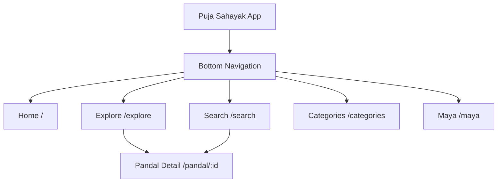
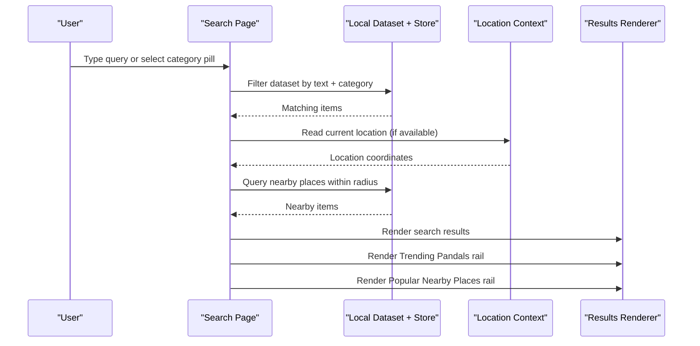
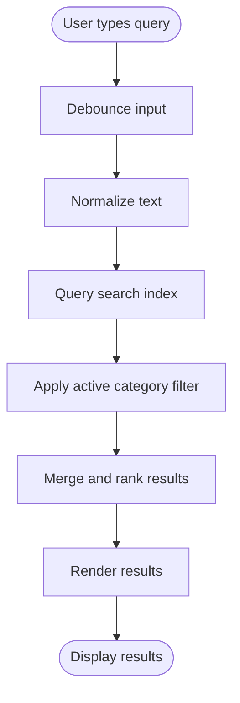
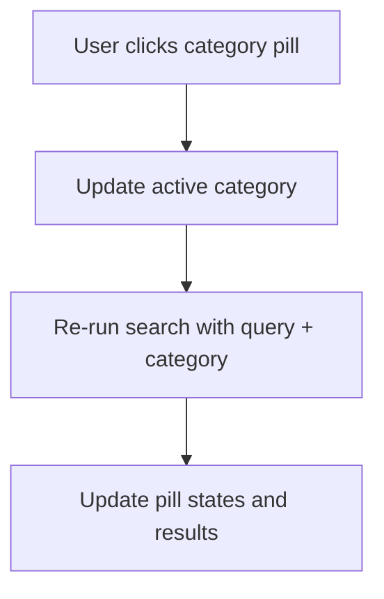
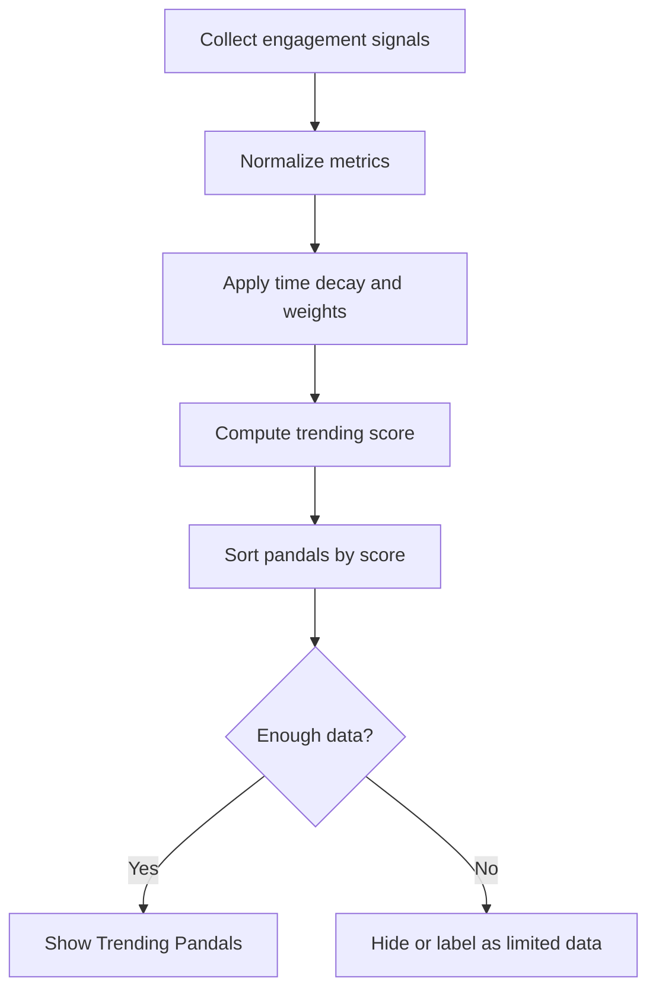
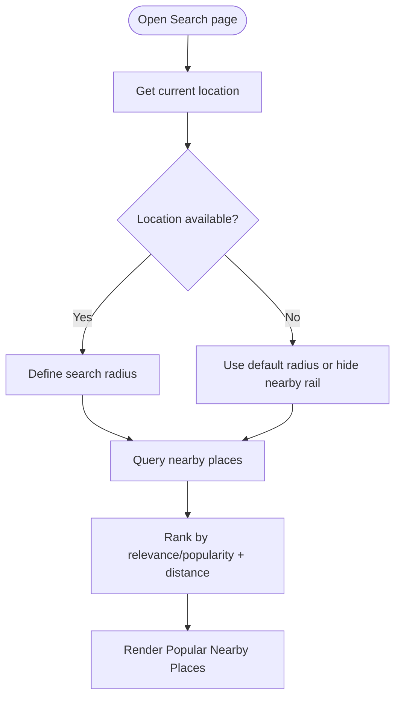
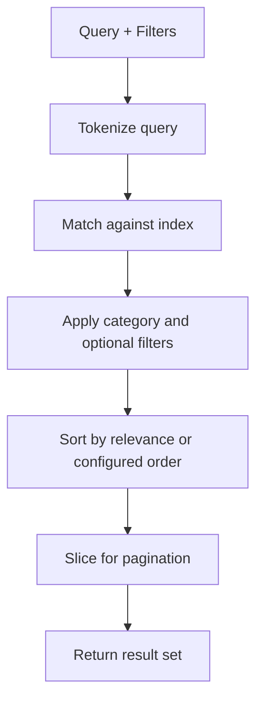
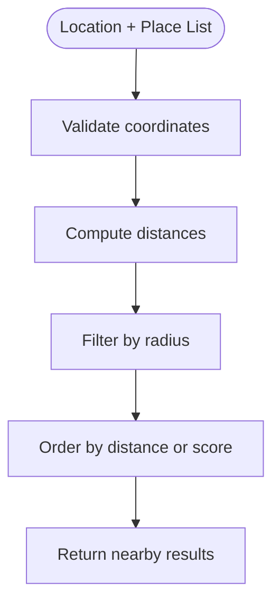
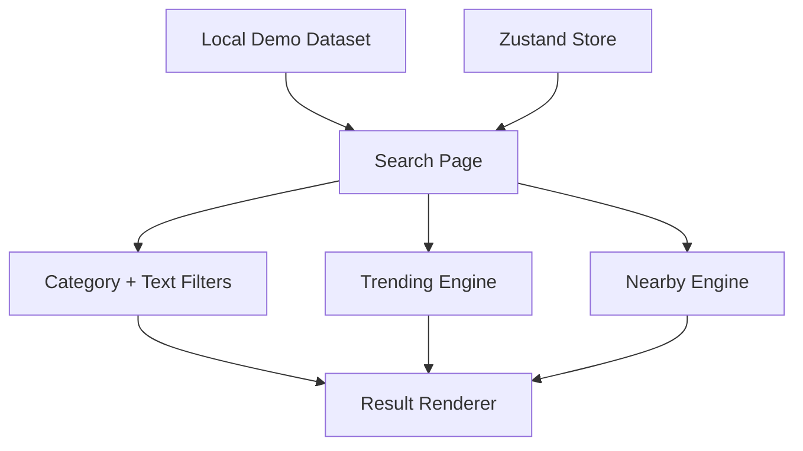

# Search and Discovery Experience

<cite>
**Referenced Files in This Document**
- [Pujo_Sahayak_Master_Project_Context.md](file://Pujo_Sahayak_Master_Project_Context.md)
- [plan.md](file://tasks/plan.md)
- [todo.md](file://tasks/todo.md)
</cite>

## Table of Contents
1. [Introduction](#introduction)
2. [Project Structure](#project-structure)
3. [Core Components](#core-components)
4. [Architecture Overview](#architecture-overview)
5. [Detailed Component Analysis](#detailed-component-analysis)
6. [Dependency Analysis](#dependency-analysis)
7. [Performance Considerations](#performance-considerations)
8. [Troubleshooting Guide](#troubleshooting-guide)
9. [Conclusion](#conclusion)

## Introduction
This document explains the search and discovery experience for Puja Sahayak, focusing on:
- A global search bar that spans pandals, restaurants, events, and places
- Category shortcuts: All, Pandals, Restaurants, Events, Places
- Trending pandals based on real engagement signals rather than manufactured rankings
- Popular nearby places driven by location context
- Implementation guidance for search indexing, filtering, location queries, and performance optimization

The product is a mobile-first local discovery platform centered around Durga Puja but designed to remain useful beyond the festival through restaurants, events, services, and other local experiences.

**Section sources**
- [Pujo_Sahayak_Master_Project_Context.md:7-18](file://Pujo_Sahayak_Master_Project_Context.md#L7-L18)
- [Pujo_Sahayak_Master_Project_Context.md:104-136](file://Pujo_Sahayak_Master_Project_Context.md#L104-L136)

## Project Structure
The search and discovery experience lives under the broader navigation model of Puja Sahayak. The implementation plan defines `/search` as a dedicated route, while the master product context describes the Search page layout, category pills, trending pandals, and popular nearby places.

**Diagram sources**
- [plan.md:19-39](file://tasks/plan.md#L19-L39)
- [Pujo_Sahayak_Master_Project_Context.md:140-157](file://Pujo_Sahayak_Master_Project_Context.md#L140-L157)

**Section sources**
- [plan.md:19-39](file://tasks/plan.md#L19-L39)
- [Pujo_Sahayak_Master_Project_Context.md:140-157](file://Pujo_Sahayak_Master_Project_Context.md#L140-L157)

## Core Components
The search and discovery surface includes:
- Global search input at the top of the Search page
- Category shortcut pills: All, Pandals, Restaurants, Events, Places
- Trending Pandals rail
- Popular Nearby Places rail
- Results list or cards filtered by query and active category

The master product context explicitly states that the Search experience should cover the entire local ecosystem and lists the exact pill labels. It also emphasizes that trending must not be manufactured unless supported by underlying metrics.

**Section sources**
- [Pujo_Sahayak_Master_Project_Context.md:447-493](file://Pujo_Sahayak_Master_Project_Context.md#L447-L493)
- [todo.md:42-43](file://tasks/todo.md#L42-L43)

## Architecture Overview
At a high level, the search flow connects user input to a dataset, applies filters, and renders results alongside contextual rails such as trending and nearby places.

**Diagram sources**
- [Pujo_Sahayak_Master_Project_Context.md:447-493](file://Pujo_Sahayak_Master_Project_Context.md#L447-L493)
- [plan.md:19-39](file://tasks/plan.md#L19-L39)

## Detailed Component Analysis

### Global Search Bar
The global search bar is the primary entry point for discovery. It should:
- Accept free-text queries across names, descriptions, themes, cuisines, event titles, and place types
- Debounce input to avoid excessive filtering operations
- Normalize input (trim, lowercase) before matching
- Support partial matches and multi-term queries
- Provide immediate feedback with loading and empty states

Implementation guidelines:
- Maintain a searchable index over key fields per entity type
- Use simple substring or token-based matching initially
- Combine query terms with AND/OR logic depending on UX goals
- Keep the search state synchronized with URL query parameters for shareable links

**Diagram sources**
- [Pujo_Sahayak_Master_Project_Context.md:447-467](file://Pujo_Sahayak_Master_Project_Context.md#L447-L467)

**Section sources**
- [Pujo_Sahayak_Master_Project_Context.md:447-467](file://Pujo_Sahayak_Master_Project_Context.md#L447-L467)

### Category Shortcuts System
The category shortcuts are implemented as pill-style filters:
- All
- Pandals
- Restaurants
- Events
- Places

Behavior:
- Selecting a pill updates the active category
- The search query and category filter combine to narrow results
- “All” resets category filtering while preserving the text query
- Pills should visually indicate the active selection

Data model considerations:
- Each item has a type field mapping to one of the categories
- The filter should be case-insensitive and resilient to future category additions

**Diagram sources**
- [Pujo_Sahayak_Master_Project_Context.md:459-467](file://Pujo_Sahayak_Master_Project_Context.md#L459-L467)

**Section sources**
- [Pujo_Sahayak_Master_Project_Context.md:459-467](file://Pujo_Sahayak_Master_Project_Context.md#L459-L467)

### Trending Pandals
Trending pandals should reflect genuine engagement rather than arbitrary ordering. The product context specifies that rankings must not be manufactured unless the underlying metric exists.

Suggested engagement signals:
- Views
- Saves
- Recent interactions
- Visits
- Overall engagement score derived from the above

Ranking principles:
- Prefer recency-weighted signals so trends stay current
- Avoid ranking without sufficient data; show neutral messaging when data is sparse
- Clearly label this section as “Trending” only when supported by metrics
- Do not promote sponsored content as organic trending

Algorithm outline:
- Compute a composite score per pandal using normalized metrics
- Apply time decay to recent activity
- Sort descending by score
- Cap displayed count for performance

**Diagram sources**
- [Pujo_Sahayak_Master_Project_Context.md:469-483](file://Pujo_Sahayak_Master_Project_Context.md#L469-L483)

**Section sources**
- [Pujo_Sahayak_Master_Project_Context.md:469-483](file://Pujo_Sahayak_Master_Project_Context.md#L469-L483)

### Popular Nearby Places
Popular nearby places use location context to show geographically relevant options. The principle is to help users discover what is around them.

Requirements:
- Request user location permission where applicable
- Fallback gracefully if location is unavailable
- Use a reasonable default radius for initial exploration
- Allow users to adjust proximity or switch back to city-wide results

Query approach:
- Use haversine distance or a spatial index for efficient nearest-neighbor queries
- Combine popularity or relevance signals with distance
- Surface diverse categories near the user’s location

**Diagram sources**
- [Pujo_Sahayak_Master_Project_Context.md:485-493](file://Pujo_Sahayak_Master_Project_Context.md#L485-L493)

**Section sources**
- [Pujo_Sahayak_Master_Project_Context.md:485-493](file://Pujo_Sahayak_Master_Project_Context.md#L485-L493)

### Search Indexing and Filtering Algorithms
Recommended indexing strategy:
- Maintain an in-memory index keyed by searchable fields per entity type
- Include tokens for name, description, theme, cuisine, event title, and tags
- Precompute category mappings for fast filtering
- Optionally persist a lightweight index for faster cold starts

Filtering algorithm:
- Text match against indexed tokens
- Category equality check
- Optional filters such as open now, crowd level, area, or distance
- Merge results and apply stable sort

Complexity considerations:
- Text matching should be O(n) over matched entities after index lookup
- Spatial queries should use precomputed coordinates and distance calculations
- Debounce and pagination prevent heavy re-renders

**Diagram sources**
- [todo.md:42-43](file://tasks/todo.md#L42-L43)

**Section sources**
- [todo.md:42-43](file://tasks/todo.md#L42-L43)

### Location-Based Queries
For nearby discovery:
- Store latitude and longitude for each place
- Use haversine formula for distance calculation
- Cache recent location lookups to reduce repeated computation
- Respect user privacy and allow disabling location features

Spatial query steps:
- Validate coordinates
- Compute distances to candidate places
- Filter by maximum radius
- Sort by distance or hybrid score

**Diagram sources**
- [Pujo_Sahayak_Master_Project_Context.md:485-493](file://Pujo_Sahayak_Master_Project_Context.md#L485-L493)

**Section sources**
- [Pujo_Sahayak_Master_Project_Context.md:485-493](file://Pujo_Sahayak_Master_Project_Context.md#L485-L493)

### Performance Optimization for Real-Time Search
To keep search responsive:
- Debounce input by 200–400ms
- Use virtualized lists for large result sets
- Paginate or lazy-load additional results
- Memoize computed filters and trending scores
- Avoid synchronous heavy work on the main thread
- Preload frequently used datasets into memory
- Use requestAnimationFrame or idle scheduling for non-critical updates

Caching strategy:
- Cache recent queries and their results
- Cache trending scores with expiration
- Cache nearby results per location session
- Invalidate caches on data changes

**Section sources**
- [plan.md:1-17](file://tasks/plan.md#L1-L17)
- [Pujo_Sahayak_Master_Project_Context.md:447-493](file://Pujo_Sahayak_Master_Project_Context.md#L447-L493)

## Dependency Analysis
The search and discovery feature depends on:
- Local demo dataset containing pandals, restaurants, events, and places
- Store layer for user state and session continuity
- Location API for nearby discovery
- Rendering components for cards, chips, and rails

**Diagram sources**
- [plan.md:1-17](file://tasks/plan.md#L1-L17)
- [Pujo_Sahayak_Master_Project_Context.md:447-493](file://Pujo_Sahayak_Master_Project_Context.md#L447-L493)

**Section sources**
- [plan.md:1-17](file://tasks/plan.md#L1-L17)
- [Pujo_Sahayak_Master_Project_Context.md:447-493](file://Pujo_Sahayak_Master_Project_Context.md#L447-L493)

## Performance Considerations
- Keep search latency under 200ms for perceived responsiveness
- Avoid full dataset scans on every keystroke
- Use incremental updates instead of full re-renders
- Limit trending computations to background tasks
- Defer nearby calculations until location is confirmed
- Monitor memory usage for large lists and images

[No sources needed since this section provides general guidance]

## Troubleshooting Guide
Common issues and resolutions:
- No results returned:
  - Verify query normalization and tokenization
  - Check category filter alignment with dataset types
  - Ensure index includes all searchable fields
- Trending shows unexpected results:
  - Confirm engagement metrics exist and are updated
  - Avoid ranking without minimum thresholds
- Nearby places not appearing:
  - Check location permissions and coordinate validity
  - Validate radius and coordinate precision
- Slow search:
  - Increase debounce interval
  - Add pagination or virtualization
  - Profile expensive computations

**Section sources**
- [Pujo_Sahayak_Master_Project_Context.md:469-493](file://Pujo_Sahayak_Master_Project_Context.md#L469-L493)

## Conclusion
The search and discovery experience in Puja Sahayak centers on a unified search interface, clear category shortcuts, honest trending signals, and location-aware nearby discovery. By implementing robust indexing, careful filtering, and performance-conscious rendering, the app can deliver fast, relevant results while staying aligned with the product’s philosophy of meaningful local exploration.

[No sources needed since this section summarizes without analyzing specific files]