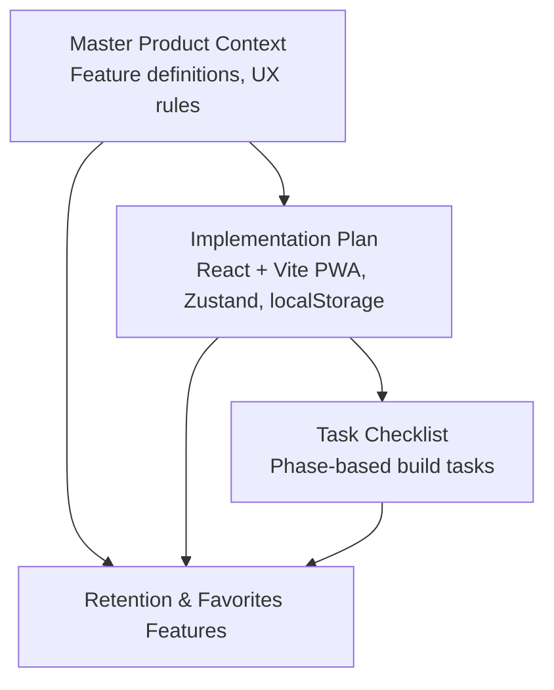
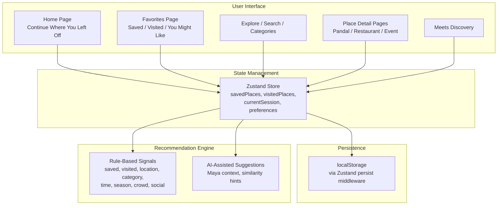
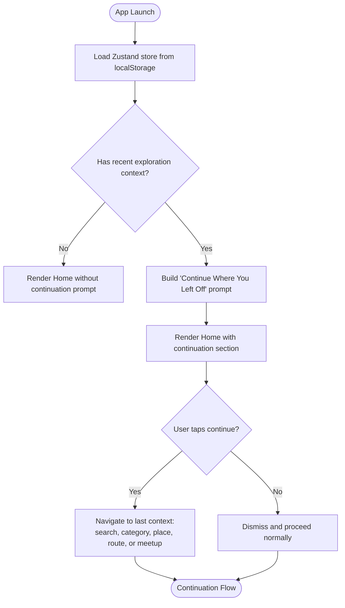
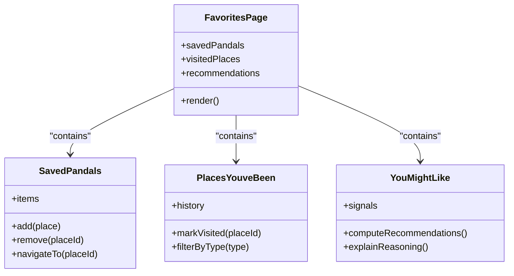
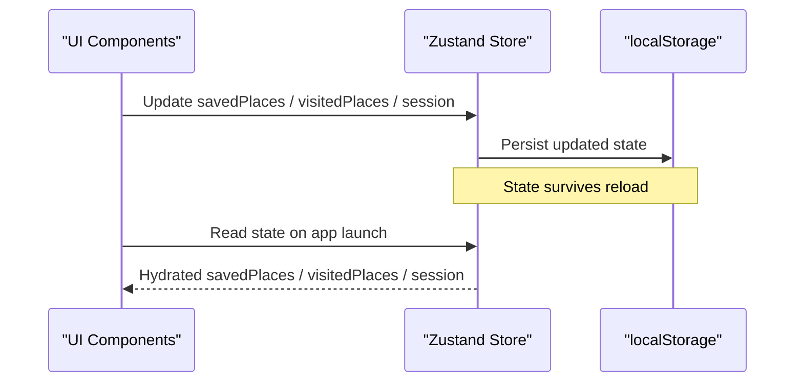
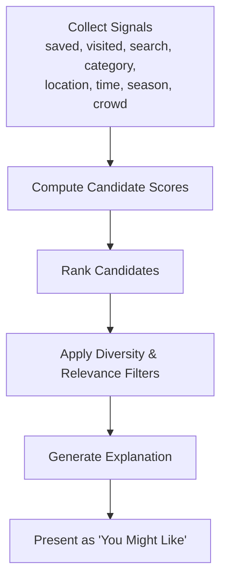
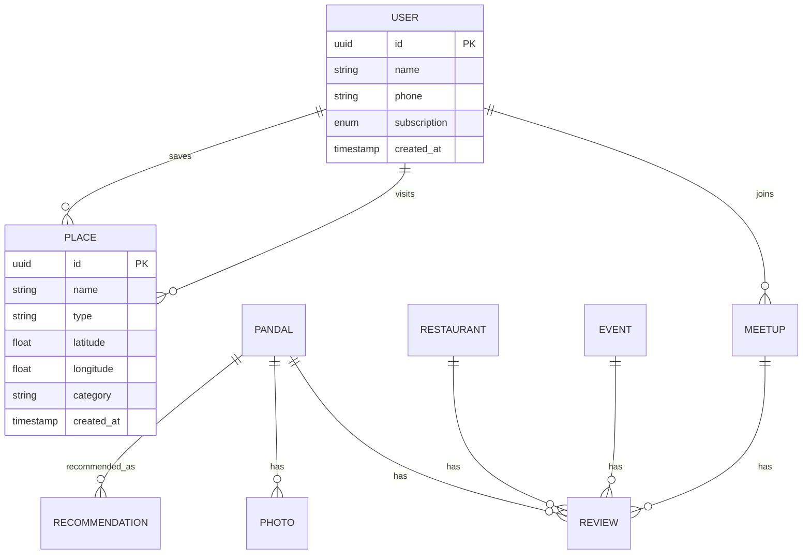
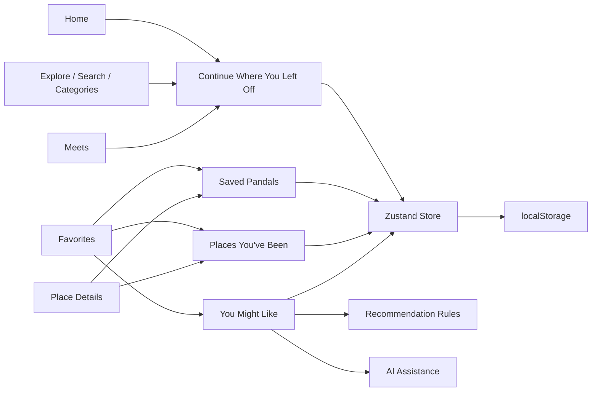

# User Retention and Favorites System

<cite>
**Referenced Files in This Document**
- [Pujo_Sahayak_Master_Project_Context.md](file://Pujo_Sahayak_Master_Project_Context.md)
- [plan.md](file://tasks/plan.md)
- [todo.md](file://tasks/todo.md)
</cite>

## Table of Contents
1. [Introduction](#introduction)
2. [Project Structure](#project-structure)
3. [Core Components](#core-components)
4. [Architecture Overview](#architecture-overview)
5. [Detailed Component Analysis](#detailed-component-analysis)
6. [Dependency Analysis](#dependency-analysis)
7. [Performance Considerations](#performance-considerations)
8. [Troubleshooting Guide](#troubleshooting-guide)
9. [Conclusion](#conclusion)

## Introduction
This document explains the user retention and favorites system for Puja Sahayak, focusing on:
- The “Continue Where You Left Off” feature that preserves exploration context across app sessions.
- The persistence mechanism for user state such as saved places, visited places, plans, settings, and active session context.
- The Favorites page architecture with three main sections: Saved Pandals, Places You’ve Been, and You Might Like.
- Implementation guidelines for recommendation algorithms, data persistence strategies, and user experience patterns that avoid absolute claims about user preferences.

The guidance is grounded in the product’s master context and implementation plan, which define the intended information architecture, behavior, and development constraints.

## Project Structure
At a high level, this documentation concerns:
- Product requirements and UX principles defined in the master project context.
- The React + Vite PWA implementation plan describing routes, client store usage, and persistence strategy.
- A task checklist that maps features to concrete build phases.

**Diagram sources**
- [Pujo_Sahayak_Master_Project_Context.md:286-350](file://Pujo_Sahayak_Master_Project_Context.md#L286-L350)
- [plan.md:1-18](file://tasks/plan.md#L1-L18)
- [todo.md:45-55](file://tasks/todo.md#L45-L55)

**Section sources**
- [Pujo_Sahayak_Master_Project_Context.md:286-350](file://Pujo_Sahayak_Master_Project_Context.md#L286-L350)
- [plan.md:1-18](file://tasks/plan.md#L1-L18)
- [todo.md:45-55](file://tasks/todo.md#L45-L55)

## Core Components
The retention and favorites system is composed of:
- Continue Where You Left Off: remembers unfinished routes, searches, categories, saved items, and meetup discovery sessions.
- Favorites Page:
  - Saved Pandals: explicitly bookmarked locations.
  - Places You’ve Been: visited location history including pandals, restaurants, events, and other places.
  - You Might Like: recommendations based on saved places, visited locations, current location, categories, preferences, and AI-assisted suggestions.
- Persistence Layer: client-side state persisted to `localStorage` via a Zustand store with persist middleware.

Key design rules:
- Recommendations use cautious wording like “You might like.”
- Location-aware signals are used intelligently but not treated as absolute truth.
- AI assists rather than controls every part of the app.

**Section sources**
- [Pujo_Sahayak_Master_Project_Context.md:286-350](file://Pujo_Sahayak_Master_Project_Context.md#L286-L350)
- [Pujo_Sahayak_Master_Project_Context.md:1263-1295](file://Pujo_Sahayak_Master_Project_Context.md#L1263-L1295)
- [plan.md:1-18](file://tasks/plan.md#L1-L18)

## Architecture Overview
The retention and favorites system spans UI, state management, and local persistence.

**Diagram sources**
- [plan.md:1-18](file://tasks/plan.md#L1-L18)
- [todo.md:45-55](file://tasks/todo.md#L45-L55)
- [Pujo_Sahayak_Master_Project_Context.md:1263-1295](file://Pujo_Sahayak_Master_Project_Context.md#L1263-L1295)

## Detailed Component Analysis

### Continue Where You Left Off
Purpose:
- Restore the user’s last meaningful exploration context so they do not always start from Home.
- Support continuity across app sessions by remembering:
  - Unfinished route or trip planning.
  - Unfinished search query or filters.
  - Partially explored category.
  - Recently viewed or saved place.
  - Active meetup discovery session.

Behavioral expectations:
- Present a clear “Continue where you left off” entry point on Home.
- Allow quick navigation back to the exact type of exploration the user was doing.
- Avoid forcing users into a rigid flow; keep it optional and contextual.

Data model implications:
- Session context should include:
  - Last viewed place ID and type.
  - Active search query and filter state.
  - Current category view.
  - In-progress plan day or route segment.
  - Meetup discovery filters or selected meetup.

UX pattern:
- Show concise context text, such as what the user was exploring and the last viewed item.
- Provide a single primary action to resume.
- Keep the card lightweight and dismissible if the user prefers to start fresh.

**Diagram sources**
- [Pujo_Sahayak_Master_Project_Context.md:286-318](file://Pujo_Sahayak_Master_Project_Context.md#L286-L318)
- [plan.md:1-18](file://tasks/plan.md#L1-L18)

**Section sources**
- [Pujo_Sahayak_Master_Project_Context.md:286-318](file://Pujo_Sahayak_Master_Project_Context.md#L286-L318)

### Favorites Page Architecture
The Favorites page is intentionally more than a simple bookmark list. It has three core sections:

1. **Saved Pandals**
   - Explicitly bookmarked places.
   - Primary source of intentional user preference signals.
   - Should be easy to manage: add, remove, reorder, and navigate.

2. **Places You’ve Been**
   - Previously visited places.
   - Includes pandals, restaurants, events, and other places.
   - Supports activity history and retrospective discovery.

3. **You Might Like**
   - Recommendation section based on:
     - Saved places.
     - Visited places.
     - Current location.
     - Categories.
     - Preferences.
     - Potentially AI recommendations.
   - Wording must remain suggestive, not absolute.

**Diagram sources**
- [Pujo_Sahayak_Master_Project_Context.md:320-350](file://Pujo_Sahayak_Master_Project_Context.md#L320-L350)
- [todo.md:45-55](file://tasks/todo.md#L45-L55)

**Section sources**
- [Pujo_Sahayak_Master_Project_Context.md:320-350](file://Pujo_Sahayak_Master_Project_Context.md#L320-L350)
- [todo.md:45-55](file://tasks/todo.md#L45-L55)

### Persistence Mechanism
The implementation plan specifies:
- React + TypeScript + Vite PWA.
- Zustand with persist middleware.
- One client store holding:
  - Saved places.
  - Visited places.
  - Puja plan (day slots).
  - Meetups.
  - Language, theme, app-logo choice.
  - “Continue where you left off” session.
- All user state persists to `localStorage`.

Guidelines:
- Treat `localStorage` as the initial persistence layer for v1.
- Keep the store schema structured so it can evolve to server-backed storage later.
- Ensure critical state survives reloads and app restarts.
- Validate and sanitize stored values before rendering.

**Diagram sources**
- [plan.md:1-18](file://tasks/plan.md#L1-L18)
- [todo.md:45-55](file://tasks/todo.md#L45-L55)

**Section sources**
- [plan.md:1-18](file://tasks/plan.md#L1-L18)
- [todo.md:45-55](file://tasks/todo.md#L45-L55)

### Recommendation Algorithms and UX Guidelines
The product defines a broad set of signals for recommendations:
- Location.
- Previous visits.
- Favorites.
- Search activity.
- Categories.
- Time.
- Season.
- Crowd.
- Social activity.

Implementation guidelines:
- Start with rule-based scoring using explicit signals.
- Use similarity heuristics such as area, theme, category, and proximity.
- Introduce AI assistance gradually for explanation and suggestion refinement.
- Always present recommendations as possibilities, not guarantees.
- Avoid absolute claims about user preferences.

Recommended algorithmic approach:
- Signal collection:
  - Explicit signals: saved places, explicit preferences.
  - Implicit signals: visited places, search queries, category views, time spent.
  - Contextual signals: current location, time of day, season, crowd levels.
- Scoring:
  - Base score from explicit signals.
  - Boost from implicit signals weighted by recency and relevance.
  - Contextual boost for nearby, open-now, or less-crowded options.
- Ranking:
  - Apply diversity constraints to avoid showing only one type.
  - Surface a small number of top candidates.
- Explanation:
  - Provide understandable reasons, e.g., “near your saved traditional pandals.”
  - Use cautious language: “You might like,” not “You will love.”

**Diagram sources**
- [Pujo_Sahayak_Master_Project_Context.md:1263-1295](file://Pujo_Sahayak_Master_Project_Context.md#L1263-L1295)

**Section sources**
- [Pujo_Sahayak_Master_Project_Context.md:1263-1295](file://Pujo_Sahayak_Master_Project_Context.md#L1263-L1295)

### Data Models Relevant to Retention and Favorites
The product emphasizes a broad data model beyond a single entity type. For retention and favorites, relevant entities include:
- User
- Place
- Pandal
- Restaurant
- Event
- Meetup
- Review
- Photo
- Trip
- Category
- Offer
- Subscription
- Payment
- SafetyPoint
- EmergencyReport
- Recommendation

A Pandal can be a specialized type of Place, enabling off-season expansion and unified handling of visited/saved/recommended items.

**Diagram sources**
- [Pujo_Sahayak_Master_Project_Context.md:1232-1260](file://Pujo_Sahayak_Master_Project_Context.md#L1232-L1260)

**Section sources**
- [Pujo_Sahayak_Master_Project_Context.md:1232-1260](file://Pujo_Sahayak_Master_Project_Context.md#L1232-L1260)

### User Experience Patterns That Avoid Absolute Claims
Important UX rules:
- Use suggestive wording for recommendations: “You might like.”
- Do not claim certainty about user preferences.
- Do not treat GPS or inferred context as absolute proof of location.
- Present AI-generated plans and recommendations as suggestions, not guaranteed optimal outcomes.
- Keep explanations understandable and grounded in application data.

These rules protect trust and reduce misleading assumptions about user intent.

**Section sources**
- [Pujo_Sahayak_Master_Project_Context.md:320-350](file://Pujo_Sahayak_Master_Project_Context.md#L320-L350)
- [Pujo_Sahayak_Master_Project_Context.md:1263-1295](file://Pujo_Sahayak_Master_Project_Context.md#L1263-L1295)
- [Pujo_Sahayak_Master_Project_Context.md:1330-1388](file://Pujo_Sahayak_Master_Project_Context.md#L1330-L1388)

## Dependency Analysis
The retention and favorites system depends on:
- UI components for Home, Favorites, Explore, Detail, and Meets.
- Zustand store for shared state.
- `localStorage` for persistence.
- Rule-based and AI-assisted recommendation logic.
- Broader product data model for places, categories, and activities.

**Diagram sources**
- [plan.md:1-18](file://tasks/plan.md#L1-L18)
- [todo.md:45-55](file://tasks/todo.md#L45-L55)
- [Pujo_Sahayak_Master_Project_Context.md:1263-1295](file://Pujo_Sahayak_Master_Project_Context.md#L1263-L1295)

**Section sources**
- [plan.md:1-18](file://tasks/plan.md#L1-L18)
- [todo.md:45-55](file://tasks/todo.md#L45-L55)
- [Pujo_Sahayak_Master_Project_Context.md:1263-1295](file://Pujo_Sahayak_Master_Project_Context.md#L1263-L1295)

## Performance Considerations
- Keep the “Continue Where You Left Off” prompt lightweight and fast to render.
- Debounce updates to session context to avoid excessive writes to `localStorage`.
- Limit the size of persisted state; prune stale session data after a reasonable period.
- Cache recommendation results per session when possible.
- Avoid heavy computations on the UI thread; move scoring/ranking to background logic where feasible.
- Ensure offline-first shell remains responsive even when recommendation or map features are unavailable.

[No sources needed since this section provides general guidance]

## Troubleshooting Guide
Common issues and resolutions:
- Continuation prompt does not appear:
  - Verify that session context exists in the store.
  - Check that `localStorage` hydration runs before Home renders.
- Saved or visited places disappear after reload:
  - Confirm Zustand persist middleware is configured.
  - Inspect `localStorage` keys and values.
- Recommendations feel irrelevant:
  - Review signal weights and recency decay.
  - Add missing signals such as category or location.
  - Ensure explanations are visible so users understand why items are suggested.
- Location-based suggestions are inaccurate:
  - Remember that GPS is not precise enough to guarantee exact placement.
  - Use cautious wording and allow user confirmation.

**Section sources**
- [plan.md:1-18](file://tasks/plan.md#L1-L18)
- [Pujo_Sahayak_Master_Project_Context.md:1360-1388](file://Pujo_Sahayak_Master_Project_Context.md#L1360-L1388)

## Conclusion
The user retention and favorites system in Puja Sahayak is designed to make exploration continuous, personal, and trustworthy:
- “Continue Where You Left Off” reduces friction by restoring meaningful context.
- Favorites separates explicit saves, visit history, and suggestions.
- Recommendations combine multiple signals while avoiding absolute claims.
- Persistence through Zustand and `localStorage` keeps the experience smooth in v1 while leaving room for future evolution.

When implementing, prioritize clarity, honesty, and user control. Let the system remember what matters, explain why it suggests things, and never pretend to know more about the user than the available signals justify.

[No sources needed since this section summarizes without analyzing specific files]