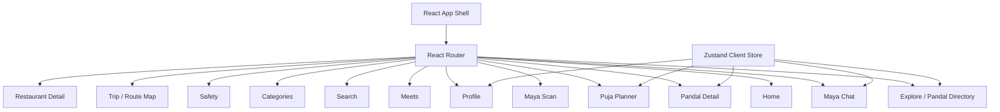
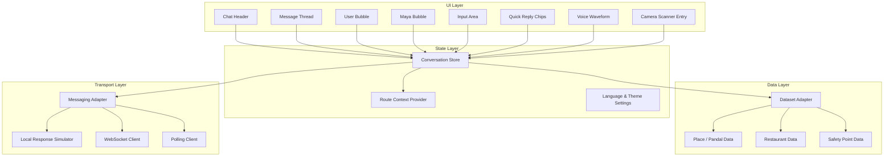
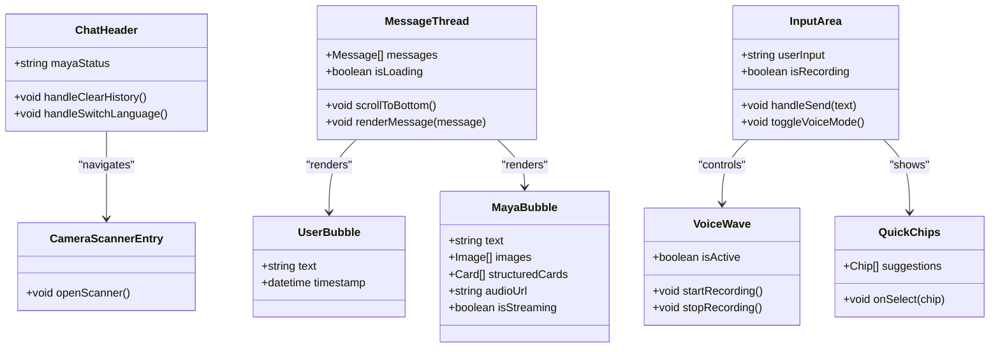
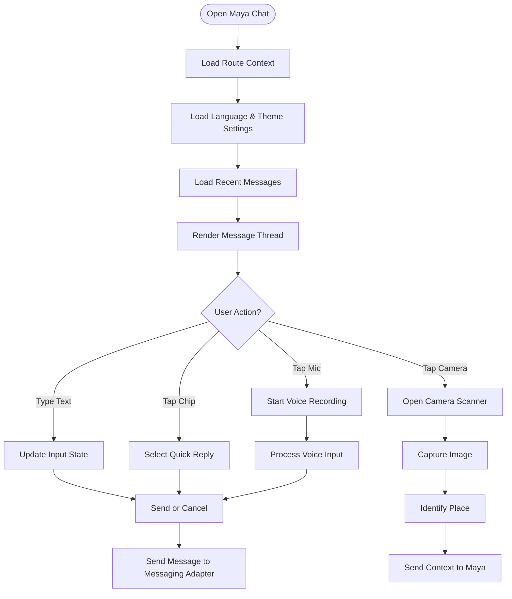
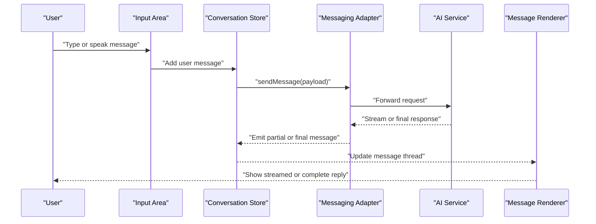
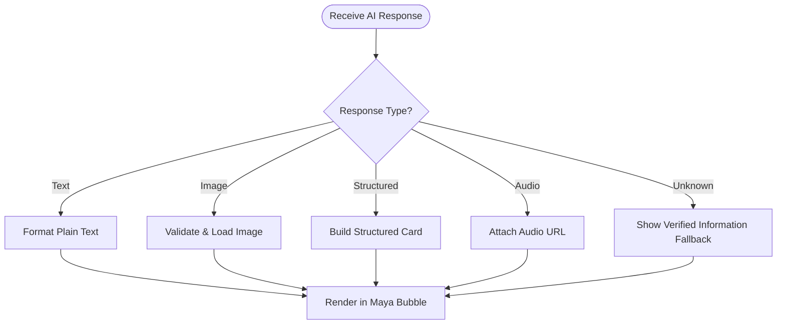
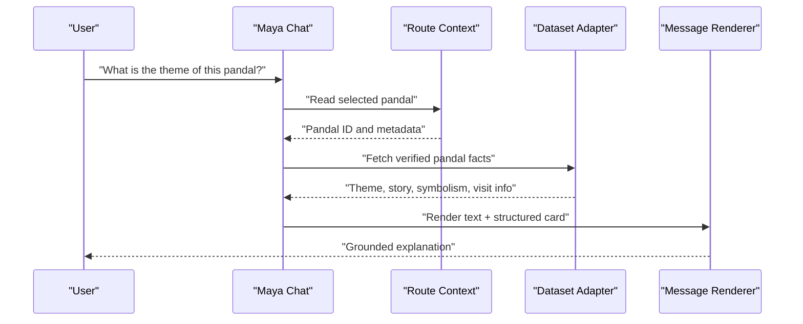
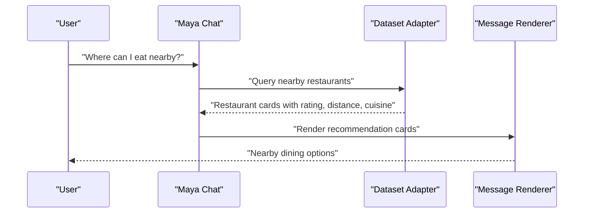
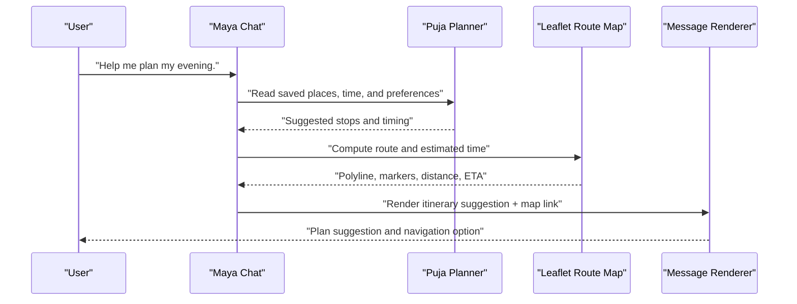
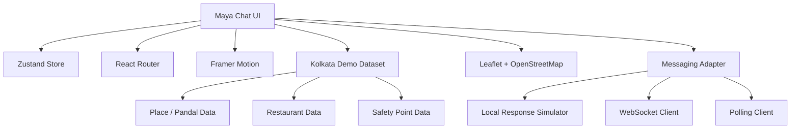

# Chat Interface Architecture

<cite>
**Referenced Files in This Document**   
- [Pujo_Sahayak_Master_Project_Context.md](file://Pujo_Sahayak_Master_Project_Context.md)
- [plan.md](file://tasks/plan.md)
- [todo.md](file://tasks/todo.md)
</cite>

## Table of Contents
1. [Introduction](#introduction)
2. [Project Structure](#project-structure)
3. [Core Components](#core-components)
4. [Architecture Overview](#architecture-overview)
5. [Detailed Component Analysis](#detailed-component-analysis)
6. [Dependency Analysis](#dependency-analysis)
7. [Performance Considerations](#performance-considerations)
8. [Troubleshooting Guide](#troubleshooting-guide)
9. [Conclusion](#conclusion)
10. [Appendices](#appendices)

## Introduction
This document defines the chat interface architecture for Maya, the AI assistant inside Pujo Sahayak. It explains how the chat UI should be structured, how conversation state is managed, how real-time messaging can be implemented, how messages are formatted, and how common flows like pandal information queries, restaurant recommendations, and navigation assistance should behave. It also covers error handling and performance considerations for large conversations.

The project context establishes that:
- The platform is a location-aware local discovery app centered on Durga Puja.
- Maya is the named AI assistant and must remain grounded in verified application data.
- Maya supports natural-language Q&A, visual identification through camera, voice interaction, multilingual explanation, and planning assistance.
- The implementation plan specifies a React + Vite PWA with Tailwind CSS, Zustand for client state, Framer Motion for motion, Leaflet for maps, and a locally simulated but dataset-grounded Maya experience.

**Section sources**
- [Pujo_Sahayak_Master_Project_Context.md:1-18](file://Pujo_Sahayak_Master_Project_Context.md#L1-L18)
- [Pujo_Sahayak_Master_Project_Context.md:558-660](file://Pujo_Sahayak_Master_Project_Context.md#L558-L660)
- [Pujo_Sahayak_Master_Project_Context.md:1297-1358](file://Pujo_Sahayak_Master_Project_Context.md#L1297-L1358)
- [plan.md:1-18](file://tasks/plan.md#L1-L18)
- [todo.md:34-43](file://tasks/todo.md#L34-L43)

## Project Structure
At this stage, the repository contains product context and implementation planning documents rather than source code. The chat interface should therefore be designed as part of the planned React + Vite PWA structure described in the implementation plan.

Key architectural decisions relevant to the chat interface include:
- React 18 + TypeScript + Vite PWA.
- Tailwind CSS v4 design tokens.
- React Router v6 routes including `/maya` and `/maya/scan`.
- Zustand store for saved places, visited places, plans, settings, and session continuity.
- Framer Motion for page transitions, card interactions, scan frame animation, and voice waveform.
- Leaflet + OpenStreetMap for route and trip visualization.
- Maya UI-complete but AI-simulated locally, grounded in the demo dataset.

**Diagram sources**
- [plan.md:7-18](file://tasks/plan.md#L7-L18)
- [plan.md:19-39](file://tasks/plan.md#L19-L39)

**Section sources**
- [plan.md:1-18](file://tasks/plan.md#L1-L18)
- [plan.md:19-39](file://tasks/plan.md#L19-L39)

## Core Components
The Maya chat interface should be composed from clear, reusable components aligned with the mockup-driven requirements.

### Chat Surface Components
- **Chat Header**: Shows Maya avatar, status (Online), and optional quick actions such as clearing history or switching language.
- **Message Thread**: Scrollable list of user and Maya messages.
- **User Message Bubble**: Right-aligned bubble for Bengali or English user input.
- **Maya Message Bubble**: Left-aligned bubble for AI responses, supporting text, images, and structured cards.
- **Input Area**: Text input, send button, and optional microphone toggle for voice mode.
- **Quick Reply Chips**: Contextual suggestions such as “Nearest Metro?”, “Medical Camp?”, or “More about the artist”.
- **Voice Input Mode**: Waveform visualization while recording or processing voice input.
- **Camera Scanner Entry**: FAB or header action opening `/maya/scan` for visual identification.

### State Management Components
- **Conversation Store**: Holds message history, current context, active place, selected language, and voice/camera mode flags.
- **Context Provider**: Supplies current route context (for example, selected pandal or restaurant) to Maya so it does not require repeated clarification.
- **Dataset Adapter**: Grounds Maya’s answers in the local Kolkata dataset instead of hallucinating facts.
- **Persistence Layer**: Uses localStorage via Zustand persist middleware to retain conversation preferences and recent session state where appropriate.

### Real-Time Messaging Layer
- **Local Simulation Mode**: For v1, Maya responses are retrieved from the dataset and rendered immediately after a short simulated delay.
- **WebSocket or Polling Abstraction**: A pluggable messaging adapter that can later connect to a backend service for live streaming responses.
- **Streaming Renderer**: Renders partial responses progressively when the backend supports streaming.

### Message Formatting System
- **Text Formatter**: Supports plain text, line breaks, and basic emphasis.
- **Image Renderer**: Displays images inline when Maya returns image URLs or base64 content.
- **Structured Card Renderer**: Renders place cards, restaurant cards, safety points, and itinerary suggestions.
- **Audio Row Renderer**: Inline audio player row for voice-related responses.
- **Fallback Formatter**: Shows “I don’t have verified information about that yet” when no grounded answer exists.

**Section sources**
- [todo.md:36-43](file://tasks/todo.md#L36-L43)
- [Pujo_Sahayak_Master_Project_Context.md:558-660](file://Pujo_Sahayak_Master_Project_Context.md#L558-L660)
- [Pujo_Sahayak_Master_Project_Context.md:1330-1358](file://Pujo_Sahayak_Master_Project_Context.md#L1330-L1358)
- [plan.md:12-16](file://tasks/plan.md#L12-L16)

## Architecture Overview
The Maya chat architecture separates UI, state, data grounding, and transport layers so that the UI remains stable while the AI backend can evolve.

**Diagram sources**
- [plan.md:7-18](file://tasks/plan.md#L7-L18)
- [todo.md:36-43](file://tasks/todo.md#L36-L43)
- [Pujo_Sahayak_Master_Project_Context.md:558-660](file://Pujo_Sahayak_Master_Project_Context.md#L558-L660)
- [Pujo_Sahayak_Master_Project_Context.md:1330-1358](file://Pujo_Sahayak_Master_Project_Context.md#L1330-L1358)

## Detailed Component Analysis

### Chat UI Component Model
The chat UI is primarily presentational and driven by conversation state.

**Diagram sources**
- [todo.md:36-43](file://tasks/todo.md#L36-L43)
- [plan.md:12-16](file://tasks/plan.md#L12-L16)

**Section sources**
- [todo.md:36-43](file://tasks/todo.md#L36-L43)
- [plan.md:12-16](file://tasks/plan.md#L12-L16)

### Conversation State Management
Conversation state should be centralized in a Zustand store with persistence enabled for user preferences and recent session continuity.

Recommended state shape:
- `messages`: array of message objects with id, role, content, type, metadata, and timestamp.
- `context`: current place, selected category, user location, and previous question hints.
- `input`: current text input value and validation state.
- `voice`: recording state, waveform data, and transcription result.
- `camera`: scanner mode, captured image preview, and identification result.
- `settings`: language, theme, reduced motion preference.
- `ui`: loading states, error messages, and scroll position.

Persistence rules:
- Persist `settings`, `context`, and optionally a limited recent window of `messages`.
- Do not persist sensitive personal data unless explicitly required.
- Reset or trim conversation history when navigating away from Maya for privacy and performance.

**Diagram sources**
- [todo.md:36-43](file://tasks/todo.md#L36-L43)
- [plan.md:12-16](file://tasks/plan.md#L12-L16)

**Section sources**
- [plan.md:12-16](file://tasks/plan.md#L12-L16)
- [todo.md:36-43](file://tasks/todo.md#L36-L43)

### Real-Time Messaging System
For v1, Maya is UI-complete but AI-simulated locally. The messaging system should still be designed for future real-time communication.

Options:
- **WebSocket**: Preferred for low-latency streaming responses. Suitable for progressive text rendering and live voice transcription.
- **Server-Sent Events**: Suitable if only server-to-client streaming is needed.
- **Polling**: Simplest fallback; less efficient but acceptable for non-streaming batch responses.

Recommended abstraction:
- `sendMessage(payload)`: sends user input and receives a response stream or final message.
- `subscribe(listener)`: subscribes to incoming events.
- `disconnect()`: closes connections and cleans up listeners.
- `isConnected`: boolean flag for connection status.

**Diagram sources**
- [todo.md:36-43](file://tasks/todo.md#L36-L43)
- [plan.md:12-16](file://tasks/plan.md#L12-L16)

**Section sources**
- [todo.md:36-43](file://tasks/todo.md#L36-L43)
- [plan.md:12-16](file://tasks/plan.md#L12-L16)

### Message Formatting System
Maya’s responses should support multiple formats while remaining grounded in application data.

Supported formats:
- **Text**: Natural-language explanations, directions, and summaries.
- **Images**: Photos of pandals, restaurants, or safety points.
- **Structured Cards**: Place cards, restaurant cards, safety point cards, and itinerary suggestions.
- **Audio Rows**: Inline playback for voice-assisted responses.
- **Fallback Text**: Explicit acknowledgment when verified information is unavailable.

Formatting rules:
- Never invent artist names, historical facts, timings, emergency numbers, crowd status, committee information, or donation details.
- If information is missing, return a clear fallback message.
- Prefer structured cards over unstructured text when presenting places, restaurants, or safety points.
- Keep images optimized and lazy-loaded.

**Diagram sources**
- [Pujo_Sahayak_Master_Project_Context.md:1330-1358](file://Pujo_Sahayak_Master_Project_Context.md#L1330-L1358)
- [todo.md:36-43](file://tasks/todo.md#L36-L43)

**Section sources**
- [Pujo_Sahayak_Master_Project_Context.md:1330-1358](file://Pujo_Sahayak_Master_Project_Context.md#L1330-L1358)
- [todo.md:36-43](file://tasks/todo.md#L36-L43)

### Chat Flow Patterns

#### Pandal Information Query

**Diagram sources**
- [Pujo_Sahayak_Master_Project_Context.md:578-660](file://Pujo_Sahayak_Master_Project_Context.md#L578-L660)
- [Pujo_Sahayak_Master_Project_Context.md:1330-1358](file://Pujo_Sahayak_Master_Project_Context.md#L1330-L1358)

#### Restaurant Recommendation

**Diagram sources**
- [Pujo_Sahayak_Master_Project_Context.md:578-660](file://Pujo_Sahayak_Master_Project_Context.md#L578-L660)
- [Pujo_Sahayak_Master_Project_Context.md:913-931](file://Pujo_Sahayak_Master_Project_Context.md#L913-L931)

#### Navigation Assistance

**Diagram sources**
- [Pujo_Sahayak_Master_Project_Context.md:404-421](file://Pujo_Sahayak_Master_Project_Context.md#L404-L421)
- [todo.md:50-54](file://tasks/todo.md#L50-L54)
- [plan.md:12-14](file://tasks/plan.md#L12-L14)

## Dependency Analysis
The chat interface depends on several core systems defined in the project context and implementation plan.

**Diagram sources**
- [plan.md:7-18](file://tasks/plan.md#L7-L18)
- [todo.md:36-43](file://tasks/todo.md#L36-L43)

**Section sources**
- [plan.md:7-18](file://tasks/plan.md#L7-L18)
- [todo.md:36-43](file://tasks/todo.md#L36-L43)

## Performance Considerations
Large conversation histories and rich media can impact rendering performance. The following strategies should be applied:

- **Virtualized Message List**: Render only visible messages plus a small buffer to avoid re-rendering thousands of DOM nodes.
- **Message Batching**: Group updates during streaming responses to reduce frequent re-renders.
- **Lazy Loading Images**: Defer image loading until messages enter the viewport.
- **Memoization**: Memoize expensive formatting functions and derived message lists.
- **Conversation Trimming**: Keep only a recent window of messages in memory; archive older history to localStorage or backend storage.
- **Debounced Input**: Debounce typing and search inputs to prevent excessive state updates.
- **Voice Processing Limits**: Limit waveform update frequency and abort long-running voice tasks when navigating away.
- **Map Optimization**: Use marker clustering and lazy initialization for route maps triggered from chat suggestions.

[No sources needed since this section provides general guidance]

## Troubleshooting Guide
Common issues and their handling strategies:

### Network Failures
- Detect connection loss and show a non-blocking network error banner.
- Queue outgoing messages and retry with exponential backoff.
- Provide a manual retry action and an offline-friendly fallback response.

### AI Service Unavailability
- Fall back to dataset-grounded static responses when possible.
- Show a clear status indicator that Maya is temporarily unavailable.
- Avoid fabricating answers; use the documented fallback wording.

### Invalid Inputs
- Validate empty messages, excessively long inputs, and unsupported media types.
- Provide inline validation feedback before sending.
- Reject malformed structured payloads from the backend.

### Camera and Voice Permissions
- Handle denied permissions gracefully with explanatory UI.
- Allow users to retry permission requests without breaking the chat flow.
- Preserve user intent across permission prompts.

### Large Conversations
- Trim old messages automatically.
- Offer a “Clear History” action.
- Warn users before clearing persistent state.

**Section sources**
- [Pujo_Sahayak_Master_Project_Context.md:1330-1358](file://Pujo_Sahayak_Master_Project_Context.md#L1330-L1358)
- [todo.md:36-43](file://tasks/todo.md#L36-L43)

## Conclusion
Maya’s chat interface should be built as a modular, state-driven React component system backed by a robust Zustand store and a pluggable messaging adapter. The UI must remain grounded in verified application data, support text, images, structured cards, and audio, and provide clear fallback behavior when information is unavailable. Real-time capabilities should be designed from the start using WebSocket or polling abstractions, even though v1 simulates AI responses locally. Performance, error handling, and accessibility should be treated as first-class concerns, especially for large conversation histories and media-rich responses.

[No sources needed since this section summarizes without analyzing specific files]

## Appendices

### Maya Feature Scope Summary
- Chat interface with Bengali user bubbles and Maya replies.
- Inline audio player row and waveform visualization.
- Quick-reply chips for common questions.
- Context-aware responses based on current route and selected place.
- Dataset-grounded answers with explicit fallback when information is missing.
- Camera-based pandal identification leading to detail pages.
- Integration with planning and mapping features for navigation assistance.

**Section sources**
- [todo.md:36-43](file://tasks/todo.md#L36-L43)
- [Pujo_Sahayak_Master_Project_Context.md:558-660](file://Pujo_Sahayak_Master_Project_Context.md#L558-L660)
- [Pujo_Sahayak_Master_Project_Context.md:1330-1358](file://Pujo_Sahayak_Master_Project_Context.md#L1330-L1358)