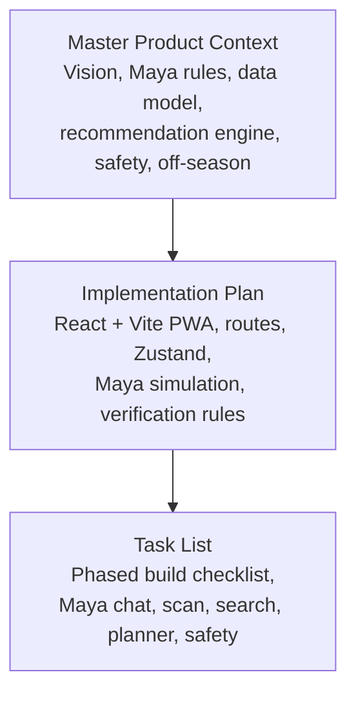
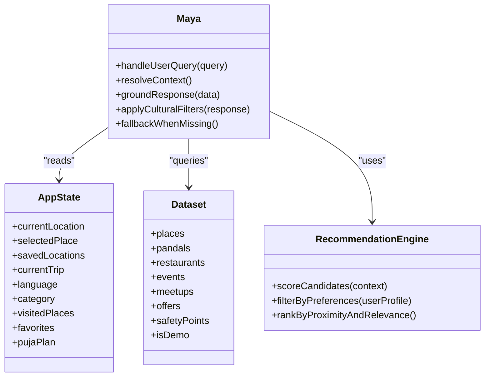
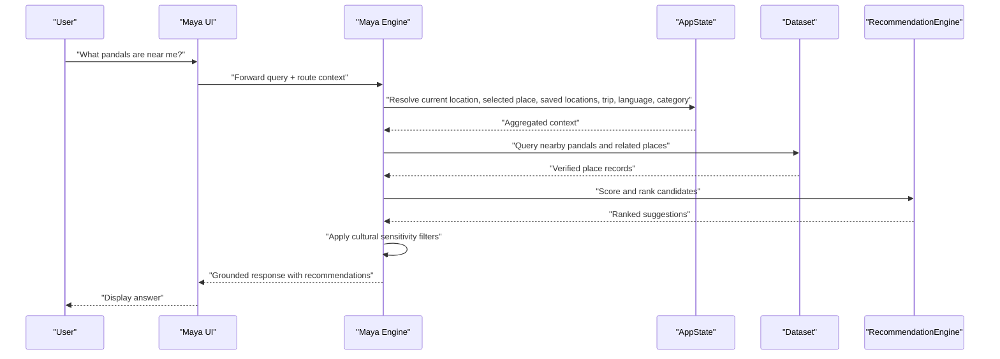
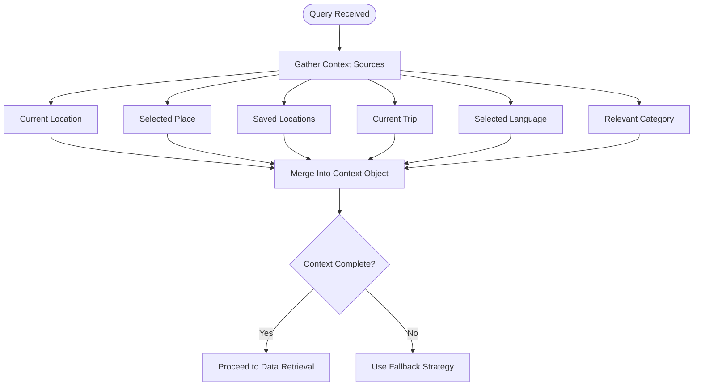
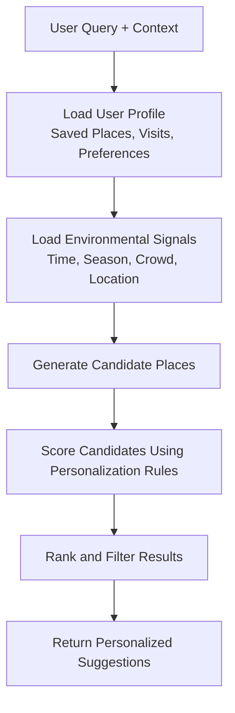
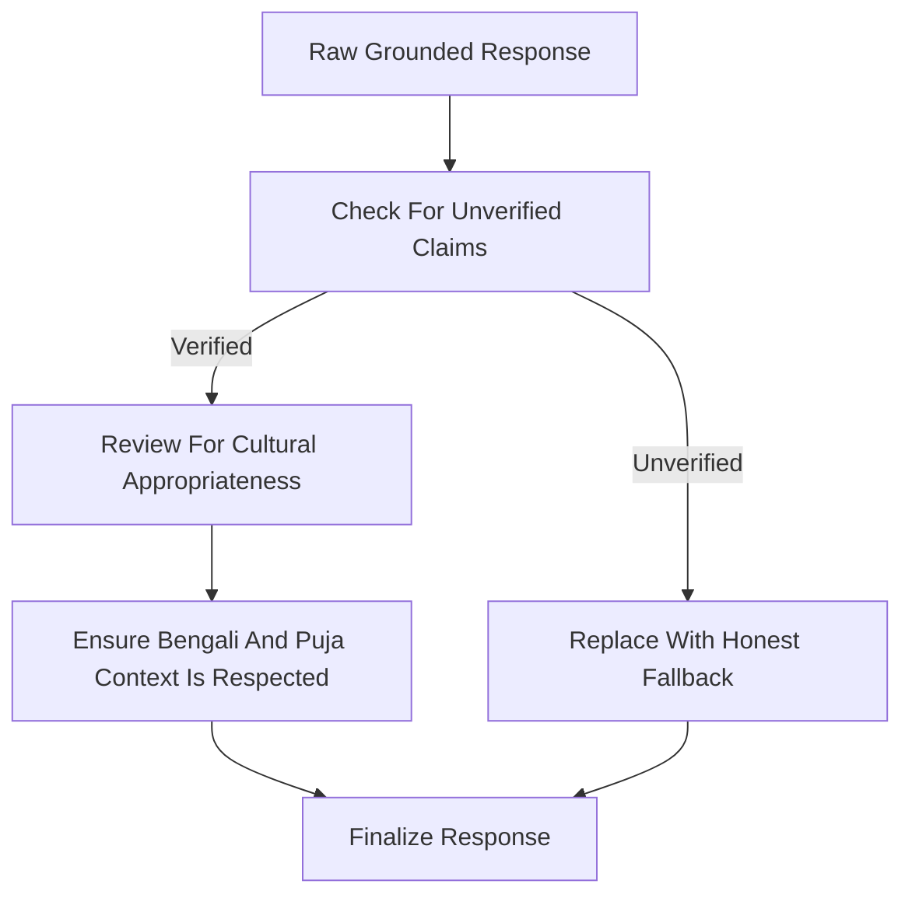
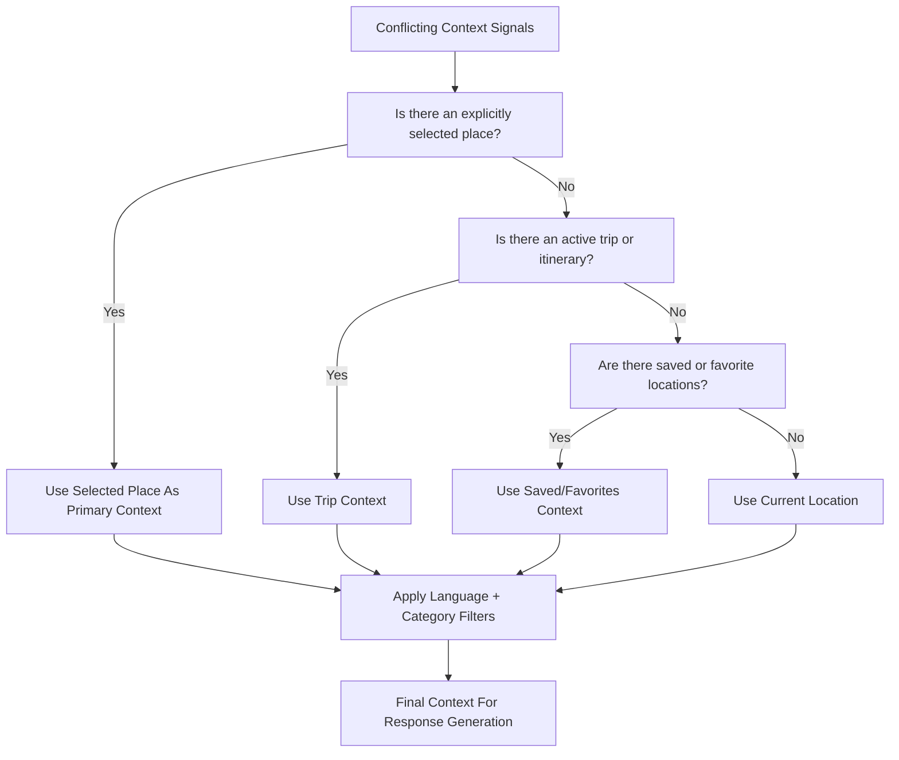
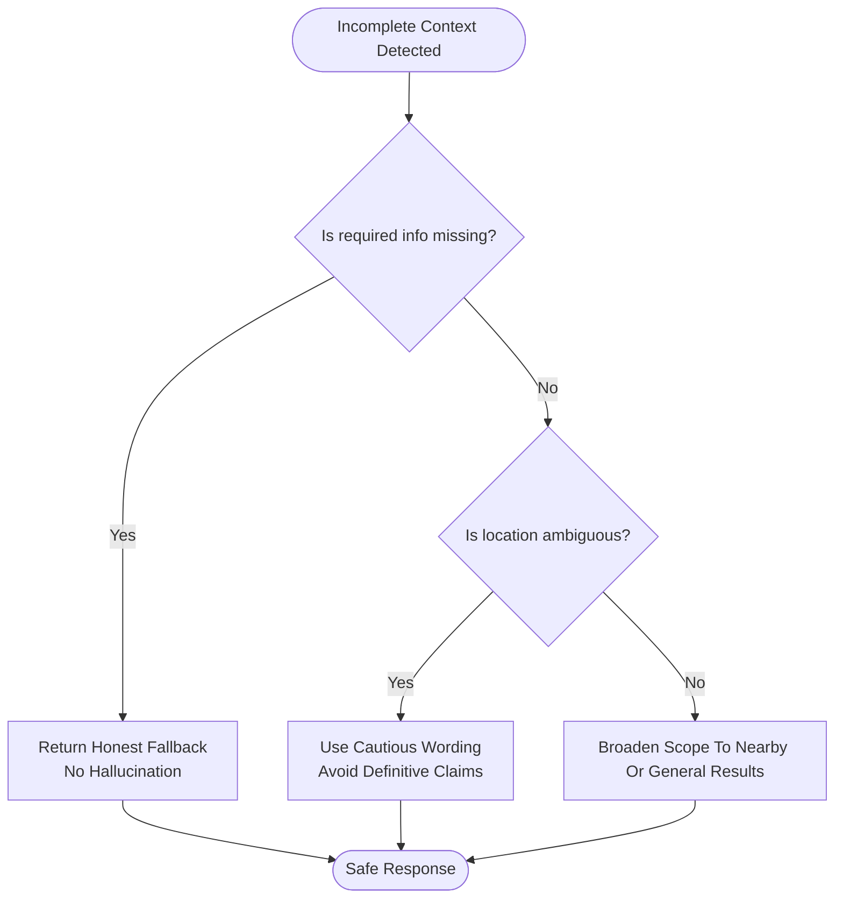
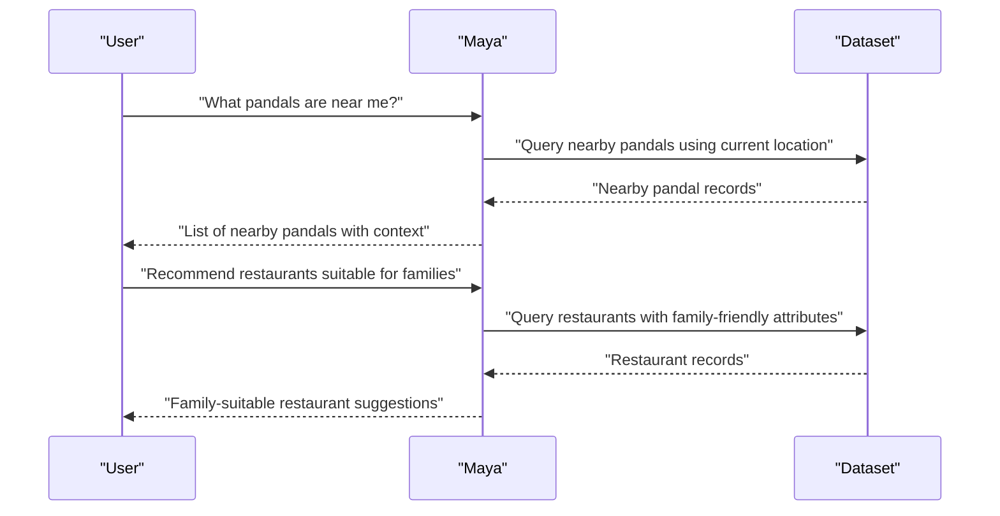
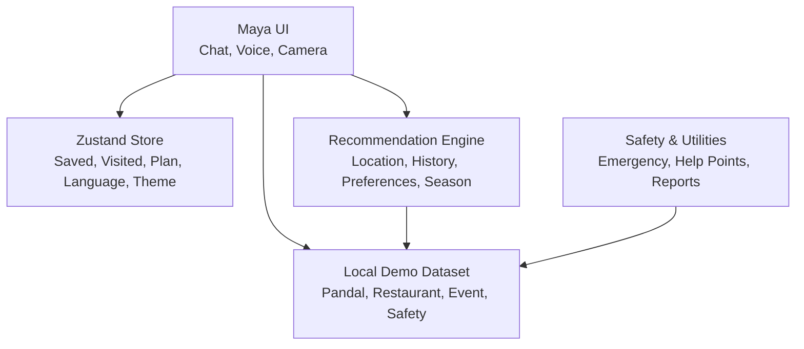

# Context-Aware Response Engine

<cite>
**Referenced Files in This Document**
- [Pujo_Sahayak_Master_Project_Context.md](file://Pujo_Sahayak_Master_Project_Context.md)
- [plan.md](file://tasks/plan.md)
- [todo.md](file://tasks/todo.md)
</cite>

## Table of Contents
1. [Introduction](#introduction)
2. [Project Structure](#project-structure)
3. [Core Components](#core-components)
4. [Architecture Overview](#architecture-overview)
5. [Detailed Component Analysis](#detailed-component-analysis)
6. [Dependency Analysis](#dependency-analysis)
7. [Performance Considerations](#performance-considerations)
8. [Troubleshooting Guide](#troubleshooting-guide)
9. [Conclusion](#conclusion)

## Introduction
This document explains how Maya, the Pujo Sahayak assistant, should generate context-aware responses. The system must combine multiple contextual signals such as current location, selected place, saved locations, trip information, language preferences, and relevant categories. It must also explain how user profile data, application state, and environmental factors are aggregated into a single decision surface for personalization, cultural sensitivity, fallback handling, and priority resolution.

The documentation is based on the product context that defines Pujo Sahayak as a location-aware local discovery platform with a specialized Durga Puja experience, powered by an AI assistant for visual identification, contextual Q&A, multilingual interaction, and intelligent planning.

## Project Structure
At this stage, the repository contains:
- A master product context document describing the full product vision, Maya’s role, data model, recommendation principles, safety, off-season behavior, and feature status.
- An implementation plan describing the React + Vite PWA stack, routes, Zustand store, design tokens, and Maya’s UI-complete but locally simulated behavior.
- A task list breaking down phases from foundation through polish, including Maya chat, camera scan, search, categories, planner, meets, safety, and personalization.

**Diagram sources**
- [Pujo_Sahayak_Master_Project_Context.md:1-18](file://Pujo_Sahayak_Master_Project_Context.md#L1-L18)
- [plan.md:1-18](file://tasks/plan.md#L1-L18)
- [todo.md:1-10](file://tasks/todo.md#L1-L10)

**Section sources**
- [Pujo_Sahayak_Master_Project_Context.md:1-18](file://Pujo_Sahayak_Master_Project_Context.md#L1-L18)
- [plan.md:1-18](file://tasks/plan.md#L1-L18)
- [todo.md:1-10](file://tasks/todo.md#L1-L10)

## Core Components
The context-aware response engine is centered around Maya and the surrounding application state. The key components are:

- **Maya Assistant**: The conversational interface that understands app data and context. It should not be a generic chatbot; answers must be grounded in application data.
- **Context Inputs**: Current location, current pandal or selected place, saved locations, current trip, selected language, and relevant category.
- **Application State Store**: Client-side state managed by Zustand, including saved places, visited places, puja plan, meetups, language, theme, logo choice, and “continue where you left off” session.
- **Dataset Layer**: Typed local demo dataset containing real Kolkata pandals, restaurants, events, meetups, offers, and safety points.
- **Recommendation Engine**: Uses location, previous visits, favorites, search activity, categories, time, season, crowd, and social activity to suggest places.
- **Safety and Utility Layer**: Emergency shortcuts, nearby help points, missing-person reporting, and utility services.

**Diagram sources**
- [Pujo_Sahayak_Master_Project_Context.md:558-662](file://Pujo_Sahayak_Master_Project_Context.md#L558-L662)
- [plan.md:9-18](file://tasks/plan.md#L9-L18)
- [todo.md:36-43](file://tasks/todo.md#L36-L43)

**Section sources**
- [Pujo_Sahayak_Master_Project_Context.md:558-662](file://Pujo_Sahayak_Master_Project_Context.md#L558-L662)
- [plan.md:9-18](file://tasks/plan.md#L9-L18)
- [todo.md:36-43](file://tasks/todo.md#L36-L43)

## Architecture Overview
The Maya response pipeline follows a clear flow:
1. Capture the user query.
2. Resolve active context from application state and route state.
3. Retrieve verified data from the dataset.
4. Generate a natural-language response grounded in that data.
5. Apply cultural sensitivity filters.
6. Handle incomplete context with explicit fallback messaging.

**Diagram sources**
- [Pujo_Sahayak_Master_Project_Context.md:578-662](file://Pujo_Sahayak_Master_Project_Context.md#L578-L662)
- [Pujo_Sahayak_Master_Project_Context.md:1330-1387](file://Pujo_Sahayak_Master_Project_Context.md#L1330-L1387)
- [todo.md:36-43](file://tasks/todo.md#L36-L43)

## Detailed Component Analysis

### Context Aggregation Mechanism
Maya must aggregate multiple context factors before generating a response. The documented potential context includes:
- Current location
- Current pandal or selected place
- Saved locations
- Current trip
- Selected language
- Relevant category

The application state is stored in a Zustand store and persists across reloads. This means Maya can rely on:
- Saved places
- Visited places
- Puja plan
- Meetups
- Language preference
- Theme and logo choices
- “Continue where you left off” session

**Diagram sources**
- [Pujo_Sahayak_Master_Project_Context.md:643-662](file://Pujo_Sahayak_Master_Project_Context.md#L643-L662)
- [plan.md:12-15](file://tasks/plan.md#L12-L15)
- [todo.md:36-43](file://tasks/todo.md#L36-L43)

**Section sources**
- [Pujo_Sahayak_Master_Project_Context.md:643-662](file://Pujo_Sahayak_Master_Project_Context.md#L643-L662)
- [plan.md:12-15](file://tasks/plan.md#L12-L15)
- [todo.md:36-43](file://tasks/todo.md#L36-L43)

### Response Personalization Logic
Personalization is driven by both user history and situational awareness. The recommendation engine may use:
- Location
- Previous visits
- Favorites
- Search activity
- Categories
- Time
- Season
- Crowd levels
- Social activity

Maya’s personalization should therefore tailor suggestions like:
- Nearby pandals when the user is mobile and exploring
- Family-friendly restaurants when the user has family-oriented interests or past behavior indicates families
- Less crowded options when crowd information suggests high density
- Places aligned with saved locations or recent searches

**Diagram sources**
- [Pujo_Sahayak_Master_Project_Context.md:1263-1294](file://Pujo_Sahayak_Master_Project_Context.md#L1263-L1294)
- [todo.md:47-51](file://tasks/todo.md#L47-L51)

**Section sources**
- [Pujo_Sahayak_Master_Project_Context.md:1263-1294](file://Pujo_Sahayak_Master_Project_Context.md#L1263-L1294)
- [todo.md:47-51](file://tasks/todo.md#L47-L51)

### Cultural Sensitivity Filters
The product is deeply rooted in Bengali culture and Durga Puja traditions. While the provided documents do not define explicit rule-based filters, they establish strong constraints:
- Maya must not hallucinate facts about pandals, artists, timings, emergency numbers, crowd status, committee information, or donation information.
- Answers must be grounded in verified application data.
- If information is unavailable, Maya should respond honestly rather than inventing details.
- The product emphasizes cultural identity: modern Kolkata, Durga Puja, premium technology, and respectful exploration.

For Bengali traditions and local customs, the implementation should ensure:
- Culturally appropriate terminology and explanations.
- Respectful framing of religious and community practices.
- Avoidance of stereotypes or insensitive generalizations.
- Clear distinction between verified facts and suggested experiences.

**Diagram sources**
- [Pujo_Sahayak_Master_Project_Context.md:1330-1358](file://Pujo_Sahayak_Master_Project_Context.md#L1330-L1358)
- [Pujo_Sahayak_Master_Project_Context.md:1458-1470](file://Pujo_Sahayak_Master_Project_Context.md#L1458-L1470)

**Section sources**
- [Pujo_Sahayak_Master_Project_Context.md:1330-1358](file://Pujo_Sahayak_Master_Project_Context.md#L1330-L1358)
- [Pujo_Sahayak_Master_Project_Context.md:1458-1470](file://Pujo_Sahayak_Master_Project_Context.md#L1458-L1470)

### Priority System For Conflicting Context
The documents do not define a formal numeric priority matrix, but they imply a practical hierarchy:
- Explicitly selected place takes precedence over inferred location.
- Current trip and planned itinerary influence routing and suggestions.
- Saved locations and visited places inform long-term preferences.
- Current location provides proximity and situational awareness.
- Selected language controls output language.
- Relevant category narrows the domain of results.

A reasonable priority order for conflict resolution is:
1. Selected place or explicitly identified pandal
2. Current trip or active itinerary
3. Saved locations and favorites
4. Recent visited places
5. Current GPS-derived location
6. Selected language and category

**Diagram sources**
- [Pujo_Sahayak_Master_Project_Context.md:643-662](file://Pujo_Sahayak_Master_Project_Context.md#L643-L662)
- [plan.md:12-15](file://tasks/plan.md#L12-L15)

**Section sources**
- [Pujo_Sahayak_Master_Project_Context.md:643-662](file://Pujo_Sahayak_Master_Project_Context.md#L643-L662)
- [plan.md:12-15](file://tasks/plan.md#L12-L15)

### Fallback Strategies For Incomplete Context
When context is incomplete, Maya should avoid guessing and instead use honest fallbacks:
- If verified information is missing, respond that it does not have verified information yet.
- If location is uncertain, avoid claiming the user is inside a specific pandal; use cautious wording such as “near.”
- If a query cannot be answered from the dataset, return a grounded explanation rather than fabricating details.
- If the user opens Maya from a detail page, use that page’s context; otherwise, ask clarifying questions or provide broader nearby results.

**Diagram sources**
- [Pujo_Sahayak_Master_Project_Context.md:1330-1387](file://Pujo_Sahayak_Master_Project_Context.md#L1330-L1387)
- [todo.md:36-43](file://tasks/todo.md#L36-L43)

**Section sources**
- [Pujo_Sahayak_Master_Project_Context.md:1330-1387](file://Pujo_Sahayak_Master_Project_Context.md#L1330-L1387)
- [todo.md:36-43](file://tasks/todo.md#L36-L43)

### Example Context-Aware Queries
The product documents several example interactions that demonstrate how Maya should behave with context:
- “What is the theme of this pandal?”
- “What does this theme mean?”
- “Where is the nearest metro?”
- “Where can I eat nearby?”
- “Which pandals are less crowded?”
- “What can I visit after this?”
- “Where is the nearest hospital?”
- “Help me plan my evening.”

These examples show that Maya should:
- Understand the current pandal or selected place.
- Provide nearby utilities and food.
- Consider crowd information.
- Support planning queries.
- Remain grounded in application data.

**Diagram sources**
- [Pujo_Sahayak_Master_Project_Context.md:578-605](file://Pujo_Sahayak_Master_Project_Context.md#L578-L605)
- [todo.md:36-43](file://tasks/todo.md#L36-L43)

**Section sources**
- [Pujo_Sahayak_Master_Project_Context.md:578-605](file://Pujo_Sahayak_Master_Project_Context.md#L578-L605)
- [todo.md:36-43](file://tasks/todo.md#L36-L43)

## Dependency Analysis
Maya depends on several layers:
- UI layer: Maya chat, voice waveform, camera scan, quick-reply chips.
- Application state: Zustand store with persisted user data.
- Dataset: Local typed demo data with `isDemo` flag.
- Recommendation engine: Scoring and ranking logic based on multiple signals.
- Safety and utility systems: Emergency contacts, nearby help points, missing-person reporting.

**Diagram sources**
- [plan.md:9-18](file://tasks/plan.md#L9-L18)
- [todo.md:36-43](file://tasks/todo.md#L36-L43)
- [Pujo_Sahayak_Master_Project_Context.md:1232-1259](file://Pujo_Sahayak_Master_Project_Context.md#L1232-L1259)

**Section sources**
- [plan.md:9-18](file://tasks/plan.md#L9-L18)
- [todo.md:36-43](file://tasks/todo.md#L36-L43)
- [Pujo_Sahayak_Master_Project_Context.md:1232-1259](file://Pujo_Sahayak_Master_Project_Context.md#L1232-L1259)

## Performance Considerations
- Keep Maya’s response generation lightweight during development by using the local dataset rather than heavy external APIs.
- Cache frequently accessed context such as current location, selected place, and saved locations to avoid repeated lookups.
- Defer expensive recommendation scoring until necessary; precompute simple scores for nearby places when possible.
- Ensure fallback responses are fast and do not block the UI.
- Honor reduced-motion settings and keep animations minimal in critical flows like safety and emergency access.

[No sources needed since this section provides general guidance]

## Troubleshooting Guide
Common issues and their expected behaviors:
- **Maya returns unverified facts**: This violates the AI knowledge principle. Responses must be grounded in verified place data. If information is missing, return an honest fallback.
- **Maya claims exact location without confirmation**: GPS in dense urban environments is not precise enough to guarantee being inside a specific pandal. Use cautious wording.
- **Context is empty**: Ensure Maya reads from route state and Zustand store. If context is incomplete, broaden scope or ask clarifying questions.
- **Camera identification fails**: The camera flow is UI-complete but identification is simulated against the dataset with an honest demo marker. Do not present simulation as production-grade identification.
- **Language mismatch**: Ensure selected language from the store is applied to Maya’s output.

**Section sources**
- [Pujo_Sahayak_Master_Project_Context.md:1330-1387](file://Pujo_Sahayak_Master_Project_Context.md#L1330-L1387)
- [plan.md:15-18](file://tasks/plan.md#L15-L18)
- [todo.md:36-43](file://tasks/todo.md#L36-L43)

## Conclusion
Maya’s context-aware response engine should treat Pujo Sahayak as a location-aware local discovery platform with a specialized Durga Puja experience. The engine must aggregate current location, selected place, saved locations, trip information, language preferences, and relevant categories. It must personalize suggestions using user history, preferences, and situational awareness while remaining culturally sensitive and factually grounded. When context is incomplete, Maya should use honest fallbacks rather than hallucinating. The priority system should favor explicit user intent, active trips, saved places, and then inferred location, with language and category applied as filters throughout.

[No sources needed since this section summarizes without analyzing specific files]