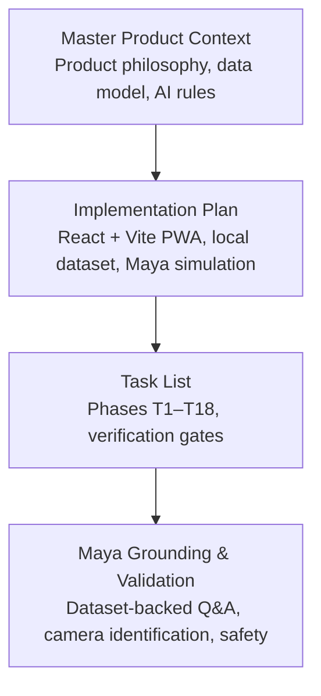
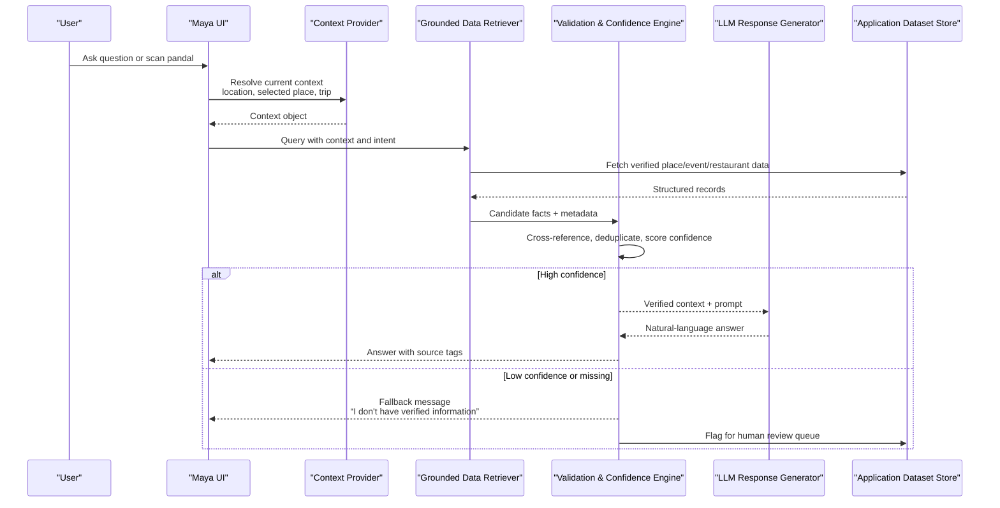
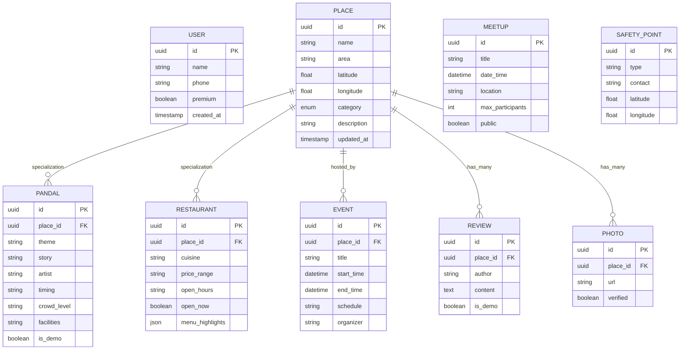
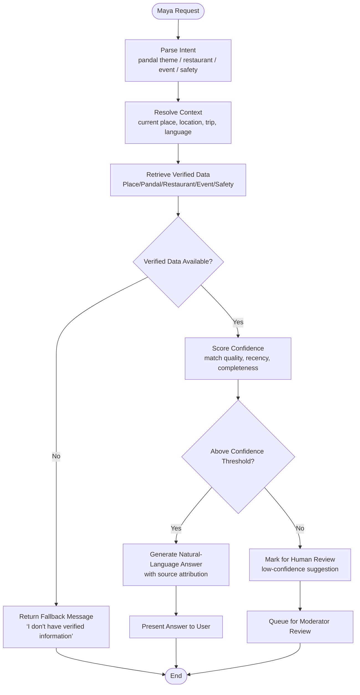
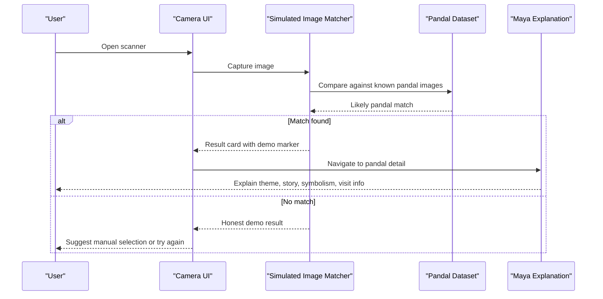
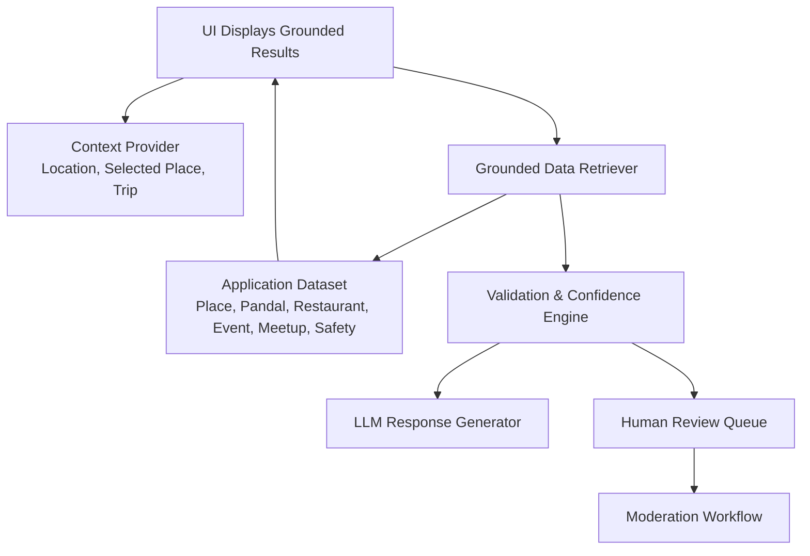

# Dataset Grounding and Validation

<cite>
**Referenced Files in This Document**
- [Pujo_Sahayak_Master_Project_Context.md](file://Pujo_Sahayak_Master_Project_Context.md)
- [plan.md](file://tasks/plan.md)
- [todo.md](file://tasks/todo.md)
</cite>

## Table of Contents
1. [Introduction](#introduction)
2. [Project Structure](#project-structure)
3. [Core Components](#core-components)
4. [Architecture Overview](#architecture-overview)
5. [Detailed Component Analysis](#detailed-component-analysis)
6. [Dependency Analysis](#dependency-analysis)
7. [Performance Considerations](#performance-considerations)
8. [Troubleshooting Guide](#troubleshooting-guide)
9. [Conclusion](#conclusion)
10. [Appendices](#appendices)

## Introduction
This document explains how Maya, the Pujo Sahayak AI assistant, is designed to stay grounded in verified application data rather than generating hallucinated answers. It covers:
- The grounding mechanism that ties Maya’s responses to trusted place, event, restaurant, and user-generated content sources.
- The validation pipeline that cross-references AI output against the application dataset before showing it to users.
- A confidence-aware response model with fallbacks for uncertain or missing information.
- Examples of grounding scenarios for pandal themes, restaurant menus, and event schedules.
- An update mechanism for keeping AI knowledge synchronized with changing application data and seasonal variations during Durga Puja.

The repository currently contains product context, implementation planning, and task tracking. There is no production code yet; therefore, this documentation describes the intended system design based on the documented requirements and constraints.

**Section sources**
- [Pujo_Sahayak_Master_Project_Context.md:1-1878](file://Pujo_Sahayak_Master_Project_Context.md#L1-L1878)
- [plan.md:1-86](file://tasks/plan.md#L1-L86)
- [todo.md:1-81](file://tasks/todo.md#L1-L81)

## Project Structure
At this stage, the repository provides:
- A master product context describing Pujo Sahayak’s goals, features, data model, and AI principles.
- An implementation plan outlining a React + Vite PWA with local demo data and UI-complete but locally simulated AI behavior.
- A task list breaking down foundation, discovery, Maya, planning, social, utility, and polish phases.

**Diagram sources**
- [Pujo_Sahayak_Master_Project_Context.md:1-1878](file://Pujo_Sahayak_Master_Project_Context.md#L1-L1878)
- [plan.md:1-86](file://tasks/plan.md#L1-L86)
- [todo.md:1-81](file://tasks/todo.md#L1-L81)

**Section sources**
- [Pujo_Sahayak_Master_Project_Context.md:1-1878](file://Pujo_Sahayak_Master_Project_Context.md#L1-L1878)
- [plan.md:1-86](file://tasks/plan.md#L1-L86)
- [todo.md:1-81](file://tasks/todo.md#L1-L81)

## Core Components
The grounding and validation system revolves around these core components:

- Application Dataset
  - Typed local demo dataset including real Kolkata pandals, restaurants, events, meetups, offers, and safety points.
  - Fields such as area, theme, crowd level, open hours, location coordinates, and category metadata are used by both UI and Maya.
  - `isDemo: true` marks the dataset as demonstrative, ensuring honesty about data provenance.

- Maya Assistant Layer
  - Chat interface with context-aware queries (current pandal, nearby places, saved locations).
  - Voice input waveform UI and quick-reply chips.
  - Camera-based pandal identification flow that simulates matching against known images and navigates to the corresponding detail page.

- Grounded Retrieval Engine
  - Retrieves verified place data before any natural-language generation.
  - Enforces “no hallucination” policy for critical facts like artist names, timings, emergency numbers, crowd status, committee info, and donation details.
  - Returns a clear fallback when verified information is unavailable.

- Confidence Scoring and Review Trigger
  - Assigns confidence levels to generated responses based on data availability and match quality.
  - Low-confidence responses are marked as suggestions or routed for human review.
  - High-confidence responses can be shown directly with source attribution.

- Update and Seasonal Sync Mechanism
  - Keeps AI knowledge synchronized with changing application data.
  - Supports seasonal updates for Durga Puja themes, schedules, and temporary offerings.
  - Maintains off-season continuity through broader local discovery categories.

**Section sources**
- [Pujo_Sahayak_Master_Project_Context.md:1232-1259](file://Pujo_Sahayak_Master_Project_Context.md#L1232-L1259)
- [Pujo_Sahayak_Master_Project_Context.md:1330-1358](file://Pujo_Sahayak_Master_Project_Context.md#L1330-L1358)
- [plan.md:5-17](file://tasks/plan.md#L5-L17)
- [todo.md:13-14](file://tasks/todo.md#L13-L14)
- [todo.md:36-40](file://tasks/todo.md#L36-L40)

## Architecture Overview
The grounding architecture ensures that every AI response is anchored in verified application data.

**Diagram sources**
- [Pujo_Sahayak_Master_Project_Context.md:1330-1358](file://Pujo_Sahayak_Master_Project_Context.md#L1330-L1358)
- [todo.md:36-40](file://tasks/todo.md#L36-L40)

**Section sources**
- [Pujo_Sahayak_Master_Project_Context.md:1330-1358](file://Pujo_Sahayak_Master_Project_Context.md#L1330-L1358)
- [todo.md:36-40](file://tasks/todo.md#L36-L40)

## Detailed Component Analysis

### Grounded Data Model
The product data model is intentionally broad so that Maya can reference multiple entity types without being limited to pandals alone.

**Diagram sources**
- [Pujo_Sahayak_Master_Project_Context.md:1232-1259](file://Pujo_Sahayak_Master_Project_Context.md#L1232-L1259)
- [todo.md:13-14](file://tasks/todo.md#L13-L14)

**Section sources**
- [Pujo_Sahayak_Master_Project_Context.md:1232-1259](file://Pujo_Sahayak_Master_Project_Context.md#L1232-L1259)
- [todo.md:13-14](file://tasks/todo.md#L13-L14)

### Maya Grounding Pipeline
Maya’s grounding pipeline enforces strict separation between verified data retrieval and natural-language generation.

**Diagram sources**
- [Pujo_Sahayak_Master_Project_Context.md:1330-1358](file://Pujo_Sahayak_Master_Project_Context.md#L1330-L1358)
- [todo.md:36-40](file://tasks/todo.md#L36-L40)

**Section sources**
- [Pujo_Sahayak_Master_Project_Context.md:1330-1358](file://Pujo_Sahayak_Master_Project_Context.md#L1330-L1358)
- [todo.md:36-40](file://tasks/todo.md#L36-L40)

### Confidence Scoring System
Confidence scoring determines whether an AI response can be shown directly or requires caution and review.

- Confidence inputs:
  - Presence of exact matches in the dataset.
  - Recency and reliability of the data source.
  - Completeness of required fields (e.g., timing, crowd status, emergency contacts).
  - Match quality from camera identification.

- Confidence tiers:
  - High confidence: direct answer with source tags.
  - Medium confidence: answer with caveats and suggested alternatives.
  - Low confidence: fallback message and flag for human review.

- Safety-critical fields:
  - Emergency numbers, hospital locations, police stations, and safety points must never be inferred.
  - If missing, Maya must explicitly state that verified information is unavailable.

**Section sources**
- [Pujo_Sahayak_Master_Project_Context.md:1330-1358](file://Pujo_Sahayak_Master_Project_Context.md#L1330-L1358)
- [Pujo_Sahayak_Master_Project_Context.md:1360-1388](file://Pujo_Sahayak_Master_Project_Context.md#L1360-L1388)
- [todo.md:36-40](file://tasks/todo.md#L36-L40)

### Camera-Based Pandal Identification
Camera identification connects visual input to grounded place data.

**Diagram sources**
- [Pujo_Sahayak_Master_Project_Context.md:608-640](file://Pujo_Sahayak_Master_Project_Context.md#L608-L640)
- [todo.md:39-40](file://tasks/todo.md#L39-L40)

**Section sources**
- [Pujo_Sahayak_Master_Project_Context.md:608-640](file://Pujo_Sahayak_Master_Project_Context.md#L608-L640)
- [todo.md:39-40](file://tasks/todo.md#L39-L40)

### Validation Against Trusted Sources
Before presenting any AI response, the system validates claims against trusted sources.

- Trusted sources:
  - Application dataset for pandals, restaurants, events, meetups, offers, and safety points.
  - User-generated content such as reviews and photos, which may require moderation and verification.
  - Location and time context, validated carefully due to GPS limitations.

- Validation rules:
  - Never invent artist names, historical facts, timings, emergency numbers, crowd status, committee information, or donation details.
  - Use cautious wording for location-based claims (“You’re near…” instead of absolute statements).
  - Treat recommendations and suggestions as non-guaranteed unless backed by deterministic logic.

**Section sources**
- [Pujo_Sahayak_Master_Project_Context.md:1330-1358](file://Pujo_Sahayak_Master_Project_Context.md#L1330-L1358)
- [Pujo_Sahayak_Master_Project_Context.md:1360-1388](file://Pujo_Sahayak_Master_Project_Context.md#L1360-L1388)
- [plan.md:15-17](file://tasks/plan.md#L15-L17)

### Grounding Scenarios

#### Pandal Theme Grounding
- Scenario: User asks about the theme of the current pandal.
- Flow:
  - Resolve current pandal from route state or context.
  - Retrieve verified theme, story, artist, and symbolism from the dataset.
  - Generate explanation only if fields exist.
  - If missing, return fallback and avoid inventing cultural or artistic details.

#### Restaurant Menu Grounding
- Scenario: User asks what to eat near a pandal or at a specific restaurant.
- Flow:
  - Retrieve nearby restaurants from the dataset.
  - Use menu highlights, cuisine, and open-now status where available.
  - Avoid fabricating dishes or prices not present in the dataset.
  - Mark suggestions clearly when derived from similarity rather than exact matches.

#### Event Schedule Grounding
- Scenario: User asks about upcoming events or meetup times.
- Flow:
  - Retrieve event or meetup records with start/end times and location.
  - Validate against current time and user location.
  - Present schedule only if verified; otherwise, indicate uncertainty and suggest checking official sources.

**Section sources**
- [Pujo_Sahayak_Master_Project_Context.md:578-605](file://Pujo_Sahayak_Master_Project_Context.md#L578-L605)
- [Pujo_Sahayak_Master_Project_Context.md:913-931](file://Pujo_Sahayak_Master_Project_Context.md#L913-L931)
- [todo.md:36-43](file://tasks/todo.md#L36-L43)

### Update Mechanism and Seasonal Variations
Keeping Maya’s knowledge synchronized with application data is essential, especially during Durga Puja season.

- Update triggers:
  - New pandal entries with themes, stories, and visit information.
  - Updated restaurant menus, hours, and availability.
  - Event schedule changes and new meetups.
  - Safety point updates and emergency contacts.

- Seasonal handling:
  - During Puja, pandal-related data dominates discovery and Maya explanations.
  - Off-season, the platform continues offering restaurants, events, activities, and local experiences.
  - Recommendations adapt using location, previous visits, favorites, search activity, time, season, crowd, and social activity.

- Data integrity:
  - Demo dataset remains marked as demo.
  - Crowd levels and hours are rendered only from dataset fields.
  - No fabricated statistics, reviews, or crowd data.

**Section sources**
- [Pujo_Sahayak_Master_Project_Context.md:104-137](file://Pujo_Sahayak_Master_Project_Context.md#L104-L137)
- [Pujo_Sahayak_Master_Project_Context.md:1263-1294](file://Pujo_Sahayak_Master_Project_Context.md#L1263-L1294)
- [plan.md:15-17](file://tasks/plan.md#L15-L17)
- [todo.md:13-14](file://tasks/todo.md#L13-L14)

## Dependency Analysis
Maya’s grounding and validation depends on several interconnected layers.

**Diagram sources**
- [Pujo_Sahayak_Master_Project_Context.md:1232-1259](file://Pujo_Sahayak_Master_Project_Context.md#L1232-L1259)
- [Pujo_Sahayak_Master_Project_Context.md:1330-1358](file://Pujo_Sahayak_Master_Project_Context.md#L1330-L1358)
- [todo.md:36-40](file://tasks/todo.md#L36-L40)

**Section sources**
- [Pujo_Sahayak_Master_Project_Context.md:1232-1259](file://Pujo_Sahayak_Master_Project_Context.md#L1232-L1259)
- [Pujo_Sahayak_Master_Project_Context.md:1330-1358](file://Pujo_Sahayak_Master_Project_Context.md#L1330-L1358)
- [todo.md:36-40](file://tasks/todo.md#L36-L40)

## Performance Considerations
- Keep retrieval fast by indexing dataset fields such as area, category, theme, and coordinates.
- Cache frequently accessed place and event data to reduce repeated lookups.
- Limit LLM calls to cases where natural-language generation adds value; prefer deterministic UI for structured data.
- Defer heavy operations like image matching and recommendation scoring to background tasks where possible.
- Ensure offline-capable shell caching while keeping sensitive or dynamic data server-synced.

[No sources needed since this section provides general guidance]

## Troubleshooting Guide
Common issues and resolutions:

- Maya returns generic or unhelpful answers:
  - Check whether context resolution succeeded.
  - Verify that the requested entity exists in the dataset.
  - Confirm that required fields (theme, timing, crowd, safety) are populated.

- Camera identification fails:
  - Ensure camera permissions are granted.
  - Verify that the scanned image resembles a known pandal entry.
  - Fall back to manual selection if no confident match exists.

- Low-confidence responses appear:
  - Inspect confidence scoring inputs.
  - Add missing verified data to the dataset.
  - Route low-confidence answers to human review.

- Incorrect location-based claims:
  - Avoid absolute statements about user location.
  - Use cautious wording and require confirmation when necessary.

**Section sources**
- [Pujo_Sahayak_Master_Project_Context.md:1330-1358](file://Pujo_Sahayak_Master_Project_Context.md#L1330-L1358)
- [Pujo_Sahayak_Master_Project_Context.md:1360-1388](file://Pujo_Sahayak_Master_Project_Context.md#L1360-L1388)
- [todo.md:39-40](file://tasks/todo.md#L39-L40)

## Conclusion
Maya’s dataset grounding and validation system is designed to prioritize trustworthiness over generative flair. By retrieving verified application data first, enforcing strict no-hallucination rules, scoring confidence, and routing uncertain answers for review, the system ensures that AI responses remain useful, accurate, and safe. The architecture supports seasonal Durga Puja dynamics while maintaining a broader local-discovery ecosystem beyond the festival. As the application evolves, this grounding layer should remain central to every AI-driven feature.

[No sources needed since this section summarizes without analyzing specific files]

## Appendices

### Implementation Checklist for Grounding and Validation
- Implement typed data model for Place, Pandal, Restaurant, Event, Meetup, Review, Photo, SafetyPoint.
- Build grounded data retriever with context-aware queries.
- Add validation and confidence scoring engine.
- Integrate Maya chat, voice, and camera flows.
- Enforce fallback messaging for missing verified information.
- Create human review queue for low-confidence outputs.
- Support seasonal updates and off-season continuity.
- Verify that no fabricated stats, reviews, or crowd data are presented.

**Section sources**
- [Pujo_Sahayak_Master_Project_Context.md:1232-1259](file://Pujo_Sahayak_Master_Project_Context.md#L1232-L1259)
- [plan.md:5-17](file://tasks/plan.md#L5-L17)
- [todo.md:13-14](file://tasks/todo.md#L13-L14)
- [todo.md:36-40](file://tasks/todo.md#L36-L40)