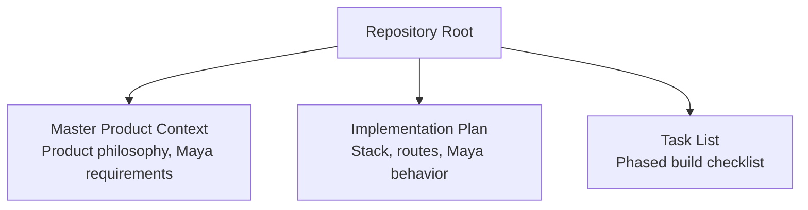
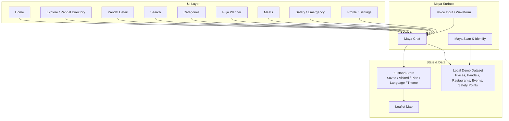
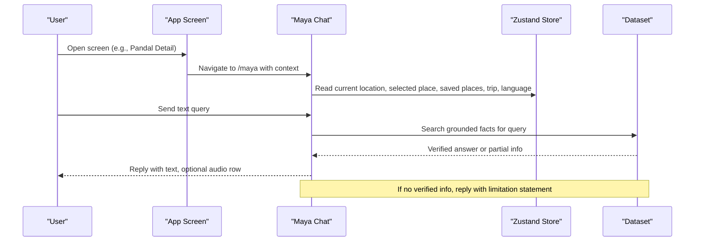
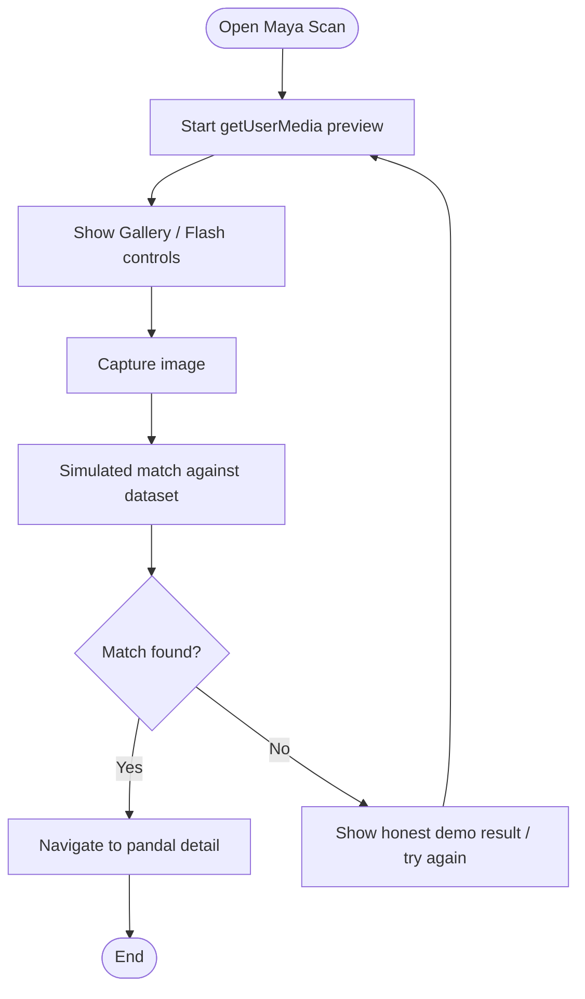
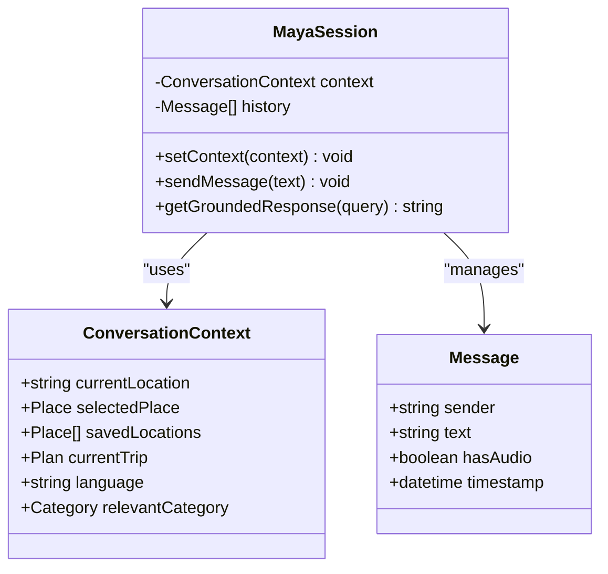
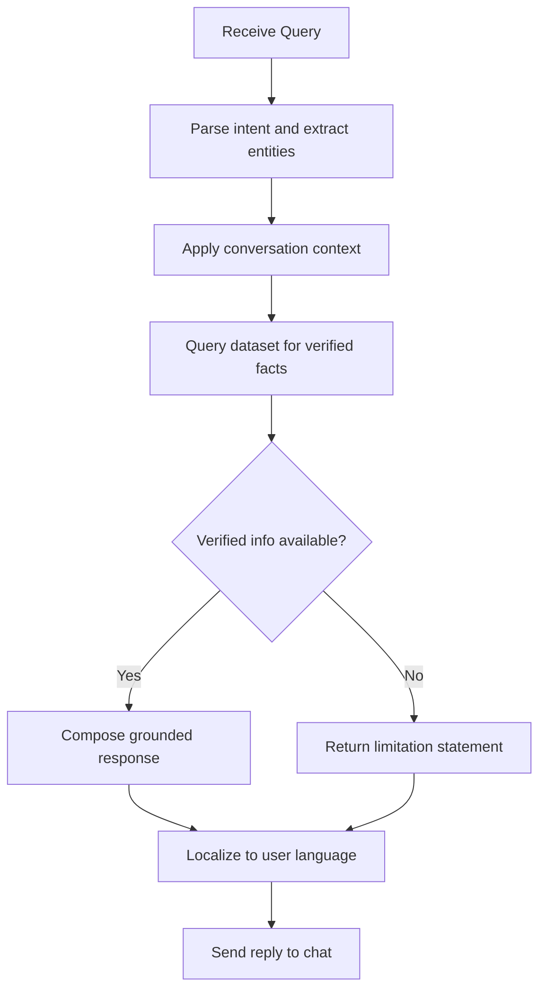
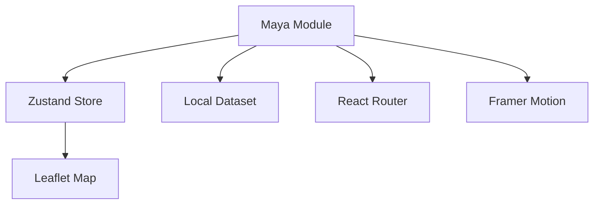

# Maya AI Assistant Implementation

<cite>
**Referenced Files in This Document**   
- [Pujo_Sahayak_Master_Project_Context.md](file://Pujo_Sahayak_Master_Project_Context.md)
- [plan.md](file://tasks/plan.md)
- [todo.md](file://tasks/todo.md)
</cite>

## Table of Contents
1. [Introduction](#introduction)
2. [Project Structure](#project-structure)
3. [Core Components](#core-components)
4. [Architecture Overview](#architecture-overview)
5. [Detailed Component Analysis](#detailed-component-analysis)
6. [Dependency Analysis](#dependency-analysis)
7. [Performance Considerations](#performance-considerations)
8. [Troubleshooting Guide](#troubleshooting-guide)
9. [Conclusion](#conclusion)
10. [Appendices](#appendices)

## Introduction
This document explains how to implement the Maya AI assistant for Pujo Sahayak. Maya is a context-aware chat interface that understands the application’s data and user context, not a generic chatbot. It should help users discover places, understand themes, plan visits, avoid crowds, find nearby services, and stay safe during exploration. The documentation covers:
- Maya’s role as a contextual companion for pandal discovery and local exploration
- Chat interface architecture: message handling, conversation state, response generation
- Visual identification workflow where users point their camera at pandals for recognition and explanation
- Context-aware responses using current location, selected place, saved locations, trip information, language preferences, and relevant categories
- Dataset grounding to prevent hallucination and ensure answers are based on verified application data
- Multilingual support and cultural sensitivity for Bengali and English interactions
- Examples of common queries
- Privacy considerations for location data and user context sharing with AI services

The implementation guidance is grounded in the project’s master product context and task plans.

## Project Structure
At this stage, the repository contains:
- A master product context document describing the overall product philosophy, navigation, screens, and Maya requirements
- An implementation plan describing the React + Vite PWA stack, routes, design system, and Maya behavior
- A task list breaking down phases from foundation through polish, including Maya chat, scan, voice, search, categories, planner, meets, safety, and profile

**Diagram sources**
- [Pujo_Sahayak_Master_Project_Context.md:1-120](file://Pujo_Sahayak_Master_Project_Context.md#L1-L120)
- [plan.md:1-20](file://tasks/plan.md#L1-L20)
- [todo.md:1-10](file://tasks/todo.md#L1-L10)

**Section sources**
- [Pujo_Sahayak_Master_Project_Context.md:1-120](file://Pujo_Sahayak_Master_Project_Context.md#L1-L120)
- [plan.md:1-20](file://tasks/plan.md#L1-L20)
- [todo.md:1-10](file://tasks/todo.md#L1-L10)

## Core Components
Maya is a core feature within Pujo Sahayak. Its responsibilities include:
- Providing contextual answers about pandals, restaurants, events, transport, and utilities
- Supporting visual identification of pandals via camera capture and simulated matching against the dataset
- Maintaining conversation state and responding in the user’s preferred language
- Grounding all answers in the local demo dataset and clearly marking limitations when verified information is unavailable

Key Maya-related behaviors defined by the project:
- Maya name and accessibility: Maya is the assistant name; it should be accessible from Categories and ideally through a persistent action
- Maya capabilities: theme explanations, nearest metro, nearby dining, crowd avoidance, next visit suggestions, hospital directions, evening planning
- Camera integration: live preview, animated scan frame, gallery controls, capture, simulated match result, then navigate to detail
- Context awareness: current location, selected place, saved locations, current trip, selected language, relevant category
- Grounded responses: answers must come from application data; no fabrication

**Section sources**
- [Pujo_Sahayak_Master_Project_Context.md:558-662](file://Pujo_Sahayak_Master_Project_Context.md#L558-L662)
- [plan.md:15-17](file://tasks/plan.md#L15-L17)
- [todo.md:36-43](file://tasks/todo.md#L36-L43)

## Architecture Overview
Maya spans multiple UI surfaces and interacts with shared app state and dataset:

**Diagram sources**
- [plan.md:7-17](file://tasks/plan.md#L7-L17)
- [todo.md:18-43](file://tasks/todo.md#L18-L43)
- [Pujo_Sahayak_Master_Project_Context.md:558-662](file://Pujo_Sahayak_Master_Project_Context.md#L558-L662)

## Detailed Component Analysis

### Maya Chat Interface
Maya chat provides a conversational surface integrated across the app. It should:
- Show an avatar and online status
- Render Bengali user bubbles and Maya replies
- Support inline audio playback rows and waveform visualization
- Provide quick-reply chips such as “Nearest Metro?”, “Medical Camp?”, “More about the artist”
- Use route state to infer context (e.g., current pandal or restaurant)
- Retrieve grounded answers from the dataset and fall back to “I don’t have verified information” when needed
- Toggle voice input mode via a floating action button

**Diagram sources**
- [todo.md:36-43](file://tasks/todo.md#L36-L43)
- [plan.md:15-17](file://tasks/plan.md#L15-L17)
- [Pujo_Sahayak_Master_Project_Context.md:578-662](file://Pujo_Sahayak_Master_Project_Context.md#L578-L662)

**Section sources**
- [todo.md:36-43](file://tasks/todo.md#L36-L43)
- [plan.md:15-17](file://tasks/plan.md#L15-L17)
- [Pujo_Sahayak_Master_Project_Context.md:578-662](file://Pujo_Sahayak_Master_Project_Context.md#L578-L662)

### Maya Scan & Identify Workflow
The visual identification flow allows users to point their camera at a pandal:
- Live getUserMedia preview with an animated scan frame
- Gallery and flash controls
- Capture triggers simulated matching against the dataset
- Honest demo result card navigates to the identified pandal detail page

**Diagram sources**
- [todo.md:39-43](file://tasks/todo.md#L39-L43)
- [Pujo_Sahayak_Master_Project_Context.md:608-641](file://Pujo_Sahayak_Master_Project_Context.md#L608-L641)

**Section sources**
- [todo.md:39-43](file://tasks/todo.md#L39-L43)
- [Pujo_Sahayak_Master_Project_Context.md:608-641](file://Pujo_Sahayak_Master_Project_Context.md#L608-L641)

### Conversation State Management
Conversation state should consider:
- Current location
- Selected place (pandal, restaurant, event)
- Saved locations
- Current trip (planned itinerary)
- Selected language
- Relevant category

When Maya opens from a specific screen, it should already know the context without requiring the user to repeat details.

**Diagram sources**
- [Pujo_Sahayak_Master_Project_Context.md:643-662](file://Pujo_Sahayak_Master_Project_Context.md#L643-L662)
- [todo.md:36-43](file://tasks/todo.md#L36-L43)

**Section sources**
- [Pujo_Sahayak_Master_Project_Context.md:643-662](file://Pujo_Sahayak_Master_Project_Context.md#L643-L662)
- [todo.md:36-43](file://tasks/todo.md#L36-L43)

### Response Generation Patterns
Maya’s response generation should follow these patterns:
- Ground answers in the local dataset
- Avoid fabricating statistics, reviews, or facts
- Provide clear fallbacks when verified information is missing
- Respect the user’s language preference
- Offer actionable suggestions (nearest metro, hospitals, restaurants, crowd avoidance)

**Diagram sources**
- [plan.md:15-17](file://tasks/plan.md#L15-L17)
- [todo.md:36-43](file://tasks/todo.md#L36-L43)
- [Pujo_Sahayak_Master_Project_Context.md:578-662](file://Pujo_Sahayak_Master_Project_Context.md#L578-L662)

**Section sources**
- [plan.md:15-17](file://tasks/plan.md#L15-L17)
- [todo.md:36-43](file://tasks/todo.md#L36-L43)
- [Pujo_Sahayak_Master_Project_Context.md:578-662](file://Pujo_Sahayak_Master_Project_Context.md#L578-L662)

### Dataset Grounding Mechanism
To prevent hallucination:
- All answers must reference the local demo dataset
- Crowd levels, hours, ratings, and other metrics should only be rendered from dataset fields
- Any external LLM integration should be architected as a clean swap-in point while keeping the current behavior as local retrieval
- Clearly mark demo-only features and avoid presenting them as production integrations

**Diagram sources**
- [plan.md:15-17](file://tasks/plan.md#L15-L17)
- [todo.md:63-70](file://tasks/todo.md#L63-L70)

**Section sources**
- [plan.md:15-17](file://tasks/plan.md#L15-L17)
- [todo.md:63-70](file://tasks/todo.md#L63-L70)

### Multilingual Support and Cultural Sensitivity
Considerations:
- Support Bengali and English interactions
- Honor user-selected language throughout the app
- Ensure Bengali text rendering uses appropriate fonts with system fallbacks
- Maintain cultural sensitivity around Durga Puja traditions, symbolism, and community norms
- Keep tone respectful and informative, avoiding assumptions about religious practices beyond verified data

**Section sources**
- [plan.md:79-80](file://tasks/plan.md#L79-L80)
- [todo.md:71-72](file://tasks/todo.md#L71-L72)
- [Pujo_Sahayak_Master_Project_Context.md:578-662](file://Pujo_Sahayak_Master_Project_Context.md#L578-L662)

### Common Queries and Use Cases
Examples of typical Maya interactions:
- Theme explanations: “What is the theme of this pandal?”
- Symbolism and story: “What does this theme mean?”
- Navigation: “Where is the nearest metro?”
- Dining: “Where can I eat nearby?”
- Crowd avoidance: “Which pandals are less crowded?”
- Next steps: “What can I visit after this?”
- Emergency assistance: “Where is the nearest hospital?”
- Planning: “Help me plan my evening.”

These queries should be answered using grounded data and contextual awareness.

**Section sources**
- [Pujo_Sahayak_Master_Project_Context.md:578-606](file://Pujo_Sahayak_Master_Project_Context.md#L578-L606)

### Privacy Considerations
Privacy guidelines for Maya and related features:
- Minimize collection of sensitive location data; collect only what is necessary
- Allow users to control whether location is shared with AI services
- Do not send unnecessary personal context to external services
- Clearly communicate what data is used locally versus externally
- Provide opt-outs for location-based features and store preferences persistently

[No sources needed since this section provides general privacy guidance]

## Dependency Analysis
Maya depends on several shared components and data layers:
- Zustand store for saved places, visited places, plan, language, theme, and session continuity
- Local demo dataset for grounded responses
- Leaflet map for route and nearby points
- Framer Motion for animations (scan frame, waveform, transitions)
- React Router for routing between screens and passing context to Maya

**Diagram sources**
- [plan.md:7-17](file://tasks/plan.md#L7-L17)
- [todo.md:36-43](file://tasks/todo.md#L36-L43)

**Section sources**
- [plan.md:7-17](file://tasks/plan.md#L7-L17)
- [todo.md:36-43](file://tasks/todo.md#L36-L43)

## Performance Considerations
- Keep Maya responses fast by querying the local dataset rather than making network calls
- Cache frequent queries and precompute nearby results based on current location
- Defer heavy operations like image processing until after capture
- Respect reduced-motion settings for accessibility
- Optimize audio playback and waveform rendering to avoid jank during conversations

[No sources needed since this section provides general performance guidance]

## Troubleshooting Guide
Common issues and resolutions:
- Maya returns unverified or vague answers: verify dataset coverage and grounding rules; add missing entries or refine query parsing
- Camera permissions denied: guide users to grant permission and retry; provide gallery fallback
- Bengali text not rendering: ensure font loading and fallbacks are configured correctly
- Location-based features not working: check permissions and store state synchronization
- Offline shell issues: audit PWA caching and ensure critical assets are cached

**Section sources**
- [plan.md:15-17](file://tasks/plan.md#L15-L17)
- [todo.md:63-70](file://tasks/todo.md#L63-L70)

## Conclusion
Maya is a central, context-aware assistant that transforms Pujo Sahayak from a directory into a digital companion for exploring Kolkata during Puja. By grounding responses in verified application data, supporting visual identification, respecting user context and language preferences, and maintaining strong privacy practices, Maya delivers reliable, culturally sensitive assistance. The phased implementation plan ensures a robust foundation, polished UI, and scalable architecture ready for future enhancements.

[No sources needed since this section summarizes without analyzing specific files]

## Appendices

### Appendix A: Maya Requirements Summary
- Name: Maya
- Accessibility: From Categories and a persistent action
- Capabilities: Theme explanations, nearest metro, nearby dining, crowd avoidance, next visit suggestions, hospital directions, evening planning
- Camera: Live preview, animated scan frame, gallery/flash controls, capture, simulated match, navigate to detail
- Context: Current location, selected place, saved locations, current trip, selected language, relevant category
- Grounding: Answers from application data; no fabrication; honest limitations

**Section sources**
- [Pujo_Sahayak_Master_Project_Context.md:558-662](file://Pujo_Sahayak_Master_Project_Context.md#L558-L662)

### Appendix B: Implementation Checklist Highlights
- Scaffold React + Vite PWA with Tailwind, React Router, Zustand, Framer Motion, Leaflet
- Implement Maya chat with grounded dataset retrieval and voice waveform UI
- Implement Maya scan with getUserMedia and simulated matching
- Ensure Bengali/English i18n and cultural sensitivity
- Validate offline PWA installability and responsive layout

**Section sources**
- [plan.md:1-20](file://tasks/plan.md#L1-L20)
- [todo.md:1-10](file://tasks/todo.md#L1-L10)