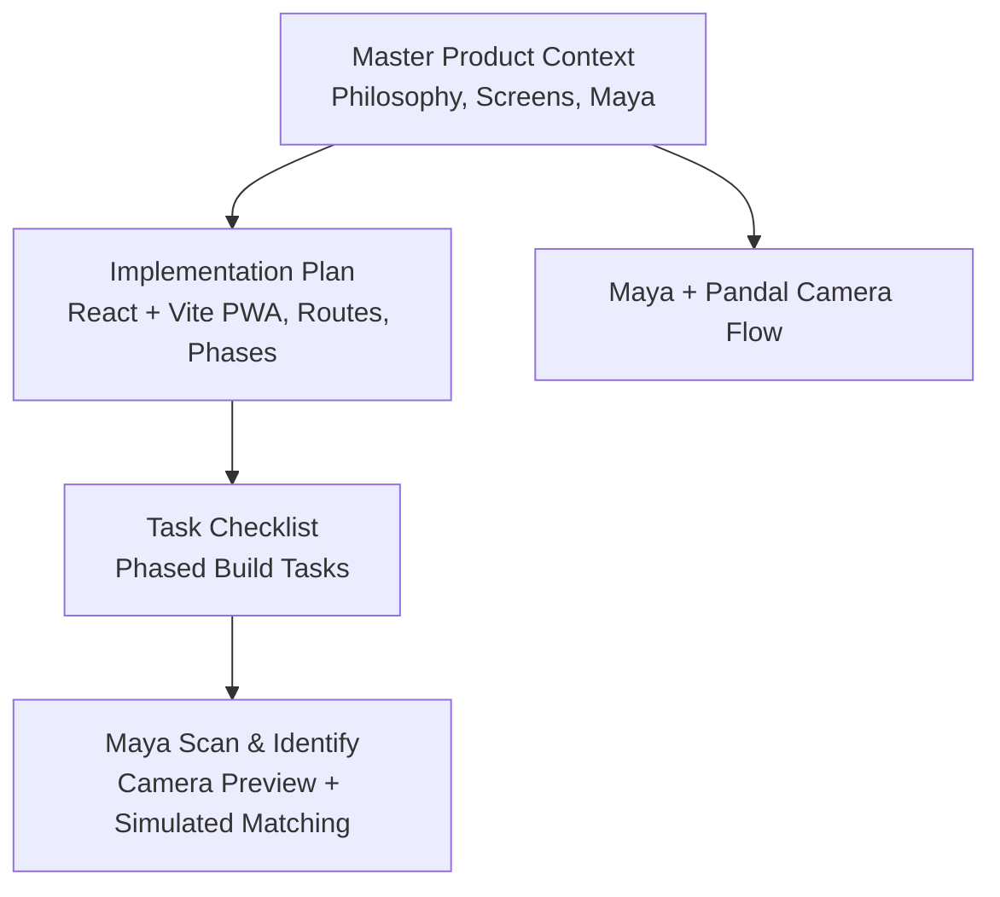
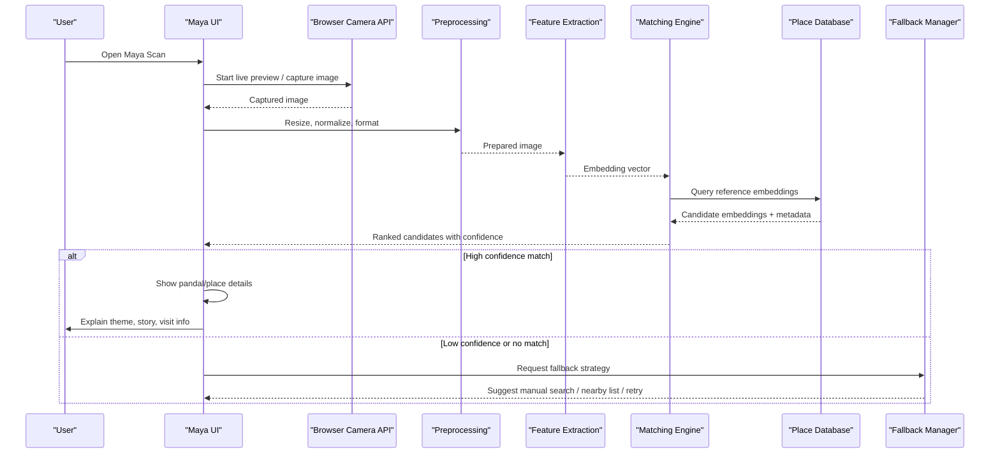
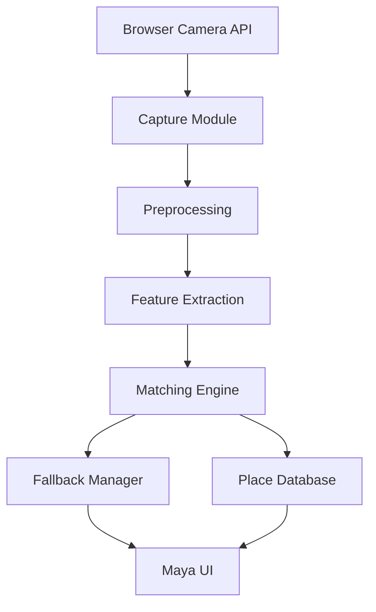
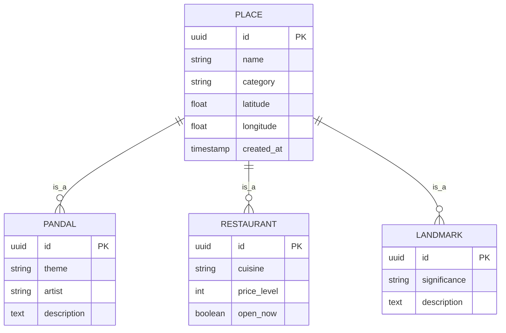

# Visual Recognition System

<cite>
**Referenced Files in This Document**
- [Pujo_Sahayak_Master_Project_Context.md](file://Pujo_Sahayak_Master_Project_Context.md)
- [plan.md](file://tasks/plan.md)
- [todo.md](file://tasks/todo.md)
</cite>

## Table of Contents
1. [Introduction](#introduction)
2. [Project Structure](#project-structure)
3. [Core Components](#core-components)
4. [Architecture Overview](#architecture-overview)
5. [Detailed Component Analysis](#detailed-component-analysis)
6. [Dependency Analysis](#dependency-analysis)
7. [Performance Considerations](#performance-considerations)
8. [Troubleshooting Guide](#troubleshooting-guide)
9. [Conclusion](#conclusion)
10. [Appendices](#appendices)

## Introduction
This document explains how the visual recognition capability should be implemented for Pujo Sahayak’s “Maya” assistant. The system enables users to point their camera at a Durga Puja pandal, restaurant, or landmark and receive contextual information through Maya. It covers:
- Camera integration using the browser Camera API
- Image processing pipeline: preprocessing, feature extraction, and comparison against known place databases
- Machine learning model integration for identifying places
- Confidence scoring and fallback mechanisms
- User experience flows for capture, processing feedback, and result presentation
- Privacy considerations for image handling and storage
- Performance optimization techniques for mobile devices
- Example scenarios and error handling patterns

The product context emphasizes that Maya is currently UI-complete with simulated identification; any real AI integration must remain clearly separated from the demo behavior.

**Section sources**
- [Pujo_Sahayak_Master_Project_Context.md:558-640](file://Pujo_Sahayak_Master_Project_Context.md#L558-L640)
- [plan.md:15-17](file://tasks/plan.md#L15-L17)

## Project Structure
At this stage, the repository contains:
- A master product context describing Pujo Sahayak’s philosophy, navigation, screens, and Maya features
- An implementation plan outlining React + Vite PWA architecture, screen routes, phases, and risks
- A task checklist tracking progress across foundation, discovery, Maya, planning, utility, and polish phases

**Diagram sources**
- [Pujo_Sahayak_Master_Project_Context.md:558-640](file://Pujo_Sahayak_Master_Project_Context.md#L558-L640)
- [plan.md:1-17](file://tasks/plan.md#L1-17)
- [todo.md:34-43](file://tasks/todo.md#L34-L43)

**Section sources**
- [Pujo_Sahayak_Master_Project_Context.md:1-122](file://Pujo_Sahayak_Master_Project_Context.md#L1-L122)
- [plan.md:1-17](file://tasks/plan.md#L1-L17)
- [todo.md:1-16](file://tasks/todo.md#L1-L16)

## Core Components
The visual recognition system spans several components:
- Camera Capture Module: Uses the browser Camera API to open a live preview, allow gallery selection, and capture images
- Preprocessing Module: Resizes, normalizes, and prepares images for model inference
- Feature Extraction Module: Converts images into embeddings suitable for similarity search
- Place Database: Stores curated place records (pandals, restaurants, landmarks) with reference images and metadata
- Matching Engine: Compares extracted features against the database and returns candidate matches with confidence scores
- Fallback Manager: Handles low-confidence results, errors, and degraded conditions by offering alternative UX paths
- Maya Integration Layer: Presents results, explanations, and next actions within the Maya interface

Key constraints from the project context:
- Maya is UI-complete but AI-simulated locally in the current build
- Identification is simulated against the dataset with an honest “demo” marker
- No fabricated integrations are presented as production-ready

**Section sources**
- [plan.md:15-17](file://tasks/plan.md#L15-L17)
- [todo.md:39-40](file://tasks/todo.md#L39-L40)

## Architecture Overview
The end-to-end flow connects user interaction with camera capture, image processing, matching, and Maya’s explanation layer.

**Diagram sources**
- [Pujo_Sahayak_Master_Project_Context.md:608-640](file://Pujo_Sahayak_Master_Project_Context.md#L608-L640)
- [todo.md:39-40](file://tasks/todo.md#L39-L40)

## Detailed Component Analysis

### Camera Integration Using Browser Camera API
Responsibilities:
- Request camera permissions
- Display a live preview stream
- Provide controls for flash and gallery selection
- Capture a still image for processing

UX expectations:
- Clear instruction: “Point your camera at a pandal”
- Animated scan frame around the preview
- Immediate feedback when capturing

Error handling:
- Permission denied: prompt user to enable camera access
- Device not supported: offer gallery-only mode
- Stream failure: show retry option and fallback to manual search

Mobile considerations:
- Use appropriate resolution settings to balance quality and performance
- Handle orientation changes gracefully
- Avoid blocking the main thread during capture

**Section sources**
- [todo.md:39-40](file://tasks/todo.md#L39-L40)

### Image Processing Pipeline
Stages:
1. Preprocessing
   - Resize to model input size
   - Normalize pixel values
   - Convert color space if required
   - Crop or pad to maintain aspect ratio without distortion
2. Feature Extraction
   - Run image through embedding model
   - Produce fixed-length vector representation
3. Comparison Against Known Places
   - Compute similarity between query embedding and database embeddings
   - Rank candidates by similarity score
   - Apply thresholding for confidence decisions

Optimization opportunities:
- Batch processing for multiple captures
- Caching embeddings for static reference images
- Using efficient similarity search algorithms (e.g., approximate nearest neighbors)

**Section sources**
- [Pujo_Sahayak_Master_Project_Context.md:608-640](file://Pujo_Sahayak_Master_Project_Context.md#L608-L640)

### Machine Learning Model Integration
Integration points:
- Model loader: loads pre-trained embedding model
- Inference runner: executes feature extraction on device or via backend
- Result formatter: converts raw outputs into ranked candidates with metadata

Constraints:
- Current implementation simulates identification against the local dataset
- Any future real model integration must be clearly separated from the demo behavior
- Results must remain grounded in application data; avoid hallucination

Model types:
- For pandals: scene-based embeddings trained on architectural and thematic features
- For restaurants: facade and signage recognition combined with location context
- For landmarks: broader scene recognition with geographic filters

**Section sources**
- [plan.md:15-17](file://tasks/plan.md#L15-L17)
- [Pujo_Sahayak_Master_Project_Context.md:578-605](file://Pujo_Sahayak_Master_Project_Context.md#L578-L605)

### Confidence Scoring and Fallback Mechanisms
Confidence scoring:
- Normalize similarity scores to a 0–1 scale
- Apply category-specific thresholds (pandal vs restaurant vs landmark)
- Factor in contextual signals (current location, selected area, time of day)

Fallback strategies:
- If confidence below threshold:
  - Offer “Show nearby places” list
  - Suggest refining the photo (better lighting, clearer view)
  - Allow manual search with filters
- If camera fails:
  - Switch to gallery upload
  - Provide guided tips for better capture

Transparency:
- Clearly label demo results
- Do not present simulated matches as verified facts

**Section sources**
- [plan.md:15-17](file://tasks/plan.md#L15-L17)
- [todo.md:39-40](file://tasks/todo.md#L39-L40)

### User Experience Flows
Photo capture flow:
- User opens Maya Scan
- Camera preview appears with animated scan frame
- User captures image or selects from gallery
- App shows processing indicator
- Result card displays likely place with confidence level
- Maya provides explanation and next actions

Processing feedback:
- Progress steps: “Capturing → Preparing → Analyzing → Identifying”
- Error messages with actionable guidance
- Option to retry or switch to manual search

Result presentation:
- Place card with name, location, rating, distance
- “Ask Maya about this place” chip
- Related content: similar places, nearby restaurants, events

**Section sources**
- [Pujo_Sahayak_Master_Project_Context.md:608-640](file://Pujo_Sahayak_Master_Project_Context.md#L608-L640)
- [todo.md:39-40](file://tasks/todo.md#L39-L40)

### Privacy Considerations
Image handling:
- Process images locally whenever possible
- Do not store full-resolution images unless explicitly requested by the user
- Allow users to delete captured images and history
- Avoid uploading images to servers without clear consent

Data minimization:
- Store only necessary metadata (place ID, timestamp, anonymized location)
- Do not retain biometric or sensitive personal data

Compliance:
- Inform users about camera usage and data retention
- Provide easy opt-out for analytics or telemetry related to image processing

**Section sources**
- [Pujo_Sahayak_Master_Project_Context.md:558-640](file://Pujo_Sahayak_Master_Project_Context.md#L558-L640)

### Performance Optimization Techniques for Mobile Devices
Image compression:
- Compress captured images before processing
- Limit maximum dimensions while preserving key features

Efficient processing:
- Use WebAssembly models where available
- Offload heavy computation to background threads
- Cache embeddings for frequently visited places

Memory management:
- Release image buffers after processing
- Avoid loading all reference images into memory simultaneously

Network efficiency:
- Prefer local matching for speed and privacy
- Only call remote APIs when necessary and with caching

**Section sources**
- [plan.md:1-17](file://tasks/plan.md#L1-L17)

### Examples of Successful Recognition Scenarios
- User points camera at a well-known pandal under good lighting; high-confidence match returns detailed theme and artist information
- User captures a restaurant facade near a pandal; medium-confidence match suggests nearby dining options with cuisine tags
- User scans a landmark; low-confidence match triggers fallback to nearby attractions list

### Error Handling Patterns
- Camera permission denied: prompt to enable permissions and explain why camera access is needed
- Poor image quality: suggest retaking with better focus and lighting
- No match found: offer manual search and nearby suggestions
- Network failure: fall back to offline dataset and cached results

**Section sources**
- [todo.md:39-40](file://tasks/todo.md#L39-L40)

## Dependency Analysis
The visual recognition system depends on:
- Browser Camera API for capture
- Local dataset for place metadata and reference images
- Maya UI for interaction and explanation
- Optional backend services for advanced matching and model updates

**Diagram sources**
- [todo.md:39-40](file://tasks/todo.md#L39-L40)
- [plan.md:15-17](file://tasks/plan.md#L15-L17)

**Section sources**
- [plan.md:1-17](file://tasks/plan.md#L1-L17)
- [todo.md:34-43](file://tasks/todo.md#L34-L43)

## Performance Considerations
- Prioritize fast initial response times by showing immediate feedback during capture and processing
- Use progressive enhancement: start with lightweight local matching, then enhance with remote services if available
- Monitor memory usage and CPU load on mobile devices; throttle heavy operations
- Implement lazy loading for reference images and embeddings
- Provide user-controlled settings for quality vs speed trade-offs

[No sources needed since this section provides general guidance]

## Troubleshooting Guide
Common issues and resolutions:
- Camera not opening: check permissions, device compatibility, and browser support
- Blurry or dark images: guide users to improve lighting and focus
- Low confidence results: suggest retaking photos or switching to manual search
- Slow processing: recommend reducing image resolution or enabling offline mode
- Incorrect matches: verify dataset coverage and update reference images

Debugging tips:
- Log capture metadata (resolution, orientation, lighting conditions)
- Track confidence scores and thresholds per category
- Inspect fallback triggers and user actions after failed matches

**Section sources**
- [todo.md:39-40](file://tasks/todo.md#L39-L40)

## Conclusion
The visual recognition system for Pujo Sahayak integrates camera capture, image processing, and Maya’s contextual explanations to help users discover and understand Durga Puja pandals, restaurants, and landmarks. The current implementation is UI-complete with simulated identification, ensuring honesty about demo capabilities while laying a clear path for future machine learning integration. By emphasizing privacy, performance, and robust fallbacks, the system delivers a reliable and engaging experience for users exploring Kolkata during Puja and beyond.

[No sources needed since this section summarizes without analyzing specific files]

## Appendices

### Data Model Overview
Conceptual entities relevant to recognition:
- Place: base entity with name, location, category, and metadata
- Pandal: subtype with theme, artist, and historical notes
- Restaurant: subtype with cuisine, price range, and operating hours
- Landmark: subtype with significance and nearby points of interest

[No sources needed since this diagram shows conceptual structure, not actual code files]