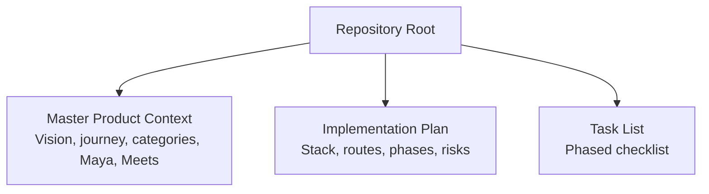
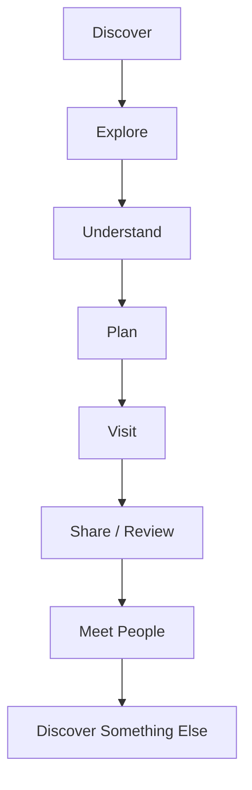
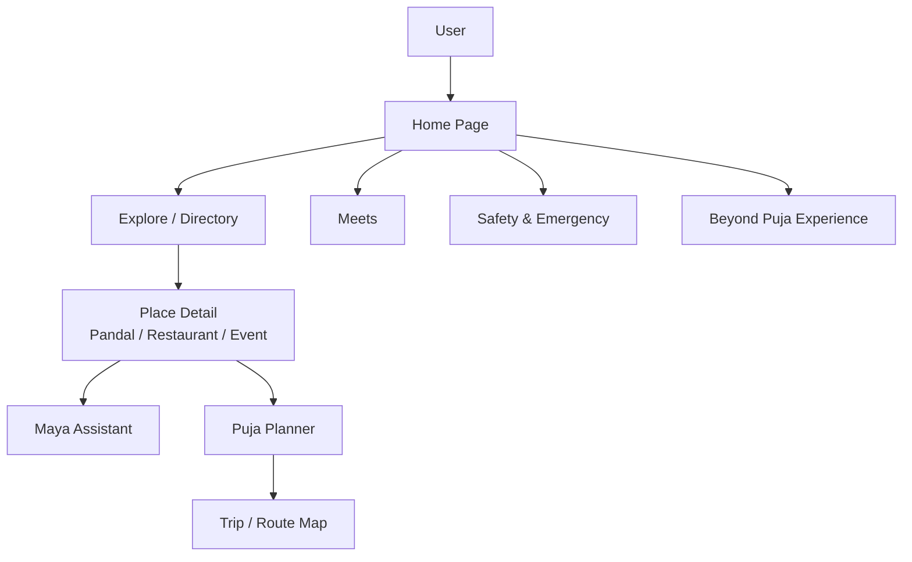
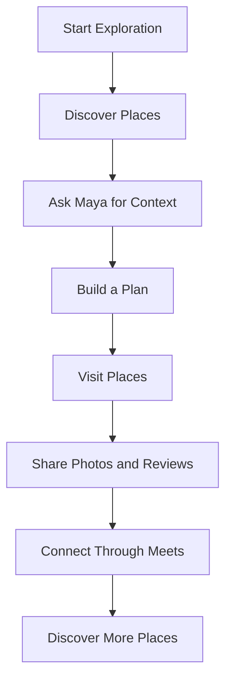
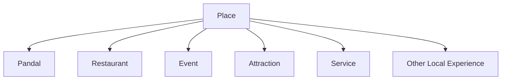
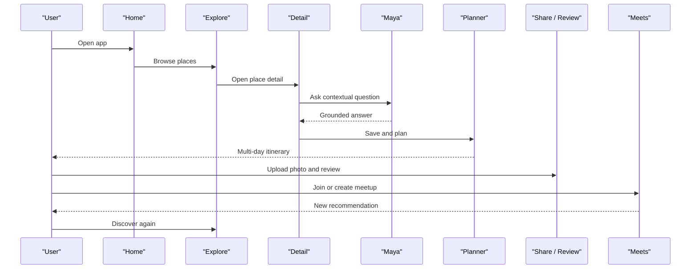
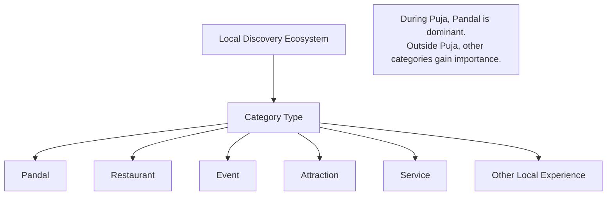
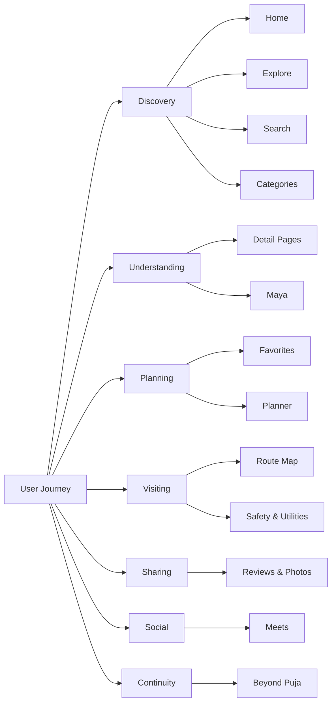

# Project Overview and Vision

<cite>
**Referenced Files in This Document**
- [Pujo_Sahayak_Master_Project_Context.md](file://Pujo_Sahayak_Master_Project_Context.md)
- [plan.md](file://tasks/plan.md)
- [todo.md](file://tasks/todo.md)
</cite>

## Table of Contents
1. [Introduction](#introduction)
2. [Project Structure](#project-structure)
3. [Core Components](#core-components)
4. [Architecture Overview](#architecture-overview)
5. [Detailed Component Analysis](#detailed-component-analysis)
6. [Dependency Analysis](#dependency-analysis)
7. [Performance Considerations](#performance-considerations)
8. [Troubleshooting Guide](#troubleshooting-guide)
9. [Conclusion](#conclusion)

## Introduction
Pujo Sahayak is a modern web application and progressive web app designed as a digital companion for exploring Kolkata during Durga Puja, while remaining useful beyond the festival season. Its core philosophy is not to build another static directory or generic chatbot, but to guide users through a continuous journey: discover where to go, understand what they are seeing, decide what to do next, connect with people, and stay informed and safe while moving around the city.

The product’s main value proposition combines discovery, intelligence, planning, community, utility, memory, and continuity. During Puja, pandals are central; outside Puja, the same platform supports restaurants, events, local experiences, offers, transport, safety, and social meetups. The result is a seasonal focus on Durga Puja layered over a broader local-discovery ecosystem.

This document explains the product vision, user journey, audience, cultural context, and how pandals fit into the wider place hierarchy. It is based on the master product context and implementation plan for the project.

**Section sources**
- [Pujo_Sahayak_Master_Project_Context.md:1-18](file://Pujo_Sahayak_Master_Project_Context.md#L1-L18)
- [plan.md:1-18](file://tasks/plan.md#L1-L18)

## Project Structure
At this stage, the repository contains the master product context that defines the product vision, navigation, features, and conceptual model, along with an implementation plan and task list for building the React + Vite PWA.

**Diagram sources**
- [Pujo_Sahayak_Master_Project_Context.md:1-18](file://Pujo_Sahayak_Master_Project_Context.md#L1-L18)
- [plan.md:1-18](file://tasks/plan.md#L1-L18)
- [todo.md:1-10](file://tasks/todo.md#L1-L10)

**Section sources**
- [Pujo_Sahayak_Master_Project_Context.md:1-18](file://Pujo_Sahayak_Master_Project_Context.md#L1-L18)
- [plan.md:1-18](file://tasks/plan.md#L1-L18)
- [todo.md:1-10](file://tasks/todo.md#L1-L10)

## Core Components
The product is organized around a single user journey rather than unrelated features. The flow starts with discovery and continues through exploration, understanding, planning, visiting, sharing or reviewing, meeting people, and discovering something else. This creates a continuous loop instead of a one-time tool.

Key components include:
- Discovery surfaces such as Home, Explore, Search, and Categories.
- Intelligence through Maya, the contextual AI assistant.
- Planning via the Puja Planner and route map.
- Community through the Meets page and interest-based connections.
- Utility including transport, services, safety, and emergency information.
- Memory through saved places, visited places, photos, reviews, and plans.
- Continuity by supporting local discovery beyond Durga Puja.

**Diagram sources**
- [Pujo_Sahayak_Master_Project_Context.md:21-43](file://Pujo_Sahayak_Master_Project_Context.md#L21-L43)

**Section sources**
- [Pujo_Sahayak_Master_Project_Context.md:21-43](file://Pujo_Sahayak_Master_Project_Context.md#L21-L43)
- [Pujo_Sahayak_Master_Project_Context.md:77-100](file://Pujo_Sahayak_Master_Project_Context.md#L77-L100)

## Architecture Overview
Conceptually, Pujo Sahayak is a mobile-first local-discovery platform with a seasonal focus on Durga Puja. The architecture emphasizes:
- A primary navigation structure centered on Home, Favorites, Search, Categories, and Meets.
- An always-accessible AI assistant named Maya.
- Rich detail pages for places, especially pandals.
- A planner that can evolve into an AI-assisted experience.
- Social features for finding or organizing meetups.
- Utility and safety tools for real-world navigation and support.
- A “Beyond Puja” experience to keep the app relevant year-round.

**Diagram sources**
- [Pujo_Sahayak_Master_Project_Context.md:140-158](file://Pujo_Sahayak_Master_Project_Context.md#L140-L158)
- [Pujo_Sahayak_Master_Project_Context.md:160-284](file://Pujo_Sahayak_Master_Project_Context.md#L160-L284)
- [Pujo_Sahayak_Master_Project_Context.md:353-445](file://Pujo_Sahayak_Master_Project_Context.md#L353-L445)
- [Pujo_Sahayak_Master_Project_Context.md:664-773](file://Pujo_Sahayak_Master_Project_Context.md#L664-L773)
- [plan.md:19-40](file://tasks/plan.md#L19-L40)

**Section sources**
- [Pujo_Sahayak_Master_Project_Context.md:140-158](file://Pujo_Sahayak_Master_Project_Context.md#L140-L158)
- [plan.md:19-40](file://tasks/plan.md#L19-L40)

## Detailed Component Analysis

### Product Philosophy and Value Proposition
The product philosophy centers on guiding users through a complete exploration lifecycle. Instead of treating features as isolated tools, every part of the app should support the same journey: from discovering a place to understanding it, planning around it, visiting it, sharing the experience, connecting with others, and discovering more.

The main value proposition includes:
- Discovery: Find pandals, restaurants, events, and useful places.
- Intelligence: Ask Maya contextual questions about what you see or want to do.
- Planning: Create multi-stop Puja plans and itineraries.
- Community: Find or organize meetups with shared interests.
- Utility: Access transport, emergency, and nearby-service information.
- Memory: Save places, track visits, store photos and reviews.
- Continuity: Remain useful outside the Durga Puja season through other local discovery features.

**Diagram sources**
- [Pujo_Sahayak_Master_Project_Context.md:21-43](file://Pujo_Sahayak_Master_Project_Context.md#L21-L43)
- [Pujo_Sahayak_Master_Project_Context.md:77-100](file://Pujo_Sahayak_Master_Project_Context.md#L77-L100)

**Section sources**
- [Pujo_Sahayak_Master_Project_Context.md:21-43](file://Pujo_Sahayak_Master_Project_Context.md#L21-L43)
- [Pujo_Sahayak_Master_Project_Context.md:77-100](file://Pujo_Sahayak_Master_Project_Context.md#L77-L100)

### Why This Is Not Only a Puja App
Durga Puja is the strongest initial use case because it naturally drives massive movement, pandal exploration, food discovery, transportation needs, events, meetups, shopping, local experiences, safety requirements, content generation, and route planning. However, the platform is intentionally broader.

Conceptually, the place hierarchy treats pandal as one category among many:
- Place
  - Pandal
  - Restaurant
  - Event
  - Attraction
  - Service
  - Other local experience

During Puja, pandals dominate. Outside Puja, the same discovery, planning, social, and utility layers can support restaurants, events, attractions, services, and other local experiences.

**Diagram sources**
- [Pujo_Sahayak_Master_Project_Context.md:104-138](file://Pujo_Sahayak_Master_Project_Context.md#L104-L138)

**Section sources**
- [Pujo_Sahayak_Master_Project_Context.md:104-138](file://Pujo_Sahayak_Master_Project_Context.md#L104-L138)

### Target Audience Analysis
The target audience can be grouped into three overlapping segments:

- Tourists: Visitors who need help navigating Kolkata, understanding puja culture, finding reliable places, avoiding overly crowded spots, and staying safe.
- Locals: Residents who already know parts of the city but want curated recommendations, better planning tools, updated event information, and community-driven insights.
- Social explorers: Users who enjoy activity-based social discovery, such as photography walks, food crawls, heritage tours, family-friendly exploration, and group pandal hopping.

The app supports these audiences through:
- Discovery and search tailored to location and interests.
- Maya providing contextual explanations and guidance.
- Planning tools for individuals and groups.
- Meets for activity-based social discovery.
- Safety and utility features for real-world confidence.

**Section sources**
- [Pujo_Sahayak_Master_Project_Context.md:664-750](file://Pujo_Sahayak_Master_Project_Context.md#L664-L750)
- [Pujo_Sahayak_Master_Project_Context.md:447-556](file://Pujo_Sahayak_Master_Project_Context.md#L447-L556)

### Cultural Context of Durga Puja in Kolkata
Durga Puja is not just a festival; it is a city-wide cultural event that shapes movement, culture, food, art, community, and daily life in Kolkata. For Pujo Sahayak, this means:
- Pandals are cultural landmarks, not just locations.
- Themes, stories, symbolism, and artists matter.
- Crowds, timing, transport, and safety are important practical concerns.
- Food, shopping, and local experiences are part of the overall experience.
- Content creation, reviews, and photos help preserve and share memories.
- The app must remain respectful, grounded, and useful both during and after the festival.

The design reflects this by making pandal details rich, allowing users to understand themes and stories, integrating Maya for contextual explanation, and keeping the platform open to other local experiences beyond puja.

**Section sources**
- [Pujo_Sahayak_Master_Project_Context.md:1-18](file://Pujo_Sahayak_Master_Project_Context.md#L1-L18)
- [Pujo_Sahayak_Master_Project_Context.md:104-138](file://Pujo_Sahayak_Master_Project_Context.md#L104-L138)
- [Pujo_Sahayak_Master_Project_Context.md:608-662](file://Pujo_Sahayak_Master_Project_Context.md#L608-L662)

### User Journey Flow
The intended user journey is cyclical and continuous:

1. Discover: The user opens the app and sees relevant places, sponsored highlights, restaurants, offers, events, and continue-where-you-left-off suggestions.
2. Explore: The user browses pandals, restaurants, events, or other categories using lists, maps, filters, and trending sections.
3. Understand: The user opens a detail page and uses Maya to learn about themes, stories, transport, nearby options, and crowd-related advice.
4. Plan: The user saves places, builds a multi-day Puja plan, and optionally optimizes it with AI-assisted suggestions.
5. Visit: The user navigates to places, marks visits, and tracks progress through the trip or route map.
6. Share / Review: The user uploads photos, writes reviews, and contributes to the community knowledge base.
7. Meet People: The user joins or creates meetups aligned with interests like photography, food, heritage, or night exploration.
8. Discover Again: Based on recent activity, location, and preferences, the app recommends new places, restarting the cycle.

**Diagram sources**
- [Pujo_Sahayak_Master_Project_Context.md:21-43](file://Pujo_Sahayak_Master_Project_Context.md#L21-L43)
- [Pujo_Sahayak_Master_Project_Context.md:160-284](file://Pujo_Sahayak_Master_Project_Context.md#L160-L284)
- [Pujo_Sahayak_Master_Project_Context.md:353-445](file://Pujo_Sahayak_Master_Project_Context.md#L353-L445)
- [Pujo_Sahayak_Master_Project_Context.md:608-662](file://Pujo_Sahayak_Master_Project_Context.md#L608-L662)
- [Pujo_Sahayak_Master_Project_Context.md:664-773](file://Pujo_Sahayak_Master_Project_Context.md#L664-L773)

**Section sources**
- [Pujo_Sahayak_Master_Project_Context.md:21-43](file://Pujo_Sahayak_Master_Project_Context.md#L21-L43)
- [Pujo_Sahayak_Master_Project_Context.md:160-284](file://Pujo_Sahayak_Master_Project_Context.md#L160-L284)
- [Pujo_Sahayak_Master_Project_Context.md:353-445](file://Pujo_Sahayak_Master_Project_Context.md#L353-L445)
- [Pujo_Sahayak_Master_Project_Context.md:608-662](file://Pujo_Sahayak_Master_Project_Context.md#L608-L662)
- [Pujo_Sahayak_Master_Project_Context.md:664-773](file://Pujo_Sahayak_Master_Project_Context.md#L664-L773)

### Conceptual Understanding of Pandal Placement in the Place Hierarchy
Pandal is the most important category during Durga Puja, but it is not the only category. The conceptual hierarchy treats all local experiences as types of places. This allows the app to:
- Keep pandals central during the festival.
- Support restaurants, events, attractions, services, and other experiences at other times.
- Use the same discovery, planning, social, and utility systems across categories.
- Avoid becoming a narrow festival-only app if user retention depends on year-round usefulness.

**Diagram sources**
- [Pujo_Sahayak_Master_Project_Context.md:104-138](file://Pujo_Sahayak_Master_Project_Context.md#L104-L138)

**Section sources**
- [Pujo_Sahayak_Master_Project_Context.md:104-138](file://Pujo_Sahayak_Master_Project_Context.md#L104-L138)

## Dependency Analysis
From a product-design perspective, the main dependencies are between the user journey and the feature modules:
- Discovery depends on Home, Explore, Search, and Categories.
- Understanding depends on detail pages and Maya.
- Planning depends on favorites, saved places, and the planner.
- Visiting depends on navigation, route mapping, and utility data.
- Sharing depends on user-generated content and reviews.
- Meeting people depends on the Meets system and interest tags.
- Continuity depends on off-season content and broader local discovery.

**Diagram sources**
- [Pujo_Sahayak_Master_Project_Context.md:140-158](file://Pujo_Sahayak_Master_Project_Context.md#L140-L158)
- [Pujo_Sahayak_Master_Project_Context.md:160-284](file://Pujo_Sahayak_Master_Project_Context.md#L160-L284)
- [Pujo_Sahayak_Master_Project_Context.md:320-445](file://Pujo_Sahayak_Master_Project_Context.md#L320-L445)
- [Pujo_Sahayak_Master_Project_Context.md:664-773](file://Pujo_Sahayak_Master_Project_Context.md#L664-L773)

**Section sources**
- [Pujo_Sahayak_Master_Project_Context.md:140-158](file://Pujo_Sahayak_Master_Project_Context.md#L140-L158)
- [Pujo_Sahayak_Master_Project_Context.md:160-284](file://Pujo_Sahayak_Master_Project_Context.md#L160-L284)
- [Pujo_Sahayak_Master_Project_Context.md:320-445](file://Pujo_Sahayak_Master_Project_Context.md#L320-L445)
- [Pujo_Sahayak_Master_Project_Context.md:664-773](file://Pujo_Sahayak_Master_Project_Context.md#L664-L773)

## Performance Considerations
This section focuses on product-level performance considerations rather than code-level optimization:
- Keep the primary navigation simple and mobile-first so users can move quickly from discovery to action.
- Avoid turning the app into a coupon site or generic e-commerce marketplace unless explicitly finalized.
- Present AI-generated plans as suggestions, not guaranteed optimal routes.
- Use grounded answers from the dataset rather than hallucinated information.
- Preserve continuity by remembering unfinished searches, routes, and sessions.
- Balance promotional content with organic recommendations so the experience remains trustworthy.

These principles help maintain usability, trust, and retention across both the Puja season and the rest of the year.

[No sources needed since this section provides general guidance]

## Troubleshooting Guide
When diagnosing product or UX issues, refer back to the documented flows and constraints:
- If users cannot find places, verify that Home, Explore, Search, and Categories are working together.
- If Maya feels unhelpful, check whether it is grounded in the dataset and aware of current context such as the selected pandal or restaurant.
- If planning feels overwhelming, ensure the planner presents suggestions clearly and does not claim guaranteed optimal routes.
- If social features feel unclear, confirm that Meets are framed as activity-based social discovery, not dating-style matching.
- If retention drops after Puja, validate that the “Beyond Puja” experience and broader local discovery features are visible and useful.

**Section sources**
- [Pujo_Sahayak_Master_Project_Context.md:404-445](file://Pujo_Sahayak_Master_Project_Context.md#L404-L445)
- [Pujo_Sahayak_Master_Project_Context.md:558-662](file://Pujo_Sahayak_Master_Project_Context.md#L558-L662)
- [Pujo_Sahayak_Master_Project_Context.md:664-750](file://Pujo_Sahayak_Master_Project_Context.md#L664-L750)
- [plan.md:71-86](file://tasks/plan.md#L71-L86)

## Conclusion
Pujo Sahayak is best understood as a digital companion for exploring Kolkata during Durga Puja, built around a continuous user journey rather than isolated features. Its core strength lies in combining discovery, intelligence, planning, community, utility, memory, and continuity. While Durga Puja is the seasonal anchor, the platform is designed to grow into a broader local-discovery ecosystem. By treating pandals as a key category within a larger place hierarchy, the app can remain culturally meaningful during the festival and practically useful throughout the year.

[No sources needed since this section summarizes without analyzing specific files]