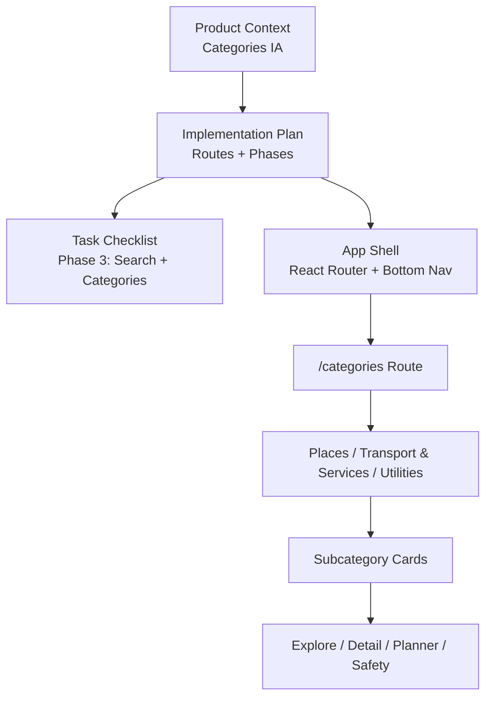
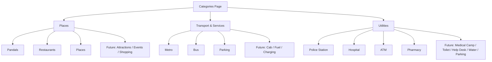
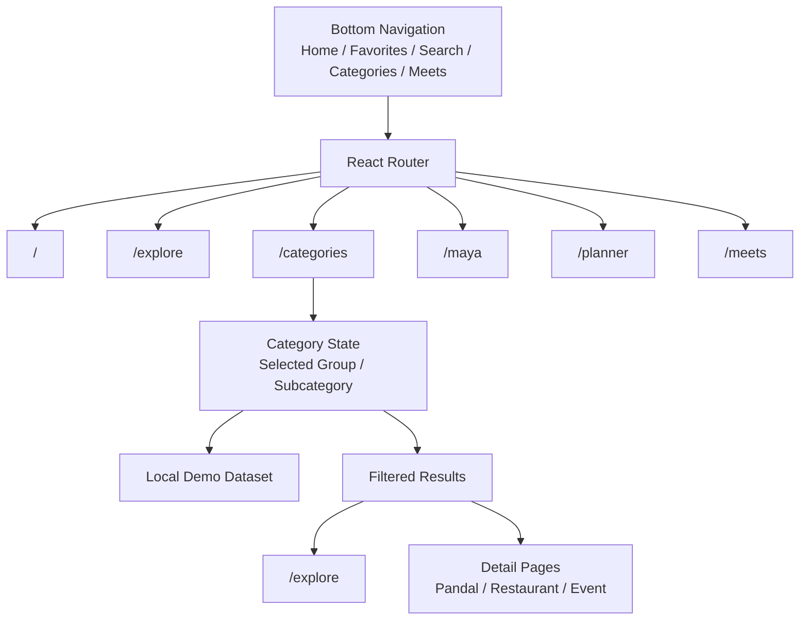
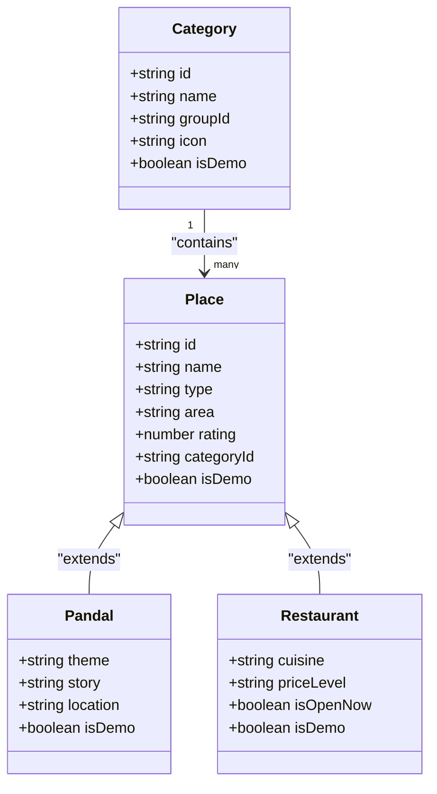
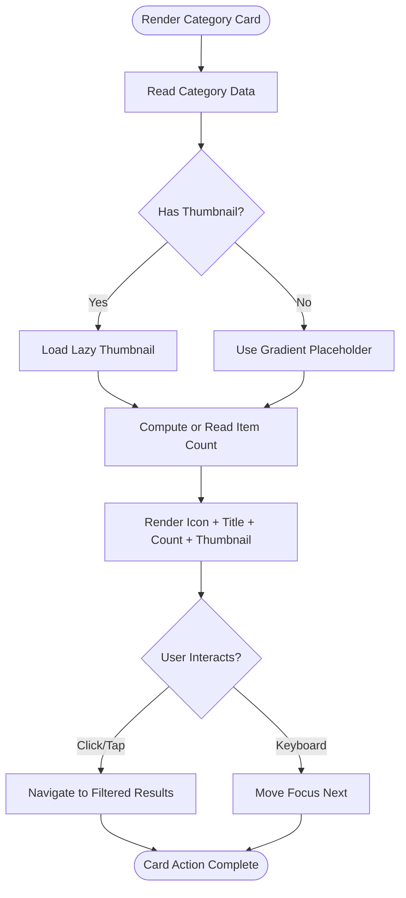
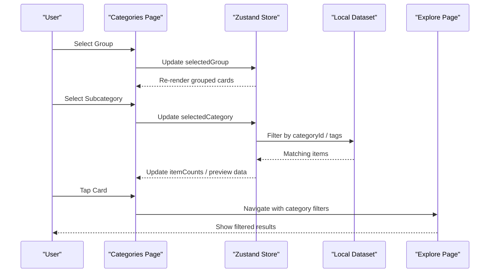
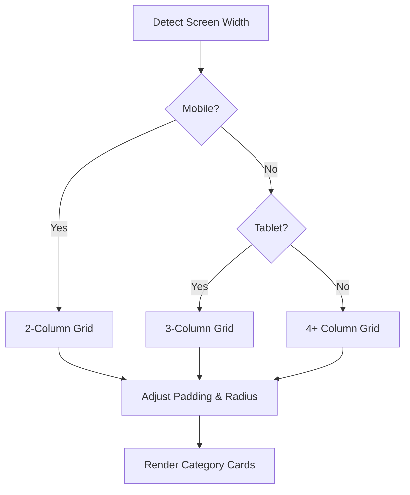
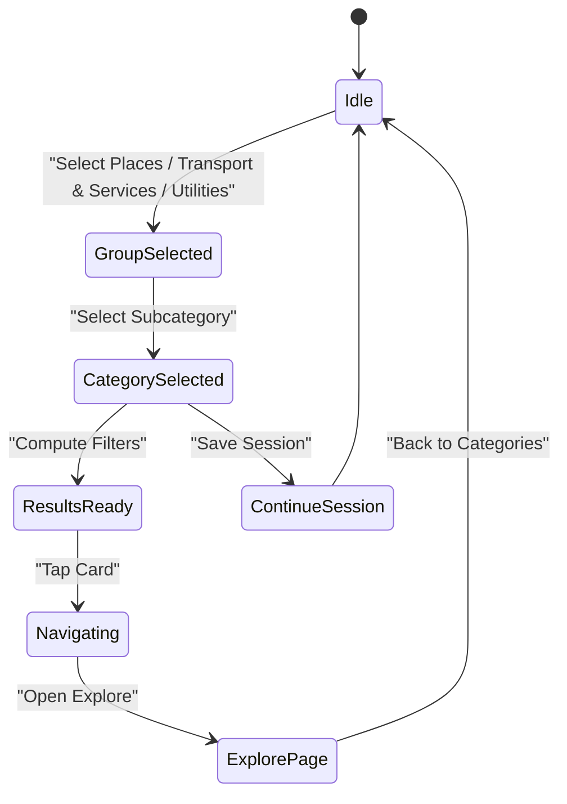
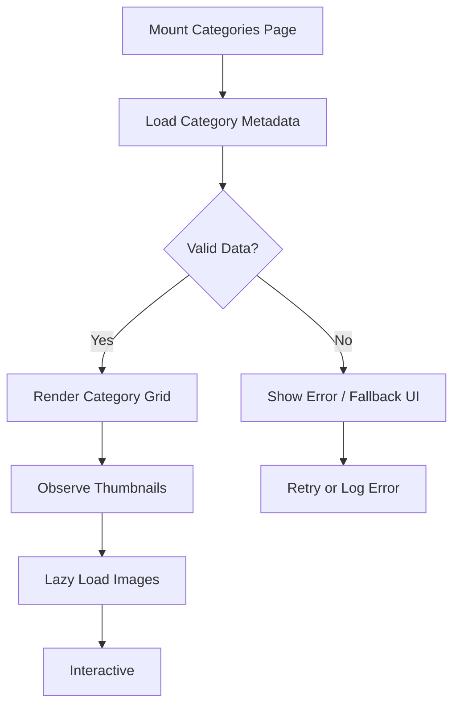
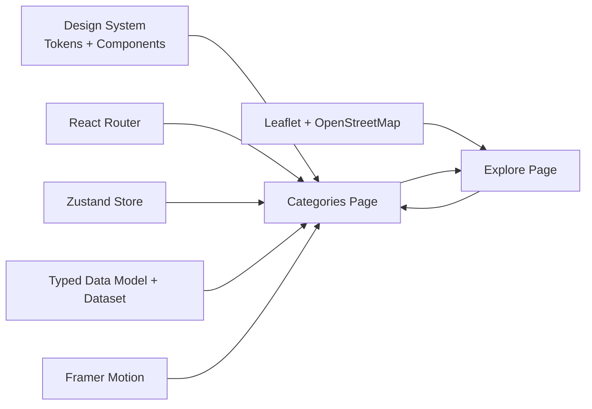

# Categories Page Implementation

<cite>
**Referenced Files in This Document**
- [Pujo_Sahayak_Master_Project_Context.md](file://Pujo_Sahayak_Master_Project_Context.md)
- [plan.md](file://tasks/plan.md)
- [todo.md](file://tasks/todo.md)
</cite>

## Table of Contents
1. [Introduction](#introduction)
2. [Project Structure](#project-structure)
3. [Core Components](#core-components)
4. [Architecture Overview](#architecture-overview)
5. [Detailed Component Analysis](#detailed-component-analysis)
6. [Dependency Analysis](#dependency-analysis)
7. [Performance Considerations](#performance-considerations)
8. [Troubleshooting Guide](#troubleshooting-guide)
9. [Conclusion](#conclusion)
10. [Appendices](#appendices)

## Introduction
This document explains the implementation approach for the **Categories Page** in Pujo Sahayak. The page is a structured discovery hub that groups local content into three main category families:

- Places
- Transport & Services
- Utilities

The goal is to help users quickly navigate from broad categories to specific subcategories, then continue into explore, detail, planning, or safety flows. The documentation covers hierarchical organization, card components, filtering logic, responsive grid layout, navigation state management, dynamic content loading, and accessibility considerations.

## Project Structure
At this stage, the repository contains product context and implementation planning rather than full source code. The relevant files are:

- `Pujo_Sahayak_Master_Project_Context.md`: Product philosophy, navigation model, and explicit description of the Categories page structure.
- `tasks/plan.md`: High-level architecture decisions, route mapping, and phase breakdown including Categories.
- `tasks/todo.md`: Task checklist where the Categories screen is part of Phase 3.

**Diagram sources**
- [Pujo_Sahayak_Master_Project_Context.md:140-158](file://Pujo_Sahayak_Master_Project_Context.md#L140-L158)
- [Pujo_Sahayak_Master_Project_Context.md:495-556](file://Pujo_Sahayak_Master_Project_Context.md#L495-L556)
- [plan.md:19-39](file://tasks/plan.md#L19-L39)
- [todo.md:42-43](file://tasks/todo.md#L42-L43)

**Section sources**
- [Pujo_Sahayak_Master_Project_Context.md:140-158](file://Pujo_Sahayak_Master_Project_Context.md#L140-L158)
- [Pujo_Sahayak_Master_Project_Context.md:495-556](file://Pujo_Sahayak_Master_Project_Context.md#L495-L556)
- [plan.md:19-39](file://tasks/plan.md#L19-L39)
- [todo.md:42-43](file://tasks/todo.md#L42-L43)

## Core Components
The Categories Page should be treated as a **discovery entry point**, not just a static list. Its core responsibilities are:

| Responsibility | Description |
|---|---|
| Category grouping | Organize items under Places, Transport & Services, and Utilities. |
| Hierarchical navigation | Allow users to drill down from group → subcategory → filtered results. |
| Card presentation | Show iconography, item counts, and preview thumbnails where available. |
| Filtering integration | Connect category selection with the main Explore experience. |
| Dynamic loading | Load or filter dataset entries based on selected category. |
| Accessibility | Provide keyboard, focus, and screen-reader-friendly navigation. |
| Responsiveness | Adapt the grid from mobile to tablet and desktop layouts. |

### Category Groups and Subcategories
The product context defines the following structure:

- **Places**: Pandals, Restaurants, Places; potential future additions include Attractions, Events, Shopping.
- **Transport & Services**: Metro, Bus, Parking; potential future additions include Cab/ride information, Fuel, Charging.
- **Utilities**: Police Station, Hospital, ATM, Pharmacy; potential additions include Medical camp, Toilet, Help desk, Drinking water, Parking.

This hierarchy should remain flexible so new subcategories can be added without changing the top-level group structure.

**Diagram sources**
- [Pujo_Sahayak_Master_Project_Context.md:495-556](file://Pujo_Sahayak_Master_Project_Context.md#L495-L556)

**Section sources**
- [Pujo_Sahayak_Master_Project_Context.md:495-556](file://Pujo_Sahayak_Master_Project_Context.md#L495-L556)

## Architecture Overview
The Categories Page sits inside the app’s primary navigation and routes system. According to the implementation plan, the bottom navigation includes five tabs, and `/categories` is one of the documented routes.

**Diagram sources**
- [plan.md:19-39](file://tasks/plan.md#L19-L39)
- [todo.md:42-43](file://tasks/todo.md#L42-L43)

### Data Model Integration
The implementation plan specifies a typed data model including `Category`, along with entities such as `Place`, `Pandal`, `Restaurant`, `Event`, `Meetup`, `Review`, `Photo`, `PlanDay`, `Offer`, and `SafetyPoint`. The Categories Page should consume this model rather than maintaining its own parallel category schema.

Recommended relationships:

- A `Category` represents a navigable bucket (for example, “Pandals” or “Metro”).
- A `Place` may have a `categoryId` or `categoryTags` field.
- The dataset should mark demo data clearly, consistent with the project-wide rule that demo data is explicitly marked.

**Diagram sources**
- [todo.md:13-14](file://tasks/todo.md#L13-L14)
- [plan.md:45-46](file://tasks/plan.md#L45-L46)

**Section sources**
- [plan.md:19-39](file://tasks/plan.md#L19-L39)
- [todo.md:13-14](file://tasks/todo.md#L13-L14)

## Detailed Component Analysis

### Category Group Header
Each top-level group should have:

- A clear heading matching the product context: Places, Transport & Services, Utilities.
- Optional supporting text explaining what belongs in the group.
- A visual separator between groups to reinforce hierarchy.

Accessibility guidance:

- Use semantic headings (`h2` or equivalent) for each group.
- Ensure heading order is logical and does not skip levels.
- Avoid decorative-only icons without accessible labels.

### Category Card Component
A category card should represent a subcategory and support:

- Iconography representing the subcategory.
- Title text.
- Item count when available.
- Preview thumbnail when applicable.
- Click/tap behavior that navigates to filtered results.

Recommended card attributes:

| Attribute | Purpose |
|---|---|
| `id` | Unique identifier for analytics and routing. |
| `name` | Display label. |
| `icon` | Visual representation. |
| `thumbnail` | Optional preview image or gradient placeholder. |
| `itemCount` | Number of matching places or services. |
| `categoryId` | Link to the underlying category model. |
| `groupId` | Parent group for filtering and breadcrumbs. |
| `isDemo` | Indicates whether the entry is demo data. |

Complexity considerations:

- Rendering a flat list of cards is O(n).
- If thumbnails are heavy images, use lazy loading and placeholders.
- If item counts are computed dynamically, cache them per category to avoid repeated filtering.

**Diagram sources**
- [todo.md:10-11](file://tasks/todo.md#L10-L11)
- [todo.md:42-43](file://tasks/todo.md#L42-L43)

**Section sources**
- [todo.md:10-11](file://tasks/todo.md#L10-L11)
- [todo.md:42-43](file://tasks/todo.md#L42-L43)

### Category Filtering Logic
The Categories Page should integrate with the main Explore functionality by translating user category selection into filters applied to the local dataset.

Filtering flow:

1. User selects a top-level group: Places, Transport & Services, or Utilities.
2. User selects a subcategory: for example, Pandals, Metro, Hospital.
3. The app computes the set of matching places/services from the dataset.
4. The result is either:
   - Rendered directly on the Categories page, or
   - Passed to the Explore page as pre-applied filters.

**Diagram sources**
- [plan.md:9-12](file://tasks/plan.md#L9-L12)
- [todo.md:42-43](file://tasks/todo.md#L42-L43)

**Section sources**
- [plan.md:9-12](file://tasks/plan.md#L9-L12)
- [todo.md:42-43](file://tasks/todo.md#L42-L43)

### Responsive Grid Layout
The Categories Page should adapt to different screen sizes while keeping the mobile-first principle emphasized in the product context.

Suggested breakpoints and behavior:

| Screen Size | Columns | Behavior |
|---|---:|---|
| Mobile | 2 columns | Compact cards, small thumbnails, emphasis on tap targets. |
| Tablet | 3–4 columns | Larger thumbnails, more visible item counts. |
| Desktop | 4+ columns | Wider grid, optional side-by-side group panels. |

Layout rules:

- Keep card aspect ratios consistent.
- Preserve minimum touch target size on mobile.
- Avoid horizontal scrolling unless necessary.
- Maintain readable typography and spacing across breakpoints.

[No sources needed since this section provides general layout guidance]

### Navigation State Management
The implementation plan specifies Zustand with persist middleware for client state. For the Categories Page, recommended state fields include:

- `selectedGroup`: Current top-level group.
- `selectedCategory`: Current subcategory.
- `searchQuery`: Shared query if Categories integrates with search.
- `filters`: Additional filters such as area, distance, crowd level.
- `continueWhereLeftOff`: Remember last explored category session.

Persistence:

- Persist category navigation state so users can return to their last exploration.
- Respect the “Continue Where You Left Off” concept described in the product context.

**Diagram sources**
- [plan.md:9-12](file://tasks/plan.md#L9-L12)
- [Pujo_Sahayak_Master_Project_Context.md:286-318](file://Pujo_Sahayak_Master_Project_Context.md#L286-L318)

**Section sources**
- [plan.md:9-12](file://tasks/plan.md#L9-L12)
- [Pujo_Sahayak_Master_Project_Context.md:286-318](file://Pujo_Sahayak_Master_Project_Context.md#286-318)

### Dynamic Content Loading
Dynamic loading should handle:

- Initial load of category metadata.
- Lazy loading of thumbnails.
- Computation of item counts.
- Error handling for missing or invalid data.
- Demo-data markers to avoid presenting simulated data as verified facts.

Loading strategy:

- Load lightweight category metadata first.
- Load thumbnails lazily as they enter the viewport.
- Compute item counts once per category and cache them.
- Show skeleton or placeholder states during loading.

[No sources needed since this section provides general loading guidance]

### Accessibility Considerations
Accessibility is critical for category navigation, especially because users may rely on assistive technologies while exploring Kolkata during Puja.

Key requirements:

- **Semantic structure**: Use proper headings, lists, and buttons.
- **Keyboard navigation**: All category cards must be reachable via Tab and activatable via Enter or Space.
- **Focus management**: When navigating to filtered results, move focus appropriately.
- **Screen reader labels**: Icons and thumbnails should not be the only meaning; provide text alternatives.
- **Color contrast**: Ensure text and icons meet contrast guidelines.
- **Reduced motion**: Honor reduced-motion preferences for animations.
- **Language support**: Support Bengali and English strings as indicated by the implementation plan.

Recommended ARIA patterns:

- Use `role="list"` and `role="listitem"` for category grids if not using native HTML lists.
- Use `aria-label` or `aria-labelledby` for icon-only controls.
- Announce active category changes when they occur programmatically.
- Mark demo data clearly so screen readers do not imply false certainty.

**Section sources**
- [plan.md:9-15](file://tasks/plan.md#L9-L15)
- [todo.md:10-11](file://tasks/todo.md#L10-L11)
- [todo.md:71-72](file://tasks/todo.md#L71-L72)

## Dependency Analysis
The Categories Page depends on several shared systems defined in the implementation plan and task checklist.

**Diagram sources**
- [plan.md:9-15](file://tasks/plan.md#L9-L15)
- [plan.md:19-39](file://tasks/plan.md#L19-L39)
- [todo.md:10-14](file://tasks/todo.md#L10-L14)

**Section sources**
- [plan.md:9-15](file://tasks/plan.md#L9-L15)
- [plan.md:19-39](file://tasks/plan.md#L19-L39)
- [todo.md:10-14](file://tasks/todo.md#L10-L14)

## Performance Considerations
To keep the Categories Page fast and smooth:

- Avoid recomputing category counts on every render; memoize or cache results.
- Use lazy loading for thumbnails and heavy assets.
- Prefer lightweight SVG icons over large raster images where possible.
- Debounce search input if Categories shares a search bar with the Search page.
- Keep the initial payload small; load detailed place data only after navigation.
- Respect reduced-motion settings to avoid unnecessary animation costs.

[No sources needed since this section provides general performance guidance]

## Troubleshooting Guide
Common issues and resolutions:

| Issue | Likely Cause | Resolution |
|---|---|---|
| Category cards show no thumbnails | Missing or broken image paths | Use gradient placeholders; verify asset pipeline. |
| Item counts are incorrect | Category-to-place mapping mismatch | Verify `categoryId` or tag-based filtering logic. |
| Keyboard navigation fails | Missing focusable elements or handlers | Add `tabindex`, click handlers, and Enter/Space support. |
| Screen reader announces only icons | Missing accessible labels | Add `aria-label` or descriptive text. |
| Selected category resets on reload | Missing persistence | Persist `selectedGroup` and `selectedCategory` in store. |
| Demo data looks like real data | Missing demo markers | Ensure dataset entries include `isDemo: true`. |

**Section sources**
- [todo.md:13-14](file://tasks/todo.md#L13-L14)
- [todo.md:42-43](file://tasks/todo.md#L42-L43)

## Conclusion
The Categories Page is a foundational discovery surface for Pujo Sahayak. It should present Places, Transport & Services, and Utilities as clear, navigable hierarchies, connect those choices to the broader Explore and detail flows, and remain performant, accessible, and responsive. Because the current repository snapshot focuses on product context and planning, the implementation should follow the documented architecture: React Router for navigation, Zustand for state, a typed local dataset, and reusable design-system components.

[No sources needed since this section summarizes without analyzing specific files]

## Appendices

### Appendix A: Category Data Structure Reference
Recommended fields for category-driven content:

| Field | Type | Description |
|---|---|---|
| `id` | string | Unique identifier. |
| `name` | string | Display name. |
| `groupId` | string | Parent group: Places, Transport & Services, or Utilities. |
| `icon` | string | Icon reference. |
| `thumbnail` | string | Optional preview image URL. |
| `categoryId` | string | Link to category model. |
| `itemCount` | number | Number of matching items. |
| `isDemo` | boolean | Whether the entry is demo data. |

**Section sources**
- [todo.md:13-14](file://tasks/todo.md#L13-L14)

### Appendix B: Navigation Flow Reference
The Categories Page should fit cleanly into the documented route map:

- `/categories` is the dedicated route.
- Users can reach it from the bottom navigation.
- From a category card, users can navigate to Explore with pre-applied filters.
- From Explore, users can continue to detail pages, planner, or safety features.

**Section sources**
- [plan.md:19-39](file://tasks/plan.md#L19-L39)
- [todo.md:42-43](file://tasks/todo.md#L42-L43)