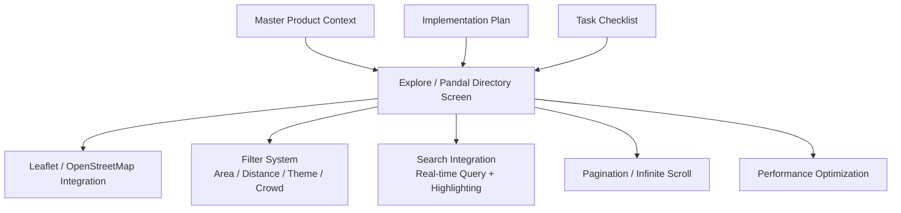
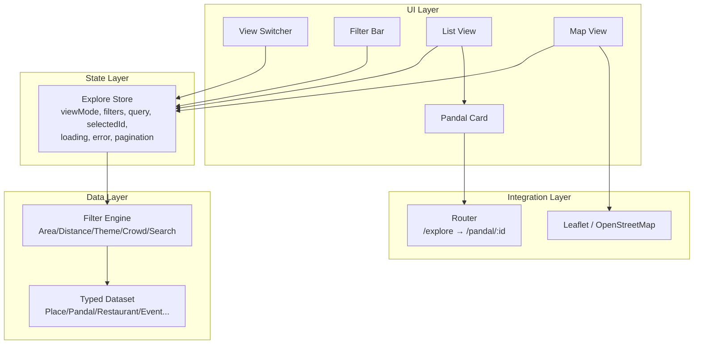
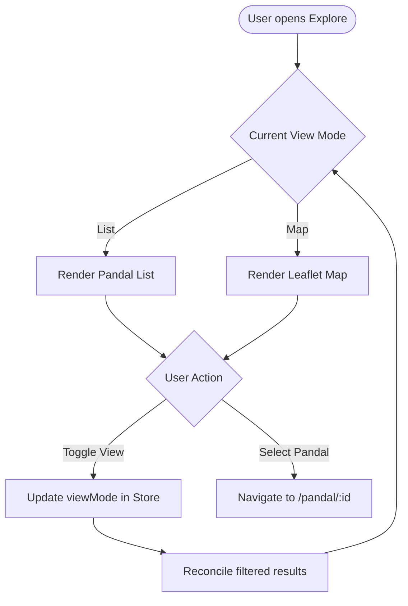
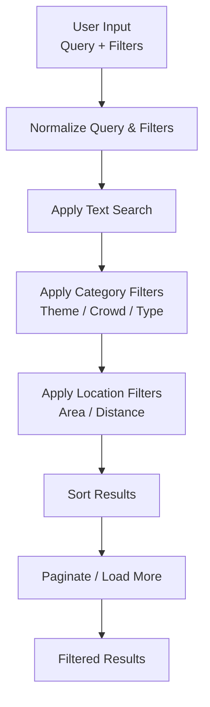
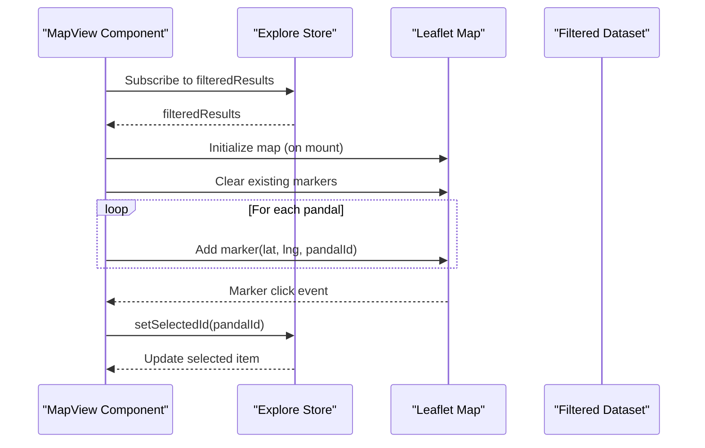
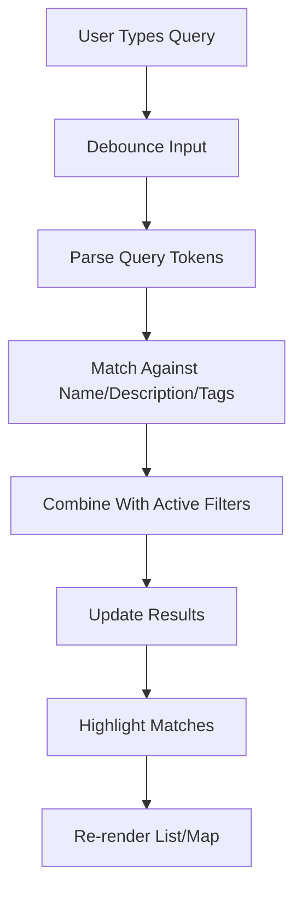
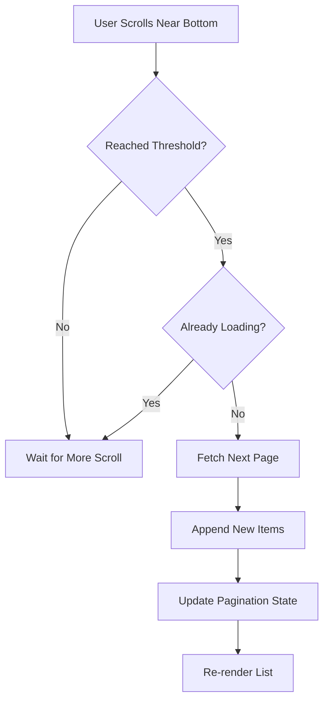
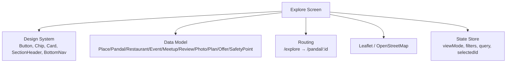

# Explore/Pandal Directory Implementation

<cite>
**Referenced Files in This Document**
- [Pujo_Sahayak_Master_Project_Context.md](file://Pujo_Sahayak_Master_Project_Context.md)
- [plan.md](file://tasks/plan.md)
- [todo.md](file://tasks/todo.md)
</cite>

## Table of Contents
1. [Introduction](#introduction)
2. [Project Structure](#project-structure)
3. [Core Components](#core-components)
4. [Architecture Overview](#architecture-overview)
5. [Detailed Component Analysis](#detailed-component-analysis)
6. [Dependency Analysis](#dependency-analysis)
7. [Performance Considerations](#performance-considerations)
8. [Troubleshooting Guide](#troubleshooting-guide)
9. [Conclusion](#conclusion)

## Introduction
This document is an implementation guide for the Explore/Pandal Directory screen. It explains how the screen should support a dual-view architecture with seamless switching between list and map views, an advanced filtering system covering location-based filters, category filters, and custom search parameters, integration with Leaflet/OpenStreetMap for interactive mapping, search integration with real-time query processing and result highlighting, pagination or infinite scrolling for large datasets, and performance optimization strategies for smooth transitions and efficient rendering of large pandal datasets.

The guidance is grounded in the project’s product context and task plan:
- The application is a modern local-discovery platform centered around Durga Puja, designed to remain useful beyond the festival season.
- The Explore/Pandal Directory is explicitly planned as part of Phase 2 discovery core, with a List/Map toggle using Leaflet markers, filter chips for Area/Distance/Theme/Crowd, and pandal cards showing rating, distance, crowd tag, theme, and actions such as View Details and Route.
- The data model treats Pandal as a specialized type of Place, enabling broader local discovery and off-season expansion.

**Section sources**
- [Pujo_Sahayak_Master_Project_Context.md:1-18](file://Pujo_Sahayak_Master_Project_Context.md#L1-L18)
- [Pujo_Sahayak_Master_Project_Context.md:104-137](file://Pujo_Sahayak_Master_Project_Context.md#L104-L137)
- [Pujo_Sahayak_Master_Project_Context.md:1232-1260](file://Pujo_Sahayak_Master_Project_Context.md#L1232-L1260)
- [plan.md:19-39](file://tasks/plan.md#L19-L39)
- [todo.md:26-27](file://tasks/todo.md#L26-L27)

## Project Structure
At this stage, the repository contains:
- A master product context document describing the overall product vision, navigation, data model, recommendation principles, safety considerations, and final product map.
- An implementation plan defining routes and phase breakdown.
- A task checklist specifying what needs to be built, including the Explore/Pandal Directory.

**Diagram sources**
- [Pujo_Sahayak_Master_Project_Context.md:1781-1858](file://Pujo_Sahayak_Master_Project_Context.md#L1781-L1858)
- [plan.md:19-39](file://tasks/plan.md#L19-L39)
- [todo.md:26-27](file://tasks/todo.md#L26-L27)

**Section sources**
- [Pujo_Sahayak_Master_Project_Context.md:1781-1858](file://Pujo_Sahayak_Master_Project_Context.md#L1781-L1858)
- [plan.md:19-39](file://tasks/plan.md#L19-L39)
- [todo.md:1-81](file://tasks/todo.md#L1-L81)

## Core Components
The Explore/Pandal Directory screen should be composed of the following core components:

- **View Switcher**: Controls whether the user sees a list view or a map view. It must provide a smooth transition and preserve scroll position and selection state when switching.
- **Filter Bar**: Contains filter chips for Area, Distance, Theme, and Crowd. It should also include a text search input that supports real-time filtering and highlights matching terms in results.
- **Pandal List View**: Renders a vertically scrollable list of pandal cards. Each card displays name, image, rating, distance, crowd level, theme, and actions (View Details, Route).
- **Pandal Map View**: Renders Leaflet/OpenStreetMap with markers for each pandal. Markers should reflect current filters and selected items. Clicking a marker can open a small info card or navigate to the detail page.
- **Result Highlighter**: Highlights matched text from search queries within pandal names, themes, descriptions, and tags.
- **Pagination or Infinite Scroller**: Loads more pandals as the user scrolls or provides explicit pagination controls. For large datasets, virtualization or windowed rendering is recommended.
- **State Manager**: Holds view mode, active filters, search query, selected pandal, loading state, error state, and pagination metadata.

These components align with the task definition for T6:
- List/Map toggle with Leaflet markers.
- Filter chips for Area/Distance/Theme/Crowd.
- Pandal cards with rating, distance, crowd tag, theme, and actions.

**Section sources**
- [todo.md:26-27](file://tasks/todo.md#L26-L27)
- [plan.md:48-49](file://tasks/plan.md#L48-L49)

## Architecture Overview
The Explore/Pandal Directory follows a component-driven architecture with clear separation of concerns:

- **Presentation Layer**: UI components for list, map, filters, and cards.
- **State Layer**: Centralized store managing view mode, filters, search, selection, and pagination.
- **Data Layer**: Typed dataset containing Places and Pandals, with geospatial coordinates and metadata.
- **Integration Layer**: Leaflet/OpenStreetMap for map rendering; optional routing to Pandal Detail and Maya.

**Diagram sources**
- [Pujo_Sahayak_Master_Project_Context.md:1232-1260](file://Pujo_Sahayak_Master_Project_Context.md#L1232-L1260)
- [plan.md:19-39](file://tasks/plan.md#L19-L39)
- [todo.md:26-27](file://tasks/todo.md#L26-L27)

## Detailed Component Analysis

### Dual-View Architecture: List and Map with Seamless Switching
The screen must support two primary views:
- **List View**: Optimized for scanning and comparing pandals by attributes like rating, distance, crowd, and theme.
- **Map View**: Optimized for spatial exploration, showing pandal locations on a Leaflet/OpenStreetMap with markers.

Key requirements:
- Smooth transition between views without losing scroll position or selection.
- Preserve filter state across view switches.
- Ensure map markers update immediately when filters change.
- Provide keyboard and accessibility support for toggling views.

Implementation approach:
- Use a single source of truth for filtered results.
- Render either list or map based on `viewMode` in the store.
- Debounce expensive operations during view transitions.
- On mobile, consider full-screen map with a floating list drawer.

**Diagram sources**
- [todo.md:26-27](file://tasks/todo.md#L26-L27)
- [plan.md:19-39](file://tasks/plan.md#L19-L39)

**Section sources**
- [todo.md:26-27](file://tasks/todo.md#L26-L27)
- [plan.md:19-39](file://tasks/plan.md#L19-L39)

### Advanced Filtering System
The filter system must support:
- **Location-based filters**: Area, Distance radius, proximity to current location.
- **Category filters**: Theme, crowd level, cuisine (for restaurants), event type.
- **Custom search parameters**: Text search across name, description, tags, and metadata.

Filter logic flow:
1. Collect active filters from UI.
2. Apply text search first if present.
3. Apply categorical filters (theme, crowd, etc.).
4. Apply location-based filters (area, distance).
5. Sort results according to default or user preference.
6. Paginate or load more results.

**Diagram sources**
- [todo.md:26-27](file://tasks/todo.md#L26-L27)
- [Pujo_Sahayak_Master_Project_Context.md:1232-1260](file://Pujo_Sahayak_Master_Project_Context.md#L1232-L1260)

**Section sources**
- [todo.md:26-27](file://tasks/todo.md#L26-L27)
- [Pujo_Sahayak_Master_Project_Context.md:1232-1260](file://Pujo_Sahayak_Master_Project_Context.md#L1232-L1260)

### Leaflet/OpenStreetMap Integration
The map view uses Leaflet with OpenStreetMap tiles to display pandal markers. Requirements:
- Initialize map only when map view is active to avoid unnecessary overhead.
- Add markers for each pandal in the filtered dataset.
- Support marker clustering for large datasets.
- Handle map events: click, zoom, move.
- Sync selected pandal between list and map.

**Diagram sources**
- [todo.md:26-27](file://tasks/todo.md#L26-L27)
- [plan.md:19-39](file://tasks/plan.md#L19-L39)

**Section sources**
- [todo.md:26-27](file://tasks/todo.md#L26-L27)
- [plan.md:19-39](file://tasks/plan.md#L19-L39)

### Search Integration with Real-Time Query Processing and Result Highlighting
Search should:
- Trigger debounced real-time filtering as the user types.
- Highlight matching substrings in pandal names, themes, and descriptions.
- Support multi-term search and fuzzy matching where appropriate.
- Reset filters when search is cleared.

**Diagram sources**
- [todo.md:42-43](file://tasks/todo.md#L42-L43)
- [plan.md:48-49](file://tasks/plan.md#L48-L49)

**Section sources**
- [todo.md:42-43](file://tasks/todo.md#L42-L43)
- [plan.md:48-49](file://tasks/plan.md#L48-L49)

### Pagination or Infinite Scrolling
For large pandal datasets:
- Implement infinite scrolling with a threshold trigger.
- Maintain cursor-based or offset-based pagination.
- Show loading indicators during data fetch.
- Preserve scroll position when switching views.
- Consider virtualization for list rendering to improve performance.

**Diagram sources**
- [todo.md:26-27](file://tasks/todo.md#L26-L27)
- [plan.md:48-49](file://tasks/plan.md#L48-L49)

**Section sources**
- [todo.md:26-27](file://tasks/todo.md#L26-L27)
- [plan.md:48-49](file://tasks/plan.md#L48-L49)

### Code Examples for View State Management, Filter Logic, and Map Interaction Handlers
While specific code files are not present in the repository yet, the implementation should follow these patterns:

- **View State Management**:
  - Use a centralized store to manage `viewMode`, `filters`, `query`, `selectedId`, `loading`, `error`, and `pagination`.
  - Derive filtered results from the store using memoized selectors.
  - Persist last viewed pandal and active filters for continuity.

- **Filter Logic**:
  - Implement a pure function that takes raw dataset and filters, returning filtered results.
  - Separate text search, category filters, and location filters into distinct steps.
  - Cache intermediate results to avoid recomputation.

- **Map Interaction Handlers**:
  - Initialize Leaflet map lazily when entering map view.
  - Add/remove markers based on filtered results.
  - Handle marker clicks to select pandals and sync with list view.
  - Respect reduced-motion preferences and handle errors gracefully.

These patterns align with the project’s emphasis on clean architecture, typed data models, and maintainable UI components.

**Section sources**
- [Pujo_Sahayak_Master_Project_Context.md:1232-1260](file://Pujo_Sahayak_Master_Project_Context.md#L1232-L1260)
- [todo.md:10-14](file://tasks/todo.md#L10-L14)
- [plan.md:45-49](file://tasks/plan.md#L45-L49)

## Dependency Analysis
The Explore/Pandal Directory depends on:
- **Design System**: Buttons, chips, cards, section headers, bottom navigation.
- **Data Model**: Place/Pandal/Restaurant/Event/Meetup/Review/Photo/Plan/Offer/SafetyPoint.
- **Routing**: Navigation to Pandal Detail and other screens.
- **Map Library**: Leaflet/OpenStreetMap for interactive mapping.
- **State Management**: Centralized store for view and filter state.

**Diagram sources**
- [todo.md:10-14](file://tasks/todo.md#L10-L14)
- [todo.md:26-27](file://tasks/todo.md#L26-L27)
- [plan.md:19-39](file://tasks/plan.md#L19-L39)

**Section sources**
- [todo.md:10-14](file://tasks/todo.md#L10-L14)
- [todo.md:26-27](file://tasks/todo.md#L26-L27)
- [plan.md:19-39](file://tasks/plan.md#L19-L39)

## Performance Considerations
To ensure smooth performance with large pandal datasets:
- **Virtualization**: Use virtualized lists to render only visible items.
- **Debouncing**: Debounce search input and filter changes.
- **Memoization**: Memoize filtered results and derived state.
- **Lazy Loading**: Load map and markers only when map view is active.
- **Marker Clustering**: Cluster nearby markers to reduce DOM nodes.
- **Image Optimization**: Lazy-load images and use responsive formats.
- **Reduced Motion**: Respect user preferences for animations and transitions.
- **Error Boundaries**: Isolate rendering failures and show fallback UI.

These optimizations align with the project’s design principles emphasizing modern, elegant, and functional UI while avoiding excessive motion or decoration.

**Section sources**
- [Pujo_Sahayak_Master_Project_Context.md:1458-1533](file://Pujo_Sahayak_Master_Project_Context.md#L1458-L1533)
- [todo.md:10-14](file://tasks/todo.md#L10-L14)

## Troubleshooting Guide
Common issues and resolutions:
- **Map Not Rendering**:
  - Ensure Leaflet is initialized only when map view is active.
  - Check for missing CSS or tile server access.
  - Validate latitude/longitude values in dataset.

- **Filters Not Applying**:
  - Verify filter logic order and precedence.
  - Check for incorrect data types in filter inputs.
  - Ensure store updates trigger re-renders.

- **Search Not Highlighting**:
  - Confirm regex or substring matching logic.
  - Ensure highlighted content is safely rendered.
  - Test with special characters and long queries.

- **Slow Scrolling or Rendering**:
  - Enable virtualization for list view.
  - Reduce number of markers or enable clustering.
  - Optimize image loading and caching.

- **State Inconsistency Between Views**:
  - Ensure filtered results are derived from a single source of truth.
  - Avoid local state duplication in list and map components.
  - Persist and restore view mode and filters correctly.

**Section sources**
- [todo.md:26-27](file://tasks/todo.md#L26-L27)
- [plan.md:48-49](file://tasks/plan.md#L48-L49)

## Conclusion
The Explore/Pandal Directory screen is a central discovery surface that combines list and map views, advanced filtering, real-time search, and interactive mapping. Its implementation should prioritize clean architecture, typed data models, performant rendering, and smooth user interactions. By following the patterns and guidelines outlined here, the screen will support both casual exploration and detailed planning, aligning with the broader product vision of Pujo Sahayak as a modern local-discovery and community platform.

[No sources needed since this section summarizes without analyzing specific files]