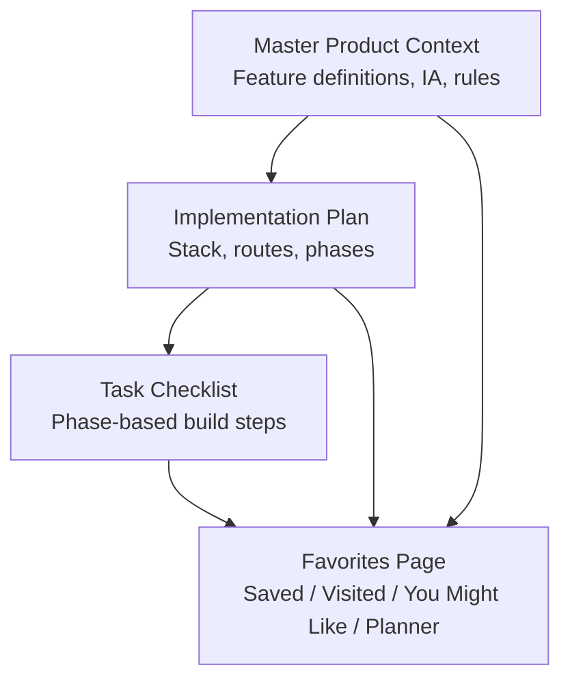
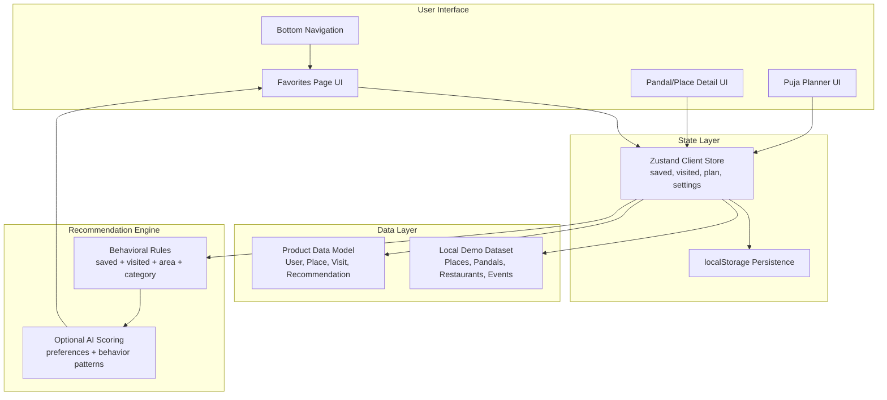
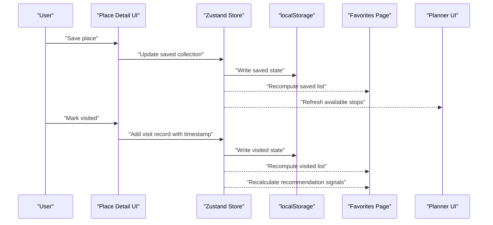
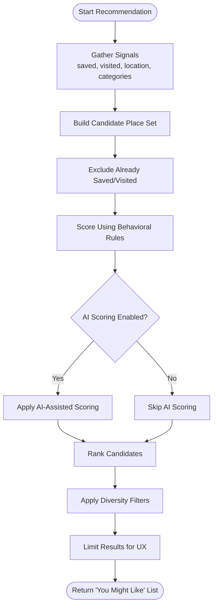
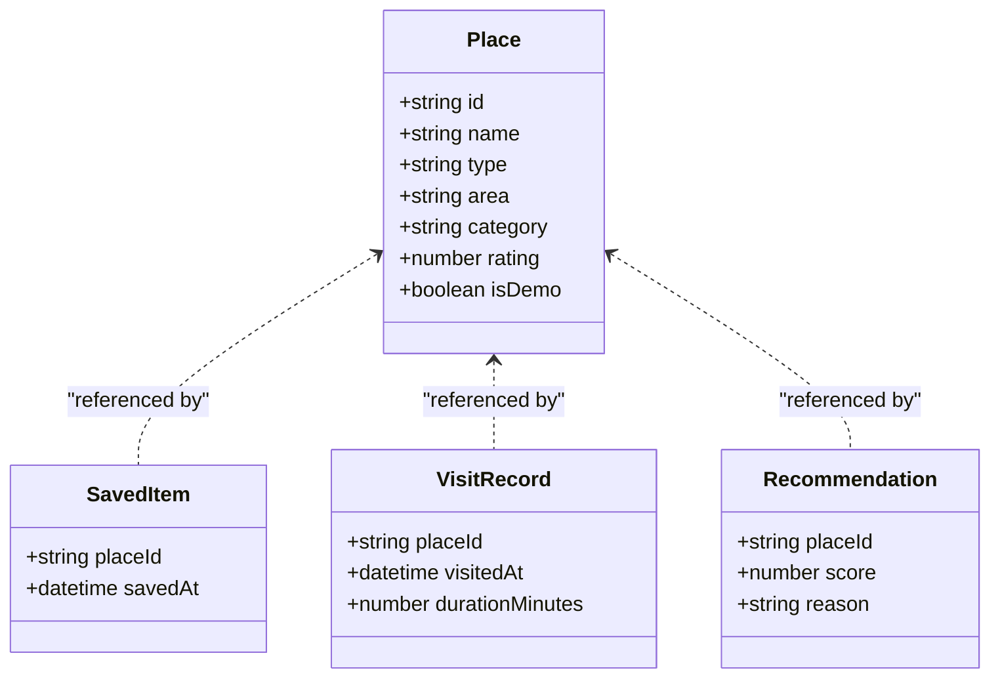
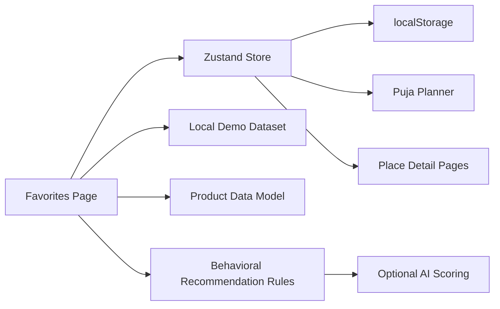
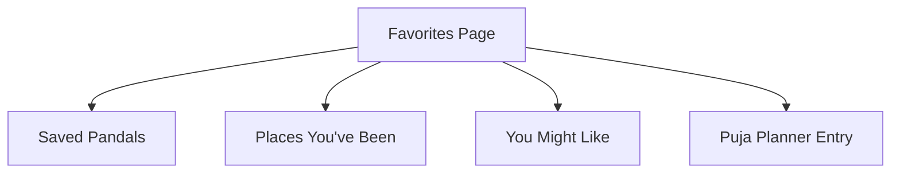

# Favorites Page Implementation

<cite>
**Referenced Files in This Document**
- [Pujo_Sahayak_Master_Project_Context.md](file://Pujo_Sahayak_Master_Project_Context.md)
- [plan.md](file://tasks/plan.md)
- [todo.md](file://tasks/todo.md)
</cite>

## Table of Contents
1. [Introduction](#introduction)
2. [Project Structure](#project-structure)
3. [Core Components](#core-components)
4. [Architecture Overview](#architecture-overview)
5. [Detailed Component Analysis](#detailed-component-analysis)
6. [Dependency Analysis](#dependency-analysis)
7. [Performance Considerations](#performance-considerations)
8. [Troubleshooting Guide](#troubleshooting-guide)
9. [Conclusion](#conclusion)
10. [Appendices](#appendices)

## Introduction
This document explains the Favorites Page implementation for Pujo Sahayak from a product and technical perspective. The Favorites Page is not just a bookmark list; it is a personal memory and discovery hub that combines:
- Saved places explicitly marked by the user
- Previously visited places with visit history
- Recommendations based on saved and visited behavior, location, categories, preferences, and potentially AI-assisted signals
- A bridge to the multi-day Puja Planner

The documentation focuses on how these collections are modeled, persisted, updated in real time, and used to generate recommendations. It also outlines bulk operations such as add/remove, reorder, and export, while keeping the scope aligned with the project’s current planning documents.

## Project Structure
At this stage, the repository contains:
- A master product context describing the overall platform, navigation, feature boundaries, and data model
- An implementation plan describing the React + Vite PWA stack, routes, state management, and phased tasks
- A task checklist tracking progress through foundation, discovery, Maya, planning, social, utility, and polish phases

**Diagram sources**
- [Pujo_Sahayak_Master_Project_Context.md:140-157](file://Pujo_Sahayak_Master_Project_Context.md#L140-L157)
- [Pujo_Sahayak_Master_Project_Context.md:320-350](file://Pujo_Sahayak_Master_Project_Context.md#L320-L350)
- [plan.md:1-18](file://tasks/plan.md#L1-L18)
- [todo.md:45-55](file://tasks/todo.md#L45-L55)

**Section sources**
- [Pujo_Sahayak_Master_Project_Context.md:140-157](file://Pujo_Sahayak_Master_Project_Context.md#L140-L157)
- [plan.md:1-18](file://tasks/plan.md#L1-L18)
- [todo.md:45-55](file://tasks/todo.md#L45-L55)

## Core Components
The Favorites Page is composed of four main conceptual components:

| Component | Purpose | Key Behaviors |
|---|---|---|
| Saved Collection | Holds places explicitly saved by the user | Add/remove favorites, persist to local storage, reflect across detail pages and planner |
| Visited Collection | Tracks places the user has actually visited | Record visit timestamp, count visits, show frequency insights |
| Recommendation Collection | Suggests new places based on user behavior | Use saved and visited data, area/theme/category signals, and optional AI-assisted scoring |
| Planner Bridge | Connects Favorites to the multi-day Puja Planner | Allow adding favorite or recommended stops into day slots |

These components share a common place entity model and rely on persistent client-side state.

**Section sources**
- [Pujo_Sahayak_Master_Project_Context.md:320-350](file://Pujo_Sahayak_Master_Project_Context.md#L320-L350)
- [todo.md:47-51](file://tasks/todo.md#L47-L51)

## Architecture Overview
The Favorites Page sits inside the broader Pujo Sahayak application and interacts with several system areas:

**Diagram sources**
- [Pujo_Sahayak_Master_Project_Context.md:1232-1261](file://Pujo_Sahayak_Master_Project_Context.md#L1232-L1261)
- [Pujo_Sahayak_Master_Project_Context.md:1263-1295](file://Pujo_Sahayak_Master_Project_Context.md#L1263-L1295)
- [plan.md:7-18](file://tasks/plan.md#L7-L18)
- [todo.md:47-51](file://tasks/todo.md#L47-L51)

### State Synchronization Flow
When a user saves or marks a place as visited, the following synchronization occurs:

**Diagram sources**
- [plan.md:7-18](file://tasks/plan.md#L7-L18)
- [todo.md:29-31](file://tasks/todo.md#L29-L31)
- [todo.md:47-51](file://tasks/todo.md#L47-L51)

**Section sources**
- [plan.md:7-18](file://tasks/plan.md#L7-L18)
- [todo.md:29-31](file://tasks/todo.md#L29-L31)
- [todo.md:47-51](file://tasks/todo.md#L47-L51)

## Detailed Component Analysis

### Saved Items Management System
The saved items system tracks places the user explicitly wants to revisit. It should:
- Prevent duplicate entries
- Support removal
- Keep saved items consistent across the app (detail pages, search results, planner)
- Persist changes immediately to local storage
- Expose a simple API for other features to read saved IDs or full place objects

Recommended data shape:
- `savedIds`: array of unique place identifiers
- `savedAt`: optional map from place ID to save timestamp
- `lastUpdated`: timestamp of last change to support cache invalidation

Persistence strategy:
- Write to localStorage on every mutation
- Load once at app initialization
- Debounce heavy recomputation when multiple mutations occur rapidly

Bulk operations:
- Add multiple places from search or explore results
- Remove multiple places via selection mode
- Clear all saved items with confirmation

Code example references:
- Zustand store usage and persistence pattern: [plan.md:7-18](file://tasks/plan.md#L7-L18)
- Favorites page integration with store state: [todo.md:47-48](file://tasks/todo.md#L47-L48)

**Section sources**
- [plan.md:7-18](file://tasks/plan.md#L7-L18)
- [todo.md:47-48](file://tasks/todo.md#L47-L48)

### Visited Places Tracking with Timestamps and Frequency Analysis
Visited places represent actual user experiences. This system should:
- Record each visit with a timestamp
- Count total visits per place
- Optionally compute frequency metrics such as:
  - Most visited places
  - Recent visit streaks
  - Time-based patterns (e.g., frequently visited during evenings)
- Exclude already-saved duplicates where appropriate, or allow overlap between saved and visited

Recommended data shape:
- `visits`: array of visit records containing place ID, timestamp, duration (optional), notes (optional)
- `visitCounts`: map from place ID to number of visits
- `lastVisitedAt`: map from place ID to most recent visit timestamp

Frequency analysis:
- Sort by `visitCounts` descending for top visited
- Filter by date range for recent activity
- Group by category for behavioral insights

Code example references:
- Product data model including visit-related entities: [Pujo_Sahayak_Master_Project_Context.md:1232-1261](file://Pujo_Sahayak_Master_Project_Context.md#L1232-L1261)
- Favorites page showing visited places: [Pujo_Sahayak_Master_Project_Context.md:329-338](file://Pujo_Sahayak_Master_Project_Context.md#L329-L338)

**Section sources**
- [Pujo_Sahayak_Master_Project_Context.md:1232-1261](file://Pujo_Sahayak_Master_Project_Context.md#L1232-L1261)
- [Pujo_Sahayak_Master_Project_Context.md:329-338](file://Pujo_Sahayak_Master_Project_Context.md#L329-L338)

### Recommendation Algorithms for New Places
The “You Might Like” section suggests places based on:
- Saved places
- Visited places
- Location context
- Categories and themes
- Preferences
- Potentially AI-assisted scoring

A practical layered approach:
1. **Rule-based filtering**: exclude already saved or visited places
2. **Signal weighting**:
   - Same area or nearby
   - Same theme or category
   - Similar popularity or crowd profile
   - Recency of saved/visited interactions
3. **Optional AI scoring**:
   - Combine behavioral signals with preference embeddings
   - Provide explainable suggestions rather than black-box rankings
4. **Diversity and freshness**:
   - Avoid recommending too many identical types
   - Surface newer or trending places occasionally

Algorithm flow:

**Diagram sources**
- [Pujo_Sahayak_Master_Project_Context.md:339-350](file://Pujo_Sahayak_Master_Project_Context.md#L339-L350)
- [Pujo_Sahayak_Master_Project_Context.md:1263-1295](file://Pujo_Sahayak_Master_Project_Context.md#L1263-L1295)
- [todo.md:47-48](file://tasks/todo.md#L47-L48)

Code example references:
- Recommendation engine inputs and principles: [Pujo_Sahayak_Master_Project_Context.md:1263-1295](file://Pujo_Sahayak_Master_Project_Context.md#L1263-L1295)
- Simple similarity hint in task description: [todo.md:47-48](file://tasks/todo.md#L47-L48)

**Section sources**
- [Pujo_Sahayak_Master_Project_Context.md:339-350](file://Pujo_Sahayak_Master_Project_Context.md#L339-L350)
- [Pujo_Sahayak_Master_Project_Context.md:1263-1295](file://Pujo_Sahayak_Master_Project_Context.md#L1263-L1295)
- [todo.md:47-48](file://tasks/todo.md#L47-L48)

### Categorization of Favorites: Saved, Visited, Recommended
The Favorites Page organizes user data into three clear collections:

| Collection | Meaning | Primary Actions |
|---|---|---|
| Saved | Places explicitly bookmarked | View details, remove, add to planner |
| Visited | Places the user has been to | View details, see visit frequency, remove visit record |
| Recommended | Places suggested by algorithms | View details, save, ignore suggestion |

Relationships:
- A place can be both saved and visited
- Recommended places should avoid duplicating saved or visited unless explicitly allowed
- Planner uses saved and recommended places as candidate stops

**Diagram sources**
- [Pujo_Sahayak_Master_Project_Context.md:1232-1261](file://Pujo_Sahayak_Master_Project_Context.md#L1232-L1261)
- [Pujo_Sahayak_Master_Project_Context.md:320-350](file://Pujo_Sahayak_Master_Project_Context.md#L320-L350)

**Section sources**
- [Pujo_Sahayak_Master_Project_Context.md:320-350](file://Pujo_Sahayak_Master_Project_Context.md#L320-L350)
- [Pujo_Sahayak_Master_Project_Context.md:1232-1261](file://Pujo_Sahayak_Master_Project_Context.md#L1232-L1261)

### Bulk Operations for Managing Favorite Lists
Bulk operations improve usability when users manage large collections:

| Operation | Description | Implementation Notes |
|---|---|---|
| Add Multiple | Add several places from search, explore, or recommendation lists | Batch updates to saved collection; deduplicate by place ID |
| Remove Multiple | Remove selected places from saved or visited lists | Confirm destructive actions; update UI immediately |
| Reorder Saved List | Allow manual ordering of saved places | Persist order index; sync with planner availability |
| Export Favorites | Export saved, visited, or recommended lists | Format options: JSON, CSV; include timestamps and metadata |

Export considerations:
- Include place ID, name, type, area, category
- For saved: include `savedAt`
- For visited: include `visitedAt`, visit count, last visited
- For recommended: include score and reason if available

Code example references:
- Local persistence requirement: [plan.md:1-5](file://tasks/plan.md#L1-L5)
- Favorites page task scope: [todo.md:47-48](file://tasks/todo.md#L47-L48)

**Section sources**
- [plan.md:1-5](file://tasks/plan.md#L1-L5)
- [todo.md:47-48](file://tasks/todo.md#L47-L48)

### Code Examples for State Synchronization, Recommendation Logic, and Preference Persistence
Because this repository does not yet contain source code files, the examples below describe implementation patterns using the documented stack and architecture.

#### State Synchronization Pattern
- Use a single Zustand store slice for favorites and visits
- Subscribe UI components to only the slices they need
- Persist store changes to localStorage using the documented persistence middleware
- Debounce expensive recomputation when multiple mutations happen quickly

References:
- Stack and persistence: [plan.md:7-18](file://tasks/plan.md#L7-L18)
- Favorites store-backed behavior: [todo.md:47-48](file://tasks/todo.md#L47-L48)

#### Recommendation Logic Pattern
- Compute a base score from saved and visited signals
- Apply area, theme, and category weights
- Optionally apply AI-assisted scoring
- Filter out already saved or visited places
- Apply diversity and limit results

References:
- Recommendation inputs: [Pujo_Sahayak_Master_Project_Context.md:1263-1295](file://Pujo_Sahayak_Master_Project_Context.md#L1263-L1295)
- Task-level similarity hint: [todo.md:47-48](file://tasks/todo.md#L47-L48)

#### User Preference Persistence Pattern
- Store language, theme, reduced motion, and other personalization flags
- Load preferences at startup
- Update UI instantly on change
- Persist changes immediately

References:
- Personalization requirements: [Pujo_Sahayak_Master_Project_Context.md:1055-1074](file://Pujo_Sahayak_Master_Project_Context.md#L1055-L1074)
- Personalization task: [todo.md:71-72](file://tasks/todo.md#L71-L72)

**Section sources**
- [plan.md:7-18](file://tasks/plan.md#L7-L18)
- [Pujo_Sahayak_Master_Project_Context.md:1055-1074](file://Pujo_Sahayak_Master_Project_Context.md#L1055-L1074)
- [Pujo_Sahayak_Master_Project_Context.md:1263-1295](file://Pujo_Sahayak_Master_Project_Context.md#L1263-L1295)
- [todo.md:47-48](file://tasks/todo.md#L47-L48)
- [todo.md:71-72](file://tasks/todo.md#L71-L72)

## Dependency Analysis
The Favorites Page depends on several layers:

Key dependencies:
- **Zustand store**: central state for saved, visited, plan, and settings
- **Local dataset**: demo data for places, pandals, restaurants, events
- **Product data model**: typed entities such as Place, Visit, Recommendation
- **Recommendation rules**: deterministic logic before optional AI enhancement
- **Planner and Detail pages**: consumers of saved and visited state

**Diagram sources**
- [plan.md:7-18](file://tasks/plan.md#L7-L18)
- [Pujo_Sahayak_Master_Project_Context.md:1232-1261](file://Pujo_Sahayak_Master_Project_Context.md#L1232-L1261)
- [Pujo_Sahayak_Master_Project_Context.md:1263-1295](file://Pujo_Sahayak_Master_Project_Context.md#L1263-L1295)
- [todo.md:47-51](file://tasks/todo.md#L47-L51)

**Section sources**
- [plan.md:7-18](file://tasks/plan.md#L7-L18)
- [Pujo_Sahayak_Master_Project_Context.md:1232-1261](file://Pujo_Sahayak_Master_Project_Context.md#L1232-L1261)
- [Pujo_Sahayak_Master_Project_Context.md:1263-1295](file://Pujo_Sahayak_Master_Project_Context.md#L1263-L1295)
- [todo.md:47-51](file://tasks/todo.md#L47-L51)

## Performance Considerations
For large favorite collections and efficient data retrieval:

- **Indexing**:
  - Maintain lookup maps by place ID for O(1) checks
  - Index saved and visited collections by category and area for faster filtering
- **Pagination and virtualization**:
  - Render only visible items in long lists
  - Paginate recommendations and visited history
- **Debouncing and batching**:
  - Batch multiple add/remove operations
  - Debounce recomputation of recommendations after rapid mutations
- **Immutable updates**:
  - Use immutable store updates to enable efficient re-renders
- **Caching**:
  - Cache computed recommendation sets until saved/visited data changes
- **Storage size limits**:
  - Monitor localStorage growth
  - Consider archiving old visit records if needed
- **Avoid unnecessary recomputation**:
  - Recompute recommendations only when relevant signals change
  - Separate UI state from data state

[No sources needed since this section provides general guidance]

## Troubleshooting Guide
Common issues and resolutions:

| Issue | Likely Cause | Resolution |
|---|---|---|
| Saved items disappear after reload | Persistence not configured or localStorage blocked | Verify Zustand persistence middleware and browser storage permissions |
| Recommendations do not update | Store subscription missing or recomputation not triggered | Ensure UI subscribes to saved/visited slices and triggers recomputation on change |
| Duplicate saved places | Missing deduplication logic | Enforce uniqueness by place ID before saving |
| Visited count incorrect | Visit records overwritten instead of appended | Append visit records and maintain a separate visit count map |
| Recommendations too repetitive | Lack of diversity filter | Add category/theme diversity constraints |
| Export file missing metadata | Export function incomplete | Include timestamps, categories, and reasons where applicable |
| Large list performance degradation | Rendering too many items | Implement pagination or virtualized lists |

**Section sources**
- [plan.md:1-5](file://tasks/plan.md#L1-L5)
- [todo.md:47-51](file://tasks/todo.md#L47-L51)

## Conclusion
The Favorites Page implementation centers on a clean separation between saved items, visited history, and algorithmic recommendations, all synchronized through a persistent client store. The product context defines the intended collections and recommendation inputs, while the implementation plan and task checklist define the technical stack and build phases. Future work should focus on robust indexing, efficient recomputation, diversity-aware recommendations, and reliable bulk operations such as reorder and export.

[No sources needed since this section summarizes without analyzing specific files]

## Appendices

### Appendix A: Favorites Page Feature Map

**Diagram sources**
- [Pujo_Sahayak_Master_Project_Context.md:320-350](file://Pujo_Sahayak_Master_Project_Context.md#L320-L350)
- [todo.md:47-51](file://tasks/todo.md#L47-L51)

### Appendix B: Recommendation Inputs Summary
- Saved places
- Visited places
- Location context
- Categories and themes
- Preferences
- Optional AI-assisted scoring

**Section sources**
- [Pujo_Sahayak_Master_Project_Context.md:1263-1295](file://Pujo_Sahayak_Master_Project_Context.md#L1263-L1295)