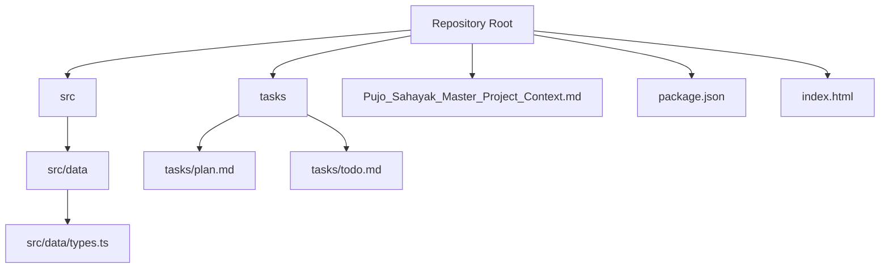
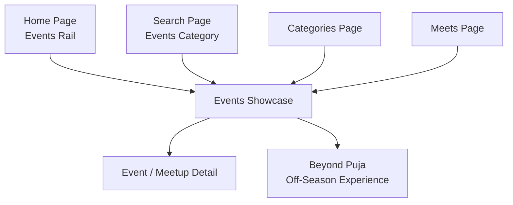
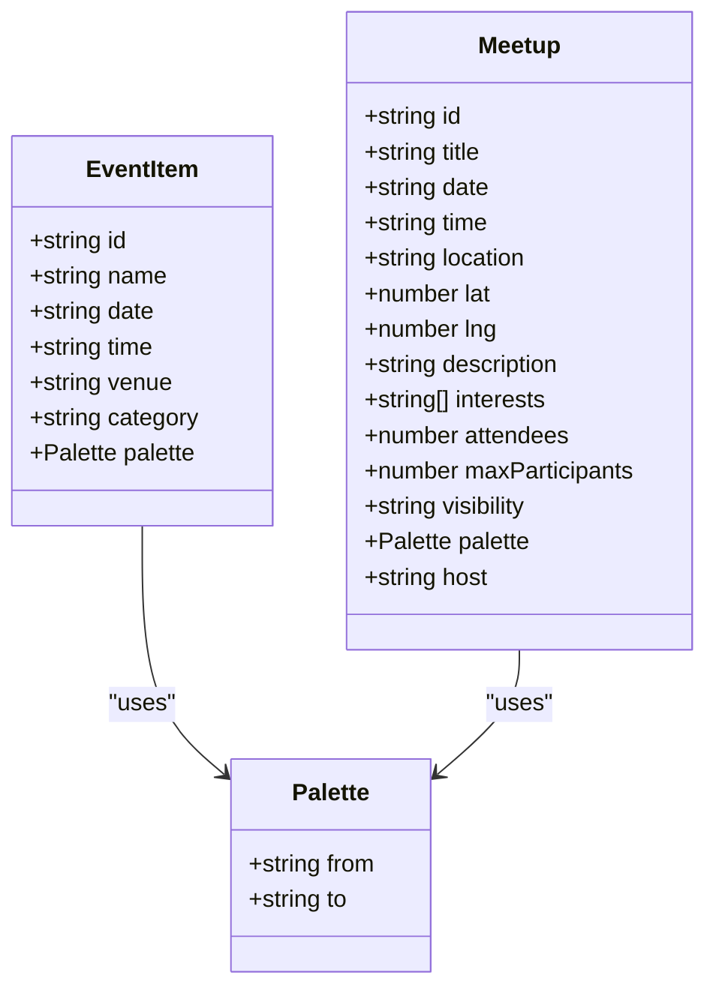
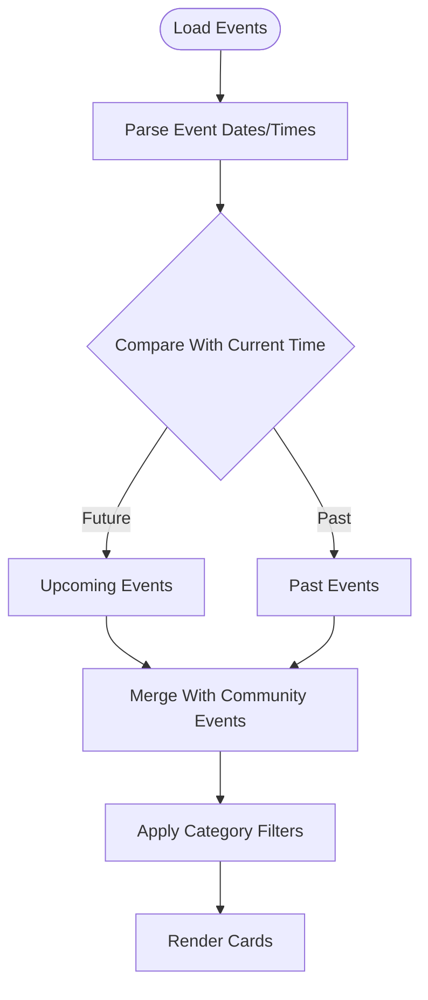
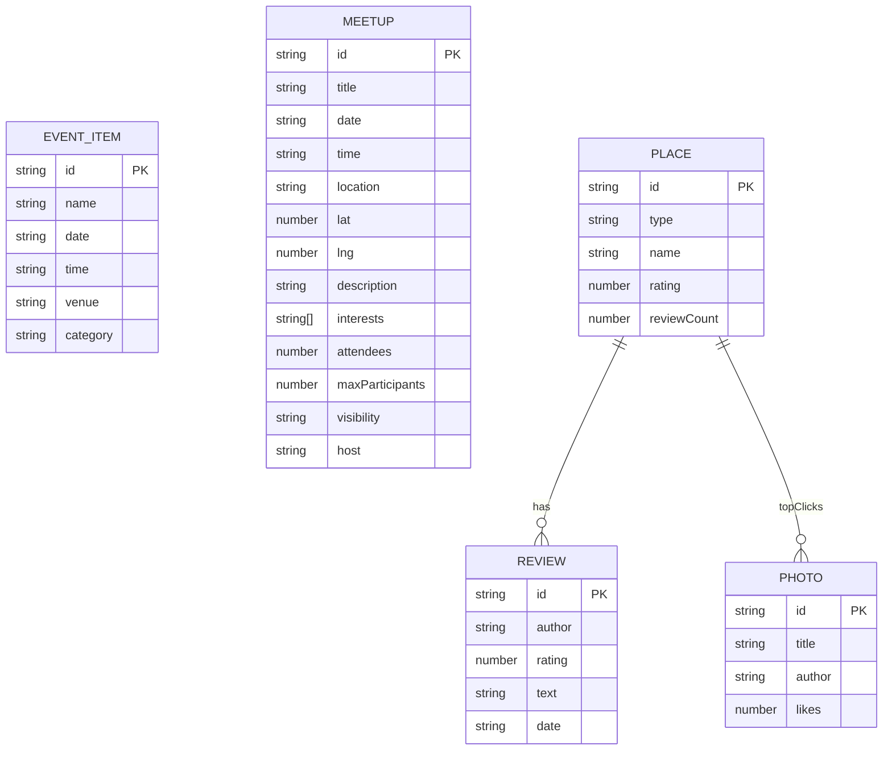
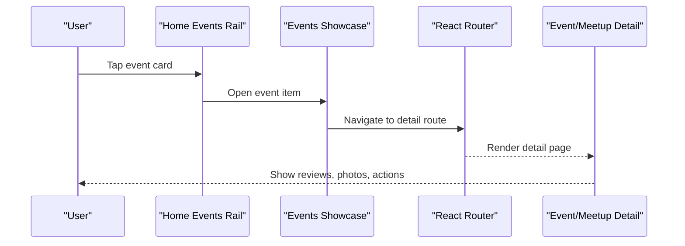
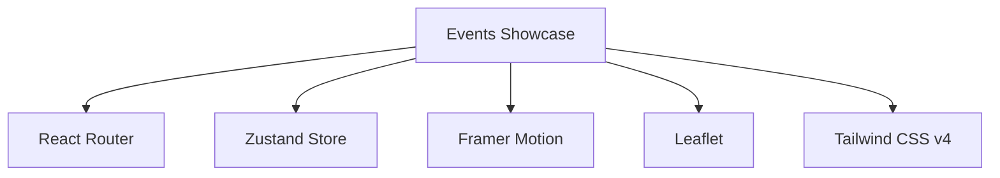

# Events Showcase Component

<cite>
**Referenced Files in This Document**
- [Pujo_Sahayak_Master_Project_Context.md](file://Pujo_Sahayak_Master_Project_Context.md)
- [plan.md](file://tasks/plan.md)
- [todo.md](file://tasks/todo.md)
- [types.ts](file://src/data/types.ts)
- [package.json](file://package.json)
- [index.html](file://index.html)
</cite>

## Table of Contents
1. [Introduction](#introduction)
2. [Project Structure](#project-structure)
3. [Core Components](#core-components)
4. [Architecture Overview](#architecture-overview)
5. [Detailed Component Analysis](#detailed-component-analysis)
6. [Dependency Analysis](#dependency-analysis)
7. [Performance Considerations](#performance-considerations)
8. [Troubleshooting Guide](#troubleshooting-guide)
9. [Conclusion](#conclusion)

## Introduction
This document explains the Events Showcase component for Pujo Sahayak, a mobile-first React + Vite PWA focused on Durga Puja discovery and year-round Kolkata local exploration. The Events Showcase is part of the Home page’s events rail and connects to the broader “Beyond Puja” off-season experience. It supports date-based filtering (upcoming, past), community event highlighting through meetups, and navigation into detailed views that integrate with social features such as reviews, photos, and user-generated content.

The product context emphasizes continuity beyond the Puja season: during Puja, events are dominated by Puja-related activities; after Puja, the same structure promotes restaurants, music, local activities, classes, community meetups, and offers. The Events Showcase should therefore be flexible enough to represent both seasonal and off-season content while remaining visually consistent with the rest of the app.

**Section sources**
- [Pujo_Sahayak_Master_Project_Context.md:268-284](file://Pujo_Sahayak_Master_Project_Context.md#L268-L284)
- [Pujo_Sahayak_Master_Project_Context.md:1093-1177](file://Pujo_Sahayak_Master_Project_Context.md#L1093-L1177)

## Project Structure
At this stage, the repository contains:
- A typed data model under `src/data/types.ts`.
- Product context and implementation plans under `Pujo_Sahayak_Master_Project_Context.md` and `tasks/`.
- Build configuration and dependencies under `package.json`, `vite.config.ts`, and `index.html`.

**Diagram sources**
- [types.ts:1-150](file://src/data/types.ts#L1-L150)
- [plan.md:1-86](file://tasks/plan.md#L1-L86)
- [todo.md:1-81](file://tasks/todo.md#L1-L81)
- [package.json:1-32](file://package.json#L1-L32)
- [index.html:1-24](file://index.html#L1-L24)

**Section sources**
- [types.ts:1-150](file://src/data/types.ts#L1-L150)
- [plan.md:1-86](file://tasks/plan.md#L1-L86)
- [todo.md:1-81](file://tasks/todo.md#L1-L81)
- [package.json:1-32](file://package.json#L1-L32)
- [index.html:1-24](file://index.html#L1-L24)

## Core Components
The Events Showcase is composed of several conceptual components:
- Event Card: displays event name, date/time, venue, category, and visual palette.
- Date Filter Bar: filters events into upcoming, past, or community-focused categories.
- Community Highlight Rail: surfaces meetups and community-driven events.
- Beyond Puja Integration: links to the off-season events and experiences route.
- Navigation Entry Points: from Home Events rail, Search, Categories, and Meets.

Key responsibilities:
- Render event metadata consistently across seasonal and off-season contexts.
- Provide clear date signals so users can distinguish upcoming vs past events.
- Surface community participation indicators (attendees, host, interests).
- Route users to detail pages where they can engage socially (reviews, photos, meetups).

**Section sources**
- [Pujo_Sahayak_Master_Project_Context.md:268-284](file://Pujo_Sahayak_Master_Project_Context.md#L268-L284)
- [Pujo_Sahayak_Master_Project_Context.md:1093-1177](file://Pujo_Sahayak_Master_Project_Context.md#L1093-L1177)
- [plan.md:39-39](file://tasks/plan.md#L39-L39)

## Architecture Overview
The Events Showcase integrates with the Home page, Search, Categories, and Meets. During Puja, it highlights Puja events; outside Puja, it promotes local events and activities. Meetups provide community participation and social engagement.

**Diagram sources**
- [plan.md:39-39](file://tasks/plan.md#L39-L39)
- [todo.md:23-24](file://tasks/todo.md#L23-L24)
- [todo.md:42-43](file://tasks/todo.md#L42-L43)
- [todo.md:53-54](file://tasks/todo.md#L53-L54)

**Section sources**
- [plan.md:39-39](file://tasks/plan.md#L39-L39)
- [todo.md:23-24](file://tasks/todo.md#L23-L24)
- [todo.md:42-43](file://tasks/todo.md#L42-L43)
- [todo.md:53-54](file://tasks/todo.md#L53-L54)

## Detailed Component Analysis

### Event Card Component
The Event Card represents an individual event entry within the showcase. It should display:
- Name and subtitle/descriptor when available.
- Date and time.
- Venue and area.
- Category label.
- Visual palette for consistent theming.
- Optional community indicators when the event is a meetup (attendee count, host, interests).

Data mapping:
- Use `EventItem` for general events.
- Use `Meetup` for community-driven events.
- Use `Palette` for image placeholders and gradients.

Complexity considerations:
- Rendering is O(1) per card.
- Filtering and sorting operate on arrays of events/meetups.

Accessibility and clarity:
- Clearly separate date/time from venue/category.
- Use concise labels for community metrics.

**Section sources**
- [types.ts:71-96](file://src/data/types.ts#L71-L96)
- [types.ts:11-15](file://src/data/types.ts#L11-L15)

#### Class Diagram: Event Data Model

**Diagram sources**
- [types.ts:11-15](file://src/data/types.ts#L11-L15)
- [types.ts:71-96](file://src/data/types.ts#L71-L96)

### Filtering System
The Events Showcase supports three primary filter modes:
- Upcoming Events: events whose date/time is in the future relative to current time.
- Past Events: events whose date/time has already passed.
- Community Activities: events that are organized by the community, represented by meetups.

Filter logic flow:

Implementation notes:
- For `EventItem`, compare `date` and `time` against the current timestamp.
- For `Meetup`, treat all entries as community activities regardless of date, but still allow date-based grouping if needed.
- Category filters can be applied using the `category` field for events and `interests` for meetups.

**Diagram sources**
- [types.ts:71-96](file://src/data/types.ts#L71-L96)

**Section sources**
- [types.ts:71-96](file://src/data/types.ts#L71-L96)

### Community Participation Indicators
Community events are modeled as `Meetup`. Key indicators include:
- Attendee count (`attendees`) and maximum participants (`maxParticipants`).
- Host identity (`host`).
- Interests (`interests`) for matching users with similar vibes.
- Visibility (`public` or `restricted`) for access control.

These fields enable:
- Displaying participant avatars and counts.
- Showing join status and capacity.
- Highlighting community-led activities in the Events Showcase.

**Section sources**
- [types.ts:81-96](file://src/data/types.ts#L81-L96)
- [Pujo_Sahayak_Master_Project_Context.md:664-770](file://Pujo_Sahayak_Master_Project_Context.md#L664-L770)

### Integration With “Beyond Puja”
The “Beyond Puja” experience is explicitly mapped to `/beyond-puja` and is accessible from the Home Events section. It allows the platform to promote non-Puja events and activities after the festival season.

Navigation path:
- Home → Events Rail → “Explore Kolkata Beyond Puja” → `/beyond-puja`.

Content strategy:
- During Puja: emphasize Puja events and related activities.
- After Puja: emphasize restaurants, music, local activities, play zones, classes, community meetups, and offers.

**Section sources**
- [plan.md:39-39](file://tasks/plan.md#L39-L39)
- [todo.md:74-75](file://tasks/todo.md#L74-L75)
- [Pujo_Sahayak_Master_Project_Context.md:1093-1177](file://Pujo_Sahayak_Master_Project_Context.md#L1093-L1177)

### Data Structures for Event Metadata, Image Galleries, and Engagement Metrics
Event metadata:
- `EventItem`: core event fields including name, date, time, venue, category, and palette.

Image galleries:
- `Photo`: includes id, title, author, palette, and likes.
- `Review`: includes id, author, rating, text, and date.

Engagement metrics:
- `Meetup.attendees` and `Meetup.maxParticipants` indicate participation levels.
- `Place.rating` and `Place.reviewCount` support popularity signals for places that may also host events.

**Diagram sources**
- [types.ts:17-31](file://src/data/types.ts#L17-L31)
- [types.ts:40-69](file://src/data/types.ts#L40-L69)
- [types.ts:71-96](file://src/data/types.ts#L71-L96)

**Section sources**
- [types.ts:17-31](file://src/data/types.ts#L17-L31)
- [types.ts:40-69](file://src/data/types.ts#L40-L69)
- [types.ts:71-96](file://src/data/types.ts#L71-L96)

### Navigation Flow to Event Details and Social Features
Typical navigation flows:
- From Home Events rail: tap an event card → navigate to event detail.
- From Search: filter by “Events” → select result → navigate to detail.
- From Categories: select relevant category → navigate to detail.
- From Meets: select a meetup → navigate to meetup detail.

Detail page integration:
- Reviews and top-click photos appear on place details.
- Ask Maya chip provides contextual information about the place/event.
- Similar places and nearby restaurants help users plan next steps.

**Diagram sources**
- [todo.md:23-30](file://tasks/todo.md#L23-L30)
- [todo.md:42-43](file://tasks/todo.md#L42-L43)
- [todo.md:53-54](file://tasks/todo.md#L53-L54)

**Section sources**
- [todo.md:23-30](file://tasks/todo.md#L23-L30)
- [todo.md:42-43](file://tasks/todo.md#L42-L43)
- [todo.md:53-54](file://tasks/todo.md#L53-L54)

## Dependency Analysis
The Events Showcase depends on:
- React Router for navigation between Home, Search, Categories, Meets, and detail pages.
- Zustand for client state (saved places, visited places, plans, meetups, settings).
- Framer Motion for subtle animations (page fades, card scale).
- Leaflet for map-based discovery (nearby events/meetups).
- Tailwind CSS v4 for design tokens and layout.

**Diagram sources**
- [package.json:11-18](file://package.json#L11-L18)
- [plan.md:7-17](file://tasks/plan.md#L7-L17)

**Section sources**
- [package.json:11-18](file://package.json#L11-L18)
- [plan.md:7-17](file://tasks/plan.md#L7-L17)

## Performance Considerations
- Keep event lists paginated or virtualized if the dataset grows large.
- Avoid heavy computations on every render; precompute upcoming/past flags at load time.
- Use stable keys (id) for list items to minimize re-renders.
- Defer loading of images and galleries until the detail view is visible.
- Respect reduced-motion preferences via Framer Motion.

[No sources needed since this section provides general guidance]

## Troubleshooting Guide
Common issues and resolutions:
- Events not appearing: verify date parsing and timezone handling; ensure `date` and `time` fields are valid strings.
- Community events not highlighted: confirm `Meetup` records have correct `visibility`, `attendees`, and `interests`.
- Navigation failures: check React Router routes for `/beyond-puja` and detail routes; ensure bottom nav and deep links are configured.
- Image fallbacks: ensure `Palette` values are provided for all cards when photography is unavailable.

**Section sources**
- [types.ts:71-96](file://src/data/types.ts#L71-L96)
- [plan.md:39-39](file://tasks/plan.md#L39-L39)

## Conclusion
The Events Showcase is a central discovery surface that bridges seasonal Puja events and year-round local experiences. By modeling events and meetups with clear metadata, applying robust date-based filters, and integrating with the “Beyond Puja” off-season route, the component supports both immediate planning and long-term engagement. Its connection to social features—reviews, photos, and community participation—ensures that users can discover, plan, visit, and share experiences throughout the year.

[No sources needed since this section summarizes without analyzing specific files]