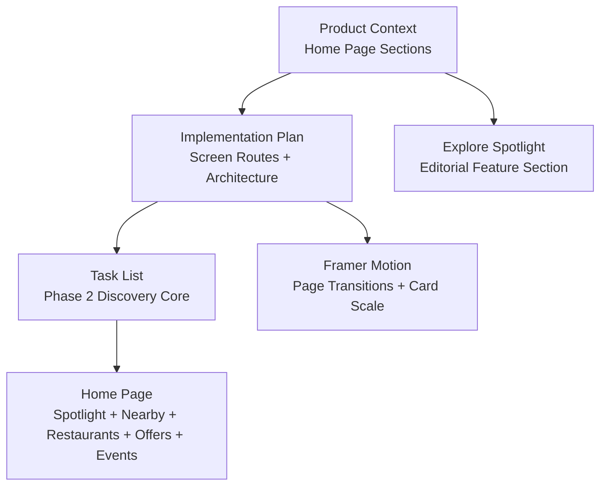
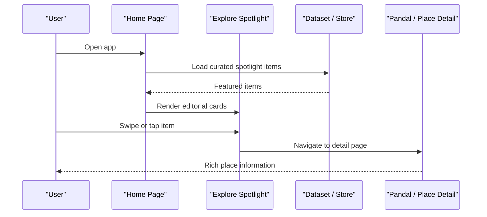
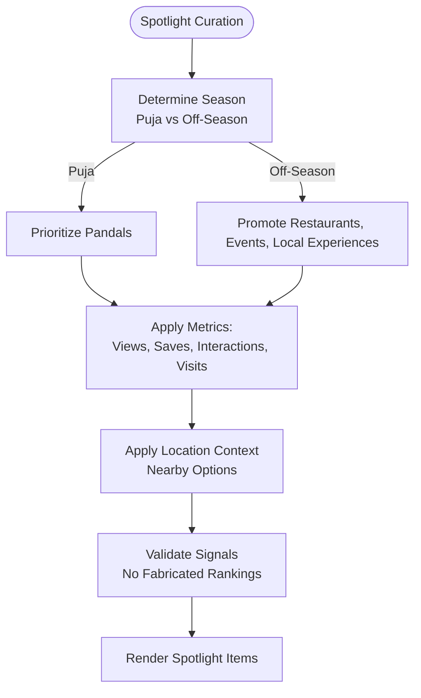
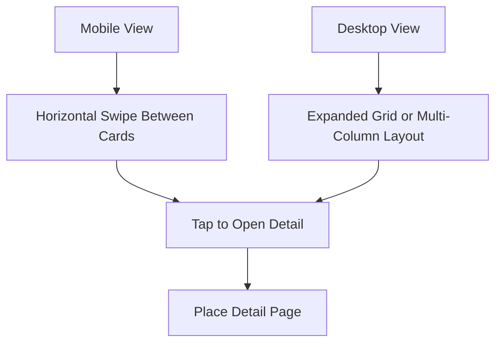
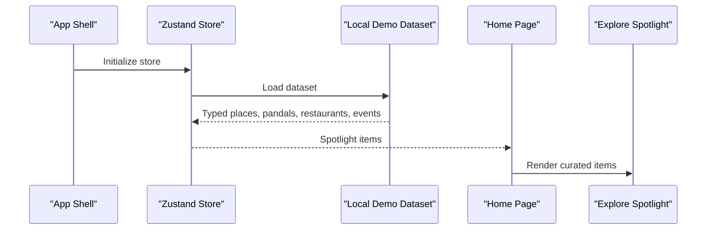
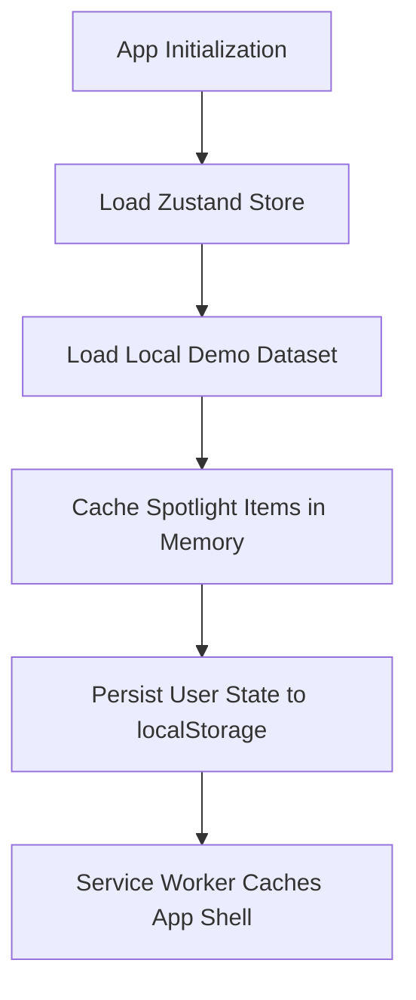
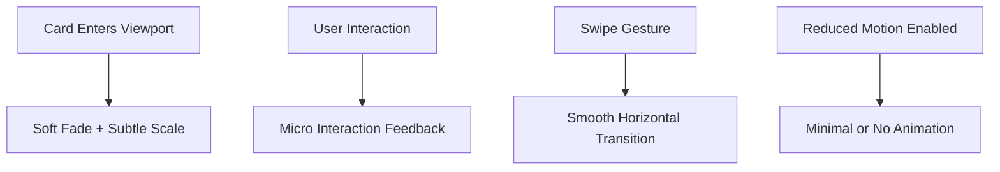
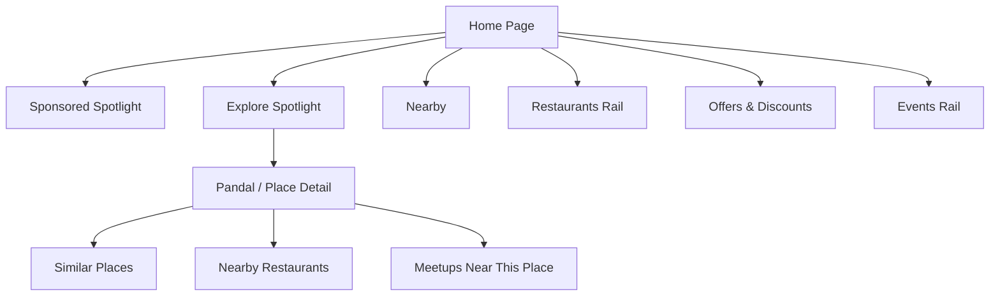
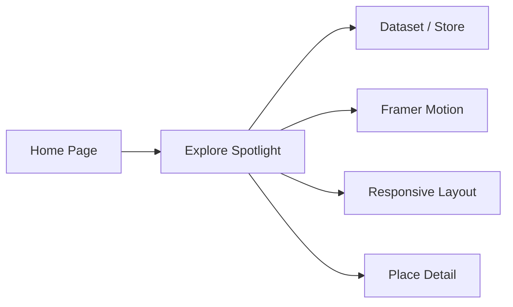

# Explore Spotlight Sections

<cite>
**Referenced Files in This Document**
- [Pujo_Sahayak_Master_Project_Context.md](file://Pujo_Sahayak_Master_Project_Context.md)
- [plan.md](file://tasks/plan.md)
- [todo.md](file://tasks/todo.md)
</cite>

## Table of Contents
1. [Introduction](#introduction)
2. [Project Structure](#project-structure)
3. [Core Components](#core-components)
4. [Architecture Overview](#architecture-overview)
5. [Detailed Component Analysis](#detailed-component-analysis)
6. [Dependency Analysis](#dependency-analysis)
7. [Performance Considerations](#performance-considerations)
8. [Troubleshooting Guide](#troubleshooting-guide)
9. [Conclusion](#conclusion)

## Introduction
This document explains the explore spotlight sections that highlight featured pandals and events on the Home page. It covers content curation logic for trending and popular locations, carousel or grid layout behavior with swipe gestures on mobile, data fetching patterns for spotlight content, caching strategies, Framer Motion animation implementation, responsive design considerations, and integration with the broader explore functionality.

The project is a mobile-first local discovery platform centered around Durga Puja. The Home page is the main discovery surface and should not become an endless feed; it remains structured with clearly labeled sections such as Spotlight, Nearby, Restaurants, Offers, Events, Recommendations, and Continue Where You Left Off. During Puja, pandals dominate the spotlight; outside Puja, the same component can promote restaurants, events, and other local experiences.

**Section sources**
- [Pujo_Sahayak_Master_Project_Context.md:160-207](file://Pujo_Sahayak_Master_Project_Context.md#L160-L207)
- [Pujo_Sahayak_Master_Project_Context.md:1555-1575](file://Pujo_Sahayak_Master_Project_Context.md#L1555-L1575)
- [Pujo_Sahayak_Master_Project_Context.md:1577-1603](file://Pujo_Sahayak_Master_Project_Context.md#L1577-L1603)

## Project Structure
At this stage, the repository contains product context and planning documents rather than source code. The relevant structure for understanding the explore spotlight sections is:

- Product context document describing Home page sections, motion system, responsive design, and off-season strategy.
- Implementation plan defining screen routes, architecture decisions, and task phases.
- Task list detailing what must be built, including Home page components and motion primitives.

**Diagram sources**
- [Pujo_Sahayak_Master_Project_Context.md:160-207](file://Pujo_Sahayak_Master_Project_Context.md#L160-L207)
- [plan.md:7-17](file://tasks/plan.md#L7-L17)
- [todo.md:23-24](file://tasks/todo.md#L23-L24)

**Section sources**
- [Pujo_Sahayak_Master_Project_Context.md:160-207](file://Pujo_Sahayak_Master_Project_Context.md#L160-L207)
- [plan.md:19-40](file://tasks/plan.md#L19-L40)
- [todo.md:23-24](file://tasks/todo.md#L23-L24)

## Core Components
The explore spotlight section is an editorial-style feature area on the Home page. It displays rich media (pictures or videos), name, and short description. It can spotlight:

- Pandal
- Restaurant
- Event
- Local experience

During Puja, pandals should dominate. Outside Puja, the same component promotes other local experiences. The Home page also includes Sponsored Spotlight, which must be visually distinct from organic recommendations.

Key responsibilities:

- Present curated featured items prominently at the top of the Home page.
- Support multiple content types without turning Home into a generic feed.
- Integrate with seasonal context so the spotlight reflects current relevance.
- Provide smooth transitions and subtle interactions using Framer Motion.
- Remain accessible and readable on mobile first, then adapt to wider screens.

**Section sources**
- [Pujo_Sahayak_Master_Project_Context.md:168-207](file://Pujo_Sahayak_Master_Project_Context.md#L168-L207)
- [Pujo_Sahayak_Master_Project_Context.md:1577-1603](file://Pujo_Sahayak_Master_Project_Context.md#L1577-L1603)

## Architecture Overview
The explore spotlight sits inside the Home page and connects to the broader discovery flow. The Home page is structured, not a feed, and spotlight appears before Nearby, Restaurants, Offers, Events, Recommendations, and Continue Where You Left Off.

**Diagram sources**
- [Pujo_Sahayak_Master_Project_Context.md:160-207](file://Pujo_Sahayak_Master_Project_Context.md#L160-L207)
- [Pujo_Sahayak_Master_Project_Context.md:1577-1603](file://Pujo_Sahayak_Master_Project_Context.md#L1577-L1603)
- [plan.md:19-40](file://tasks/plan.md#L19-L40)

## Detailed Component Analysis

### Content Curation Logic for Trending and Popular Locations
The spotlight should highlight trending and popular locations based on meaningful signals rather than fabricated rankings. For trending pandals, possible metrics include views, saves, recent interactions, visits, and engagement. The exact algorithm can evolve later.

For the spotlight specifically:

- Prioritize editorially important items during Puja, especially pandals.
- Use location context to show nearby options where appropriate.
- Keep wording honest: do not claim absolute popularity unless supported by data.
- Allow the spotlight to transition to non-pandal content after Puja while preserving the same component structure.

**Diagram sources**
- [Pujo_Sahayak_Master_Project_Context.md:469-491](file://Pujo_Sahayak_Master_Project_Context.md#L469-L491)
- [Pujo_Sahayak_Master_Project_Context.md:1093-1140](file://Pujo_Sahayak_Master_Project_Context.md#L1093-L1140)

**Section sources**
- [Pujo_Sahayak_Master_Project_Context.md:469-491](file://Pujo_Sahayak_Master_Project_Context.md#L469-L491)
- [Pujo_Sahayak_Master_Project_Context.md:1093-1140](file://Pujo_Sahayak_Master_Project_Context.md#L1093-L1140)

### Carousel or Grid Layout With Swipe Gestures on Mobile
The spotlight is described as a larger editorial-style feature section containing pictures, videos, name, and short description. On mobile, this naturally maps to a horizontally scrollable carousel or swipeable card stack. On wider screens, the same content can expand into a grid or multi-column layout.

Recommended behavior:

- Mobile: horizontal swipe between spotlight cards with clear visual feedback.
- Desktop: expanded view with more visible cards or a grid.
- Accessibility: keyboard navigation for moving between cards.
- Performance: lazy-load images and avoid heavy animations on low-power devices.
- Reduced motion: honor user preferences for reduced motion.

**Diagram sources**
- [Pujo_Sahayak_Master_Project_Context.md:1555-1575](file://Pujo_Sahayak_Master_Project_Context.md#L1555-L1575)

**Section sources**
- [Pujo_Sahayak_Master_Project_Context.md:1555-1575](file://Pujo_Sahayak_Master_Project_Context.md#L1555-L1575)

### Data Fetching Patterns for Spotlight Content
The implementation plan states that data is a typed local demo dataset grounded in real Kolkata pandals and restaurants, and all user state persists to localStorage. The Home page renders sections from the dataset. Therefore, spotlight content should be fetched from the client store or dataset layer rather than hard-coded inline.

Suggested pattern:

- Dataset layer provides curated spotlight items.
- Client store loads dataset once and exposes filtered spotlight results.
- Home page subscribes to spotlight data and renders the section.
- If backend integration is added later, swap dataset fetcher with API fetcher without changing UI.

**Diagram sources**
- [plan.md:7-17](file://tasks/plan.md#L7-L17)
- [todo.md:13-14](file://tasks/todo.md#L13-L14)
- [todo.md:23-24](file://tasks/todo.md#L23-L24)

**Section sources**
- [plan.md:7-17](file://tasks/plan.md#L7-L17)
- [todo.md:13-14](file://tasks/todo.md#L13-L14)
- [todo.md:23-24](file://tasks/todo.md#L23-L24)

### Caching Strategies
Since the initial version uses a local demo dataset and Zustand with persist middleware, caching can rely on:

- In-memory store for active session data.
- localStorage persistence for saved places, visited places, plans, settings, and “continue where you left off” state.
- Service worker caching via `vite-plugin-pwa` for offline shell and static assets.

For spotlight content specifically:

- Cache dataset in the store on app initialization.
- Persist only user-driven state, not the entire dataset, to keep storage reasonable.
- If switching to remote data later, add request-level caching and stale-while-revalidate behavior.

**Diagram sources**
- [plan.md:7-17](file://tasks/plan.md#L7-L17)
- [todo.md:13-14](file://tasks/todo.md#L13-L14)

**Section sources**
- [plan.md:7-17](file://tasks/plan.md#L7-L17)
- [todo.md:13-14](file://tasks/todo.md#L13-L14)

### Animation Implementations Using Framer Motion
The motion system should communicate energy without becoming a motion showcase. Relevant motions include:

- Soft page fade and slight movement for page transitions.
- Subtle scale on card interaction.
- Smooth horizontal reveals for recommendations and rails.
- Animated scan frame for camera scanning.
- Reactive waveform for voice assistant.
- Occasional subtle light/smoke effects for Puja atmosphere.

For the spotlight section:

- Animate cards entering the viewport with soft fade and slight scale.
- Animate horizontal swipes smoothly.
- Respect reduced-motion preferences.
- Avoid excessive motion that harms usability.

**Diagram sources**
- [Pujo_Sahayak_Master_Project_Context.md:1509-1533](file://Pujo_Sahayak_Master_Project_Context.md#L1509-L1533)
- [plan.md:13](file://tasks/plan.md#L13)

**Section sources**
- [Pujo_Sahayak_Master_Project_Context.md:1509-1533](file://Pujo_Sahayak_Master_Project_Context.md#L1509-L1533)
- [plan.md:13](file://tasks/plan.md#L13)

### Responsive Design Considerations
The sketches are heavily mobile-oriented. Mobile is the primary target. Desktop should adapt the same system into wider layouts, multi-column sections, expanded maps, side panels, and richer exploration. Do not create completely separate UX concepts.

For the spotlight:

- Mobile: single-card carousel with swipe.
- Tablet: two or three visible cards with partial next/previous hints.
- Desktop: multi-column grid or expanded editorial layout.
- Ensure typography, spacing, and touch targets remain usable across sizes.

**Section sources**
- [Pujo_Sahayak_Master_Project_Context.md:1555-1575](file://Pujo_Sahayak_Master_Project_Context.md#L1555-L1575)

### Integration With Broader Explore Functionality
The spotlight integrates with:

- Sponsored Spotlight: clearly distinguish sponsored content from organic recommendations.
- Nearby section: continue discovery after the spotlight.
- Restaurants rail: connect pandal exploration to food discovery.
- Offers and Events: maintain structured Home page sections.
- Search and Categories: allow users to find trending and nearby places.
- Pandal Detail: navigate from spotlight items to detailed place pages.

**Diagram sources**
- [Pujo_Sahayak_Master_Project_Context.md:168-207](file://Pujo_Sahayak_Master_Project_Context.md#L168-L207)
- [Pujo_Sahayak_Master_Project_Context.md:895-950](file://Pujo_Sahayak_Master_Project_Context.md#L895-L950)
- [Pujo_Sahayak_Master_Project_Context.md:1577-1603](file://Pujo_Sahayak_Master_Project_Context.md#L1577-L1603)

**Section sources**
- [Pujo_Sahayak_Master_Project_Context.md:168-207](file://Pujo_Sahayak_Master_Project_Context.md#L168-L207)
- [Pujo_Sahayak_Master_Project_Context.md:895-950](file://Pujo_Sahayak_Master_Project_Context.md#L895-L950)
- [Pujo_Sahayak_Master_Project_Context.md:1577-1603](file://Pujo_Sahayak_Master_Project_Context.md#L1577-L1603)

## Dependency Analysis
The explore spotlight depends on:

- Home page structure and ordering.
- Dataset or store providing curated items.
- Framer Motion for smooth transitions.
- Responsive design tokens and layout rules.
- Navigation to detail pages and related sections.

**Diagram sources**
- [plan.md:7-17](file://tasks/plan.md#L7-L17)
- [todo.md:23-24](file://tasks/todo.md#L23-L24)

**Section sources**
- [plan.md:7-17](file://tasks/plan.md#L7-L17)
- [todo.md:23-24](file://tasks/todo.md#L23-L24)

## Performance Considerations
- Lazy-load images and videos in spotlight cards.
- Avoid heavy animations on low-end devices.
- Honor reduced-motion preferences.
- Keep spotlight data small and focused on curated items.
- Use in-memory cache for active spotlight items and localStorage for user state.
- Avoid turning Home into an infinite feed; keep sections bounded and intentional.

[No sources needed since this section provides general guidance]

## Troubleshooting Guide
Common issues and resolutions:

- Spotlight shows no items: verify dataset loading and store initialization.
- Swiping feels laggy: reduce animation complexity and ensure images are optimized.
- Spotlight looks broken on desktop: check responsive breakpoints and multi-column layout.
- Sponsored content confuses users: ensure clear visual distinction between sponsored and organic spotlight items.
- Trending claims feel misleading: validate ranking signals and avoid fabricating popularity metrics.

**Section sources**
- [Pujo_Sahayak_Master_Project_Context.md:168-207](file://Pujo_Sahayak_Master_Project_Context.md#L168-L207)
- [Pujo_Sahayak_Master_Project_Context.md:469-491](file://Pujo_Sahayak_Master_Project_Context.md#L469-L491)

## Conclusion
The explore spotlight sections are a central editorial discovery surface on the Home page. They should highlight trending and popular locations using honest signals, support swipe-based carousels on mobile, and adapt gracefully to wider screens. Spotlight content should be sourced from the dataset or store, animated with Framer Motion, and integrated with Nearby, Restaurants, Offers, Events, Search, Categories, and Place Detail pages. The implementation plan and task list provide a clear path toward building these features while keeping the Home page structured and purposeful.

[No sources needed since this section summarizes without analyzing specific files]