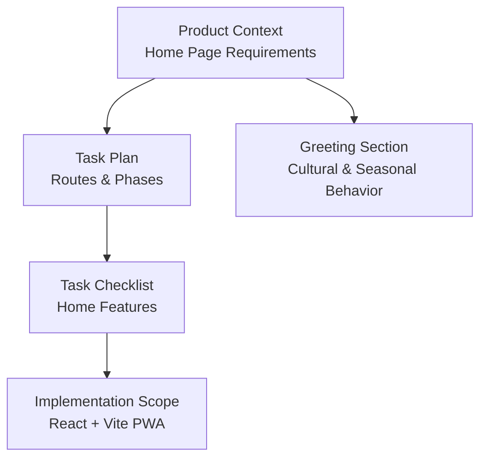
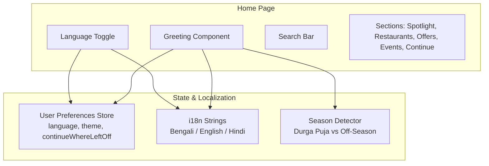
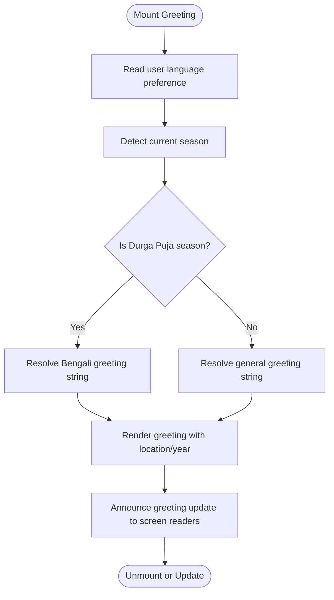
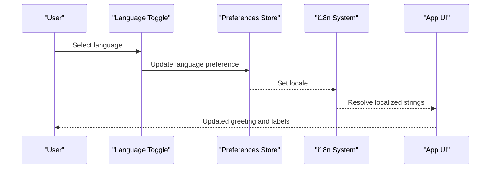
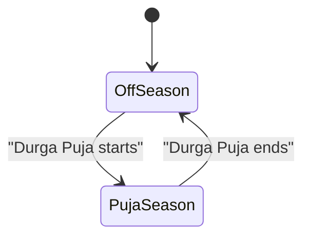
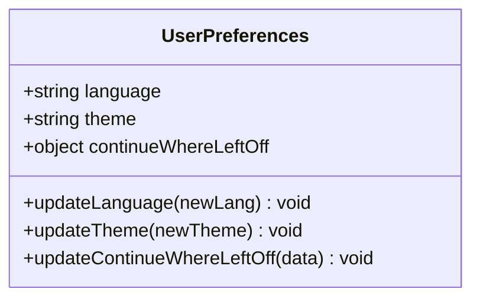
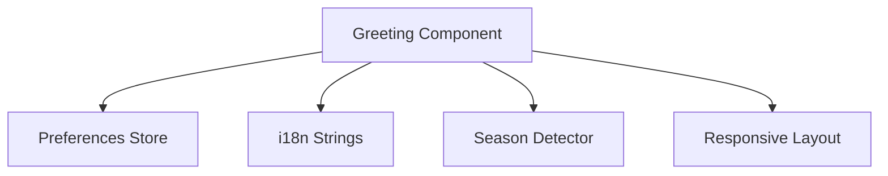

# Greeting Section Implementation

<cite>
**Referenced Files in This Document**
- [Pujo_Sahayak_Master_Project_Context.md](file://Pujo_Sahayak_Master_Project_Context.md)
- [plan.md](file://tasks/plan.md)
- [todo.md](file://tasks/todo.md)
</cite>

## Table of Contents
1. [Introduction](#introduction)
2. [Project Structure](#project-structure)
3. [Core Components](#core-components)
4. [Architecture Overview](#architecture-overview)
5. [Detailed Component Analysis](#detailed-component-analysis)
6. [Dependency Analysis](#dependency-analysis)
7. [Performance Considerations](#performance-considerations)
8. [Troubleshooting Guide](#troubleshooting-guide)
9. [Conclusion](#conclusion)

## Introduction
This document explains the greeting section implementation for Pujo Sahayak, focusing on how the Home page greets users with a culturally aware message, supports Bengali and English language toggling, and adapts to Durga Puja season versus off-season periods. It also covers state management for user preferences, responsive design patterns, and accessibility considerations for greeting announcements and screen reader compatibility.

The project is a mobile-first React + Vite PWA that replicates 21 mockup screens, including Splash, Home, Explore/Pandal Directory, Pandal Detail, Maya (chat/scan/voice), Puja Planner, Meets, Categories, Search, Profile, Safety/Emergency, Missing Person Report, Trip/Route Map, Restaurant Detail, Create Meetup, Settings, and an off-season “Beyond Puja” experience. The Home page is the main discovery surface and includes a greeting, search bar, language toggle, sponsored content, spotlight, restaurants, offers, events, and “Continue Where You Left Off.”

**Section sources**
- [plan.md:1-10](file://tasks/plan.md#L1-L10)
- [plan.md:19-39](file://tasks/plan.md#L19-L39)
- [plan.md:45-61](file://tasks/plan.md#L45-L61)
- [todo.md:23-24](file://tasks/todo.md#L23-L24)
- [Pujo_Sahayak_Master_Project_Context.md:160-166](file://Pujo_Sahayak_Master_Project_Context.md#L160-L166)

## Project Structure
At this stage, the repository contains product context and task plans rather than source code. The relevant structure for understanding the greeting section is:

- Product context file describing Home page requirements, seasonal behavior, personalization, and visual language.
- Task plan defining routes, phases, and verification criteria.
- Task checklist specifying Home page features such as greeting, language toggle, and sections order.

**Diagram sources**
- [Pujo_Sahayak_Master_Project_Context.md:160-166](file://Pujo_Sahayak_Master_Project_Context.md#L160-L166)
- [plan.md:19-39](file://tasks/plan.md#L19-L39)
- [todo.md:23-24](file://tasks/todo.md#L23-L24)

**Section sources**
- [Pujo_Sahayak_Master_Project_Context.md:160-166](file://Pujo_Sahayak_Master_Project_Context.md#L160-L166)
- [plan.md:19-39](file://tasks/plan.md#L19-L39)
- [todo.md:23-24](file://tasks/todo.md#L23-L24)

## Core Components
The greeting section is part of the Home page and includes:

- Personalized greeting text reflecting cultural context (e.g., a Bengali greeting during Durga Puja).
- Location and year indicator (e.g., Kolkata·2026).
- Language toggle supporting Bengali, English, and Hindi.
- Integration with i18n strings for dynamic text switching.
- Season-aware messaging that adapts between Puja season and off-season periods.
- Store-backed state for user preferences (language, theme, continue-where-left-off).

Key responsibilities:
- Render greeting based on current season and user language preference.
- Provide accessible announcement for screen readers when greeting updates.
- Maintain consistent typography and layout across languages, including Bengali script rendering.

**Section sources**
- [todo.md:23-24](file://tasks/todo.md#L23-L24)
- [plan.md:45-61](file://tasks/plan.md#L45-L61)
- [Pujo_Sahayak_Master_Project_Context.md:1093-1142](file://Pujo_Sahayak_Master_Project_Context.md#L1093-L1142)
- [Pujo_Sahayak_Master_Project_Context.md:1144-1177](file://Pujo_Sahayak_Master_Project_Context.md#L1144-L1177)

## Architecture Overview
The greeting section integrates with the Home page shell and depends on:

- User preferences store (Zustand + persist middleware) for language, theme, and session continuity.
- i18n system for Bengali/English/Hindi string resolution.
- Season detection logic to determine whether the app is in Durga Puja season or off-season.
- Responsive layout system ensuring proper rendering on mobile and desktop.

**Diagram sources**
- [plan.md:12-14](file://tasks/plan.md#L12-L14)
- [todo.md:23-24](file://tasks/todo.md#L23-L24)
- [Pujo_Sahayak_Master_Project_Context.md:1093-1142](file://Pujo_Sahayak_Master_Project_Context.md#L1093-L1142)

**Section sources**
- [plan.md:12-14](file://tasks/plan.md#L12-L14)
- [todo.md:23-24](file://tasks/todo.md#L23-L24)
- [Pujo_Sahayak_Master_Project_Context.md:1093-1142](file://Pujo_Sahayak_Master_Project_Context.md#L1093-L1142)

## Detailed Component Analysis

### Greeting Component
The greeting component renders a culturally appropriate message at the top of the Home page. During Durga Puja season, it shows a Bengali greeting; outside the season, it can adapt to a more general local discovery greeting. The greeting includes location and year context.

Behavior:
- Reads current season from a season detector.
- Reads user language preference from the store.
- Resolves localized greeting text via i18n.
- Announces greeting change to assistive technologies.

**Diagram sources**
- [todo.md:23-24](file://tasks/todo.md#L23-L24)
- [Pujo_Sahayak_Master_Project_Context.md:1093-1142](file://Pujo_Sahayak_Master_Project_Context.md#L1093-L1142)

**Section sources**
- [todo.md:23-24](file://tasks/todo.md#L23-L24)
- [Pujo_Sahayak_Master_Project_Context.md:1093-1142](file://Pujo_Sahayak_Master_Project_Context.md#L1093-L1142)

### Language Toggle Functionality
The language toggle allows users to switch between Bengali, English, and Hindi. It updates the application’s i18n locale and persists the selection in the user preferences store.

Responsibilities:
- Present available languages clearly.
- Switch i18n locale immediately upon selection.
- Persist selected language to localStorage via Zustand persist middleware.
- Ensure Bengali text renders correctly using appropriate fonts and fallbacks.

**Diagram sources**
- [plan.md:12-14](file://tasks/plan.md#L12-L14)
- [todo.md:23-24](file://tasks/todo.md#L23-L24)

**Section sources**
- [plan.md:12-14](file://tasks/plan.md#L12-L14)
- [todo.md:23-24](file://tasks/todo.md#L23-L24)

### Cultural Context Awareness
The greeting section adapts to Durga Puja season versus off-season periods. During Puja, the Home page emphasizes pandals, Puja events, Puja restaurants, Puja shopping, and Puja meetups. After Puja, it transitions to restaurants, events, music, local activities, play zones, classes/academies, community meetups, local experiences, and offers.

Implementation approach:
- Use a season detector to determine if the current date falls within Durga Puja season.
- Adjust greeting text and recommended sections accordingly.
- Keep the overall information architecture consistent while changing emphasis.

**Diagram sources**
- [Pujo_Sahayak_Master_Project_Context.md:1093-1142](file://Pujo_Sahayak_Master_Project_Context.md#L1093-L1142)
- [Pujo_Sahayak_Master_Project_Context.md:1144-1177](file://Pujo_Sahayak_Master_Project_Context.md#L1144-L1177)

**Section sources**
- [Pujo_Sahayak_Master_Project_Context.md:1093-1142](file://Pujo_Sahayak_Master_Project_Context.md#L1093-L1142)
- [Pujo_Sahayak_Master_Project_Context.md:1144-1177](file://Pujo_Sahayak_Master_Project_Context.md#L1144-L1177)

### State Management for User Preferences
User preferences include language, theme, app-logo choice, and “continue where you left off” session data. These are managed through a single client store using Zustand with persist middleware, ensuring persistence across reloads.

Key fields:
- language: Current app language (Bengali, English, Hindi).
- theme: Appearance setting (light/dark/system default).
- continueWhereLeftOff: Last explored category or place.

**Diagram sources**
- [plan.md:12-14](file://tasks/plan.md#L12-L14)

**Section sources**
- [plan.md:12-14](file://tasks/plan.md#L12-L14)

### Responsive Design Patterns
The greeting section must render well on mobile and adapt to desktop layouts. Mobile is the primary target; desktop should expand content into wider layouts, multi-column sections, expanded maps, side panels, and richer exploration.

Patterns:
- Fluid typography scaling for greeting text.
- Flexible spacing and alignment for language toggle.
- Accessible focus states and keyboard navigation.
- Font fallbacks for Bengali script rendering.

**Section sources**
- [Pujo_Sahayak_Master_Project_Context.md:1555-1573](file://Pujo_Sahayak_Master_Project_Context.md#L1555-L1573)
- [plan.md:79-79](file://tasks/plan.md#L79-L79)

### Accessibility Considerations
Accessibility is critical for greeting announcements and screen reader compatibility.

Recommendations:
- Use semantic HTML elements for greeting (e.g., heading or live region).
- Announce greeting changes via aria-live regions so screen readers read updates automatically.
- Ensure language toggle buttons have clear labels and roles.
- Respect reduced motion preferences for any animations around greeting.
- Provide sufficient color contrast for greeting text in both light and dark themes.

**Section sources**
- [Pujo_Sahayak_Master_Project_Context.md:1509-1531](file://Pujo_Sahayak_Master_Project_Context.md#L1509-L1531)

## Dependency Analysis
The greeting section depends on:

- User preferences store for language and theme.
- i18n system for localized strings.
- Season detector for cultural context.
- Responsive layout system for cross-device compatibility.

**Diagram sources**
- [plan.md:12-14](file://tasks/plan.md#L12-L14)
- [todo.md:23-24](file://tasks/todo.md#L23-L24)
- [Pujo_Sahayak_Master_Project_Context.md:1093-1142](file://Pujo_Sahayak_Master_Project_Context.md#L1093-L1142)

**Section sources**
- [plan.md:12-14](file://tasks/plan.md#L12-L14)
- [todo.md:23-24](file://tasks/todo.md#L23-L24)
- [Pujo_Sahayak_Master_Project_Context.md:1093-1142](file://Pujo_Sahayak_Master_Project_Context.md#L1093-L1142)

## Performance Considerations
- Avoid heavy computations in greeting rendering; keep season detection lightweight.
- Cache i18n strings to prevent unnecessary re-resolutions.
- Debounce language toggle updates if multiple components depend on locale changes.
- Use lazy loading for non-critical assets behind the greeting.
- Respect reduced motion settings to avoid performance penalties from animations.

[No sources needed since this section provides general guidance]

## Troubleshooting Guide
Common issues and resolutions:

- Greeting not updating after language change:
  - Verify i18n locale is set correctly in the store.
  - Ensure components subscribe to language preference updates.
- Bengali text not rendering properly:
  - Check font loading and fallbacks.
  - Validate CSS for correct Unicode handling.
- Season detection incorrect:
  - Confirm date ranges for Durga Puja season.
  - Test edge cases near festival start/end dates.
- Screen reader not announcing greeting:
  - Ensure aria-live region is present and updated.
  - Verify no conflicting live regions suppress announcements.

**Section sources**
- [plan.md:63-69](file://tasks/plan.md#L63-L69)
- [Pujo_Sahayak_Master_Project_Context.md:1509-1531](file://Pujo_Sahayak_Master_Project_Context.md#L1509-L1531)

## Conclusion
The greeting section is a foundational element of the Home page, providing a personalized, culturally aware welcome that adapts to Durga Puja season and supports Bengali, English, and Hindi through i18n integration. It relies on a robust state management system for user preferences, responsive design patterns for cross-device compatibility, and accessibility best practices for screen reader support. As the application evolves, the greeting will remain a key touchpoint for user engagement and cultural connection.

[No sources needed since this section summarizes without analyzing specific files]