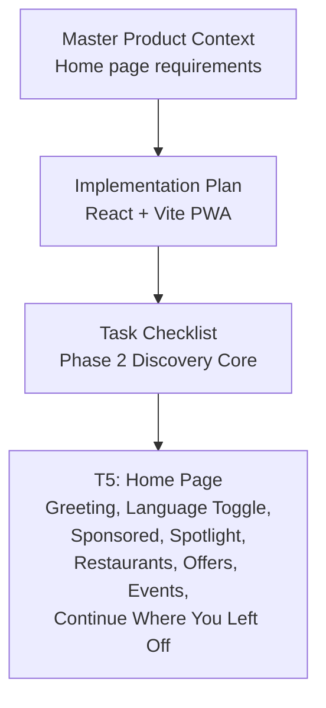
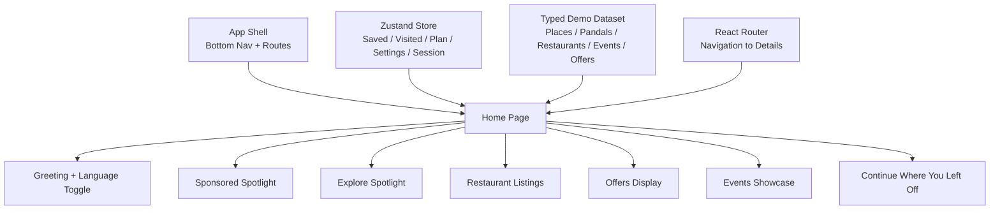
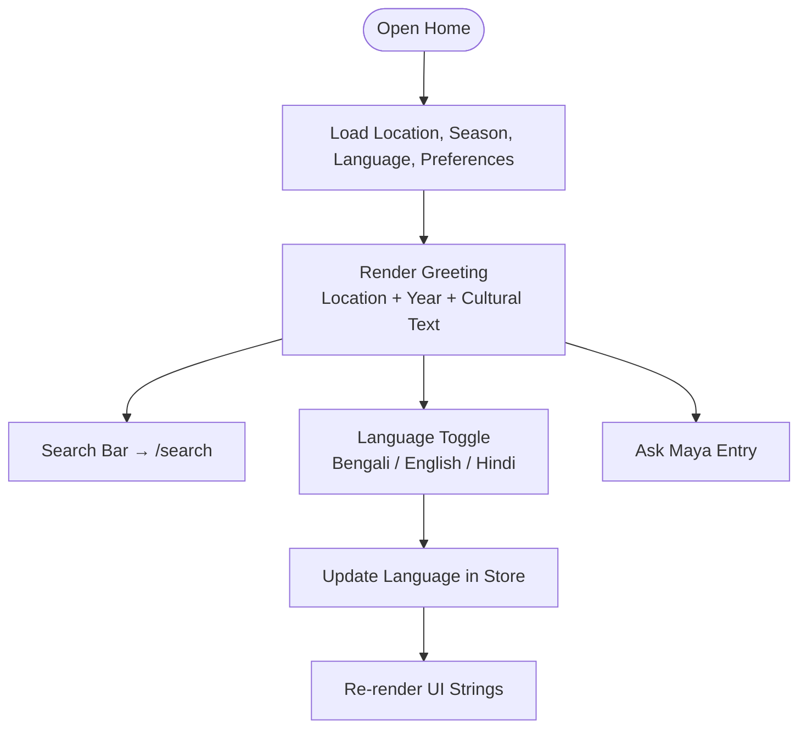
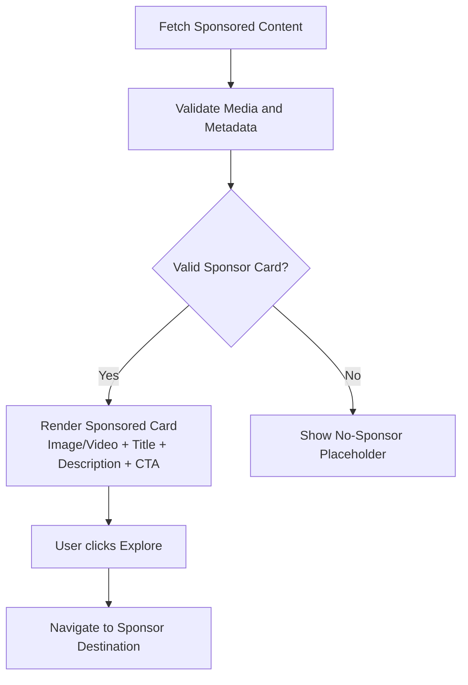
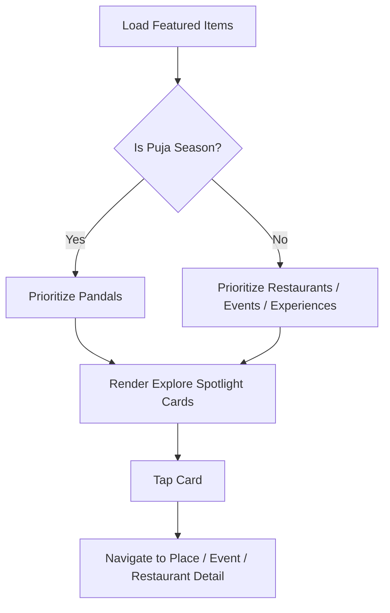
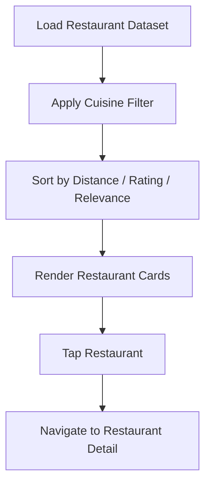
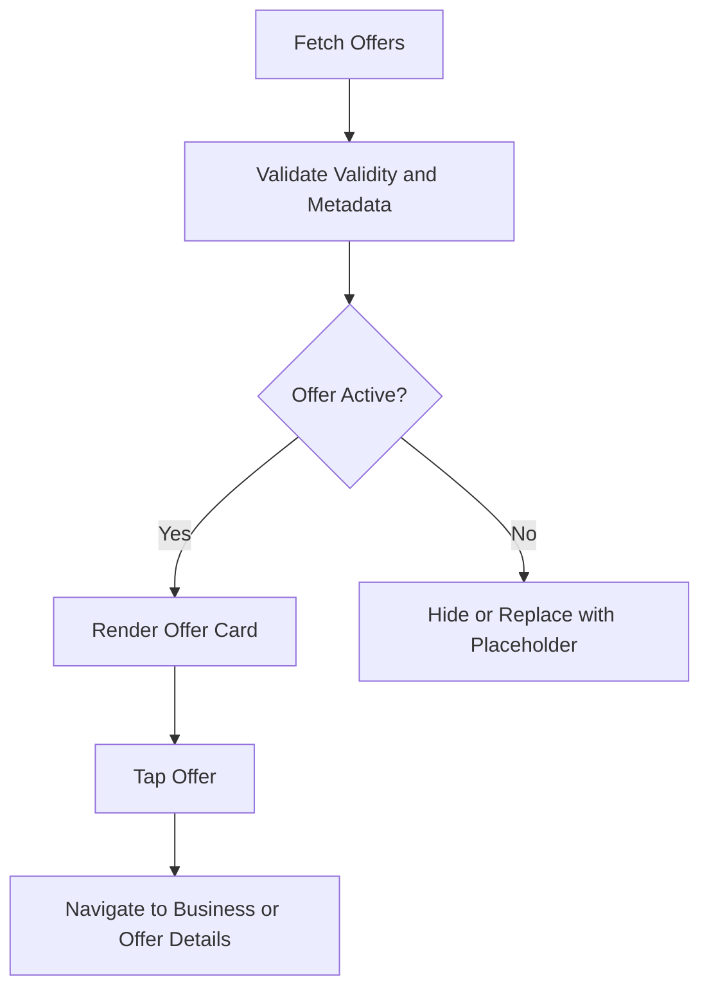
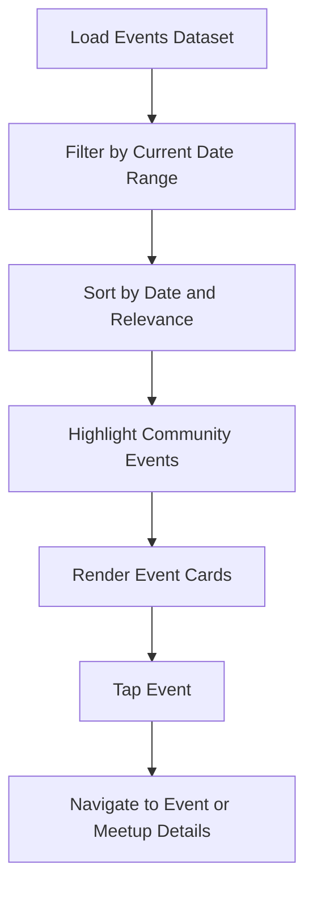
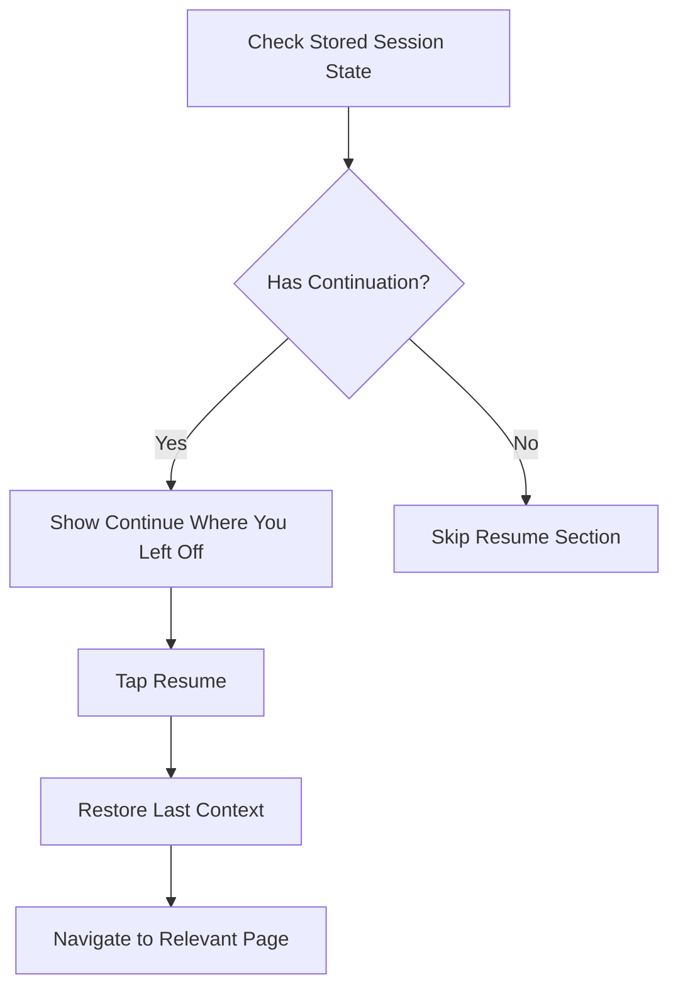
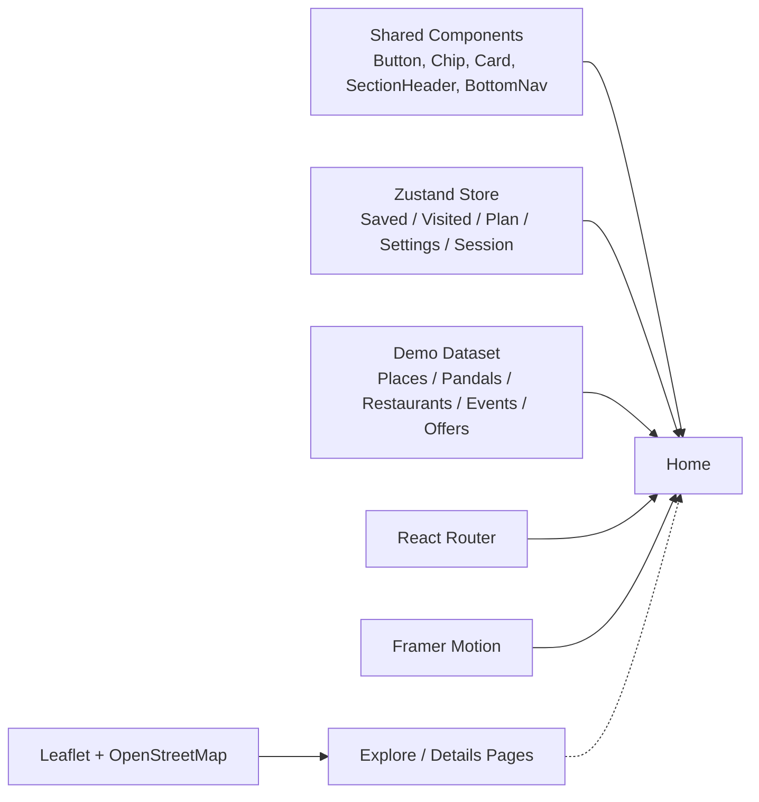

# Home Page Implementation

<cite>
**Referenced Files in This Document**
- [Pujo_Sahayak_Master_Project_Context.md](file://Pujo_Sahayak_Master_Project_Context.md)
- [plan.md](file://tasks/plan.md)
- [todo.md](file://tasks/todo.md)
</cite>

## Table of Contents
1. [Introduction](#introduction)
2. [Project Structure](#project-structure)
3. [Core Components](#core-components)
4. [Architecture Overview](#architecture-overview)
5. [Detailed Component Analysis](#detailed-component-analysis)
6. [Dependency Analysis](#dependency-analysis)
7. [Performance Considerations](#performance-considerations)
8. [Troubleshooting Guide](#troubleshooting-guide)
9. [Conclusion](#conclusion)

## Introduction
This document explains the Home page implementation for Pujo Sahayak as defined by the project context and task plan. The Home page is the main discovery surface: it should not only show pandals, but dynamically present what is relevant to the user based on season, time, location, activity, current events, and personalization. It combines a greeting with cultural awareness, sponsored content, editorial spotlights, restaurant listings, offers, events, and continuity features such as “Continue where you left off.”

The product philosophy emphasizes that Home must remain structured rather than becoming an endless feed. The intended section order is spotlight, nearby, restaurants, offers, events, recommendations, and continue-where-you-left-off. During Puja, pandals dominate; outside Puja, the same structure supports restaurants, events, local activities, meetups, and other experiences.

**Section sources**
- [Pujo_Sahayak_Master_Project_Context.md:160-284](file://Pujo_Sahayak_Master_Project_Context.md#L160-L284)
- [Pujo_Sahayak_Master_Project_Context.md:1146-1178](file://Pujo_Sahayak_Master_Project_Context.md#L1146-L1178)
- [Pujo_Sahayak_Master_Project_Context.md:1555-1603](file://Pujo_Sahayak_Master_Project_Context.md#L1555-L1603)

## Project Structure
At this stage, the repository contains the master product context and task planning files. The Home page is described conceptually and operationally in the context document, while the task plan defines how the Home page fits into the broader React + Vite PWA build.

**Diagram sources**
- [Pujo_Sahayak_Master_Project_Context.md:160-284](file://Pujo_Sahayak_Master_Project_Context.md#L160-L284)
- [plan.md:1-18](file://tasks/plan.md#L1-L18)
- [todo.md:23-24](file://tasks/todo.md#L23-L24)

**Section sources**
- [Pujo_Sahayak_Master_Project_Context.md:160-284](file://Pujo_Sahayak_Master_Project_Context.md#L160-L284)
- [plan.md:1-18](file://tasks/plan.md#L1-L18)
- [todo.md:23-24](file://tasks/todo.md#L23-L24)

## Core Components
The Home page is composed from several sections. Each section has a clear purpose, data source, and interaction model.

| Section | Purpose | Key Data | User Actions |
|---|---|---|---|
| Greeting and Personalization | Establish cultural context, location, season, and language | Current location, selected language, season, user preferences | Open search, toggle language, open Maya |
| Sponsored Spotlight | Native sponsored card distinguishing commercial content | Sponsor image/video, brand/event name, short description, CTA | Explore sponsor content |
| Explore Spotlight | Editorial-style feature cards for pandals, restaurants, events, or local experiences | Image/video, name, short description | Navigate to detail or related page |
| Restaurants | Local food discovery integrated with exploration | Image, name, rating, distance, cuisine/category, optional open-now and price tags | View details, save, route |
| Offers & Discounts | Promotional content without turning the app into a coupon site | Offer title, discount, partner/business, validity, CTA | Explore offer, navigate to business |
| Events | Community and local event highlights | Event name, date/time, location, category | View details, join meetup if applicable |
| Continue Where You Left Off | Retention through session memory | Last viewed place, unfinished route/search/category | Resume exploration |

These components are intentionally ordered to avoid making Home a social-media-style feed. The information hierarchy keeps users oriented around discovery, understanding, planning, visiting, sharing, and meeting people.

**Section sources**
- [Pujo_Sahayak_Master_Project_Context.md:160-284](file://Pujo_Sahayak_Master_Project_Context.md#L160-L284)
- [Pujo_Sahayak_Master_Project_Context.md:1555-1603](file://Pujo_Sahayak_Master_Project_Context.md#L1555-L1603)
- [todo.md:23-24](file://tasks/todo.md#L23-L24)

## Architecture Overview
The Home page is part of a mobile-first React application built with Vite and Tailwind CSS. It uses React Router for navigation, Zustand for client state, Framer Motion for motion, and Leaflet for maps. The Home page consumes typed demo data representing places, pandals, restaurants, events, offers, and user state.

**Diagram sources**
- [plan.md:1-18](file://tasks/plan.md#L1-L18)
- [todo.md:23-24](file://tasks/todo.md#L23-L24)

**Section sources**
- [plan.md:1-18](file://tasks/plan.md#L1-L18)
- [todo.md:23-24](file://tasks/todo.md#L23-L24)

## Detailed Component Analysis

### Greeting Section with Personalized User Experience
The greeting establishes cultural context and personalization. It can display a Bengali greeting alongside location and year, along with a search bar and a language toggle. The language toggle supports Bengali, English, and Hindi according to the task definition, while the broader context also mentions language settings under account and profile.

Key responsibilities:
- Show culturally appropriate greeting text.
- Reflect current location context.
- Reflect season and festival timing.
- Provide quick access to search and AI assistant.
- Allow language switching between supported locales.

Personalization inputs include:
- Selected language.
- Current location.
- Season (Puja vs off-season).
- Recent activity and saved places.
- Theme and appearance preferences.

**Diagram sources**
- [todo.md:23-24](file://tasks/todo.md#L23-L24)
- [Pujo_Sahayak_Master_Project_Context.md:1055-1091](file://Pujo_Sahayak_Master_Project_Context.md#L1055-L1091)

**Section sources**
- [todo.md:23-24](file://tasks/todo.md#L23-L24)
- [Pujo_Sahayak_Master_Project_Context.md:1055-1091](file://Pujo_Sahayak_Master_Project_Context.md#L1055-L1091)

### Sponsored Spotlight Cards
The sponsored spotlight is a native-looking sponsored card near the top of Home. It must be visually distinct from organic recommendations and should not feel intrusive. It can contain an image or video, brand or event name, short description, and an explore action.

Responsibilities:
- Clearly label sponsored content.
- Support rich media safely.
- Avoid cluttering the editorial experience.
- Route users to sponsor-related destinations.

Dynamic loading considerations:
- Sponsored content may come from a separate dataset or backend.
- Images/videos should be optimized and have fallbacks.
- Empty or invalid sponsor data should degrade gracefully.

**Diagram sources**
- [Pujo_Sahayak_Master_Project_Context.md:168-188](file://Pujo_Sahayak_Master_Project_Context.md#L168-L188)

**Section sources**
- [Pujo_Sahayak_Master_Project_Context.md:168-188](file://Pujo_Sahayak_Master_Project_Context.md#L168-L188)

### Explore Spotlight Sections
The explore spotlight is an editorial-style feature section showcasing featured pandals, restaurants, events, or local experiences. During Puja, pandals dominate; outside Puja, the component promotes other local experiences.

Responsibilities:
- Present curated or algorithmically selected items.
- Show image/video, name, and short description.
- Distinguish editorial content from sponsored content.
- Route users to detail pages or related sections.

Data binding strategy:
- Bind to a curated list of featured items.
- Respect season-based prioritization.
- Allow empty states when no featured content exists.

**Diagram sources**
- [Pujo_Sahayak_Master_Project_Context.md:189-208](file://Pujo_Sahayak_Master_Project_Context.md#L189-L208)
- [Pujo_Sahayak_Master_Project_Context.md:1146-1178](file://Pujo_Sahayak_Master_Project_Context.md#L1146-L1178)

**Section sources**
- [Pujo_Sahayak_Master_Project_Context.md:189-208](file://Pujo_Sahayak_Master_Project_Context.md#L189-L208)
- [Pujo_Sahayak_Master_Project_Context.md:1146-1178](file://Pujo_Sahayak_Master_Project_Context.md#L1146-L1178)

### Restaurant Listings Component
The restaurant section integrates food discovery into the exploration ecosystem. Cards can show image, restaurant name, rating, distance, cuisine/category, and optional indicators such as open now and price level.

Responsibilities:
- Display nearby or recommended restaurants.
- Show ratings and distance clearly.
- Support cuisine filtering at the listing level.
- Connect restaurants to place exploration rather than delivery flows.

Filtering and rating display:
- Cuisine filter can be implemented as chips or pills.
- Rating can be numeric or star-based.
- Distance can be formatted locally.
- Open-now status should reflect available data.

**Diagram sources**
- [Pujo_Sahayak_Master_Project_Context.md:209-234](file://Pujo_Sahayak_Master_Project_Context.md#L209-L234)
- [todo.md:60-61](file://tasks/todo.md#L60-L61)

**Section sources**
- [Pujo_Sahayak_Master_Project_Context.md:209-234](file://Pujo_Sahayak_Master_Project_Context.md#L209-L234)
- [todo.md:60-61](file://tasks/todo.md#L60-L61)

### Offers Display System
The offers section presents promotional content including sponsor offers, local business offers, Puja-related discounts, and partner promotions. The UI must avoid making the app look like a coupon website.

Responsibilities:
- Display offers with clear branding and terms.
- Keep promotional content tasteful and contextual.
- Route users to relevant businesses or actions.
- Handle expired or invalid offers gracefully.

Promotional content management:
- Offers should be versioned and time-bound.
- Visual distinction from organic content is important.
- Empty or expired states should be handled.

**Diagram sources**
- [Pujo_Sahayak_Master_Project_Context.md:235-247](file://Pujo_Sahayak_Master_Project_Context.md#L235-L247)

**Section sources**
- [Pujo_Sahayak_Master_Project_Context.md:235-247](file://Pujo_Sahayak_Master_Project_Context.md#L235-L247)

### Events Showcase
The events showcase highlights community events, local experiences, and seasonal activities. It supports date-based filtering and can connect to meetups and social discovery.

Responsibilities:
- Show upcoming events with date, time, and location.
- Support filtering by date range or category.
- Highlight community-oriented events.
- Connect events to related places or meetups.

Date-based filtering logic:
- Compare event dates with current date.
- Group by today, upcoming, or past.
- Sort by nearest date.
- Surface community-highlighted events.

**Diagram sources**
- [Pujo_Sahayak_Master_Project_Context.md:268-284](file://Pujo_Sahayak_Master_Project_Context.md#L268-L284)
- [todo.md:53-54](file://tasks/todo.md#L53-L54)

**Section sources**
- [Pujo_Sahayak_Master_Project_Context.md:268-284](file://Pujo_Sahayak_Master_Project_Context.md#L268-L284)
- [todo.md:53-54](file://tasks/todo.md#L53-L54)

### Continue Where You Left Off
This retention feature allows users to return to their last exploration context, such as an unfinished route, search, category, saved restaurant, or meetup discovery session.

Responsibilities:
- Persist last viewed place or partial session state.
- Provide a clear resume action.
- Reset or update the continuation context when the user starts a new flow.

Session persistence:
- Store last viewed place, unfinished route, or partial search.
- Clear continuation after successful completion.
- Respect privacy and storage limits.

**Diagram sources**
- [Pujo_Sahayak_Master_Project_Context.md:286-318](file://Pujo_Sahayak_Master_Project_Context.md#L286-L318)
- [todo.md:23-24](file://tasks/todo.md#L23-L24)

**Section sources**
- [Pujo_Sahayak_Master_Project_Context.md:286-318](file://Pujo_Sahayak_Master_Project_Context.md#L286-L318)
- [todo.md:23-24](file://tasks/todo.md#L23-L24)

### Component Composition Patterns
The Home page follows a section-based composition pattern:
- Each major area is a reusable section component.
- Shared primitives such as cards, chips, buttons, and section headers are reused across Home and other screens.
- The bottom navigation and app shell provide consistent layout and routing.
- Motion primitives support soft page transitions and subtle interactions.

Composition layers:
- App shell and navigation.
- Section containers with titles and descriptions.
- Card components for places, restaurants, offers, and events.
- Filter chips for cuisine, area, distance, theme, crowd, and categories.
- Action rows for save, visit, route, and explore.

**Section sources**
- [plan.md:1-18](file://tasks/plan.md#L1-L18)
- [todo.md:10-11](file://tasks/todo.md#L10-L11)

### Data Binding Strategies
Data binding for Home relies on a typed local demo dataset and a Zustand store:
- Static or curated data feeds the explore spotlight and sponsored sections.
- Dynamic filters bind to user-selected cuisine, area, distance, theme, crowd, or date ranges.
- User state binds to saved places, visited places, plan, language, theme, and session continuation.
- Navigation routes bind to detail pages for pandals, restaurants, events, and offers.

Binding principles:
- Keep data models broad enough to support both Puja and off-season use.
- Avoid fabricating statistics or reviews beyond the demo dataset.
- Use grounded data for Maya and recommendations.

**Section sources**
- [plan.md:1-18](file://tasks/plan.md#L1-L18)
- [todo.md:13-14](file://tasks/todo.md#L13-L14)
- [Pujo_Sahayak_Master_Project_Context.md:1232-1260](file://Pujo_Sahayak_Master_Project_Context.md#L1232-L1260)

### Responsive Design Implementations
The design is heavily mobile-oriented, with desktop adaptation using wider layouts, multi-column sections, expanded maps, side panels, and richer exploration. Home should not become two completely separate UX concepts; instead, it should scale the same system.

Responsive guidelines:
- Mobile first: single-column rails, compact cards, bottom navigation.
- Desktop: multi-column grids, larger hero images, side-by-side sections.
- Preserve accessibility and reduced-motion preferences.
- Ensure tap targets and readability on small screens.

**Section sources**
- [Pujo_Sahayak_Master_Project_Context.md:1555-1575](file://Pujo_Sahayak_Master_Project_Context.md#L1555-L1575)
- [todo.md:74-75](file://tasks/todo.md#L74-L75)

## Dependency Analysis
The Home page depends on shared UI primitives, routing, store state, and demo data. Its dependencies are intentionally decoupled so each section can evolve independently.

**Diagram sources**
- [plan.md:1-18](file://tasks/plan.md#L1-L18)
- [todo.md:23-24](file://tasks/todo.md#L23-L24)

**Section sources**
- [plan.md:1-18](file://tasks/plan.md#L1-L18)
- [todo.md:23-24](file://tasks/todo.md#L23-L24)

## Performance Considerations
- Prefer lazy loading for sections that are not immediately visible.
- Optimize images and videos in sponsored and spotlight sections.
- Debounce or throttle filter inputs for restaurants and events.
- Cache frequently used data in the store to avoid redundant computations.
- Respect reduced-motion preferences for animations.
- Avoid heavy synchronous operations during initial render.

[No sources needed since this section provides general guidance]

## Troubleshooting Guide
Common issues and resolutions for the Home page:

| Issue | Likely Cause | Resolution |
|---|---|---|
| Greeting does not change language | Language toggle not updating store or strings not bound | Verify language state updates and string bindings |
| Sponsored card shows broken media | Missing or invalid image/video URL | Add fallback placeholder and validate metadata |
| Explore spotlight shows wrong content type | Season logic not applied | Confirm season check and prioritization rules |
| Restaurant filters do nothing | Filter state not bound to dataset query | Verify filter state and query pipeline |
| Offers disappear unexpectedly | Expired or inactive offers filtered out | Review offer validity logic and empty state handling |
| Events show past events | Date filter not applied correctly | Normalize dates and compare against current date |
| Continue Where You Left Off does not resume | Session state missing or cleared | Check localStorage/session persistence and reset behavior |

**Section sources**
- [todo.md:23-24](file://tasks/todo.md#L23-L24)
- [Pujo_Sahayak_Master_Project_Context.md:286-318](file://Pujo_Sahayak_Master_Project_Context.md#L286-L318)

## Conclusion
The Home page for Pujo Sahayak is a structured, culturally aware discovery surface. It begins with a personalized greeting, then moves through sponsored content, editorial spotlights, restaurant listings, offers, events, and continuity features. Its architecture supports responsive design, component reuse, and clean data binding. During Puja, pandals dominate; outside Puja, the same structure sustains engagement through restaurants, events, local activities, and community experiences. The implementation should preserve clarity, avoid fabricated data, and keep commercial content distinct from organic discovery.

[No sources needed since this section summarizes without analyzing specific files]