# Offers Display System

<cite>
**Referenced Files in This Document**
- [Pujo_Sahayak_Master_Project_Context.md](file://Pujo_Sahayak_Master_Project_Context.md)
</cite>

## Table of Contents
1. [Introduction](#introduction)
2. [Project Structure](#project-structure)
3. [Core Components](#core-components)
4. [Architecture Overview](#architecture-overview)
5. [Detailed Component Analysis](#detailed-component-analysis)
6. [Dependency Analysis](#dependency-analysis)
7. [Performance Considerations](#performance-considerations)
8. [Troubleshooting Guide](#troubleshooting-guide)
9. [Conclusion](#conclusion)

## Introduction
This document explains the offers display system for Pujo Sahayak, focusing on promotional content management, offer card structure, scheduling and expiration handling, visual urgency patterns, store integration for analytics, responsive design, and accessibility. The project is a location-aware local discovery platform centered around Durga Puja, with an evolving commercial layer that includes offers, restaurants, events, shopping, and off-season activities. Offers are explicitly listed as “Designed but Still Evolving,” meaning they should be implemented as a structured, extensible feature without overwhelming the core discovery experience.

The offers section appears on the Home page after Spotlight, Nearby, and Restaurants, and before Events, Recommendations, and Continue Where You Left Off. It should not turn the app into a coupon website; it must remain part of the broader exploration ecosystem.

**Section sources**
- [Pujo_Sahayak_Master_Project_Context.md:160-247](file://Pujo_Sahayak_Master_Project_Context.md#L160-L247)
- [Pujo_Sahayak_Master_Project_Context.md:1577-1601](file://Pujo_Sahayak_Master_Project_Context.md#L1577-L1601)
- [Pujo_Sahayak_Master_Project_Context.md:1662-1674](file://Pujo_Sahayak_Master_Project_Context.md#L1662-L1674)

## Project Structure
At this stage, the repository contains product context and configuration files rather than full application source code. The offers display system should therefore be designed as a modular feature within the Home page, using the existing information architecture:

- Home Page
  - Sponsored Spotlight
  - Explore Spotlight
  - Restaurants
  - **Offers**
  - Events
  - Local Experiences
  - Continue Where You Left Off

The offers module should integrate cleanly with:
- Place data model
- Offer data model
- User activity tracking
- Recommendation engine inputs
- Visual language and motion guidelines
- Responsive design rules

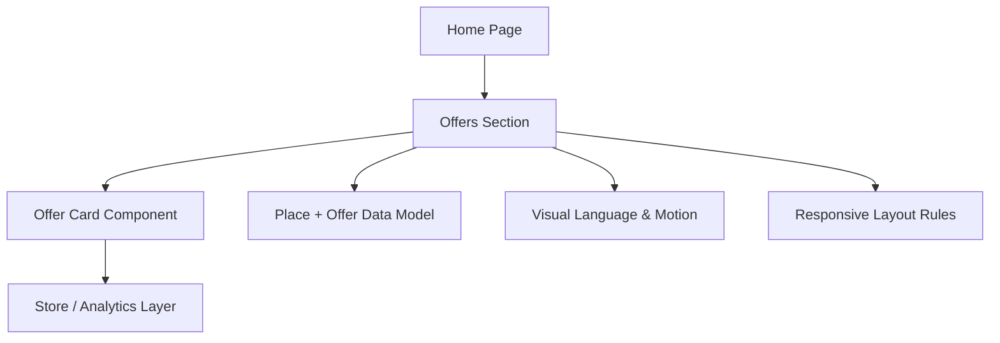

**Diagram sources**
- [Pujo_Sahayak_Master_Project_Context.md:1783-1794](file://Pujo_Sahayak_Master_Project_Context.md#L1783-L1794)
- [Pujo_Sahayak_Master_Project_Context.md:1232-1259](file://Pujo_Sahayak_Master_Project_Context.md#L1232-L1259)
- [Pujo_Sahayak_Master_Project_Context.md:1482-1533](file://Pujo_Sahayak_Master_Project_Context.md#L1482-L1533)
- [Pujo_Sahayak_Master_Project_Context.md:1555-1575](file://Pujo_Sahayak_Master_Project_Context.md#L1555-L1575)

**Section sources**
- [Pujo_Sahayak_Master_Project_Context.md:1783-1794](file://Pujo_Sahayak_Master_Project_Context.md#L1783-L1794)
- [Pujo_Sahayak_Master_Project_Context.md:1232-1259](file://Pujo_Sahayak_Master_Project_Context.md#L1232-L1259)
- [Pujo_Sahayak_Master_Project_Context.md:1482-1533](file://Pujo_Sahayak_Master_Project_Context.md#L1482-L1533)
- [Pujo_Sahayak_Master_Project_Context.md:1555-1575](file://Pujo_Sahayak_Master_Project_Context.md#L1555-L1575)

## Core Components
The offers display system consists of these primary components:

- Offers Section
  - Displays curated promotional cards on the Home page.
  - Supports sponsor offers, local business offers, Puja-related discounts, and partner promotions.
  - Must avoid making the app feel like a coupon site.

- Offer Card Component
  - Shows discount percentage or value.
  - Shows validity period or time-bound status.
  - Includes a call-to-action button such as “Explore,” “View Deal,” or “Visit Partner.”
  - Can optionally show urgency indicators such as countdown timers when appropriate.

- Content Management Layer
  - Manages offer metadata: title, description, image, discount type, discount value, start/end times, eligibility, partner/store linkage, and visibility flags.
  - Handles scheduling and expiration logic.
  - Integrates with the store system for interaction tracking and analytics.

- Store Integration
  - Tracks user interactions with offers: views, clicks, conversions, saves, and dismissals.
  - Feeds engagement signals into recommendations and trending logic.

- Visual and Interaction Layer
  - Uses the product’s modern, elegant, editorial, vibrant, immersive, youthful, culturally rooted visual language.
  - Applies subtle motion to highlight deals without distracting from usability.

- Responsive and Accessibility Layer
  - Mobile-first layout with desktop adaptations.
  - Accessible labels, keyboard navigation, focus states, reduced-motion support, and clear contrast.

**Section sources**
- [Pujo_Sahayak_Master_Project_Context.md:235-247](file://Pujo_Sahayak_Master_Project_Context.md#L235-L247)
- [Pujo_Sahayak_Master_Project_Context.md:1482-1533](file://Pujo_Sahayak_Master_Project_Context.md#L1482-L1533)
- [Pujo_Sahayak_Master_Project_Context.md:1555-1575](file://Pujo_Sahayak_Master_Project_Context.md#L1555-L1575)

## Architecture Overview
The offers display system sits inside the Home page and interacts with the broader product data model and recommendation engine.

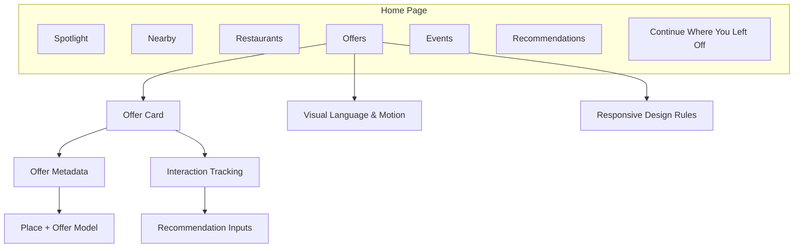

**Diagram sources**
- [Pujo_Sahayak_Master_Project_Context.md:1783-1794](file://Pujo_Sahayak_Master_Project_Context.md#L1783-L1794)
- [Pujo_Sahayak_Master_Project_Context.md:1232-1259](file://Pujo_Sahayak_Master_Project_Context.md#L1232-L1259)
- [Pujo_Sahayak_Master_Project_Context.md:1263-1287](file://Pujo_Sahayak_Master_Project_Context.md#L1263-L1287)
- [Pujo_Sahayak_Master_Project_Context.md:1482-1533](file://Pujo_Sahayak_Master_Project_Context.md#L1482-L1533)
- [Pujo_Sahayak_Master_Project_Context.md:1555-1575](file://Pujo_Sahayak_Master_Project_Context.md#L1555-L1575)

## Detailed Component Analysis

### Offer Card Component
The offer card is the main interactive unit for promotional content. It should clearly communicate value, timing, and next action.

Key responsibilities:
- Display discount percentage or discount amount.
- Show validity period or time-bound state.
- Provide a clear call-to-action button.
- Indicate whether the offer is active, expiring soon, or expired.
- Support saving or sharing where appropriate.
- Avoid coupon-site aesthetics while still highlighting deals.

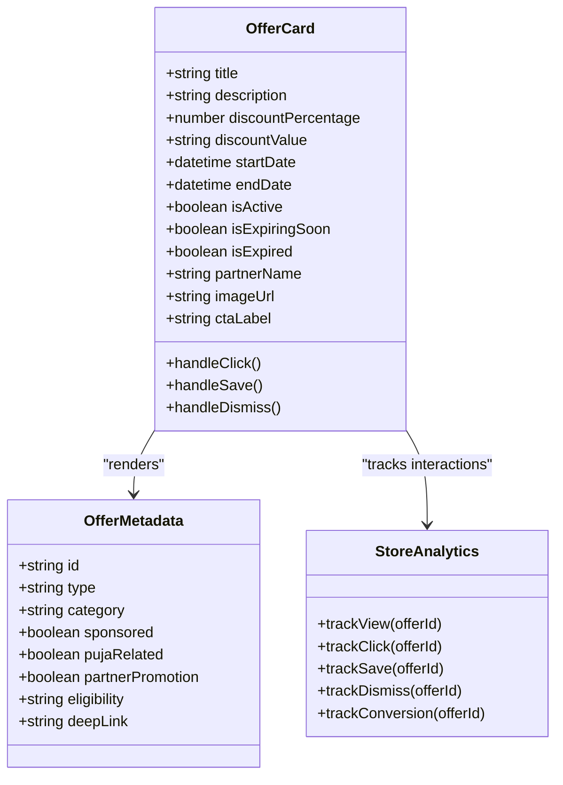

**Diagram sources**
- [Pujo_Sahayak_Master_Project_Context.md:235-247](file://Pujo_Sahayak_Master_Project_Context.md#L235-L247)
- [Pujo_Sahayak_Master_Project_Context.md:1232-1259](file://Pujo_Sahayak_Master_Project_Context.md#L1232-L1259)

**Section sources**
- [Pujo_Sahayak_Master_Project_Context.md:235-247](file://Pujo_Sahayak_Master_Project_Context.md#L235-L247)

### Promotional Content Management
Promotional content management should treat offers as first-class entities alongside places, events, restaurants, and meetups.

Core concepts:
- Offer entity with scheduling fields.
- Visibility controls for active/expired/offline offers.
- Categorization by sponsor, local business, Puja-related, or partner promotion.
- Linkage to stores/partners for deeper exploration or conversion.
- Integration with the broader place model so offers can relate to locations, experiences, or partners.

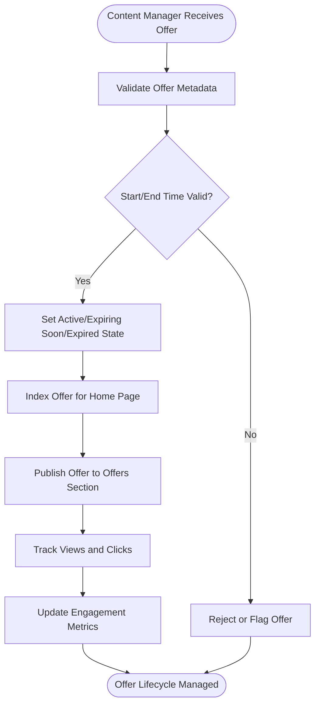

**Diagram sources**
- [Pujo_Sahayak_Master_Project_Context.md:1232-1259](file://Pujo_Sahayak_Master_Project_Context.md#L1232-L1259)
- [Pujo_Sahayak_Master_Project_Context.md:1662-1674](file://Pujo_Sahayak_Master_Project_Context.md#L1662-L1674)

**Section sources**
- [Pujo_Sahayak_Master_Project_Context.md:1232-1259](file://Pujo_Sahayak_Master_Project_Context.md#L1232-L1259)
- [Pujo_Sahayak_Master_Project_Context.md:1662-1674](file://Pujo_Sahayak_Master_Project_Context.md#L1662-L1674)

### Scheduling and Expiration Handling
Scheduling ensures offers appear only when relevant and do not mislead users about availability.

Processing logic:
- Compare current time with offer start and end times.
- Mark offers as active if within valid window.
- Mark offers as expiring soon when close to expiration.
- Hide or visually disable expired offers.
- Prevent expired offers from driving conversions.

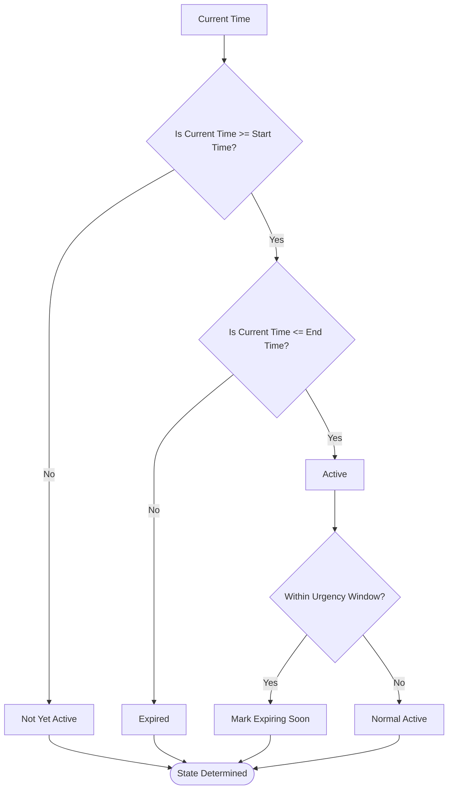

**Diagram sources**
- [Pujo_Sahayak_Master_Project_Context.md:1662-1674](file://Pujo_Sahayak_Master_Project_Context.md#L1662-L1674)

**Section sources**
- [Pujo_Sahayak_Master_Project_Context.md:1662-1674](file://Pujo_Sahayak_Master_Project_Context.md#L1662-L1674)

### Visual Design Patterns for Deals and Urgency
The visual design should highlight deals without turning the app into a coupon site. Use the product’s visual language: modern, elegant, editorial, vibrant, immersive, youthful, and culturally rooted.

Guidelines:
- Use subtle gradients, soft glow, and tasteful accents inspired by Durga Puja without over-decoration.
- Highlight discount badges or banners sparingly.
- Use motion carefully: subtle scale on interaction, smooth reveals, and occasional atmospheric effects.
- Avoid excessive animations that reduce clarity or performance.
- Keep sponsored offers visually distinct from organic recommendations.

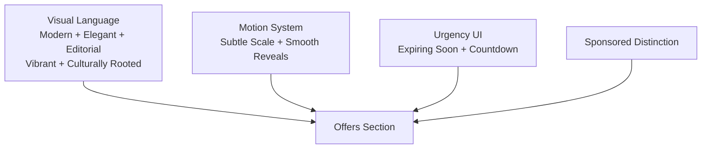

**Diagram sources**
- [Pujo_Sahayak_Master_Project_Context.md:1482-1533](file://Pujo_Sahayak_Master_Project_Context.md#L1482-L1533)
- [Pujo_Sahayak_Master_Project_Context.md:168-187](file://Pujo_Sahayak_Master_Project_Context.md#L168-L187)

**Section sources**
- [Pujo_Sahayak_Master_Project_Context.md:1482-1533](file://Pujo_Sahayak_Master_Project_Context.md#L1482-L1533)
- [Pujo_Sahayak_Master_Project_Context.md:168-187](file://Pujo_Sahayak_Master_Project_Context.md#L168-L187)

### Countdown Timers and Urgency
Countdown timers can create urgency for time-bound offers, but they must be used thoughtfully:

- Show countdown only for active offers nearing expiration.
- Avoid constant ticking animations that cause unnecessary re-renders.
- Respect reduced-motion preferences.
- Ensure timer text is accessible and meaningful to screen readers.
- Do not imply scarcity unless the underlying offer truly has limited availability.

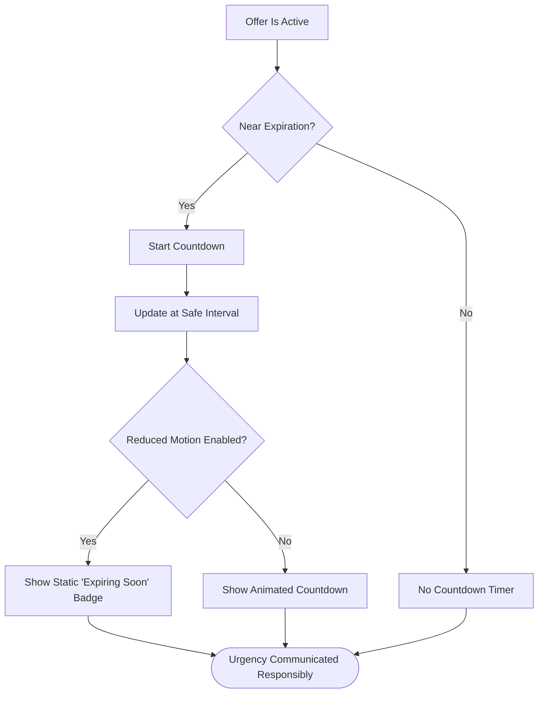

**Diagram sources**
- [Pujo_Sahayak_Master_Project_Context.md:1509-1533](file://Pujo_Sahayak_Master_Project_Context.md#L1509-L1533)

**Section sources**
- [Pujo_Sahayak_Master_Project_Context.md:1509-1533](file://Pujo_Sahayak_Master_Project_Context.md#L1509-L1533)

### Store Integration for Tracking and Analytics
The offers system should integrate with the store or analytics layer to track user interactions. This supports:
- Measuring offer performance.
- Understanding which sponsors or partners drive engagement.
- Informing recommendations and trending displays.
- Supporting future monetization and premium features.

Recommended tracked events:
- Offer view
- Offer click
- Offer save or bookmark
- Offer dismissal
- Offer conversion or partner visit

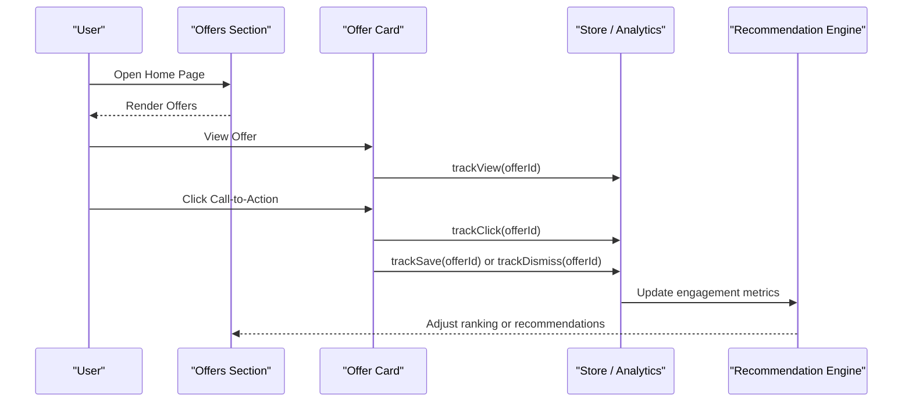

**Diagram sources**
- [Pujo_Sahayak_Master_Project_Context.md:1263-1287](file://Pujo_Sahayak_Master_Project_Context.md#L1263-L1287)
- [Pujo_Sahayak_Master_Project_Context.md:1662-1674](file://Pujo_Sahayak_Master_Project_Context.md#L1662-L1674)

**Section sources**
- [Pujo_Sahayak_Master_Project_Context.md:1263-1287](file://Pujo_Sahayak_Master_Project_Context.md#L1263-L1287)
- [Pujo_Sahayak_Master_Project_Context.md:1662-1674](file://Pujo_Sahayak_Master_Project_Context.md#L1662-L1674)

### Responsive Design Considerations
The offers section should follow the mobile-first approach described in the product context.

Mobile considerations:
- Single-column offer cards.
- Clear tap targets for call-to-action buttons.
- Concise discount and validity information.
- Minimal animation to preserve performance.

Desktop considerations:
- Wider layouts with multi-column sections.
- Expanded offer details.
- Side panels or richer exploration options.
- Consistent behavior across breakpoints.

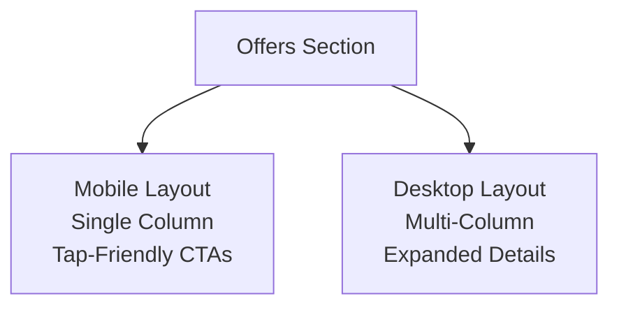

**Diagram sources**
- [Pujo_Sahayak_Master_Project_Context.md:1555-1575](file://Pujo_Sahayak_Master_Project_Context.md#L1555-L1575)

**Section sources**
- [Pujo_Sahayak_Master_Project_Context.md:1555-1575](file://Pujo_Sahayak_Master_Project_Context.md#L1555-L1575)

### Accessibility Features for Promotional Content
Accessibility is essential for promotional content because urgency, discounts, and timers can be confusing or exclusionary if not handled properly.

Required features:
- Semantic HTML for offer cards, badges, and buttons.
- Descriptive labels for discount values and validity periods.
- Keyboard navigation for all interactive elements.
- Focus indicators for buttons and links.
- Screen-reader-friendly announcements for offer state changes.
- Reduced-motion support for countdown timers and animations.
- High contrast and readable typography.
- Clear distinction between sponsored offers and organic content.

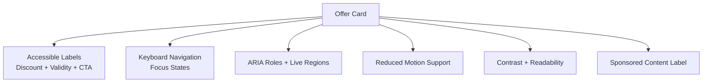

**Diagram sources**
- [Pujo_Sahayak_Master_Project_Context.md:1055-1074](file://Pujo_Sahayak_Master_Project_Context.md#L1055-L1074)
- [Pujo_Sahayak_Master_Project_Context.md:168-187](file://Pujo_Sahayak_Master_Project_Context.md#L168-L187)

**Section sources**
- [Pujo_Sahayak_Master_Project_Context.md:1055-1074](file://Pujo_Sahayak_Master_Project_Context.md#L1055-L1074)
- [Pujo_Sahayak_Master_Project_Context.md:168-187](file://Pujo_Sahayak_Master_Project_Context.md#L168-L187)

## Dependency Analysis
The offers display system depends on several product-wide systems:

- Home Page Information Architecture
  - Offers must fit into the structured Home flow.
- Place and Offer Data Model
  - Offers should extend or relate to the broader place model.
- Recommendation Engine
  - Offer engagement can influence recommendations.
- Visual Language and Motion Guidelines
  - Offers must match the product’s aesthetic and motion principles.
- Responsive Design Rules
  - Offers must adapt from mobile to desktop without separate UX concepts.

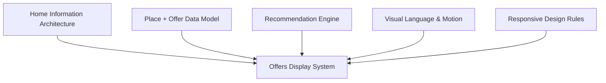

**Diagram sources**
- [Pujo_Sahayak_Master_Project_Context.md:1783-1794](file://Pujo_Sahayak_Master_Project_Context.md#L1783-L1794)
- [Pujo_Sahayak_Master_Project_Context.md:1232-1259](file://Pujo_Sahayak_Master_Project_Context.md#L1232-L1259)
- [Pujo_Sahayak_Master_Project_Context.md:1263-1287](file://Pujo_Sahayak_Master_Project_Context.md#L1263-L1287)
- [Pujo_Sahayak_Master_Project_Context.md:1482-1533](file://Pujo_Sahayak_Master_Project_Context.md#L1482-L1533)
- [Pujo_Sahayak_Master_Project_Context.md:1555-1575](file://Pujo_Sahayak_Master_Project_Context.md#L1555-L1575)

**Section sources**
- [Pujo_Sahayak_Master_Project_Context.md:1783-1794](file://Pujo_Sahayak_Master_Project_Context.md#L1783-L1794)
- [Pujo_Sahayak_Master_Project_Context.md:1232-1259](file://Pujo_Sahayak_Master_Project_Context.md#L1232-L1259)
- [Pujo_Sahayak_Master_Project_Context.md:1263-1287](file://Pujo_Sahayak_Master_Project_Context.md#L1263-L1287)
- [Pujo_Sahayak_Master_Project_Context.md:1482-1533](file://Pujo_Sahayak_Master_Project_Context.md#L1482-L1533)
- [Pujo_Sahayak_Master_Project_Context.md:1555-1575](file://Pujo_Sahayak_Master_Project_Context.md#L1555-L1575)

## Performance Considerations
- Avoid heavy animations for countdown timers; use safe update intervals.
- Prefer static badges for urgency when reduced motion is enabled.
- Lazy-load offer images and metadata where possible.
- Minimize re-renders by batching analytics events.
- Keep offer cards lightweight to preserve scroll performance on mobile.
- Avoid turning the Home page into an endless feed; keep offers structured and purposeful.

[No sources needed since this section provides general guidance]

## Troubleshooting Guide
Common issues and resolutions:

- Expired offers still visible
  - Verify scheduling logic compares current time against start and end times.
  - Ensure expired offers are hidden or visually disabled.

- Countdown timer causes jank
  - Reduce update frequency.
  - Disable animated timers under reduced-motion preferences.

- Sponsored offers look like organic content
  - Add clear sponsored labeling.
  - Apply consistent visual distinction.

- Offer analytics missing
  - Confirm view, click, save, dismiss, and conversion events are fired.
  - Verify store integration is connected to the analytics pipeline.

- Offers break responsive layout
  - Test single-column mobile layout and multi-column desktop layout.
  - Ensure call-to-action buttons remain large enough for touch targets.

**Section sources**
- [Pujo_Sahayak_Master_Project_Context.md:1662-1674](file://Pujo_Sahayak_Master_Project_Context.md#L1662-L1674)
- [Pujo_Sahayak_Master_Project_Context.md:1509-1533](file://Pujo_Sahayak_Master_Project_Context.md#L1509-L1533)
- [Pujo_Sahayak_Master_Project_Context.md:1555-1575](file://Pujo_Sahayak_Master_Project_Context.md#L1555-L1575)

## Conclusion
The offers display system should be a structured, accessible, and performance-conscious extension of the Home page. It must highlight deals and urgency without compromising the product’s identity as a local discovery platform. Offers should integrate cleanly with the place and offer data models, respect scheduling and expiration rules, support store analytics, and follow the product’s visual language and responsive design principles. As a “designed but still evolving” feature, offers should grow incrementally, always supporting the core journey of discover, explore, understand, plan, visit, share, and continue exploring.

[No sources needed since this section summarizes without analyzing specific files]