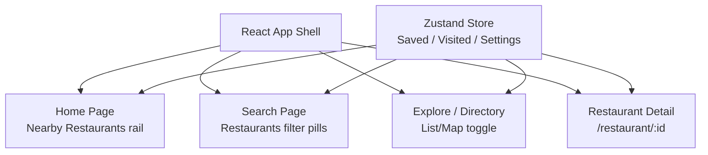
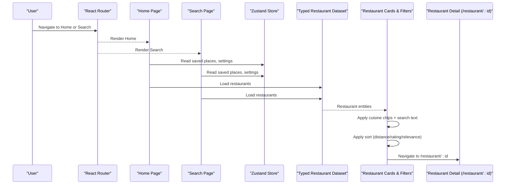
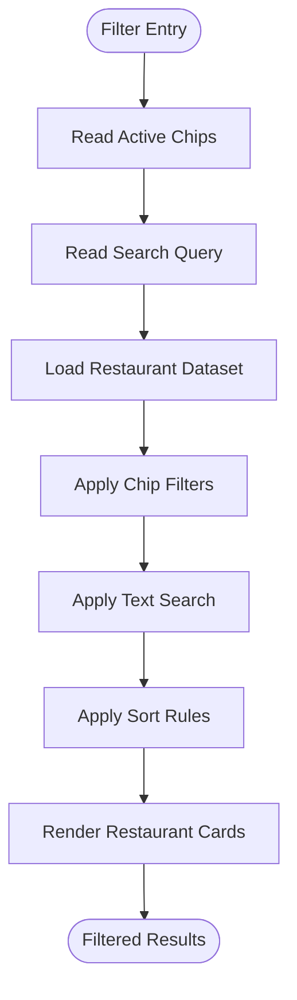
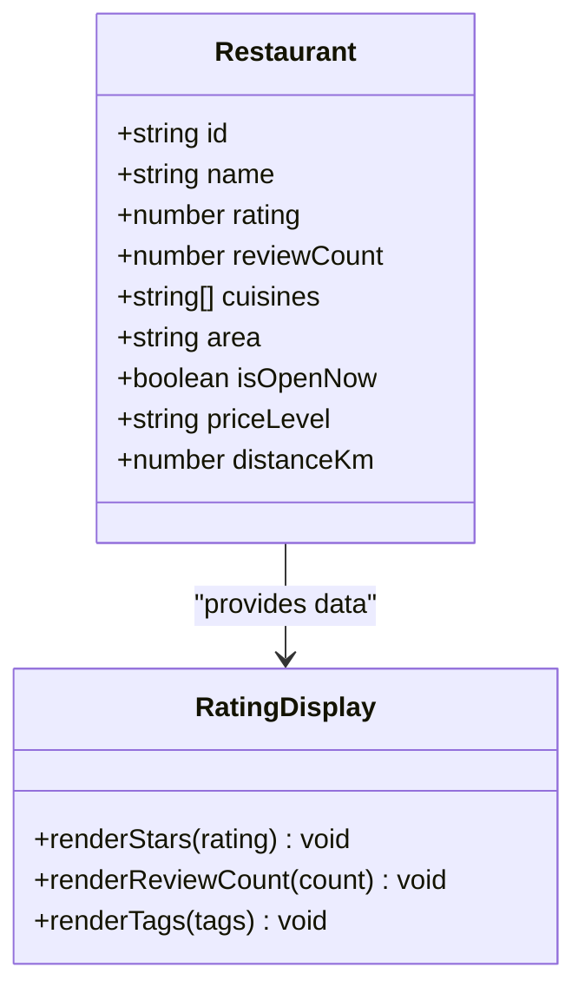
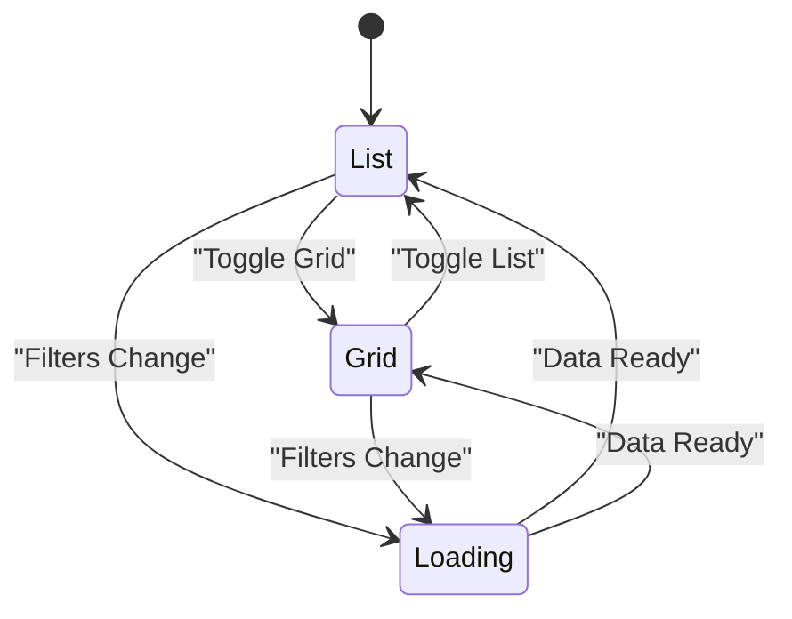
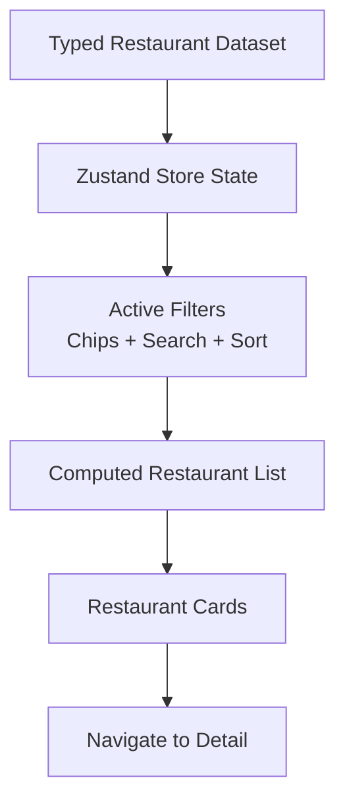
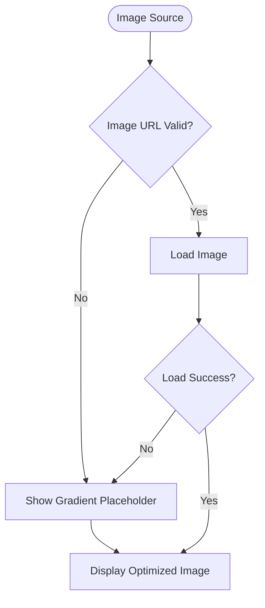
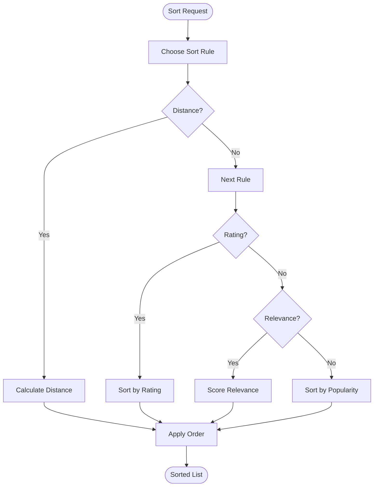
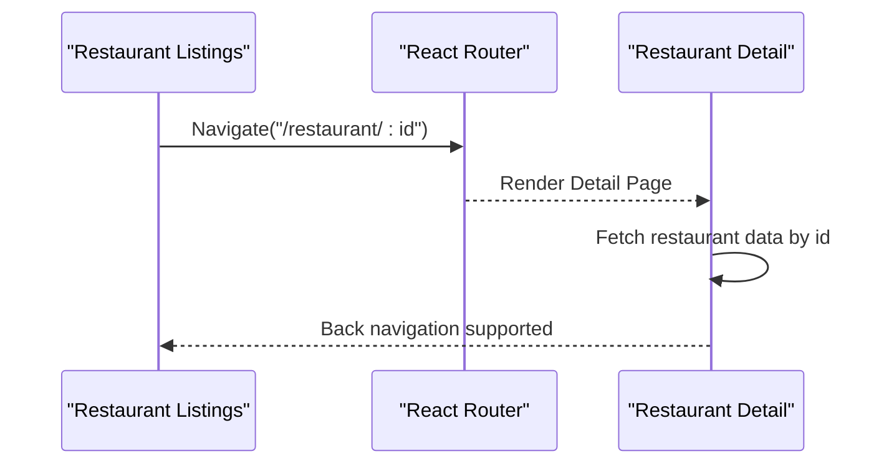
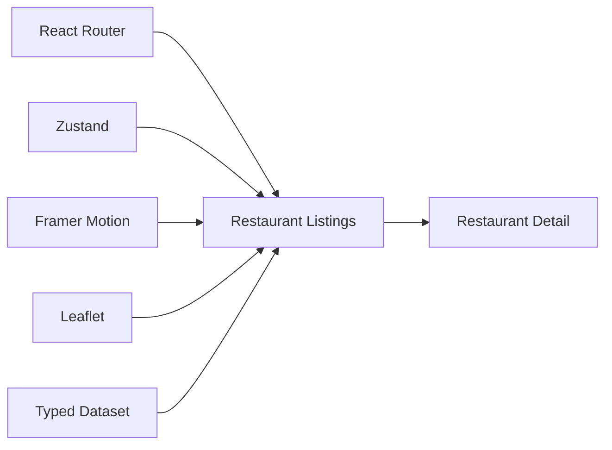

# Restaurant Listings Component

<cite>
**Referenced Files in This Document**
- [Pujo_Sahayak_Master_Project_Context.md](file://Pujo_Sahayak_Master_Project_Context.md)
- [plan.md](file://tasks/plan.md)
- [todo.md](file://tasks/todo.md)
</cite>

## Table of Contents
1. [Introduction](#introduction)
2. [Project Structure](#project-structure)
3. [Core Components](#core-components)
4. [Architecture Overview](#architecture-overview)
5. [Detailed Component Analysis](#detailed-component-analysis)
6. [Dependency Analysis](#dependency-analysis)
7. [Performance Considerations](#performance-considerations)
8. [Troubleshooting Guide](#troubleshooting-guide)
9. [Conclusion](#conclusion)

## Introduction
This document describes the restaurant listings component for Pujo Sahayak. It explains how restaurants are discovered from the home and search surfaces, how cuisine filtering works with category chips, how ratings and review counts are displayed, how list and grid views toggle with smooth transitions, and how data binding connects to the typed restaurant model. It also covers image handling, location-based sorting, performance strategies for large datasets, lazy loading, memory management, customization options for card layouts, and navigation into the restaurant detail page.

The product context positions restaurants as part of a broader local discovery ecosystem around Durga Puja and everyday Kolkata exploration. Restaurants appear on the Home page and in search results, and they integrate with planning, nearby discovery, and social features.

**Section sources**
- [Pujo_Sahayak_Master_Project_Context.md:77-100](file://Pujo_Sahayak_Master_Project_Context.md#L77-L100)
- [Pujo_Sahayak_Master_Project_Context.md:209-234](file://Pujo_Sahayak_Master_Project_Context.md#L209-L234)

## Project Structure
At a high level, the application is a React + Vite PWA with TypeScript, Tailwind CSS, React Router, Zustand, Framer Motion, and Leaflet. The implementation plan maps screens to routes and defines phases that include restaurant-related surfaces such as Home, Search, Explore, and Restaurant Detail.

**Diagram sources**
- [plan.md:19-39](file://tasks/plan.md#L19-L39)
- [plan.md:45-61](file://tasks/plan.md#L45-L61)

**Section sources**
- [plan.md:1-18](file://tasks/plan.md#L1-L18)
- [plan.md:19-39](file://tasks/plan.md#L19-L39)
- [plan.md:45-61](file://tasks/plan.md#L45-L61)

## Core Components
The restaurant listings experience is composed of several coordinated parts:

- **Restaurant Card**: Displays image, name, rating, distance, cuisine/category, open status, price level, and tags like “Nearby”.
- **Cuisine Filter Chips**: Horizontal chips for categories such as All, Pandals, Restaurants, Events, Places; within restaurant context, chips represent cuisines or filters like Open Now, Price Range, Distance.
- **Search Input**: Live filtering across names, cuisines, areas, and tags.
- **View Toggle**: List view and grid view switcher with animated transitions.
- **Sort Controls**: Sort by distance, rating, popularity, or relevance.
- **Data Binding Layer**: Connects typed restaurant entities from the dataset to UI state.
- **Image Loader**: Handles placeholder gradients, fallbacks, and optimized rendering.
- **Navigation Bridge**: Routes users to `/restaurant/:id`.

These components work together to deliver a fast, accessible, and customizable restaurant discovery surface.

**Section sources**
- [Pujo_Sahayak_Master_Project_Context.md:209-234](file://Pujo_Sahayak_Master_Project_Context.md#L209-L234)
- [todo.md:42-43](file://tasks/todo.md#L42-L43)
- [todo.md:60-61](file://tasks/todo.md#L60-L61)

## Architecture Overview
The restaurant listings flow integrates routing, store state, dataset, and UI components.

**Diagram sources**
- [plan.md:19-39](file://tasks/plan.md#L19-L39)
- [plan.md:45-61](file://tasks/plan.md#L45-L61)
- [todo.md:42-43](file://tasks/todo.md#L42-L43)
- [todo.md:60-61](file://tasks/todo.md#L60-L61)

## Detailed Component Analysis

### Cuisine Filtering System with Category Chips and Search
The filtering system combines:
- **Category chips**: Quick toggles for broad categories (All, Restaurants, etc.) and specific cuisine filters when inside the restaurant context.
- **Search input**: Real-time text matching against restaurant name, cuisine, area, and tags.
- **Combined logic**: When both chips and search text are active, results intersect the chip set with the search match.

**Diagram sources**
- [todo.md:42-43](file://tasks/todo.md#L42-L43)
- [todo.md:60-61](file://tasks/todo.md#L60-L61)

Implementation notes:
- Chips should be mutually exclusive within a category group but combinable across groups (e.g., cuisine + price range).
- Search should debounce to avoid excessive re-renders during typing.
- Empty states should guide users to clear filters or broaden search terms.

**Section sources**
- [Pujo_Sahayak_Master_Project_Context.md:447-493](file://Pujo_Sahayak_Master_Project_Context.md#L447-L493)
- [todo.md:42-43](file://tasks/todo.md#L42-L43)

### Rating Display System with Visual Indicators and Review Counts
Ratings are shown alongside review counts to communicate quality and community feedback. Visual indicators include:
- Star-based rating bars or numeric badges.
- Review count labels next to the rating.
- Optional “Open now” and “Nearby” tags to contextualize availability and proximity.

**Diagram sources**
- [todo.md:60-61](file://tasks/todo.md#L60-L61)

Best practices:
- Use consistent star sizes and spacing for accessibility.
- Avoid misleading precision; round ratings appropriately.
- Provide tooltips or legends explaining rating scales if needed.

**Section sources**
- [Pujo_Sahayak_Master_Project_Context.md:209-234](file://Pujo_Sahayak_Master_Project_Context.md#L209-L234)
- [todo.md:60-61](file://tasks/todo.md#L60-L61)

### List View and Grid View Toggles with Smooth Transitions
The view toggle allows users to switch between:
- **List view**: Vertical cards suitable for scanning details quickly.
- **Grid view**: Compact tiles optimized for browsing many items at once.

Transitions should use Framer Motion for subtle fade/scale animations, respecting reduced-motion preferences.

**Diagram sources**
- [plan.md:1-18](file://tasks/plan.md#L1-L18)

Accessibility considerations:
- Ensure keyboard focus moves logically when switching views.
- Announce view changes via ARIA live regions.
- Preserve scroll position where possible.

**Section sources**
- [plan.md:1-18](file://tasks/plan.md#L1-L18)

### Data Binding for Restaurant Information
Data binding connects typed restaurant entities to UI components:
- **Typed model**: Includes fields like name, rating, reviewCount, cuisines, area, isOpenNow, priceLevel, distanceKm.
- **Store integration**: Zustand holds current filters, search query, sort order, and view mode.
- **Derived state**: Computed filtered and sorted lists based on dataset and user inputs.

**Diagram sources**
- [plan.md:1-18](file://tasks/plan.md#L1-L18)
- [todo.md:60-61](file://tasks/todo.md#L60-L61)

Guidelines:
- Keep dataset immutable; derive new lists without mutating source data.
- Memoize derived lists to prevent unnecessary re-renders.
- Validate required fields before rendering cards.

**Section sources**
- [plan.md:1-18](file://tasks/plan.md#L1-L18)
- [todo.md:60-61](file://tasks/todo.md#L60-L61)

### Image Handling
Images should:
- Use curated placeholders or free stock assets at build time.
- Provide gradient fallbacks when images fail to load.
- Support responsive sizing and aspect ratios.
- Defer offscreen images and use lazy loading.

**Diagram sources**
- [plan.md:1-18](file://tasks/plan.md#L1-L18)

Recommendations:
- Use `loading="lazy"` for below-the-fold images.
- Implement error boundaries around image components.
- Cache images using browser cache headers or service worker strategies.

**Section sources**
- [plan.md:1-18](file://tasks/plan.md#L1-L18)

### Location-Based Sorting
Sorting options include:
- **Distance**: Haversine calculation from user’s current location.
- **Rating**: Highest rated first.
- **Relevance**: Match score based on search query and filters.
- **Popularity**: Views, saves, or visits if available.

**Diagram sources**
- [todo.md:60-61](file://tasks/todo.md#L60-L61)

Notes:
- Debounce location updates to avoid frequent recalculations.
- Allow users to reset sorting to default.
- Clearly label the active sort option.

**Section sources**
- [todo.md:60-61](file://tasks/todo.md#L60-L61)

### Customizing Restaurant Card Layouts
To customize card layouts:
- Extract reusable card variants (compact, expanded, featured).
- Use composition to inject header, body, footer sections.
- Support theme tokens for colors, radii, and typography.
- Provide props for optional fields like “Open now”, “Nearby”, or “Price level”.

Example customization points:
- Swap image placement (top vs left).
- Add badges for dietary options or awards.
- Include quick actions (Call, Directions, Save).

**Section sources**
- [plan.md:1-18](file://tasks/plan.md#L1-L18)
- [todo.md:60-61](file://tasks/todo.md#L60-L61)

### Integrating with Detail Page Navigation
Navigation to the restaurant detail page should:
- Route to `/restaurant/:id`.
- Pass minimal context (id, maybe selected filters) via route params or store.
- Preserve back navigation behavior.
- Preload essential detail data when entering the listing screen.

**Diagram sources**
- [plan.md:19-39](file://tasks/plan.md#L19-L39)

**Section sources**
- [plan.md:19-39](file://tasks/plan.md#L19-L39)

## Dependency Analysis
Key dependencies for the restaurant listings component:
- **Routing**: React Router for navigation to Home, Search, and Detail.
- **State Management**: Zustand for filters, search, sort, and view mode.
- **Motion**: Framer Motion for smooth transitions.
- **Maps**: Leaflet for location-aware features (distance calculations, nearby suggestions).
- **Dataset**: Typed local demo dataset with restaurant entities.

**Diagram sources**
- [plan.md:1-18](file://tasks/plan.md#L1-L18)
- [plan.md:19-39](file://tasks/plan.md#L19-L39)

**Section sources**
- [plan.md:1-18](file://tasks/plan.md#L1-L18)
- [plan.md:19-39](file://tasks/plan.md#L19-L39)

## Performance Considerations
For large restaurant datasets:
- **Virtualization**: Render only visible cards using virtual scrolling libraries.
- **Lazy Loading**: Load images and heavy content on demand.
- **Memoization**: Use `useMemo` and `useCallback` to stabilize derived lists and handlers.
- **Debouncing**: Debounce search input and location updates.
- **Pagination or Infinite Scroll**: Load more results progressively.
- **Memory Management**: Unsubscribe from listeners, clear timers, and release references when navigating away.

Optimization checklist:
- Avoid re-computing distances unless necessary.
- Cache computed results per filter combination.
- Use lightweight components for cards.
- Profile render cycles with React DevTools.

[No sources needed since this section provides general guidance]

## Troubleshooting Guide
Common issues and resolutions:
- **Empty results after filtering**: Verify chip combinations and search query; provide clear empty-state messaging.
- **Stale images**: Implement error boundaries and fallback placeholders; check network requests.
- **Slow sorting**: Memoize sort functions and limit recalculation scope.
- **Navigation errors**: Ensure route parameters are correctly passed and validated.
- **Memory leaks**: Clean up event listeners and timers in cleanup functions.

**Section sources**
- [plan.md:63-79](file://tasks/plan.md#L63-L79)

## Conclusion
The restaurant listings component integrates filtering, search, ratings, view toggles, data binding, image handling, and location-based sorting into a cohesive discovery experience. By following the outlined architecture, performance strategies, and customization guidelines, teams can deliver a responsive and accessible interface that fits naturally into Pujo Sahayak’s broader local exploration ecosystem.

[No sources needed since this section summarizes without analyzing specific files]