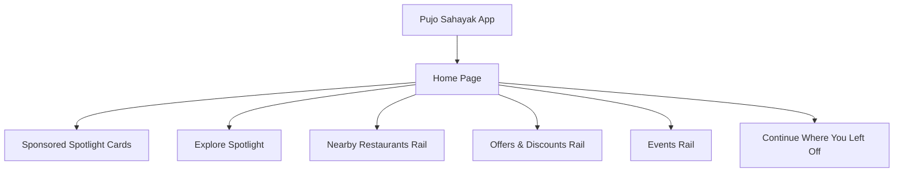
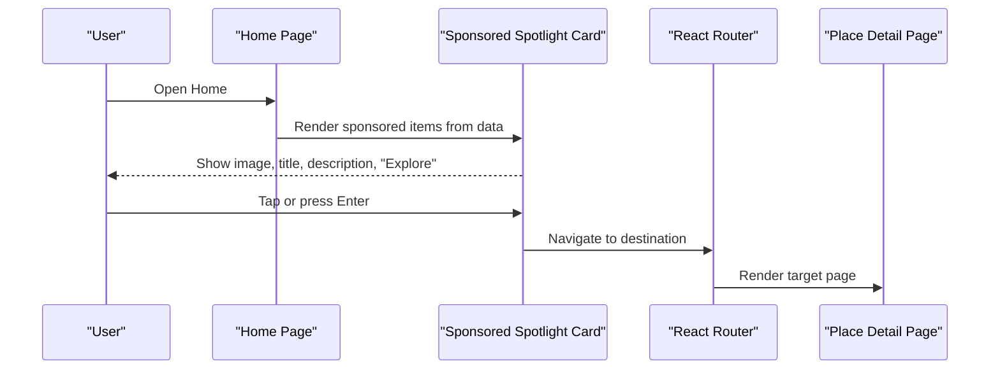
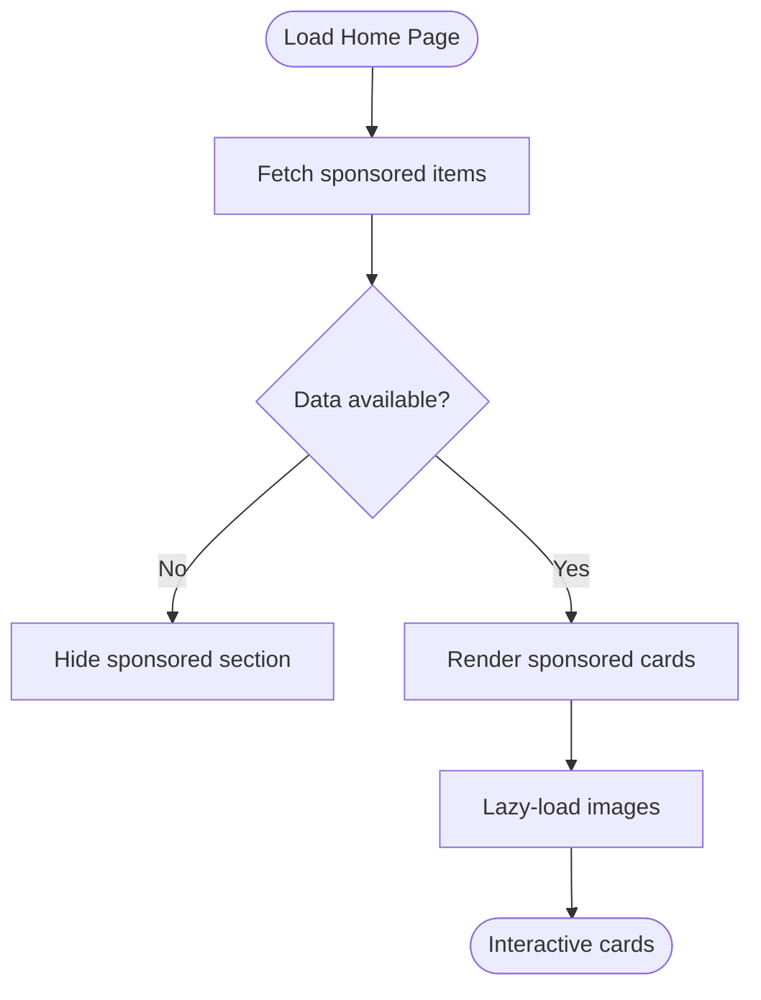
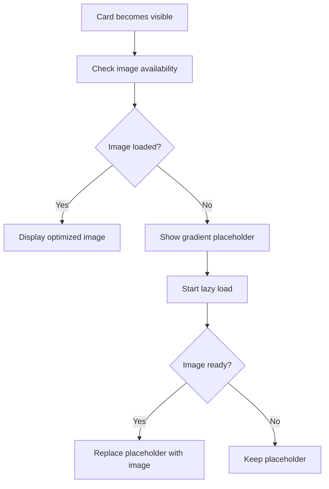
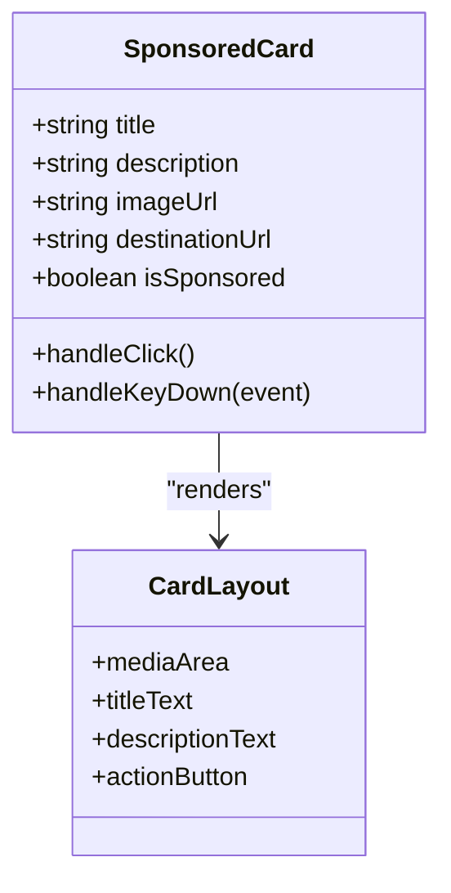
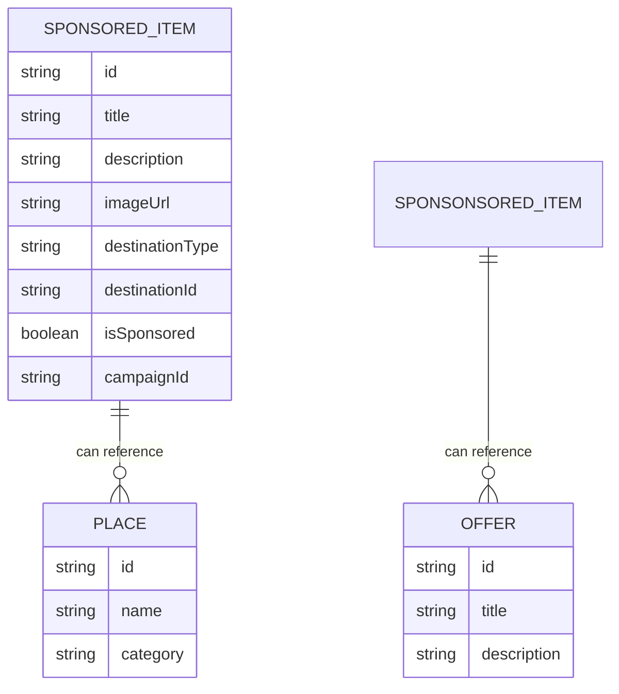
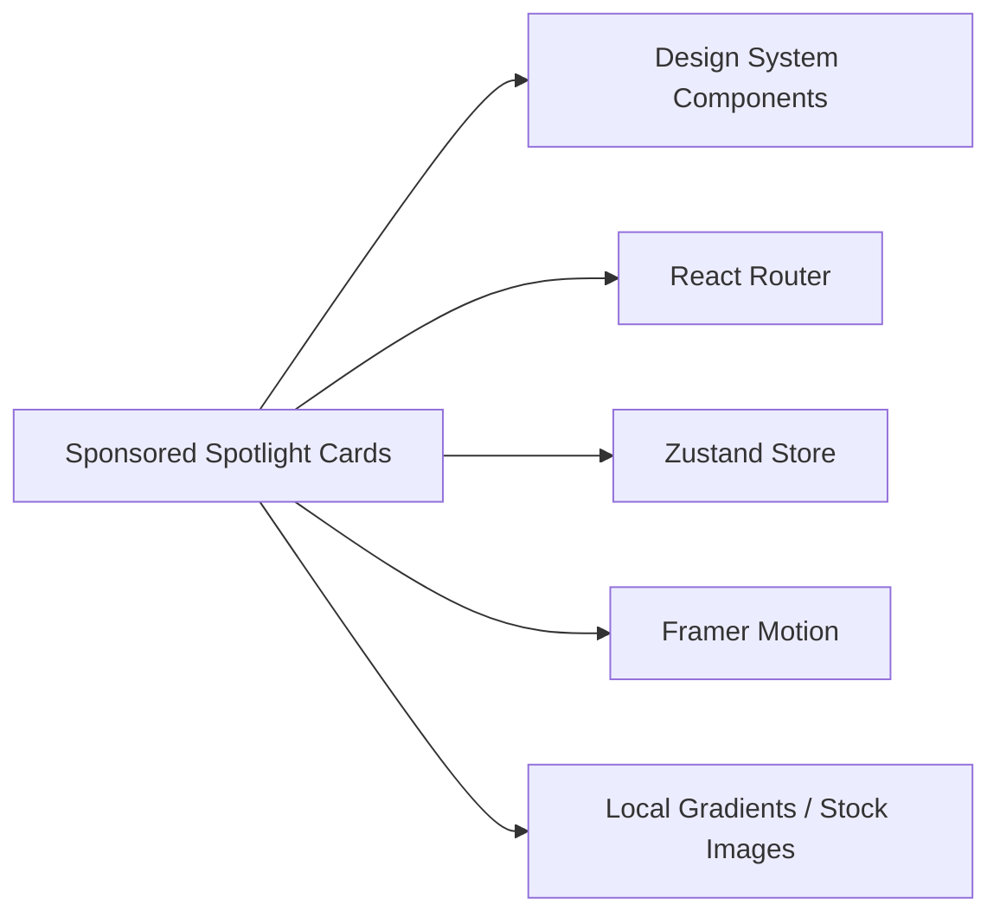
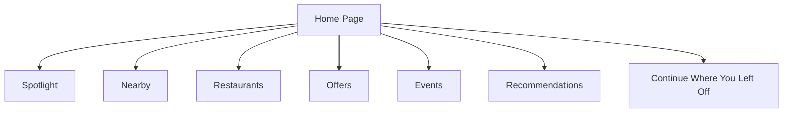

# Sponsored Spotlight Cards Component

<cite>
**Referenced Files in This Document**
- [Pujo_Sahayak_Master_Project_Context.md](file://Pujo_Sahayak_Master_Project_Context.md)
- [plan.md](file://tasks/plan.md)
- [todo.md](file://tasks/todo.md)
</cite>

## Table of Contents
1. [Introduction](#introduction)
2. [Project Structure](#project-structure)
3. [Core Components](#core-components)
4. [Architecture Overview](#architecture-overview)
5. [Detailed Component Analysis](#detailed-component-analysis)
6. [Dependency Analysis](#dependency-analysis)
7. [Performance Considerations](#performance-considerations)
8. [Troubleshooting Guide](#troubleshooting-guide)
9. [Conclusion](#conclusion)
10. [Appendices](#appendices)

## Introduction
This document defines the sponsored spotlight cards component for Pujo Sahayak. It explains how promotional pandals and featured locations are presented as native, non-intrusive sponsored cards on the Home page, how they integrate with the broader discovery flow, and how they should be implemented to meet product goals: clarity, performance, accessibility, and a cohesive local-discovery experience that remains useful beyond the Puja season.

The component is part of the Home page’s top section and must visually distinguish sponsored content from organic recommendations while fitting into the app’s editorial, mobile-first design system.

## Project Structure
At this stage, the repository contains product context and implementation planning rather than source code. The sponsored spotlight card belongs to the Home page and is planned as one of the first screens built after foundation tasks.

**Diagram sources**
- [Pujo_Sahayak_Master_Project_Context.md:160-284](file://Pujo_Sahayak_Master_Project_Context.md#L160-L284)
- [plan.md:19-39](file://tasks/plan.md#L19-L39)

**Section sources**
- [Pujo_Sahayak_Master_Project_Context.md:160-284](file://Pujo_Sahayak_Master_Project_Context.md#L160-L284)
- [plan.md:19-39](file://tasks/plan.md#L19-L39)

## Core Components
The sponsored spotlight cards component is a small, focused UI surface with these responsibilities:
- Display one or more sponsored items (promotional pandals, featured locations, partner offers).
- Clearly label each item as sponsored.
- Provide an image or media area, title, short description, and a call-to-action such as “Explore”.
- Route users to the appropriate detail or landing destination when tapped.
- Respect reduced-motion preferences and provide keyboard navigation.
- Load images efficiently with lazy loading, placeholders, and responsive handling.
- Bind data from the demo dataset or future real content without hardcoding values.

Key integration points:
- Home page layout and ordering per the product information hierarchy.
- Shared Card component from the design system.
- Router for navigation to Pandal Detail, Restaurant Detail, Event pages, or external sponsor destinations.
- Store for user state if needed (for example, tracking which sponsored items were viewed or dismissed).

**Section sources**
- [Pujo_Sahayak_Master_Project_Context.md:168-187](file://Pujo_Sahayak_Master_Project_Context.md#L168-L187)
- [plan.md:45-49](file://tasks/plan.md#L45-L49)
- [todo.md:23-24](file://tasks/todo.md#L23-L24)

## Architecture Overview
The sponsored spotlight cards component sits at the top of the Home page and is rendered before other sections. It consumes structured data representing sponsored items and renders them using shared components. Navigation routes users to relevant detail pages or external links.

**Diagram sources**
- [Pujo_Sahayak_Master_Project_Context.md:168-187](file://Pujo_Sahayak_Master_Project_Context.md#L168-L187)
- [plan.md:19-39](file://tasks/plan.md#L19-L39)

## Detailed Component Analysis

### Dynamic Content Loading Mechanism
- Data source: The component should consume a typed array of sponsored items from the application store or a dedicated data module. During development, it uses the demo dataset; later, it can bind to a backend API or CMS response.
- Loading states:
  - Initial load: show skeleton or gradient placeholder while data resolves.
  - Empty state: hide the section if no sponsored items are available.
  - Error state: degrade gracefully without breaking the Home page.
- Refresh strategy:
  - On app launch, fetch fresh sponsored content once.
  - Optionally refresh when returning to the Home page after a long absence.
- Caching:
  - Cache recent sponsored items locally to avoid repeated network calls.
  - Invalidate cache when new campaigns start or on explicit refresh.

**Diagram sources**
- [plan.md:45-49](file://tasks/plan.md#L45-L49)
- [todo.md:23-24](file://tasks/todo.md#L23-L24)

**Section sources**
- [plan.md:45-49](file://tasks/plan.md#L45-L49)
- [todo.md:23-24](file://tasks/todo.md#L23-L24)

### Image Optimization Strategies
- Placeholder gradients: Use subtle gradients matching the design tokens until the real image loads. This keeps the layout stable and avoids jarring shifts.
- Lazy loading: Defer image loading until the card enters the viewport. Combine with intersection observers or framework-native lazy-loading utilities.
- Responsive images: Serve appropriately sized images based on device pixel ratio and screen width. Use srcset or similar mechanisms where possible.
- Fallbacks: If an image fails to load, display a neutral placeholder and preserve the card’s aspect ratio.
- Performance: Avoid preloading all images; only preload critical hero images if necessary.

**Diagram sources**
- [plan.md:9-17](file://tasks/plan.md#L9-L17)
- [todo.md:10-11](file://tasks/todo.md#L10-L11)

**Section sources**
- [plan.md:9-17](file://tasks/plan.md#L9-L17)
- [todo.md:10-11](file://tasks/todo.md#L10-L11)

### Card Layout System
- Visual structure:
  - Media area: image or video thumbnail.
  - Title: name of the promoted place or brand.
  - Description: short, scannable text explaining the offer or location.
  - Call-to-action: “Explore” or equivalent action button.
- Interaction:
  - Hover effect: subtle scale or elevation change consistent with the motion system.
  - Focus state: clear outline for keyboard users.
  - Click handler: navigate to the relevant detail page or external link.
- Accessibility:
  - Role and labels: mark the card as interactive and describe its purpose.
  - Keyboard support: allow activation via Enter or Space.
  - Screen reader hints: include “Sponsored” label and destination type.

**Diagram sources**
- [plan.md:10-14](file://tasks/plan.md#L10-L14)
- [todo.md:10-11](file://tasks/todo.md#L10-L11)

**Section sources**
- [plan.md:10-14](file://tasks/plan.md#L10-L14)
- [todo.md:10-11](file://tasks/todo.md#L10-L11)

### Data Binding Patterns for Sponsored Content
- Typed model:
  - Each sponsored item should have fields for title, description, image URL, destination route or URL, and metadata such as campaign ID or placement index.
- Demo data:
  - Use the existing demo dataset pattern with an `isDemo` marker to keep implementation honest.
- Real content integration:
  - Map API responses to the typed model.
  - Handle missing fields gracefully by falling back to defaults.
- State management:
  - Keep sponsored data in a lightweight store slice or module.
  - Expose selectors for rendering and analytics.

**Diagram sources**
- [plan.md:45-49](file://tasks/plan.md#L45-L49)
- [todo.md:13-14](file://tasks/todo.md#L13-L14)

**Section sources**
- [plan.md:45-49](file://tasks/plan.md#L45-L49)
- [todo.md:13-14](file://tasks/todo.md#L13-L14)

### Performance Optimization Techniques
- Virtualization: If many sponsored items are shown, render only those in view.
- Debounced interactions: Avoid heavy work on every hover or focus event.
- Minimal re-renders: Memoize card components and derived data.
- Network efficiency: Batch requests and use caching strategies.
- Reduced motion: Honor user preferences for animations.

[No sources needed since this section provides general guidance]

### Accessibility Features
- Keyboard navigation:
  - Cards should be focusable and activatable with Enter or Space.
  - Tab order should follow visual order.
- ARIA attributes:
  - Mark cards as buttons or links depending on interaction.
  - Include aria-label describing the destination.
  - Announce “Sponsored” to screen readers.
- Contrast and readability:
  - Ensure text meets contrast guidelines over images and gradients.
- Motion preferences:
  - Disable or reduce animations when reduced motion is enabled.

**Section sources**
- [plan.md:10-14](file://tasks/plan.md#L10-L14)
- [todo.md:10-11](file://tasks/todo.md#L10-L11)

### Demo Data Structure and Real Content Integration
- Demo data:
  - Use the project’s typed data model and demo dataset approach.
  - Mark demo entries clearly so they are not mistaken for production data.
- Real content:
  - Integrate with a content management system or backend API.
  - Support multiple destination types: internal routes for places, events, restaurants, or external sponsor URLs.
- Validation:
  - Validate required fields before rendering.
  - Provide safe fallbacks for missing images or descriptions.

**Section sources**
- [plan.md:45-49](file://tasks/plan.md#L45-L49)
- [todo.md:13-14](file://tasks/todo.md#L13-L14)

## Dependency Analysis
The sponsored spotlight cards component depends on:
- Design system components: Card, SectionHeader, BottomNav, AppShell.
- Router: React Router for navigation.
- Store: Zustand for client state and demo data.
- Motion library: Framer Motion for subtle interactions.
- Images: Local placeholder gradients and optional stock imagery.

**Diagram sources**
- [plan.md:9-17](file://tasks/plan.md#L9-L17)
- [todo.md:10-11](file://tasks/todo.md#L10-L11)

**Section sources**
- [plan.md:9-17](file://tasks/plan.md#L9-L17)
- [todo.md:10-11](file://tasks/todo.md#L10-L11)

## Performance Considerations
- Prefer lazy loading for images and defer non-critical logic until interaction.
- Avoid blocking the main thread during initial render; split work across microtasks.
- Use memoization for expensive computations and prevent unnecessary re-renders.
- Keep the sponsored section lightweight; do not embed heavy media unless necessary.
- Test under low-end devices and slow networks to ensure graceful degradation.

[No sources needed since this section provides general guidance]

## Troubleshooting Guide
Common issues and resolutions:
- Sponsored section does not appear:
  - Verify data fetching and empty-state handling.
  - Check that the Home page includes the sponsored section in the correct order.
- Images fail to load:
  - Confirm placeholder gradients are applied.
  - Inspect network requests and CORS settings.
- Navigation does not work:
  - Ensure router configuration includes the destination route.
  - Validate destination type and ID mapping.
- Keyboard navigation is broken:
  - Confirm focus management and key handlers.
  - Test with screen readers and voiceover tools.
- Animations cause discomfort:
  - Respect reduced-motion preferences.
  - Provide static alternatives for motion-heavy effects.

**Section sources**
- [plan.md:63-79](file://tasks/plan.md#L63-L79)
- [todo.md:77-80](file://tasks/todo.md#L77-L80)

## Conclusion
The sponsored spotlight cards component should deliver a clean, accessible, and performant way to present promotional pandals and featured locations on the Home page. It must clearly distinguish sponsored content, integrate smoothly with the app’s design system and routing, and support both demo and real data. By following the outlined architecture, performance strategies, and accessibility practices, the component will enhance discovery without compromising usability or the product’s editorial tone.

[No sources needed since this section summarizes without analyzing specific files]

## Appendices

### Home Page Information Hierarchy Reference
The Home page should maintain a structured hierarchy so users quickly understand their context and options.

**Diagram sources**
- [Pujo_Sahayak_Master_Project_Context.md:1577-1600](file://Pujo_Sahayak_Master_Project_Context.md#L1577-L1600)

**Section sources**
- [Pujo_Sahayak_Master_Project_Context.md:1577-1600](file://Pujo_Sahayak_Master_Project_Context.md#L1577-L1600)