# Meets Page Implementation

<cite>
**Referenced Files in This Document**
- [Pujo_Sahayak_Master_Project_Context.md](file://Pujo_Sahayak_Master_Project_Context.md)
- [plan.md](file://tasks/plan.md)
- [todo.md](file://tasks/todo.md)
</cite>

## Table of Contents
1. [Introduction](#introduction)
2. [Project Structure](#project-structure)
3. [Core Components](#core-components)
4. [Architecture Overview](#architecture-overview)
5. [Detailed Component Analysis](#detailed-component-analysis)
6. [Dependency Analysis](#dependency-analysis)
7. [Performance Considerations](#performance-considerations)
8. [Troubleshooting Guide](#troubleshooting-guide)
9. [Conclusion](#conclusion)

## Introduction
This document explains the Meets Page implementation for Pujo Sahayak as a social discovery layer that helps users find or organize community meetups around shared interests and plans. It covers:
- The social discovery interface for browsing, filtering, and joining meetups
- The meetup creation workflow with form fields, validation concepts, location selection, and participant management
- Interest-based matching to connect users with similar activities
- Real-time update patterns for status changes and participant joins
- Geographic proximity features and location-based meetup discovery
- Scalability considerations for growing community features and user-generated content

The Meets feature is part of a broader product ecosystem centered on Durga Puja exploration, local discovery, planning, safety, and community interaction.

## Project Structure
The repository currently contains product context and task documentation rather than application source code. The Meets feature is defined at the product and planning levels:
- Product context defines the Meets page goal, existing meetup cards, create-your-own flow, interest-based discovery, monetization concepts, and integration points such as “meetups near this place” from the Pandal Detail page.
- Implementation plan maps routes including `/meets` and `/meets/create`.
- Task checklist describes the expected UI behavior for Meets and Create Meetup, including pills, cards, join actions, and local state updates.

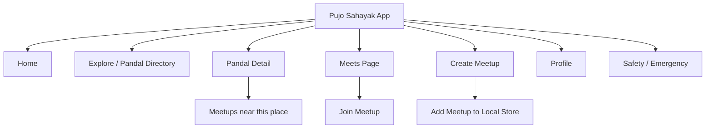

**Diagram sources**
- [Pujo_Sahayak_Master_Project_Context.md:664-770](file://Pujo_Sahayak_Master_Project_Context.md#L664-L770)
- [plan.md:29-30](file://tasks/plan.md#L29-L30)
- [todo.md:53-54](file://tasks/todo.md#L53-L54)

**Section sources**
- [Pujo_Sahayak_Master_Project_Context.md:664-770](file://Pujo_Sahayak_Master_Project_Context.md#L664-L770)
- [plan.md:19-39](file://tasks/plan.md#L19-L39)
- [todo.md:53-54](file://tasks/todo.md#L53-L54)

## Core Components
The Meets feature includes these core components based on the product context and tasks:
- Meets list view with pill filters (All, Nearby, My Interests)
- Meetup cards showing image, name, date/time, location/distance, attendee avatars + count, and Join action
- Create Meetup form with title, date, time, location, description, interest chips, maximum participants, and public/restricted visibility
- Integration with Pandal Detail via “Meetups near this place”
- Profile activity tracking including a Meetups tab
- Monetization model support for free, paid, and premium-only meetups

These components are designed to be mobile-first, integrated with the app’s design system, and backed by a typed data model that includes a `Meetup` entity.

**Section sources**
- [Pujo_Sahayak_Master_Project_Context.md:664-770](file://Pujo_Sahayak_Master_Project_Context.md#L664-L770)
- [Pujo_Sahayak_Master_Project_Context.md:935-950](file://Pujo_Sahayak_Master_Project_Context.md#L935-L950)
- [Pujo_Sahayak_Master_Project_Context.md:978-991](file://Pujo_Sahayak_Master_Project_Context.md#L978-L991)
- [plan.md:19-39](file://tasks/plan.md#L19-L39)
- [todo.md:53-54](file://tasks/todo.md#L53-L54)

## Architecture Overview
At a high level, the Meets feature interacts with:
- Routing: `/meets` and `/meets/create`
- State store: Zustand with persist middleware for meetups and related user state
- Data model: Typed entities including `Meetup`, `Place`, `User`, etc.
- UI components: Cards, chips, buttons, bottom navigation, motion primitives
- Location services: Proximity calculations and nearby discovery
- Safety and moderation controls for social interactions

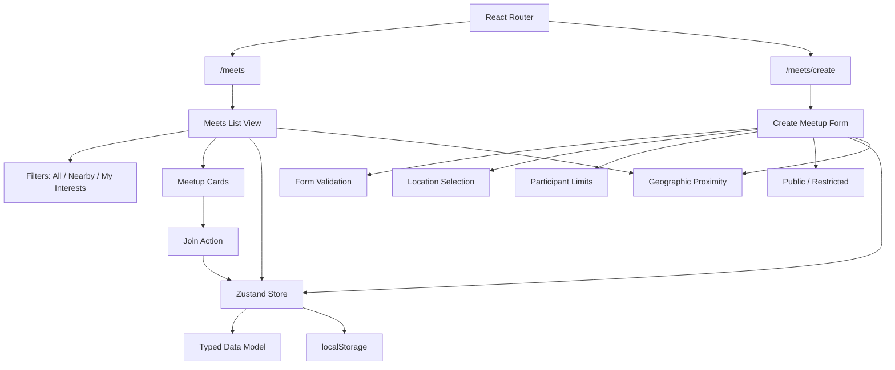

**Diagram sources**
- [plan.md:19-39](file://tasks/plan.md#L19-L39)
- [todo.md:53-54](file://tasks/todo.md#L53-L54)
- [Pujo_Sahayak_Master_Project_Context.md:664-770](file://Pujo_Sahayak_Master_Project_Context.md#L664-L770)

## Detailed Component Analysis

### Social Discovery Interface
The Meets list provides:
- Pill filters: All, Nearby, My Interests
- Meetup cards with image, name, date/time, location/distance, attendee avatars + count, and Join action
- Integration with the broader app navigation and routing

Behavioral expectations:
- Filtering updates the displayed list without full reloads
- Joining a meetup updates local state immediately
- Distance and location are shown per card to aid discovery

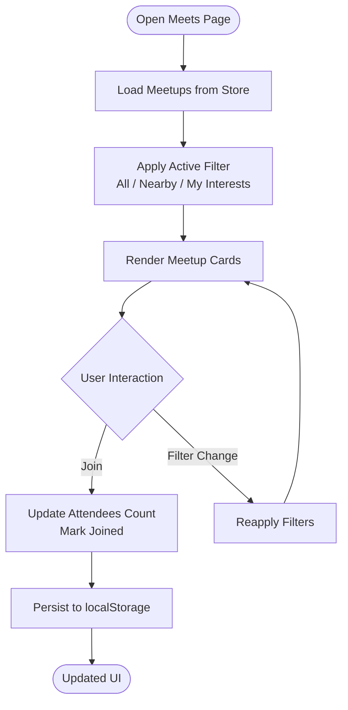

**Diagram sources**
- [todo.md:53-54](file://tasks/todo.md#L53-L54)
- [plan.md:19-39](file://tasks/plan.md#L19-L39)

**Section sources**
- [todo.md:53-54](file://tasks/todo.md#L53-L54)
- [plan.md:19-39](file://tasks/plan.md#L19-L39)

### Meetup Creation Workflow
The Create Meetup form includes:
- Title
- Date
- Time
- Location
- Description
- Interest chips
- Maximum participants
- Public / restricted visibility
- Optional selections for pandals, restaurants, or route

Validation and UX considerations:
- Required fields must be validated before submission
- Location should be selected explicitly; distance can be computed later
- Interest chips should constrain or tag the meetup for matching
- Maximum participants should enforce capacity limits
- Visibility should control discoverability and access

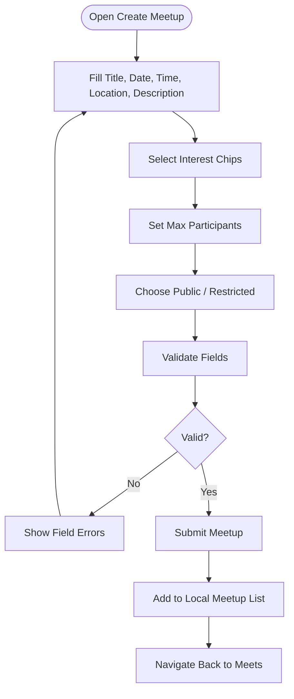

**Diagram sources**
- [Pujo_Sahayak_Master_Project_Context.md:703-727](file://Pujo_Sahayak_Master_Project_Context.md#L703-L727)
- [todo.md:53-54](file://tasks/todo.md#L53-L54)

**Section sources**
- [Pujo_Sahayak_Master_Project_Context.md:703-727](file://Pujo_Sahayak_Master_Project_Context.md#L703-L727)
- [todo.md:53-54](file://tasks/todo.md#L53-L54)

### Interest-Based Matching Algorithm
Interest-based matching connects users with meetups and other users through shared interests such as photography, pandal hopping, food, music, art, night exploration, heritage, and family-friendly exploration. The algorithm should:
- Tag meetups with interest chips
- Tag users with their interests
- Score match relevance using:
  - Exact interest overlap
  - Activity type alignment (e.g., pandal-related meetups for users who explore pandals)
  - Recency of user activity
  - Location proximity when applicable

Implementation guidance:
- Start with simple scoring rules
- Avoid dating-app-like profiles; emphasize activity-based discovery
- Provide clear explanations for recommendations where possible

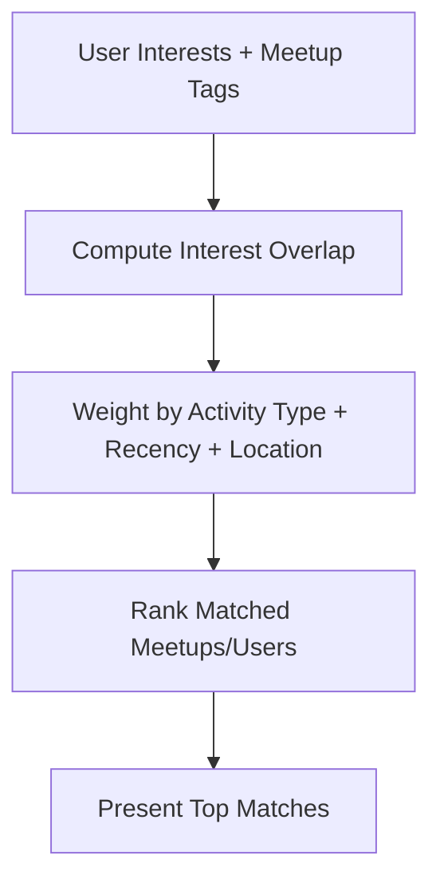

**Diagram sources**
- [Pujo_Sahayak_Master_Project_Context.md:730-750](file://Pujo_Sahayak_Master_Project_Context.md#L730-L750)

**Section sources**
- [Pujo_Sahayak_Master_Project_Context.md:730-750](file://Pujo_Sahayak_Master_Project_Context.md#L730-L750)

### Real-Time Updates for Status Changes and Participant Joins
Real-time updates should reflect:
- New attendees joining a meetup
- Host-initiated status changes (e.g., cancelled, full, moved)
- Live participant counts and avatars

Patterns:
- Optimistic UI updates followed by persistence
- Event-driven state changes in the store
- Debounced re-renders to avoid excessive UI churn
- Fallback to polling if real-time channels are unavailable

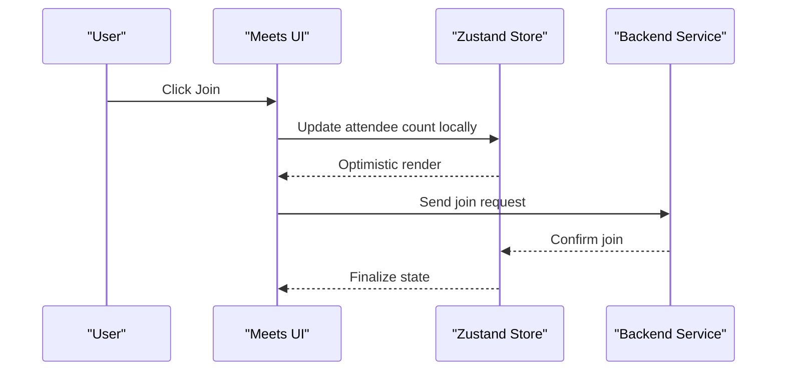

**Diagram sources**
- [todo.md:53-54](file://tasks/todo.md#L53-L54)
- [plan.md:12](file://tasks/plan.md#L12)

**Section sources**
- [todo.md:53-54](file://tasks/todo.md#L53-L54)
- [plan.md:12](file://tasks/plan.md#L12)

### Geographic Proximity Features
Location-based meetup discovery should:
- Use GPS or manual location input
- Compute distances between user and meetup locations
- Surface nearby meetups prominently
- Integrate with map views and route planning where relevant

Constraints:
- Do not overclaim precision in dense urban environments
- Use wording like “nearby” instead of exact containment
- Respect privacy controls for location sharing

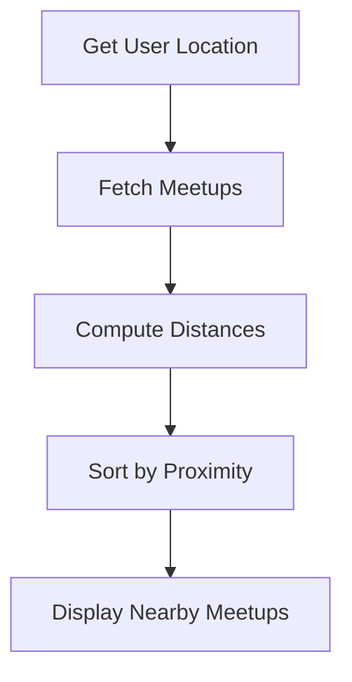

**Diagram sources**
- [Pujo_Sahayak_Master_Project_Context.md:1360-1387](file://Pujo_Sahayak_Master_Project_Context.md#L1360-L1387)
- [todo.md:53-54](file://tasks/todo.md#L53-L54)

**Section sources**
- [Pujo_Sahayak_Master_Project_Context.md:1360-1387](file://Pujo_Sahayak_Master_Project_Context.md#L1360-L1387)
- [todo.md:53-54](file://tasks/todo.md#L53-L54)

### Integration with Pandal Detail
The Pandal Detail page can surface “Meetups near this place,” connecting individual places to the community system. This encourages users to discover group activities aligned with specific locations they are exploring.

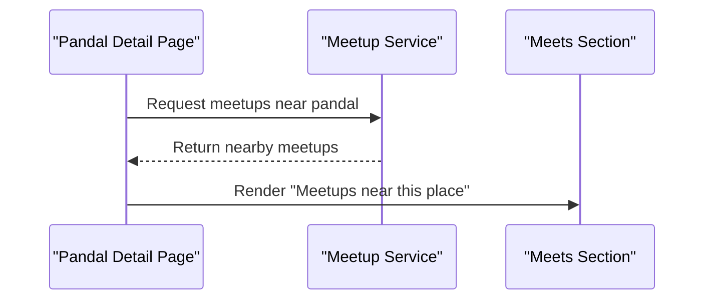

**Diagram sources**
- [Pujo_Sahayak_Master_Project_Context.md:935-950](file://Pujo_Sahayak_Master_Project_Context.md#L935-L950)

**Section sources**
- [Pujo_Sahayak_Master_Project_Context.md:935-950](file://Pujo_Sahayak_Master_Project_Context.md#L935-L950)

### Data Structures
The product data model includes a `Meetup` entity alongside other core types such as `User`, `Place`, `Review`, `Photo`, `Trip`, `Category`, `Offer`, `Subscription`, `Payment`, `SafetyPoint`, and `EmergencyReport`. A Pandal can be modeled as a specialized type of Place to support off-season expansion.

Key fields implied by the context:
- Meetup: title, date, time, location, description, interests, max participants, visibility, attendees
- Place/Pandal: name, location, theme, area, popularity
- User: interests, activity history, profile settings

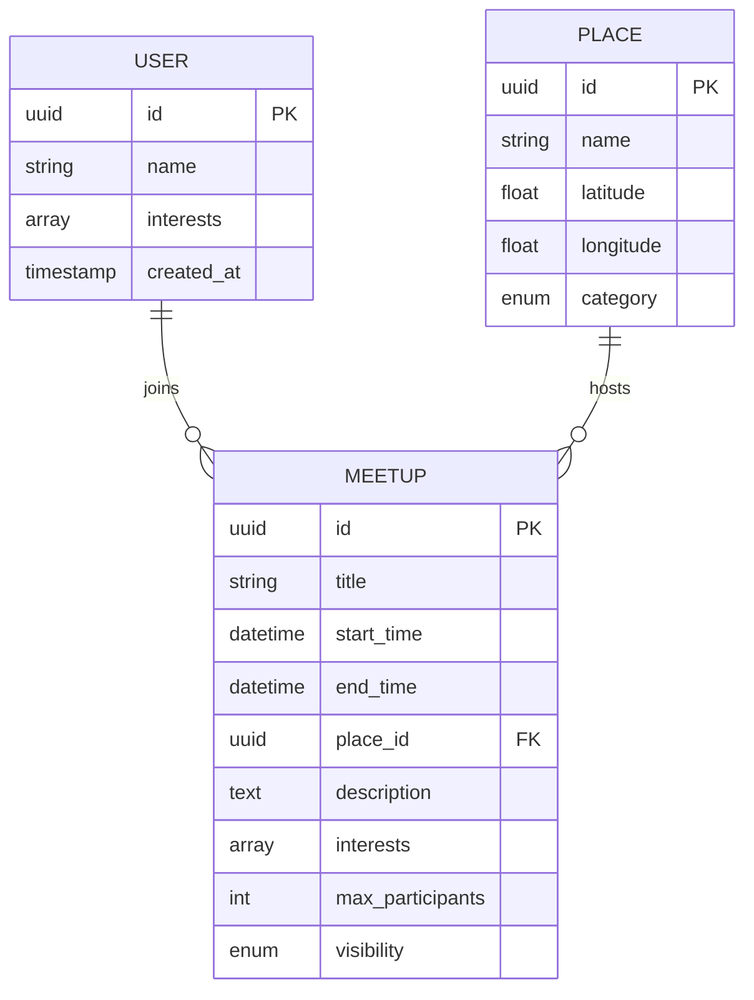

**Diagram sources**
- [Pujo_Sahayak_Master_Project_Context.md:1232-1259](file://Pujo_Sahayak_Master_Project_Context.md#L1232-L1259)
- [todo.md:14](file://tasks/todo.md#L14)

**Section sources**
- [Pujo_Sahayak_Master_Project_Context.md:1232-1259](file://Pujo_Sahayak_Master_Project_Context.md#L1232-L1259)
- [todo.md:14](file://tasks/todo.md#L14)

### Form Handling and Validation
Form handling for Create Meetup should:
- Validate required fields (title, date, time, location)
- Enforce maximum participants
- Ensure interests are selected
- Handle public vs restricted visibility
- Provide clear error messages and inline feedback

Validation flow:
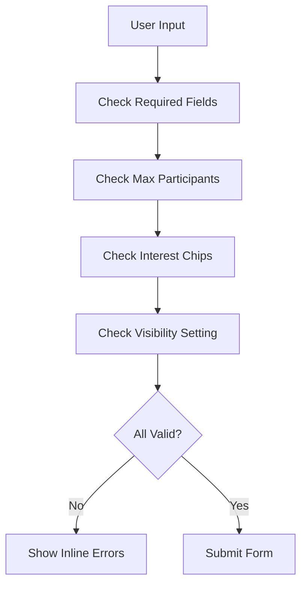

**Diagram sources**
- [Pujo_Sahayak_Master_Project_Context.md:703-727](file://Pujo_Sahayak_Master_Project_Context.md#L703-L727)
- [todo.md:53-54](file://tasks/todo.md#L53-L54)

**Section sources**
- [Pujo_Sahayak_Master_Project_Context.md:703-727](file://Pujo_Sahayak_Master_Project_Context.md#L703-L727)
- [todo.md:53-54](file://tasks/todo.md#L53-L54)

### Real-Time Communication Patterns
Recommended patterns:
- Optimistic updates for join actions
- Event-driven store updates
- Debounced UI refreshes
- Fallback polling if WebSocket or server-sent events are unavailable
- Clear error states for failed operations

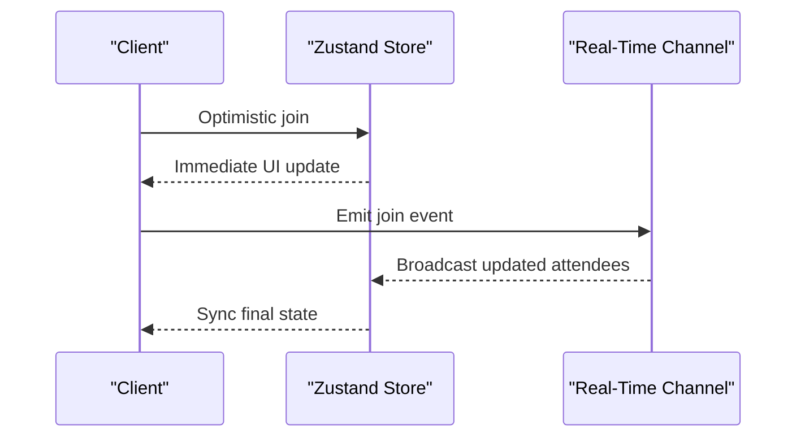

**Diagram sources**
- [plan.md:12](file://tasks/plan.md#L12)
- [todo.md:53-54](file://tasks/todo.md#L53-L54)

**Section sources**
- [plan.md:12](file://tasks/plan.md#L12)
- [todo.md:53-54](file://tasks/todo.md#L53-L54)

## Dependency Analysis
The Meets feature depends on:
- React Router for navigation (`/meets`, `/meets/create`)
- Zustand with persist middleware for client state and localStorage
- Typed data model including `Meetup`
- Design system components (cards, chips, buttons, bottom nav)
- Location services for proximity calculations
- Safety and moderation controls for social interactions

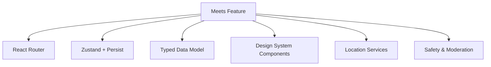

**Diagram sources**
- [plan.md:12](file://tasks/plan.md#L12)
- [plan.md:19-39](file://tasks/plan.md#L19-L39)
- [todo.md:53-54](file://tasks/todo.md#L53-L54)

**Section sources**
- [plan.md:12](file://tasks/plan.md#L12)
- [plan.md:19-39](file://tasks/plan.md#L19-L39)
- [todo.md:53-54](file://tasks/todo.md#L53-L54)

## Performance Considerations
- Use optimistic UI updates to improve perceived responsiveness during join actions
- Debounce location updates and filter recalculations to reduce re-renders
- Paginate or virtualize large meetup lists
- Cache nearby results based on current location and time window
- Avoid heavy computations on the main thread; offload distance sorting to workers if needed
- Keep real-time payloads minimal and focused on essential state changes

[No sources needed since this section provides general guidance]

## Troubleshooting Guide
Common issues and resolutions:
- Join action does not persist: verify Zustand store updates and localStorage persistence
- Nearby filter returns no results: check location permissions and coordinate accuracy
- Interest matching yields irrelevant results: review tagging strategy and scoring weights
- Real-time updates not reflected: confirm channel connectivity and fallback polling
- Form submission fails: validate field constraints and provide clear error messages

**Section sources**
- [todo.md:53-54](file://tasks/todo.md#L53-L54)
- [plan.md:12](file://tasks/plan.md#L12)

## Conclusion
The Meets Page implementation provides a robust social discovery layer for Pujo Sahayak, enabling users to browse, create, and join community meetups aligned with shared interests and geographic proximity. The feature integrates with the app’s routing, state management, data model, and design system while emphasizing safety, moderation, and performance. As the platform grows beyond the Puja season, the Meets feature will continue to support local discovery, community engagement, and activity-based social connections.

[No sources needed since this section summarizes without analyzing specific files]