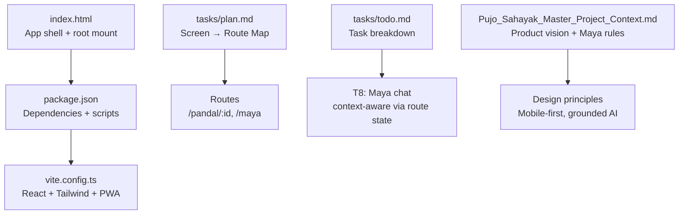
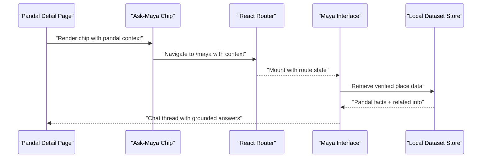
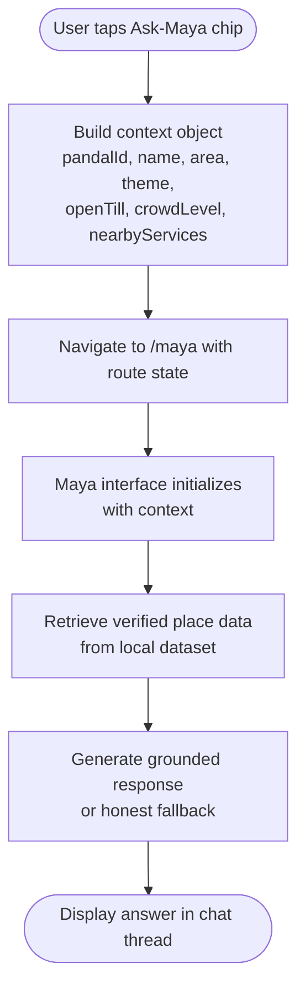
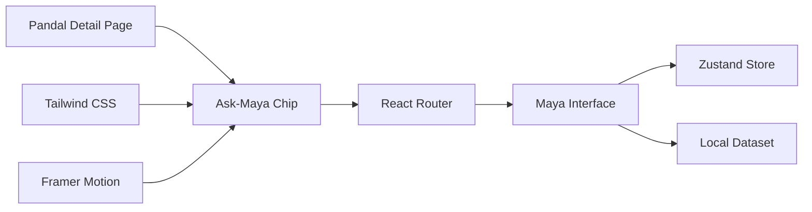

# Ask-Maya Chip Integration

<cite>
**Referenced Files in This Document**
- [index.html](file://index.html)
- [package.json](file://package.json)
- [vite.config.ts](file://vite.config.ts)
- [tasks/plan.md](file://tasks/plan.md)
- [tasks/todo.md](file://tasks/todo.md)
- [Pujo_Sahayak_Master_Project_Context.md](file://Pujo_Sahayak_Master_Project_Context.md)
</cite>

## Table of Contents
1. [Introduction](#introduction)
2. [Project Structure](#project-structure)
3. [Core Components](#core-components)
4. [Architecture Overview](#architecture-overview)
5. [Detailed Component Analysis](#detailed-component-analysis)
6. [Dependency Analysis](#dependency-analysis)
7. [Performance Considerations](#performance-considerations)
8. [Troubleshooting Guide](#troubleshooting-guide)
9. [Conclusion](#conclusion)

## Introduction
This document is a detailed implementation guide for the Ask-Maya chip integration on the Pandal Detail Page. It explains how the contextual AI assistance trigger should work, how the chip should look and behave, and how data flows from the current pandal context to Maya’s response generation while maintaining conversation context. It also covers accessibility considerations and mobile-first interaction patterns for this AI assistant entry point.

The guidance is grounded in the project’s documented product vision: Pujo Sahayak is a location-aware local discovery platform with a specialized Durga Puja experience, where Maya is the AI assistant that helps users understand places, plan visits, and explore Kolkata during Puja. The Pandal Detail page is explicitly designed to include an “Ask Maya about this pandal” chip that routes to the Maya interface with contextual parameters.

## Project Structure
At this stage, the repository contains configuration files, task planning, and master product context rather than application source code. The build system is Vite with React, Tailwind CSS v4, and PWA support. The routing model uses React Router v6 with nested detail routes such as `/pandal/:id` and `/maya`.

**Diagram sources**
- [index.html:1-25](file://index.html#L1-L25)
- [package.json:1-32](file://package.json#L1-L32)
- [vite.config.ts:1-37](file://vite.config.ts#L1-L37)
- [tasks/plan.md:19-39](file://tasks/plan.md#L19-L39)
- [tasks/todo.md:34-43](file://tasks/todo.md#L34-L43)
- [Pujo_Sahayak_Master_Project_Context.md:558-660](file://Pujo_Sahayak_Master_Project_Context.md#L558-L660)

**Section sources**
- [index.html:1-25](file://index.html#L1-L25)
- [package.json:1-32](file://package.json#L1-L32)
- [vite.config.ts:1-37](file://vite.config.ts#L1-L37)
- [tasks/plan.md:19-39](file://tasks/plan.md#L19-L39)
- [tasks/todo.md:34-43](file://tasks/todo.md#L34-L43)
- [Pujo_Sahayak_Master_Project_Context.md:558-660](file://Pujo_Sahayak_Master_Project_Context.md#L558-L660)

## Core Components
The Ask-Maya chip integration spans several components and concerns:

- **Pandal Detail Page**: Displays hero, metadata, actions, theme/story, reviews, similar places, nearby restaurants, and the Ask-Maya chip.
- **Ask-Maya Chip**: A compact, accessible action element that opens Maya with the current pandal context.
- **Maya Interface**: Chat-based UI with dataset-grounded responses, voice waveform UI, quick-reply chips, and camera scan mode.
- **Context Provider**: Route-state or store-backed context that carries the selected pandal into Maya.
- **Data Retrieval Layer**: Local dataset retrieval that grounds Maya’s answers without hallucination.

Key responsibilities:
- Render the chip at a clear, reachable position on the Pandal Detail page.
- Pass contextual parameters (pandal id, name, area/theme, open-till, crowd level, nearby services).
- Maintain conversation context across Maya sessions when appropriate.
- Ensure accessibility and mobile-first interactions.

**Section sources**
- [tasks/todo.md:29-31](file://tasks/todo.md#L29-L31)
- [tasks/todo.md:36-40](file://tasks/todo.md#L36-L40)
- [Pujo_Sahayak_Master_Project_Context.md:558-660](file://Pujo_Sahayak_Master_Project_Context.md#L558-L660)

## Architecture Overview
The Ask-Maya chip integrates the Pandal Detail page with the Maya interface through routing and context. The flow is:

1. User views a Pandal Detail page.
2. User taps the Ask-Maya chip.
3. App navigates to `/maya` with route state containing the current pandal context.
4. Maya interface initializes with the provided context.
5. User asks questions; Maya retrieves verified information from the local dataset and responds.
6. Conversation history can be maintained per session or persisted if needed.

**Diagram sources**
- [tasks/plan.md:25-28](file://tasks/plan.md#L25-L28)
- [tasks/todo.md:29-40](file://tasks/todo.md#L29-L40)
- [Pujo_Sahayak_Master_Project_Context.md:643-660](file://Pujo_Sahayak_Master_Project_Context.md#L643-L660)

## Detailed Component Analysis

### Pandal Detail Page and Ask-Maya Chip Placement
The Pandal Detail page includes multiple sections: hero, past editions, theme/story, what others say, top clicks, user photos, similar places, nearby restaurants, and meetups near the place. The Ask-Maya chip is explicitly mentioned as part of this page and should provide a direct path to Maya with contextual awareness.

Implementation guidance:
- Place the chip after primary actions (Save/Visited/Route) and before community sections like reviews or photos.
- Use a compact, recognizable design consistent with the app’s visual language: vermilion primary, warm ivory surfaces, subtle motion.
- Label it clearly as “Ask Maya about this pandal” or similar wording aligned with the mockup intent.
- Ensure it is visible without scrolling too far down on mobile.

Accessibility guidance:
- Provide a descriptive `aria-label` indicating the action and context.
- Ensure keyboard focusability and screen-reader announcements.
- Respect reduced-motion preferences for any animations around the chip.

**Section sources**
- [tasks/todo.md:29-31](file://tasks/todo.md#L29-L31)
- [Pujo_Sahayak_Master_Project_Context.md:775-950](file://Pujo_Sahayak_Master_Project_Context.md#L775-L950)

### Visual Design and Positioning
The chip should follow the project’s visual language:
- Colors: deep vermilion, warm ivory, charcoal ink, muted gold, deep indigo accents.
- Typography: Inter for body, Playfair Display for editorial accents, Noto Serif Bengali for Bengali text.
- Motion: soft fades, subtle scale on interaction, honoring reduced-motion settings.
- Size: compact enough for mobile but large enough for comfortable tapping.

Positioning:
- Primary placement: below the action row (Save/Visited/Route) and above the About/Theme section.
- Alternative placement: sticky bottom bar on mobile if the content is long, ensuring it remains accessible without obscuring critical content.

Interaction patterns:
- Tap opens Maya with context.
- Optional hover/focus states for desktop.
- Quick-reply chips inside Maya for common questions like nearest metro, medical camp, or more about the artist.

**Section sources**
- [Pujo_Sahayak_Master_Project_Context.md:1482-1533](file://Pujo_Sahayak_Master_Project_Context.md#L1482-L1533)
- [tasks/todo.md:36-40](file://tasks/todo.md#L36-L40)

### Contextual Parameters and Data Flow
When the user taps the chip, the app should pass contextual parameters to Maya:
- Pandal identifier and name
- Area and theme
- Open hours and crowd level
- Nearby transport, hospitals, and restaurants
- Current user language preference
- Any saved or visited places relevant to recommendations

Maya must ground its responses in the local dataset and avoid hallucination. If information is unavailable, it should respond honestly rather than inventing facts.

**Diagram sources**
- [tasks/todo.md:36-40](file://tasks/todo.md#L36-L40)
- [Pujo_Sahayak_Master_Project_Context.md:643-660](file://Pujo_Sahayak_Master_Project_Context.md#L643-L660)
- [Pujo_Sahayak_Master_Project_Context.md:1330-1358](file://Pujo_Sahayak_Master_Project_Context.md#L1330-L1358)

**Section sources**
- [tasks/todo.md:36-40](file://tasks/todo.md#L36-L40)
- [Pujo_Sahayak_Master_Project_Context.md:643-660](file://Pujo_Sahayak_Master_Project_Context.md#L643-L660)
- [Pujo_Sahayak_Master_Project_Context.md:1330-1358](file://Pujo_Sahayak_Master_Project_Context.md#L1330-L1358)

### Conversation Context Management
Maya should maintain conversation context so users do not repeat themselves. Context can be managed via:
- Route state for the current session
- Zustand store for persistent conversation history
- Per-pandal context that persists until the user switches to another place

Best practices:
- Keep context minimal and relevant to the current exploration.
- Allow users to reset or clear conversation context.
- Do not leak sensitive user data into logs or external systems.

**Section sources**
- [tasks/todo.md:36-40](file://tasks/todo.md#L36-L40)
- [Pujo_Sahayak_Master_Project_Context.md:643-660](file://Pujo_Sahayak_Master_Project_Context.md#L643-L660)

### Accessibility Considerations
- Keyboard navigation: ensure the chip is focusable and operable via Enter/Space.
- Screen readers: announce the chip’s purpose and context clearly.
- Color contrast: ensure sufficient contrast for text and icons.
- Touch targets: minimum 44x44 dp for mobile tap targets.
- Reduced motion: disable animations when preferred.
- Language support: respect user-selected language and provide Bengali/English/Hindi strings where applicable.

**Section sources**
- [Pujo_Sahayak_Master_Project_Context.md:1509-1533](file://Pujo_Sahayak_Master_Project_Context.md#L1509-L1533)
- [Pujo_Sahayak_Master_Project_Context.md:1555-1575](file://Pujo_Sahayak_Master_Project_Context.md#L1555-L1575)

### Mobile-First Interaction Patterns
- Primary entry point: prominent chip on Pandal Detail.
- Secondary entry points: Categories page includes an “Ask Maya” CTA.
- Voice input: FAB mic toggling voice-input mode within Maya.
- Camera scan: live getUserMedia preview with animated scan frame for pandal identification.
- Quick replies: chips for common questions to reduce typing effort.

**Section sources**
- [tasks/todo.md:36-43](file://tasks/todo.md#L36-L43)
- [Pujo_Sahayak_Master_Project_Context.md:608-641](file://Pujo_Sahayak_Master_Project_Context.md#L608-L641)

## Dependency Analysis
The Ask-Maya chip depends on:
- React Router for navigation to `/maya` with context.
- Zustand for state management if conversation context is persisted.
- Local dataset store for grounded responses.
- Framer Motion for subtle animations.
- Tailwind CSS for styling tokens and responsive layout.

**Diagram sources**
- [package.json:11-18](file://package.json#L11-L18)
- [tasks/plan.md:7-14](file://tasks/plan.md#L7-L14)
- [tasks/todo.md:29-40](file://tasks/todo.md#L29-L40)

**Section sources**
- [package.json:11-18](file://package.json#L11-L18)
- [tasks/plan.md:7-14](file://tasks/plan.md#L7-L14)
- [tasks/todo.md:29-40](file://tasks/todo.md#L29-L40)

## Performance Considerations
- Minimize payload size by passing only necessary context parameters.
- Avoid heavy computations on the main thread; offload dataset filtering to workers if needed.
- Debounce search and filter operations in Maya.
- Cache frequently accessed place data locally.
- Respect reduced-motion preferences to improve performance on low-end devices.

[No sources needed since this section provides general guidance]

## Troubleshooting Guide
Common issues and resolutions:
- Chip not visible: verify placement logic and z-index; ensure it is not hidden behind overlays.
- Context lost on navigation: confirm route state is passed correctly and Maya reads it on mount.
- Maya hallucinates facts: enforce dataset grounding and honest fallback messaging.
- Accessibility failures: test with keyboard-only navigation and screen readers; validate color contrast.
- Mobile tap target too small: increase touch target size to meet accessibility guidelines.

**Section sources**
- [Pujo_Sahayak_Master_Project_Context.md:1330-1358](file://Pujo_Sahayak_Master_Project_Context.md#L1330-L1358)
- [Pujo_Sahayak_Master_Project_Context.md:1509-1533](file://Pujo_Sahayak_Master_Project_Context.md#L1509-L1533)

## Conclusion
The Ask-Maya chip on the Pandal Detail page is a critical entry point for contextual AI assistance. It should be visually distinct, accessible, and positioned to encourage interaction without disrupting the user’s exploration flow. By passing rich contextual parameters to Maya and grounding responses in verified local data, the app delivers meaningful, trustworthy assistance tailored to the current pandal. Mobile-first design, accessibility compliance, and careful state management ensure a smooth, inclusive experience for all users.

[No sources needed since this section summarizes without analyzing specific files]