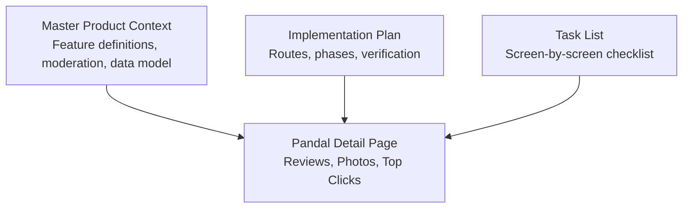
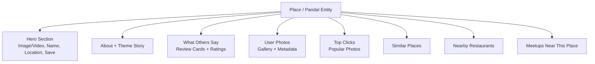
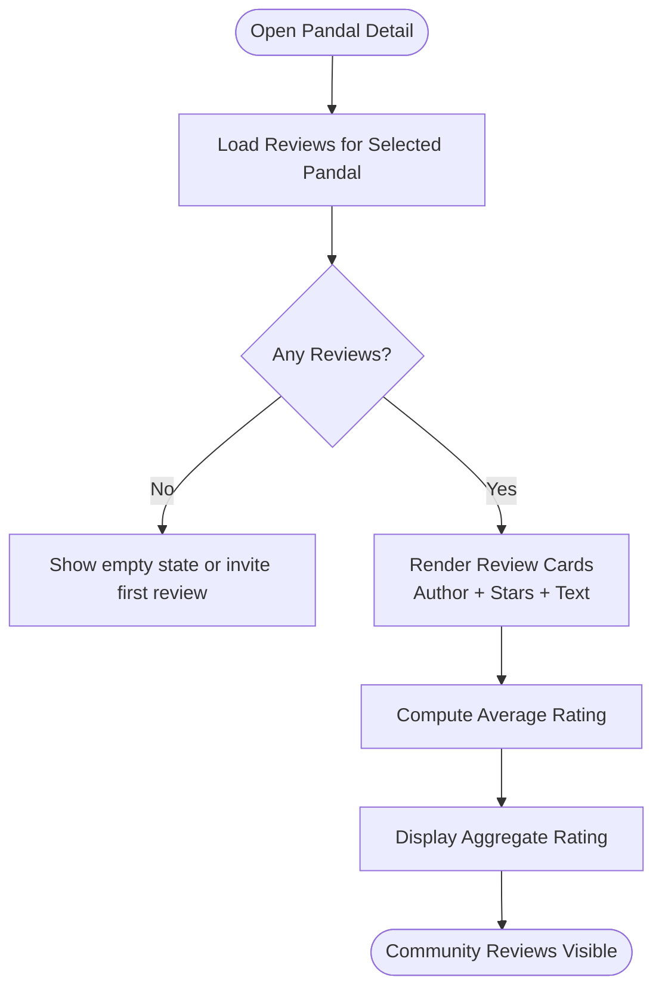
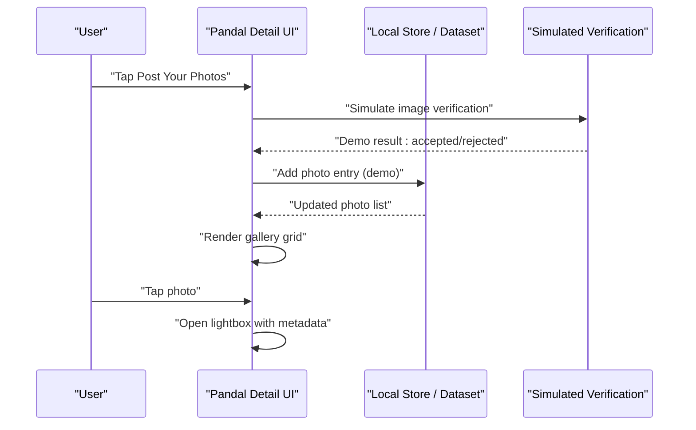
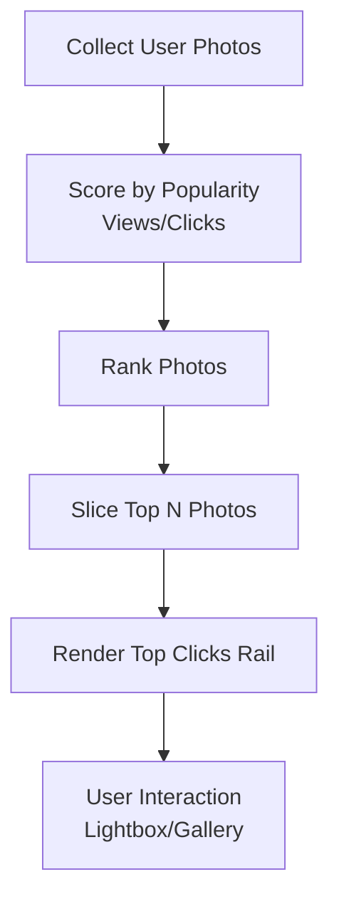
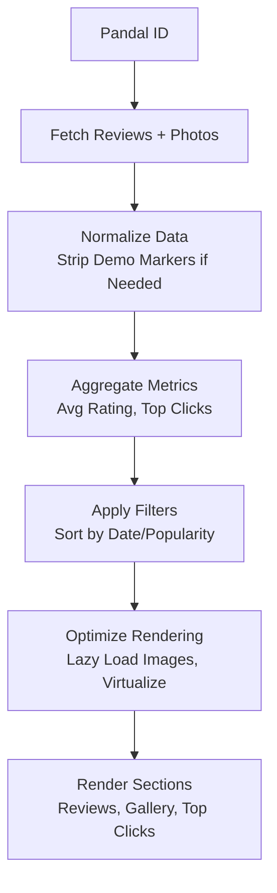
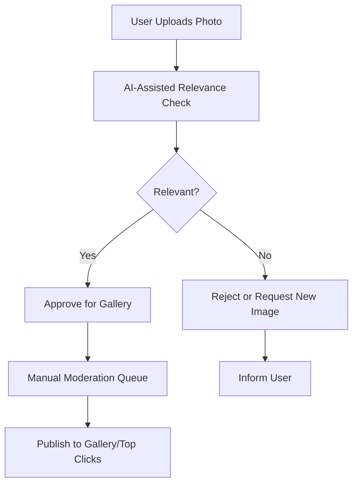
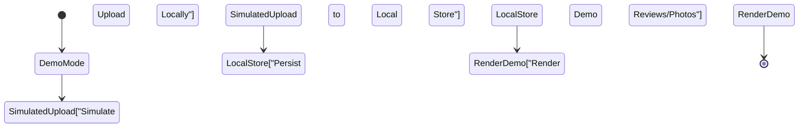
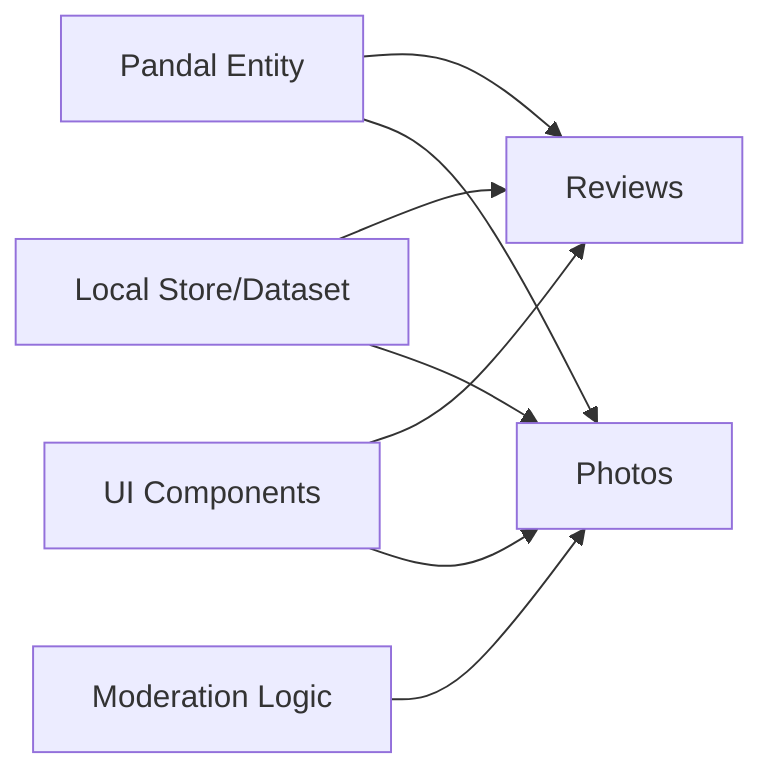

# Community Content Integration

<cite>
**Referenced Files in This Document**
- [Pujo_Sahayak_Master_Project_Context.md](file://Pujo_Sahayak_Master_Project_Context.md)
- [plan.md](file://tasks/plan.md)
- [todo.md](file://tasks/todo.md)
</cite>

## Table of Contents
1. [Introduction](#introduction)
2. [Project Structure](#project-structure)
3. [Core Components](#core-components)
4. [Architecture Overview](#architecture-overview)
5. [Detailed Component Analysis](#detailed-component-analysis)
6. [Dependency Analysis](#dependency-analysis)
7. [Performance Considerations](#performance-considerations)
8. [Troubleshooting Guide](#troubleshooting-guide)
9. [Conclusion](#conclusion)

## Introduction
This document explains how community content is integrated into the Pandal Detail Page within the Pujo Sahayak product context. It focuses on:
- The reviews system, including review cards and ratings display.
- User-generated photos, including gallery layout, lightbox behavior, and metadata presentation.
- The Top Clicks visualization for popular user content.
- Data aggregation, filtering, and performance considerations for media-heavy pages.
- Moderation rules and demo-data markers that keep community features safe and honest during development.

The guidance is grounded in the project’s master product context and implementation plan rather than assuming a specific codebase implementation.

## Project Structure
At this stage, the repository contains:
- A master product context describing feature intent, data model scope, moderation expectations, and page layouts.
- An implementation plan outlining routes, phases, and verification criteria.
- A task list breaking down build steps, including the Pandal Detail screen with community sections.

**Diagram sources**
- [Pujo_Sahayak_Master_Project_Context.md:775-900](file://Pujo_Sahayak_Master_Project_Context.md#L775-L900)
- [plan.md:19-39](file://tasks/plan.md#L19-L39)
- [todo.md:29-31](file://tasks/todo.md#L29-L31)

**Section sources**
- [Pujo_Sahayak_Master_Project_Context.md:775-900](file://Pujo_Sahayak_Master_Project_Context.md#L775-L900)
- [plan.md:1-18](file://tasks/plan.md#L1-L18)
- [todo.md:1-16](file://tasks/todo.md#L1-L16)

## Core Components
The Pandal Detail Page integrates three main community components:

- Reviews System
  - Displays user-submitted reviews with star ratings and text.
  - Must show real user-generated content; AI should not fabricate reviews.

- User Photo Gallery
  - Allows visitors to post photos of the pandal.
  - Includes a “Top Clicks” section highlighting popular user photos.
  - Supports photo upload with simulated verification in v1.

- Top Clicks Visualization
  - Highlights the most viewed or interacted user photos.
  - Acts as a community-curated visual feed tied to the selected pandal.

These components are part of the broader discovery flow: Discover → Explore → Understand → Plan → Visit → Share/Review → Meet people → Discover more.

**Section sources**
- [Pujo_Sahayak_Master_Project_Context.md:775-850](file://Pujo_Sahayak_Master_Project_Context.md#L775-L850)
- [todo.md:29-31](file://tasks/todo.md#L29-L31)

## Architecture Overview
The Pandal Detail Page composes multiple sections around a single place entity. Community content (reviews and photos) is attached to that place and presented alongside operational details such as location, crowd level, and nearby services.

**Diagram sources**
- [Pujo_Sahayak_Master_Project_Context.md:775-950](file://Pujo_Sahayak_Master_Project_Context.md#L775-L950)
- [todo.md:29-31](file://tasks/todo.md#L29-L31)

## Detailed Component Analysis

### Reviews System
The “What Others Say” section displays authentic user reviews and star ratings. The design emphasizes transparency: do not generate fake reviews through AI.

Key responsibilities:
- Render review cards with author attribution, star rating, and review text.
- Aggregate average rating from existing reviews.
- Provide an option to submit a new review (UI flow), while keeping submission behavior aligned with v1 constraints.

Data model alignment:
- Reviews are part of the product data model alongside Place, Pandal, Photo, and other entities.

Moderation rule:
- No AI-generated fake reviews. Only real user submissions should appear.

**Diagram sources**
- [Pujo_Sahayak_Master_Project_Context.md:811-829](file://Pujo_Sahayak_Master_Project_Context.md#L811-L829)
- [Pujo_Sahayak_Master_Project_Context.md:1232-1259](file://Pujo_Sahayak_Master_Project_Context.md#L1232-L1259)

**Section sources**
- [Pujo_Sahayak_Master_Project_Context.md:811-829](file://Pujo_Sahayak_Master_Project_Context.md#L811-L829)
- [Pujo_Sahayak_Master_Project_Context.md:1232-1259](file://Pujo_Sahayak_Master_Project_Context.md#L1232-L1259)

### User Photos Gallery and Lightbox
Users can contribute photographs of the pandal. The detail page includes a gallery view and a “Post Your Photos” action. In v1, the upload flow simulates verification locally without a backend.

Responsibilities:
- Present user photos in a responsive grid.
- Support opening a lightbox to view full-size images.
- Show photo metadata such as uploader attribution and optional contextual notes.
- Integrate with the “Top Clicks” section by surfacing popular photos.

**Diagram sources**
- [Pujo_Sahayak_Master_Project_Context.md:853-893](file://Pujo_Sahayak_Master_Project_Context.md#L853-L893)
- [plan.md:81-86](file://tasks/plan.md#L81-L86)

**Section sources**
- [Pujo_Sahayak_Master_Project_Context.md:853-893](file://Pujo_Sahayak_Master_Project_Context.md#L853-L893)
- [plan.md:81-86](file://tasks/plan.md#L81-L86)

### Top Clicks Visualization
“Top Clicks” highlights visually popular user photos. It functions as a community-curated photo rail on the Pandal Detail Page.

Responsibilities:
- Surface photos with higher interaction metrics (views, clicks).
- Keep the section clearly attributed to visitor contributions.
- Allow navigation to the full gallery or lightbox view.

**Diagram sources**
- [Pujo_Sahayak_Master_Project_Context.md:831-850](file://Pujo_Sahayak_Master_Project_Context.md#L831-L850)

**Section sources**
- [Pujo_Sahayak_Master_Project_Context.md:831-850](file://Pujo_Sahayak_Master_Project_Context.md#L831-L850)

### Content Aggregation, Filtering, and Performance Optimization
Aggregation and filtering should be deterministic and efficient, especially when rendering many images and reviews.

Recommended patterns:
- Aggregate reviews per pandal using stable keys (pandal id).
- Precompute average ratings and top-click counts at load time.
- Paginate or virtualize large galleries to avoid heavy DOM updates.
- Use lazy loading for images and defer non-critical metadata until needed.
- Cache computed aggregates in local store to prevent recomputation on re-renders.

[No sources needed since this diagram shows conceptual workflow, not actual code structure]

### Moderation Considerations
Moderation is central to community safety and trust:
- Do not generate fake reviews via AI.
- Use AI-assisted photo verification to ensure uploaded images relate to the selected pandal.
- Maintain manual moderation controls for spam, inappropriate content, copyrighted/promotional material, and unrelated photos.
- Clearly mark demo-only behavior so users understand limitations.

**Diagram sources**
- [Pujo_Sahayak_Master_Project_Context.md:869-893](file://Pujo_Sahayak_Master_Project_Context.md#L869-L893)

**Section sources**
- [Pujo_Sahayak_Master_Project_Context.md:869-893](file://Pujo_Sahayak_Master_Project_Context.md#L869-L893)

### Demo Data Markers
In v1:
- Reviews and photos on the Pandal Detail Page use demo entries from the dataset.
- There is no upload backend; photo upload simulation runs locally.
- All demo data must be clearly marked to avoid misleading users.

**Diagram sources**
- [plan.md:81-86](file://tasks/plan.md#L81-L86)

**Section sources**
- [plan.md:81-86](file://tasks/plan.md#L81-L86)

## Dependency Analysis
Community content depends on several foundational elements:
- Place/Pandal entity as the anchor for reviews and photos.
- Local store/dataset for demo data and persistence.
- UI components for cards, grids, and lightboxes.
- Moderation logic for uploads and content safety.

**Diagram sources**
- [Pujo_Sahayak_Master_Project_Context.md:1232-1259](file://Pujo_Sahayak_Master_Project_Context.md#L1232-L1259)
- [plan.md:1-18](file://tasks/plan.md#L1-L18)

**Section sources**
- [Pujo_Sahayak_Master_Project_Context.md:1232-1259](file://Pujo_Sahayak_Master_Project_Context.md#L1232-L1259)
- [plan.md:1-18](file://tasks/plan.md#L1-L18)

## Performance Considerations
- Media-heavy galleries should avoid loading all images at once. Use lazy loading and responsive image variants.
- Virtualize long lists of reviews and photos to reduce memory pressure.
- Debounce search/filter inputs and cache intermediate results.
- Avoid recomputing aggregate metrics on every render; memoize calculations keyed by pandal id.
- Keep the lightbox lightweight: load high-resolution assets only when opened.

[No sources needed since this section provides general guidance]

## Troubleshooting Guide
Common issues and resolutions:
- Fake reviews appearing: Ensure no AI generation path is enabled for reviews; only real user submissions should be rendered.
- Unrelated photos in gallery: Enforce AI-assisted relevance checks and manual moderation queues.
- Slow gallery rendering: Implement pagination/virtualization and lazy loading for images.
- Incorrect average ratings: Validate aggregation logic and ensure it recalculates when new reviews are added.
- Demo data confusion: Clearly label demo entries and simulate uploads without implying a live backend.

**Section sources**
- [Pujo_Sahayak_Master_Project_Context.md:811-829](file://Pujo_Sahayak_Master_Project_Context.md#L811-L829)
- [Pujo_Sahayak_Master_Project_Context.md:869-893](file://Pujo_Sahayak_Master_Project_Context.md#L869-L893)
- [plan.md:81-86](file://tasks/plan.md#L81-L86)

## Conclusion
The Pandal Detail Page integrates community content through reviews, user photos, and a Top Clicks visualization. The design prioritizes authenticity, moderation, and performance. In v1, demo data and local simulation provide a safe foundation while keeping the architecture ready for future backend integration and advanced recommendation systems.

[No sources needed since this section summarizes without analyzing specific files]