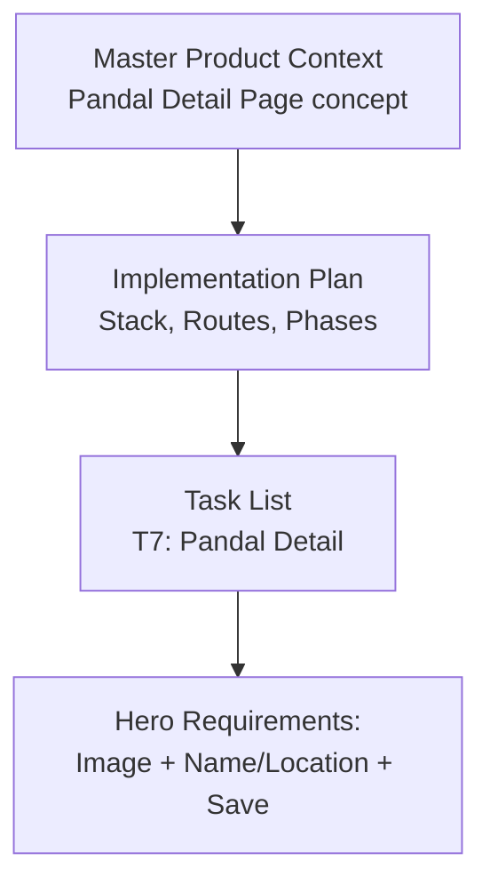
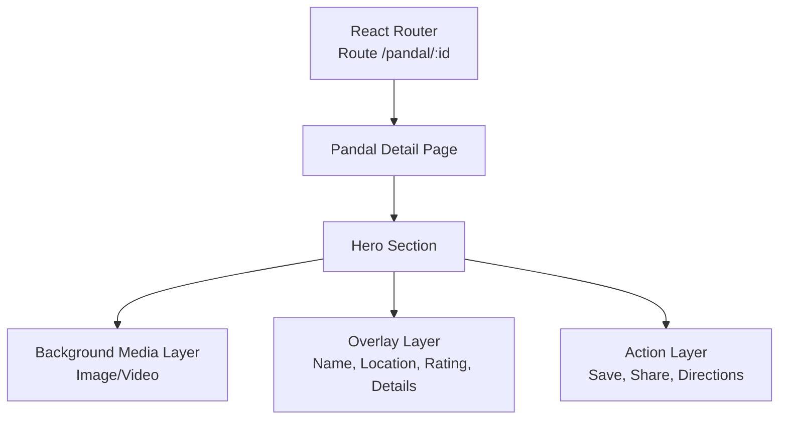
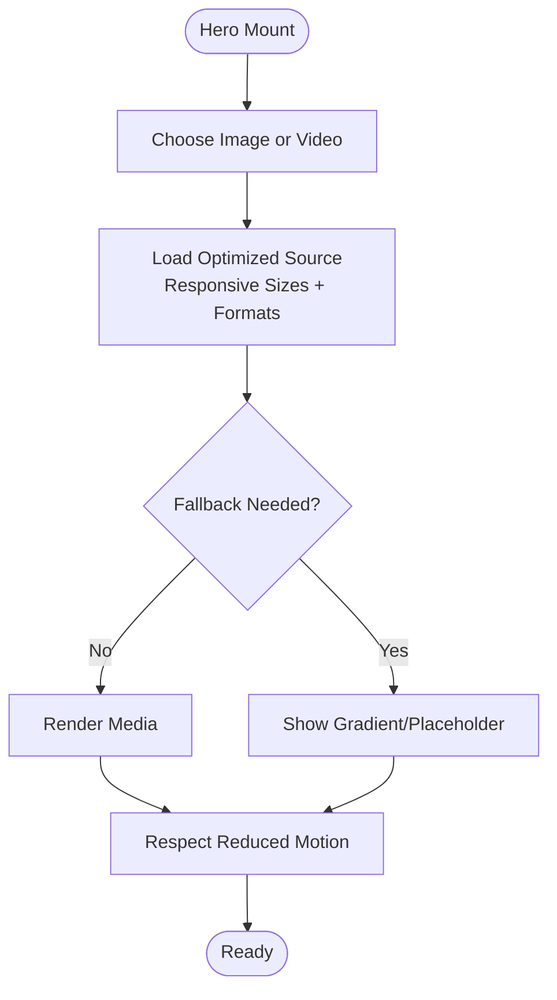
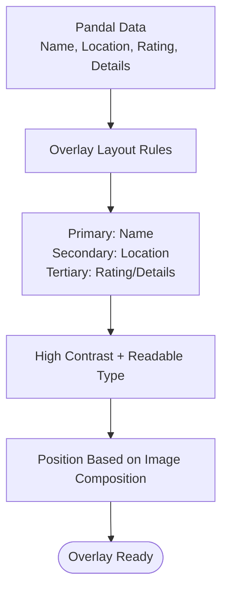
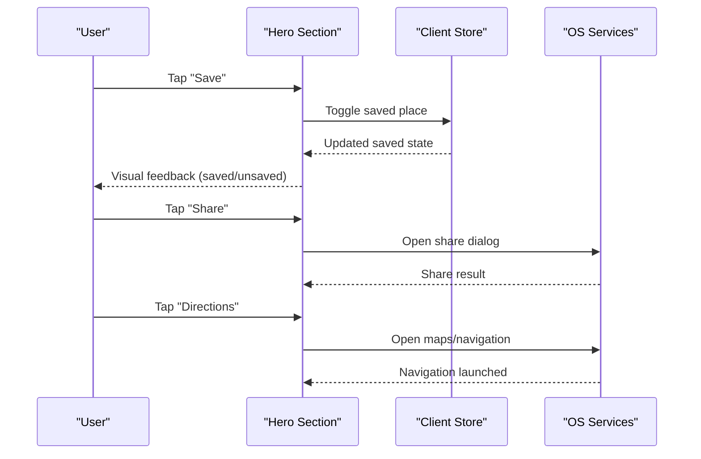
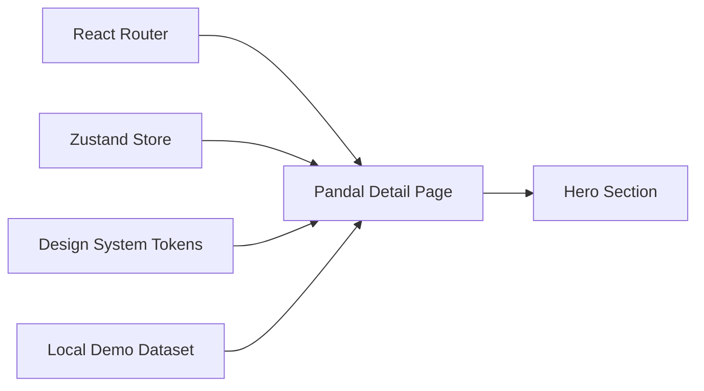

# Hero Section Implementation

<cite>
**Referenced Files in This Document**
- [Pujo_Sahayak_Master_Project_Context.md](file://Pujo_Sahayak_Master_Project_Context.md)
- [plan.md](file://tasks/plan.md)
- [todo.md](file://tasks/todo.md)
</cite>

## Table of Contents
1. [Introduction](#introduction)
2. [Project Structure](#project-structure)
3. [Core Components](#core-components)
4. [Architecture Overview](#architecture-overview)
5. [Detailed Component Analysis](#detailed-component-analysis)
6. [Dependency Analysis](#dependency-analysis)
7. [Performance Considerations](#performance-considerations)
8. [Troubleshooting Guide](#troubleshooting-guide)
9. [Conclusion](#conclusion)

## Introduction
This document is an implementation guide for the Pandal Detail Page hero section in Pujo Sahayak. It explains how the hero should display high-resolution imagery, present key information such as pandal name and location, and provide action buttons like Save, Share, and Directions. It also covers responsive image loading, overlay positioning, touch-friendly interactions, and performance considerations for large images and smooth scrolling.

The guidance is based on the project’s product context, screen map, task breakdown, and design principles. The repository currently contains planning and context documentation rather than source code; therefore, this guide focuses on architecture, behavior, and implementation recommendations aligned with the documented requirements.

## Project Structure
At this stage, the repository includes:
- A master product context describing the overall product, user journeys, and detailed feature descriptions.
- An implementation plan defining the stack, routes, and phases.
- A task list breaking down work into foundation, discovery core, Maya, planning, utility, and polish phases.

**Diagram sources**
- [Pujo_Sahayak_Master_Project_Context.md:775-800](file://Pujo_Sahayak_Master_Project_Context.md#L775-L800)
- [plan.md:19-49](file://tasks/plan.md#L19-L49)
- [todo.md:29-30](file://tasks/todo.md#L29-L30)

**Section sources**
- [Pujo_Sahayak_Master_Project_Context.md:775-800](file://Pujo_Sahayak_Master_Project_Context.md#L775-L800)
- [plan.md:19-49](file://tasks/plan.md#L19-L49)
- [todo.md:29-30](file://tasks/todo.md#L29-L30)

## Core Components
The hero section is part of the Pandal Detail page and must include:
- High-resolution background image or video.
- Overlay text showing the pandal name and location.
- A Save/Bookmark control.
- Action controls for Share and Directions (navigation).

These elements are explicitly described in the product context and reinforced by the task breakdown for the Pandal Detail page.

Key responsibilities:
- Image layer: full-bleed, responsive, optimized, with graceful fallbacks.
- Information overlay: clear hierarchy for name, location, rating, and essential details.
- Actions: Save, Share, Directions, with accessible states and feedback.

**Section sources**
- [Pujo_Sahayak_Master_Project_Context.md:775-800](file://Pujo_Sahayak_Master_Project_Context.md#L775-L800)
- [todo.md:29-30](file://tasks/todo.md#L29-L30)

## Architecture Overview
The hero section sits at the top of the Pandal Detail route `/pandal/:id`. It composes three layers:
- Background media layer: image or video.
- Content overlay layer: title, location, rating, and essential details.
- Action layer: Save, Share, Directions.

**Diagram sources**
- [plan.md:19-27](file://tasks/plan.md#L19-L27)
- [Pujo_Sahayak_Master_Project_Context.md:775-800](file://Pujo_Sahayak_Master_Project_Context.md#L775-L800)

## Detailed Component Analysis

### High-Resolution Imagery Display
Requirements:
- Full-bleed hero image or video that adapts to mobile and desktop.
- Responsive image loading with appropriate sizes and formats.
- Graceful fallbacks when images are unavailable.

Recommended approach:
- Use a responsive image strategy with multiple resolutions and modern formats where supported.
- Apply lazy loading for off-screen or secondary images while ensuring the hero loads promptly.
- Provide a gradient or placeholder fallback if the image fails to load.
- Respect reduced-motion preferences for any subtle parallax or transitions.

[No sources needed since this diagram shows conceptual workflow, not actual code structure]

**Section sources**
- [plan.md:15-17](file://tasks/plan.md#L15-L17)
- [plan.md:49-61](file://tasks/plan.md#L49-L61)

### Key Information Overlay
Requirements:
- Pandal name and location prominently displayed.
- Optional rating and essential details visible without cluttering the hero.
- Clear visual hierarchy suitable for dark imagery.

Recommended approach:
- Place the overlay near the bottom-left or center-bottom depending on image composition.
- Use high-contrast text and readable typography.
- Keep the overlay concise; move secondary details below the fold.

[No sources needed since this diagram shows conceptual workflow, not actual code structure]

**Section sources**
- [Pujo_Sahayak_Master_Project_Context.md:775-800](file://Pujo_Sahayak_Master_Project_Context.md#L775-L800)

### Action Buttons: Save, Share, Directions
Requirements:
- Save/Bookmark toggle persisted in local state.
- Share opens native sharing or app share flow.
- Directions opens external navigation or maps integration.

State management:
- Persist save state using the client store.
- Provide immediate visual feedback for toggling Save.
- Disable or stub non-functional actions until backend support exists.

Touch-friendly interactions:
- Ensure minimum touch target size.
- Provide accessible labels and roles.
- Avoid accidental taps by spacing controls appropriately.

[No sources needed since this diagram shows conceptual workflow, not actual code structure]

**Section sources**
- [plan.md:11-13](file://tasks/plan.md#L11-L13)
- [todo.md:29-30](file://tasks/todo.md#L29-L30)

### Code Examples and Patterns
Because the repository does not yet contain source code, this section provides patterns and references to where implementation should occur once the Pandal Detail page is built.

- Image lazy loading pattern:
  - Use responsive image attributes and lazy loading for non-critical images.
  - Ensure the hero image loads early; defer secondary images.
  - Reference: image handling decisions and placeholders in the implementation plan.

- Overlay positioning pattern:
  - Use CSS layout to position the overlay relative to the hero container.
  - Maintain readability over varied imagery.
  - Reference: design system tokens and motion guidelines.

- Touch-friendly button interactions:
  - Implement accessible buttons with proper roles and labels.
  - Provide haptic or visual feedback for Save toggles.
  - Reference: shared components and motion primitives.

**Section sources**
- [plan.md:9-17](file://tasks/plan.md#L9-L17)
- [plan.md:49-61](file://tasks/plan.md#L49-L61)

## Dependency Analysis
The hero section depends on:
- React Router for navigating to `/pandal/:id`.
- Client store for persisted save state.
- Design system tokens for colors, typography, and motion.
- Dataset fields for pandal metadata.

**Diagram sources**
- [plan.md:9-13](file://tasks/plan.md#L9-L13)
- [plan.md:19-27](file://tasks/plan.md#L19-L27)

**Section sources**
- [plan.md:9-17](file://tasks/plan.md#L9-L17)
- [plan.md:19-27](file://tasks/plan.md#L19-L27)

## Performance Considerations
- Large images:
  - Serve optimized formats and sizes.
  - Use responsive images to avoid downloading unnecessary pixels.
  - Provide fallbacks for offline or slow networks.

- Smooth scrolling:
  - Avoid heavy animations in the hero; prefer subtle transitions.
  - Honor reduced-motion settings.
  - Defer non-critical assets until after initial render.

- Memory and reflows:
  - Avoid layout thrashing by measuring only when necessary.
  - Use CSS transforms for animations instead of layout-affecting properties.

- PWA caching:
  - Cache static assets and shell for faster repeat visits.
  - Validate offline behavior for hero imagery.

**Section sources**
- [plan.md:15-17](file://tasks/plan.md#L15-L17)
- [plan.md:49-61](file://tasks/plan.md#L49-L61)

## Troubleshooting Guide
Common issues and resolutions:
- Hero image not loading:
  - Verify network availability and fallback placeholder rendering.
  - Check responsive image URLs and CORS policies.

- Overlay text unreadable:
  - Increase contrast and adjust typography sizing.
  - Add subtle backdrop or shadow behind text.

- Save state not persisting:
  - Confirm store initialization and persistence middleware.
  - Validate localStorage access and quota limits.

- Share or Directions not working:
  - Ensure OS-level permissions and handlers are available.
  - Provide stubs or disabled states when integrations are not ready.

**Section sources**
- [plan.md:11-17](file://tasks/plan.md#L11-L17)
- [todo.md:29-30](file://tasks/todo.md#L29-L30)

## Conclusion
The Pandal Detail Page hero section should deliver an immersive, high-quality visual experience while clearly communicating essential information and enabling key actions. By combining responsive imagery, a clean overlay, and accessible action buttons, the hero supports the broader discovery-to-plan journey defined in the product context. Future implementation should align with the documented stack, design system, and phased task plan, ensuring performance, accessibility, and consistency across devices.