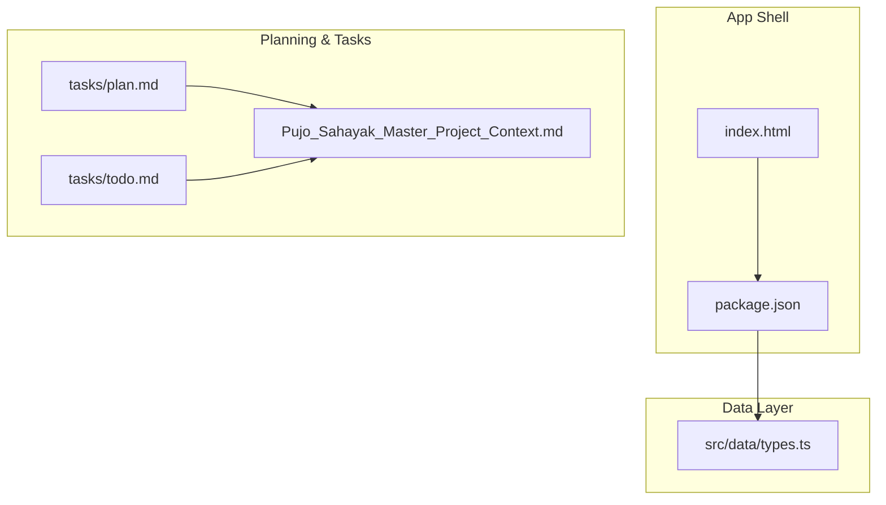
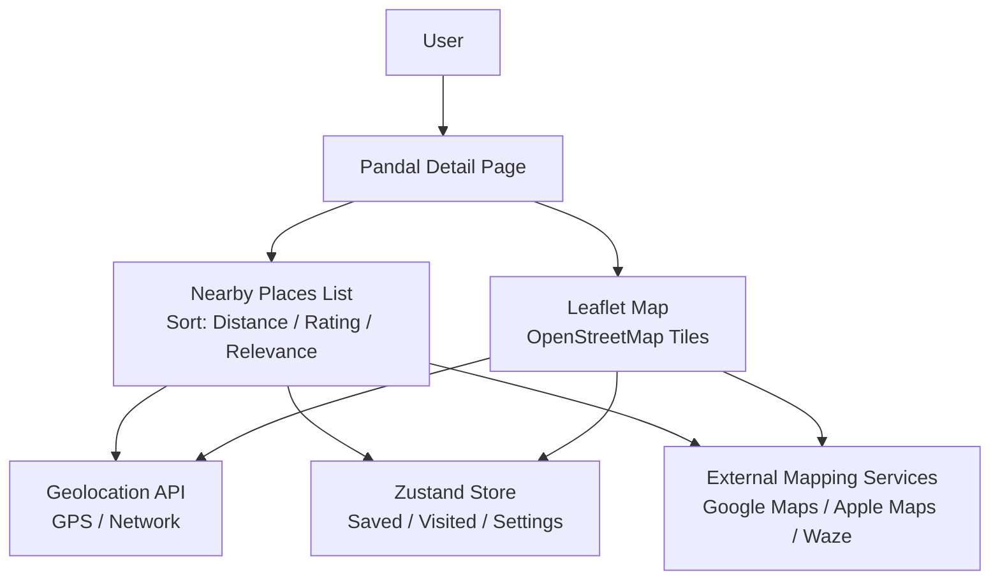
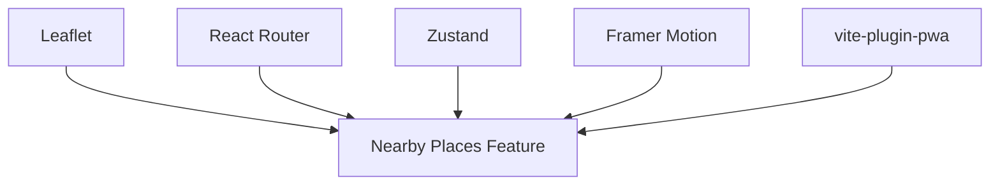

# Nearby Places Functionality

<cite>
**Referenced Files in This Document**
- [Pujo_Sahayak_Master_Project_Context.md](file://Pujo_Sahayak_Master_Project_Context.md)
- [types.ts](file://src/data/types.ts)
- [package.json](file://package.json)
- [index.html](file://index.html)
- [plan.md](file://tasks/plan.md)
- [todo.md](file://tasks/todo.md)
</cite>

## Table of Contents
1. [Introduction](#introduction)
2. [Project Structure](#project-structure)
3. [Core Components](#core-components)
4. [Architecture Overview](#architecture-overview)
5. [Detailed Component Analysis](#detailed-component-analysis)
6. [Dependency Analysis](#dependency-analysis)
7. [Performance Considerations](#performance-considerations)
8. [Troubleshooting Guide](#troubleshooting-guide)
9. [Conclusion](#conclusion)
10. [Appendices](#appendices)

## Introduction
This document explains the nearby places functionality on the Pandal Detail Page for Pujo Sahayak. It covers:
- How distance is calculated using geolocation APIs and coordinate systems
- The nearby places list, including sorting by distance, rating, and relevance
- Map integration with Leaflet and OpenStreetMap
- Geospatial queries, distance formatting, and navigation integration with external mapping services
- Location permissions, offline scenarios, and performance optimization
- Common issues like inaccurate location data and mitigation strategies

The project is a mobile-first React + Vite PWA that combines pandal discovery, local place discovery, AI assistance, route planning, social meetups, safety, user-generated content, personalization, and monetization. During Puja, the focus is on pandals; outside the season, it transitions to general Kolkata local discovery.

**Section sources**
- [Pujo_Sahayak_Master_Project_Context.md:1-18](file://Pujo_Sahayak_Master_Project_Context.md#L1-L18)
- [Pujo_Sahayak_Master_Project_Context.md:104-136](file://Pujo_Sahayak_Master_Project_Context.md#L104-L136)
- [Pujo_Sahayak_Master_Project_Context.md:1734-1738](file://Pujo_Sahayak_Master_Project_Context.md#L1734-L1738)

## Project Structure
At this stage, the repository contains:
- A TypeScript data model defining Place types (including lat/lng and distance fields)
- A package manifest declaring dependencies such as Leaflet for maps, React Router for routing, Zustand for state, and Framer Motion for animations
- A plan and task list describing the implementation roadmap, including Pandal Detail, Explore with List/Map toggle, Trip/Route Map, and Search with Popular Nearby Places
- An HTML entry point referencing a main module

**Diagram sources**
- [index.html:20-22](file://index.html#L20-L22)
- [package.json:11-18](file://package.json#L11-L18)
- [types.ts:40-69](file://src/data/types.ts#L40-L69)
- [plan.md:1-18](file://tasks/plan.md#L1-L18)
- [todo.md:1-14](file://tasks/todo.md#L1-L14)
- [Pujo_Sahayak_Master_Project_Context.md:1-18](file://Pujo_Sahayak_Master_Project_Context.md#L1-L18)

**Section sources**
- [index.html:20-22](file://index.html#L20-L22)
- [package.json:11-18](file://package.json#L11-L18)
- [types.ts:40-69](file://src/data/types.ts#L40-L69)
- [plan.md:1-18](file://tasks/plan.md#L1-L18)
- [todo.md:1-14](file://tasks/todo.md#L1-L14)
- [Pujo_Sahayak_Master_Project_Context.md:1-18](file://Pujo_Sahayak_Master_Project_Context.md#L1-L18)

## Core Components
Nearby places on the Pandal Detail Page are built around these core concepts:
- Place data model with geographic coordinates and precomputed distance
- Sorting options: distance, rating, relevance
- Map integration via Leaflet and OpenStreetMap tiles
- Navigation integration to external mapping services
- Location permission handling and offline fallbacks
- Performance optimizations for geospatial queries

Key data structures:
- Place: includes id, type, name, area, lat, lng, rating, reviewCount, distanceKm, crowd, theme, story, facilities, palette, and optional sections like reviews, topClicks, cuisine, priceBand, openNow, hours, popularDishes
- SafetyPoint: includes kind, name, detail, distanceM, lat, lng
- Meetup: includes id, title, date, time, location, lat, lng, description, interests, attendees, maxParticipants, visibility, palette, host

These types provide the foundation for nearby lists, map markers, and distance calculations.

**Section sources**
- [types.ts:40-69](file://src/data/types.ts#L40-L69)
- [types.ts:107-115](file://src/data/types.ts#L107-L115)
- [types.ts:81-96](file://src/data/types.ts#L81-L96)

## Architecture Overview
The nearby places feature integrates UI, data, and mapping layers:

**Diagram sources**
- [package.json:11-18](file://package.json#L11-L18)
- [plan.md:1-18](file://tasks/plan.md#L1-L18)
- [todo.md:29-30](file://tasks/todo.md#L29-L30)
- [todo.md:63-64](file://tasks/todo.md#L63-L64)

**Section sources**
- [package.json:11-18](file://package.json#L11-L18)
- [plan.md:1-18](file://tasks/plan.md#L1-L18)
- [todo.md:29-30](file://tasks/todo.md#L29-L30)
- [todo.md:63-64](file://tasks/todo.md#L63-L64)

## Detailed Component Analysis

### Distance Calculation Algorithms
Distance calculation uses the Haversine formula between two latitude/longitude pairs. This is appropriate for spherical Earth approximations and provides accurate distances over short ranges typical in city exploration.

Implementation guidance:
- Use the Haversine formula to compute distance in kilometers between the current user location and each place’s lat/lng
- Precompute or cache distance values in the dataset where possible to avoid repeated calculations
- Format distances for display:
  - Under 1 km: show meters (e.g., “250 m”)
  - 1–10 km: show kilometers with one decimal (e.g., “2.3 km”)
  - Over 10 km: show kilometers rounded (e.g., “12 km”)

Complexity:
- Time: O(n) per query for n places
- Space: O(1) additional memory beyond input arrays

Optimization opportunities:
- Spatial indexing (e.g., quadtree or geohash) for large datasets
- Debounce location updates to reduce recalculations
- Cache results keyed by user location hash and place set

Error handling:
- Handle invalid or missing coordinates gracefully
- Provide fallback text when distance cannot be computed

**Section sources**
- [types.ts:40-69](file://src/data/types.ts#L40-L69)
- [todo.md:63-64](file://tasks/todo.md#L63-L64)

### Nearby Places List and Sorting Options
The Pandal Detail Page should include a nearby places section that supports:
- Sorting by distance (ascending)
- Sorting by rating (descending)
- Sorting by relevance (hybrid score combining proximity, rating, popularity, and user preferences)

Relevance scoring can combine:
- Proximity weight (closer places score higher)
- Rating weight (higher ratings score higher)
- Popularity weight (review count or engagement)
- Personalization weight (saved/visited history, area/theme affinity)

UI considerations:
- Clear sort controls accessible from the list header
- Visual indicators for active sort
- Consistent card layout showing name, rating, distance, and category

Edge cases:
- If no location is available, disable distance-based sorting or prompt for location
- If rating or review count is missing, handle nulls safely

**Section sources**
- [todo.md:29-30](file://tasks/todo.md#L29-L30)
- [todo.md:42-43](file://tasks/todo.md#L42-L43)
- [types.ts:40-69](file://src/data/types.ts#L40-L69)

### Map Integration
The app uses Leaflet with OpenStreetMap tiles for real maps without requiring Google Maps keys. The Pandal Detail Page can integrate a map view that shows:
- Current user location marker
- Selected pandal marker
- Nearby places markers
- Optional polyline for route visualization

Integration points:
- Initialize Leaflet map once per page lifecycle
- Update markers reactively when nearby places change
- Support toggling between list and map views
- Provide “Start Navigation” action to open external mapping services

Accessibility:
- Ensure map controls are keyboard accessible
- Provide alt text and labels for markers

**Section sources**
- [package.json:11-18](file://package.json#L11-L18)
- [plan.md:1-18](file://tasks/plan.md#L1-L18)
- [todo.md:29-30](file://tasks/todo.md#L29-L30)
- [todo.md:63-64](file://tasks/todo.md#L63-L64)

### Geospatial Queries
Examples of geospatial queries:
- Find all restaurants within 2 km of the selected pandal
- Filter safety points within 1 km
- Retrieve meetups within 3 km with specific interests

Query pattern:
- Compute distance for each candidate place
- Apply filters (category, open now, crowd level)
- Sort by chosen criteria
- Paginate or limit results for performance

Performance tips:
- Pre-filter by bounding box before computing Haversine
- Use spatial indexes for large datasets
- Debounce frequent location updates

**Section sources**
- [types.ts:40-69](file://src/data/types.ts#L40-L69)
- [types.ts:107-115](file://src/data/types.ts#L107-L115)
- [types.ts:81-96](file://src/data/types.ts#L81-L96)

### Distance Formatting
Formatting rules:
- Meters for distances under 1 km
- Kilometers with one decimal for 1–10 km
- Rounded kilometers for over 10 km

Localization:
- Respect user language settings (English/Bengali/Hindi)
- Use appropriate units and separators

**Section sources**
- [types.ts:40-69](file://src/data/types.ts#L40-L69)

### Navigation Integration with External Mapping Services
“Start Navigation” should open external mapping apps/services:
- Android/iOS deep links to Google Maps, Apple Maps, Waze
- Web fallback to open URLs in browser if native apps are unavailable

Behavior:
- Construct destination coordinates from place lat/lng
- Optionally include origin coordinates for turn-by-turn directions
- Provide clear feedback if navigation fails

Privacy:
- Do not persist exact coordinates unless necessary
- Allow users to opt out of location sharing

**Section sources**
- [todo.md:63-64](file://tasks/todo.md#L63-L64)

### Location Permissions and Offline Scenarios
Location permissions:
- Request only when needed (e.g., when opening nearby list or map)
- Explain why location is required (to show nearby places and calculate distances)
- Respect denied permissions with graceful fallbacks

Offline scenarios:
- Cache recent nearby results locally
- Show last known location and distances
- Disable live location updates when offline
- Use PWA caching for map tiles and shell assets

**Section sources**
- [plan.md:1-18](file://tasks/plan.md#L1-L18)
- [todo.md:74-75](file://tasks/todo.md#L74-L75)

### Performance Optimization for Location-Based Queries
- Debounce location updates to avoid excessive recalculations
- Throttle re-renders when nearby list changes frequently
- Use memoization for distance computations
- Limit result sets (e.g., top 20 nearby places)
- Avoid heavy operations during initial render

**Section sources**
- [types.ts:40-69](file://src/data/types.ts#L40-L69)

## Dependency Analysis
Dependencies relevant to nearby places:
- Leaflet for map rendering
- React Router for navigating to detail pages and trip routes
- Zustand for managing saved places, visited places, and settings
- Framer Motion for smooth interactions
- vite-plugin-pwa for offline capabilities

**Diagram sources**
- [package.json:11-18](file://package.json#L11-L18)
- [plan.md:1-18](file://tasks/plan.md#L1-L18)

**Section sources**
- [package.json:11-18](file://package.json#L11-L18)
- [plan.md:1-18](file://tasks/plan.md#L1-L18)

## Performance Considerations
- Prefer client-side Haversine calculations for small to medium datasets
- Use bounding box filtering to reduce candidate places before distance computation
- Cache computed distances keyed by user location and place set
- Debounce location updates and map movements
- Limit visible results and implement pagination or virtualization for long lists
- Avoid blocking the main thread with heavy computations; use Web Workers if necessary

[No sources needed since this section provides general guidance]

## Troubleshooting Guide
Common issues and mitigations:
- Inaccurate location data:
  - GPS drift in dense urban areas
  - Mitigation: use smoothing filters, require minimum accuracy threshold, and present “You’re near…” wording rather than absolute claims
- Denied location permissions:
  - Mitigation: explain purpose, offer manual location input, and show cached results
- No network connectivity:
  - Mitigation: rely on PWA cache, show last known nearby places, and disable live updates
- Slow map rendering:
  - Mitigation: limit markers, cluster nearby points, and defer heavy operations until after initial render
- Incorrect distance formatting:
  - Mitigation: validate unit conversions and locale-specific number formatting

**Section sources**
- [Pujo_Sahayak_Master_Project_Context.md:1360-1386](file://Pujo_Sahayak_Master_Project_Context.md#L1360-L1386)
- [plan.md:1-18](file://tasks/plan.md#L1-L18)
- [todo.md:74-75](file://tasks/todo.md#L74-L75)

## Conclusion
The nearby places functionality on the Pandal Detail Page combines precise distance calculations, flexible sorting, robust map integration, and thoughtful handling of permissions and offline scenarios. By leveraging the Place data model, Leaflet maps, and careful performance optimizations, the feature delivers a reliable and engaging experience for discovering places around a selected pandal. Future enhancements can include advanced spatial indexing, richer relevance scoring, and deeper integration with external navigation services while maintaining honesty about demo data and avoiding fabricated statistics.

[No sources needed since this section summarizes without analyzing specific files]

## Appendices

### Data Model Reference
- Place: id, type, name, area, lat, lng, rating, reviewCount, distanceKm, crowd, theme, story, artist, openTill, metro, facilities, palette, pastEditions, reviews, topClicks, cuisine, priceBand, openNow, hours, popularDishes
- SafetyPoint: id, kind, name, detail, distanceM, lat, lng
- Meetup: id, title, date, time, location, lat, lng, description, interests, attendees, maxParticipants, visibility, palette, host

**Section sources**
- [types.ts:40-69](file://src/data/types.ts#L40-L69)
- [types.ts:107-115](file://src/data/types.ts#L107-L115)
- [types.ts:81-96](file://src/data/types.ts#L81-L96)

### Implementation Roadmap Highlights
- Pandal Detail includes Similar Places, Nearby Restaurants, and Meetups near this place
- Explore page supports List/Map toggle with filters
- Trip/Route Map uses Leaflet with multi-stop polylines and total distance estimation
- Search includes Trending Pandals and Popular Nearby Places

**Section sources**
- [todo.md:29-30](file://tasks/todo.md#L29-L30)
- [todo.md:42-43](file://tasks/todo.md#L42-L43)
- [todo.md:63-64](file://tasks/todo.md#L63-L64)