# Pandal Detail Page Implementation

<cite>
**Referenced Files in This Document**
- [Pujo_Sahayak_Master_Project_Context.md](file://Pujo_Sahayak_Master_Project_Context.md)
- [plan.md](file://tasks/plan.md)
- [todo.md](file://tasks/todo.md)
</cite>

## Table of Contents
1. [Introduction](#introduction)
2. [Project Structure](#project-structure)
3. [Core Components](#core-components)
4. [Architecture Overview](#architecture-overview)
5. [Detailed Component Analysis](#detailed-component-analysis)
6. [Dependency Analysis](#dependency-analysis)
7. [Performance Considerations](#performance-considerations)
8. [Troubleshooting Guide](#troubleshooting-guide)
9. [Conclusion](#conclusion)

## Introduction
This document is an implementation guide for the Pandal Detail Page within Puja Sahayak. It explains how the page should present rich media, historical pandal data, community content, AI assistance, and local discovery features. The guidance is grounded in the project’s product context and task plan: the detail page is a central exploration surface that connects users to reviews, photos, similar places, nearby restaurants, meetups, and contextual AI help through Maya.

The current repository contains planning and product documentation rather than source code. Therefore, this guide focuses on architecture, component responsibilities, data flows, and implementation recommendations aligned with the documented requirements.

## Project Structure
At this stage, the repository includes:
- A master product context describing feature behavior, user journeys, and screen expectations.
- An implementation plan outlining the React + Vite PWA stack, routes, and phased tasks.
- A task checklist tracking progress toward building the full application, including the Pandal Detail Page.

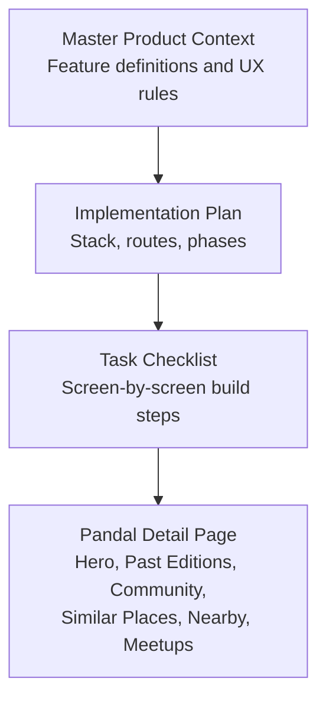

**Diagram sources**
- [Pujo_Sahayak_Master_Project_Context.md:775-950](file://Pujo_Sahayak_Master_Project_Context.md#L775-L950)
- [plan.md:1-18](file://tasks/plan.md#L1-L18)
- [todo.md:29-30](file://tasks/todo.md#L29-L30)

**Section sources**
- [Pujo_Sahayak_Master_Project_Context.md:775-950](file://Pujo_Sahayak_Master_Project_Context.md#L775-L950)
- [plan.md:1-18](file://tasks/plan.md#L1-L18)
- [todo.md:29-30](file://tasks/todo.md#L29-L30)

## Core Components
The Pandal Detail Page is composed of several cohesive sections:
- Hero section with high-resolution imagery, name, location, and save/bookmark action.
- Current information row with rating, reviews, distance, crowd level, and open-till time.
- Action row with Save, Visited, and Route actions.
- Info row with Location, Metro, Facilities, and Safety links.
- About and theme story area.
- Ask-Maya chip for contextual AI assistance.
- What Others Say (reviews).
- Top Clicks (popular user photos).
- Post Your Photos upload flow with AI verification concept.
- Similar Places recommendation list.
- Nearby Restaurants list.
- Meetups near this place.

These components are explicitly defined in the product context and task plan.

**Section sources**
- [Pujo_Sahayak_Master_Project_Context.md:775-950](file://Pujo_Sahayak_Master_Project_Context.md#L775-L950)
- [todo.md:29-30](file://tasks/todo.md#L29-L30)

## Architecture Overview
The Pandal Detail Page sits within a React Router-based application. Its route is `/pandal/:id`, and it integrates with:
- Local dataset for place metadata, reviews, photos, restaurants, and meetups.
- Zustand store for user state such as saved places, visited places, and preferences.
- Leaflet map for navigation and distance calculations.
- Maya assistant for contextual Q&A and camera-based identification.

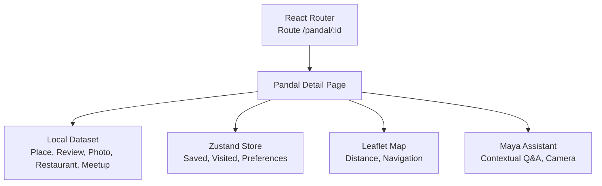

**Diagram sources**
- [plan.md:1-18](file://tasks/plan.md#L1-L18)
- [todo.md:29-30](file://tasks/todo.md#L29-L30)

## Detailed Component Analysis

### Hero Section
The hero displays a large image or video, the pandal name, location, and a save/bookmark control. It sets the visual tone and immediate context for the detail page.

Implementation considerations:
- Use responsive images with appropriate aspect ratios.
- Provide fallback gradients when images are unavailable.
- Ensure accessibility labels for images and controls.
- Keep the hero lightweight by deferring heavy assets until needed.

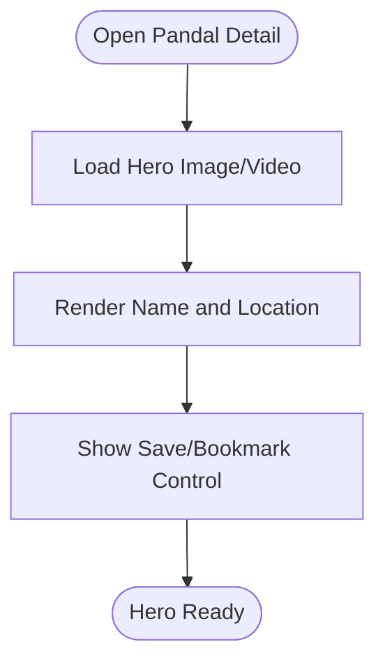

**Diagram sources**
- [Pujo_Sahayak_Master_Project_Context.md:781-789](file://Pujo_Sahayak_Master_Project_Context.md#L781-L789)
- [todo.md:29-30](file://tasks/todo.md#L29-L30)

**Section sources**
- [Pujo_Sahayak_Master_Project_Context.md:781-789](file://Pujo_Sahayak_Master_Project_Context.md#L781-L789)
- [todo.md:29-30](file://tasks/todo.md#L29-L30)

### Key Information Display
The key information row shows rating, number of reviews, distance, crowd level, and open-till time. It helps users quickly assess whether to visit now or later.

Implementation considerations:
- Derive crowd levels and hours from the dataset; do not fabricate values.
- Format distance consistently and show relative indicators (e.g., “Nearby”).
- Respect reduced-motion settings for any animated badges.

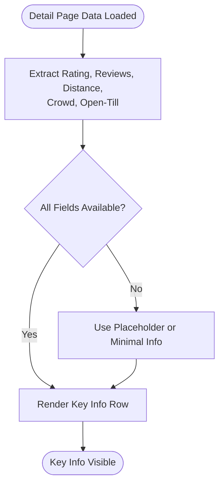

**Diagram sources**
- [todo.md:29-30](file://tasks/todo.md#L29-L30)

**Section sources**
- [todo.md:29-30](file://tasks/todo.md#L29-L30)

### Action Buttons
Actions include Save, Visited, and Route. These update local state and can trigger navigation or map integration.

Implementation considerations:
- Persist Save and Visited states using Zustand with localStorage persistence.
- Route action should integrate with Leaflet for directions.
- Provide clear feedback for each action (e.g., toast or inline confirmation).

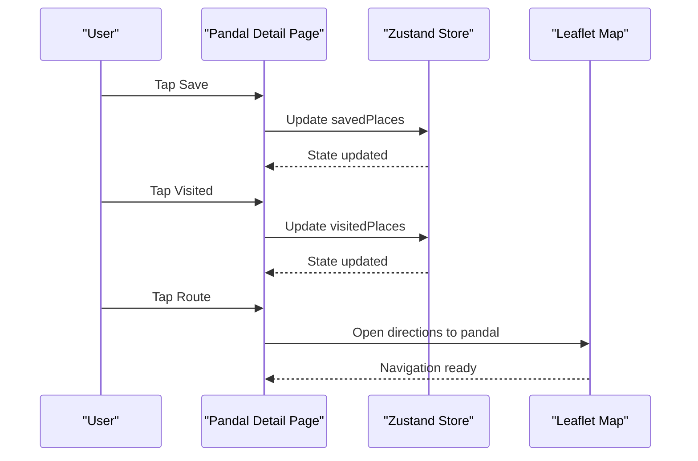

**Diagram sources**
- [todo.md:29-30](file://tasks/todo.md#L29-L30)
- [plan.md:1-18](file://tasks/plan.md#L1-L18)

**Section sources**
- [todo.md:29-30](file://tasks/todo.md#L29-L30)
- [plan.md:1-18](file://tasks/plan.md#L1-L18)

### Info Row
The info row provides quick access to Location, Metro, Facilities, and Safety. These are utility links that enhance the visitor experience.

Implementation considerations:
- Location opens maps with coordinates.
- Metro links to transit details if available in the dataset.
- Facilities and Safety link to relevant categories or safety points.

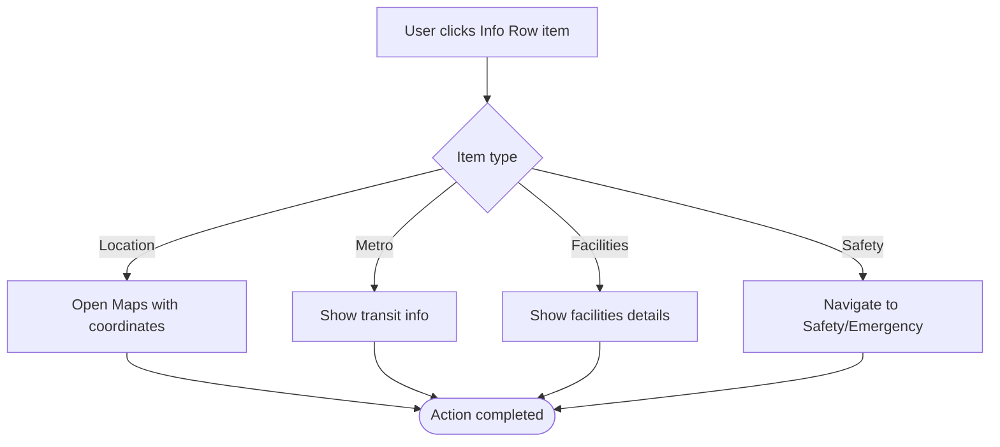

**Diagram sources**
- [todo.md:29-30](file://tasks/todo.md#L29-L30)

**Section sources**
- [todo.md:29-30](file://tasks/todo.md#L29-L30)

### About and Theme Story
This area explains the pandal’s theme and cultural background. It should be grounded in dataset-provided text and avoid hallucination.

Implementation considerations:
- Render structured content safely (e.g., sanitized HTML or markdown).
- Support Bengali and English strings per i18n configuration.
- Allow long-form storytelling without breaking mobile layouts.

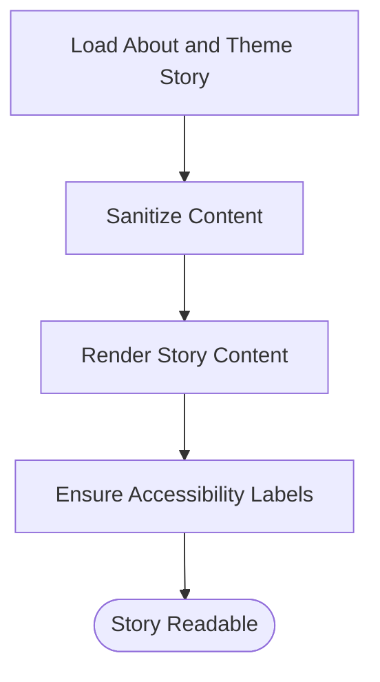

**Diagram sources**
- [Pujo_Sahayak_Master_Project_Context.md:775-950](file://Pujo_Sahayak_Master_Project_Context.md#L775-L950)

**Section sources**
- [Pujo_Sahayak_Master_Project_Context.md:775-950](file://Pujo_Sahayak_Master_Project_Context.md#L775-L950)

### Past Editions
Past editions display photographs, videos, and previous themes to communicate the evolution of the Puja committee over time.

Implementation considerations:
- Group past editions chronologically.
- Support both images and short videos.
- Show year and theme label for each edition.
- Lazy-load media to improve performance.

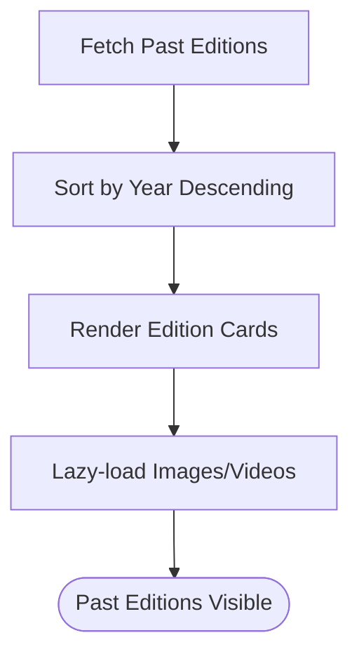

**Diagram sources**
- [Pujo_Sahayak_Master_Project_Context.md:791-808](file://Pujo_Sahayak_Master_Project_Context.md#L791-L808)

**Section sources**
- [Pujo_Sahayak_Master_Project_Context.md:791-808](file://Pujo_Sahayak_Master_Project_Context.md#L791-L808)

### Community Content Integration
Community content includes:
- What Others Say: user reviews with star ratings and comments.
- Top Clicks: popular user-contributed photos.
- Post Your Photos: upload flow with AI verification concept.

Implementation considerations:
- Reviews must be actual user-generated content; do not generate fake reviews via AI.
- Top Clicks should reflect engagement metrics (views, likes) from the dataset.
- Upload flow should simulate verification locally in v1 and clearly mark demo behavior.

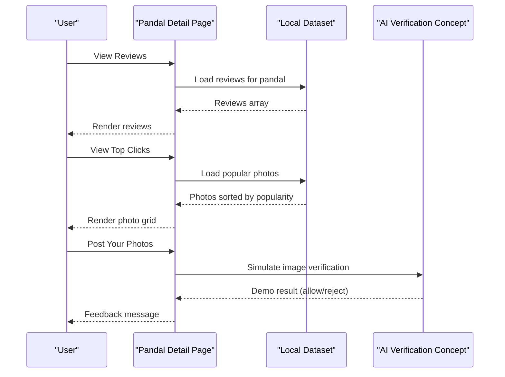

**Diagram sources**
- [Pujo_Sahayak_Master_Project_Context.md:811-893](file://Pujo_Sahayak_Master_Project_Context.md#L811-L893)
- [todo.md:29-30](file://tasks/todo.md#L29-L30)

**Section sources**
- [Pujo_Sahayak_Master_Project_Context.md:811-893](file://Pujo_Sahayak_Master_Project_Context.md#L811-L893)
- [todo.md:29-30](file://tasks/todo.md#L29-L30)

### Related Place Recommendations Algorithm
Similar Places recommends other pandals based on:
- Same theme
- Same area
- Similar architecture
- Similar popularity
- Similar experience

The system can start simple and evolve into more sophisticated matching.

Implementation considerations:
- Compute similarity scores using weighted fields from the dataset.
- Cache results to avoid recomputation on every render.
- Present “You might like” wording rather than absolute claims.

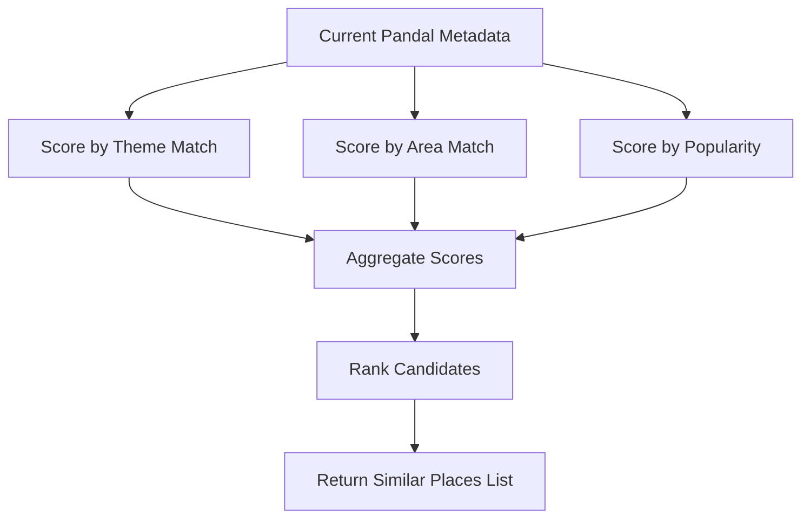

**Diagram sources**
- [Pujo_Sahayak_Master_Project_Context.md:895-910](file://Pujo_Sahayak_Master_Project_Context.md#L895-L910)

**Section sources**
- [Pujo_Sahayak_Master_Project_Context.md:895-910](file://Pujo_Sahayak_Master_Project_Context.md#L895-L910)

### Ask-Maya Chip Integration
The Ask-Maya chip provides contextual AI assistance directly from the detail page. It should pass the current pandal context to Maya so users can ask questions about the theme, symbolism, artist information, and visit details.

Implementation considerations:
- Pre-populate Maya context with the selected pandal.
- Offer quick-reply chips for common questions.
- Ground answers in dataset facts; use “I don’t have verified information” fallback when needed.

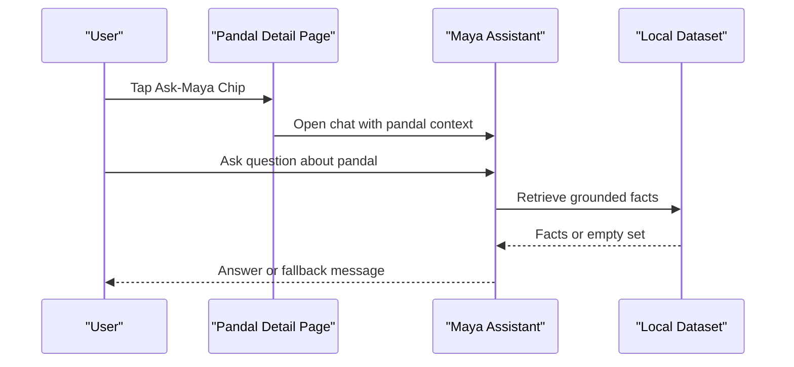

**Diagram sources**
- [Pujo_Sahayak_Master_Project_Context.md:558-660](file://Pujo_Sahayak_Master_Project_Context.md#L558-L660)
- [todo.md:29-30](file://tasks/todo.md#L29-L30)

**Section sources**
- [Pujo_Sahayak_Master_Project_Context.md:558-660](file://Pujo_Sahayak_Master_Project_Context.md#L558-L660)
- [todo.md:29-30](file://tasks/todo.md#L29-L30)

### Nearby Places Functionality
Nearby functionality includes:
- Nearby Restaurants: curated list of dining options close to the pandal.
- Meetups near this place: social events connected to the location.
- Distance calculation and navigation integration via Leaflet.

Implementation considerations:
- Use haversine formula for distance calculations.
- Show estimated travel time where possible.
- Integrate with map markers and polyline for multi-stop trips.

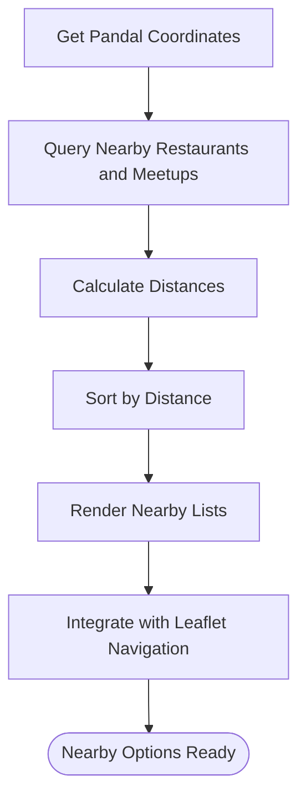

**Diagram sources**
- [Pujo_Sahayak_Master_Project_Context.md:913-950](file://Pujo_Sahayak_Master_Project_Context.md#L913-L950)
- [todo.md:63-64](file://tasks/todo.md#L63-L64)

**Section sources**
- [Pujo_Sahayak_Master_Project_Context.md:913-950](file://Pujo_Sahayak_Master_Project_Context.md#L913-L950)
- [todo.md:63-64](file://tasks/todo.md#L63-L64)

### Rich Content Rendering Examples
While the repository does not contain source code, the following patterns describe how rich content should be rendered:
- Structured content rendering for About and theme story.
- Safe rendering of user-generated reviews and photos.
- Interactive elements for actions and navigation.

Recommended approach:
- Use a content renderer component that supports headings, paragraphs, lists, and images.
- Apply sanitization to prevent XSS.
- Provide loading skeletons for async content.

[No sources needed since this section provides general guidance]

### Image Optimization Examples
Recommended approach:
- Use responsive images with srcset and sizes attributes.
- Implement lazy loading for below-the-fold images and videos.
- Provide gradient placeholders while media loads.
- Compress images at build time and serve WebP/AVIF where supported.

[No sources needed since this section provides general guidance]

### Interactive Element Handling Examples
Recommended approach:
- Wrap buttons and chips with accessible event handlers.
- Debounce expensive operations (e.g., search, filtering).
- Use optimistic UI updates for Save/Visited actions, then reconcile with persisted state.

[No sources needed since this section provides general guidance]

## Dependency Analysis
The Pandal Detail Page depends on:
- Local dataset for all place-related data.
- Zustand store for user state persistence.
- Leaflet for mapping and navigation.
- Maya assistant for contextual Q&A and camera identification.

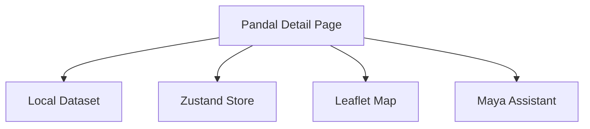

**Diagram sources**
- [plan.md:1-18](file://tasks/plan.md#L1-L18)
- [todo.md:29-30](file://tasks/todo.md#L29-L30)

**Section sources**
- [plan.md:1-18](file://tasks/plan.md#L1-L18)
- [todo.md:29-30](file://tasks/todo.md#L29-L30)

## Performance Considerations
To ensure smooth scrolling and responsive interactions on heavy media content:
- Defer non-critical assets and load them progressively.
- Use virtualized lists for long sections like reviews and past editions.
- Avoid layout thrashing by batching DOM reads and writes.
- Respect reduced-motion preferences for animations.
- Cache computed similarity results and nearby queries.
- Use skeleton loaders to maintain perceived performance during data fetches.

[No sources needed since this section provides general guidance]

## Troubleshooting Guide
Common issues and resolutions:
- Missing images: ensure fallback gradients are applied and asset paths are correct.
- Incorrect crowd levels or hours: verify dataset fields and avoid fabricating values.
- Maya hallucinations: ground responses in dataset; use explicit fallback messages.
- Navigation failures: confirm Leaflet initialization and coordinate validity.
- State inconsistencies: check Zustand persistence and ensure Save/Visited updates are idempotent.

**Section sources**
- [todo.md:81-86](file://tasks/todo.md#L81-L86)

## Conclusion
The Pandal Detail Page is a rich, community-driven exploration surface that combines high-quality media, historical context, user reviews, AI assistance, and local discovery. By following the documented requirements and recommended implementation patterns, developers can build a performant, accessible, and culturally grounded experience that fits seamlessly into the broader Puja Sahayak ecosystem.

[No sources needed since this section summarizes without analyzing specific files]