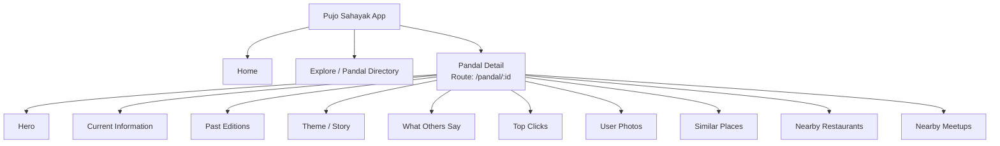
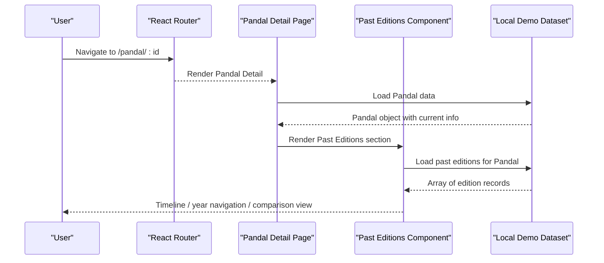
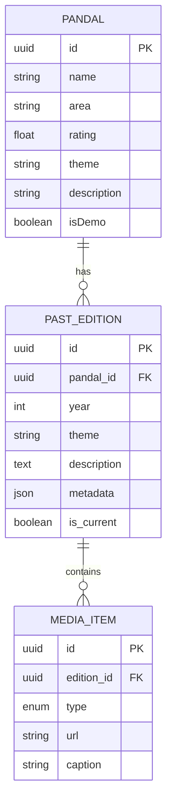
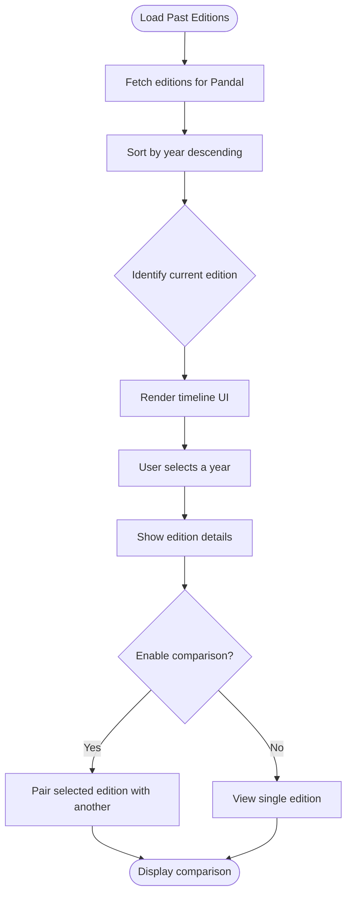
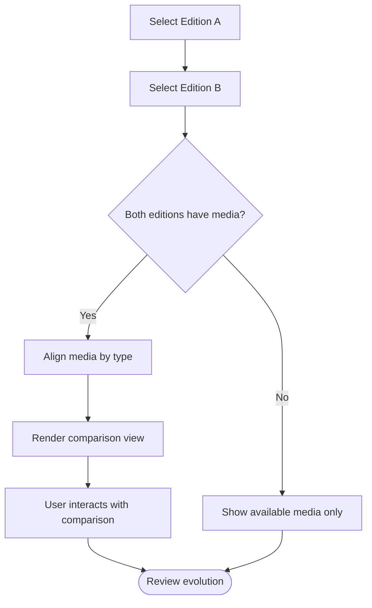
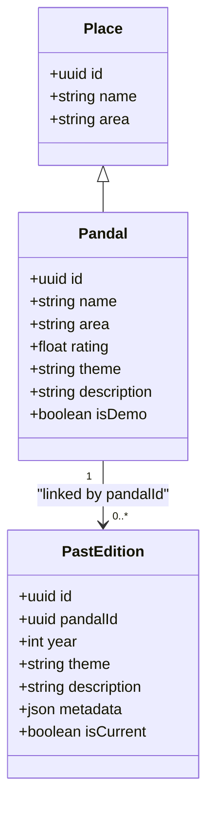
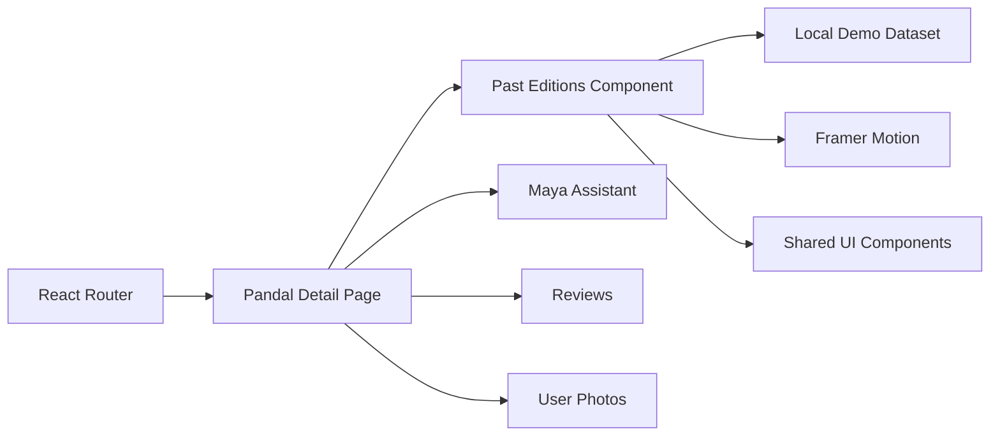

# Past Editions Display

<cite>
**Referenced Files in This Document**   
- [Pujo_Sahayak_Master_Project_Context.md](file://Pujo_Sahayak_Master_Project_Context.md)
- [plan.md](file://tasks/plan.md)
- [todo.md](file://tasks/todo.md)
</cite>

## Table of Contents
1. [Introduction](#introduction)
2. [Project Structure](#project-structure)
3. [Core Components](#core-components)
4. [Architecture Overview](#architecture-overview)
5. [Detailed Component Analysis](#detailed-component-analysis)
6. [Dependency Analysis](#dependency-analysis)
7. [Performance Considerations](#performance-considerations)
8. [Troubleshooting Guide](#troubleshooting-guide)
9. [Conclusion](#conclusion)

## Introduction
This document explains the **Past Editions display component** for a Pandal Detail page. It focuses on how historical pandal data is presented to show the evolution of a Puja committee over time, including timeline visualization, year navigation, and comparison between different editions. It also documents the expected data model for past editions, the rendering logic for chronological display, interactive switching behavior, relationships with the main Pandal data model, and common issues such as missing historical data.

The Past Editions section is part of the Pandal Detail experience, which is one of the core screens in the product map. The broader context emphasizes that this feature communicates the history and evolution of a Puja committee through photographs, videos, and previous themes.

**Section sources**
- [Pujo_Sahayak_Master_Project_Context.md:775-809](file://Pujo_Sahayak_Master_Project_Context.md#L775-L809)
- [Pujo_Sahayak_Master_Project_Context.md:1781-1858](file://Pujo_Sahayak_Master_Project_Context.md#L1781-L1858)

## Project Structure
At the repository level, the project documentation and implementation plan are captured in:
- A master product context document describing features, information architecture, data models, and UX principles.
- An implementation plan describing the React + Vite PWA stack, routes, and task phases.
- A task list tracking screen-by-screen development milestones.

For the Past Editions display, the relevant structure is:
- **Pandal Detail route**: `/pandal/:id`
- **Pandal Detail sections**: Hero, Current Information, Past Editions, Theme / Story, What Others Say, Top Clicks, User Photos, Similar Places, Nearby Restaurants, Nearby Meetups.

**Diagram sources**
- [plan.md:19-39](file://tasks/plan.md#L19-L39)
- [Pujo_Sahayak_Master_Project_Context.md:1781-1858](file://Pujo_Sahayak_Master_Project_Context.md#L1781-L1858)

**Section sources**
- [plan.md:1-18](file://tasks/plan.md#L1-L18)
- [plan.md:19-39](file://tasks/plan.md#L19-L39)
- [Pujo_Sahayak_Master_Project_Context.md:1781-1858](file://Pujo_Sahayak_Master_Project_Context.md#L1781-L1858)

## Core Components
The Past Editions display is a subcomponent of the Pandal Detail page. Its responsibilities include:
- Showing historical records for a specific Pandal across multiple years.
- Presenting photographs, videos, and previous themes.
- Allowing users to navigate by year.
- Enabling comparison between editions.
- Communicating the evolution of a Puja committee.

Key user-facing behaviors:
- Chronological ordering of editions.
- Year-based selection or timeline navigation.
- Visual emphasis on theme changes and media differences.
- Clear indication of the current edition versus past editions.

Relationship to the Pandal Detail page:
- The Past Editions section sits below the hero and current information.
- It complements the “Theme / Story” section by providing historical evidence rather than only narrative explanation.
- It connects to community content such as reviews and photos by showing how user-generated content has evolved over time.

**Section sources**
- [Pujo_Sahayak_Master_Project_Context.md:775-809](file://Pujo_Sahayak_Master_Project_Context.md#L775-L809)
- [Pujo_Sahayak_Master_Project_Context.md:1781-1858](file://Pujo_Sahayak_Master_Project_Context.md#L1781-L1858)

## Architecture Overview
The Past Editions display integrates into the Pandal Detail flow. Conceptually, it reads historical edition data associated with a Pandal and renders a timeline-like interface.

**Diagram sources**
- [plan.md:19-39](file://tasks/plan.md#L19-L39)
- [Pujo_Sahayak_Master_Project_Context.md:1781-1858](file://Pujo_Sahayak_Master_Project_Context.md#L1781-L1858)

## Detailed Component Analysis

### Data Model for Past Editions
The product context defines a broad data model where `Place` is a general entity and `Pandal` is a specialized type. Historical edition data should be modeled as part of the Pandal’s extended data rather than as an unrelated collection.

Recommended data structure for past editions:
- `pandalId`: Identifier linking the edition to the main Pandal.
- `year`: Integer representing the festival year.
- `theme`: Text describing the edition’s theme.
- `description`: Optional summary of the edition.
- `media`: List of images and/or videos from that year.
- `metadata`: Optional fields such as artist, location notes, crowd size, or special events.
- `isCurrent`: Boolean flag indicating whether the edition represents the current season.

Complexity considerations:
- Rendering editions chronologically requires sorting by `year`.
- Comparison views may require pairing two editions side by side, so operations like filtering by year and mapping media become important.
- If many editions exist, pagination or virtualization can reduce memory usage.

**Diagram sources**
- [Pujo_Sahayak_Master_Project_Context.md:1232-1260](file://Pujo_Sahayak_Master_Project_Context.md#L1232-L1260)

**Section sources**
- [Pujo_Sahayak_Master_Project_Context.md:1232-1260](file://Pujo_Sahayak_Master_Project_Context.md#L1232-L1260)

### Timeline Visualization
The timeline visualization should present past editions in chronological order. On mobile, a horizontal scrollable timeline or compact year chips works well. On desktop, a wider timeline with more detail per year can be shown.

Timeline elements:
- Year labels.
- Theme preview.
- Media thumbnail.
- Indicator for the current edition.
- Optional badge for notable editions (e.g., anniversary, major theme change).

Rendering logic:
1. Retrieve all past editions for the selected Pandal.
2. Sort editions by year in descending order (newest first).
3. Mark the current edition using `isCurrent` or by comparing `year` with the current festival season.
4. Render a timeline row or card for each edition.
5. Highlight the selected year and provide navigation controls.

**Diagram sources**
- [Pujo_Sahayak_Master_Project_Context.md:775-809](file://Pujo_Sahayak_Master_Project_Context.md#L775-L809)

**Section sources**
- [Pujo_Sahayak_Master_Project_Context.md:775-809](file://Pujo_Sahayak_Master_Project_Context.md#L775-L809)

### Year Navigation
Year navigation allows users to jump directly to a specific edition. Options include:
- Horizontal chip bar with years.
- Dropdown selector for older editions.
- Timeline scrubber for continuous browsing.

Behavior:
- Selecting a year updates the active edition without reloading the entire Pandal Detail page.
- The URL can optionally reflect the selected year for shareability.
- Keyboard accessibility should support arrow keys and Enter/Space for activation.

Accessibility considerations:
- Use semantic buttons or tabs for year selection.
- Provide visible focus indicators.
- Announce the active year to screen readers.

**Section sources**
- [Pujo_Sahayak_Master_Project_Context.md:775-809](file://Pujo_Sahayak_Master_Project_Context.md#L775-L809)

### Comparison Features Between Editions
Comparison mode helps users understand how a Pandal’s theme, design, lighting, or layout changed over time.

Comparison modes:
- Side-by-side media comparison.
- Theme evolution summary.
- Before-and-after highlights.
- Optional overlay or slider interaction for image pairs.

Data requirements for comparison:
- Two editions must be selectable.
- Media items should be aligned by type when possible.
- Differences in theme text should be highlighted clearly.

**Diagram sources**
- [Pujo_Sahayak_Master_Project_Context.md:775-809](file://Pujo_Sahayak_Master_Project_Context.md#L775-L809)

**Section sources**
- [Pujo_Sahayak_Master_Project_Context.md:775-809](file://Pujo_Sahayak_Master_Project_Context.md#L775-L809)

### Relationship With the Main Pandal Data Model
The Past Editions component depends on the main Pandal data model but should not duplicate it. Instead:
- The Pandal object holds current information such as name, location, theme, rating, and current-season metadata.
- Past editions are linked via `pandalId` and represent historical snapshots.
- The Pandal Detail page composes both current information and past editions.

This separation supports:
- Clean data normalization.
- Independent evolution of current vs historical data.
- Easier testing and mocking of demo datasets.

**Diagram sources**
- [Pujo_Sahayak_Master_Project_Context.md:1232-1260](file://Pujo_Sahayak_Master_Project_Context.md#L1232-L1260)

**Section sources**
- [Pujo_Sahayak_Master_Project_Context.md:1232-1260](file://Pujo_Sahayak_Master_Project_Context.md#L1232-L1260)

### Interactive Elements for Edition Switching
Interactive elements should make switching between editions smooth and predictable:
- Year chips or timeline markers.
- Swipe gestures on mobile for adjacent years.
- Focus management when switching editions.
- Loading states while fetching historical media.
- Error boundaries around media loading.

State considerations:
- Active year state.
- Comparison mode state.
- Loading and error states for historical data.
- Persistence of user preference for timeline orientation if desired.

**Section sources**
- [Pujo_Sahayak_Master_Project_Context.md:775-809](file://Pujo_Sahayak_Master_Project_Context.md#L775-L809)

### How Historical Context Enhances User Experience
Historical context adds depth to the Pandal experience:
- It shows continuity and tradition.
- It helps users appreciate artistic and cultural evolution.
- It supports storytelling alongside Maya’s explanations.
- It encourages repeat visits and deeper engagement with Puja culture.

From the product perspective, Past Editions aligns with the principle that the app should feel alive and culturally rooted while remaining functional and modern.

**Section sources**
- [Pujo_Sahayak_Master_Project_Context.md:775-809](file://Pujo_Sahayak_Master_Project_Context.md#L775-L809)
- [Pujo_Sahayak_Master_Project_Context.md:1458-1507](file://Pujo_Sahayak_Master_Project_Context.md#L1458-L1507)

## Dependency Analysis
The Past Editions display depends on several parts of the application:

- **Routing**: Pandal Detail route `/pandal/:id`.
- **Data layer**: Local demo dataset containing Pandal objects and related historical edition data.
- **UI components**: Shared cards, chips, timeline primitives, and motion system.
- **Contextual features**: Maya assistant, reviews, user photos, and similar places can reference historical context indirectly.

**Diagram sources**
- [plan.md:1-18](file://tasks/plan.md#L1-L18)
- [plan.md:19-39](file://tasks/plan.md#L19-L39)

**Section sources**
- [plan.md:1-18](file://tasks/plan.md#L1-L18)
- [plan.md:19-39](file://tasks/plan.md#L19-L39)

## Performance Considerations
- Avoid loading all historical media at once; lazy-load images and videos.
- Cache previously viewed editions to reduce repeated fetches.
- Use skeleton loaders for timeline entries while data loads.
- Limit comparison pairs to two editions to prevent heavy rendering.
- Respect reduced-motion preferences for animations.
- Keep timeline navigation lightweight; avoid re-rendering the entire Pandal Detail page on year switch.

[No sources needed since this section provides general guidance]

## Troubleshooting Guide

Common issues and solutions:

| Issue | Likely Cause | Solution |
|---|---|---|
| No past editions appear | Missing historical data for the Pandal | Show an empty state explaining that historical records are not yet available; allow users to contribute or explore other pandals. |
| Wrong year displayed | Incorrect sorting or missing year field | Ensure editions are sorted by `year`; validate required fields before rendering. |
| Comparison view fails | One or both editions lack media | Gracefully fall back to available media and inform the user that full comparison is unavailable. |
| Timeline feels slow | Too many media items loaded | Implement pagination, virtualization, or lazy loading for media. |
| Accessibility problems | Non-semantic year selectors | Use buttons/tabs with proper roles, labels, and keyboard support. |
| Historical data conflicts with current edition | Ambiguous `isCurrent` flag | Derive current edition from both `isCurrent` and the current festival year; prefer explicit flags when available. |

**Section sources**
- [Pujo_Sahayak_Master_Project_Context.md:775-809](file://Pujo_Sahayak_Master_Project_Context.md#L775-L809)

## Conclusion
The Past Editions display is a meaningful extension of the Pandal Detail experience. It transforms a static place profile into a living record of cultural evolution. By modeling historical editions separately from current Pandal data, implementing clear chronological navigation, and supporting thoughtful comparison features, the component enhances both understanding and emotional connection to Puja traditions. When historical data is incomplete, the UI should remain honest, accessible, and useful, guiding users toward current exploration while preserving the promise of richer history over time.

[No sources needed since this section summarizes without analyzing specific files]