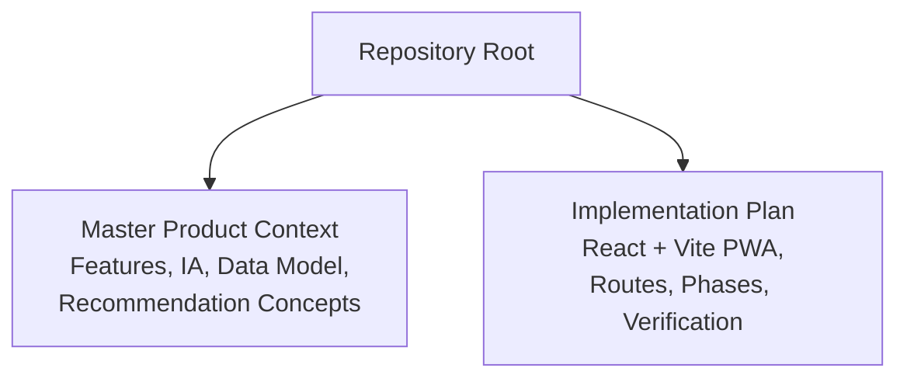
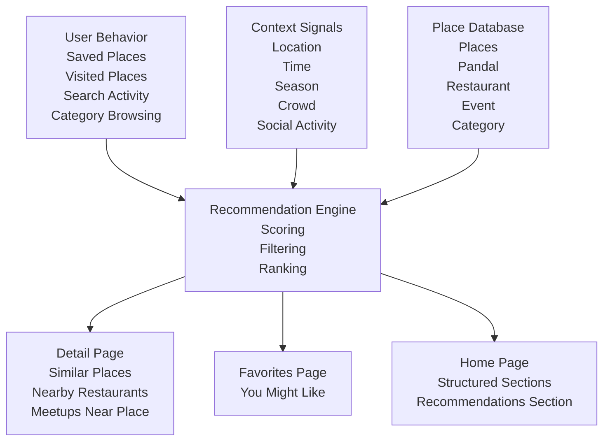
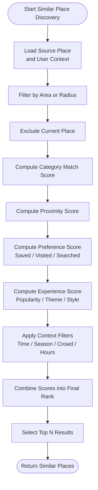
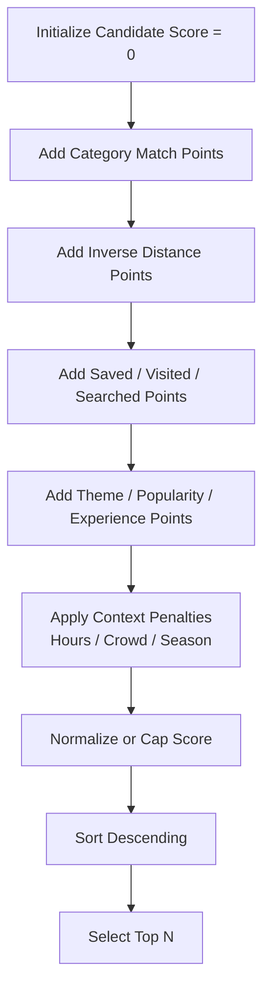
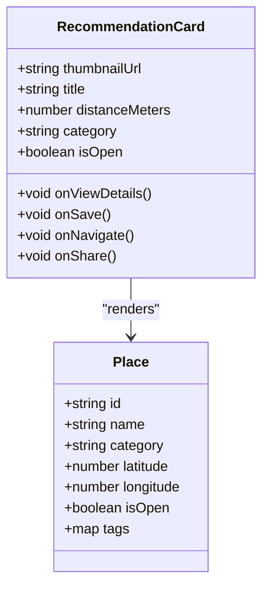
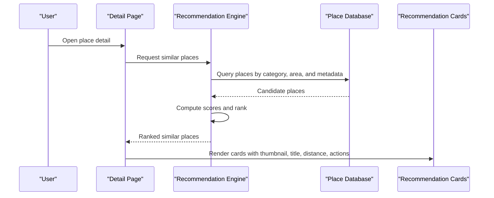
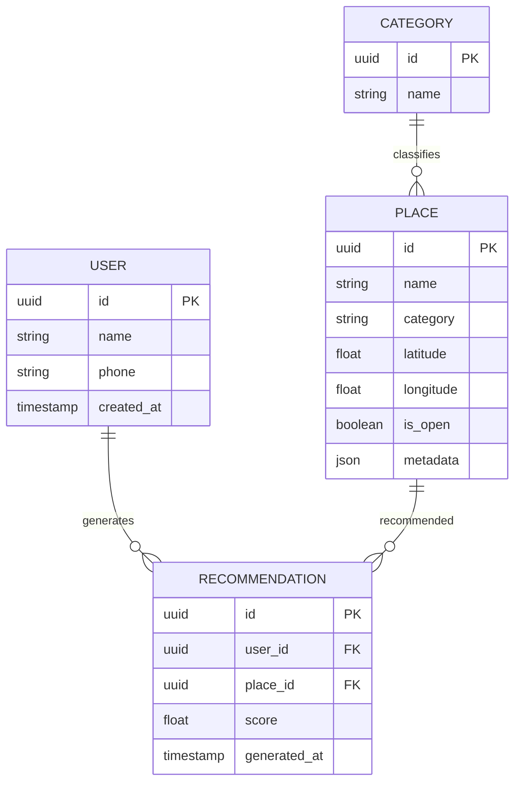
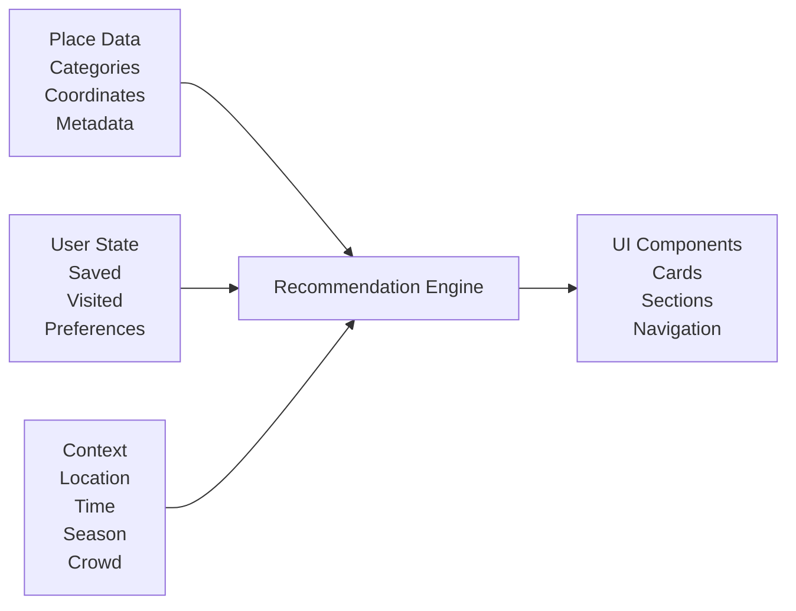

# Related Places & Recommendations

<cite>
**Referenced Files in This Document**   
- [Pujo_Sahayak_Master_Project_Context.md](file://Pujo_Sahayak_Master_Project_Context.md)
- [plan.md](file://tasks/plan.md)
</cite>

## Table of Contents
1. [Introduction](#introduction)
2. [Project Structure](#project-structure)
3. [Core Components](#core-components)
4. [Architecture Overview](#architecture-overview)
5. [Detailed Component Analysis](#detailed-component-analysis)
6. [Dependency Analysis](#dependency-analysis)
7. [Performance Considerations](#performance-considerations)
8. [Troubleshooting Guide](#troubleshooting-guide)
9. [Conclusion](#conclusion)

## Introduction
This document explains the related places and recommendations system for Pujo Sahayak. It focuses on:
- How similar places are discovered using category matching, location proximity, and user preferences.
- The recommendation card UI with thumbnail, title, distance, and quick actions.
- Concrete examples of scoring logic, data filtering criteria, and UI presentation patterns.
- Integration with the broader place database and user behavior tracking.
- Performance considerations for real-time recommendation calculations and caching strategies.

The product is a mobile-first local discovery platform centered around Durga Puja but designed to remain useful beyond the season through restaurants, events, activities, meetups, and general Kolkata exploration.

**Section sources**
- [Pujo_Sahayak_Master_Project_Context.md:1-18](file://Pujo_Sahayak_Master_Project_Context.md#L1-L18)
- [Pujo_Sahayak_Master_Project_Context.md:104-137](file://Pujo_Sahayak_Master_Project_Context.md#L104-L137)
- [plan.md:1-17](file://tasks/plan.md#L1-L17)

## Project Structure
At this stage, the repository contains:
- A master product context describing features, navigation, data model, and recommendation concepts.
- An implementation plan describing React + Vite PWA architecture, routes, phases, and verification rules.

**Diagram sources**
- [Pujo_Sahayak_Master_Project_Context.md:1-18](file://Pujo_Sahayak_Master_Project_Context.md#L1-L18)
- [plan.md:1-17](file://tasks/plan.md#L1-L17)

**Section sources**
- [Pujo_Sahayak_Master_Project_Context.md:1-18](file://Pujo_Sahayak_Master_Project_Context.md#L1-L18)
- [plan.md:1-17](file://tasks/plan.md#L1-L17)

## Core Components
The related places and recommendations system is built around these core components:

- Place entity and categories
  - Places include pandals, restaurants, events, attractions, services, and other local experiences.
  - Categories provide structured metadata used for similarity and filtering.

- User behavior signals
  - Saved places (favorites).
  - Visited places.
  - Search activity.
  - Category browsing.
  - Time, season, crowd, and social activity.

- Recommendation engine
  - Combines location, previous visits, favorites, search activity, categories, time, season, crowd, and social activity.
  - Starts simple and can evolve toward AI-assisted ranking.

- Similar places feature
  - Appears on detail pages.
  - Uses similarity dimensions such as theme, area, architecture, popularity, and experience.

- Nearby contextual sections
  - Nearby restaurants.
  - Meetups near a place.

- UI presentation
  - Structured Home sections including recommendations.
  - Cards showing thumbnails, titles, distances, ratings, categories, and quick actions.

**Section sources**
- [Pujo_Sahayak_Master_Project_Context.md:1232-1260](file://Pujo_Sahayak_Master_Project_Context.md#L1232-L1260)
- [Pujo_Sahayak_Master_Project_Context.md:1263-1294](file://Pujo_Sahayak_Master_Project_Context.md#L1263-L1294)
- [Pujo_Sahayak_Master_Project_Context.md:895-910](file://Pujo_Sahayak_Master_Project_Context.md#L895-L910)
- [Pujo_Sahayak_Master_Project_Context.md:913-931](file://Pujo_Sahayak_Master_Project_Context.md#L913-L931)
- [Pujo_Sahayak_Master_Project_Context.md:935-950](file://Pujo_Sahayak_Master_Project_Context.md#L935-L950)
- [Pujo_Sahayak_Master_Project_Context.md:1577-1602](file://Pujo_Sahayak_Master_Project_Context.md#L1577-L1602)

## Architecture Overview
The recommendation system integrates multiple layers:

**Diagram sources**
- [Pujo_Sahayak_Master_Project_Context.md:1232-1260](file://Pujo_Sahayak_Master_Project_Context.md#L1232-L1260)
- [Pujo_Sahayak_Master_Project_Context.md:1263-1294](file://Pujo_Sahayak_Master_Project_Context.md#L1263-L1294)
- [Pujo_Sahayak_Master_Project_Context.md:895-910](file://Pujo_Sahayak_Master_Project_Context.md#L895-L910)
- [Pujo_Sahayak_Master_Project_Context.md:1577-1602](file://Pujo_Sahayak_Master_Project_Context.md#L1577-L1602)

## Detailed Component Analysis

### Similar Place Discovery Algorithm
The algorithm discovers similar places by combining several signals:

- Category matching
  - Same category or subcategory.
  - For pandals, same theme or architectural style.
  - For restaurants, cuisine type.
  - For events, event type or interest tag.

- Location proximity
  - Distance from current user location or selected place.
  - Area-level grouping for coarse similarity.
  - Radius-based filtering before scoring.

- User preferences
  - Saved places indicate explicit preference.
  - Visited places indicate confirmed interest.
  - Search history indicates exploratory intent.
  - Category browsing shows affinity.

- Experience and popularity
  - Similar experience level (e.g., family-friendly, heritage, nightlife).
  - Similar popularity metrics when available.

- Contextual filters
  - Time of day.
  - Seasonal relevance.
  - Crowd levels.
  - Operating hours.

**Diagram sources**
- [Pujo_Sahayak_Master_Project_Context.md:895-910](file://Pujo_Sahayak_Master_Project_Context.md#L895-L910)
- [Pujo_Sahayak_Master_Project_Context.md:1263-1294](file://Pujo_Sahayak_Master_Project_Context.md#L1263-L1294)

#### Scoring Logic Examples
Below are concrete examples of how scores can be computed. These are illustrative implementations aligned with the documented signals.

- Base score initialization
  - Start each candidate place with a base score of zero.

- Category match score
  - Exact category match: add a strong positive value.
  - Subcategory or theme match: add a moderate positive value.
  - No match: add zero or a small negative penalty depending on strategy.

- Proximity score
  - Use inverse distance weighting so closer places score higher.
  - Apply a maximum radius cutoff; places beyond it receive zero or are filtered out.

- Preference score
  - If saved: add a high positive value.
  - If visited: add a moderate positive value.
  - If searched or browsed: add a smaller positive value.
  - If already visited and not explicitly liked: optionally reduce score to avoid repetition.

- Experience score
  - Theme or architectural similarity: add positive value.
  - Popularity similarity: add small positive value if relevant.
  - Crowding or operating hours mismatch: apply penalty.

- Final rank
  - Normalize or cap scores.
  - Sort descending.
  - Return top results.

**Diagram sources**
- [Pujo_Sahayak_Master_Project_Context.md:895-910](file://Pujo_Sahayak_Master_Project_Context.md#L895-L910)
- [Pujo_Sahayak_Master_Project_Context.md:1263-1294](file://Pujo_Sahayak_Master_Project_Context.md#L1263-L1294)

#### Data Filtering Criteria
Before scoring, the system should filter candidates:

- Must have valid coordinates.
- Must be within a reasonable distance threshold.
- Must match at least one allowed category unless exploring broadly.
- Must satisfy hard constraints such as open now or operating hours.
- Should exclude already visited places unless the user explicitly allows repeat suggestions.
- Should respect privacy and safety boundaries where applicable.

**Section sources**
- [Pujo_Sahayak_Master_Project_Context.md:895-910](file://Pujo_Sahayak_Master_Project_Context.md#L895-L910)
- [Pujo_Sahayak_Master_Project_Context.md:1263-1294](file://Pujo_Sahayak_Master_Project_Context.md#L1263-L1294)

### Recommendation Card Component
The recommendation card presents a compact, scannable summary of a place.

#### Required Fields
- Thumbnail image or placeholder.
- Title or name.
- Distance indicator.
- Category or cuisine tag.
- Optional rating or popularity badge.
- Quick actions such as view details, save, navigate, or share.

#### Presentation Patterns
- Mobile-first layout.
- Consistent spacing and typography.
- Clear visual hierarchy: image first, then title, then secondary info.
- Accessible labels and keyboard focus order.
- Reduced-motion support for users who prefer less animation.

**Diagram sources**
- [Pujo_Sahayak_Master_Project_Context.md:209-233](file://Pujo_Sahayak_Master_Project_Context.md#L209-L233)
- [Pujo_Sahayak_Master_Project_Context.md:1577-1602](file://Pujo_Sahayak_Master_Project_Context.md#L1577-L1602)
- [plan.md:9-17](file://tasks/plan.md#L9-L17)

#### Example Card Content
- Restaurant card:
  - Thumbnail: restaurant image or gradient placeholder.
  - Title: restaurant name.
  - Distance: e.g., 0.8 km.
  - Category: Bengali food, North Indian, etc.
  - Quick actions: View details, Save, Navigate.

- Pandal card:
  - Thumbnail: pandal image or placeholder.
  - Title: pandal name.
  - Distance: e.g., 1.2 km.
  - Category: Pandal, Heritage theme.
  - Quick actions: View details, Save, Add to plan.

**Section sources**
- [Pujo_Sahayak_Master_Project_Context.md:209-233](file://Pujo_Sahayak_Master_Project_Context.md#L209-L233)
- [Pujo_Sahayak_Master_Project_Context.md:1577-1602](file://Pujo_Sahayak_Master_Project_Context.md#L1577-L1602)

### UI Placement and Navigation
Related places and recommendations appear in multiple surfaces:

- Detail page
  - Similar places section.
  - Nearby restaurants section.
  - Meetups near this place section.

- Favorites page
  - You might like section based on saved and visited places.

- Home page
  - Structured sections including recommendations.
  - Not an endless feed; each section has a clear purpose.

**Diagram sources**
- [Pujo_Sahayak_Master_Project_Context.md:895-910](file://Pujo_Sahayak_Master_Project_Context.md#L895-L910)
- [Pujo_Sahayak_Master_Project_Context.md:913-931](file://Pujo_Sahayak_Master_Project_Context.md#L913-L931)
- [Pujo_Sahayak_Master_Project_Context.md:935-950](file://Pujo_Sahayak_Master_Project_Context.md#L935-L950)
- [Pujo_Sahayak_Master_Project_Context.md:1577-1602](file://Pujo_Sahayak_Master_Project_Context.md#L1577-L1602)

**Section sources**
- [Pujo_Sahayak_Master_Project_Context.md:895-910](file://Pujo_Sahayak_Master_Project_Context.md#L895-L910)
- [Pujo_Sahayak_Master_Project_Context.md:913-931](file://Pujo_Sahayak_Master_Project_Context.md#L913-L931)
- [Pujo_Sahayak_Master_Project_Context.md:935-950](file://Pujo_Sahayak_Master_Project_Context.md#L935-L950)
- [Pujo_Sahayak_Master_Project_Context.md:1577-1602](file://Pujo_Sahayak_Master_Project_Context.md#L1577-L1602)

### Integration with Place Database and User Behavior Tracking
The recommendation system depends on a broad place database and continuous user behavior tracking.

- Place database
  - Centralized entities: User, Place, Pandal, Restaurant, Event, Meetup, Review, Photo, Trip, Category, Offer, Subscription, Payment, SafetyPoint, EmergencyReport, Recommendation.
  - Places are not limited to pandals; this supports off-season expansion.

- User behavior tracking
  - Saved places.
  - Visited places.
  - Search activity.
  - Category browsing.
  - Social activity and meetups.
  - Time, season, crowd, and location context.

**Diagram sources**
- [Pujo_Sahayak_Master_Project_Context.md:1232-1260](file://Pujo_Sahayak_Master_Project_Context.md#L1232-L1260)
- [Pujo_Sahayak_Master_Project_Context.md:1263-1294](file://Pujo_Sahayak_Master_Project_Context.md#L1263-L1294)

**Section sources**
- [Pujo_Sahayak_Master_Project_Context.md:1232-1260](file://Pujo_Sahayak_Master_Project_Context.md#L1232-L1260)
- [Pujo_Sahayak_Master_Project_Context.md:1263-1294](file://Pujo_Sahayak_Master_Project_Context.md#L1263-L1294)

## Dependency Analysis
The recommendation system depends on:

- Place metadata and geospatial data.
- User state such as saved places, visited places, and preferences.
- Contextual signals such as time, season, crowd, and location.
- UI components that render cards and handle quick actions.
- Routing and navigation for detail pages and nearby sections.

**Diagram sources**
- [Pujo_Sahayak_Master_Project_Context.md:1232-1260](file://Pujo_Sahayak_Master_Project_Context.md#L1232-L1260)
- [Pujo_Sahayak_Master_Project_Context.md:1263-1294](file://Pujo_Sahayak_Master_Project_Context.md#L1263-L1294)
- [plan.md:9-17](file://tasks/plan.md#L9-L17)

**Section sources**
- [Pujo_Sahayak_Master_Project_Context.md:1232-1260](file://Pujo_Sahayak_Master_Project_Context.md#L1232-L1260)
- [Pujo_Sahayak_Master_Project_Context.md:1263-1294](file://Pujo_Sahayak_Master_Project_Context.md#L1263-L1294)
- [plan.md:9-17](file://tasks/plan.md#L9-L17)

## Performance Considerations
Real-time recommendation calculations require careful performance design:

- Pre-filtering
  - Use area or radius filters before scoring.
  - Exclude already visited or irrelevant places early.
  - Limit candidate set size.

- Efficient scoring
  - Avoid expensive operations per candidate.
  - Use vectorized or indexed queries where possible.
  - Cache frequently accessed place metadata.

- Caching strategies
  - Cache recent recommendations per user session.
  - Cache popular nearby places for common locations.
  - Cache category-to-place mappings.
  - Invalidate caches on significant user state changes.

- UI responsiveness
  - Render skeleton or placeholder cards while computing.
  - Paginate or limit displayed results.
  - Debounce location updates.
  - Respect reduced-motion settings.

- Offline and PWA considerations
  - Keep essential UI shell offline.
  - Cache static assets and lightweight dataset entries.
  - Gracefully degrade when live data is unavailable.

[No sources needed since this section provides general guidance]

## Troubleshooting Guide
Common issues and resolutions:

- No similar places returned
  - Check whether the source place has valid category and coordinates.
  - Verify distance thresholds and area filters.
  - Ensure user behavior signals are being recorded.
  - Confirm that hard constraints such as operating hours are not too restrictive.

- Irrelevant recommendations
  - Review category matching weights.
  - Increase preference signal strength for saved and visited places.
  - Adjust proximity decay function.
  - Add explanation text such as “You might like” rather than absolute claims.

- Slow recommendation calculation
  - Reduce candidate set size.
  - Implement pre-filtering by area and category.
  - Add caching for repeated requests.
  - Avoid recomputing on every minor location update.

- Poor card UX
  - Ensure thumbnails load or show placeholders.
  - Display accurate distance values.
  - Provide clear quick actions.
  - Maintain consistent layout across screens.

**Section sources**
- [Pujo_Sahayak_Master_Project_Context.md:895-910](file://Pujo_Sahayak_Master_Project_Context.md#L895-L910)
- [Pujo_Sahayak_Master_Project_Context.md:1263-1294](file://Pujo_Sahayak_Master_Project_Context.md#L1263-L1294)
- [plan.md:9-17](file://tasks/plan.md#L9-L17)

## Conclusion
The related places and recommendations system combines category matching, location proximity, and user preferences to surface meaningful next steps after a user explores a place. It starts simple, scales with richer signals, and remains grounded in the broader place database and user behavior tracking. The recommendation card UI emphasizes clarity, accessibility, and quick actions. With proper filtering, scoring, caching, and performance tuning, the system can deliver responsive, personalized discovery both during Puja and throughout the year.

[No sources needed since this section summarizes without analyzing specific files]