# Screen-by-Screen Implementation Guide

<cite>
**Referenced Files in This Document**
- [Pujo_Sahayak_Master_Project_Context.md](file://Pujo_Sahayak_Master_Project_Context.md)
- [tasks/plan.md](file://tasks/plan.md)
- [tasks/todo.md](file://tasks/todo.md)
</cite>

## Table of Contents
1. [Introduction](#introduction)
2. [Project Structure](#project-structure)
3. [Core Components](#core-components)
4. [Architecture Overview](#architecture-overview)
5. [Detailed Component Analysis](#detailed-component-analysis)
6. [Dependency Analysis](#dependency-analysis)
7. [Performance Considerations](#performance-considerations)
8. [Troubleshooting Guide](#troubleshooting-guide)
9. [Conclusion](#conclusion)

## Introduction
This document is a screen-by-screen implementation guide for the Puja Sahayak application. It translates the product context, route map, and task plan into actionable guidance for building each screen: Splash, Home, Explore/Pandal Directory, Search, Categories, Favorites, Pandal Detail, Meets, and related utility screens.

The project is defined as a mobile-first React + Vite PWA with TypeScript, Tailwind CSS v4, React Router v6, Zustand, Framer Motion, and Leaflet. The initial data layer is a typed local demo dataset grounded in real Kolkata places. User state such as saved places, visited places, plans, settings, and session continuity persists to localStorage.

The core user journey is discovery → explore → understand → plan → visit → share/meet → discover again. Screens should not be isolated; they should connect through navigation, state, and contextual actions such as “Ask Maya,” save/visit toggles, route planning, and nearby recommendations.

**Section sources**
- [Pujo_Sahayak_Master_Project_Context.md:1-18](file://Pujo_Sahayak_Master_Project_Context.md#L1-L18)
- [tasks/plan.md:1-17](file://tasks/plan.md#L1-L17)

## Project Structure
At this stage, the repository contains the master product context and implementation planning artifacts rather than source code. The planned structure is:

- Product context: `Pujo_Sahayak_Master_Project_Context.md`
- Route map and architecture decisions: `tasks/plan.md`
- Task checklist and screen-level scope: `tasks/todo.md`

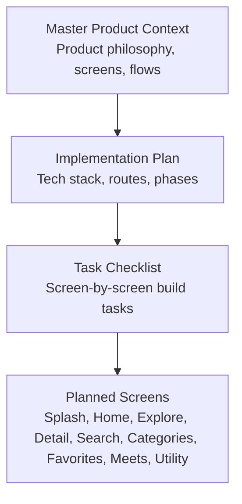

**Diagram sources**
- [Pujo_Sahayak_Master_Project_Context.md:1-18](file://Pujo_Sahayak_Master_Project_Context.md#L1-L18)
- [tasks/plan.md:1-17](file://tasks/plan.md#L1-L17)
- [tasks/todo.md:1-16](file://tasks/todo.md#L1-L16)

**Section sources**
- [Pujo_Sahayak_Master_Project_Context.md:1-18](file://Pujo_Sahayak_Master_Project_Context.md#L1-L18)
- [tasks/plan.md:1-17](file://tasks/plan.md#L1-L17)
- [tasks/todo.md:1-16](file://tasks/todo.md#L1-L16)

## Core Components
Before implementing screens, the plan defines shared foundations that every screen will reuse.

### Design System and Shared UI
- Tokens: ivory surfaces, vermilion primary, charcoal ink, muted gold, indigo accents.
- Shared components: Button, Chip, Card (including place-card variant), SectionHeader, BottomNav, AppShell, Waveform, ScanFrame, page-transition wrapper.
- Motion: soft page fades, subtle card scale, animated scan frame, voice waveform; respects reduced-motion preference.

### Data Model and Demo Dataset
- Types include Place, Pandal, Restaurant, Event, Meetup, Review, Photo, PlanDay, Offer, SafetyPoint, Category.
- Demo dataset includes real pandals, restaurants, events, meetups, offers, safety points, and location coordinates.
- All dataset entries are marked as demo data to avoid presenting simulated information as production facts.

### State Management
- Zustand store with persistence middleware.
- Persisted state covers saved places, visited places, Puja plan day slots, meetups, language, theme, app-logo choice, and “continue where you left off” session data.

### Routing and Navigation
- React Router v6 with five-tab bottom navigation.
- Nested detail routes such as `/pandal/:id` and `/restaurant/:id`.
- Entry route `/splash` auto-advances to Home.

**Section sources**
- [tasks/todo.md:7-14](file://tasks/todo.md#L7-L14)
- [tasks/plan.md:7-17](file://tasks/plan.md#L7-L17)

## Architecture Overview
The planned architecture centers on a small number of durable layers:

- Presentation layer: React components per screen and shared UI primitives.
- Routing layer: React Router maps URLs to screens and nested details.
- State layer: Zustand store with localStorage persistence.
- Data layer: Typed local demo dataset used by all discovery screens.
- Map layer: Leaflet + OpenStreetMap for list/map toggle, route map, and nearby help points.
- AI assistant shell: Maya chat, voice waveform, and camera scan UI backed by dataset-grounded retrieval in the demo.

```mermaid
graph TB
subgraph "Presentation"
Splash["Splash"]
Home["Home"]
Explore["Explore / Pandal Directory"]
Detail["Pandal Detail"]
Search["Search"]
Categories["Categories"]
Favorites["Favorites"]
Planner["Puja Planner"]
Meets["Meets"]
CreateMeetup["Create Meetup"]
RestaurantDetail["Restaurant Detail"]
TripMap["Trip / Route Map"]
Profile["Profile + Settings"]
Safety["Safety + Missing Person"]
Maya["Maya Chat / Scan / Voice"]
end
subgraph "Platform"
Router["React Router v6"]
Store["Zustand + persist"]
Dataset["Typed Demo Dataset"]
Maps["Leaflet + OSM"]
Motion["Framer Motion"]
end
Router --> Splash
Router --> Home
Router --> Explore
Router --> Detail
Router --> Search
Router --> Categories
Router --> Favorites
Router --> Planner
Router --> Meets
Router --> CreateMeetup
Router --> RestaurantDetail
Router --> TripMap
Router --> Profile
Router --> Safety
Router --> Maya
Home --> Store
Explore --> Store
Detail --> Store
Search --> Store
Categories --> Store
Favorites --> Store
Planner --> Store
Meets --> Store
RestaurantDetail --> Store
TripMap --> Store
Profile --> Store
Safety --> Store
Maya --> Store
Explore --> Maps
TripMap --> Maps
Detail --> Dataset
Search --> Dataset
Explore --> Dataset
Home --> Dataset
Favorites --> Dataset
Meets --> Dataset
Planner --> Dataset
RestaurantDetail --> Dataset
Safety --> Dataset
Maya --> Dataset
Motion --> Home
Motion --> Explore
Motion --> Detail
Motion --> Maya
```

**Diagram sources**
- [tasks/plan.md:7-17](file://tasks/plan.md#L7-L17)
- [tasks/plan.md:19-39](file://tasks/plan.md#L19-L39)
- [tasks/todo.md:20-67](file://tasks/todo.md#L20-L67)

## Detailed Component Analysis

### Splash Screen
The Splash screen is the entry point and branding moment.

- Purpose: Show brand identity, tagline, and transition to Home.
- Visuals: Full-bleed dark Durga Atar–inspired image or gradient, wordmark, and tagline.
- Behavior: Auto-advance after a short delay; do not block navigation if timing fails.
- Accessibility: Respect reduced-motion setting; provide a visible but non-blocking transition.
- State: No heavy state; may record initial session start for analytics or “continue where you left off.”

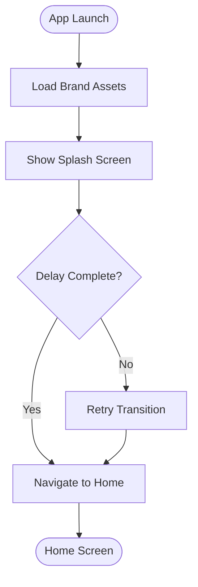

**Diagram sources**
- [tasks/todo.md:20-21](file://tasks/todo.md#L20-L21)

**Section sources**
- [tasks/todo.md:20-21](file://tasks/todo.md#L20-L21)

### Home Page
The Home page is the main discovery surface. It must remain relevant beyond Puja season.

#### Composition
- Greeting and city/year label.
- Search bar that navigates to `/search`.
- Language toggle between Bengali, English, and Hindi.
- Sponsored spotlight card clearly labeled as sponsored.
- Explore Spotlight section for editorial features.
- Nearby Restaurants rail.
- Offers & Discounts rail.
- Events rail.
- Continue Where You Left Off section backed by persisted session state.

#### Content Rules
- Sponsored content must be visually distinct from organic recommendations.
- During Puja, pandals dominate; outside Puja, other local experiences take prominence.
- Shopping is a proposed feature and should not become a generic e-commerce marketplace unless finalized.

#### State and Data Binding
- Use the demo dataset for restaurants, offers, events, and spotlight items.
- Persist “last viewed” or “unfinished exploration” in the Zustand store.
- Language toggle switches localized strings without reloading the page.

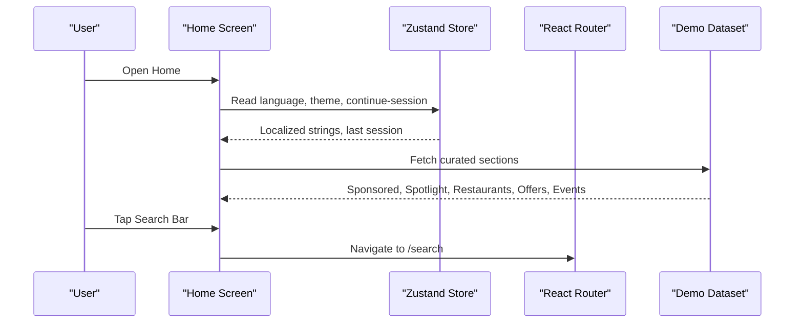

**Diagram sources**
- [Pujo_Sahayak_Master_Project_Context.md:160-284](file://Pujo_Sahayak_Master_Project_Context.md#L160-L284)
- [Pujo_Sahayak_Master_Project_Context.md:286-318](file://Pujo_Sahayak_Master_Project_Context.md#L286-L318)
- [tasks/todo.md:23-24](file://tasks/todo.md#L23-L24)

**Section sources**
- [Pujo_Sahayak_Master_Project_Context.md:160-284](file://Pujo_Sahayak_Master_Project_Context.md#L160-L284)
- [Pujo_Sahayak_Master_Project_Context.md:286-318](file://Pujo_Sahayak_Master_Project_Context.md#L286-L318)
- [tasks/todo.md:23-24](file://tasks/todo.md#L23-L24)

### Explore / Pandal Directory
The Explore screen combines list and map views with filtering and search integration.

#### Views
- List view: scrollable cards showing name, rating, distance, crowd level, theme, and actions.
- Map view: Leaflet markers for pandals with basic clustering or simple density handling.
- View toggle: Switch between List and Map without losing filters.

#### Filtering
- Area filter.
- Distance filter.
- Theme filter.
- Crowd filter.
- Optional keyword search integrated with the global search experience.

#### Actions
- View Details navigates to `/pandal/:id`.
- Route action can open trip planning or directions depending on later phases.

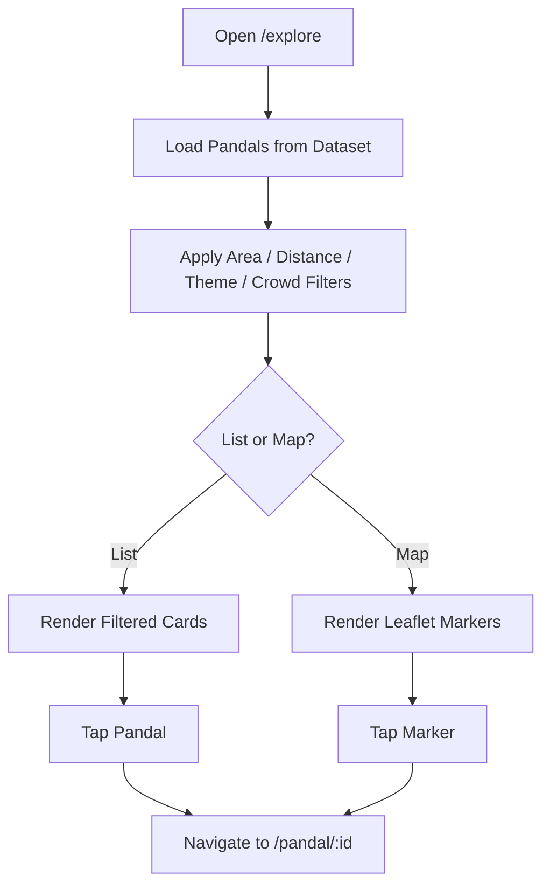

**Diagram sources**
- [tasks/todo.md:26-27](file://tasks/todo.md#L26-L27)
- [tasks/plan.md:19-39](file://tasks/plan.md#L19-L39)

**Section sources**
- [tasks/todo.md:26-27](file://tasks/todo.md#L26-L27)
- [tasks/plan.md:19-39](file://tasks/plan.md#L19-L39)

### Search Page
The Search page provides query processing, category filtering, trending results, and nearby place discovery.

#### Features
- Search input at the top.
- Category pills: All, Pandals, Restaurants, Events, Places.
- Live filtering against the demo dataset.
- Trending Pandals rail based on engagement signals such as views, saves, recent interactions, visits, or popularity.
- Popular Nearby Places rail using location context.

#### Query Processing
- Normalize input and trim whitespace.
- Match against name, description, theme, cuisine, and category fields.
- Debounce live search to avoid excessive re-renders.
- Preserve selected category pill while typing.

#### Results Strategy
- Do not fabricate rankings; use available metrics or mark trends as conceptual until backend metrics exist.
- Clearly separate organic results from sponsored or editorial content.

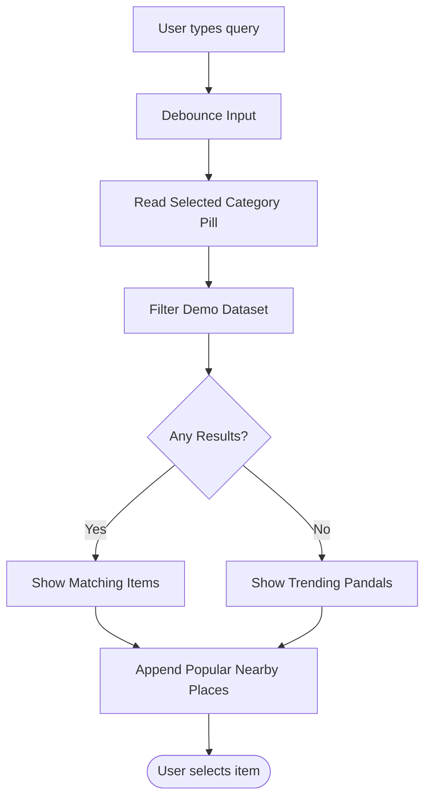

**Diagram sources**
- [Pujo_Sahayak_Master_Project_Context.md:447-493](file://Pujo_Sahayak_Master_Project_Context.md#L447-L493)
- [tasks/todo.md:42-43](file://tasks/todo.md#L42-L43)

**Section sources**
- [Pujo_Sahayak_Master_Project_Context.md:447-493](file://Pujo_Sahayak_Master_Project_Context.md#L447-L493)
- [tasks/todo.md:42-43](file://tasks/todo.md#L42-L43)

### Categories Page
The Categories page organizes discovery into three broad groups.

#### Sections
- Places: Pandals, Restaurants, Places; potential future additions include Attractions, Events, Shopping.
- Transport & Services: Metro, Bus, Parking; potential future additions include cab/ride info, fuel, charging.
- Utilities: Police Station, Hospital, ATM, Pharmacy; potential future additions include medical camp, toilet, help desk, drinking water, parking.

#### Interaction
- Each category group is navigable and leads to filtered listings.
- Include a purple “Ask Maya” call-to-action accessible from the categories experience.

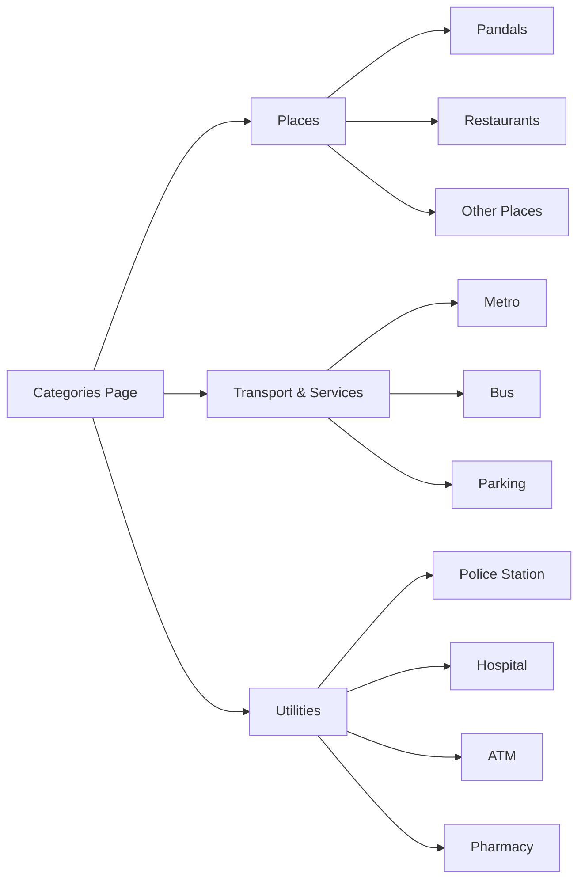

**Diagram sources**
- [Pujo_Sahayak_Master_Project_Context.md:495-556](file://Pujo_Sahayak_Master_Project_Context.md#L495-L556)
- [tasks/todo.md:42-43](file://tasks/todo.md#L42-L43)

**Section sources**
- [Pujo_Sahayak_Master_Project_Context.md:495-556](file://Pujo_Sahayak_Master_Project_Context.md#L495-L556)
- [tasks/todo.md:42-43](file://tasks/todo.md#L42-L43)

### Favorites Page
The Favorites page manages saved items, visited places, and recommendations.

#### Sections
- Saved Pandals: explicitly saved places.
- Places You’ve Been: previously visited places across pandals, restaurants, events, and other places.
- You Might Like: recommendation section based on saved places, visited places, location, categories, preferences, and potentially AI-assisted suggestions.

#### Recommendation Algorithm
- Start with simple similarity: same area, same theme, similar category, or proximity.
- Avoid absolute claims; use wording like “You might like.”
- Later iterations can incorporate more sophisticated personalization.

#### State Management
- Save/unsave toggles update the Zustand store.
- Visited tracking updates when users confirm visits from detail pages or planner completion.
- Recommendations derive from current store state.

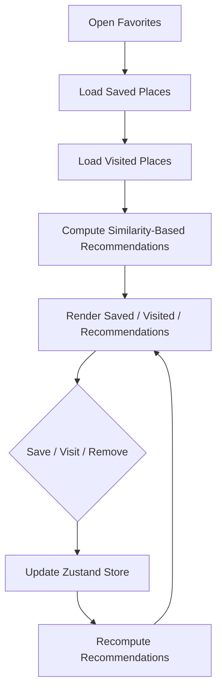

**Diagram sources**
- [Pujo_Sahayak_Master_Project_Context.md:320-351](file://Pujo_Sahayak_Master_Project_Context.md#L320-L351)
- [tasks/todo.md:47-48](file://tasks/todo.md#L47-L48)

**Section sources**
- [Pujo_Sahayak_Master_Project_Context.md:320-351](file://Pujo_Sahayak_Master_Project_Context.md#L320-L351)
- [tasks/todo.md:47-48](file://tasks/todo.md#L47-L48)

### Pandal Detail Page
The Pandal Detail page is a rich content surface connecting discovery, community, planning, and social features.

#### Hero Section
- Large image or video.
- Pandal name and location.
- Save/Bookmark action.

#### Metadata and Actions
- Rating, reviews count, distance, crowd level, open-till time.
- Action row: Save, Visited, Route.

#### Information Sections
- Location, Metro access, Facilities, Safety.
- About and theme story.
- “Ask Maya about this pandal” chip passing context to `/maya`.

#### Community Content
- What Others Say: actual user-generated reviews; no fake AI-generated reviews.
- Top Clicks: visually popular photos contributed by visitors.
- Post Your Photos: upload flow with simulated AI verification that checks relevance to the pandal.

#### Related Discoveries
- Similar Places: same theme, area, architecture, popularity, or experience.
- Nearby Restaurants.
- Meetups near this place.

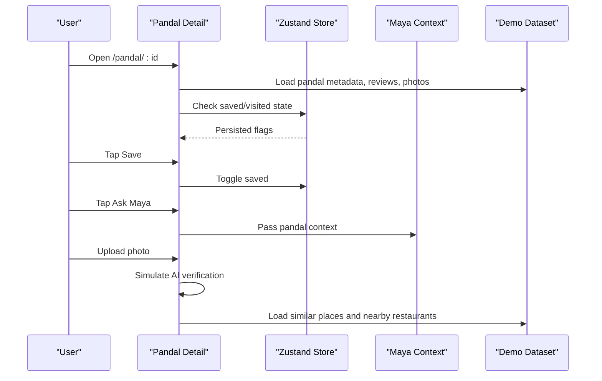

**Diagram sources**
- [Pujo_Sahayak_Master_Project_Context.md:775-951](file://Pujo_Sahayak_Master_Project_Context.md#L775-L951)
- [tasks/todo.md:29-30](file://tasks/todo.md#L29-L30)

**Section sources**
- [Pujo_Sahayak_Master_Project_Context.md:775-951](file://Pujo_Sahayak_Master_Project_Context.md#L775-L951)
- [tasks/todo.md:29-30](file://tasks/todo.md#L29-L30)

### Meets Page
The Meets page enables social discovery and meetup creation workflows.

#### Existing Meetups
- Cards show name, date, time, location, participants, and short description.
- Example themes include South Kolkata Pandal Hop, Photography Walk, Late-night Puja Food Crawl.
- Pills for All, Nearby, My Interests.

#### Create Meetup Workflow
- Title, date, time, location, description, interest/vibe chips, maximum participants, public/restricted visibility.
- Potential selection of pandals, restaurants, or route segments.
- Join/Create actions update local state in the demo.

#### Monetization Concept
- Support free, paid, and premium-only meetups conceptually without hard-coding pricing rules.
- First meetup free model is a business-model concept, not a finalized rule.

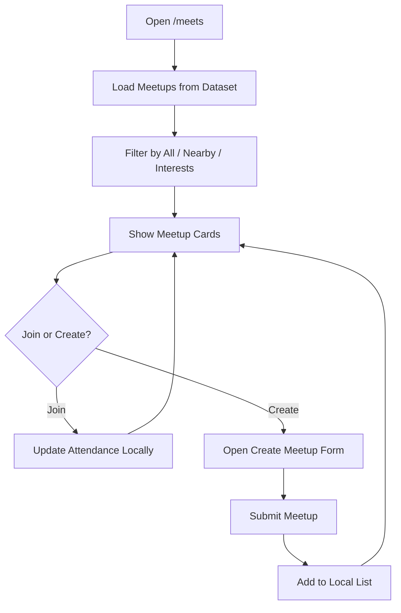

**Diagram sources**
- [Pujo_Sahayak_Master_Project_Context.md:664-771](file://Pujo_Sahayak_Master_Project_Context.md#L664-L771)
- [tasks/todo.md:53-54](file://tasks/todo.md#L53-L54)

**Section sources**
- [Pujo_Sahayak_Master_Project_Context.md:664-771](file://Pujo_Sahayak_Master_Project_Context.md#L664-L771)
- [tasks/todo.md:53-54](file://tasks/todo.md#L53-L54)

### Additional Planned Screens
While the documentation objective focuses on specific screens, the plan also defines related screens that complete the user journey.

#### Puja Planner
- Day tabs from Panchami to Dashami.
- Stop cards with image, type, duration, and travel-between rows.
- Add Place picker from dataset or saved places.
- Optimize with AI nearest-neighbor suggestion; wording remains “suggestions.”
- Start Navigation navigates to `/trip/:planDayId`.

#### Restaurant Detail
- Hero, rating/reviews/distance/Open now/cuisine/price.
- Save, Call stub, Order disabled placeholder.
- Popular Dishes rail.

#### Trip / Route Map
- Leaflet map with numbered markers and polyline.
- Stop list with times.
- Total distance and estimated time using haversine logic.
- Start Navigation action.

#### Profile, Settings, Safety, Missing Person Report
- Profile header with Premium badge, stats, Upgrade banner, Emergency Shortcuts.
- Settings including appearance, security, notifications, language, permissions, and app-logo picker.
- Safety screen with emergency calls and nearby help points.
- Missing Person Report wizard with four steps: Person, Details, Location, Submit; local record only.

**Section sources**
- [tasks/todo.md:50-67](file://tasks/todo.md#L50-L67)
- [tasks/plan.md:45-61](file://tasks/plan.md#L45-L61)

## Dependency Analysis
The screens depend on shared infrastructure and each other through routing, state, and data.

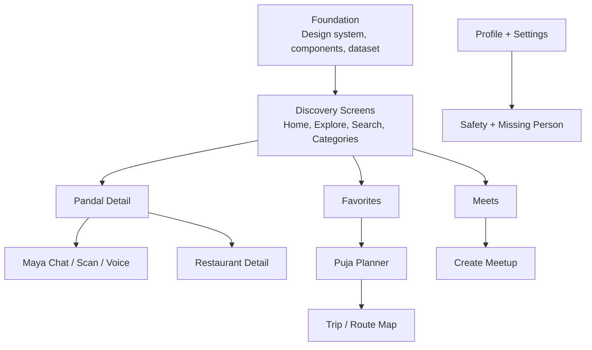

**Diagram sources**
- [tasks/todo.md:7-67](file://tasks/todo.md#L7-L67)
- [tasks/plan.md:45-61](file://tasks/plan.md#L45-L61)

**Section sources**
- [tasks/todo.md:7-67](file://tasks/todo.md#L7-L67)
- [tasks/plan.md:45-61](file://tasks/plan.md#L45-L61)

## Performance Considerations
- Debounce search inputs to reduce re-renders and dataset filtering cost.
- Paginate or virtualize long lists such as Explore results and Meetup cards.
- Lazy-load images and media; keep layout stable with placeholders.
- Keep Zustand store minimal; persist only necessary fields and avoid large objects.
- Use Leaflet efficiently: cluster markers, lazy-initialize maps, and avoid unnecessary re-renders.
- Respect reduced-motion preference for animations.
- Cache static assets via PWA service worker for offline shell and faster reloads.

[No sources needed since this section provides general guidance]

## Troubleshooting Guide
Common issues and their likely causes:

- Splash does not advance: check delay logic, asset loading, and router initialization.
- Home sections missing: verify dataset loading, language string keys, and persisted session state.
- Explore filters not working: ensure filter state is bound to dataset fields and re-applied on toggle.
- Search returns no results: normalize query, check category pill state, and verify dataset fields.
- Favorites not persisting: confirm Zustand persist middleware and localStorage availability.
- Maya responses hallucinating: enforce dataset-grounded retrieval and fallback messaging.
- Camera scan failing: handle getUserMedia permissions and browser compatibility.
- Map not rendering: initialize Leaflet after mount and ensure container dimensions are available.

**Section sources**
- [tasks/todo.md:20-67](file://tasks/todo.md#L20-L67)
- [tasks/plan.md:63-86](file://tasks/plan.md#L63-L86)

## Conclusion
This guide translates the Puja Sahayak product context and implementation plan into screen-focused responsibilities, composition patterns, state management approaches, and data binding strategies. The recommended order is foundation first, then discovery screens, followed by Maya/Search/Categories, planning/social features, utility/account screens, and finally polish and PWA readiness. Every screen should connect to the broader journey: discover, explore, understand, plan, visit, share, meet, and discover again.

[No sources needed since this section summarizes without analyzing specific files]