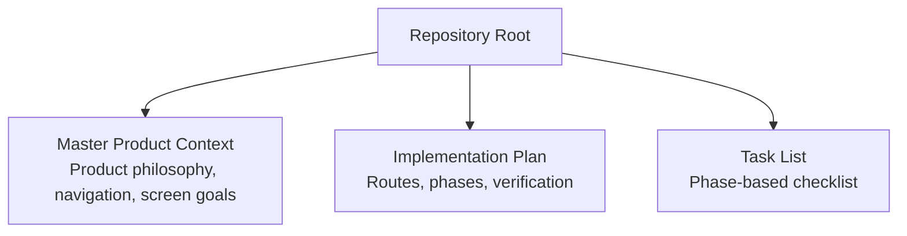
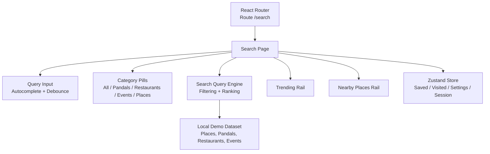
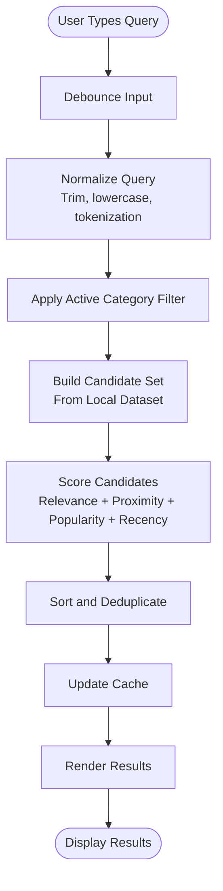
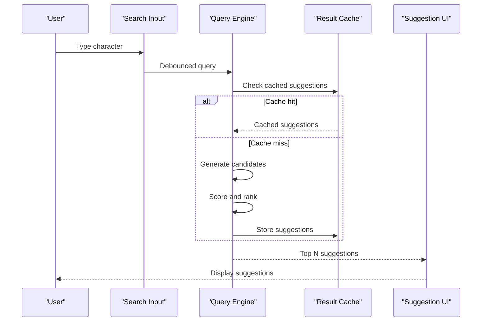
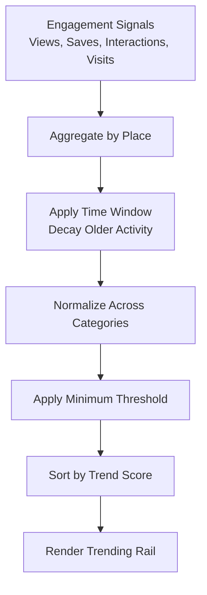
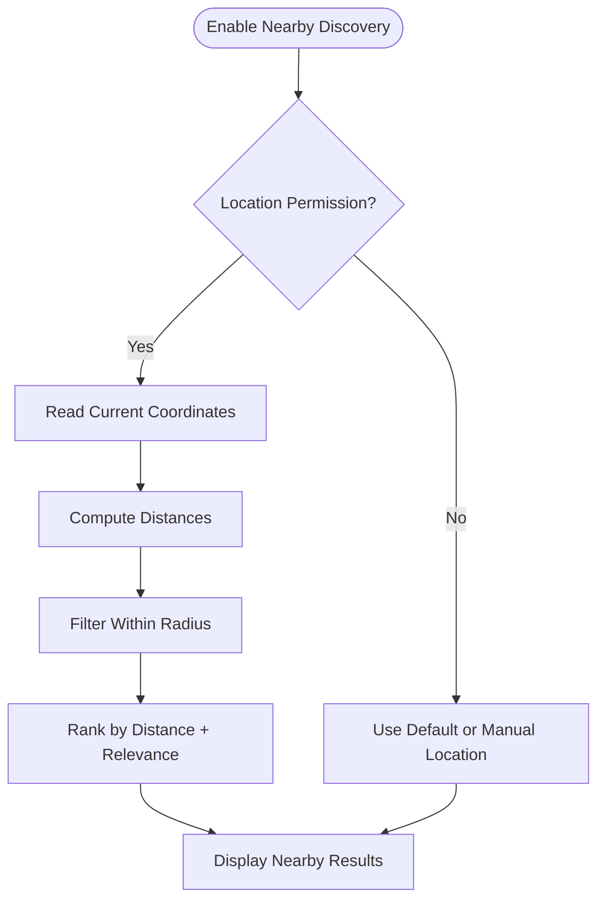
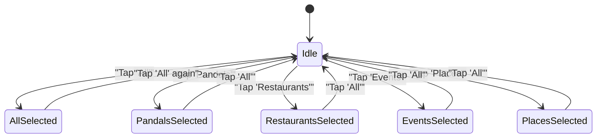
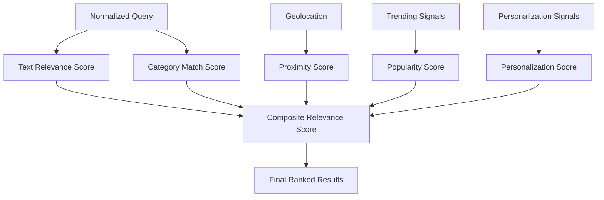
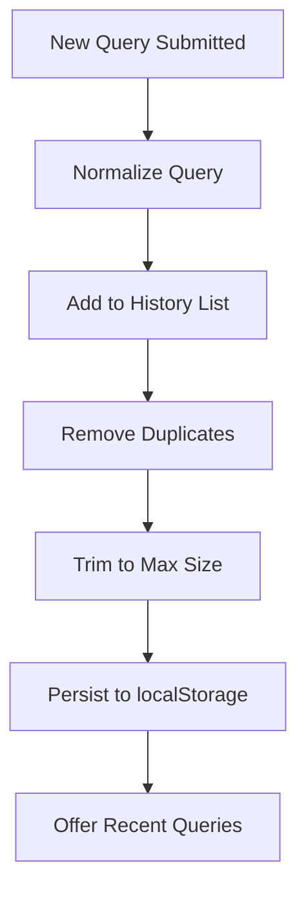
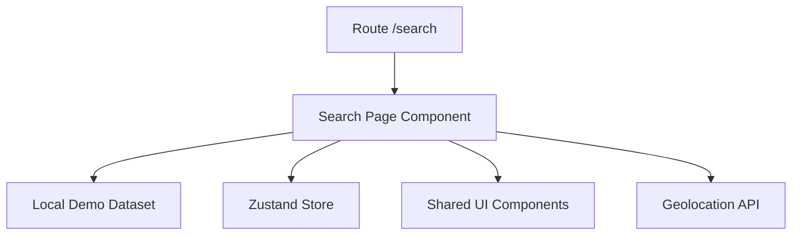

# Search Page Implementation

<cite>
**Referenced Files in This Document**
- [Pujo_Sahayak_Master_Project_Context.md](file://Pujo_Sahayak_Master_Project_Context.md)
- [plan.md](file://tasks/plan.md)
- [todo.md](file://tasks/todo.md)
</cite>

## Table of Contents
1. [Introduction](#introduction)
2. [Project Structure](#project-structure)
3. [Core Components](#core-components)
4. [Architecture Overview](#architecture-overview)
5. [Detailed Component Analysis](#detailed-component-analysis)
6. [Dependency Analysis](#dependency-analysis)
7. [Performance Considerations](#performance-considerations)
8. [Troubleshooting Guide](#troubleshooting-guide)
9. [Conclusion](#conclusion)
10. [Appendices](#appendices)

## Introduction
This document explains the Search Page implementation for Pujo Sahayak, a mobile-first React + Vite PWA focused on discovering pandals, restaurants, events, and other local places around Kolkata. The Search experience is part of the product’s discovery core and connects directly to trending results, nearby place discovery, category filtering, result ranking, search history, and caching strategies.

The Search page is designed as a central entry point for users who want to quickly find what to visit, understand what they see, and continue their exploration through related places, routes, and community features.

## Project Structure
At this stage, the repository contains:
- A master product context describing the overall app philosophy, navigation, screens, and feature scope.
- An implementation plan that maps mockup screens to routes and defines phases of work.
- A task list tracking progress across foundation, discovery, Maya, Search, planning, social, utility, and polish phases.

**Diagram sources**
- [Pujo_Sahayak_Master_Project_Context.md:1-120](file://Pujo_Sahayak_Master_Project_Context.md#L1-L120)
- [plan.md:1-40](file://tasks/plan.md#L1-L40)
- [todo.md:1-44](file://tasks/todo.md#L1-L44)

**Section sources**
- [Pujo_Sahayak_Master_Project_Context.md:140-158](file://Pujo_Sahayak_Master_Project_Context.md#L140-L158)
- [plan.md:19-40](file://tasks/plan.md#L19-L40)
- [todo.md:34-44](file://tasks/todo.md#L34-L44)

## Core Components
The Search Page is composed of several conceptual components:

- Query Input and Autocomplete
  - A top search bar with live suggestions and autocomplete behavior.
  - Debounced input handling to avoid excessive filtering or network calls while typing.

- Category Filtering System
  - Pill-based filters such as All, Pandals, Restaurants, Events, Places.
  - Dynamic pill state that updates the active filter and re-runs the query.

- Trending Results
  - A rail showing currently popular or trending pandals.
  - Ranking based on engagement signals such as views, saves, recent interactions, visits, or general engagement.

- Nearby Place Discovery
  - Uses geolocation context to show popular places near the user.
  - Supports distance-aware sorting and proximity hints.

- Result Ranking and Relevance Scoring
  - Combines text relevance, category match, location proximity, popularity, and recency into a composite score.
  - Ensures results are useful even when the query is partial or ambiguous.

- Search History and Recent Queries
  - Persists recent queries locally so users can quickly repeat past searches.
  - Integrates with “Continue where you left off” by remembering an unfinished search.

- Caching Strategy
  - In-memory cache for recent queries and filtered result sets.
  - Optional persistence layer for frequently used categories or trending lists.

**Section sources**
- [Pujo_Sahayak_Master_Project_Context.md:447-493](file://Pujo_Sahayak_Master_Project_Context.md#L447-L493)
- [todo.md:34-44](file://tasks/todo.md#L34-L44)

## Architecture Overview
The Search Page integrates with the broader application architecture defined by the project plan:

- Routing
  - Search is mapped to `/search`.
  - It sits alongside Home, Explore, Categories, Meets, Profile, Safety, Planner, and detail pages.

- Data Layer
  - Typed local demo dataset grounded in real Kolkata locations.
  - Zustand store manages saved places, visited places, plans, settings, and session continuity.

- UI Layer
  - Mobile-first design system using Tailwind CSS.
  - Shared components include chips/pills, cards, section headers, bottom navigation, and motion primitives.

**Diagram sources**
- [plan.md:19-40](file://tasks/plan.md#L19-L40)
- [plan.md:45-53](file://tasks/plan.md#L45-L53)
- [todo.md:34-44](file://tasks/todo.md#L34-L44)

## Detailed Component Analysis

### Query Processing Engine
The query processing engine transforms user input into filtered and ranked results. It should support:

- Text matching against place names, descriptions, themes, cuisines, and tags.
- Partial and fuzzy matching for robust autocomplete.
- Category scoping from active pills.
- Location-aware scoring when geolocation is available.
- Popularity and recency weighting for trending and fresh results.

**Diagram sources**
- [Pujo_Sahayak_Master_Project_Context.md:447-493](file://Pujo_Sahayak_Master_Project_Context.md#L447-L493)
- [todo.md:34-44](file://tasks/todo.md#L34-L44)

**Section sources**
- [Pujo_Sahayak_Master_Project_Context.md:447-493](file://Pujo_Sahayak_Master_Project_Context.md#L447-L493)
- [todo.md:34-44](file://tasks/todo.md#L34-L44)

### Real-Time Search Suggestions and Autocomplete
Real-time suggestions improve discoverability by:
- Showing likely matches as the user types.
- Highlighting matched tokens.
- Supporting keyboard navigation and touch-friendly selection.
- Avoiding jank by debouncing input and limiting suggestion count.

Recommended behavior:
- Debounce input by approximately 150–300 milliseconds.
- Limit suggestions to a small set (for example, up to 8).
- Prioritize exact prefix matches, then partial matches.
- Include category hints in suggestions when multiple categories match.

**Diagram sources**
- [todo.md:34-44](file://tasks/todo.md#L34-L44)

**Section sources**
- [todo.md:34-44](file://tasks/todo.md#L34-L44)

### Trending Results Algorithm
Trending results highlight places that are currently popular. The product context explicitly states that trending can be based on:
- Views
- Saves
- Recent interactions
- Visits
- Engagement

The algorithm should:
- Use a time window (for example, last 7 days) to compute trend strength.
- Combine raw counts with decay factors so older activity contributes less.
- Normalize scores across categories to avoid bias toward high-volume categories.
- Surface a curated rail rather than replacing the main search results.

**Diagram sources**
- [Pujo_Sahayak_Master_Project_Context.md:469-483](file://Pujo_Sahayak_Master_Project_Context.md#L469-L483)

**Section sources**
- [Pujo_Sahayak_Master_Project_Context.md:469-483](file://Pujo_Sahayak_Master_Project_Context.md#L469-L483)

### Nearby Place Discovery Based on Geolocation
Nearby discovery helps users find relevant places close to them. The product context emphasizes helping users discover what is around them using location context.

Key behaviors:
- Request geolocation permission only when needed.
- Compute distances using haversine or equivalent.
- Show distance labels and sort by proximity.
- Allow users to disable location-based features if privacy is a concern.
- Fall back gracefully when location is unavailable.

**Diagram sources**
- [Pujo_Sahayak_Master_Project_Context.md:485-493](file://Pujo_Sahayak_Master_Project_Context.md#L485-L493)

**Section sources**
- [Pujo_Sahayak_Master_Project_Context.md:485-493](file://Pujo_Sahayak_Master_Project_Context.md#L485-L493)

### Category Filtering System with Dynamic Pill-Based UI
The Search page uses pill-based category shortcuts:
- All
- Pandals
- Restaurants
- Events
- Places

Behavior:
- Only one category is active at a time unless “All” is selected.
- Selecting a pill resets or refines the current query.
- Pills should visually indicate active state and support accessibility.
- Category filters combine with text search and location filters.

**Diagram sources**
- [Pujo_Sahayak_Master_Project_Context.md:459-468](file://Pujo_Sahayak_Master_Project_Context.md#L459-L468)
- [todo.md:34-44](file://tasks/todo.md#L34-L44)

**Section sources**
- [Pujo_Sahayak_Master_Project_Context.md:459-468](file://Pujo_Sahayak_Master_Project_Context.md#L459-L468)
- [todo.md:34-44](file://tasks/todo.md#L34-L44)

### Search Result Ranking and Relevance Scoring
A robust ranking mechanism should balance multiple signals:

- Text Relevance
  - Exact name match > prefix match > substring match.
  - Boost matches in primary fields like name and theme.

- Category Match
  - Strong boost when the query aligns with the active category.

- Location Proximity
  - Boost nearby results when geolocation is enabled.

- Popularity and Recency
  - Apply trending score and freshness factors.

- Personalization
  - Optionally boost saved or previously visited places.

**Diagram sources**
- [Pujo_Sahayak_Master_Project_Context.md:469-493](file://Pujo_Sahayak_Master_Project_Context.md#L469-L493)

**Section sources**
- [Pujo_Sahayak_Master_Project_Context.md:469-493](file://Pujo_Sahayak_Master_Project_Context.md#L469-L493)

### Search History Management and Recent Queries Persistence
Search history improves UX by:
- Remembering recent queries.
- Allowing quick repetition of past searches.
- Supporting “Continue where you left off.”

Persistence strategy:
- Store recent queries in localStorage.
- Limit history size (for example, last 10–20 queries).
- Remove duplicates and normalize entries.
- Clear history optionally via settings.

**Diagram sources**
- [Pujo_Sahayak_Master_Project_Context.md:286-318](file://Pujo_Sahayak_Master_Project_Context.md#L286-L318)
- [plan.md:12-15](file://tasks/plan.md#L12-L15)

**Section sources**
- [Pujo_Sahayak_Master_Project_Context.md:286-318](file://Pujo_Sahayak_Master_Project_Context.md#L286-L318)
- [plan.md:12-15](file://tasks/plan.md#L12-L15)

### Code Examples Reference
Because this repository does not yet contain the implemented Search Page code, the following sections describe where the implementation should appear and how it relates to the existing structure.

- Search State Management
  - Should be managed in a Zustand store or component-level state.
  - Stores current query, active category, debounce timer, recent queries, and cached results.
  - Path reference: Search page component under the `/search` route.

- Debounced Input Handling
  - Implement a debounce hook or utility to delay query execution.
  - Reset timer on new keystrokes.
  - Path reference: Search input component within `/search`.

- Result Caching Strategies
  - In-memory map keyed by normalized query plus category and location hash.
  - Optional persistence for trending and frequent queries.
  - Path reference: Search engine module or utility under `/search`.

[No sources needed since this section provides implementation guidance without analyzing specific files]

## Dependency Analysis
The Search Page depends on:
- Routing configuration mapping `/search`.
- Local demo dataset containing places, pandals, restaurants, and events.
- Zustand store for saved places, visited places, settings, and session continuity.
- Shared UI components such as chips/pills, cards, and section headers.
- Geolocation APIs for nearby discovery.

**Diagram sources**
- [plan.md:19-40](file://tasks/plan.md#L19-L40)
- [plan.md:45-53](file://tasks/plan.md#L45-L53)
- [todo.md:34-44](file://tasks/todo.md#L34-L44)

**Section sources**
- [plan.md:19-40](file://tasks/plan.md#L19-L40)
- [todo.md:34-44](file://tasks/todo.md#L34-L44)

## Performance Considerations
For large-scale search operations and mobile optimization:

- Debounce Input
  - Prevent unnecessary filtering on every keystroke.
  - Use 150–300ms debounce for smooth typing.

- Efficient Filtering
  - Pre-index dataset fields such as name, category, and tags.
  - Use fast string matching for prefix and substring queries.

- Pagination and Virtualization
  - Load results in batches.
  - Virtualize long lists to reduce DOM size.

- Caching
  - Cache recent queries and filtered results.
  - Invalidate cache when category, location, or query changes significantly.

- Geolocation Optimization
  - Compute distances lazily.
  - Limit nearby radius to reasonable values.

- Memory Management
  - Clear debounce timers on unmount.
  - Avoid retaining large intermediate arrays.

- Accessibility and Mobile Input
  - Support keyboard navigation for suggestions.
  - Provide large tap targets for pills.
  - Respect reduced-motion preferences.

[No sources needed since this section provides general guidance]

## Troubleshooting Guide
Common issues and resolutions:

- No Results Returned
  - Verify query normalization and category filter.
  - Check dataset availability and field mappings.
  - Ensure geolocation fallback is working.

- Slow Autocomplete
  - Increase debounce interval slightly.
  - Reduce suggestion count.
  - Optimize candidate generation and scoring.

- Incorrect Nearby Results
  - Validate coordinates and distance calculation.
  - Confirm radius and sorting logic.
  - Handle missing location permissions gracefully.

- Stale Search History
  - Verify localStorage persistence.
  - Check deduplication and trimming logic.
  - Ensure history clears correctly when requested.

- High Memory Usage
  - Review result caches and clear unused entries.
  - Avoid storing full objects unnecessarily.
  - Use references or IDs where possible.

[No sources needed since this section provides general troubleshooting guidance]

## Conclusion
The Search Page is a central discovery surface that combines query processing, real-time suggestions, category filtering, trending results, nearby place discovery, relevance scoring, search history, and caching. Its design aligns with the broader Pujo Sahayak product philosophy: help users discover, explore, understand, plan, visit, and share experiences around Kolkata.

When implemented, the Search Page should remain performant, accessible, and mobile-friendly, while staying grounded in the local dataset and respecting user privacy and preferences.

[No sources needed since this section summarizes without analyzing specific files]

## Appendices

### Appendix A: Search Page Requirements Summary
- Route: `/search`
- Features:
  - Query input with autocomplete
  - Category pills
  - Trending pandals rail
  - Popular nearby places rail
  - Search history and recent queries
  - Caching for performance
- Dependencies:
  - Local demo dataset
  - Zustand store
  - Shared UI components
  - Geolocation API

**Section sources**
- [plan.md:19-40](file://tasks/plan.md#L19-L40)
- [todo.md:34-44](file://tasks/todo.md#L34-L44)