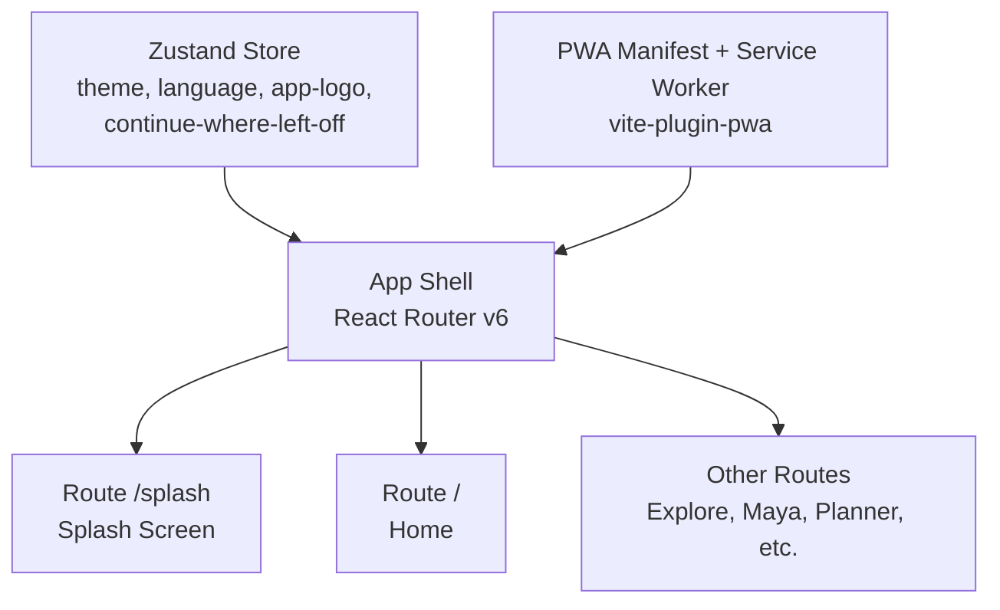
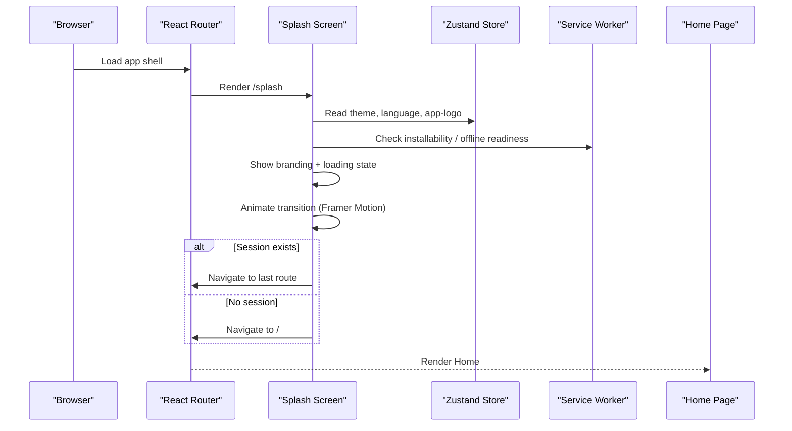
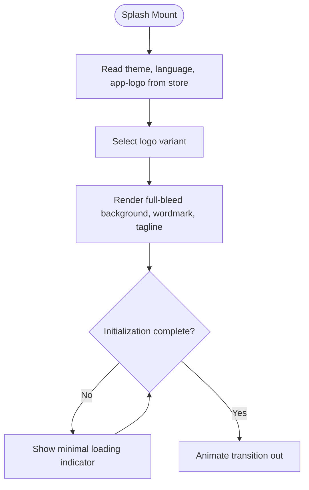
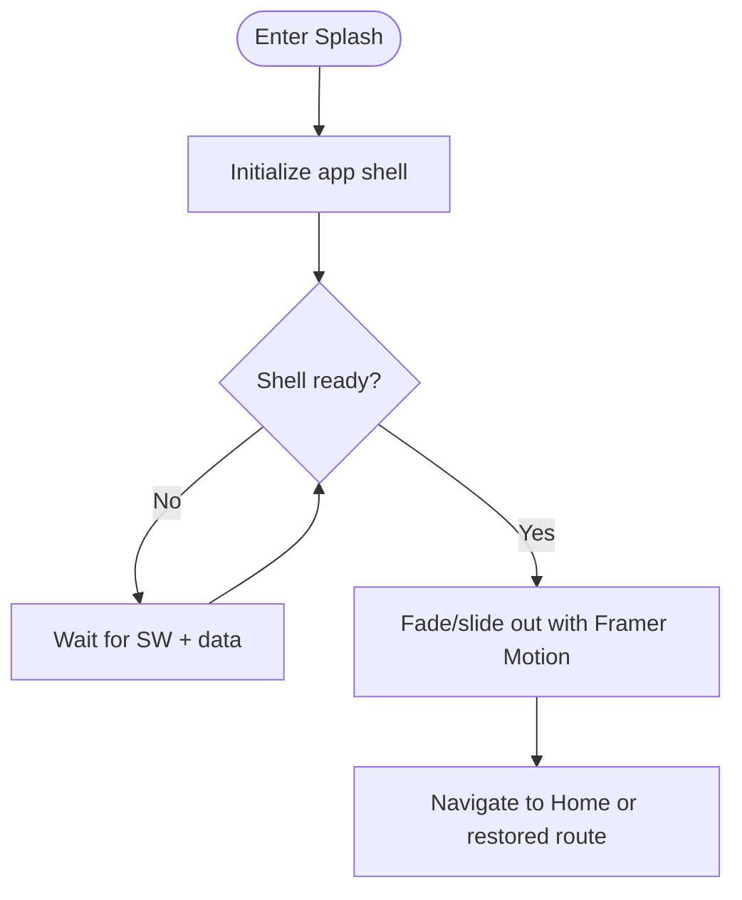
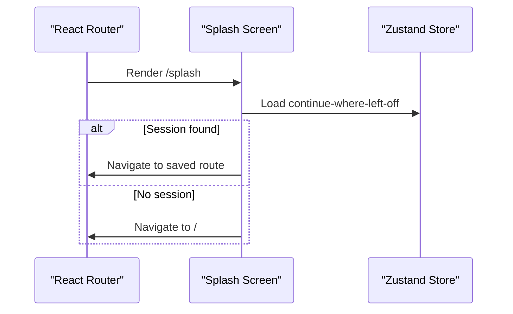
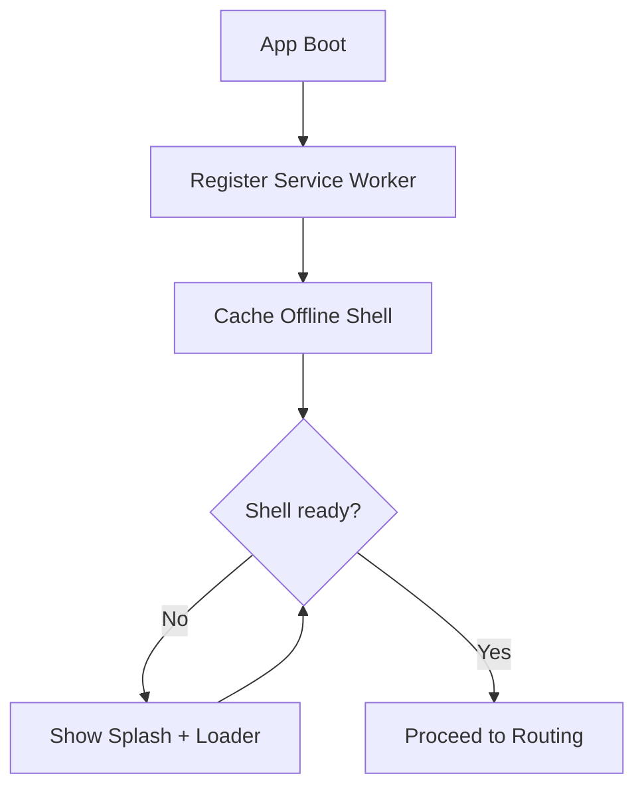
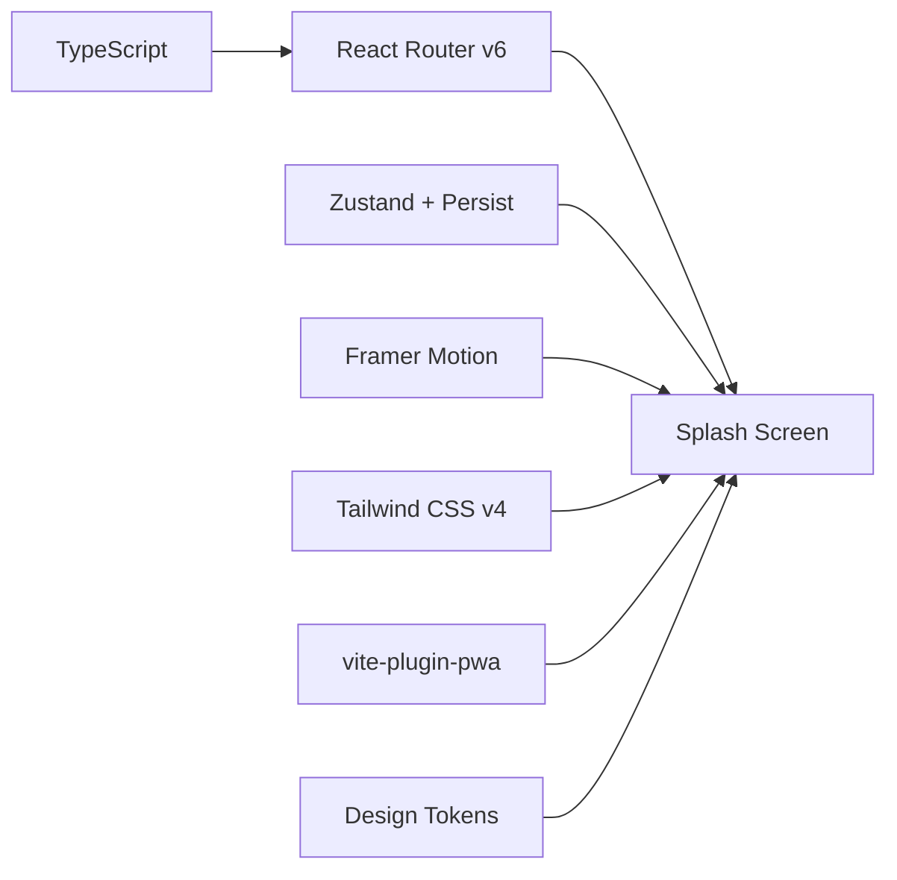

# Splash Screen Implementation

<cite>
**Referenced Files in This Document**
- [plan.md](file://tasks/plan.md)
- [todo.md](file://tasks/todo.md)
- [Pujo_Sahayak_Master_Project_Context.md](file://Pujo_Sahayak_Master_Project_Context.md)
</cite>

## Table of Contents
1. [Introduction](#introduction)
2. [Project Structure](#project-structure)
3. [Core Components](#core-components)
4. [Architecture Overview](#architecture-overview)
5. [Detailed Component Analysis](#detailed-component-analysis)
6. [Dependency Analysis](#dependency-analysis)
7. [Performance Considerations](#performance-considerations)
8. [Troubleshooting Guide](#troubleshooting-guide)
9. [Conclusion](#conclusion)

## Introduction
This document describes the Splash Screen component for Pujo Sahayak, a mobile-first React + TypeScript PWA built with Vite. The splash screen is the first user-facing route and serves as the branding entry point before routing to the Home page or restoring the previous session. It also participates in the PWA installation flow and offline shell initialization by ensuring the app shell is ready before exposing interactive routes.

The documentation covers:
- Branding display with app logo selection
- Loading states and transition animations using Framer Motion
- Entry point routing logic and session restoration
- Role in PWA installation and offline shell initialization
- Integration with the theme system
- Performance considerations for fast startup and memory management during the splash phase

## Project Structure
At this stage, the repository contains planning and context documents rather than source code. The Splash Screen is planned as part of Phase 2 discovery core and is mapped to the `/splash` route.

**Diagram sources**
- [plan.md:9-13](file://tasks/plan.md#L9-L13)
- [plan.md:19-39](file://tasks/plan.md#L19-L39)

**Section sources**
- [plan.md:1-17](file://tasks/plan.md#L1-L17)
- [plan.md:19-39](file://tasks/plan.md#L19-L39)

## Core Components
The Splash Screen implementation should include the following responsibilities:

- Branding surface
  - Full-bleed dark background with a Durga-at-aar-ti image or gradient
  - App wordmark and tagline "See the Puja. Understand the story."
  - App logo selection from the user’s chosen logo variant stored in Zustand
- Loading state
  - Minimal skeleton or spinner while the app shell initializes
  - Auto-advance after initialization completes
- Transition animation
  - Soft fade-out or slide-out into the Home page using Framer Motion
  - Respects reduced-motion preference
- Routing integration
  - Mounted at `/splash`
  - After initialization, navigates to `/` or restores the last active route via "continue where you left off"
- PWA and offline shell
  - Ensures service worker registration and manifest are available
  - Defers interactive navigation until the offline shell is ready

**Section sources**
- [todo.md:20-21](file://tasks/todo.md#L20-L21)
- [plan.md:9-13](file://tasks/plan.md#L9-L13)
- [plan.md:19-39](file://tasks/plan.md#L19-L39)

## Architecture Overview
The Splash Screen sits at the application entry point and coordinates three concerns: branding, initialization, and routing.

**Diagram sources**
- [plan.md:9-13](file://tasks/plan.md#L9-L13)
- [plan.md:19-39](file://tasks/plan.md#L19-L39)
- [todo.md:20-21](file://tasks/todo.md#L20-L21)

## Detailed Component Analysis

### Branding Display and Logo Selection
- Background
  - Full-bleed dark surface with a Durga-at-aar-ti image or gradient placeholder
- Wordmark and Tagline
  - Displays the app name and the tagline "See the Puja. Understand the story."
- App Logo Picker
  - Reads the selected app logo from the Zustand store
  - Supports multiple logo variants configured through the personalization settings
- Theme Integration
  - Uses design tokens defined in Tailwind CSS v4
  - Honors dark mode and reduced-motion preferences

**Diagram sources**
- [todo.md:20-21](file://tasks/todo.md#L20-L21)
- [plan.md:9-13](file://tasks/plan.md#L9-L13)

**Section sources**
- [todo.md:20-21](file://tasks/todo.md#L20-L21)
- [plan.md:9-13](file://tasks/plan.md#L9-L13)

### Loading States and Transition Animations
- Loading State
  - Keep the splash lightweight; avoid heavy computations
  - Use a subtle loader that does not block rendering
- Animation System
  - Use Framer Motion for soft page fades and transitions
  - Honor reduced-motion setting globally
- Exit Behavior
  - On completion, animate out and navigate to the next route

**Diagram sources**
- [plan.md:13](file://tasks/plan.md#L13)
- [todo.md:20-21](file://tasks/todo.md#L20-L21)

**Section sources**
- [plan.md:13](file://tasks/plan.md#L13)
- [todo.md:20-21](file://tasks/todo.md#L20-L21)

### Entry Point Routing Logic and Session Restoration
- Route Mapping
  - Splash is mounted at `/splash`
  - After initialization, navigate to `/` or restore the last active route
- Continue Where You Left Off
  - Uses Zustand store to persist the last viewed place, search, category, or plan
  - If a valid session exists, deep-link to it; otherwise default to Home
- Router Integration
  - Uses React Router v6
  - Avoids double renders by guarding navigation on initialization completion

**Diagram sources**
- [plan.md:11-12](file://tasks/plan.md#L11-L12)
- [plan.md:19-39](file://tasks/plan.md#L19-L39)

**Section sources**
- [plan.md:11-12](file://tasks/plan.md#L11-L12)
- [plan.md:19-39](file://tasks/plan.md#L19-L39)

### Role in PWA Installation Flow and Offline Shell Initialization
- Installability
  - The app uses `vite-plugin-pwa` to generate the manifest and service worker
  - Splash can check installability and defer interactive navigation until the shell is ready
- Offline Shell
  - Ensure the service worker is registered and the offline shell is cached before exposing interactive routes
- User Experience
  - During cold start, show only branding and a minimal loader
  - Once the shell is ready, proceed to routing

**Diagram sources**
- [plan.md:9](file://tasks/plan.md#L9)
- [todo.md:75](file://tasks/todo.md#L75)

**Section sources**
- [plan.md:9](file://tasks/plan.md#L9)
- [todo.md:75](file://tasks/todo.md#L75)

### Code Examples and Integration Notes
Because the repository currently contains planning documents rather than source files, concrete code snippets are not available. However, the implementation should follow these patterns:

- Splash component structure
  - Renders branding elements and reads configuration from the Zustand store
  - Uses a lightweight loader while initializing the app shell
  - Navigates after initialization completes
- Animation implementation with Framer Motion
  - Apply motion primitives for page transitions
  - Respect reduced-motion preference
- Theme system integration
  - Use Tailwind CSS v4 tokens for colors, typography, and spacing
  - Support dark mode and Bengali/English i18n strings

Where to find related requirements:
- Splash task description and verification criteria
- Motion system and reduced-motion support
- PWA setup and offline shell audit
- Personalization including app-logo picker and theme toggles

**Section sources**
- [todo.md:20-21](file://tasks/todo.md#L20-L21)
- [plan.md:13](file://tasks/plan.md#L13)
- [plan.md:61](file://tasks/plan.md#L61)
- [todo.md:72](file://tasks/todo.md#L72)
- [todo.md:75](file://tasks/todo.md#L75)

## Dependency Analysis
The Splash Screen depends on several foundational layers defined in the project plan.

**Diagram sources**
- [plan.md:9-13](file://tasks/plan.md#L9-L13)
- [plan.md:19-39](file://tasks/plan.md#L19-L39)

**Section sources**
- [plan.md:9-13](file://tasks/plan.md#L9-L13)
- [plan.md:19-39](file://tasks/plan.md#L19-L39)

## Performance Considerations
- Fast Startup
  - Keep the splash UI minimal and synchronous
  - Defer heavy work (data fetching, analytics, heavy assets) until after the initial paint
- Memory Management
  - Avoid retaining large images or datasets during the splash phase
  - Release references when transitioning away from the splash screen
- Motion Performance
  - Use hardware-accelerated properties for animations
  - Respect reduced-motion preference to minimize layout thrashing
- PWA Optimization
  - Pre-cache the offline shell and critical assets
  - Avoid blocking navigation until non-critical resources load

[No sources needed since this section provides general guidance]

## Troubleshooting Guide
Common issues and resolutions:

- Splash never advances
  - Verify initialization guard and service worker registration
  - Check that the store has loaded theme, language, and app-logo values
- Incorrect logo displayed
  - Confirm the selected logo variant in the Zustand store
  - Validate personalization settings persistence
- Animation feels janky
  - Ensure reduced-motion preference is respected
  - Avoid heavy layout calculations during transitions
- Offline shell not ready
  - Confirm `vite-plugin-pwa` configuration and cache strategy
  - Inspect service worker registration and caching behavior

**Section sources**
- [plan.md:9](file://tasks/plan.md#L9)
- [plan.md:13](file://tasks/plan.md#L13)
- [todo.md:72](file://tasks/todo.md#L72)
- [todo.md:75](file://tasks/todo.md#L75)

## Conclusion
The Splash Screen is the branded entry point that ensures the app shell is ready before exposing interactive routes. It displays the app logo, wordmark, and tagline, supports user-selected logo variants, and animates into the Home page or a restored session. It integrates with React Router, Zustand, Framer Motion, Tailwind CSS v4, and the PWA stack. When implemented according to the plan, it will provide a fast, accessible, and consistent first impression while supporting offline functionality and personalized branding.

[No sources needed since this section summarizes without analyzing specific files]