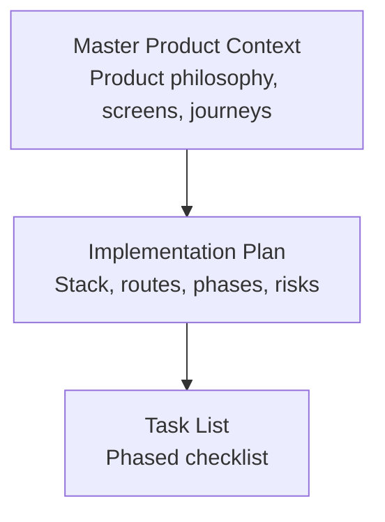
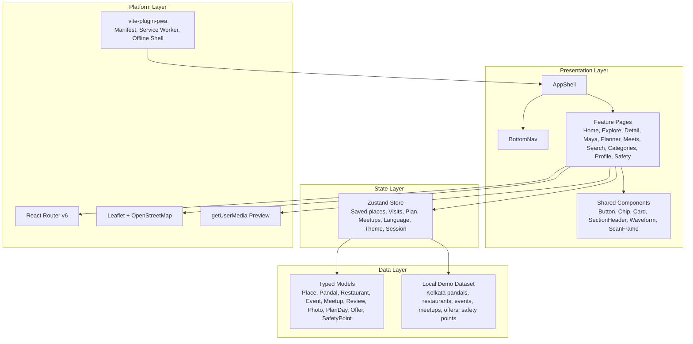
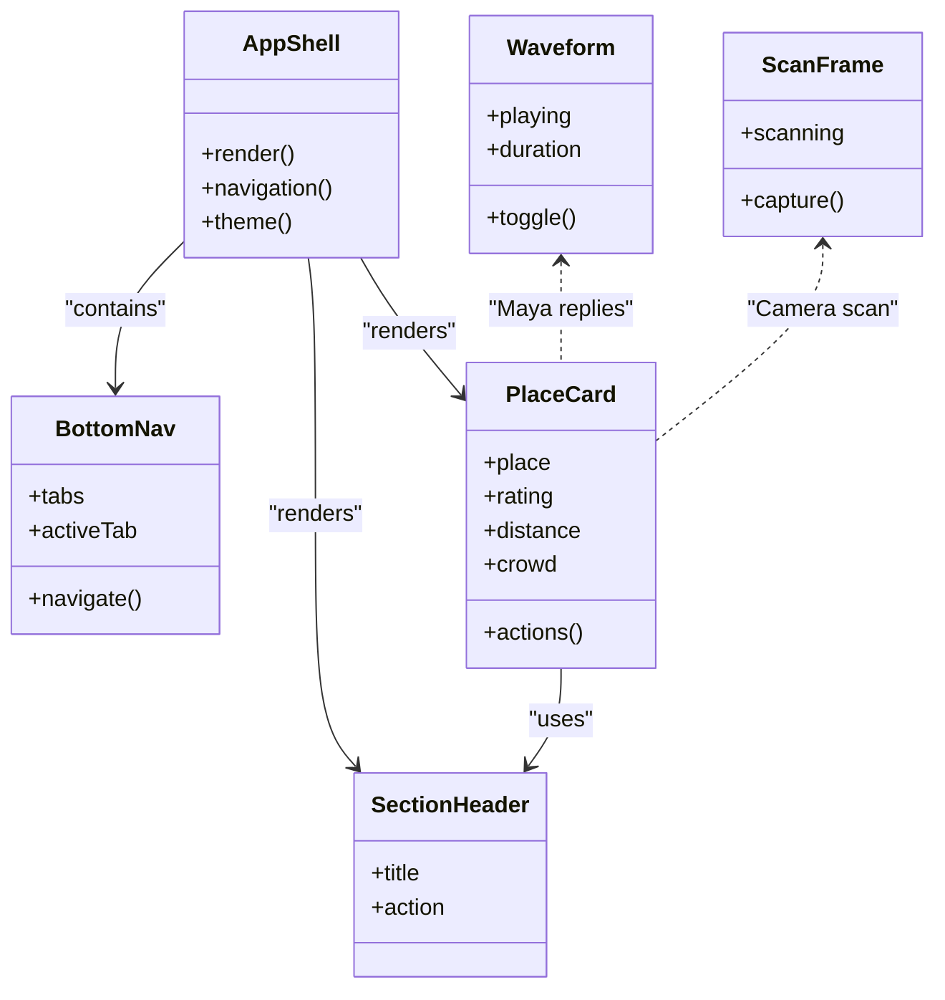
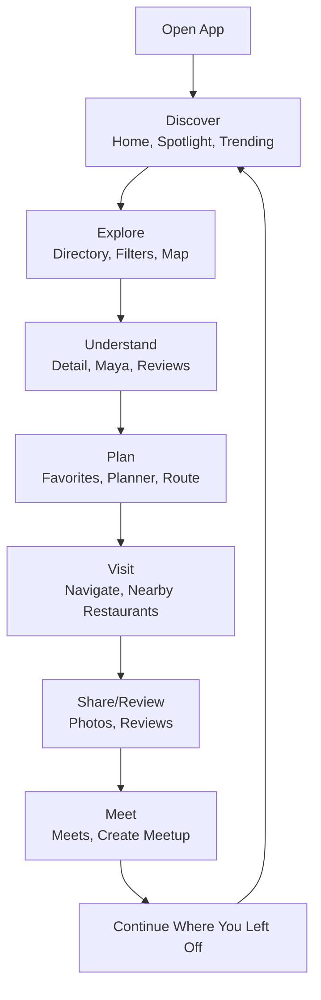
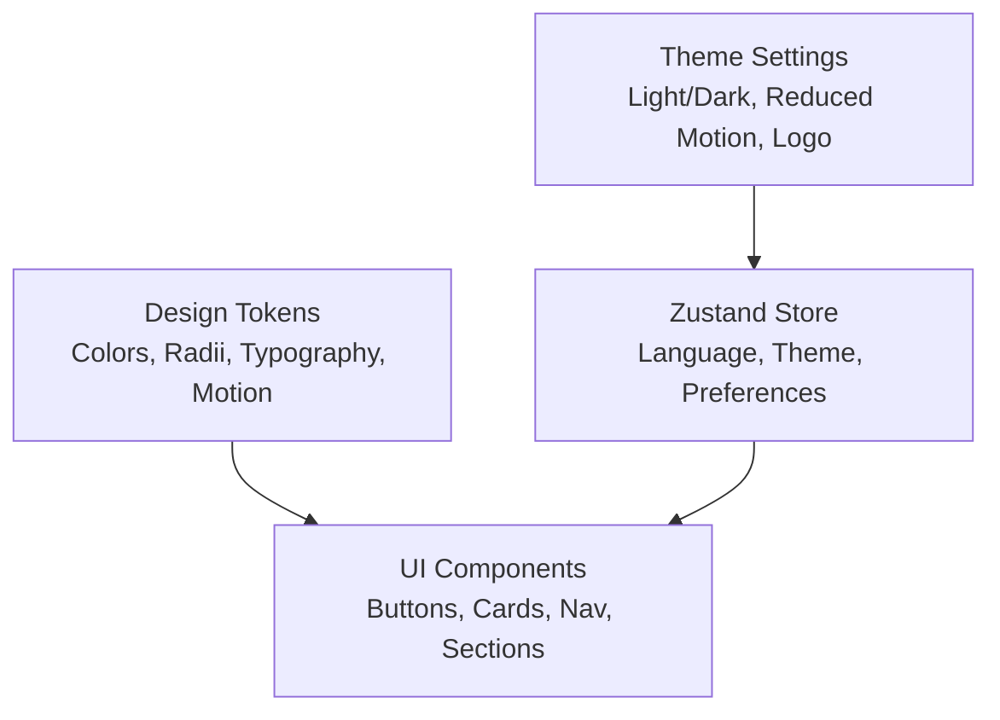
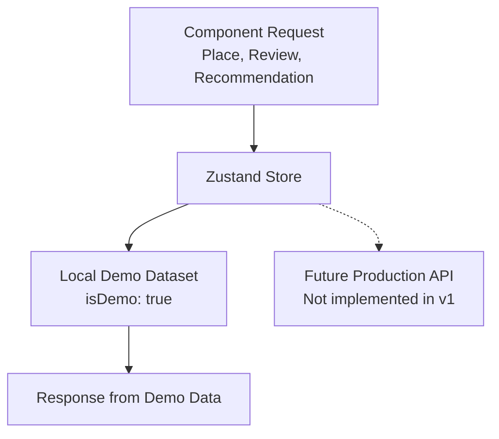
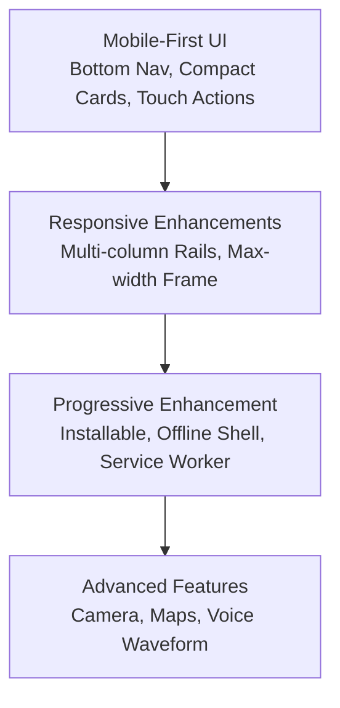
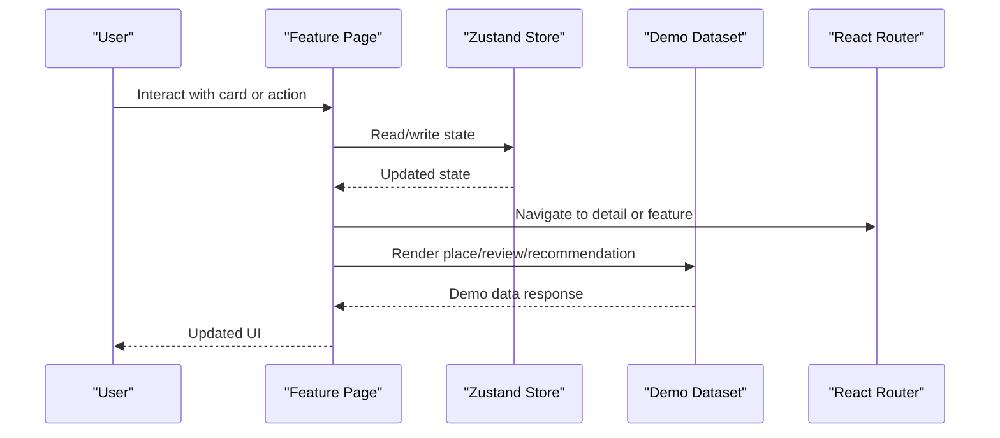
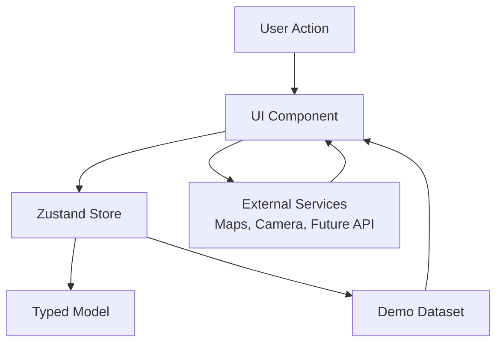
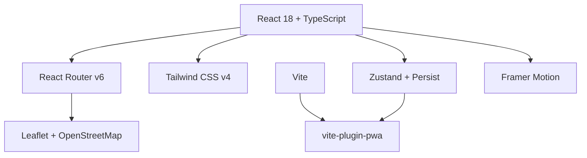

# Architectural Patterns and Design Principles

<cite>
**Referenced Files in This Document**
- [Pujo_Sahayak_Master_Project_Context.md](file://Pujo_Sahayak_Master_Project_Context.md)
- [plan.md](file://tasks/plan.md)
- [todo.md](file://tasks/todo.md)
</cite>

## Table of Contents
1. [Introduction](#introduction)
2. [Project Structure](#project-structure)
3. [Core Components](#core-components)
4. [Architecture Overview](#architecture-overview)
5. [Detailed Component Analysis](#detailed-component-analysis)
6. [Dependency Analysis](#dependency-analysis)
7. [Performance Considerations](#performance-considerations)
8. [Troubleshooting Guide](#troubleshooting-guide)
9. [Conclusion](#conclusion)

## Introduction
Pujo Sahayak is a mobile-first React + Vite PWA designed as a digital companion for exploring Kolkata during Durga Puja, while remaining useful beyond the festival season. The system combines place discovery, AI assistance through Maya, route planning, community meetups, safety utilities, user-generated content, personalization, and monetization concepts.

The architecture emphasizes:
- A **component-based UI layer** with clear separation from business logic and data.
- **Feature-based organization** grouped around user journeys such as Discover, Explore, Understand, Plan, Visit, Share, Meet, and Continue.
- A **configuration-driven design system** using Tailwind CSS v4 design tokens for consistent theming.
- A **mock data pattern** that clearly distinguishes demo data from future production API endpoints.
- **Mobile-first responsive design** with progressive enhancement toward desktop and offline capabilities.

This document explains how these principles are expressed in the project’s documented architecture decisions, feature map, and implementation plan.

**Section sources**
- [Pujo_Sahayak_Master_Project_Context.md:1-18](file://Pujo_Sahayak_Master_Project_Context.md#L1-L18)
- [plan.md:1-17](file://tasks/plan.md#L1-L17)

## Project Structure
At this stage, the repository contains:
- A master product context describing the product philosophy, screens, user journeys, and constraints.
- An implementation plan defining the technology stack, routes, phases, and verification criteria.
- A task list tracking phased delivery across foundation, discovery, Maya, planning, social, utility, and polish.

**Diagram sources**
- [Pujo_Sahayak_Master_Project_Context.md:1-18](file://Pujo_Sahayak_Master_Project_Context.md#L1-L18)
- [plan.md:1-17](file://tasks/plan.md#L1-L17)
- [todo.md:1-14](file://tasks/todo.md#L1-L14)

**Section sources**
- [Pujo_Sahayak_Master_Project_Context.md:1-18](file://Pujo_Sahayak_Master_Project_Context.md#L1-L18)
- [plan.md:1-17](file://tasks/plan.md#L1-L17)
- [todo.md:1-14](file://tasks/todo.md#L1-L14)

## Core Components
The planned application is organized around several core components and layers:

| Layer | Responsibility | Planned Implementation |
|---|---|---|
| Presentation / UI | Screens, shared components, navigation, motion, maps, camera preview | React components, Tailwind tokens, Framer Motion, Leaflet, getUserMedia |
| State Management | User preferences, saved places, visits, plans, meetups, session continuity | Zustand store with persistence |
| Data Layer | Typed models and local demo dataset | TypeScript types and `isDemo` dataset |
| Routing | Feature-based screen routing and nested detail pages | React Router v6 |
| Platform Layer | PWA manifest, service worker, installability, offline shell | vite-plugin-pwa |

Key component responsibilities include:
- **AppShell**: Application frame containing navigation and page transitions.
- **BottomNav**: Five-tab bottom navigation mapping to primary features.
- **PlaceCard and variants**: Reusable cards for pandals, restaurants, events, offers, and meetups.
- **SectionHeader**: Consistent section titles for Home rails and category hubs.
- **Waveform and ScanFrame**: Visual primitives for Maya voice input and camera scanning.
- **PageTransition**: Motion wrapper respecting reduced-motion settings.

These components support the feature-based organization rather than strict technical layering. For example, “Pandal Discovery” spans Home, Explore, Pandal Detail, Maya context, Similar Places, Nearby Restaurants, and Meets near this place.

**Section sources**
- [plan.md:9-17](file://tasks/plan.md#L9-L17)
- [todo.md:10-14](file://tasks/todo.md#L10-L14)
- [Pujo_Sahayak_Master_Project_Context.md:140-158](file://Pujo_Sahayak_Master_Project_Context.md#L140-L158)

## Architecture Overview
The system follows a component-based architecture with clear boundaries between presentation, state, data, and platform concerns.

**Diagram sources**
- [plan.md:9-17](file://tasks/plan.md#L9-L17)
- [todo.md:10-14](file://tasks/todo.md#L10-L14)

### System Boundaries
- **User boundary**: Mobile-first users interacting through screens, bottom navigation, search, categories, Maya, planner, meets, profile, and safety tools.
- **Application boundary**: React components, state store, typed data model, and local demo dataset.
- **External integration boundary**: Leaflet/OpenStreetMap for maps; optional future LLM or API endpoints for real AI responses; payment systems remain conceptual in v1.
- **Platform boundary**: Browser APIs for camera, location, and PWA installation; localStorage for client-side persistence.

**Section sources**
- [plan.md:9-17](file://tasks/plan.md#L9-L17)
- [todo.md:10-14](file://tasks/todo.md#L10-L14)
- [Pujo_Sahayak_Master_Project_Context.md:1095-1142](file://Pujo_Sahayak_Master_Project_Context.md#L1095-L1142)

## Detailed Component Analysis

### Component-Based Architecture Pattern
The UI is built from reusable components that represent both visual elements and small feature fragments. Shared components encapsulate common behavior, while feature pages compose them into complete user journeys.

**Diagram sources**
- [todo.md:10-14](file://tasks/todo.md#L10-L14)
- [plan.md:9-17](file://tasks/plan.md#L9-L17)

**Section sources**
- [todo.md:10-14](file://tasks/todo.md#L10-L14)
- [plan.md:9-17](file://tasks/plan.md#L9-L17)

### Feature-Based Organization by User Journeys
Instead of organizing code strictly by technical layers, the application groups related functionality around user journeys:

- **Discover**: Home, Sponsored Spotlight, Explore Spotlight, Trending Pandals, Popular Nearby Places.
- **Explore**: Explore/Pandal Directory, Filters, List/Map toggle.
- **Understand**: Pandal Detail, About, Theme Story, What Others Say, Top Clicks, Ask Maya.
- **Plan**: Favorites, Puja Planner, Trip/Route Map.
- **Visit**: Route actions, Navigation, Nearby Restaurants.
- **Share/Review**: Reviews, User Photos, AI photo verification concept.
- **Meet**: Meets list, Create Meetup, Find People Your Vibe.
- **Continue**: Continue Where You Left Off, session-backed exploration state.

**Diagram sources**
- [Pujo_Sahayak_Master_Project_Context.md:21-43](file://Pujo_Sahayak_Master_Project_Context.md#L21-L43)
- [Pujo_Sahayak_Master_Project_Context.md:1577-1603](file://Pujo_Sahayak_Master_Project_Context.md#L1577-L1603)

**Section sources**
- [Pujo_Sahayak_Master_Project_Context.md:21-43](file://Pujo_Sahayak_Master_Project_Context.md#L21-L43)
- [Pujo_Sahayak_Master_Project_Context.md:1577-1603](file://Pujo_Sahayak_Master_Project_Context.md#L1577-L1603)

### Configuration-Driven Design Using Design Tokens
The design system is configuration-driven through Tailwind CSS v4 tokens. Theming is not hard-coded per component but expressed via tokens for colors, radii, typography, and motion behavior.

Token-driven aspects include:
- Ivory surfaces, vermilion primary, charcoal ink, muted gold, and indigo accents.
- Bengali serif accent typography alongside system fonts.
- Reduced-motion support for accessibility.
- Dark mode and appearance settings persisted in the store.

**Diagram sources**
- [plan.md:9-17](file://tasks/plan.md#L9-L17)
- [todo.md:10-14](file://tasks/todo.md#L10-L14)

**Section sources**
- [plan.md:9-17](file://tasks/plan.md#L9-L17)
- [todo.md:10-14](file://tasks/todo.md#L10-L14)

### Mock Data Pattern: Demo Data vs Production Endpoints
The data layer uses a typed local dataset marked as demo data. Crowd levels, hours, reviews, photos, and recommendations are rendered only from dataset fields. There is no production backend in v1; any AI or external integrations are explicitly simulated or stubbed.

Key rules:
- `isDemo: true` on the dataset.
- No fabricated statistics or reviews beyond the clearly demo dataset.
- Maya answers are grounded in the local dataset with honest fallbacks.
- Camera identification is simulated against the dataset with a demo marker.
- Payment and auth flows are non-functional stubs in v1.

**Diagram sources**
- [plan.md:15-17](file://tasks/plan.md#L15-L17)
- [todo.md:13-14](file://tasks/todo.md#L13-L14)

**Section sources**
- [plan.md:15-17](file://tasks/plan.md#L15-L17)
- [todo.md:13-14](file://tasks/todo.md#L13-L14)

### Mobile-First Responsive Design and Progressive Enhancement
The application targets mobile-first experiences with bottom navigation, compact cards, and touch-friendly interactions. It progressively enhances to:
- Desktop layouts with max-width app frames and multi-column rails.
- PWA installability, offline shell caching, and service worker management.
- Real camera preview with getUserMedia and animated scan frames.
- Real maps with Leaflet and OpenStreetMap tiles.

**Diagram sources**
- [plan.md:9-17](file://tasks/plan.md#L9-L17)
- [todo.md:74-75](file://tasks/todo.md#L74-L75)

**Section sources**
- [plan.md:9-17](file://tasks/plan.md#L9-L17)
- [todo.md:74-75](file://tasks/todo.md#L74-L75)

### Component Interaction Patterns
Components interact through:
- **Props**: Passing place data, ratings, crowd tags, and actions to cards and sections.
- **Store subscriptions**: Reading and writing saved places, visits, plans, meetups, language, theme, and session state.
- **Routing**: Navigating between feature pages and nested detail routes.
- **Side effects**: Camera access, map rendering, and motion animations.

**Diagram sources**
- [plan.md:11-15](file://tasks/plan.md#L11-L15)
- [todo.md:10-14](file://tasks/todo.md#L10-L14)

**Section sources**
- [plan.md:11-15](file://tasks/plan.md#L11-L15)
- [todo.md:10-14](file://tasks/todo.md#L10-L14)

### Data Flow Diagrams Across Architectural Layers
The following diagram shows how different architectural layers communicate during a typical user journey.

**Diagram sources**
- [plan.md:9-17](file://tasks/plan.md#L9-L17)
- [todo.md:10-14](file://tasks/todo.md#L10-L14)

**Section sources**
- [plan.md:9-17](file://tasks/plan.md#L9-L17)
- [todo.md:10-14](file://tasks/todo.md#L10-L14)

## Dependency Analysis
The planned dependencies form a layered structure where UI components depend on shared components, state, routing, and platform services.

**Diagram sources**
- [plan.md:9-17](file://tasks/plan.md#L9-L17)

**Section sources**
- [plan.md:9-17](file://tasks/plan.md#L9-L17)

## Performance Considerations
- Keep the initial bundle focused on mobile-first essentials; defer heavy features like full camera workflows and advanced map interactions until needed.
- Use lazy loading for routes and features that are not immediately required.
- Avoid unnecessary re-renders by keeping Zustand stores normalized and selective.
- Respect reduced-motion settings to improve performance and accessibility.
- Cache static assets and shell via PWA service worker; avoid over-caching dynamic demo data.
- Prefer lightweight image placeholders and defer heavy photography until necessary.

[No sources needed since this section provides general guidance]

## Troubleshooting Guide
Common issues and their architectural implications:

| Issue | Likely Cause | Resolution Strategy |
|---|---|---|
| Demo data appears as production data | Missing `isDemo` marker or unclear labeling | Ensure dataset entries are clearly marked as demo and UI labels reflect demo status. |
| Maya returns hallucinated information | Direct LLM call without grounding | Use dataset-grounded retrieval with explicit fallback messages. |
| Camera flow fails | Permission or browser compatibility | Gracefully handle getUserMedia errors and provide gallery fallback. |
| Offline shell does not load | Service worker misconfiguration | Verify vite-plugin-pwa manifest and cache strategy. |
| Theme changes do not persist | Store not persisted | Ensure Zustand persist middleware covers theme and language settings. |
| Routes not reachable | Incorrect React Router configuration | Validate route definitions and bottom navigation links. |

**Section sources**
- [plan.md:15-17](file://tasks/plan.md#L15-L17)
- [todo.md:63-70](file://tasks/todo.md#L63-L70)

## Conclusion
Pujo Sahayak’s architecture is intentionally structured around user journeys rather than rigid technical layers. The component-based UI, configuration-driven design tokens, mock data pattern, and mobile-first progressive enhancement create a flexible foundation for a seasonal yet enduring local discovery platform. As production APIs, authentication, payments, and advanced AI features are introduced, the current boundaries and patterns will allow those capabilities to be integrated without disrupting the core experience.

[No sources needed since this section summarizes without analyzing specific files]