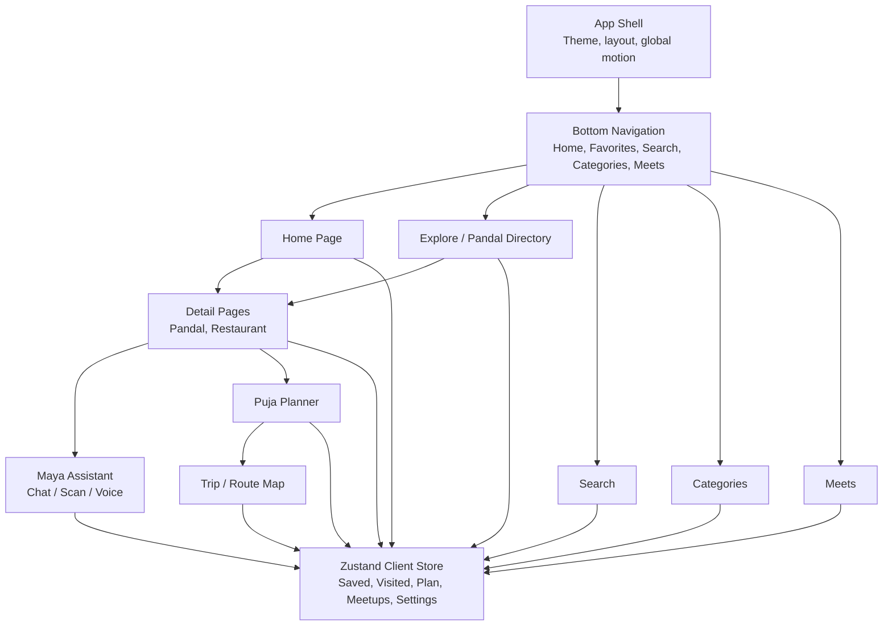
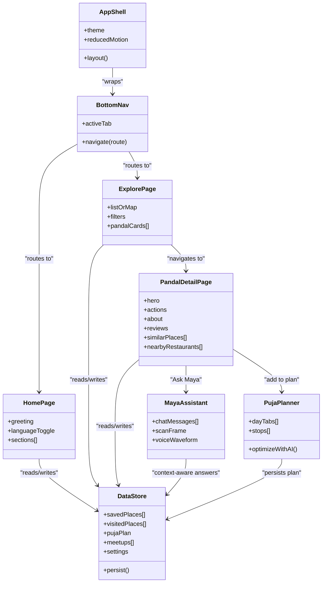
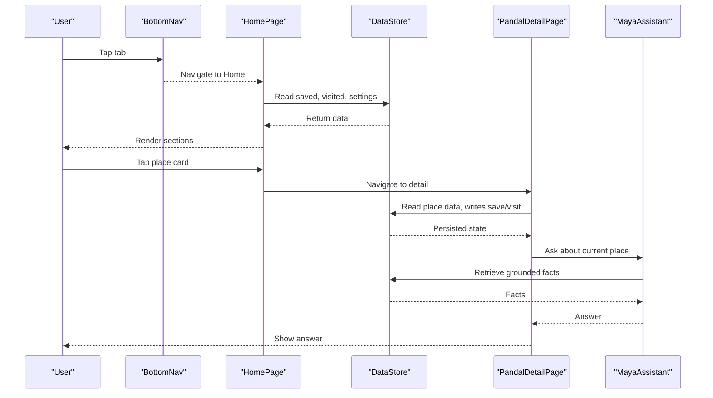
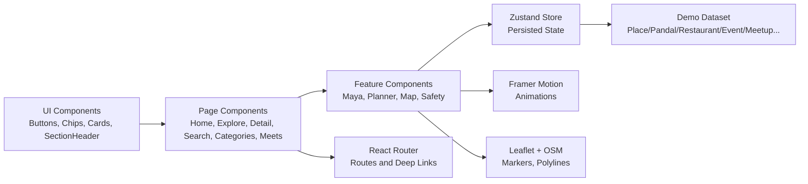

# Component-Based Architecture Pattern

<cite>
**Referenced Files in This Document**
- [Pujo_Sahayak_Master_Project_Context.md](file://Pujo_Sahayak_Master_Project_Context.md)
- [plan.md](file://tasks/plan.md)
- [todo.md](file://tasks/todo.md)
</cite>

## Table of Contents
1. [Introduction](#introduction)
2. [Project Structure](#project-structure)
3. [Core Components](#core-components)
4. [Architecture Overview](#architecture-overview)
5. [Detailed Component Analysis](#detailed-component-analysis)
6. [Dependency Analysis](#dependency-analysis)
7. [Performance Considerations](#performance-considerations)
8. [Troubleshooting Guide](#troubleshooting-guide)
9. [Conclusion](#conclusion)
10. [Appendices](#appendices)

## Introduction
This document explains the component-based architecture pattern for Puja Sahayak as defined by the project’s product context and implementation plan. The application is a mobile-first React + TypeScript PWA that separates UI components, business logic, and data layers while keeping the user journey centered around discovery, exploration, understanding, planning, visiting, sharing, and social connection.

The intended component hierarchy follows:
App Shell → Navigation → Pages → Components → Data Store

At this stage, the repository contains the master product context and implementation plans rather than source code. Therefore, this document describes the architectural intent, expected component boundaries, communication patterns, lifecycle considerations, performance strategies, and testing approaches based on the documented stack and feature set.

**Section sources**
- [Pujo_Sahayak_Master_Project_Context.md:1-18](file://Pujo_Sahayak_Master_Project_Context.md#L1-L18)
- [plan.md:1-17](file://tasks/plan.md#L1-L17)

## Project Structure
The project is planned as a Vite + React + TypeScript PWA with:
- Tailwind CSS v4 for design tokens and bespoke UI
- React Router v6 for navigation
- Zustand + persist middleware for client state
- Framer Motion for motion primitives
- Leaflet + OpenStreetMap for mapping
- A typed local demo dataset representing places, pandals, restaurants, events, meetups, reviews, photos, offers, safety points, categories, and planning entities

**Diagram sources**
- [plan.md:9-17](file://tasks/plan.md#L9-L17)
- [plan.md:19-39](file://tasks/plan.md#L19-L39)
- [todo.md:10-14](file://tasks/todo.md#L10-L14)
- [todo.md:23-30](file://tasks/todo.md#L23-L30)
- [todo.md:36-43](file://tasks/todo.md#L36-L43)
- [todo.md:47-67](file://tasks/todo.md#L47-L67)

**Section sources**
- [plan.md:1-17](file://tasks/plan.md#L1-L17)
- [plan.md:19-39](file://tasks/plan.md#L19-L39)
- [todo.md:10-14](file://tasks/todo.md#L10-L14)

## Core Components
Based on the implementation plan, the core component groups are:

- App Shell
  - Provides theme, layout, global motion configuration, and app-wide accessibility settings such as reduced motion.
  - Wraps routing and ensures consistent structure across pages.

- Navigation
  - Bottom navigation with five tabs: Home, Favorites, Search, Categories, Meets.
  - Reflects active route state and supports deep links to detail pages.

- Pages
  - Home: greeting, language toggle, sponsored spotlight, explore spotlight, nearby restaurants, offers, events, continue where you left off.
  - Explore / Pandal Directory: list/map toggle, filters, cards with rating/distance/crowd/theme, actions to view details or route.
  - Pandal Detail: hero, save/visited actions, info rows, about/story, Ask Maya chip, reviews, top clicks, similar places, nearby restaurants, related meetups.
  - Search: category pills, live filtering, trending and nearby rails.
  - Categories: Places, Transport & Services, Utilities grids.
  - Meets: meetup list and create flow.
  - Profile, Settings, Safety/Emergency, Missing Person Report, Restaurant Detail, Trip/Route Map, Beyond Puja.

- Feature-Specific Components
  - Maya chat, scan frame, voice waveform UI.
  - Place card, section header, chips, buttons, map markers, polyline routes.
  - Photo upload and verification UI (simulated).
  - Offer/discount cards, event cards, safety point cards.

- Data Layer
  - Typed data model and demo dataset.
  - Zustand store with persistence for saves, visits, plans, meetups, language, theme, logo choice, and session continuity.

**Diagram sources**
- [todo.md:10-14](file://tasks/todo.md#L10-L14)
- [todo.md:23-30](file://tasks/todo.md#L23-L30)
- [todo.md:36-43](file://tasks/todo.md#L36-L43)
- [todo.md:47-67](file://tasks/todo.md#L47-L67)
- [plan.md:9-17](file://tasks/plan.md#L9-L17)

**Section sources**
- [todo.md:10-14](file://tasks/todo.md#L10-L14)
- [todo.md:23-30](file://tasks/todo.md#L23-L30)
- [todo.md:36-43](file://tasks/todo.md#L36-L43)
- [todo.md:47-67](file://tasks/todo.md#L47-L67)
- [plan.md:9-17](file://tasks/plan.md#L9-L17)

## Architecture Overview
The system follows a layered component architecture:

- Presentation layer: UI components render data from props and local page state.
- Business logic layer: Page-level components coordinate user interactions, validation, and feature flows.
- Data layer: Zustand store holds shared state and persists it to localStorage; the demo dataset provides initial data.

**Diagram sources**
- [plan.md:9-17](file://tasks/plan.md#L9-L17)
- [todo.md:23-30](file://tasks/todo.md#L23-L30)
- [todo.md:36-43](file://tasks/todo.md#L36-L43)

**Section sources**
- [plan.md:9-17](file://tasks/plan.md#L9-L17)
- [todo.md:23-30](file://tasks/todo.md#L23-L30)

## Detailed Component Analysis

### App Shell
Responsibilities:
- Provide global layout, theme tokens, and motion configuration.
- Ensure accessibility options like reduced motion are respected.
- Wrap routing and maintain consistent chrome across pages.

Key behaviors:
- Theme switching affects all child components.
- Reduced motion disables or simplifies animations.
- Global error boundaries can be placed here to catch rendering errors.

Component composition:
- Renders BottomNav and main content area.
- Optionally renders splash screen at entry.

**Section sources**
- [todo.md:10-14](file://tasks/todo.md#L10-L14)
- [plan.md:9-17](file://tasks/plan.md#L9-L17)

### Navigation
Responsibilities:
- Display five primary tabs: Home, Favorites, Search, Categories, Meets.
- Reflect active route state.
- Support deep linking to detail pages.

Props and state:
- Active tab derived from router.
- Callbacks to navigate without tightly coupling to specific pages.

Accessibility:
- Keyboard navigation and focus management.
- Screen-reader-friendly labels.

**Section sources**
- [plan.md:9-17](file://tasks/plan.md#L9-L17)
- [todo.md:10-14](file://tasks/todo.md#L10-L14)

### Home Page
Responsibilities:
- Present dynamic discovery content: greeting, language toggle, sponsored spotlight, explore spotlight, nearby restaurants, offers, events, and continue where you left off.
- Respect order per product documentation.

Data flow:
- Reads from store for saved items, visited history, and settings.
- Uses dataset for trending and nearby suggestions.

Composition:
- Composes reusable sections: SponsoredCard, SpotlightCard, RestaurantRail, OffersRail, EventsRail, ContinueWhereLeftOff.

**Section sources**
- [todo.md:23-30](file://tasks/todo.md#L23-L30)
- [Pujo_Sahayak_Master_Project_Context.md:160-284](file://Pujo_Sahayak_Master_Project_Context.md#L160-L284)

### Explore / Pandal Directory
Responsibilities:
- List/map toggle using Leaflet.
- Filter chips for area, distance, theme, crowd.
- Cards showing rating, distance, crowd tag, theme.
- Actions to view details or route.

State and data:
- Local filter state combined with dataset.
- Map markers reflect filtered results.

Performance:
- Memoize filtered lists.
- Virtualize long lists if needed.

**Section sources**
- [todo.md:26-30](file://tasks/todo.md#L26-L30)
- [plan.md:9-17](file://tasks/plan.md#L9-L17)

### Pandal Detail Page
Responsibilities:
- Hero image, name, location, save/bookmark.
- Rating, reviews, distance, crowd, open-till.
- Action row: Save, Visited, Route.
- Info row: Location, Metro, Facilities, Safety.
- About and theme story.
- Ask Maya chip with context.
- Reviews, top clicks, similar places, nearby restaurants, related meetups.

Communication:
- Writes save/visited to store.
- Passes selected place context to Maya.
- Links to trip/route map via planner.

**Section sources**
- [todo.md:29-30](file://tasks/todo.md#L29-L30)
- [Pujo_Sahayak_Master_Project_Context.md:775-950](file://Pujo_Sahayak_Master_Project_Context.md#L775-L950)

### Maya Assistant
Responsibilities:
- Chat interface with Bengali user bubble and Maya reply.
- Inline audio player row and waveform visualization.
- Quick-reply chips.
- Camera scan with getUserMedia preview and animated scan frame.
- Grounded responses from dataset; honest fallback when information is unavailable.

Context awareness:
- If opened from a place page, Maya already knows the selected place.
- Answers should not hallucinate facts.

Event handling:
- Message send, voice input toggle, camera capture, gallery selection.

**Section sources**
- [todo.md:36-43](file://tasks/todo.md#L36-L43)
- [Pujo_Sahayak_Master_Project_Context.md:558-662](file://Pujo_Sahayak_Master_Project_Context.md#L558-L662)
- [Pujo_Sahayak_Master_Project_Context.md:1330-1358](file://Pujo_Sahayak_Master_Project_Context.md#L1330-L1358)

### Puja Planner
Responsibilities:
- Day tabs from Panchami to Dashami.
- Stop cards with image, type, duration, travel-between rows.
- Add place picker from dataset/saved.
- Optimize with AI nearest-neighbor suggestion (presented as suggestions).
- Start navigation to trip/route map.

State:
- Persists plan across reloads.

**Section sources**
- [todo.md:47-51](file://tasks/todo.md#L47-L51)
- [Pujo_Sahayak_Master_Project_Context.md:353-421](file://Pujo_Sahayak_Master_Project_Context.md#L353-L421)

### Meets
Responsibilities:
- Meetup list with filters: All, Nearby, My Interests.
- Create meetup form: title, date, time, location, description, interest chips, max participants, public/restricted.
- Join action updates local state.

Business rules:
- Treat free/paid/premium concepts as flexible business-model concepts.

**Section sources**
- [todo.md:53-54](file://tasks/todo.md#L53-L54)
- [Pujo_Sahayak_Master_Project_Context.md:664-772](file://Pujo_Sahayak_Master_Project_Context.md#L664-L772)

### Data Store
Responsibilities:
- Centralized client state: saved places, visited places, puja plan, meetups, language, theme, app-logo choice, continue-where-you-left-off session.
- Persistence to localStorage.
- Typed schema aligned with the product data model.

Usage:
- Pages read/write through selectors and actions.
- Maya reads context-aware data.
- Planner persists multi-day itinerary.

**Section sources**
- [plan.md:9-17](file://tasks/plan.md#L9-L17)
- [todo.md:13-14](file://tasks/todo.md#L13-L14)
- [Pujo_Sahayak_Master_Project_Context.md:1232-1259](file://Pujo_Sahayak_Master_Project_Context.md#L1232-L1259)

## Dependency Analysis
High-level dependencies between components and layers:

**Diagram sources**
- [plan.md:9-17](file://tasks/plan.md#L9-L17)
- [todo.md:10-14](file://tasks/todo.md#L10-L14)
- [todo.md:26-30](file://tasks/todo.md#L26-L30)
- [todo.md:36-43](file://tasks/todo.md#L36-L43)
- [todo.md:47-67](file://tasks/todo.md#L47-L67)

Coupling and cohesion:
- Pages depend on UI components and the store; they avoid direct dataset access after initialization.
- Feature components encapsulate complex flows (Maya, Planner, Map) and expose simple props/events to pages.
- Store is the single source of truth for shared state, reducing cross-page coupling.

External integrations:
- React Router for navigation.
- Leaflet + OpenStreetMap for maps.
- Framer Motion for animations.
- getUserMedia for camera preview.

**Section sources**
- [plan.md:9-17](file://tasks/plan.md#L9-L17)
- [todo.md:26-30](file://tasks/todo.md#L26-L30)
- [todo.md:36-43](file://tasks/todo.md#L36-L43)
- [todo.md:47-67](file://tasks/todo.md#L47-L67)

## Performance Considerations
Recommended practices aligned with the documented stack:

- Memoization
  - Use memoization for expensive computations such as filtered lists, recommendation sets, and similarity calculations.
  - Memoize heavy subcomponents like map markers and waveform visualizations.

- Rendering optimization
  - Avoid unnecessary re-renders by separating presentational components from container/page components.
  - Keep store slices small and targeted; subscribe only to needed fields.

- Motion and accessibility
  - Honor reduced-motion preferences globally.
  - Prefer subtle transitions and avoid heavy animations on low-end devices.

- Data loading
  - Load dataset once and cache in store.
  - Defer non-critical sections until after initial paint.

- Image handling
  - Use placeholders and lazy loading.
  - Ensure layouts do not break without images.

[No sources needed since this section provides general guidance]

## Troubleshooting Guide
Common issues and resolutions:

- Maya hallucinating facts
  - Ensure answers are retrieved from verified dataset fields.
  - Use explicit fallback wording when information is unavailable.

- Incorrect location assumptions
  - Do not claim precise indoor placement; use “nearby” phrasing.
  - Confirm GPS context visually before acting.

- Offline assets
  - Provide gradient/placeholder fallbacks for images.
  - Verify PWA offline shell behavior.

- State persistence
  - Verify saves, visits, plan, and settings survive reload.
  - Check localStorage serialization and migration if schema changes.

- Accessibility
  - Validate keyboard navigation and screen-reader labels.
  - Respect reduced-motion setting across animations.

**Section sources**
- [Pujo_Sahayak_Master_Project_Context.md:1330-1358](file://Pujo_Sahayak_Master_Project_Context.md#L1330-L1358)
- [Pujo_Sahayak_Master_Project_Context.md:1360-1387](file://Pujo_Sahayak_Master_Project_Context.md#L1360-L1387)
- [plan.md:63-79](file://tasks/plan.md#L63-L79)

## Conclusion
Puja Sahayak’s component-based architecture emphasizes clear separation of concerns:
- App Shell and Navigation provide stable chrome and routing.
- Pages orchestrate user flows and compose feature-specific components.
- Feature components encapsulate complex interactions such as Maya, Planner, and Mapping.
- The Zustand store centralizes shared state and persists it to localStorage.
- The demo dataset supplies grounded, verifiable data for UI and assistant features.

This structure supports scalability, testability, and maintainability while preserving the product’s cultural and functional identity. As implementation progresses, each phase should leave the app runnable, with verification against mockups, persistence checks, and strict adherence to grounded data principles.

[No sources needed since this section summarizes without analyzing specific files]

## Appendices

### Component Communication Patterns
- Props
  - Pass immutable data down to presentational components.
  - Use typed interfaces for clarity and safety.
- Context
  - Use sparingly for truly global concerns such as theme or language.
- State Management
  - Prefer store selectors for derived data.
  - Keep page-local state minimal and ephemeral.

### Event Handling Guidelines
- Normalize events at page boundaries.
- Debounce frequent inputs (search, scroll).
- Handle async operations with clear loading and error states.
- Surface actionable feedback to users (success, failure, partial success).

### Testing Strategies
- Unit tests
  - Pure functions for filtering, formatting, and calculations.
  - Store actions and selectors.
- Component tests
  - Render UI components with mocked props and store slices.
  - Assert accessibility attributes and reduced-motion behavior.
- Integration tests
  - Verify page flows: Home → Explore → Detail → Maya → Planner.
  - Validate persistence across reloads.
- Visual regression
  - Compare key screens against mockups during checkpoints.

[No sources needed since this section provides general guidance]