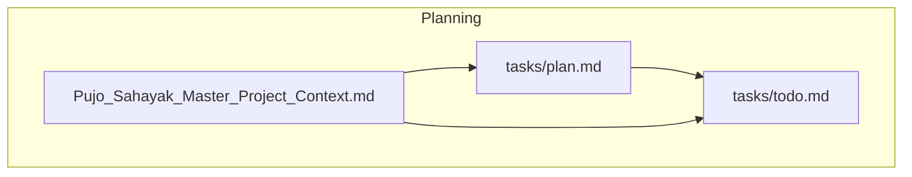
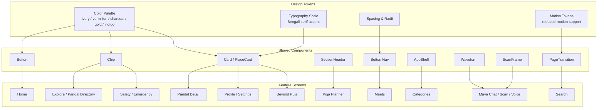
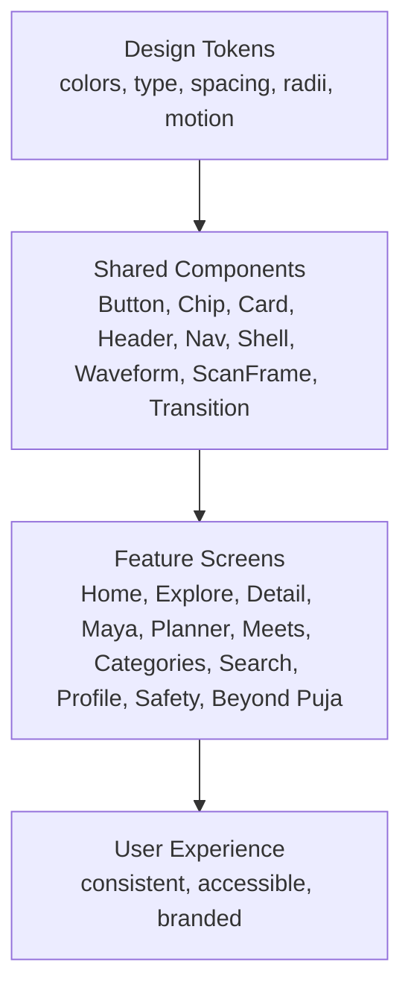
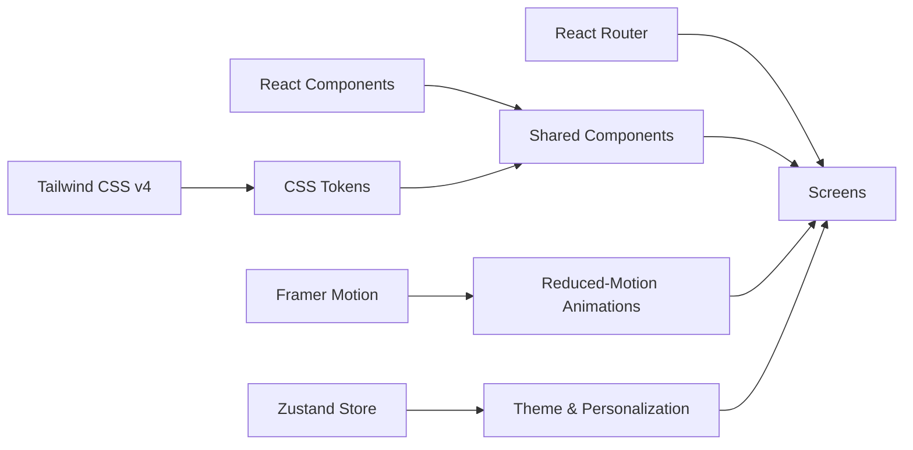

# Configuration-Driven Design System

<cite>
**Referenced Files in This Document**
- [plan.md](file://tasks/plan.md)
- [todo.md](file://tasks/todo.md)
- [Pujo_Sahayak_Master_Project_Context.md](file://Pujo_Sahayak_Master_Project_Context.md)
</cite>

## Table of Contents
1. [Introduction](#introduction)
2. [Project Structure](#project-structure)
3. [Core Components](#core-components)
4. [Architecture Overview](#architecture-overview)
5. [Detailed Component Analysis](#detailed-component-analysis)
6. [Dependency Analysis](#dependency-analysis)
7. [Performance Considerations](#performance-considerations)
8. [Troubleshooting Guide](#troubleshooting-guide)
9. [Conclusion](#conclusion)
10. [Appendices](#appendices)

## Introduction
This document describes the configuration-driven design system for Pujo Sahayak, a mobile-first React + Vite PWA. The project uses Tailwind CSS v4 to encode a bespoke design system as CSS-level design tokens rather than relying on a generic component library. The goal is consistent theming across screens such as Home, Explore, Pandal Detail, Maya (assistant), Planner, Meets, Categories, Search, Profile, Safety, and Beyond Puja.

The design system centers on:
- A culturally rooted visual language inspired by Durga Puja.
- A tokenized color palette, typography scale, spacing, radii, and motion behavior.
- Reusable UI primitives that compose into pages and features.
- Mobile-first responsive behavior with desktop adaptations.
- Accessibility-aware motion and personalization options including dark mode and reduced motion.

[No sources needed since this section provides general context]

## Project Structure
At this stage, the repository contains planning and product context documents that define how the design system should be implemented. There are no source code files present yet; the implementation plan and task list describe where the design system will live once scaffolding begins.

**Diagram sources**
- [plan.md:1-86](file://tasks/plan.md#L1-L86)
- [todo.md:1-81](file://tasks/todo.md#L1-L81)
- [Pujo_Sahayak_Master_Project_Context.md:1464-1571](file://Pujo_Sahayak_Master_Project_Context.md#L1464-L1571)

**Section sources**
- [plan.md:1-86](file://tasks/plan.md#L1-L86)
- [todo.md:1-81](file://tasks/todo.md#L1-L81)
- [Pujo_Sahayak_Master_Project_Context.md:1464-1571](file://Pujo_Sahayak_Master_Project_Context.md#L1464-L1571)

## Core Components
The design system’s core components are defined in the foundation phase. These shared building blocks ensure brand consistency and reduce duplication across screens.

- Tokens
  - Colors: ivory surfaces, vermilion primary, charcoal ink, muted gold, deep indigo.
  - Radii: rounded corners for cards, chips, buttons, and overlays.
  - Typography: type scale with Bengali serif accents for cultural emphasis.
  - Spacing: consistent spacing scale for layout rhythm.
- Primitives
  - Button: primary, secondary, ghost, and icon variants.
  - Chip: filter chips, category chips, and quick-reply chips.
  - Card: base card and place-card variant for pandals/restaurants/events.
  - SectionHeader: consistent section titles and actions.
  - BottomNav: five-tab navigation with active state.
  - AppShell: global app frame and safe areas.
  - Waveform: voice assistant waveform visualization.
  - ScanFrame: animated camera scanner overlay.
  - PageTransition: page transitions honoring reduced-motion preferences.

These components are intended to be styled exclusively through the token layer so that theme changes propagate consistently.

**Section sources**
- [todo.md:10-11](file://tasks/todo.md#L10-L11)
- [plan.md:10-13](file://tasks/plan.md#L10-L13)

## Architecture Overview
The design system architecture separates tokens from components and pages. Tokens are defined in CSS and consumed via Tailwind v4 utilities or semantic class names. Components are built on top of tokens and composed into feature screens.

**Diagram sources**
- [plan.md:10-13](file://tasks/plan.md#L10-L13)
- [todo.md:10-11](file://tasks/todo.md#L10-L11)
- [Pujo_Sahayak_Master_Project_Context.md:1482-1505](file://Pujo_Sahayak_Master_Project_Context.md#L1482-L1505)

## Detailed Component Analysis

### Color Palette and Theming
The palette is intentionally cultural and restrained:
- Deep vermilion: primary actions, highlights, and key interactive states.
- Warm ivory: light surfaces and backgrounds.
- Charcoal: text and high-contrast content.
- Muted gold: accents, borders, and subtle emphasis.
- Deep indigo: secondary emphasis and depth.

Tokens should be applied consistently to:
- Buttons and chips for primary and secondary actions.
- Cards for elevation and focus rings.
- Navigation for active and selected states.
- Overlays and scan frames for immersive interactions.

Dark mode should invert surface tones while preserving contrast ratios and keeping vermilion and gold as meaningful accents.

**Section sources**
- [Pujo_Sahayak_Master_Project_Context.md:1482-1505](file://Pujo_Sahayak_Master_Project_Context.md#L1482-L1505)
- [plan.md:10-10](file://tasks/plan.md#L10-L10)

### Typography Scale and Bengali Accents
Typography emphasizes readability and cultural identity:
- Base type scale for headings, body, captions, and labels.
- Bengali serif accents for editorial moments and cultural phrases.
- Clear hierarchy between section headers, card titles, metadata, and helper text.

Guidelines:
- Use the type scale consistently across cards, lists, and modals.
- Reserve Bengali serif accents for short, intentional moments rather than long paragraphs.
- Ensure sufficient line height and contrast for accessibility.

**Section sources**
- [todo.md:10-11](file://tasks/todo.md#L10-L11)
- [Pujo_Sahayak_Master_Project_Context.md:1496-1505](file://Pujo_Sahayak_Master_Project_Context.md#L1496-L1505)

### Spacing System and Layout Rhythm
Spacing should follow a consistent scale to maintain rhythm across:
- Screen padding and margins.
- Card gaps and grid columns.
- Button and chip internal padding.
- Section spacing and scrollable rails.

Mobile-first spacing should expand thoughtfully on desktop using multi-column layouts and wider gutters.

**Section sources**
- [todo.md:10-11](file://tasks/todo.md#L10-L11)
- [Pujo_Sahayak_Master_Project_Context.md:1555-1571](file://Pujo_Sahayak_Master_Project_Context.md#L1555-L1571)

### Shared Component Conventions
Reusable components must enforce token usage and interaction patterns:
- Button: clear primary/secondary semantics; disabled and loading states.
- Chip: filterable and selectable; keyboard accessible.
- Card: image-safe, title-safe, metadata-safe; supports action rows.
- SectionHeader: title, subtitle, and action slot.
- BottomNav: five tabs with active indicator and label.
- AppShell: safe area handling and global background.
- Waveform: reactive animation respecting reduced motion.
- ScanFrame: animated border and guidance text.
- PageTransition: fade/slide transitions with reduced-motion fallback.

**Section sources**
- [todo.md:10-11](file://tasks/todo.md#L10-L11)

### Responsive Breakpoints and Mobile-First Approach
The application targets mobile first:
- Primary target: mobile screens.
- Desktop adaptation: wider layouts, multi-column sections, expanded maps, side panels, and richer exploration.

Breakpoint strategy:
- Start with small-screen constraints.
- Introduce breakpoints only when content genuinely benefits from more space.
- Keep touch targets large enough on mobile.
- On desktop, use max-width framing and multi-column rails without losing the mobile experience.

**Section sources**
- [Pujo_Sahayak_Master_Project_Context.md:1555-1571](file://Pujo_Sahayak_Master_Project_Context.md#L1555-L1571)
- [todo.md:74-75](file://tasks/todo.md#L74-L75)

### Accessibility Considerations
Accessibility is embedded through motion and personalization:
- Reduced-motion preference is honored by motion primitives.
- Contrast and color roles should remain meaningful in both light and dark themes.
- Interactive elements must be keyboard navigable.
- Labels and screen-reader-friendly structure should accompany icons and decorative visuals.

**Section sources**
- [plan.md:13-13](file://tasks/plan.md#L13-L13)
- [todo.md:10-11](file://tasks/todo.md#L10-L11)

### Theme Customization, Dark Mode, and Brand Consistency
Theme customization should be token-driven:
- Define semantic tokens for surfaces, text, borders, and accents.
- Provide light and dark variants.
- Allow user-selected theme settings to persist.
- Maintain brand consistency by limiting custom overrides to approved tokens.

Brand guidelines:
- Avoid generic SaaS styling.
- Use cultural inspiration subtly.
- Favor photography, gradients, grain, and soft glow over heavy decoration.

**Section sources**
- [plan.md:10-13](file://tasks/plan.md#L10-L13)
- [Pujo_Sahayak_Master_Project_Context.md:1464-1505](file://Pujo_Sahayak_Master_Project_Context.md#L1464-L1505)

### Relationship Between Design Tokens and Component Implementations
Tokens are the single source of truth for visual style. Components consume tokens rather than hardcoding values. This ensures:
- Consistent colors, spacing, radii, and typography across screens.
- Easy theme switching and dark mode support.
- Predictable maintenance and auditability.

**Diagram sources**
- [todo.md:10-11](file://tasks/todo.md#L10-L11)
- [plan.md:10-13](file://tasks/plan.md#L10-L13)

## Dependency Analysis
The design system depends on the following architectural decisions:
- Tailwind CSS v4 for token-based styling.
- React components for reusable UI primitives.
- Motion library for animations and reduced-motion support.
- Routing for composing screens from shared components.
- State management for theme and personalization settings.

**Diagram sources**
- [plan.md:10-13](file://tasks/plan.md#L10-L13)

**Section sources**
- [plan.md:10-13](file://tasks/plan.md#L10-L13)

## Performance Considerations
- Keep token definitions minimal and semantic to avoid unnecessary CSS bloat.
- Prefer composable components over ad-hoc styles.
- Respect reduced-motion preferences to improve performance and accessibility.
- Defer heavy animations until after critical rendering.
- Optimize images and placeholders to avoid layout shifts.

[No sources needed since this section provides general guidance]

## Troubleshooting Guide
Common issues and resolutions:
- Inconsistent colors or spacing: verify that components consume tokens instead of hardcoded values.
- Dark mode breaks contrast: test semantic tokens in both light and dark themes.
- Animations feel jarring: ensure reduced-motion is respected by motion primitives.
- Mobile layout breaks on desktop: confirm responsive breakpoints and multi-column adaptations.
- Brand feels generic: review visual language guidelines and avoid over-decoration.

**Section sources**
- [todo.md:10-11](file://tasks/todo.md#L10-L11)
- [Pujo_Sahayak_Master_Project_Context.md:1464-1505](file://Pujo_Sahayak_Master_Project_Context.md#L1464-L1505)

## Conclusion
The configuration-driven design system for Pujo Sahayak is centered on Tailwind CSS v4 tokens that encode a culturally grounded visual language. Shared components build on these tokens to deliver consistent, accessible, and branded experiences across all screens. The system is mobile-first, adaptable to desktop, and designed to support theme customization and dark mode while maintaining brand integrity. Once scaffolding completes, the token-to-component relationship will make it straightforward to extend the system responsibly.

[No sources needed since this section summarizes without analyzing specific files]

## Appendices

### Token Reference Summary
- Colors: ivory, vermilion, charcoal, muted gold, deep indigo.
- Typography: type scale with Bengali serif accents.
- Spacing: consistent scale for layout rhythm.
- Radii: rounded corners for cards, chips, buttons, overlays.
- Motion: soft transitions, subtle scales, scan frame, waveform; honors reduced motion.

**Section sources**
- [todo.md:10-11](file://tasks/todo.md#L10-L11)
- [Pujo_Sahayak_Master_Project_Context.md:1482-1505](file://Pujo_Sahayak_Master_Project_Context.md#L1482-L1505)

### Implementation Checklist Alignment
- Foundation: scaffold, tokens, shared components, data model.
- Discovery: Home, Explore, Pandal Detail.
- Assistant: Maya chat, scan, voice.
- Planning & Social: Favorites, Planner, Meets.
- Utility & Account: Restaurant Detail, Trip Map, Profile, Settings, Safety.
- Polish: personalization, i18n, beyond Puja, PWA, responsive audit.

**Section sources**
- [todo.md:5-81](file://tasks/todo.md#L5-L81)
- [plan.md:41-61](file://tasks/plan.md#L41-L61)