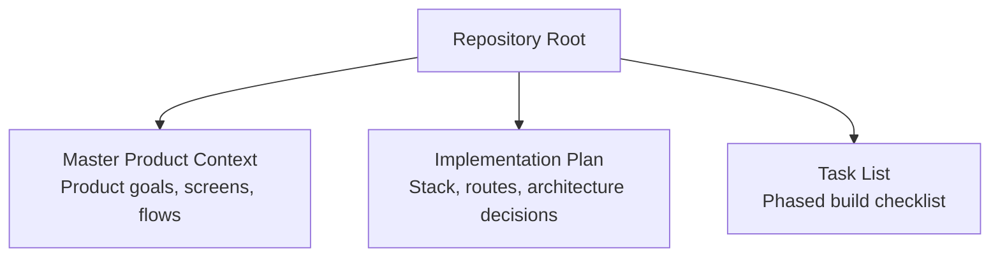
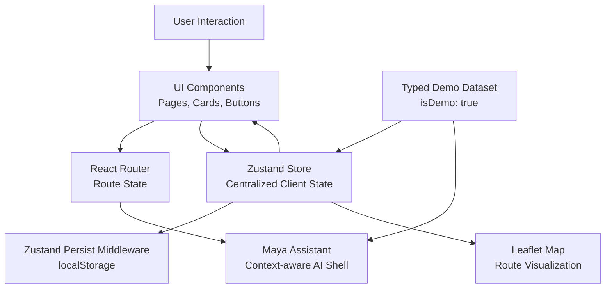
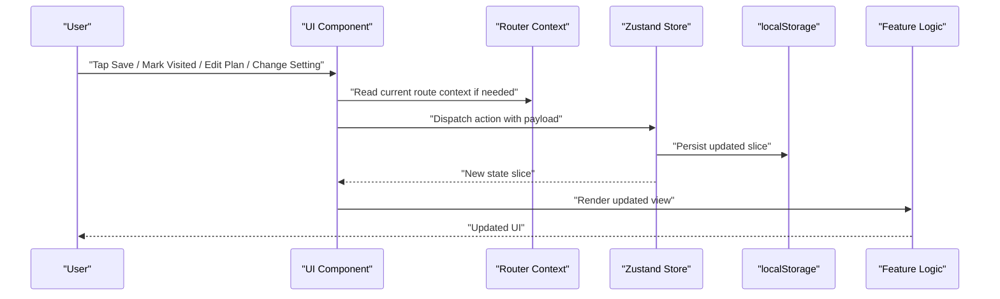
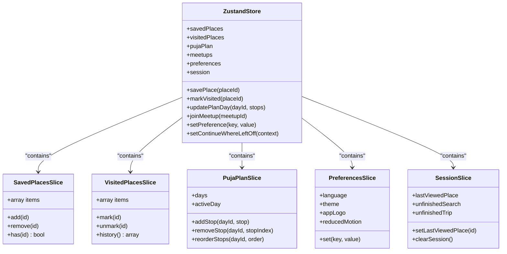
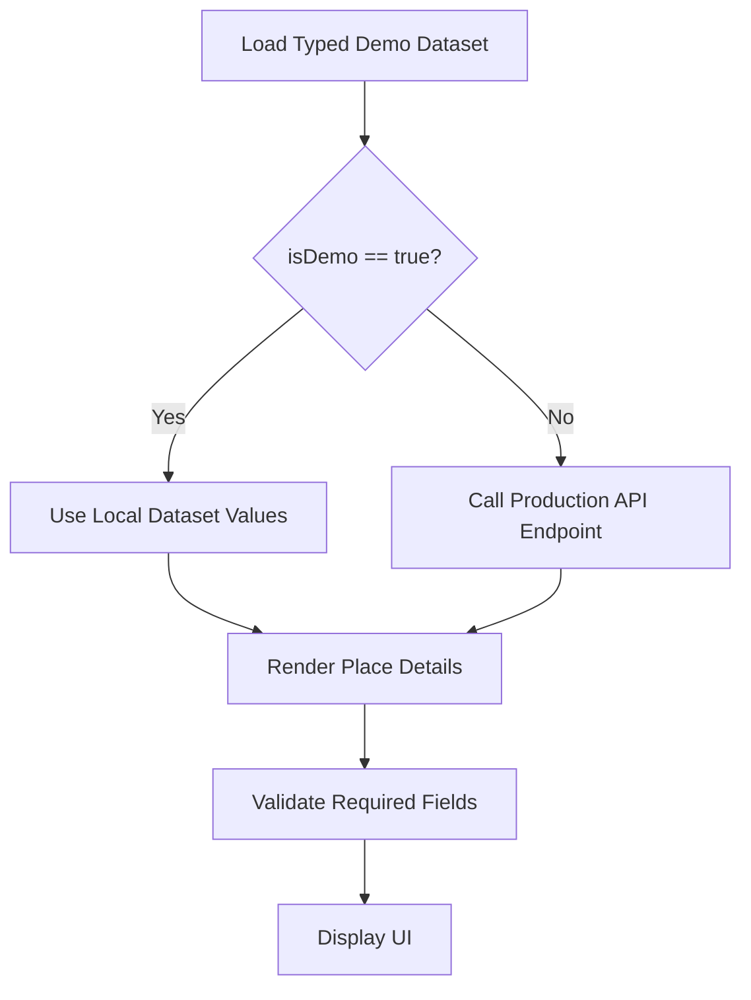
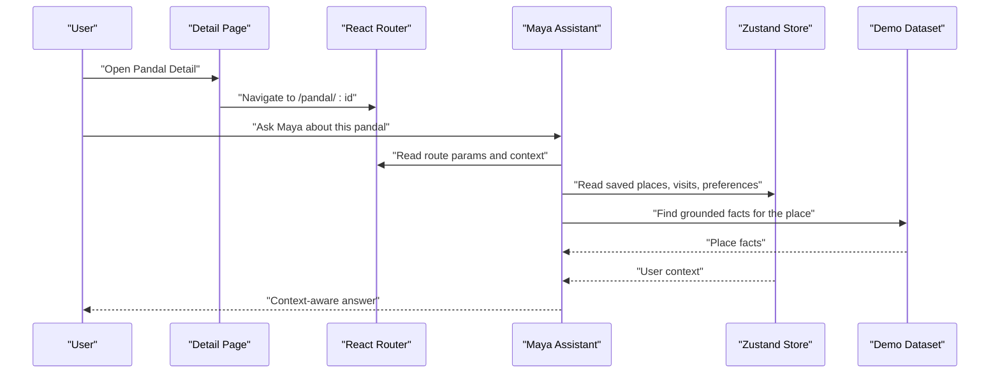
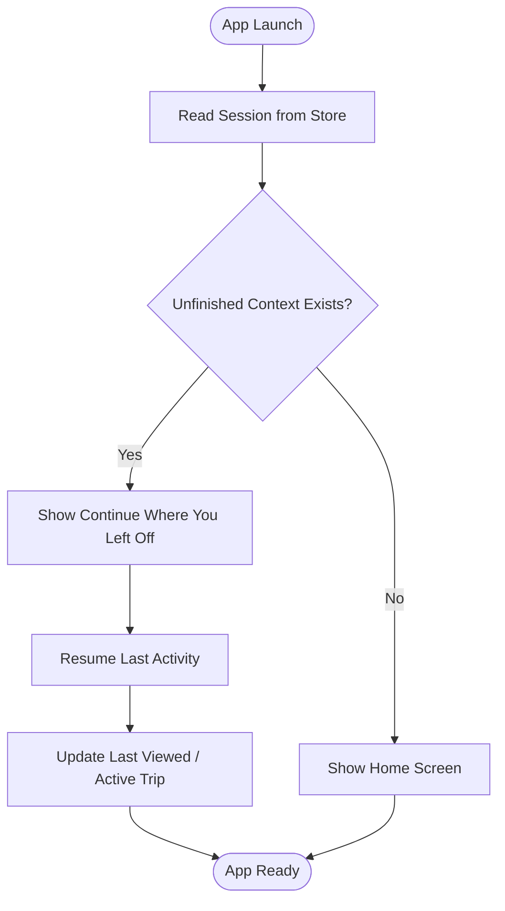
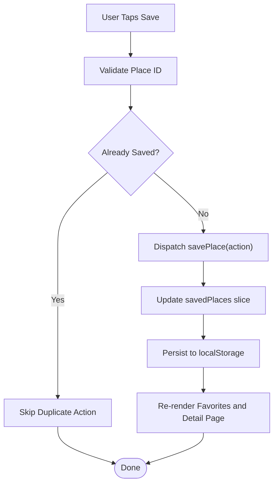
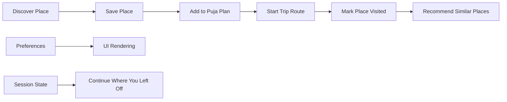
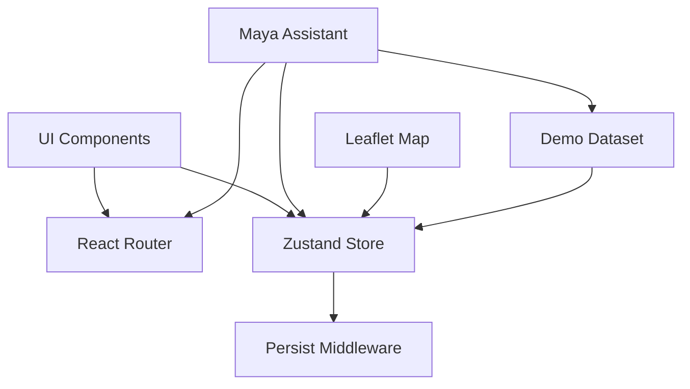

# Data Flow and State Management Patterns

<cite>
**Referenced Files in This Document**
- [Pujo_Sahayak_Master_Project_Context.md](file://Pujo_Sahayak_Master_Project_Context.md)
- [plan.md](file://tasks/plan.md)
- [todo.md](file://tasks/todo.md)
</cite>

## Table of Contents
1. [Introduction](#introduction)
2. [Project Structure](#project-structure)
3. [Core Components](#core-components)
4. [Architecture Overview](#architecture-overview)
5. [Detailed Component Analysis](#detailed-component-analysis)
6. [Dependency Analysis](#dependency-analysis)
7. [Performance Considerations](#performance-considerations)
8. [Troubleshooting Guide](#troubleshooting-guide)
9. [Conclusion](#conclusion)

## Introduction
This document explains the data flow and state management patterns for Puja Sahayak as described by the project’s master context and implementation plan. The application is a mobile-first React + Vite PWA that combines place discovery, AI assistance, route planning, social meetups, safety utilities, and personalization. Its state model centers on a centralized Zustand store with persistence to `localStorage`, while its data layer uses a typed local demo dataset marked clearly as demo data.

The intended user journey is continuous: discover, explore, understand, plan, visit, share, meet people, and then discover again. State management should support this loop by persisting user preferences, saved places, visited places, plans, settings, and session continuity information.

**Section sources**
- [Pujo_Sahayak_Master_Project_Context.md:1-18](file://Pujo_Sahayak_Master_Project_Context.md#L1-L18)
- [Pujo_Sahayak_Master_Project_Context.md:21-73](file://Pujo_Sahayak_Master_Project_Context.md#L21-L73)
- [plan.md:1-17](file://tasks/plan.md#L1-L17)

## Project Structure
At the repository level, the codebase currently exposes two key planning artifacts:

- A master product context file describing the product philosophy, screens, navigation, Maya assistant behavior, and feature scope.
- An implementation plan and task list describing the React + Vite + TypeScript stack, routing, UI libraries, data model, demo dataset, and phased build tasks.

**Diagram sources**
- [Pujo_Sahayak_Master_Project_Context.md:1-100](file://Pujo_Sahayak_Master_Project_Context.md#L1-L100)
- [plan.md:1-17](file://tasks/plan.md#L1-L17)
- [todo.md:1-15](file://tasks/todo.md#L1-L15)

**Section sources**
- [Pujo_Sahayak_Master_Project_Context.md:1-100](file://Pujo_Sahayak_Master_Project_Context.md#L1-L100)
- [plan.md:1-17](file://tasks/plan.md#L1-L17)
- [todo.md:1-15](file://tasks/todo.md#L1-L15)

## Core Components
Based on the documentation, the core state-related components are:

| Area | Responsibility | Persistence | Notes |
|---|---|---|---|
| Centralized Zustand store | Holds global client state such as saved places, visited places, plans, meetups, language, theme, app logo choice, and “continue where you left off” session data. | Yes, via `persist` middleware to `localStorage`. | Single source of truth for user-driven state. |
| Demo dataset | Typed local data representing Kolkata pandals, restaurants, events, meetups, offers, and safety points. | No; it is read-only demo data. | Must be marked `isDemo: true`; crowd levels and hours come from dataset fields only. |
| Route-based context | Supplies current page context such as selected pandal or restaurant to features like Maya. | No; derived from router state. | Enables contextual AI responses without duplicating data. |
| UI components | Render pages and interact with the store through actions. | No; they consume and dispatch state updates. | Should remain presentation-focused. |
| Local storage | Persists user state across reloads. | Yes; browser `localStorage`. | Used by Zustand persistence for user preferences and app state. |

Key responsibilities defined by the plan include:

- One client store using Zustand plus the `persist` middleware.
- Saved places, visited places, six-day Puja plan slots, meetups, language, theme, app-logo selection, and “continue where you left off.”
- A typed data model including `User`, `Place`, `Pandal`, `Restaurant`, `Event`, `Meetup`, `Review`, `Photo`, `Plan`, `Offer`, and `SafetyPoint`.
- A demo dataset grounded in real Kolkata locations but explicitly labeled as demo data.

**Section sources**
- [plan.md:5-17](file://tasks/plan.md#L5-L17)
- [plan.md:41-47](file://tasks/plan.md#L41-L47)
- [todo.md:13-14](file://tasks/todo.md#L13-L14)

## Architecture Overview
The high-level architecture connects UI components, route context, the centralized store, and local storage.

**Diagram sources**
- [plan.md:9-17](file://tasks/plan.md#L9-L17)
- [plan.md:19-39](file://tasks/plan.md#L19-L39)
- [todo.md:36-43](file://tasks/todo.md#L36-L43)

### Data Flow Summary
1. **User interaction**: The user taps Save, marks a place visited, edits a plan day, changes language/theme, or opens Maya.
2. **UI component handling**: The component validates input, reads route context if needed, and calls a store action.
3. **State update**: The Zustand reducer updates the relevant slice.
4. **Persistence**: The `persist` middleware writes changed state to `localStorage`.
5. **Re-render**: Components subscribed to the updated slice re-render.
6. **Secondary effects**: Features such as recommendations, map rendering, or Maya responses may derive new values from the updated state.

**Diagram sources**
- [plan.md:12-17](file://tasks/plan.md#L12-L17)
- [todo.md:47-51](file://tasks/todo.md#L47-L51)

## Detailed Component Analysis

### Centralized Zustand Store Architecture
The store is the single source of truth for user-driven state. It should separate concerns into slices:

| Slice | Purpose | Example Updates |
|---|---|---|
| `savedPlaces` | Places the user explicitly saved. | Add/remove place ID; toggle save status. |
| `visitedPlaces` | Places the user has marked as visited. | Mark place visited; remove visit record. |
| `pujaPlan` | Multi-day itinerary with day slots and stops. | Add stop, reorder stops, delete stop, switch active day. |
| `meetups` | Local meetup records and participation state. | Join meetup, create meetup locally, leave meetup. |
| `preferences` | Language, theme, app logo, reduced motion, accessibility options. | Toggle dark mode, change language, pick logo variant. |
| `session` | “Continue where you left off,” last viewed place, unfinished search or route. | Update last viewed pandal, save unfinished trip, clear session. |

Recommended design rules:

- Keep each slice focused on one domain.
- Expose actions rather than allowing direct mutation.
- Derive computed values such as “You might like” from saved and visited state.
- Avoid coupling UI logic directly into reducers.
- Keep demo data immutable at runtime; do not mutate the dataset itself.

**Diagram sources**
- [plan.md:12-17](file://tasks/plan.md#L12-L17)
- [todo.md:47-51](file://tasks/todo.md#L47-L51)

**Section sources**
- [plan.md:12-17](file://tasks/plan.md#L12-L17)
- [todo.md:47-51](file://tasks/todo.md#L47-L51)

### Demo Data Pattern and `isDemo` Marker
The demo dataset is intentionally local and must never be presented as production API data. The plan requires:

- A typed dataset for Kolkata pandals, restaurants, events, meetups, offers, and safety points.
- Real-world grounding where possible, but explicit demo labeling.
- `isDemo: true` markers so consumers can distinguish mock data from future backend responses.
- Crowd levels and operating hours rendered only from dataset fields.

**Diagram sources**
- [plan.md:17-17](file://tasks/plan.md#L17-L17)
- [todo.md:13-14](file://tasks/todo.md#L13-L14)

Best practices for the demo pattern:

- Never hide the demo marker behind environment variables unless the UI explicitly indicates whether data is simulated.
- Keep dataset schema stable so components do not break when swapping in production endpoints later.
- Treat demo reviews, photos, and engagement metrics as simulation until a real backend exists.
- Provide clear fallback text when required fields are missing.

**Section sources**
- [plan.md:17-17](file://tasks/plan.md#L17-L17)
- [todo.md:13-14](file://tasks/todo.md#L13-L14)

### Route-Based Context for Maya and Navigation State
Maya is not a generic chatbot; it should understand the application’s data and current context. The master context specifies that Maya should know:

- Current location
- Current pandal or selected place
- Saved locations
- Current trip
- Selected language
- Relevant category

When Maya is opened from a detail page, the assistant should already have context about that place. When opened from another screen, it should adapt accordingly.

**Diagram sources**
- [Pujo_Sahayak_Master_Project_Context.md:558-662](file://Pujo_Sahayak_Master_Project_Context.md#L558-L662)
- [plan.md:19-39](file://tasks/plan.md#L19-L39)
- [todo.md:36-43](file://tasks/todo.md#L36-L43)

Navigation state should also support “Continue where you left off.” The master context describes remembering an unfinished route, unfinished search, partially explored category, saved restaurant, or meetup discovery session.

**Diagram sources**
- [Pujo_Sahayak_Master_Project_Context.md:286-318](file://Pujo_Sahayak_Master_Project_Context.md#L286-L318)
- [plan.md:12-17](file://tasks/plan.md#L12-L17)

**Section sources**
- [Pujo_Sahayak_Master_Project_Context.md:558-662](file://Pujo_Sahayak_Master_Project_Context.md#L558-L662)
- [Pujo_Sahayak_Master_Project_Context.md:286-318](file://Pujo_Sahayak_Master_Project_Context.md#L286-L318)
- [plan.md:19-39](file://tasks/plan.md#L19-L39)
- [todo.md:36-43](file://tasks/todo.md#L36-L43)

### State Updates and Data Persistence Examples

#### Saving a Place
1. User taps Save on a place card or detail page.
2. Component checks whether the place is already saved.
3. Component calls `savePlace` with the place identifier.
4. Store adds the identifier to `savedPlaces`.
5. Persist middleware writes the updated slice to `localStorage`.
6. Favorites and recommendation sections re-render.

#### Marking a Place Visited
1. User taps Mark Visited after visiting a location.
2. Component calls `markVisited`.
3. Store adds the place to `visitedPlaces`.
4. UI updates the button state and refreshes “Places You’ve Been.”
5. Recommendations may use visited history to suggest similar places.

#### Updating a Puja Plan
1. User opens the planner and selects a day.
2. User adds a stop from saved places or dataset.
3. Store updates the selected day’s stops.
4. Planner persists the full plan.
5. Trip route map reads the updated day and renders markers and polyline.

**Diagram sources**
- [plan.md:12-17](file://tasks/plan.md#L12-L17)
- [todo.md:47-51](file://tasks/todo.md#L47-L51)

**Section sources**
- [plan.md:12-17](file://tasks/plan.md#L12-L17)
- [todo.md:47-51](file://tasks/todo.md#L47-L51)

### Relationship Between State Slices During User Workflows
Several slices interact during common workflows:

- **Discover → Save → Plan**: A place discovered on Home or Explore can be saved, then added to a planner day.
- **Save → Visit → Recommend**: Saved and visited places feed “You might like” recommendations.
- **Plan → Trip → Visit**: A planned day becomes a trip route; after visiting, the place is marked visited.
- **Preferences → UI**: Language, theme, and reduced motion affect rendering and accessibility.
- **Session → Continuity**: Last viewed place or unfinished trip restores recent activity.

**Diagram sources**
- [Pujo_Sahayak_Master_Project_Context.md:21-73](file://Pujo_Sahayak_Master_Project_Context.md#L21-L73)
- [Pujo_Sahayak_Master_Project_Context.md:320-350](file://Pujo_Sahayak_Master_Project_Context.md#L320-L350)
- [plan.md:12-17](file://tasks/plan.md#L12-L17)

**Section sources**
- [Pujo_Sahayak_Master_Project_Context.md:21-73](file://Pujo_Sahayak_Master_Project_Context.md#L21-L73)
- [Pujo_Sahayak_Master_Project_Context.md:320-350](file://Pujo_Sahayak_Master_Project_Context.md#L320-L350)
- [plan.md:12-17](file://tasks/plan.md#L12-L17)

## Dependency Analysis
The main dependencies between architectural layers are:

- UI components depend on React Router for navigation and on Zustand for state.
- Maya depends on route context, store state, and the demo dataset.
- The store depends on the `persist` middleware for `localStorage`.
- The demo dataset is consumed by UI and Maya but should not be mutated.
- Leaflet maps depend on planner state for route visualization.

**Diagram sources**
- [plan.md:9-17](file://tasks/plan.md#L9-L17)
- [plan.md:19-39](file://tasks/plan.md#L19-L39)
- [todo.md:36-43](file://tasks/todo.md#L36-L43)

**Section sources**
- [plan.md:9-17](file://tasks/plan.md#L9-L17)
- [plan.md:19-39](file://tasks/plan.md#L19-L39)
- [todo.md:36-43](file://tasks/todo.md#L36-L43)

## Performance Considerations
The following strategies align with the documented architecture:

- **Keep the store normalized**: Store identifiers for saved and visited places rather than duplicating full place objects.
- **Avoid unnecessary re-renders**: Subscribe only to the slices used by each component.
- **Debounce heavy operations**: For example, debounce search input and recommendation recalculation.
- **Lazy-load non-critical state**: Initialize heavy computed values only when needed.
- **Respect reduced motion**: Honor accessibility preferences when animating UI.
- **Limit localStorage writes**: Batch updates where possible instead of writing on every micro-interaction.
- **Separate demo data from runtime state**: Do not mutate the dataset; treat it as read-only configuration.
- **Use deterministic selectors**: Derive computed values such as “You might like” from stable inputs.

[No sources needed since this section provides general guidance]

## Troubleshooting Guide

### Common State Issues
| Symptom | Likely Cause | Resolution |
|---|---|---|
| Saved places disappear after reload | Zustand persistence not configured or `localStorage` blocked | Verify `persist` middleware and browser storage permissions. |
| Maya shows no context | Route context not passed or route params missing | Ensure Maya reads current route and selected place before answering. |
| Plan resets after reload | Plan slice not persisted or wrong storage key | Confirm plan state is included in persisted store. |
| Recommendations always empty | Saved or visited slices not populated | Trigger save or visit actions and verify store updates. |
| UI does not reflect preference changes | Preference slice not subscribed or theme not applied | Check selector subscription and CSS/theme integration. |

### Validation and Error Handling Guidelines
- Validate place IDs before saving or marking visited.
- Validate required dataset fields before rendering details.
- Handle missing or malformed demo data gracefully.
- Distinguish between network errors (future API) and local state errors.
- Provide user-friendly messages when Maya cannot find verified information.
- Log errors in development without exposing sensitive user state in production logs.

**Section sources**
- [plan.md:17-17](file://tasks/plan.md#L17-L17)
- [todo.md:36-43](file://tasks/todo.md#L36-L43)

## Conclusion
Puja Sahayak’s data flow and state management should center on a single Zustand store with persistence, a clearly labeled demo dataset, and route-based context for contextual features like Maya. UI components should dispatch actions, the store should update slices, and persistence should keep user preferences, saved places, visited places, plans, and session continuity available across reloads. By separating demo data from runtime state, validating inputs, handling errors explicitly, and optimizing re-renders, the application can support the intended continuous discovery-to-planning-to-visiting workflow while remaining extensible to production APIs later.

[No sources needed since this section summarizes without analyzing specific files]