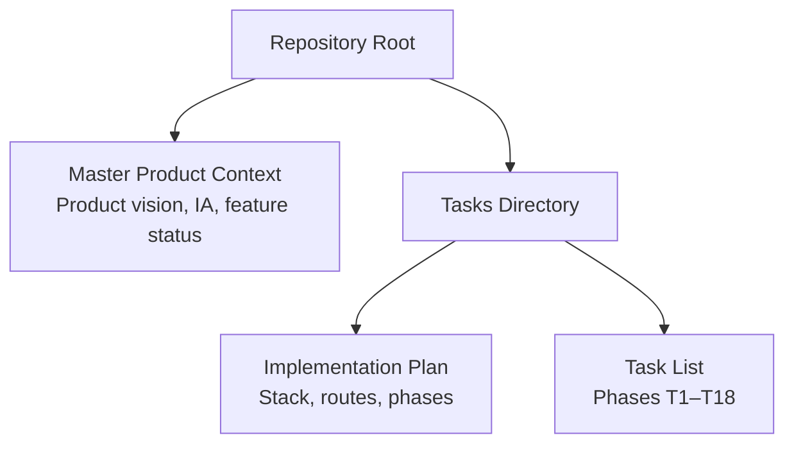
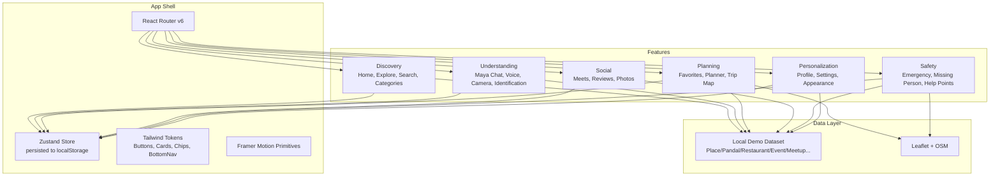
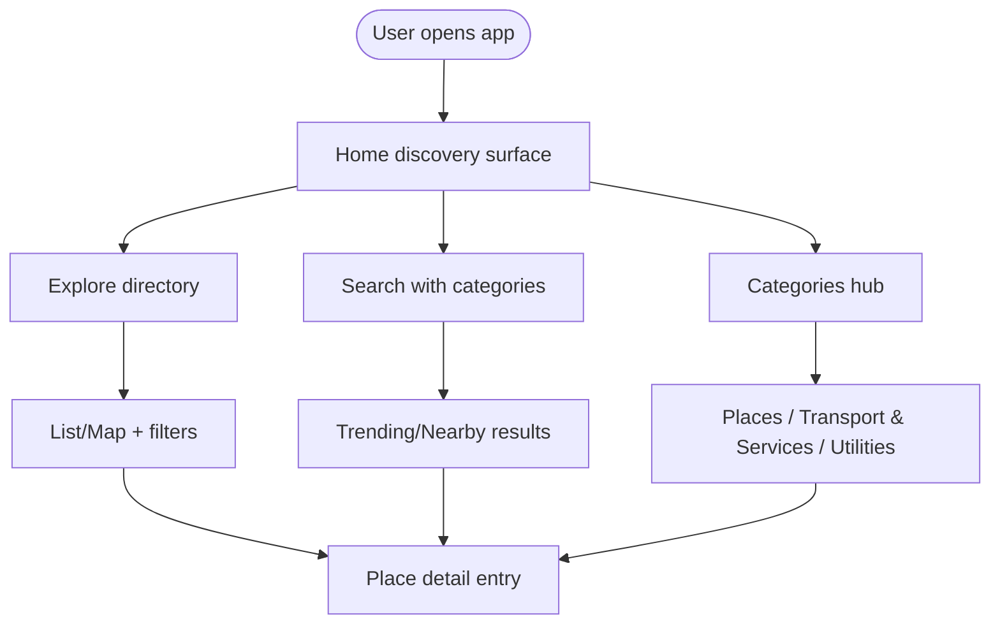
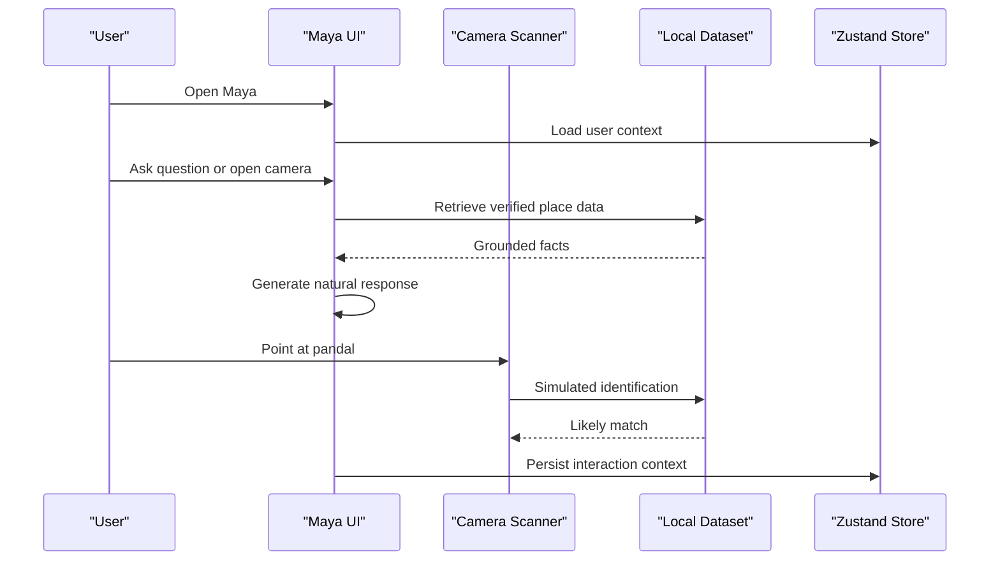
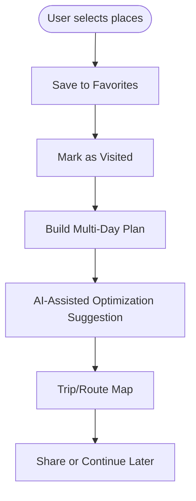
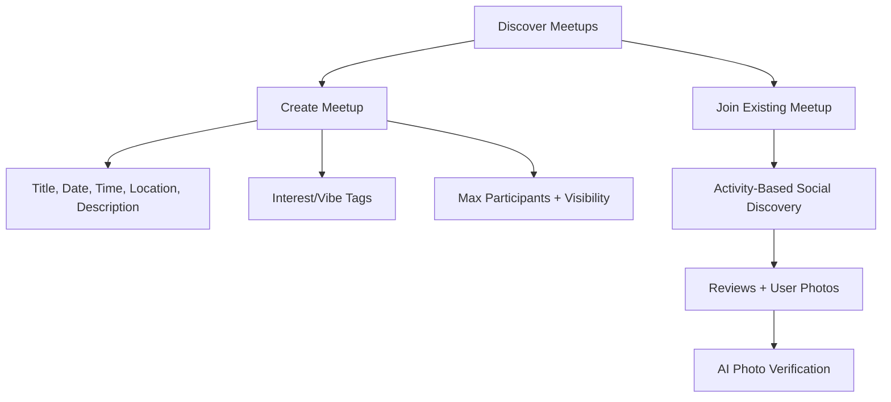
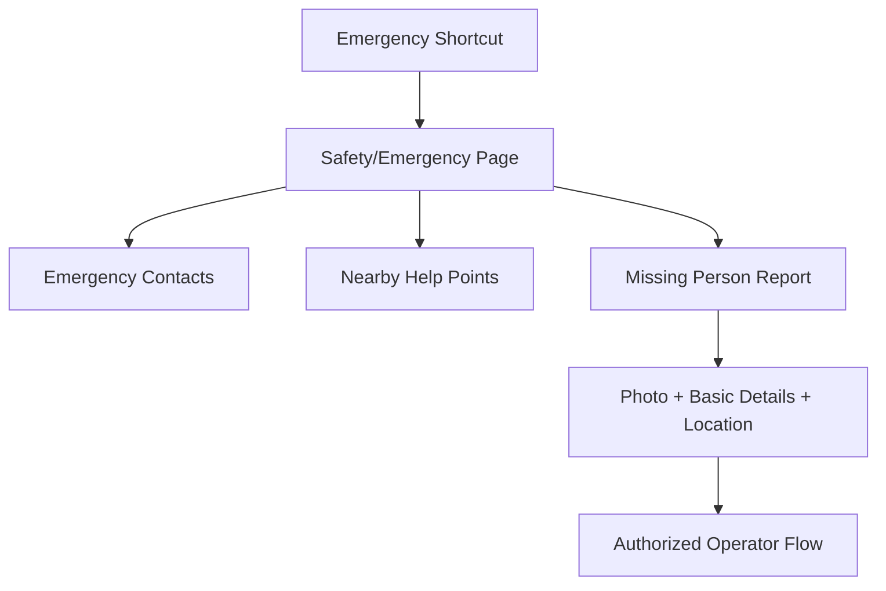
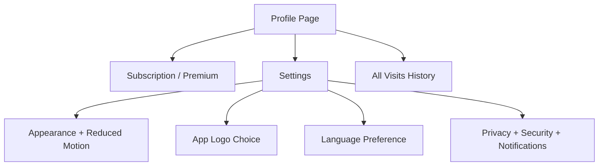
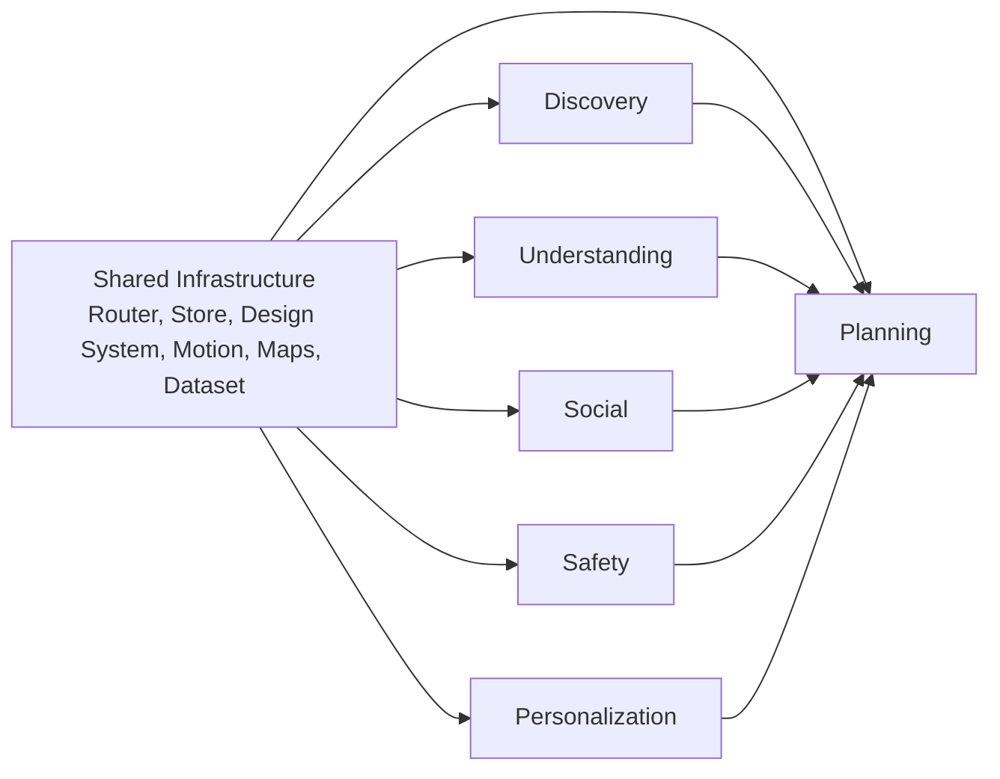

# Feature-Based Organization Strategy

<cite>
**Referenced Files in This Document**
- [Pujo_Sahayak_Master_Project_Context.md](file://Pujo_Sahayak_Master_Project_Context.md)
- [plan.md](file://tasks/plan.md)
- [todo.md](file://tasks/todo.md)
</cite>

## Table of Contents
1. [Introduction](#introduction)
2. [Project Structure](#project-structure)
3. [Core Components](#core-components)
4. [Architecture Overview](#architecture-overview)
5. [Detailed Component Analysis](#detailed-component-analysis)
6. [Dependency Analysis](#dependency-analysis)
7. [Performance Considerations](#performance-considerations)
8. [Troubleshooting Guide](#troubleshooting-guide)
9. [Conclusion](#conclusion)
10. [Appendices](#appendices)

## Introduction
This document explains the feature-based organization strategy for Puja Sahayak. The product is intentionally organized around user journeys rather than technical layers. The core journey is:

Discover → Explore → Understand → Plan → Visit → Share / Review → Meet people → Discover something else.

The documented features include Discovery, Understanding, Planning, Social, Safety, and Personalization. Each feature should encapsulate its own components, state management, routing, and data access patterns while sharing common design tokens, UI primitives, and cross-cutting concerns such as location, persistence, motion, and accessibility.

The repository currently contains product context and implementation planning documents that define the intended architecture, routes, data model, and feature boundaries. This guide translates those plans into a practical feature-based organization strategy.

**Section sources**
- [Pujo_Sahayak_Master_Project_Context.md:21-43](file://Pujo_Sahayak_Master_Project_Context.md#L21-L43)
- [Pujo_Sahayak_Master_Project_Context.md:77-100](file://Pujo_Sahayak_Master_Project_Context.md#L77-L100)
- [plan.md:1-16](file://tasks/plan.md#L1-L16)

## Project Structure
At this stage, the repository contains:
- A master product context document describing the end-to-end product vision, information architecture, and feature status.
- An implementation plan defining the React + Vite PWA stack, screen-to-route mapping, task phases, and verification criteria.
- A task list tracking build phases from foundation through polish.

**Diagram sources**
- [Pujo_Sahayak_Master_Project_Context.md:1-20](file://Pujo_Sahayak_Master_Project_Context.md#L1-L20)
- [plan.md:1-16](file://tasks/plan.md#L1-L16)
- [todo.md:1-12](file://tasks/todo.md#L1-L12)

**Section sources**
- [Pujo_Sahayak_Master_Project_Context.md:1-20](file://Pujo_Sahayak_Master_Project_Context.md#L1-L20)
- [plan.md:1-16](file://tasks/plan.md#L1-L16)
- [todo.md:1-12](file://tasks/todo.md#L1-L12)

## Core Components
The project defines several core capabilities that map directly to features:

- Discovery: Home, Explore, Search, Categories, Nearby, Trending, Offers, Events, Restaurants, Shopping, Beyond Puja.
- Understanding: Maya AI assistant, Pandal identification via camera, contextual explanations, multilingual support.
- Planning: Favorites, Puja Planner with day slots, route optimization suggestions, Trip/Route Map.
- Social: Meets list, Create Meetup, Find Your Vibe, Reviews, User Photos, Top Clicks.
- Safety: Emergency shortcuts, Safety/Emergency page, Missing Person Report, Help points.
- Personalization: Profile, Settings, Appearance (dark mode, reduced motion), App Logo choice, Language, Privacy, Security, Notifications.

These capabilities are grouped by user intent, not by technical layer. For example, “Maya” is not just a chat component; it is an understanding feature that spans chat, voice, camera, identification, recommendations, and planning assistance.

**Section sources**
- [Pujo_Sahayak_Master_Project_Context.md:77-100](file://Pujo_Sahayak_Master_Project_Context.md#L77-L100)
- [Pujo_Sahayak_Master_Project_Context.md:558-662](file://Pujo_Sahayak_Master_Project_Context.md#L558-L662)
- [Pujo_Sahayak_Master_Project_Context.md:664-772](file://Pujo_Sahayak_Master_Project_Context.md#L664-L772)
- [Pujo_Sahayak_Master_Project_Context.md:995-1039](file://Pujo_Sahayak_Master_Project_Context.md#L995-L1039)
- [Pujo_Sahayak_Master_Project_Context.md:1055-1091](file://Pujo_Sahayak_Master_Project_Context.md#L1055-L1091)
- [plan.md:19-39](file://tasks/plan.md#L19-L39)

## Architecture Overview
The application is a mobile-first React + Vite PWA using:
- React Router v6 for navigation and nested detail routes.
- Zustand with persist middleware for client-side state.
- Tailwind CSS v4 for design tokens and bespoke UI.
- Framer Motion for motion primitives.
- Leaflet + OpenStreetMap for maps.
- Local demo dataset with `isDemo: true`.

The architecture supports feature boundaries through:
- Route-based feature entry points.
- Shared store slices for cross-feature state.
- Shared UI primitives for consistent experience.
- Clear separation between local simulation and future backend integrations.

**Diagram sources**
- [plan.md:7-16](file://tasks/plan.md#L7-L16)
- [plan.md:19-39](file://tasks/plan.md#L19-L39)
- [todo.md:10-14](file://tasks/todo.md#L10-L14)
- [Pujo_Sahayak_Master_Project_Context.md:1232-1255](file://Pujo_Sahayak_Master_Project_Context.md#L1232-L1255)

**Section sources**
- [plan.md:7-16](file://tasks/plan.md#L7-L16)
- [plan.md:19-39](file://tasks/plan.md#L19-L39)
- [todo.md:10-14](file://tasks/todo.md#L10-L14)
- [Pujo_Sahayak_Master_Project_Context.md:1232-1255](file://Pujo_Sahayak_Master_Project_Context.md#L1232-L1255)

## Detailed Component Analysis

### Discovery Feature
Discovery covers how users find pandals, restaurants, events, offers, and local experiences. It includes:
- Home as the main discovery surface with sponsored spotlight, explore spotlight, restaurants, offers, events, and continue-where-left-off.
- Explore with list/map views and filters.
- Search with trending, nearby, and category shortcuts.
- Categories grouping Places, Transport & Services, and Utilities.

Discovery should be implemented as a feature boundary containing:
- Components: Home sections, Place cards, Filters, Category tiles.
- State: Current filters, trending/nearby results, continue session.
- Routing: `/`, `/explore`, `/search`, `/categories`.
- Data access: Local dataset queries filtered by category, location, and popularity signals.

**Diagram sources**
- [Pujo_Sahayak_Master_Project_Context.md:140-157](file://Pujo_Sahayak_Master_Project_Context.md#L140-L157)
- [Pujo_Sahayak_Master_Project_Context.md:160-284](file://Pujo_Sahayak_Master_Project_Context.md#L160-L284)
- [Pujo_Sahayak_Master_Project_Context.md:447-556](file://Pujo_Sahayak_Master_Project_Context.md#L447-L556)
- [plan.md:19-39](file://tasks/plan.md#L19-L39)

**Section sources**
- [Pujo_Sahayak_Master_Project_Context.md:140-157](file://Pujo_Sahayak_Master_Project_Context.md#L140-L157)
- [Pujo_Sahayak_Master_Project_Context.md:160-284](file://Pujo_Sahayak_Master_Project_Context.md#L160-L284)
- [Pujo_Sahayak_Master_Project_Context.md:447-556](file://Pujo_Sahayak_Master_Project_Context.md#L447-L556)
- [plan.md:19-39](file://tasks/plan.md#L19-L39)

### Understanding Feature (Maya)
Understanding is centered on Maya, the contextual AI assistant. It includes:
- Chat interface grounded in application data.
- Voice waveform UI.
- Camera scan with real `getUserMedia` preview and animated scan frame.
- Pandal identification simulated against the dataset.
- Explanations about theme, story, symbolism, artist info, visit details.
- Context awareness based on current place, saved locations, trip, language, and category.

Maya must never hallucinate facts. If information is unavailable, it should respond honestly.

**Diagram sources**
- [Pujo_Sahayak_Master_Project_Context.md:558-662](file://Pujo_Sahayak_Master_Project_Context.md#L558-L662)
- [Pujo_Sahayak_Master_Project_Context.md:608-641](file://Pujo_Sahayak_Master_Project_Context.md#L608-L641)
- [Pujo_Sahayak_Master_Project_Context.md:1330-1358](file://Pujo_Sahayak_Master_Project_Context.md#L1330-L1358)
- [plan.md:15-16](file://tasks/plan.md#L15-L16)

**Section sources**
- [Pujo_Sahayak_Master_Project_Context.md:558-662](file://Pujo_Sahayak_Master_Project_Context.md#L558-L662)
- [Pujo_Sahayak_Master_Project_Context.md:608-641](file://Pujo_Sahayak_Master_Project_Context.md#L608-L641)
- [Pujo_Sahayak_Master_Project_Context.md:1330-1358](file://Pujo_Sahayak_Master_Project_Context.md#L1330-L1358)
- [plan.md:15-16](file://tasks/plan.md#L15-L16)

### Planning Feature
Planning enables users to save places, track visits, and construct multi-day itineraries. It includes:
- Favorites with saved places, visited places, and recommendations.
- Puja Planner with day tabs, stops, add-place actions, and AI-assisted optimization suggestions.
- Trip/Route Map using Leaflet for multi-stop visualization.

Planning state should be persisted through Zustand so saves, visits, and plans survive reloads.

**Diagram sources**
- [Pujo_Sahayak_Master_Project_Context.md:320-402](file://Pujo_Sahayak_Master_Project_Context.md#L320-L402)
- [Pujo_Sahayak_Master_Project_Context.md:404-444](file://Pujo_Sahayak_Master_Project_Context.md#L404-L444)
- [plan.md:19-39](file://tasks/plan.md#L19-L39)

**Section sources**
- [Pujo_Sahayak_Master_Project_Context.md:320-402](file://Pujo_Sahayak_Master_Project_Context.md#L320-L402)
- [Pujo_Sahayak_Master_Project_Context.md:404-444](file://Pujo_Sahayak_Master_Project_Context.md#L404-L444)
- [plan.md:19-39](file://tasks/plan.md#L19-L39)

### Social Feature
Social functionality centers on meetups, reviews, and user-generated content:
- Meets list showing existing meetups with name, date, time, location, participants, and description.
- Create Meetup flow with title, date, time, location, description, interest/vibe, max participants, and visibility.
- Find People Your Vibe for activity-based social discovery.
- Reviews and user photos tied to places, with AI-assisted photo verification.

**Diagram sources**
- [Pujo_Sahayak_Master_Project_Context.md:664-772](file://Pujo_Sahayak_Master_Project_Context.md#L664-L772)
- [Pujo_Sahayak_Master_Project_Context.md:811-893](file://Pujo_Sahayak_Master_Project_Context.md#L811-L893)

**Section sources**
- [Pujo_Sahayak_Master_Project_Context.md:664-772](file://Pujo_Sahayak_Master_Project_Context.md#L664-L772)
- [Pujo_Sahayak_Master_Project_Context.md:811-893](file://Pujo_Sahayak_Master_Project_Context.md#L811-L893)

### Safety Feature
Safety provides emergency shortcuts and safety-related pages:
- Emergency shortcuts for ambulance, police, women’s assistance, child assistance.
- Safety/Emergency page and Missing Person Report wizard.
- Nearby help points and safety-oriented location usage.

Safety UI must prioritize clarity and speed over visual effects.

**Diagram sources**
- [Pujo_Sahayak_Master_Project_Context.md:995-1011](file://Pujo_Sahayak_Master_Project_Context.md#L995-L1011)
- [Pujo_Sahayak_Master_Project_Context.md:1390-1439](file://Pujo_Sahayak_Master_Project_Context.md#L1390-L1439)
- [plan.md:19-39](file://tasks/plan.md#L19-L39)

**Section sources**
- [Pujo_Sahayak_Master_Project_Context.md:995-1011](file://Pujo_Sahayak_Master_Project_Context.md#L995-L1011)
- [Pujo_Sahayak_Master_Project_Context.md:1390-1439](file://Pujo_Sahayak_Master_Project_Context.md#L1390-L1439)
- [plan.md:19-39](file://tasks/plan.md#L19-L39)

### Personalization Feature
Personalization includes profile controls, settings, appearance, and account preferences:
- Profile as personal control center with subscription and premium CTAs.
- Settings for appearance (light/dark/system default, reduced motion), app logo choice, language, privacy, security, notifications, permissions.
- Account management and off-season continuity.

**Diagram sources**
- [Pujo_Sahayak_Master_Project_Context.md:954-1039](file://Pujo_Sahayak_Master_Project_Context.md#L954-L1039)
- [Pujo_Sahayak_Master_Project_Context.md:1055-1091](file://Pujo_Sahayak_Master_Project_Context.md#L1055-L1091)
- [plan.md:19-39](file://tasks/plan.md#L19-L39)

**Section sources**
- [Pujo_Sahayak_Master_Project_Context.md:954-1039](file://Pujo_Sahayak_Master_Project_Context.md#L954-L1039)
- [Pujo_Sahayak_Master_Project_Context.md:1055-1091](file://Pujo_Sahayak_Master_Project_Context.md#L1055-L1091)
- [plan.md:19-39](file://tasks/plan.md#L19-L39)

## Dependency Analysis
Feature dependencies should follow these principles:
- Features depend on shared infrastructure: router, store, design system, motion, maps, and dataset.
- Cross-feature communication occurs through the shared store and well-defined data models.
- Features should avoid tight coupling; for example, Social should not directly manipulate Planning internals but can reference saved places and visited places through the store.
- Maya depends on dataset and store context but should not hard-code UI details from other features.

**Diagram sources**
- [plan.md:7-16](file://tasks/plan.md#L7-L16)
- [todo.md:10-14](file://tasks/todo.md#L10-L14)
- [Pujo_Sahayak_Master_Project_Context.md:1232-1255](file://Pujo_Sahayak_Master_Project_Context.md#L1232-L1255)

**Section sources**
- [plan.md:7-16](file://tasks/plan.md#L7-L16)
- [todo.md:10-14](file://tasks/todo.md#L10-L14)
- [Pujo_Sahayak_Master_Project_Context.md:1232-1255](file://Pujo_Sahayak_Master_Project_Context.md#L1232-L1255)

## Performance Considerations
- Keep feature bundles small by co-locating feature code and lazy-loading routes where appropriate.
- Use the local dataset efficiently with typed queries and avoid unnecessary re-renders by isolating store slices per feature.
- Respect reduced-motion preferences for accessibility and performance.
- Avoid heavy image processing on the main thread; use web workers or progressive loading for camera and photo verification flows.
- Cache frequently accessed data in memory and persist only necessary user state.

[No sources needed since this section provides general guidance]

## Troubleshooting Guide
Common issues and resolutions aligned with the feature strategy:
- Maya hallucination: Ensure responses are grounded in dataset fields; if data is missing, return honest messages instead of inventing facts.
- Offline images: Provide gradient/placeholder fallbacks so layout remains stable without images.
- Persistence failures: Verify Zustand persist middleware writes to localStorage and survives reloads.
- Route navigation: Confirm every route is reachable via bottom nav or deep links as documented.
- Mockup fidelity vs improved UI: Preserve IA and element placement while redesigning visuals professionally.

**Section sources**
- [Pujo_Sahayak_Master_Project_Context.md:1330-1358](file://Pujo_Sahayak_Master_Project_Context.md#L1330-L1358)
- [plan.md:63-79](file://tasks/plan.md#L63-L79)

## Conclusion
Organizing Puja Sahayak by user journeys rather than technical layers improves maintainability, enables parallel development, and supports independent feature deployment. Each feature—Discovery, Understanding, Planning, Social, Safety, Personalization—should encapsulate its own components, state, routing, and data access patterns while sharing common infrastructure. The documented routes, data model, and task phases provide a clear roadmap for implementing and evolving the platform beyond the Puja season.

[No sources needed since this section summarizes without analyzing specific files]

## Appendices

### Feature Folder Structure Template
A recommended feature folder structure aligns with the documented features and shared infrastructure:

- src/features/discovery
  - components
  - hooks
  - store.ts
  - routes.ts
  - data-access.ts
- src/features/understanding
  - components
  - hooks
  - store.ts
  - routes.ts
  - data-access.ts
- src/features/planning
  - components
  - hooks
  - store.ts
  - routes.ts
  - data-access.ts
- src/features/social
  - components
  - hooks
  - store.ts
  - routes.ts
  - data-access.ts
- src/features/safety
  - components
  - hooks
  - store.ts
  - routes.ts
  - data-access.ts
- src/features/personalization
  - components
  - hooks
  - store.ts
  - routes.ts
  - data-access.ts
- src/shared
  - design-tokens
  - ui-primitives
  - motion-primitives
  - utils
  - i18n
  - types

This structure keeps each feature self-contained while promoting reuse of shared utilities and design tokens.

[No sources needed since this section provides conceptual guidance]

### Integration Checklist for New Features
When integrating a new feature:
- Define the user journey and feature scope.
- Add routes under the feature’s routing module.
- Create feature-specific components and hooks.
- Isolate feature state in a dedicated store slice.
- Implement data access patterns against the dataset or external services.
- Connect to shared infrastructure (router, store, design system, motion).
- Add tests and verification steps aligned with the project-wide checklist.

**Section sources**
- [plan.md:63-79](file://tasks/plan.md#L63-L79)
- [todo.md:1-14](file://tasks/todo.md#L1-L14)