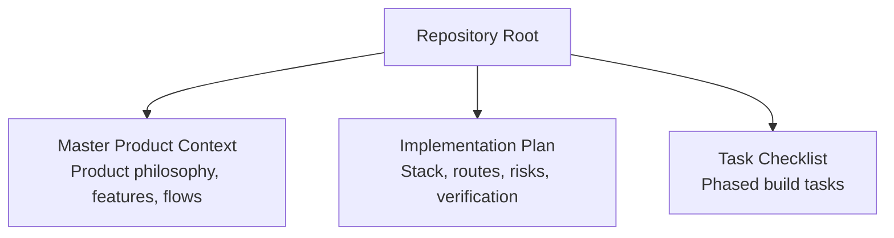
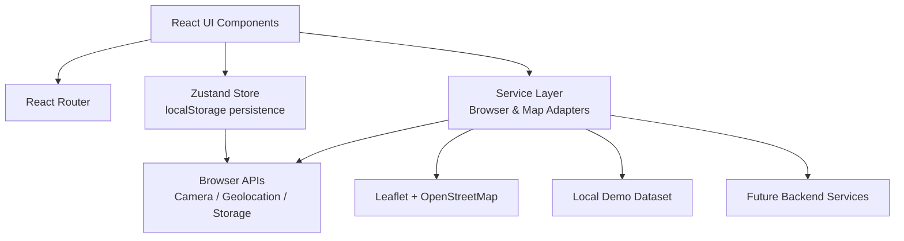
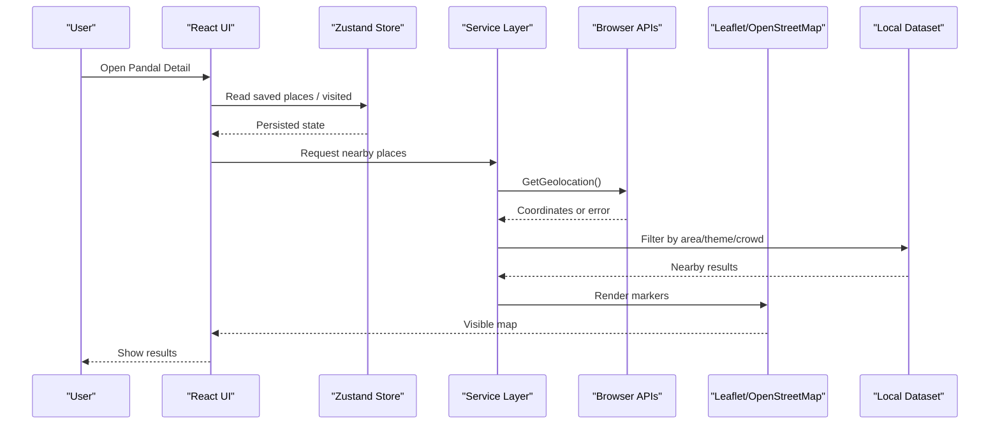
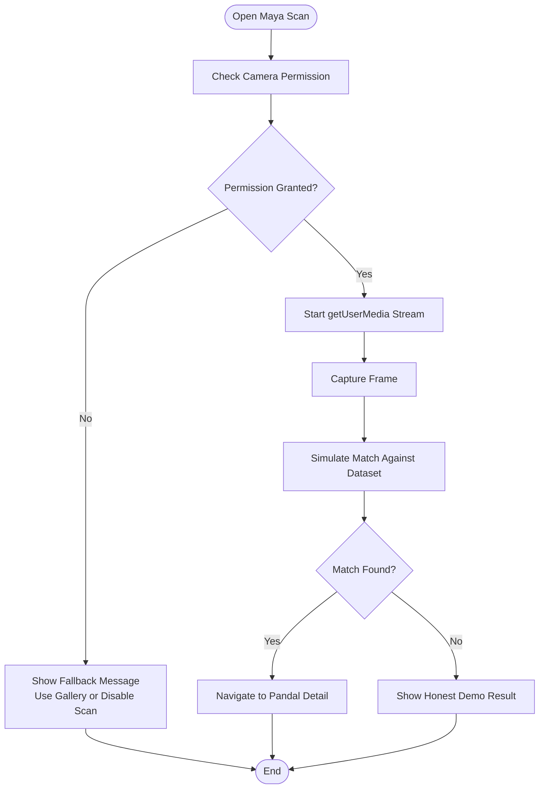
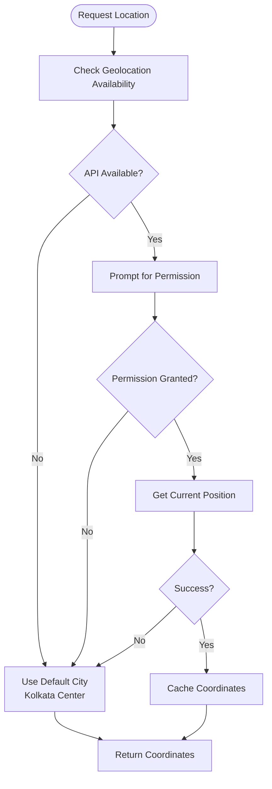
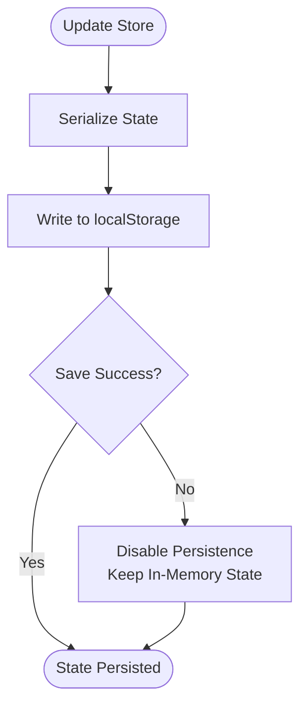
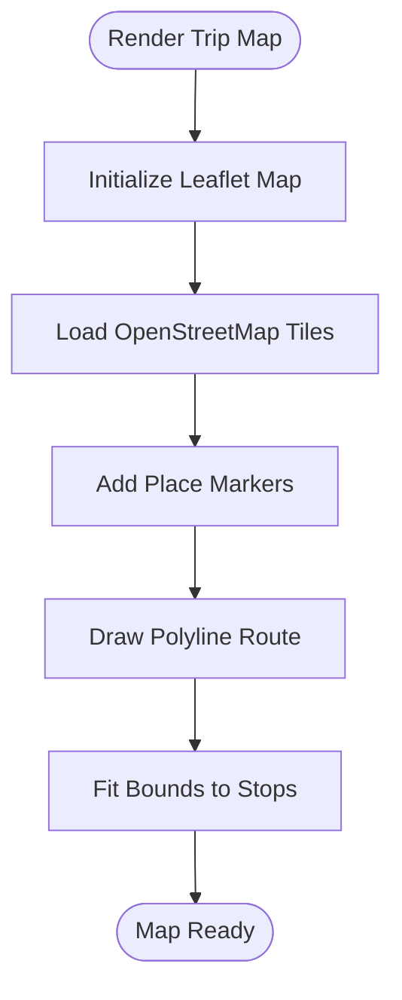
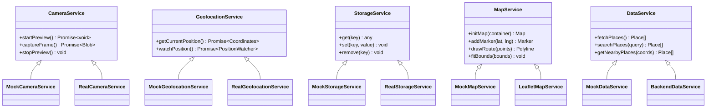
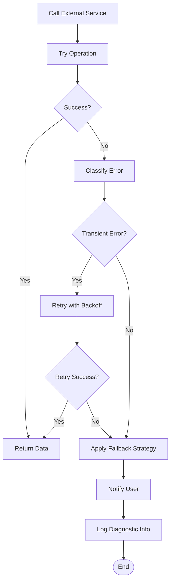
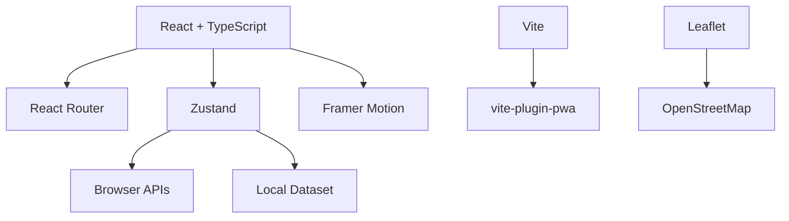

# System Boundaries and Integration Points

<cite>
**Referenced Files in This Document**
- [Pujo_Sahayak_Master_Project_Context.md](file://Pujo_Sahayak_Master_Project_Context.md)
- [plan.md](file://tasks/plan.md)
- [todo.md](file://tasks/todo.md)
</cite>

## Table of Contents
1. [Introduction](#introduction)
2. [Project Structure](#project-structure)
3. [Core Components](#core-components)
4. [Architecture Overview](#architecture-overview)
5. [Detailed Component Analysis](#detailed-component-analysis)
6. [Dependency Analysis](#dependency-analysis)
7. [Performance Considerations](#performance-considerations)
8. [Troubleshooting Guide](#troubleshooting-guide)
9. [Conclusion](#conclusion)

## Introduction
This document describes the system boundaries and external integration points for Puja Sahayak, focusing on how the application will interact with browser APIs and mapping services, and how a service layer should abstract those dependencies. It also documents planned API abstraction patterns that allow switching between mock data and real backend services, security considerations for browser permissions, fallback strategies when APIs are unavailable, integration testing approaches, and error handling patterns for external service failures.

The project is a mobile-first React + Vite PWA centered around Durga Puja discovery, AI assistance via Maya, route planning, social meetups, safety utilities, and local exploration beyond the festival season. The current repository contains product context and implementation plans rather than source code; therefore, this document synthesizes the intended architecture from those plans and provides concrete design guidance for implementing the integrations safely and testably.

**Section sources**
- [Pujo_Sahayak_Master_Project_Context.md:1-120](file://Pujo_Sahayak_Master_Project_Context.md#L1-L120)
- [plan.md:1-18](file://tasks/plan.md#L1-L18)

## Project Structure
At this stage, the repository includes:
- A master product context file describing the product philosophy, user journey, screens, and feature scope.
- An implementation plan outlining the React + Vite PWA stack, routing, state management, map integration, and Maya behavior.
- A task checklist tracking phased delivery across foundation, discovery, Maya, planning, utility, and polish phases.

**Diagram sources**
- [Pujo_Sahayak_Master_Project_Context.md:1-120](file://Pujo_Sahayak_Master_Project_Context.md#L1-L120)
- [plan.md:1-18](file://tasks/plan.md#L1-L18)
- [todo.md:1-15](file://tasks/todo.md#L1-L15)

**Section sources**
- [Pujo_Sahayak_Master_Project_Context.md:1-120](file://Pujo_Sahayak_Master_Project_Context.md#L1-L120)
- [plan.md:1-18](file://tasks/plan.md#L1-L18)
- [todo.md:1-15](file://tasks/todo.md#L1-L15)

## Core Components
The system boundaries can be grouped into four major areas:

- Browser API boundary
  - Camera API for visual pandal identification through Maya’s scan flow.
  - Geolocation API for location-based discovery, nearby places, and route planning.
  - Storage API for persistence of user preferences, saved places, visits, plans, and settings via localStorage.
  - Map services via Leaflet and OpenStreetMap tiles for route visualization and nearby help points.

- Service layer boundary
  - A thin service layer that encapsulates browser APIs and map providers.
  - Pluggable adapters for mock vs real implementations.
  - Typed interfaces so UI components remain decoupled from external dependencies.

- Data boundary
  - Local demo dataset grounded in real Kolkata locations.
  - User-generated state persisted to localStorage.
  - Clear distinction between demo data and production backend responses.

- External service boundary
  - Optional future backend services for AI responses, content moderation, analytics, and authentication.
  - Current Maya behavior is locally simulated against the dataset.

**Diagram sources**
- [plan.md:7-18](file://tasks/plan.md#L7-L18)
- [todo.md:3-14](file://tasks/todo.md#L3-L14)

**Section sources**
- [plan.md:7-18](file://tasks/plan.md#L7-L18)
- [todo.md:3-14](file://tasks/todo.md#L3-L14)

## Architecture Overview
The intended architecture follows a layered approach:

- Presentation layer (UI): Routes, pages, cards, navigation, and Maya chat/scan interfaces.
- State layer (Zustand): Centralized client store with persistence for user state.
- Service layer: Encapsulates all external dependencies behind typed interfaces.
- Data layer: Local dataset and optional backend endpoints.
- Platform layer: Browser APIs and map tile providers.

**Diagram sources**
- [plan.md:7-18](file://tasks/plan.md#L7-L18)
- [todo.md:25-31](file://tasks/todo.md#L25-L31)

**Section sources**
- [plan.md:7-18](file://tasks/plan.md#L7-L18)
- [todo.md:25-31](file://tasks/todo.md#L25-L31)

## Detailed Component Analysis

### Camera API Integration for Visual Pandal Identification
The Maya scan flow uses the Camera API to capture images and simulate matching against known pandal visuals. The implementation plan specifies a live getUserMedia preview with an animated scan frame and gallery controls, followed by a simulated match result that navigates to the corresponding pandal detail page.

Key responsibilities:
- Request camera permission and handle denial gracefully.
- Start and stop media streams safely.
- Capture frames and present them within the scan UI.
- Simulate image comparison against the dataset without claiming real computer vision capabilities.
- Navigate to the identified pandal or show a “demo” result marker.

**Diagram sources**
- [Pujo_Sahayak_Master_Project_Context.md:608-641](file://Pujo_Sahayak_Master_Project_Context.md#L608-L641)
- [todo.md:39-41](file://tasks/todo.md#L39-L41)

Security and permission handling:
- Always request camera access only when the user initiates scanning.
- Clearly explain why camera access is needed before prompting.
- Provide a non-camera alternative such as selecting an image from the gallery.
- Stop the media stream immediately after capture to avoid background usage.

Fallback strategy:
- If the Camera API is unavailable or denied, disable the live scan option and offer gallery upload.
- Mark simulation results explicitly as demo to avoid misleading users.

Integration testing approach:
- Mock navigator.mediaDevices.getUserMedia to simulate granted/denied states.
- Verify that the stream starts and stops correctly.
- Assert that captured frames trigger the simulated matching logic.
- Confirm navigation to the correct pandal detail page when a match is found.
- Validate that errors and denials display appropriate fallback UI.

Error handling pattern:
- Wrap camera initialization in try/catch.
- Surface user-friendly messages for permission denial and unsupported browsers.
- Ensure no unhandled promise rejections leak from media stream operations.

**Section sources**
- [Pujo_Sahayak_Master_Project_Context.md:608-641](file://Pujo_Sahayak_Master_Project_Context.md#L608-L641)
- [todo.md:39-41](file://tasks/todo.md#L39-L41)

### Geolocation API Integration for Location Services
Location services support nearby place discovery, route planning, and contextual recommendations. The service layer should abstract geolocation calls so UI components do not directly depend on navigator.geolocation.

Key responsibilities:
- Request location permission once per session or when needed.
- Cache coordinates briefly to reduce repeated prompts.
- Handle high-accuracy and low-accuracy modes appropriately.
- Convert coordinates into usable filters for nearby places.

**Diagram sources**
- [todo.md:25-31](file://tasks/todo.md#L25-L31)

Security and permission handling:
- Only request location when the user triggers a location-aware action.
- Do not continuously track location unless explicitly required.
- Respect user privacy by not logging precise coordinates unnecessarily.

Fallback strategy:
- Fall back to a default city center if permission is denied or the API is unavailable.
- Clearly indicate when approximate location is being used.

Integration testing approach:
- Mock navigator.geolocation.getCurrentPosition to simulate success, timeout, and denial.
- Verify that coordinates are cached and reused within a short time window.
- Assert that nearby filtering uses the returned coordinates.
- Validate fallback behavior when location is unavailable.

Error handling pattern:
- Handle position errors and timeouts gracefully.
- Display clear messaging about location availability.
- Avoid blocking the UI while waiting for location resolution.

**Section sources**
- [todo.md:25-31](file://tasks/todo.md#L25-L31)

### Storage API Integration for localStorage Persistence
User state such as saved places, visited places, puja plans, language, theme, and settings persists to localStorage. Zustand with a persist middleware is planned to manage this state.

Key responsibilities:
- Serialize and deserialize user state safely.
- Protect sensitive data from unnecessary persistence.
- Handle storage quota exceeded errors.
- Provide migration hooks if schema changes occur.

**Diagram sources**
- [plan.md:7-18](file://tasks/plan.md#L7-L18)
- [todo.md:3-14](file://tasks/todo.md#L3-L14)

Security and permission handling:
- Treat stored data as potentially sensitive; avoid storing tokens or personal identifiers in v1.
- Sanitize values before writing to prevent XSS through stored strings.

Fallback strategy:
- If localStorage is unavailable or full, keep state in memory and notify the user.
- Preserve app functionality even when persistence fails.

Integration testing approach:
- Mock localStorage getItem/setItem/removeItem.
- Verify that state updates trigger persistence.
- Test serialization/deserialization round trips.
- Validate graceful degradation when storage is disabled.

Error handling pattern:
- Catch StorageError and quota exceeded exceptions.
- Log minimal diagnostic information without exposing user data.
- Keep the UI responsive during storage failures.

**Section sources**
- [plan.md:7-18](file://tasks/plan.md#L7-L18)
- [todo.md:3-14](file://tasks/todo.md#L3-L14)

### Map Services via Leaflet and OpenStreetMap
Maps are used for route visualization, list/map toggling, and displaying nearby help points. The plan specifies Leaflet with OpenStreetMap tiles, avoiding Google Maps keys.

Key responsibilities:
- Initialize Leaflet map instances safely.
- Render markers and polylines for trip routes.
- Fit bounds to show relevant places.
- Handle tile loading failures and offline scenarios.

**Diagram sources**
- [plan.md:14-18](file://tasks/plan.md#L14-L18)
- [todo.md:63-65](file://tasks/todo.md#L63-L65)

Security and permission handling:
- Use HTTPS for tile requests where possible.
- Avoid embedding user coordinates in publicly shared URLs.

Fallback strategy:
- Show a static placeholder or list view if tiles fail to load.
- Allow users to continue planning routes even if the map cannot render.

Integration testing approach:
- Mock Leaflet map creation and marker addition.
- Verify that route polylines connect the correct stops.
- Assert that bounds update when new stops are added.
- Test tile failure paths and fallback UI.

Error handling pattern:
- Handle tile network errors and CORS issues.
- Provide a retry mechanism or fallback to list mode.
- Avoid crashing the app when map libraries fail to initialize.

**Section sources**
- [plan.md:14-18](file://tasks/plan.md#L14-L18)
- [todo.md:63-65](file://tasks/todo.md#L63-L65)

### Service Layer Architecture and API Abstraction Patterns
The service layer should define typed interfaces for each external dependency:

- CameraService
  - Methods: startPreview(), captureFrame(), stopPreview().
  - Returns: Promise-based results with explicit error types.

- GeolocationService
  - Methods: getCurrentPosition(), watchPosition().
  - Returns: Coordinates or standardized error objects.

- StorageService
  - Methods: get(key), set(key, value), remove(key).
  - Returns: Serialized data or null/error.

- MapService
  - Methods: initMap(), addMarker(), drawRoute(), fitBounds().
  - Returns: Map instance or status.

- DataService
  - Methods: fetchPlaces(), searchPlaces(), getNearbyPlaces().
  - Supports mock and real backend adapters.

**Diagram sources**
- [plan.md:7-18](file://tasks/plan.md#L7-L18)
- [todo.md:3-14](file://tasks/todo.md#L3-L14)

Mock vs real backend switching:
- Use environment configuration to select adapter implementations.
- Inject the selected service into components or stores via dependency injection or a simple factory.
- Keep UI components agnostic of whether data comes from mock or backend.

Integration testing approach:
- Swap real services with mocks in tests.
- Assert that UI reacts correctly to success, partial success, and failure responses.
- Validate that error boundaries catch service-layer failures.

Error handling pattern:
- Normalize errors from different sources into a common shape.
- Surface actionable messages to users.
- Retry transient failures with exponential backoff where appropriate.

**Section sources**
- [plan.md:7-18](file://tasks/plan.md#L7-L18)
- [todo.md:3-14](file://tasks/todo.md#L3-L14)

### Security Considerations for Browser API Access
- Camera API
  - Request permission only when scanning is initiated.
  - Explain purpose clearly before prompting.
  - Stop media streams promptly after use.
  - Handle unsupported browsers and denied permissions.

- Geolocation API
  - Request location only for location-aware features.
  - Avoid continuous tracking unless explicitly required.
  - Cache coordinates minimally and securely.
  - Provide fallbacks when location is unavailable.

- Storage API
  - Avoid storing sensitive credentials in localStorage.
  - Sanitize stored values to prevent XSS.
  - Handle quota exceeded and storage-disabled environments.

- Map services
  - Prefer HTTPS tile providers.
  - Do not expose precise user coordinates in public links.
  - Gracefully degrade when tiles fail to load.

**Section sources**
- [todo.md:39-41](file://tasks/todo.md#L39-L41)
- [todo.md:63-65](file://tasks/todo.md#L63-L65)

### Error Handling Patterns for External Service Failures
Recommended patterns:
- Try/catch around all asynchronous external calls.
- Normalize errors into a consistent structure with codes and messages.
- Show user-facing messages that explain what failed and what they can do next.
- Implement retries for transient network errors with backoff.
- Use feature flags or capability detection to disable broken features gracefully.
- Log diagnostics without leaking sensitive data.

[No sources needed since this diagram shows conceptual workflow, not actual code structure]

### Integration Testing Approaches
- Unit tests for service adapters
  - Verify mock implementations return expected data.
  - Validate error normalization and retry logic.
  - Ensure storage serialization/deserialization works correctly.

- Component tests for UI
  - Mock services and assert UI renders success, loading, and error states.
  - Verify permission prompts and fallback UI appear as expected.
  - Confirm navigation flows after successful operations.

- End-to-end tests for critical flows
  - Maya scan flow: simulate camera permission, capture, and navigation.
  - Location-aware discovery: simulate geolocation success and nearby results.
  - Route map: simulate Leaflet initialization and route rendering.

- Accessibility and performance checks
  - Ensure reduced-motion preferences are respected.
  - Verify that heavy operations do not block the main thread.

**Section sources**
- [todo.md:39-41](file://tasks/todo.md#L39-L41)
- [todo.md:63-65](file://tasks/todo.md#L63-L65)

## Dependency Analysis
The primary dependencies are:
- React ecosystem: React, TypeScript, Vite, React Router, Zustand, Framer Motion.
- PWA tooling: vite-plugin-pwa for manifest and service worker.
- Mapping: Leaflet and OpenStreetMap tiles.
- Browser APIs: Camera, Geolocation, Storage.
- Local dataset: Typed demo data grounded in real Kolkata locations.

**Diagram sources**
- [plan.md:7-18](file://tasks/plan.md#L7-L18)
- [todo.md:3-14](file://tasks/todo.md#L3-L14)

**Section sources**
- [plan.md:7-18](file://tasks/plan.md#L7-L18)
- [todo.md:3-14](file://tasks/todo.md#L3-L14)

## Performance Considerations
- Defer heavy operations such as map initialization until needed.
- Limit geolocation polling and cache coordinates for short periods.
- Avoid unnecessary re-renders by keeping store updates granular.
- Use lazy loading for routes and components that are not immediately visible.
- Respect reduced-motion preferences to improve accessibility and performance.
- Optimize image handling with placeholders and lazy loading.

[No sources needed since this section provides general guidance]

## Troubleshooting Guide
Common issues and resolutions:
- Camera permission denied
  - Check browser settings and user consent.
  - Provide gallery fallback and clear messaging.
  - Verify media stream lifecycle management.

- Geolocation unavailable
  - Detect API availability and fall back to default city center.
  - Inform users when approximate location is used.
  - Avoid blocking UI while waiting for position resolution.

- localStorage disabled or full
  - Detect storage availability and switch to in-memory mode.
  - Warn users that state will not survive reload.
  - Sanitize stored values to prevent XSS.

- Map tiles failing to load
  - Retry tile requests and show list-only mode.
  - Check network connectivity and CORS policies.
  - Provide offline-friendly fallback views.

**Section sources**
- [todo.md:39-41](file://tasks/todo.md#L39-L41)
- [todo.md:63-65](file://tasks/todo.md#L63-L65)

## Conclusion
Puja Sahayak’s system boundaries center on browser APIs and map services, abstracted through a typed service layer that supports mock and real implementations. The planned integrations include Camera API for Maya’s visual pandal identification, Geolocation API for location-aware discovery, Storage API for localStorage persistence, and Leaflet/OpenStreetMap for route and nearby-place visualization. Security, permission handling, and fallback strategies are essential to ensure robustness when APIs are unavailable. Integration testing should cover service adapters, component interactions, and end-to-end flows, while error handling should normalize failures and provide clear user feedback. This architecture keeps the UI decoupled from external dependencies, enabling safe evolution toward real backend services while maintaining a reliable demo experience.

[No sources needed since this section summarizes without analyzing specific files]