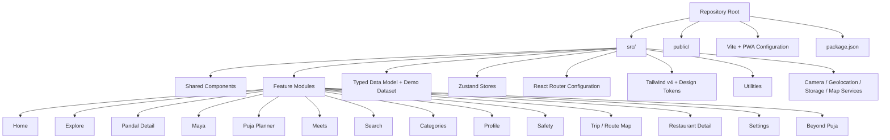
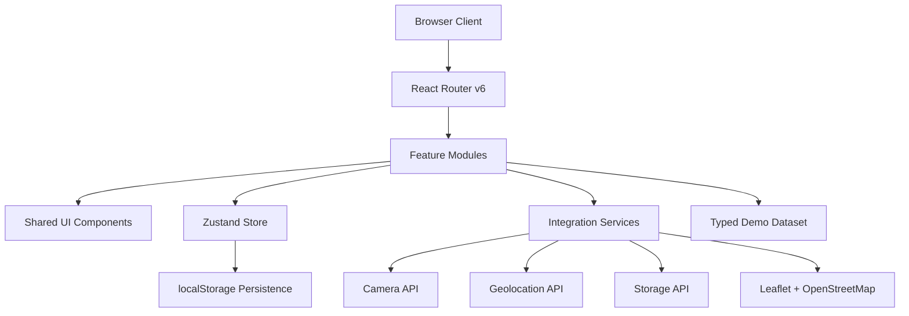
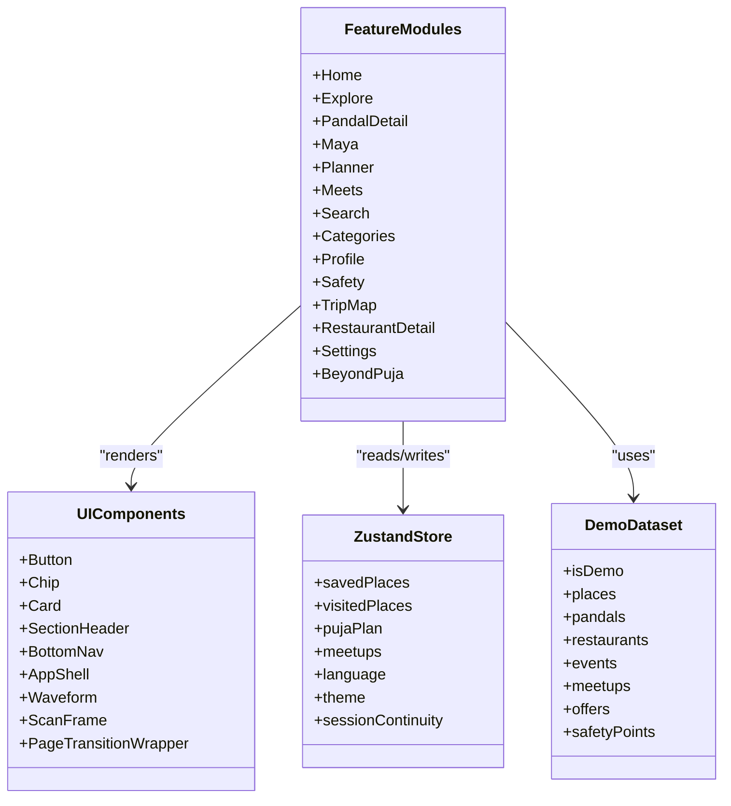
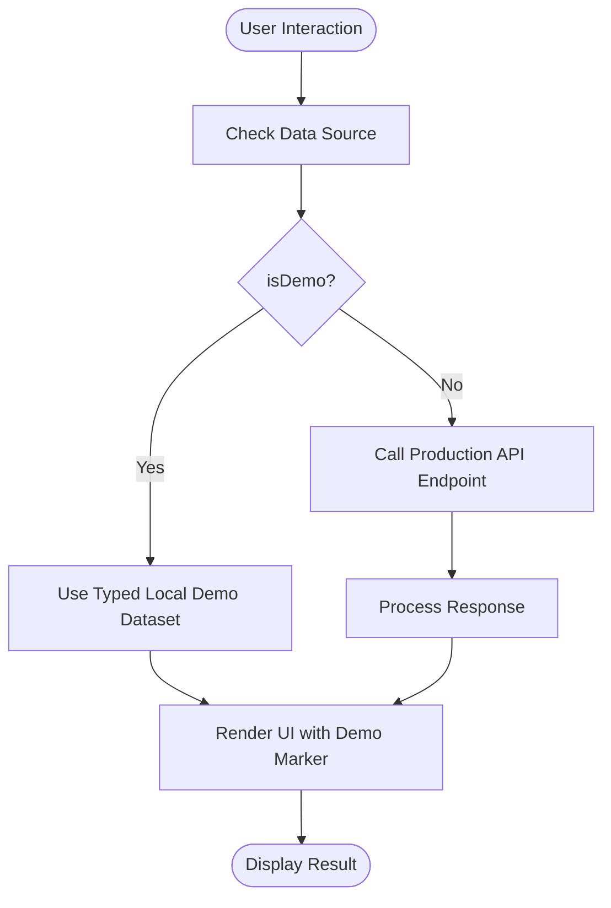
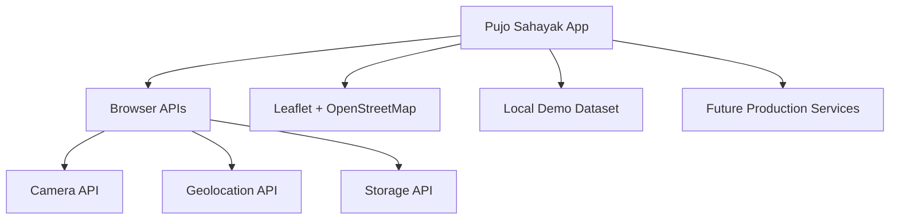
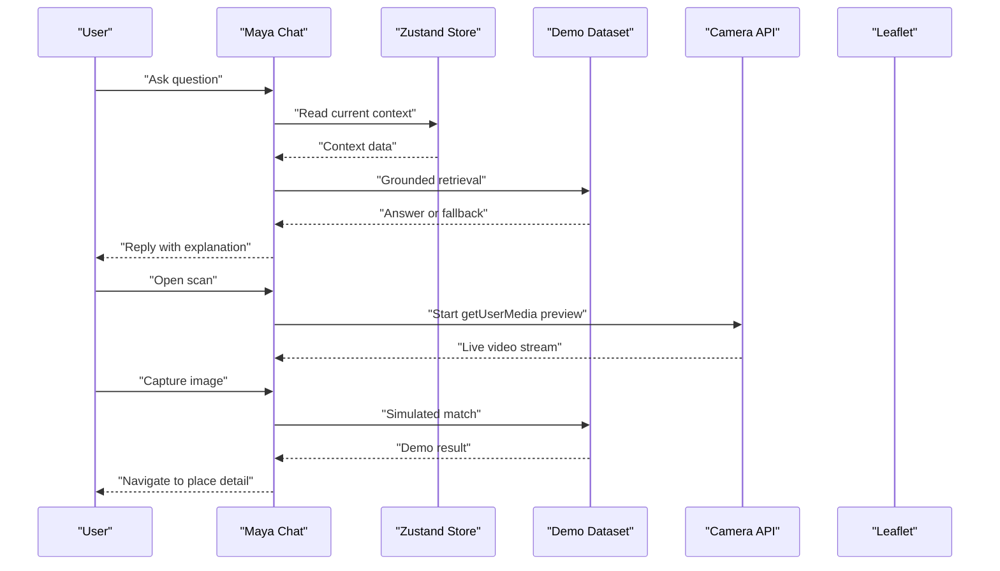
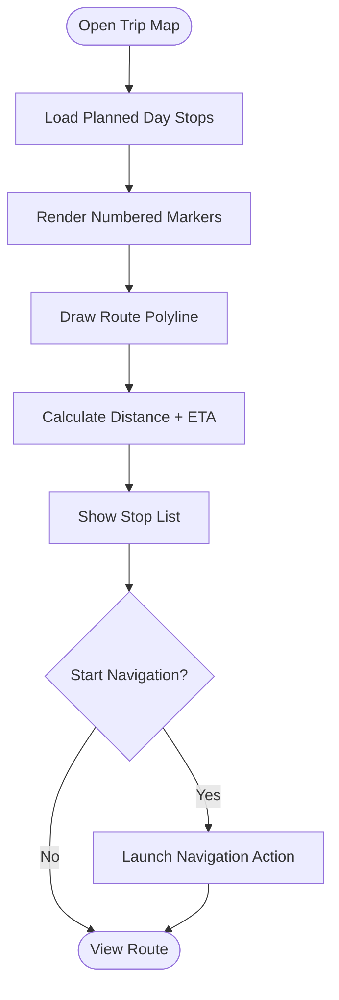
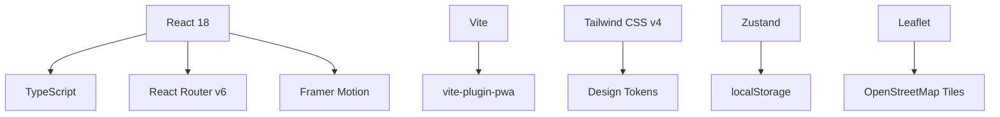

# Technical Architecture and Stack

<cite>
**Referenced Files in This Document**
- [Pujo_Sahayak_Master_Project_Context.md](file://Pujo_Sahayak_Master_Project_Context.md)
- [plan.md](file://tasks/plan.md)
- [todo.md](file://tasks/todo.md)
</cite>

## Table of Contents
1. [Introduction](#introduction)
2. [Project Structure](#project-structure)
3. [Core Components](#core-components)
4. [Architecture Overview](#architecture-overview)
5. [Detailed Component Analysis](#detailed-component-analysis)
6. [Dependency Analysis](#dependency-analysis)
7. [Performance Considerations](#performance-considerations)
8. [Troubleshooting Guide](#troubleshooting-guide)
9. [Conclusion](#conclusion)

## Introduction
Pujo Sahayak is a mobile-first Progressive Web Application designed as a digital companion for exploring Kolkata during Durga Puja, while remaining useful beyond the festival season. The product combines place discovery, AI assistance, route planning, social meetups, safety utilities, user-generated content, personalization, and monetization into one cohesive experience.

At a high level, the application guides users through a continuous journey: discover places, explore details, understand context, plan visits, visit locations, share experiences, meet people, and then discover more. The system boundaries include local browser APIs (camera, geolocation, storage), a typed demo dataset grounded in real Kolkata locations, and optional external services such as map tiles via Leaflet/OpenStreetMap.

The technical architecture emphasizes:
- A modern React 18 + TypeScript stack built with Vite.
- Tailwind CSS v4 for a bespoke design system driven by tokens.
- React Router v6 for tab-based navigation and nested detail routes.
- Zustand for client state with persistence to localStorage.
- Framer Motion for consistent animations that respect reduced-motion preferences.
- Leaflet with OpenStreetMap for routing and nearby help points.
- vite-plugin-pwa for installable offline shell behavior.
- A feature-based organization aligned with user journeys rather than strict technical layers.

**Section sources**
- [Pujo_Sahayak_Master_Project_Context.md:1-18](file://Pujo_Sahayak_Master_Project_Context.md#L1-L18)
- [plan.md:1-18](file://tasks/plan.md#L1-L18)

## Project Structure
The repository currently contains the master product context and implementation planning artifacts. The codebase itself is not yet scaffolded; however, the planned structure is clearly defined by the implementation plan and task list.

Planned project structure overview:
- `src/` — Source code for the React application.
  - `components/` — Shared UI primitives such as buttons, chips, cards, section headers, bottom navigation, app shell, waveform, scan frame, and page-transition wrappers.
  - `features/` — Feature folders grouped by user journeys, for example:
    - `home`
    - `explore`
    - `pandal-detail`
    - `maya`
    - `planner`
    - `meets`
    - `search`
    - `categories`
    - `profile`
    - `safety`
    - `trip-map`
    - `restaurant-detail`
    - `settings`
    - `beyond-puja`
  - `data/` — Typed data model and Kolkata demo dataset.
  - `store/` — Zustand stores with persist middleware.
  - `routes/` or router configuration using React Router v6.
  - `styles/` — Tailwind v4 configuration and design-token-driven styles.
  - `utils/` — Utilities such as haversine distance calculation, motion helpers, and API simulation helpers.
  - `services/` — Optional service layer for camera, geolocation, storage, and map integration.
- `public/` — Static assets such as icons and placeholder images.
- `vite.config.*` — Vite configuration including PWA plugin setup.
- `package.json` — Dependencies for React, TypeScript, Vite, Tailwind, React Router, Zustand, Framer Motion, Leaflet, and vite-plugin-pwa.

**Diagram sources**
- [plan.md:1-18](file://tasks/plan.md#L1-L18)
- [todo.md:5-75](file://tasks/todo.md#L5-L75)

**Section sources**
- [plan.md:1-18](file://tasks/plan.md#L1-L18)
- [todo.md:5-75](file://tasks/todo.md#L5-L75)

## Core Components
The core components are organized around shared UI primitives and feature modules.

### Shared UI Components
Shared components provide reusable building blocks:
- Button: Primary and secondary actions across screens.
- Chip: Filter pills, category tags, and quick-reply chips.
- Card: Place card variant used for pandals, restaurants, events, and meetups.
- SectionHeader: Consistent section titles and layout anchors.
- BottomNav: Five-tab bottom navigation mapping to main routes.
- AppShell: Layout wrapper providing safe areas, header/footer spacing, and responsive constraints.
- Waveform: Voice input visualization for Maya.
- ScanFrame: Animated scanning frame for camera-based identification.
- PageTransitionWrapper: Animation wrapper respecting reduced-motion settings.

These components are intentionally framework-agnostic from business logic and focus on presentation, accessibility, and consistency.

### Feature Modules
Features group related functionality by user journey:
- Home: Greeting, search bar, language toggle, sponsored spotlight, explore spotlight, nearby restaurants, offers, events, and continue-where-you-left-off.
- Explore: List and map views with filters for area, distance, theme, and crowd levels.
- Pandal Detail: Hero image, save/visited actions, rating and crowd information, about section, Ask Maya chip, reviews, similar places, and nearby restaurants.
- Maya: Chat interface, voice waveform UI, context-aware answers, and camera scan flow.
- Puja Planner: Multi-day itinerary with day tabs, stops, add-place picker, optimization suggestions, and trip navigation.
- Meets: Meetup listing, creation form, join flow, and interest-based grouping.
- Search: Live filtering, trending pandals, popular nearby places, and category shortcuts.
- Categories: Structured discovery hub for places, transport & services, and utilities.
- Profile: User stats, premium banner, emergency shortcuts, and account rows.
- Safety: Emergency screen, call stubs, nearby help points, and missing person report wizard.
- Trip / Route Map: Leaflet map with numbered markers, polyline route, stop list, total distance, and estimated time.
- Restaurant Detail: Hero, ratings, open status, cuisine, price, save/call/order actions, and popular dishes.
- Settings: Appearance, app logo picker, language, and other preferences.
- Beyond Puja: Off-season discovery card and section.

**Section sources**
- [todo.md:5-75](file://tasks/todo.md#L5-L75)
- [plan.md:19-39](file://tasks/plan.md#L19-L39)

## Architecture Overview
The planned architecture follows a layered but feature-oriented approach:
- Presentation Layer: React components styled with Tailwind v4 and animated with Framer Motion.
- State Layer: Zustand stores managing saved places, visited places, planner state, meetups, language, theme, and session continuity.
- Data Layer: Typed local demo dataset with an explicit demo marker, plus optional service abstractions for external APIs.
- Routing Layer: React Router v6 mapping bottom navigation and nested detail pages.
- Integration Layer: Browser APIs for camera, geolocation, and storage; Leaflet/OpenStreetMap for maps.

**Diagram sources**
- [plan.md:1-18](file://tasks/plan.md#L1-L18)
- [todo.md:5-75](file://tasks/todo.md#L5-L75)

**Section sources**
- [plan.md:1-18](file://tasks/plan.md#L1-L18)
- [todo.md:5-75](file://tasks/todo.md#L5-L75)

## Detailed Component Analysis

### Technology Stack Decisions
The implementation plan specifies:
- React 18 + TypeScript + Vite as the foundation.
- Tailwind CSS v4 for a bespoke design system encoded as design tokens.
- React Router v6 for five-tab bottom navigation and nested detail routes.
- Zustand with persist middleware for client-side state.
- Framer Motion for soft page fades, subtle card scale, animated scan frame, and voice waveform.
- Leaflet + OpenStreetMap for real maps without requiring Google Maps keys.
- vite-plugin-pwa for manifest, icons, and offline shell.

This stack supports a mobile-first, installable PWA with strong developer ergonomics and clear separation between UI, state, and data.

**Section sources**
- [plan.md:1-18](file://tasks/plan.md#L1-L18)

### Mobile-First Responsive Design Principles
The design system uses Tailwind v4 tokens for ivory surfaces, vermilion primary, charcoal ink, muted gold, and dark imagery. The application prioritizes:
- Small-screen usability with bottom navigation.
- Image-agnostic layouts so placeholder gradients can be replaced later.
- Reduced-motion support for accessibility.
- Desktop adaptation via max-width app frames and multi-column rails.
- Bengali typography with appropriate font fallbacks.

Responsive behavior is expected to be implemented through Tailwind utility classes and component-level constraints rather than heavy media queries.

**Section sources**
- [plan.md:10-16](file://tasks/plan.md#L10-L16)
- [todo.md:10-12](file://tasks/todo.md#L10-L12)
- [todo.md:71-75](file://tasks/todo.md#L71-L75)

### PWA Implementation Strategy
The PWA strategy includes:
- Installable web app via vite-plugin-pwa.
- Manifest and icons configured at build time.
- Offline shell caching for core app resources.
- Manual PWA audit covering install prompt and shell cache.
- Lighthouse checks for PWA criteria.

The PWA should remain functional even when network access is unavailable, while clearly distinguishing demo data and simulated features from production integrations.

**Section sources**
- [plan.md:1-10](file://tasks/plan.md#L1-L10)
- [todo.md:74-75](file://tasks/todo.md#L74-L75)

### Component-Based Architecture Pattern
The component pattern separates concerns as follows:
- UI Components: Presentational components focused on rendering and user interaction.
- Business Logic: Feature modules orchestrating flows such as discovery, planning, and social meetups.
- Data Layer: Typed models and demo dataset, optionally abstracted behind services.
- State Management: Zustand stores holding user preferences, saves, visits, plans, and session continuity.

This separation ensures that UI changes do not tightly couple to business rules, and business rules can evolve independently of presentation.

**Diagram sources**
- [todo.md:5-75](file://tasks/todo.md#L5-L75)
- [plan.md:1-18](file://tasks/plan.md#L1-L18)

**Section sources**
- [todo.md:5-75](file://tasks/todo.md#L5-L75)
- [plan.md:1-18](file://tasks/plan.md#L1-L18)

### Feature-Based Organization by User Journeys
The application groups functionality by user journeys rather than strict technical layers:
- Discovery: Home, Explore, Search, Categories.
- Understanding: Pandal Detail, Maya.
- Planning: Puja Planner, Trip / Route Map.
- Social: Meets, Create Meetup.
- Utility: Profile, Safety, Missing Person Report, Settings.
- Continuity: Favorites, Continue Where You Left Off, Beyond Puja.

This approach aligns development tasks with end-to-end user flows, making it easier to verify completeness against mockups and product context.

**Section sources**
- [Pujo_Sahayak_Master_Project_Context.md:21-43](file://Pujo_Sahayak_Master_Project_Context.md#L21-L43)
- [todo.md:18-67](file://tasks/todo.md#L18-L67)

### Configuration-Driven Design Using Design Tokens
Design tokens encode colors, radii, type scale, and visual hierarchy. Tailwind v4 is used to implement these tokens consistently across components. Theming includes:
- Ivory surfaces.
- Vermilion primary color.
- Charcoal ink.
- Muted gold accents.
- Dark imagery.
- Bengali serif accent typography.

Configuration files should centralize token definitions so that theme changes propagate uniformly.

**Section sources**
- [plan.md:10-11](file://tasks/plan.md#L10-L11)
- [todo.md:10-12](file://tasks/todo.md#L10-L12)

### Mock Data Pattern: Demo Data vs Production Endpoints
The dataset is explicitly marked as demo data:
- `isDemo: true` indicates that crowd levels, hours, and other fields come from the local dataset.
- Maya responses are grounded in the dataset and avoid hallucination.
- Camera identification is simulated with an honest demo result marker.
- No fake integrations are presented as production.

This pattern allows rapid iteration and testing while keeping a clean boundary for future production API integration.

**Diagram sources**
- [plan.md:15-17](file://tasks/plan.md#L15-L17)
- [todo.md:13-14](file://tasks/todo.md#L13-L14)

**Section sources**
- [plan.md:15-17](file://tasks/plan.md#L15-L17)
- [todo.md:13-14](file://tasks/todo.md#L13-L14)

### System Boundaries and External Integrations
System boundaries include:
- Browser APIs:
  - Camera API for live preview and capture.
  - Geolocation API for location context.
  - Storage API for localStorage persistence.
- Map Services:
  - Leaflet with OpenStreetMap tiles for route visualization and nearby help points.
- Optional Future Integrations:
  - Real LLM API for Maya.
  - Authentication and payment systems for premium features.
  - External map routing providers if needed.

**Diagram sources**
- [plan.md:1-18](file://tasks/plan.md#L1-L18)
- [todo.md:39-40](file://tasks/todo.md#L39-L40)
- [todo.md:63-64](file://tasks/todo.md#L63-L64)

**Section sources**
- [plan.md:1-18](file://tasks/plan.md#L1-L18)
- [todo.md:39-40](file://tasks/todo.md#L39-L40)
- [todo.md:63-64](file://tasks/todo.md#L63-L64)

### Maya Flow: Chat, Context, and Camera Scan
Maya is UI-complete but AI-simulated locally. The flow includes:
- Chat interface with Bengali user bubbles and Maya replies.
- Inline audio player row and waveform visualization.
- Quick-reply chips for common questions.
- Context-aware behavior based on current route or selected place.
- Camera scan using getUserMedia with animated scan frame.
- Simulated matching against the dataset with honest demo labeling.

**Diagram sources**
- [todo.md:36-40](file://tasks/todo.md#L36-L40)
- [plan.md:15-16](file://tasks/plan.md#L15-L16)

**Section sources**
- [todo.md:36-40](file://tasks/todo.md#L36-L40)
- [plan.md:15-16](file://tasks/plan.md#L15-L16)

### Trip and Route Map Flow
The trip and route map integrates Leaflet with OpenStreetMap:
- Numbered markers for each stop.
- Polyline connecting stops.
- Stop list with times.
- Total distance and estimated time calculated using haversine.
- Navigation action to start route guidance.

**Diagram sources**
- [todo.md:63-64](file://tasks/todo.md#L63-L64)
- [plan.md:14](file://tasks/plan.md#L14)

**Section sources**
- [todo.md:63-64](file://tasks/todo.md#L63-L64)
- [plan.md:14](file://tasks/plan.md#L14)

## Dependency Analysis
The planned dependencies reflect a modern frontend stack with clear responsibilities:
- React 18 provides component rendering and hooks.
- TypeScript adds static typing for safer refactoring.
- Vite provides fast builds and dev server capabilities.
- Tailwind v4 enables token-driven styling.
- React Router v6 manages navigation and nested routes.
- Zustand manages client state with persistence.
- Framer Motion handles animations and transitions.
- Leaflet provides interactive maps.
- vite-plugin-pwa configures manifest, icons, and service worker behavior.

**Diagram sources**
- [plan.md:1-18](file://tasks/plan.md#L1-L18)
- [todo.md:7-14](file://tasks/todo.md#L7-L14)

**Section sources**
- [plan.md:1-18](file://tasks/plan.md#L1-L18)
- [todo.md:7-14](file://tasks/todo.md#L7-L14)

## Performance Considerations
Performance considerations for the planned architecture include:
- Lazy loading of feature modules to reduce initial bundle size.
- Efficient Zustand store updates with selective subscriptions.
- Optimized Leaflet map rendering for multiple markers and polylines.
- Controlled animation complexity respecting reduced-motion preferences.
- Placeholder images and gradient fallbacks to prevent layout shifts.
- PWA caching strategies for shell resources and critical assets.
- Avoiding unnecessary re-renders by separating UI components from business logic.

[No sources needed since this section provides general guidance]

## Troubleshooting Guide
Common troubleshooting areas include:
- Build failures: Ensure TypeScript compiles cleanly and all routes are reachable.
- PWA issues: Verify manifest, icons, and offline shell caching.
- Camera permissions: Confirm getUserMedia permission prompts and fallbacks.
- Geolocation errors: Handle denied or unavailable location gracefully.
- Map rendering: Validate Leaflet container sizing and tile availability.
- State persistence: Confirm localStorage writes and reads for saves, visits, plans, and settings.
- Demo data honesty: Ensure demo markers are visible where required and no fabricated statistics are presented as production facts.

**Section sources**
- [plan.md:63-70](file://tasks/plan.md#L63-L70)
- [todo.md:77-80](file://tasks/todo.md#L77-L80)

## Conclusion
Pujo Sahayak’s technical architecture is designed around a mobile-first, feature-based approach that balances exploration, understanding, planning, social connection, and safety. The planned stack—React 18, TypeScript, Vite, Tailwind v4, React Router v6, Zustand, Framer Motion, Leaflet, and vite-plugin-pwa—supports a polished, installable PWA with clear separation of concerns. The mock data pattern keeps development fast and honest, while leaving room for production integrations. With careful attention to performance, accessibility, and system boundaries, the application can evolve from a robust demo into a scalable local discovery platform.

[No sources needed since this section summarizes without analyzing specific files]