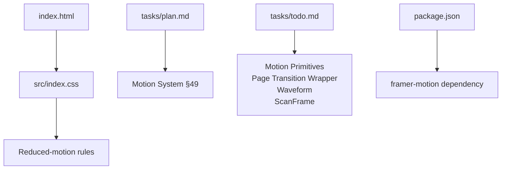
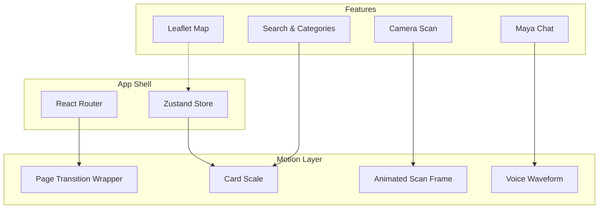
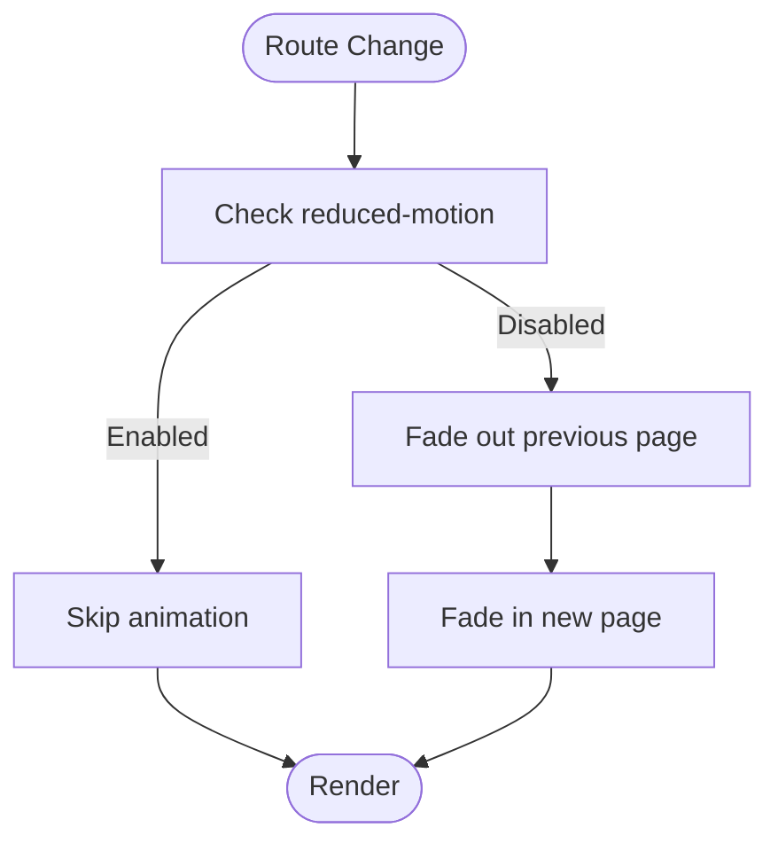
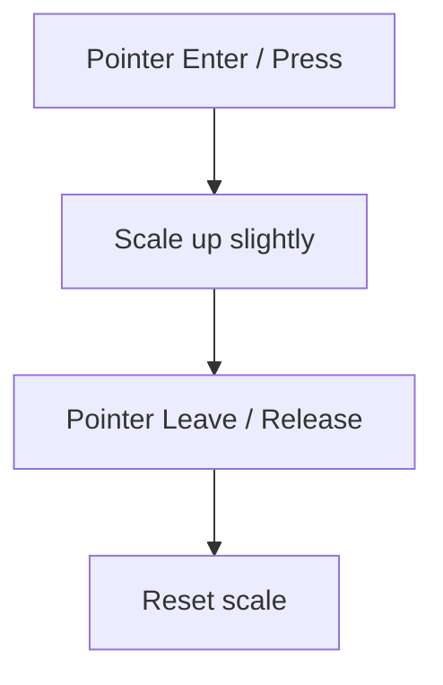
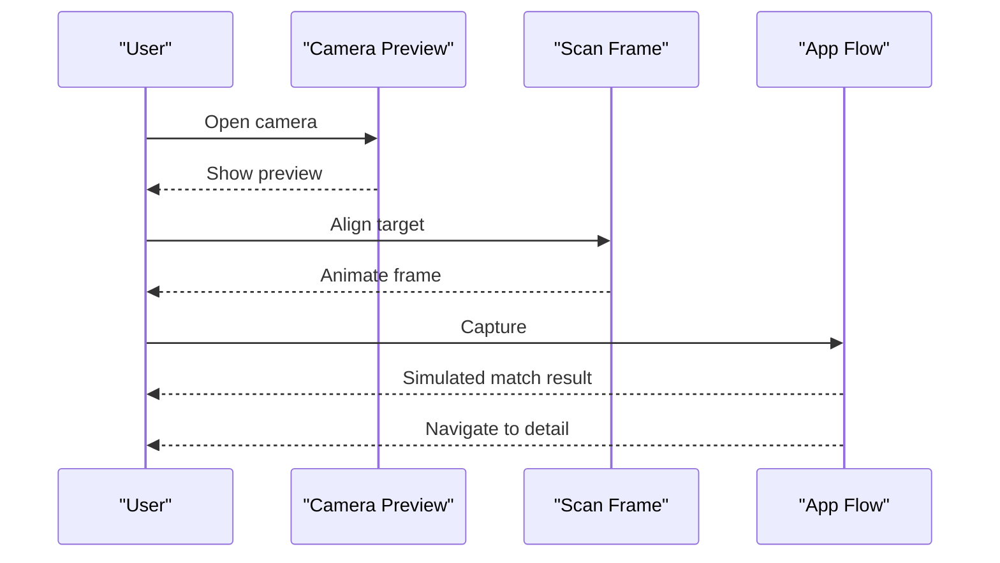
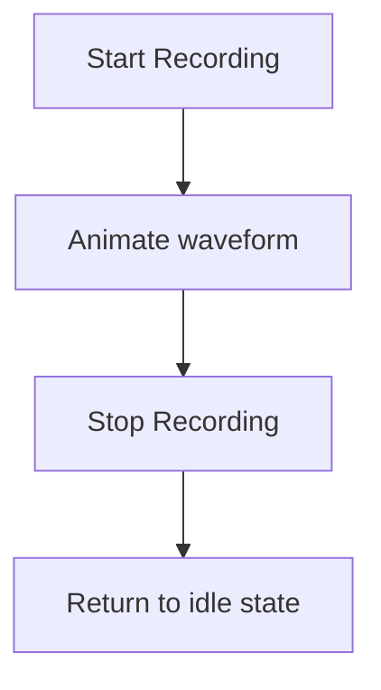
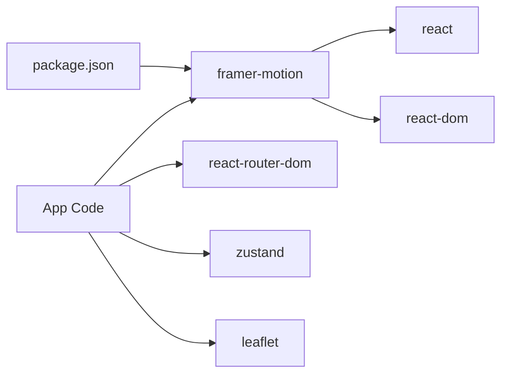

# Animations and Transitions

<cite>
**Referenced Files in This Document**
- [package.json](file://package.json)
- [Pujo_Sahayak_Master_Project_Context.md](file://Pujo_Sahayak_Master_Project_Context.md)
- [plan.md](file://tasks/plan.md)
- [todo.md](file://tasks/todo.md)
- [index.css](file://src/index.css)
</cite>

## Table of Contents
1. [Introduction](#introduction)
2. [Project Structure](#project-structure)
3. [Core Components](#core-components)
4. [Architecture Overview](#architecture-overview)
5. [Detailed Component Analysis](#detailed-component-analysis)
6. [Dependency Analysis](#dependency-analysis)
7. [Performance Considerations](#performance-considerations)
8. [Troubleshooting Guide](#troubleshooting-guide)
9. [Conclusion](#conclusion)

## Introduction
This document describes the Framer Motion implementation strategy for animations and transitions across the application. It covers page transitions, component interactions, gesture responses, and micro-interactions that improve mobile usability. It also documents accessibility requirements (reduced motion), performance considerations, and how motion supports discovery and exploration workflows such as place search, category browsing, camera scanning, and route planning.

The project uses React 18 with TypeScript and Vite, Tailwind CSS v4, React Router v6, Zustand, Leaflet, and Framer Motion. The design system emphasizes ivory surfaces, vermilion primary, charcoal ink, muted gold, and dark imagery. Motion is intended to communicate energy while remaining subtle and accessible.

**Section sources**
- [package.json:1-32](file://package.json#L1-L32)
- [plan.md:7-17](file://tasks/plan.md#L7-L17)

## Project Structure
At this stage, the repository contains configuration files, task plans, and minimal source assets. Animation-related components are planned but not yet implemented in the codebase. The current structure relevant to motion includes:
- Root HTML entry point
- Global styles that include reduced-motion handling
- Task plans describing motion primitives and pages
- Package manifest declaring Framer Motion

**Diagram sources**
- [index.html:1-25](file://index.html#L1-L25)
- [index.css:101-111](file://src/index.css#L101-L111)
- [plan.md:7-17](file://tasks/plan.md#L7-L17)
- [todo.md:8-11](file://tasks/todo.md#L8-L11)
- [package.json:11-18](file://package.json#L11-L18)

**Section sources**
- [index.html:1-25](file://index.html#L1-L25)
- [index.css:101-111](file://src/index.css#L101-L111)
- [plan.md:7-17](file://tasks/plan.md#L7-L17)
- [todo.md:8-11](file://tasks/todo.md#L8-L11)
- [package.json:11-18](file://package.json#L11-L18)

## Core Components
Planned motion primitives and their responsibilities:
- Page transition wrapper: soft page fades between routes; honors reduced-motion.
- Card scale: subtle scale on cards during hover/tap to indicate interactivity.
- Scan frame: animated frame around the camera preview when using the camera feature.
- Waveform: animated visualization for voice input/output in the Maya chat shell.

These primitives support:
- Discovery flows: search results, categories, nearby places.
- Exploration flows: route map, list/map toggle, detail pages.
- Interaction feedback: taps, gestures, and state changes.

Accessibility baseline:
- Respect `prefers-reduced-motion` and an in-app `.reduce-motion` class by collapsing animation durations globally.

**Section sources**
- [plan.md:13-16](file://tasks/plan.md#L13-L16)
- [todo.md:8-11](file://tasks/todo.md#L8-L11)
- [index.css:101-111](file://src/index.css#L101-L111)

## Architecture Overview
Framer Motion integrates into the app through a small set of motion primitives that wrap UI elements and coordinate with routing and user interactions. The global reduced-motion rules ensure consistent accessibility behavior.

[No diagram sources needed since this diagram shows conceptual architecture, not actual code structure]

## Detailed Component Analysis

### Page Transitions
Purpose:
- Provide soft fade transitions between routes to maintain continuity during navigation.
- Support both light and dark themes without jarring visual shifts.

Behavior:
- On route change, the outgoing page fades out and the incoming page fades in.
- If the user prefers reduced motion or the app is in reduced-motion mode, transitions become instantaneous.

Implementation guidance:
- Wrap route content with a motion-aware container that animates opacity based on route changes.
- Read reduced-motion preference from CSS media query and/or app setting.

[No diagram sources needed since this diagram shows conceptual workflow, not actual code structure]

### Card Interactions (Subtle Scale)
Purpose:
- Indicate tappable cards (places, events, offers) with a gentle scale effect.
- Enhance discoverability without distracting from content.

Behavior:
- On press or hover, card scales slightly and returns to normal on release.
- Respects reduced-motion by disabling scale animation.

Interaction model:
- Use gesture hooks to detect press/hover states.
- Animate transform scale with short duration and easing tuned for touch.

[No diagram sources needed since this diagram shows conceptual workflow, not actual code structure]

### Camera Scan Frame
Purpose:
- Visually guide users to align the camera with a pandal or object.
- Communicate scanning state during capture flow.

Behavior:
- Overlay an animated frame around the camera preview.
- Pause or simplify animation under reduced-motion.

Sequence:
- Open camera → show preview → animate scan frame → capture → simulate match → navigate to result.

[No diagram sources needed since this diagram shows conceptual workflow, not actual code structure]

### Voice Waveform
Purpose:
- Provide immediate feedback during voice recording and playback in the Maya chat shell.
- Reinforce conversational rhythm and state.

Behavior:
- Animate bars or waves according to audio activity.
- Reduce or stop animation when reduced-motion is enabled.

[No diagram sources needed since this diagram shows conceptual workflow, not actual code structure]

### Gesture Responses
Patterns:
- Swipe gestures for list navigation or toggling views (e.g., List/Map).
- Tap-to-expand details with spring-like motion.
- Pull-to-refresh where applicable.

Guidelines:
- Keep gesture thresholds comfortable for thumbs.
- Provide haptic feedback cues via platform APIs if available.
- Ensure gestures do not conflict with scrolling.

**Section sources**
- [plan.md:13-16](file://tasks/plan.md#L13-L16)
- [todo.md:40-40](file://tasks/todo.md#L40-L40)

## Dependency Analysis
Framer Motion is declared as a runtime dependency. The app’s motion layer depends on:
- React 18 for rendering and hooks.
- React Router for page transitions.
- Zustand for state-driven animations (e.g., active tab, theme, reduced-motion flag).
- Leaflet for map interactions that may be coordinated with motion (e.g., smooth view changes).

**Diagram sources**
- [package.json:11-18](file://package.json#L11-L18)

**Section sources**
- [package.json:11-18](file://package.json#L11-L18)

## Performance Considerations
- Prefer GPU-accelerated properties (transform, opacity) for animations.
- Avoid layout thrashing by batching style reads/writes.
- Use short durations and easing curves suited for mobile.
- Defer heavy animations until after initial render.
- Respect reduced-motion to minimize work for sensitive users.
- Limit concurrent animations; prioritize critical paths like page transitions and camera scan frame.
- Reuse animation configs and avoid recreating objects per render.

[No sources needed since this section provides general guidance]

## Troubleshooting Guide
Common issues and resolutions:
- Animations not respecting reduced-motion:
  - Verify global reduced-motion rules are applied.
  - Ensure app-level reduced-motion class is present when needed.
- Janky animations on low-end devices:
  - Simplify transforms and reduce simultaneous animations.
  - Disable non-essential effects under performance constraints.
- Gestures conflicting with scroll:
  - Adjust gesture thresholds and direction sensitivity.
  - Test on real devices with varying screen sizes.
- Camera scan frame misalignment:
  - Confirm overlay sizing and safe-area insets.
  - Validate against device-specific camera aspect ratios.

**Section sources**
- [index.css:101-111](file://src/index.css#L101-L111)

## Conclusion
The motion system centers on a small set of primitives—page transitions, card scale, scan frame, and waveform—that enhance discovery and exploration while remaining accessible and performant. By honoring reduced-motion preferences and focusing on subtle, purposeful motion, the app communicates energy without compromising usability. As components are implemented, these patterns should be consistently applied to maintain a cohesive experience across all screens and interactions.

[No sources needed since this section summarizes without analyzing specific files]