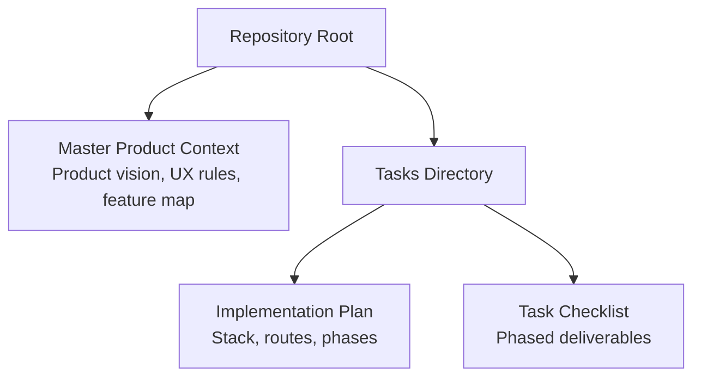
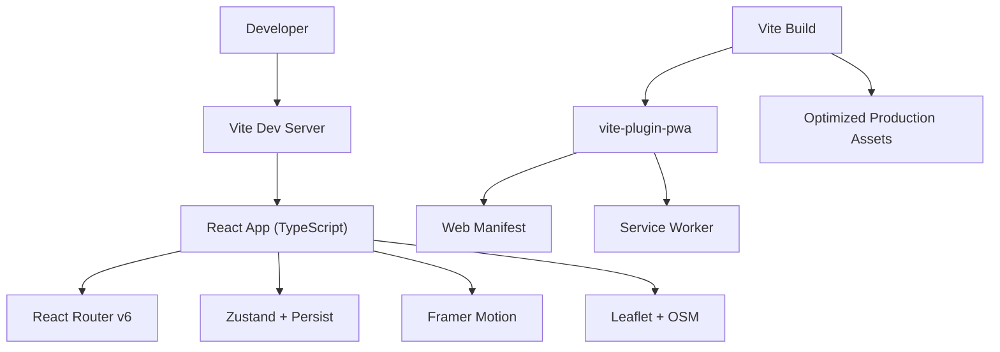
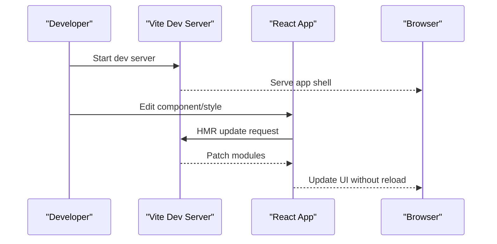
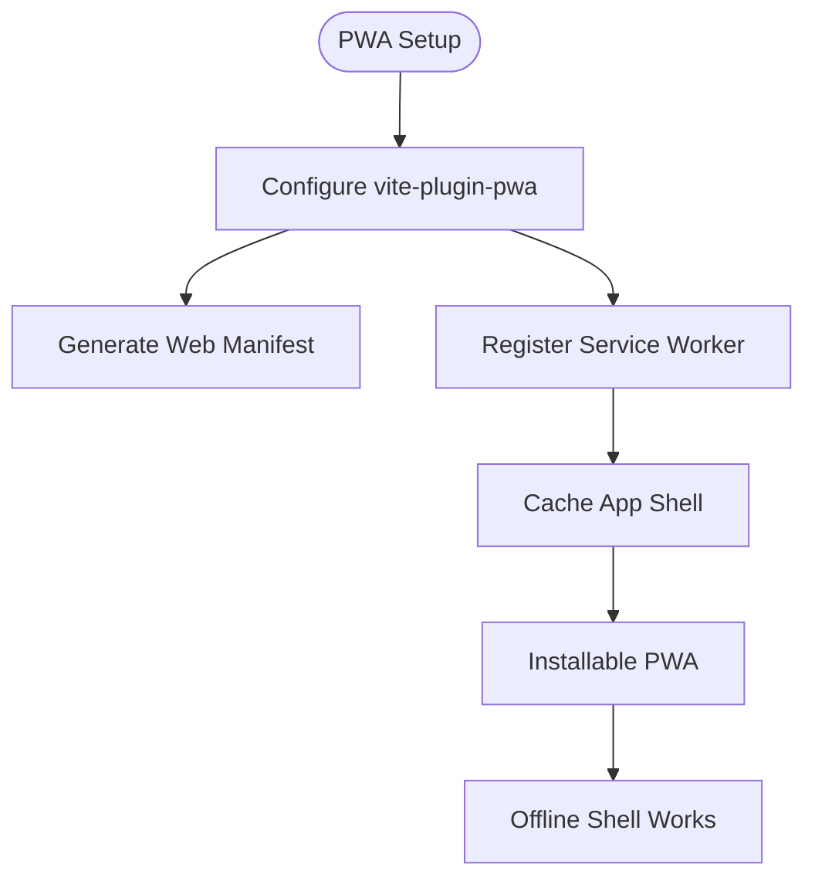
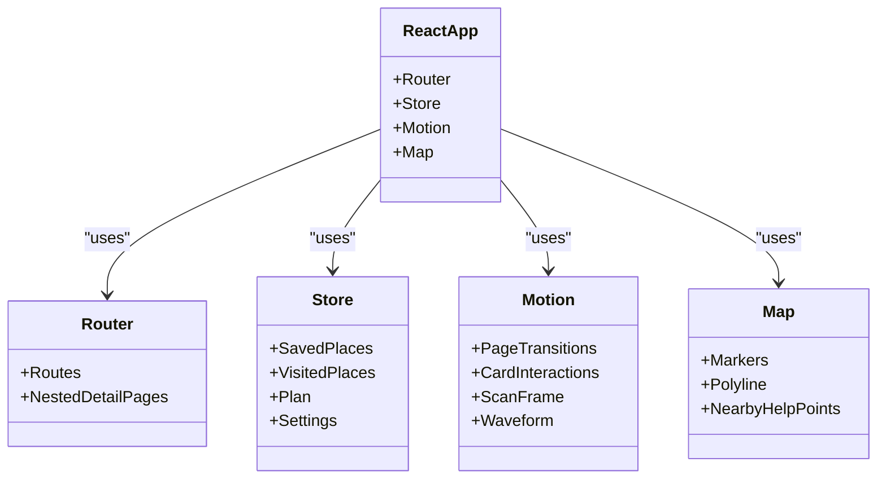
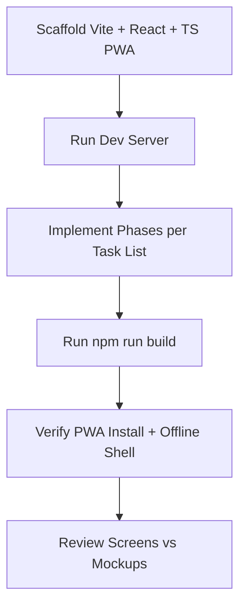
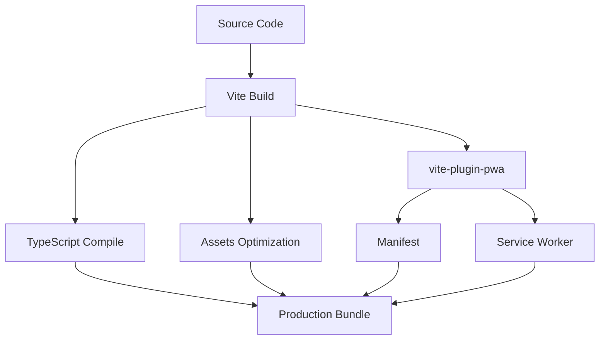
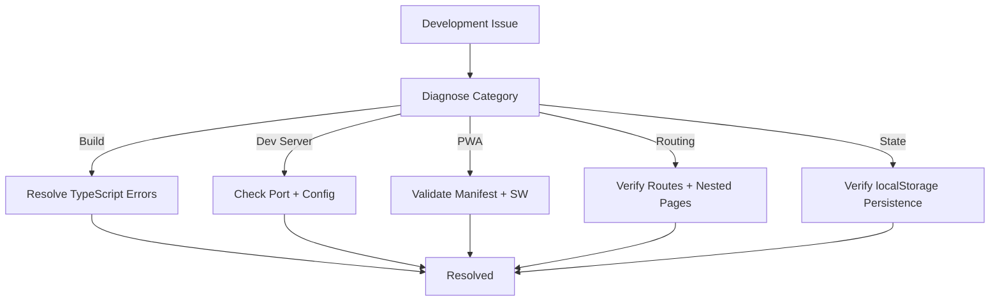
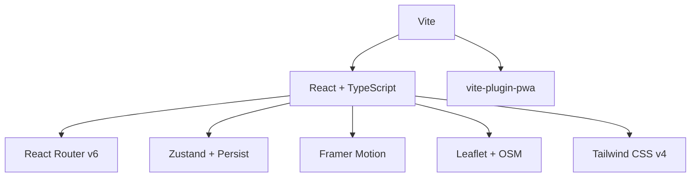

# Build Tooling and Development Server

<cite>
**Referenced Files in This Document**
- [plan.md](file://tasks/plan.md)
- [todo.md](file://tasks/todo.md)
- [Pujo_Sahayak_Master_Project_Context.md](file://Pujo_Sahayak_Master_Project_Context.md)
</cite>

## Table of Contents
1. [Introduction](#introduction)
2. [Project Structure](#project-structure)
3. [Core Components](#core-components)
4. [Architecture Overview](#architecture-overview)
5. [Detailed Component Analysis](#detailed-component-analysis)
6. [Dependency Analysis](#dependency-analysis)
7. [Performance Considerations](#performance-considerations)
8. [Troubleshooting Guide](#troubleshooting-guide)
9. [Conclusion](#conclusion)
10. [Appendices](#appendices)

## Introduction
This document explains how Vite is used as the build tool and development server for Pujo Sahayak, a mobile-first React + TypeScript PWA. It focuses on:
- Why Vite is chosen for fast development and optimized production builds
- How the project integrates with React, Tailwind CSS v4, React Router, Zustand, Framer Motion, Leaflet, and vite-plugin-pwa
- The development workflow from scaffolding to building a PWA
- Configuration responsibilities and plugin architecture
- Common development issues and troubleshooting strategies

The repository currently contains product context and implementation planning documents rather than source code. Therefore, this guide describes the intended Vite-based setup and workflows as documented in the project plan and task list.

## Project Structure
At this stage, the repository includes:
- A master product context describing features, UX principles, and technical interpretation
- An implementation plan that specifies the stack and architecture decisions
- A task checklist tracking phased delivery

**Diagram sources**
- [plan.md:1-86](file://tasks/plan.md#L1-L86)
- [todo.md:1-81](file://tasks/todo.md#L1-L81)
- [Pujo_Sahayak_Master_Project_Context.md:1-60](file://Pujo_Sahayak_Master_Project_Context.md#L1-L60)

**Section sources**
- [plan.md:1-86](file://tasks/plan.md#L1-L86)
- [todo.md:1-81](file://tasks/todo.md#L1-L81)
- [Pujo_Sahayak_Master_Project_Context.md:1-60](file://Pujo_Sahayak_Master_Project_Context.md#L1-L60)

## Core Components
Vite is the central build tool and development server for the project. The core components relevant to Vite are:

- Vite dev server
  - Provides instant startup and fast HMR for React + TypeScript
  - Serves the app shell during development
- vite-plugin-pwa
  - Generates the web manifest and service worker
  - Enables installability and offline shell caching
- React + TypeScript entry
  - Bootstraps the application via Vite’s standard React template
- Tailwind CSS v4
  - Styles the UI; configured through Vite’s asset pipeline
- React Router v6
  - Client-side routing for the bottom navigation and nested detail pages
- Zustand + persist middleware
  - Client state persisted to localStorage
- Framer Motion
  - Page transitions, card interactions, scan frame animation, voice waveform
- Leaflet + OpenStreetMap tiles
  - Maps for route visualization and nearby help points

These choices are explicitly stated in the implementation plan.

**Section sources**
- [plan.md:7-18](file://tasks/plan.md#L7-L18)

## Architecture Overview
The development and build architecture centers around Vite. During development, Vite serves the React application with hot module replacement. For production, Vite bundles assets and uses vite-plugin-pwa to generate a service worker and manifest for PWA capabilities.

**Diagram sources**
- [plan.md:7-18](file://tasks/plan.md#L7-L18)
- [todo.md:7-8](file://tasks/todo.md#L7-L8)

## Detailed Component Analysis

### Vite Dev Server and HMR
- Purpose
  - Fast startup and incremental updates without full page reloads
  - Smooth developer feedback loop while implementing screens and interactions
- Integration
  - React + TypeScript app served by Vite
  - HMR works with React Router, Zustand stores, and motion primitives
- Workflow
  - Start the dev server
  - Edit components or styles
  - Observe near-instant updates in the browser

[No sources needed since this diagram shows conceptual workflow, not actual code structure]

### vite-plugin-pwa Configuration Responsibilities
- Purpose
  - Generate web manifest and service worker
  - Enable installable PWA behavior and offline shell caching
- Key responsibilities
  - Configure manifest metadata (name, icons, theme colors)
  - Register and cache the app shell for offline access
  - Ensure production builds include PWA assets
- Verification
  - Confirm install prompt appears in supported browsers
  - Verify offline shell loads after initial visit

**Diagram sources**
- [todo.md:7-8](file://tasks/todo.md#L7-L8)

**Section sources**
- [todo.md:7-8](file://tasks/todo.md#L7-L8)

### React Ecosystem Integration
- React Router v6
  - Bottom navigation maps to routes
  - Nested routes for detail pages such as pandal and restaurant details
- Zustand + persist middleware
  - Single client store for saves, visits, plans, settings, and session continuity
- Framer Motion
  - Implements the motion system described in the product context
- Leaflet + OpenStreetMap
  - Real maps for route visualization and nearby help points

**Diagram sources**
- [plan.md:9-14](file://tasks/plan.md#L9-L14)

**Section sources**
- [plan.md:9-14](file://tasks/plan.md#L9-L14)

### Development Workflow Instructions
- Scaffold
  - Use `npm create vite` to initialize the React + TypeScript project
  - Add Tailwind CSS v4, React Router, Zustand, Framer Motion, and vite-plugin-pwa
- Run Development Server
  - Start the dev server and verify the app shell serves correctly
- Implement Phases
  - Follow the phased task breakdown in the task list
  - Each phase should leave the app runnable
- Verify Builds
  - Ensure `npm run build` completes cleanly with no TypeScript errors
- PWA Checks
  - Confirm installability and offline shell behavior

**Diagram sources**
- [todo.md:7-8](file://tasks/todo.md#L7-L8)
- [todo.md:77-81](file://tasks/todo.md#L77-L81)

**Section sources**
- [todo.md:7-8](file://tasks/todo.md#L7-L8)
- [todo.md:77-81](file://tasks/todo.md#L77-L81)

### Build Optimization Settings
- Production Build
  - Vite produces optimized static assets
  - TypeScript compilation is enforced at build time
- PWA Optimization
  - vite-plugin-pwa generates manifest and service worker
  - App shell caching improves offline performance
- Asset Strategy
  - Curated local placeholder gradients and free stock images at build time
  - Layout remains image-agnostic for future photography

**Diagram sources**
- [plan.md:7-18](file://tasks/plan.md#L7-L18)
- [todo.md:7-8](file://tasks/todo.md#L7-L8)

**Section sources**
- [plan.md:7-18](file://tasks/plan.md#L7-L18)
- [todo.md:7-8](file://tasks/todo.md#L7-L8)

### Troubleshooting Common Development Issues
- Build Errors
  - Fix TypeScript errors before committing
  - Ensure all dependencies are installed and versions match the plan
- Dev Server Not Starting
  - Check port conflicts and Node.js version compatibility
  - Validate Vite configuration files if present
- PWA Not Installing
  - Confirm manifest and service worker are generated
  - Test in a supported browser with HTTPS or localhost
- Offline Shell Not Working
  - Verify service worker registration and cache strategy
  - Clear caches and retry installation
- Routing Issues
  - Ensure React Router routes match the screen-to-route map
  - Validate nested routes for detail pages
- State Persistence
  - Confirm Zustand persist middleware writes to localStorage
  - Reload the app to verify saved data survives refresh

[No sources needed since this diagram shows conceptual workflow, not actual code structure]

## Dependency Analysis
The project’s development and runtime dependencies are defined by the implementation plan. Vite orchestrates the build and dev server, while plugins and libraries integrate into the React application.

**Diagram sources**
- [plan.md:7-18](file://tasks/plan.md#L7-L18)

**Section sources**
- [plan.md:7-18](file://tasks/plan.md#L7-L18)

## Performance Considerations
- Development Performance
  - Vite’s dev server provides fast startup and HMR
  - Keep dependencies minimal to reduce bundle size during development
- Production Performance
  - Rely on Vite’s bundling optimizations
  - Use PWA caching strategically for the app shell
- Image and Asset Handling
  - Prefer lightweight placeholders during development
  - Optimize real images at build time
- Motion and Animations
  - Respect reduced-motion preferences
  - Avoid heavy animations on low-end devices

[No sources needed since this section provides general guidance]

## Troubleshooting Guide
- Build Cleanliness
  - Run the build command and fix all TypeScript errors
  - Ensure the task verification criteria are met
- Route Reachability
  - Confirm every route is reachable via bottom navigation or deep links
- Persistence Verification
  - Validate saves, visits, plans, and settings survive reloads
- Screen-by-Screen Review
  - Compare implemented screens against mockups and information architecture
- Maya Grounded Behavior
  - Ensure AI-simulated responses do not hallucinate facts
  - Provide honest “demo” markers where appropriate

**Section sources**
- [todo.md:63-69](file://tasks/todo.md#L63-L69)
- [Pujo_Sahayak_Master_Project_Context.md:1330-1358](file://Pujo_Sahayak_Master_Project_Context.md#L1330-L1358)

## Conclusion
Vite is the foundation of Pujo Sahayak’s development experience and production build process. Combined with vite-plugin-pwa, it enables a fast, installable PWA with an offline shell. The React ecosystem—React Router, Zustand, Framer Motion, Leaflet, and Tailwind CSS—integrates cleanly under Vite’s pipeline. Following the phased implementation plan and task checklist ensures a maintainable, verifiable delivery path while keeping the focus on discovery, planning, understanding, experiencing, and remembering places.

[No sources needed since this section summarizes without analyzing specific files]

## Appendices

### Stack Summary
- Frontend framework: React 18 + TypeScript
- Build tool: Vite
- Styling: Tailwind CSS v4
- Routing: React Router v6
- State management: Zustand + persist middleware
- Animations: Framer Motion
- Maps: Leaflet + OpenStreetMap tiles
- PWA: vite-plugin-pwa

**Section sources**
- [plan.md:7-18](file://tasks/plan.md#L7-L18)