# Client-Side Routing and Navigation

<cite>
**Referenced Files in This Document**
- [plan.md](file://tasks/plan.md)
- [todo.md](file://tasks/todo.md)
- [Pujo_Sahayak_Master_Project_Context.md](file://Pujo_Sahayak_Master_Project_Context.md)
</cite>

## Table of Contents
1. [Introduction](#introduction)
2. [Project Structure](#project-structure)
3. [Core Components](#core-components)
4. [Architecture Overview](#architecture-overview)
5. [Detailed Component Analysis](#detailed-component-analysis)
6. [Dependency Analysis](#dependency-analysis)
7. [Performance Considerations](#performance-considerations)
8. [Troubleshooting Guide](#troubleshooting-guide)
9. [Conclusion](#conclusion)

## Introduction
This document explains the client-side routing and navigation design for Pujo Sahayak, a mobile-first React + Vite PWA. The application targets 21 mockup screens and uses React Router v6 to map primary navigation tabs, nested detail routes, and feature-specific subroutes. It also documents how URL parameters, query-like state, and navigation guards integrate with the app’s AI assistant context (Maya), favorites, planner, and social meetups.

The documentation is derived from the project’s planning and task files and the master product context. No source code was available in the workspace; therefore, this guide describes the intended implementation rather than inspecting concrete route definitions.

## Project Structure
At the repository level, the routing specification lives in the planning and task artifacts:

- `tasks/plan.md` defines the screen-to-route mapping, architecture decisions, and the overall React Router v6 strategy.
- `tasks/todo.md` tracks implementation tasks that tie routes to UI components and verification steps.
- `Pujo_Sahayak_Master_Project_Context.md` defines the primary navigation surface (Home, Favorites, Search, Categories, Meets) and the role of Maya as an always-accessible assistant.

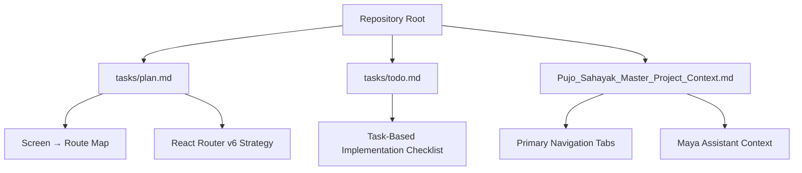

**Diagram sources**
- [plan.md:1-79](file://tasks/plan.md#L1-L79)
- [todo.md:1-81](file://tasks/todo.md#L1-L81)
- [Pujo_Sahayak_Master_Project_Context.md:140-158](file://Pujo_Sahayak_Master_Project_Context.md#L140-L158)

**Section sources**
- [plan.md:1-79](file://tasks/plan.md#L1-L79)
- [todo.md:1-81](file://tasks/todo.md#L1-L81)
- [Pujo_Sahayak_Master_Project_Context.md:140-158](file://Pujo_Sahayak_Master_Project_Context.md#L140-L158)

## Core Components
The routing system centers around five primary navigation tabs plus deep links into feature areas:

- Primary tabs: Home, Favorites, Search, Categories, Meets.
- Deep-linkable features: Maya, Planner, Safety/Emergency, Profile/Settings, Trip/Route Map, Restaurant Detail, Pandal Detail, Beyond Puja.

Key responsibilities:
- Bottom tab bar maps to top-level routes.
- Detail pages use nested routes with URL parameters.
- Maya receives contextual data through route state or shared store.
- Navigation guards protect premium or sensitive flows (e.g., advanced planner, paid meetups).

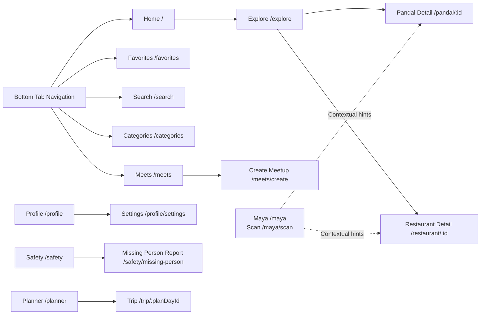

**Diagram sources**
- [plan.md:19-39](file://tasks/plan.md#L19-L39)
- [Pujo_Sahayak_Master_Project_Context.md:140-158](file://Pujo_Sahayak_Master_Project_Context.md#L140-L158)

**Section sources**
- [plan.md:19-39](file://tasks/plan.md#L19-L39)
- [Pujo_Sahayak_Master_Project_Context.md:140-158](file://Pujo_Sahayak_Master_Project_Context.md#L140-L158)

## Architecture Overview
The routing architecture follows these principles:

- React Router v6 is used for all navigation.
- Five bottom tabs correspond to top-level routes.
- Detail pages are nested under `/pandal/:id` and `/restaurant/:id`.
- Feature subroutes include `/maya`, `/maya/scan`, `/meets/create`, `/safety`, `/safety/missing-person`, `/trip/:planDayId`, `/profile/settings`, and `/beyond-puja`.
- State persistence uses Zustand with localStorage for saves, visits, plans, settings, and “continue where you left off.”
- Motion and offline capabilities are provided by Framer Motion and vite-plugin-pwa respectively.

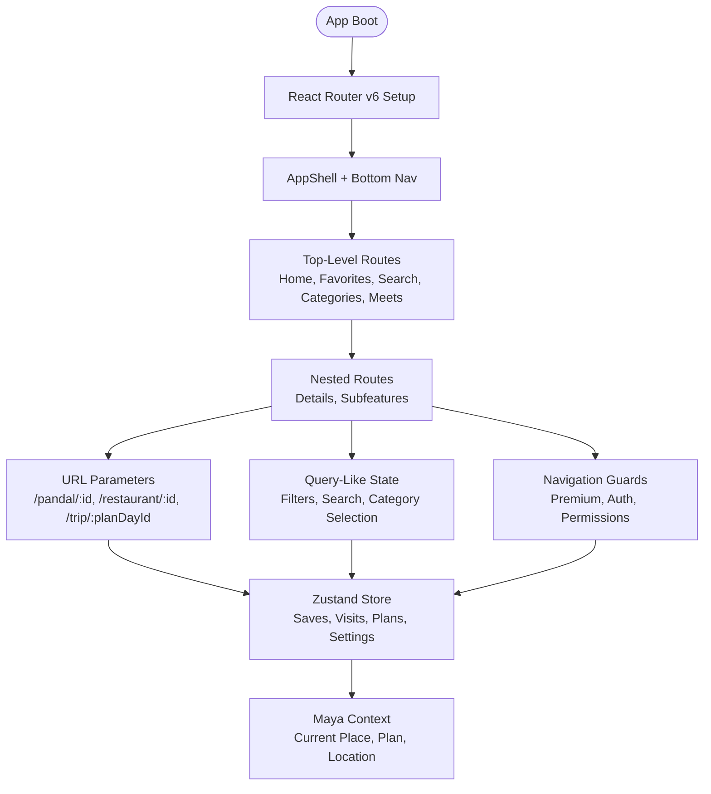

**Diagram sources**
- [plan.md:7-18](file://tasks/plan.md#L7-L18)
- [plan.md:19-39](file://tasks/plan.md#L19-L39)

**Section sources**
- [plan.md:7-18](file://tasks/plan.md#L7-L18)
- [plan.md:19-39](file://tasks/plan.md#L19-L39)

## Detailed Component Analysis

### Screen-to-Route Mapping
The planned mapping covers 21 screens across discovery, planning, social, utility, and profile domains.

| Mockup screen | Route | Notes |
|---|---|---|
| Splash | `/splash` | Entry point |
| Home | `/` | Main discovery surface |
| Explore / Pandal Directory | `/explore` | List/Map toggle, filters |
| Pandal Detail | `/pandal/:id` | Hero, actions, reviews, similar places |
| Maya chat / Scan / Voice | `/maya`, `/maya/scan` | Chat shell, camera scan frame |
| Puja Planner | `/planner` | Day tabs, stops, AI suggestion |
| Meets list | `/meets` | Existing meetups |
| Create Meetup | `/meets/create` | Form wizard |
| Categories | `/categories` | Places, Transport & Services, Utilities |
| Search | `/search` | Trending, nearby, filter pills |
| Profile | `/profile` | User control center |
| Safety / Emergency | `/safety` | Quick emergency shortcuts |
| Missing Person Report | `/safety/missing-person` | Wizard flow |
| Trip / Route Map | `/trip/:planDayId` | Leaflet multi-stop map |
| Restaurant Detail | `/restaurant/:id` | Details and nearby restaurants |
| Settings | `/profile/settings` | Appearance, account, privacy |
| Beyond Puja | `/beyond-puja` | Off-season local discovery |

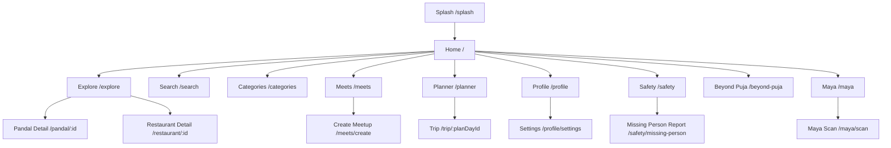

**Diagram sources**
- [plan.md:19-39](file://tasks/plan.md#L19-L39)

**Section sources**
- [plan.md:19-39](file://tasks/plan.md#L19-L39)

### Primary Navigation Integration
The primary navigation consists of five tabs: Home, Favorites, Search, Categories, and Meets. These should remain simple and mobile-first. The AI assistant (Maya) is accessible prominently but does not occupy one of the five permanent slots.

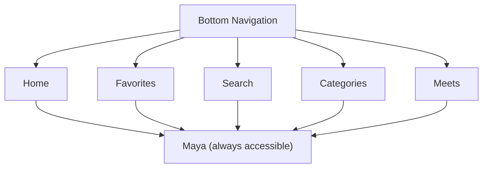

**Diagram sources**
- [Pujo_Sahayak_Master_Project_Context.md:140-158](file://Pujo_Sahayak_Master_Project_Context.md#L140-L158)

**Section sources**
- [Pujo_Sahayak_Master_Project_Context.md:140-158](file://Pujo_Sahayak_Master_Project_Context.md#L140-L158)

### Nested Routing Structures
Nested routes support detail views and feature subpages:

- `/pandal/:id`: Pandal detail page with hero, actions, reviews, similar places, nearby restaurants, and related meetups.
- `/restaurant/:id`: Restaurant detail page connected to the broader local ecosystem.
- `/meets/create`: Meetup creation wizard.
- `/safety/missing-person`: Missing person report wizard.
- `/profile/settings`: Settings within the profile section.
- `/trip/:planDayId`: Route map for a specific day in the planner.
- `/maya/scan`: Camera-based scan mode inside Maya.

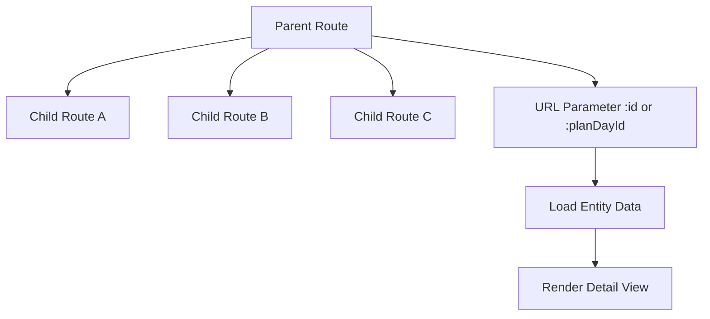

**Diagram sources**
- [plan.md:11-11](file://tasks/plan.md#L11-L11)
- [plan.md:19-39](file://tasks/plan.md#L19-L39)

**Section sources**
- [plan.md:11-11](file://tasks/plan.md#L11-L11)
- [plan.md:19-39](file://tasks/plan.md#L19-L39)

### Navigation Guards
Navigation guards should enforce access rules for premium or sensitive flows:

- Premium-only planner features.
- Paid or restricted meetups.
- Account and privacy-sensitive settings.
- Emergency-related flows requiring quick access without friction.

Recommended guard behavior:
- Redirect unauthenticated users to login when required.
- Prompt upgrade for premium features.
- Allow emergency shortcuts even when locked behind other restrictions.

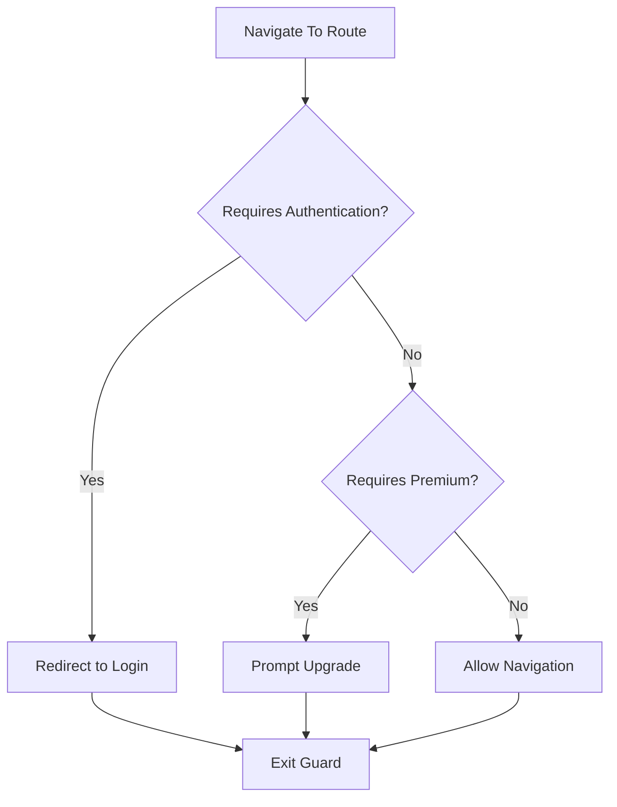

[No sources needed since this diagram shows conceptual workflow, not actual code structure]

### URL Parameter Handling
URL parameters carry entity identifiers and plan-day references:

- `/pandal/:id`: Loads pandal details, reviews, similar places, and nearby restaurants.
- `/restaurant/:id`: Loads restaurant details and related content.
- `/trip/:planDayId`: Loads trip data for a specific planner day.

Implementation guidance:
- Extract parameters from the router location.
- Validate parameter presence before loading data.
- Handle missing or invalid IDs gracefully with fallback UI.

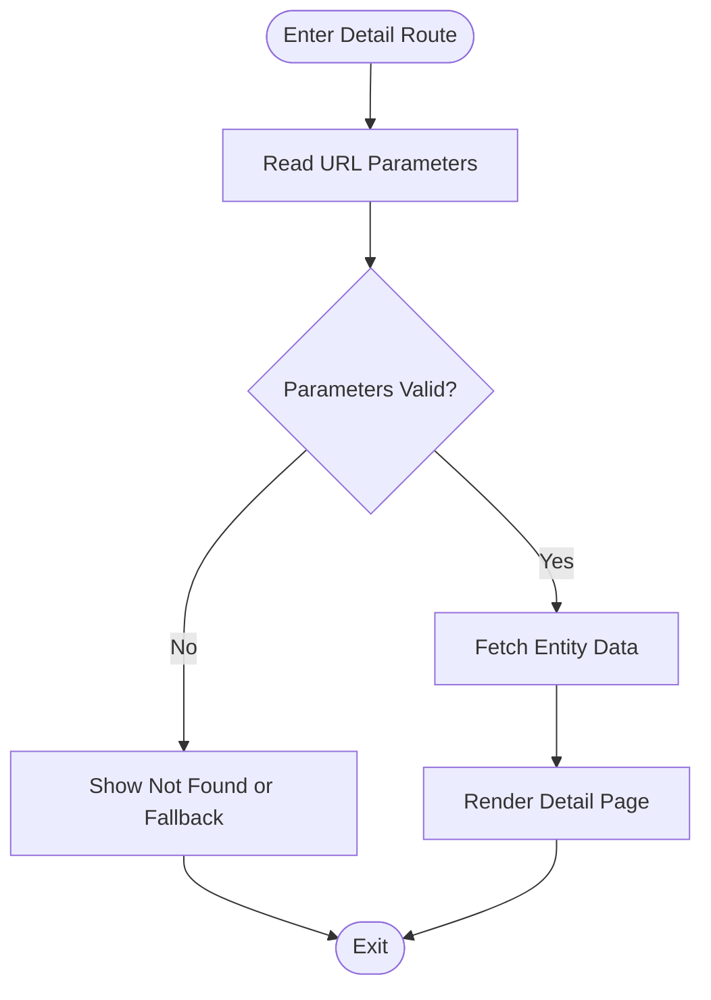

**Diagram sources**
- [plan.md:19-39](file://tasks/plan.md#L19-L39)

**Section sources**
- [plan.md:19-39](file://tasks/plan.md#L19-L39)

### Query String Management
Although the plan emphasizes query-like state via filters and search inputs, the following patterns apply:

- Search page: maintain search text, trending/nearby toggles, and category filters.
- Explore page: maintain area, distance, theme, and crowd filters.
- Categories page: maintain selected category group and subcategory selection.
- Meets page: maintain date, location, and interest filters.

Recommendation:
- Keep lightweight query state in URL for shareability and back-button support.
- Persist heavy or complex filters in Zustand if they affect multiple screens.

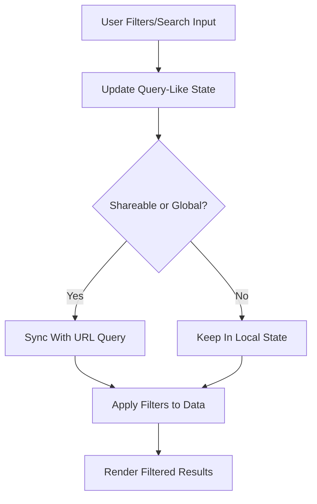

[No sources needed since this diagram shows conceptual workflow, not actual code structure]

### Navigation State Synchronization With Maya Context
Maya should understand the current app context so users do not repeat information:

- If opened from a pandal page, Maya knows the selected pandal.
- If opened from a restaurant page, Maya knows the selected restaurant.
- Maya can consider current location, saved locations, current trip, selected language, and relevant category.

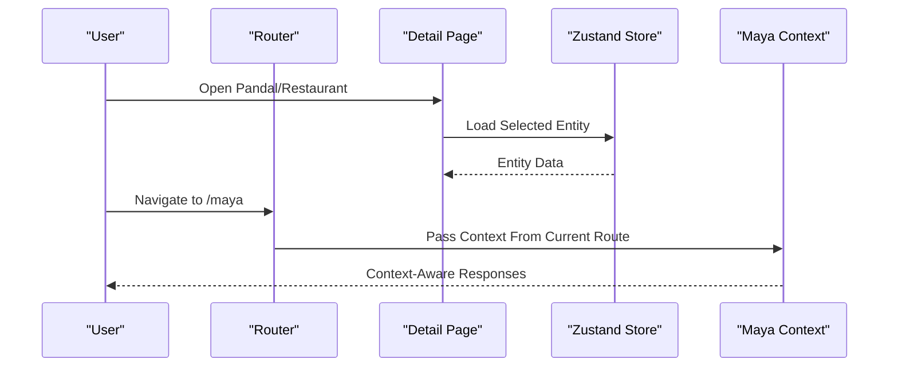

**Diagram sources**
- [Pujo_Sahayak_Master_Project_Context.md:643-660](file://Pujo_Sahayak_Master_Project_Context.md#L643-L660)
- [plan.md:19-39](file://tasks/plan.md#L19-L39)

**Section sources**
- [Pujo_Sahayak_Master_Project_Context.md:643-660](file://Pujo_Sahayak_Master_Project_Context.md#L643-L660)
- [plan.md:19-39](file://tasks/plan.md#L19-L39)

## Dependency Analysis
Routing depends on several cross-cutting concerns:

- Bottom navigation drives top-level routes.
- Detail routes depend on entity data loaded from the demo dataset.
- Maya depends on current route context and store state.
- Planner and trip routes depend on persisted plan data.
- Meets routes depend on meetup data and user permissions.

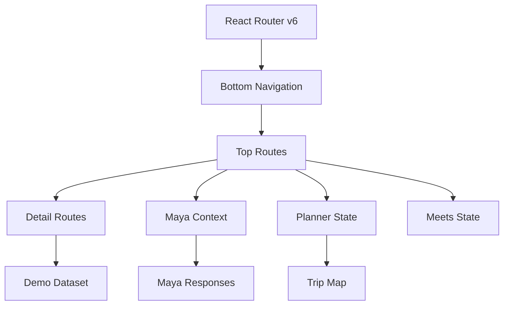

**Diagram sources**
- [plan.md:7-18](file://tasks/plan.md#L7-L18)
- [plan.md:19-39](file://tasks/plan.md#L19-L39)

**Section sources**
- [plan.md:7-18](file://tasks/plan.md#L7-L18)
- [plan.md:19-39](file://tasks/plan.md#L19-L39)

## Performance Considerations
- Use lazy loading for heavy routes such as maps and camera-based scanning.
- Defer non-critical data fetching until after initial render.
- Avoid unnecessary re-renders by memoizing filtered lists and context values.
- Respect reduced-motion preferences for smooth transitions.
- Keep URL state minimal to avoid excessive history entries.

[No sources needed since this section provides general guidance]

## Troubleshooting Guide
Common routing issues and resolutions:

- Broken deep links: verify route definitions match the planned screen-to-route map.
- Missing detail data: validate URL parameters and handle invalid IDs gracefully.
- Maya lacks context: ensure context is passed when navigating to `/maya` or `/maya/scan`.
- Filters not persisting: confirm whether filters should be stored in URL query or Zustand.
- Premium features accessible without upgrade: review navigation guards and redirect logic.
- Offline behavior: verify service worker caching for critical shell assets.

**Section sources**
- [plan.md:63-79](file://tasks/plan.md#L63-L79)
- [todo.md:77-81](file://tasks/todo.md#L77-L81)

## Conclusion
The routing design for Pujo Sahayak centers on a clean React Router v6 setup with five primary tabs, nested detail routes, and feature subroutes. URL parameters identify entities and planner days, while query-like state manages filters and searches. Maya integrates deeply with routing context to provide grounded, helpful responses. Navigation guards protect premium and sensitive flows, and Zustand persists user state for continuity. This structure supports both the seasonal Puja experience and the broader off-season local discovery model.

[No sources needed since this section summarizes without analyzing specific files]