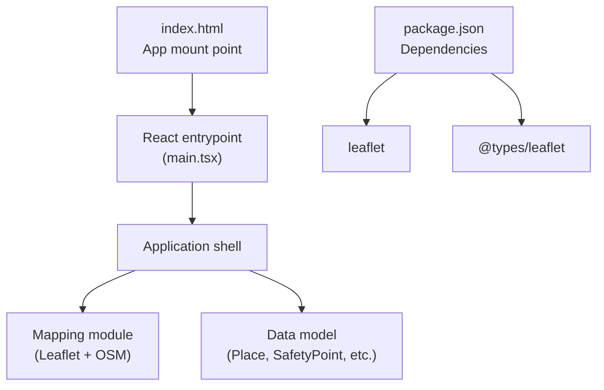
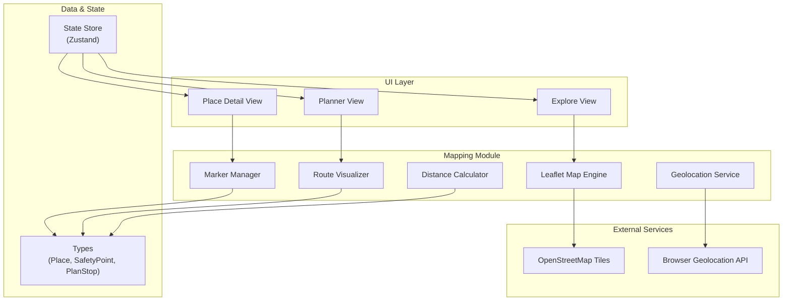
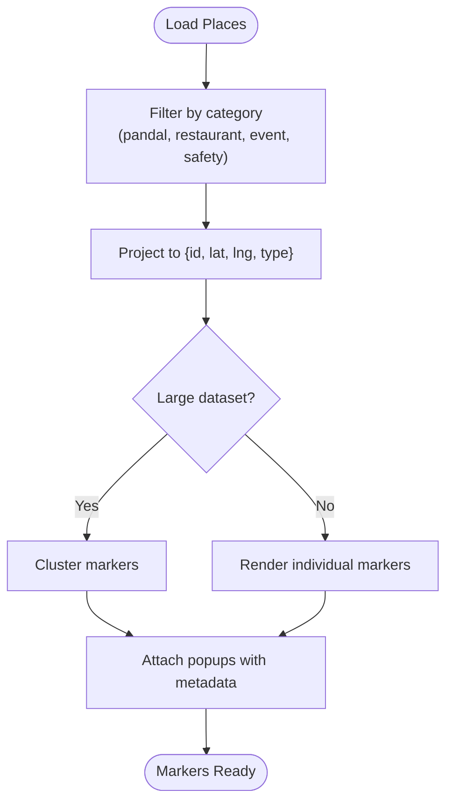
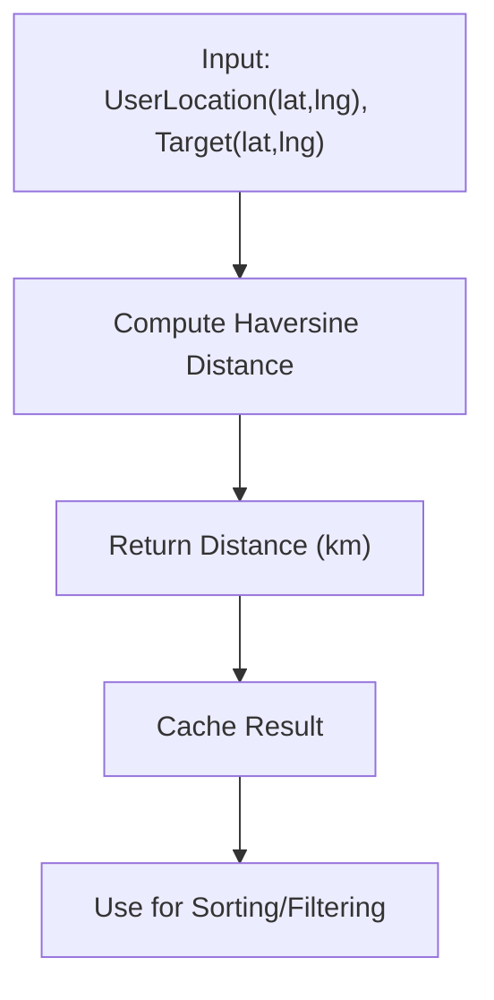
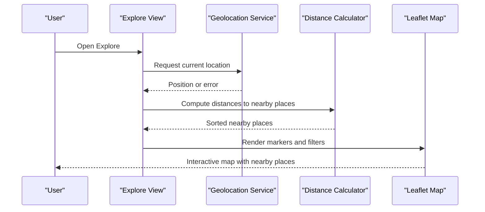
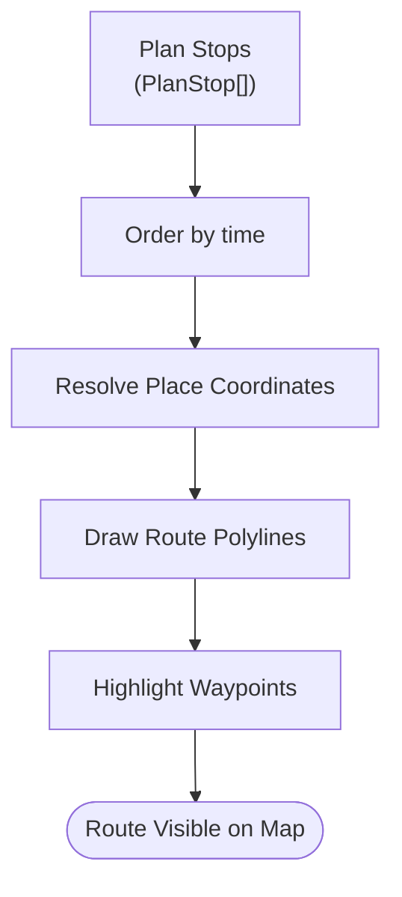
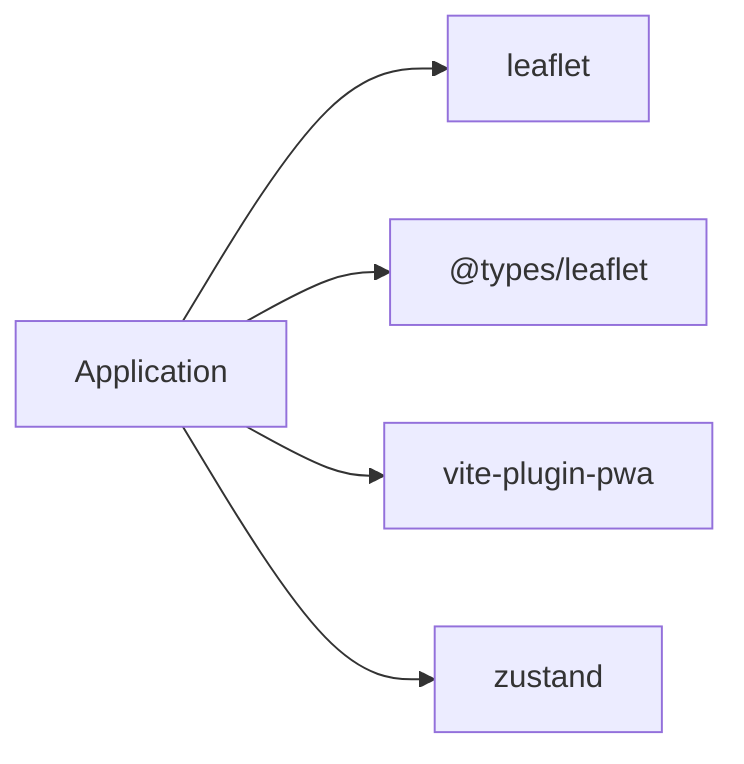

# Mapping and Location Services

<cite>
**Referenced Files in This Document**
- [index.html](file://index.html)
- [package.json](file://package.json)
- [types.ts](file://src/data/types.ts)
- [Pujo_Sahayak_Master_Project_Context.md](file://Pujo_Sahayak_Master_Project_Context.md)
</cite>

## Table of Contents
1. [Introduction](#introduction)
2. [Project Structure](#project-structure)
3. [Core Components](#core-components)
4. [Architecture Overview](#architecture-overview)
5. [Detailed Component Analysis](#detailed-component-analysis)
6. [Dependency Analysis](#dependency-analysis)
7. [Performance Considerations](#performance-considerations)
8. [Troubleshooting Guide](#troubleshooting-guide)
9. [Conclusion](#conclusion)

## Introduction
This document explains how mapping and location services should be integrated into the Pujo Sahayak application using Leaflet with OpenStreetMap. It covers map initialization, marker placement for pandals and other locations, geolocation services, distance calculations, integration with explore and planning features (route visualization, nearby place discovery, and location-based filtering), offline considerations, and performance optimization for large datasets.

The product context emphasizes a continuous user journey: discover, explore, understand, plan, visit, share, meet, and discover again. Mapping is central to this flow because it connects discovery, planning, navigation, and local exploration.

**Section sources**
- [Pujo_Sahayak_Master_Project_Context.md:21-43](file://Pujo_Sahayak_Master_Project_Context.md#L21-L43)
- [Pujo_Sahayak_Master_Project_Context.md:77-100](file://Pujo_Sahayak_Master_Project_Context.md#L77-L100)

## Project Structure
At present, the repository contains:
- An HTML entry point that mounts the React application.
- A Vite-based TypeScript project configuration.
- A package manifest declaring Leaflet as a dependency.
- A shared data model file defining place-related types used across the app.

**Diagram sources**
- [index.html:20-23](file://index.html#L20-L23)
- [package.json:11-29](file://package.json#L11-L29)

**Section sources**
- [index.html:1-25](file://index.html#L1-L25)
- [package.json:1-32](file://package.json#L1-L32)

## Core Components
The mapping layer should provide these core capabilities:
- Map initialization with OpenStreetMap tiles.
- Marker management for pandals, restaurants, events, and safety points.
- Geolocation service to obtain the user’s current position.
- Distance calculation utilities for sorting and filtering nearby places.
- Route visualization for planned itineraries.
- Nearby place discovery and location-based filtering.
- Offline tile caching strategy for PWA usage.

These components integrate with the broader product flows described in the master context, including discovery, planning, and local exploration.

**Section sources**
- [Pujo_Sahayak_Master_Project_Context.md:77-100](file://Pujo_Sahayak_Master_Project_Context.md#L77-L100)
- [Pujo_Sahayak_Master_Project_Context.md:447-493](file://Pujo_Sahayak_Master_Project_Context.md#L447-L493)

## Architecture Overview
The mapping architecture integrates UI components, state management, data models, and external services.

**Diagram sources**
- [package.json:11-29](file://package.json#L11-L29)
- [types.ts:40-69](file://src/data/types.ts#L40-L69)
- [types.ts:107-115](file://src/data/types.ts#L107-L115)
- [types.ts:134-139](file://src/data/types.ts#L134-L139)

## Detailed Component Analysis

### Map Initialization
- Initialize a Leaflet map instance bound to a DOM container rendered by the React application.
- Use OpenStreetMap tile layers for base maps.
- Set an initial center and zoom appropriate for Kolkata during Puja season.
- Provide controls such as zoom, scale, and attribution.
- Ensure responsive behavior on mobile devices.

Integration notes:
- The HTML entry point mounts the React app; the mapping module should attach to a dedicated container within the app shell.
- Keep map lifecycle management consistent with component mounting and unmounting to avoid memory leaks.

**Section sources**
- [index.html:20-23](file://index.html#L20-L23)
- [package.json:11-29](file://package.json#L11-L29)

### Marker Placement for Pandals and Locations
- Render markers for each Place or SafetyPoint from the data model.
- Use distinct icons or colors for pandals, restaurants, events, and safety points.
- Support clustering when many markers are present.
- Provide popups with key details: name, type, rating, crowd level, and quick actions (save, navigate).

Data model alignment:
- Place includes coordinates, type, name, area, rating, crowd level, and optional story/theme fields.
- SafetyPoint includes kind, name, detail, distance, and coordinates.

**Diagram sources**
- [types.ts:40-69](file://src/data/types.ts#L40-L69)
- [types.ts:107-115](file://src/data/types.ts#L107-L115)

**Section sources**
- [types.ts:40-69](file://src/data/types.ts#L40-L69)
- [types.ts:107-115](file://src/data/types.ts#L107-L115)

### Geolocation Services
- Request the user’s current position using the browser Geolocation API.
- Handle permission prompts and errors gracefully.
- Update the map view to center on the user’s location when available.
- Cache the last known location for offline scenarios where possible.

User experience:
- Show a clear indicator when location is unavailable or denied.
- Allow manual fallback to search-by-area or default city center.

**Section sources**
- [Pujo_Sahayak_Master_Project_Context.md:485-493](file://Pujo_Sahayak_Master_Project_Context.md#L485-L493)

### Distance Calculations
- Implement haversine distance calculation between two latitude/longitude pairs.
- Expose a utility function returning distance in kilometers.
- Use precomputed distanceKm from the data model when available; otherwise compute on demand.
- Cache computed distances per session to avoid repeated calculations.

Usage patterns:
- Sort nearby places by distance.
- Filter places within a radius around the user or a selected place.
- Display distance in list views and map popups.

**Diagram sources**
- [types.ts:40-69](file://src/data/types.ts#L40-L69)

**Section sources**
- [types.ts:40-69](file://src/data/types.ts#L40-L69)

### Integration with Explore and Planning Features

#### Explore: Nearby Place Discovery and Filtering
- Combine geolocation and distance calculations to show nearby pandals, restaurants, and events.
- Apply filters for crowd level, open status, cuisine, price band, and categories.
- Present results in both list and map views with synchronized selection.

Product context alignment:
- The Search and Categories pages emphasize discovering pandals, restaurants, events, and useful places.
- Popular nearby places should use location context to help users discover what is around them.

**Diagram sources**
- [Pujo_Sahayak_Master_Project_Context.md:447-493](file://Pujo_Sahayak_Master_Project_Context.md#L447-L493)
- [types.ts:40-69](file://src/data/types.ts#L40-L69)

**Section sources**
- [Pujo_Sahayak_Master_Project_Context.md:447-493](file://Pujo_Sahayak_Master_Project_Context.md#L447-L493)
- [types.ts:40-69](file://src/data/types.ts#L40-L69)

#### Planning: Route Visualization
- Convert a multi-day itinerary into a sequence of stops using the PlanStop type.
- Draw polylines connecting stops to visualize routes on the map.
- Highlight start/end points and intermediate waypoints.
- Provide turn-by-turn guidance integration if needed later.

Data model alignment:
- PlanStop defines placeId, time, and durationMin for each stop.
- Place provides coordinates and metadata required for route rendering.

**Diagram sources**
- [types.ts:134-139](file://src/data/types.ts#L134-L139)
- [types.ts:40-69](file://src/data/types.ts#L40-L69)

**Section sources**
- [types.ts:134-139](file://src/data/types.ts#L134-L139)
- [types.ts:40-69](file://src/data/types.ts#L40-L69)

### Offline Map Considerations
- Use a PWA strategy to cache OpenStreetMap tiles at relevant zoom levels for expected areas.
- Pre-cache tiles around popular Puja zones and transit hubs.
- Gracefully degrade to a static overview or cached snapshot when offline.
- Inform users about offline mode limitations and suggest downloading areas ahead of time.

PWA tooling:
- The project includes vite-plugin-pwa in development dependencies, enabling offline strategies.

**Section sources**
- [package.json:20-30](file://package.json#L20-L30)

### Performance Optimization for Large Datasets
- Use marker clustering to reduce visual clutter and improve rendering performance.
- Load markers lazily based on viewport bounds.
- Debounce map movement events before recalculating nearby places.
- Avoid heavy computations on the main thread; consider Web Workers for batch distance calculations.
- Prefer server-side filtering and pagination when datasets grow large.

**Section sources**
- [Pujo_Sahayak_Master_Project_Context.md:447-493](file://Pujo_Sahayak_Master_Project_Context.md#L447-L493)

## Dependency Analysis
Key dependencies for mapping and location services:
- leaflet: Core mapping library.
- @types/leaflet: TypeScript definitions for Leaflet.
- vite-plugin-pwa: Enables offline caching strategies.
- zustand: State management for app-wide state (e.g., selected place, filters, plan).

**Diagram sources**
- [package.json:11-29](file://package.json#L11-L29)

**Section sources**
- [package.json:11-29](file://package.json#L11-L29)

## Performance Considerations
- Tile loading: Limit initial zoom range and defer high-zoom tiles until needed.
- Marker rendering: Cluster markers and update only visible ones.
- Geolocation polling: Throttle updates to avoid excessive re-renders.
- Distance computation: Cache results and compute incrementally.
- Memory management: Dispose of unused map instances and remove event listeners on unmount.

[No sources needed since this section provides general guidance]

## Troubleshooting Guide
Common issues and resolutions:
- Map not rendering: Verify the DOM container exists and has dimensions; ensure Leaflet CSS is loaded.
- Geolocation denied: Prompt users to enable location permissions; provide manual fallback.
- Slow marker load: Enable clustering and lazy loading; paginate or filter results.
- Offline map blank: Confirm PWA cache rules include OSM tile domains and appropriate zoom levels.
- Incorrect distances: Validate coordinate formats and ensure consistent units (degrees vs meters).

**Section sources**
- [Pujo_Sahayak_Master_Project_Context.md:485-493](file://Pujo_Sahayak_Master_Project_Context.md#L485-L493)

## Conclusion
Integrating Leaflet with OpenStreetMap enables robust mapping and location services for Pujo Sahayak. By aligning the mapping layer with the product’s discovery, planning, and local exploration flows, the application can deliver a cohesive experience: users discover pandals and nearby places, plan multi-stop itineraries, visualize routes, and stay informed while navigating Kolkata during Puja. Proper attention to offline support and performance ensures reliability and responsiveness even under heavy usage.

[No sources needed since this section summarizes without analyzing specific files]