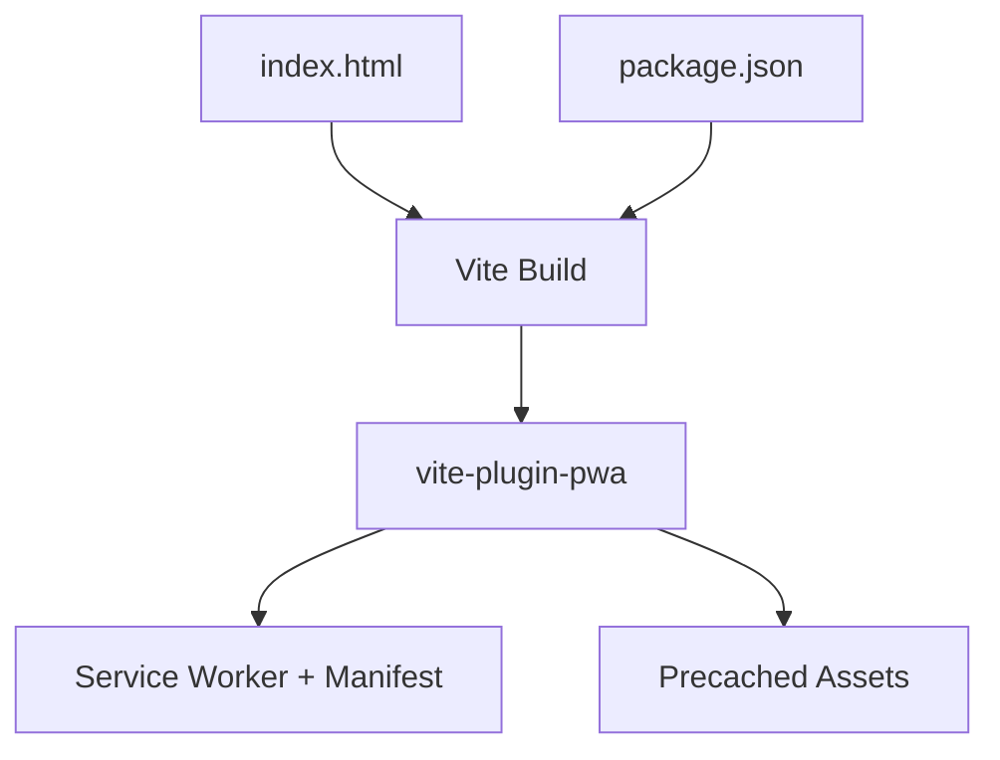
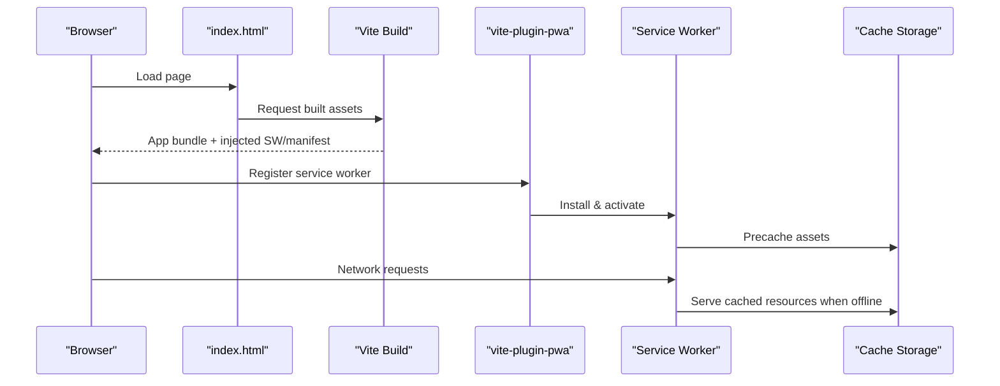
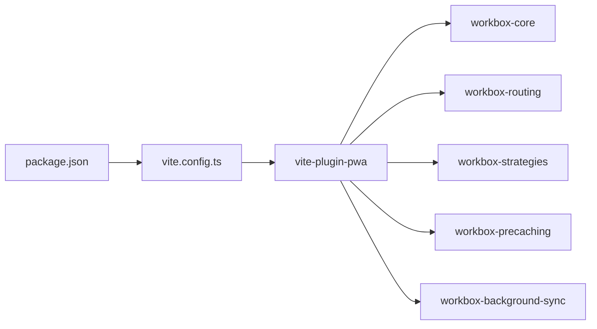

# Progressive Web App Capabilities

<cite>
**Referenced Files in This Document**
- [vite.config.ts](file://vite.config.ts)
- [package.json](file://package.json)
- [index.html](file://index.html)
- [types.ts](file://src/data/types.ts)
- [plan.md](file://tasks/plan.md)
</cite>

## Table of Contents
1. [Introduction](#introduction)
2. [Project Structure](#project-structure)
3. [Core Components](#core-components)
4. [Architecture Overview](#architecture-overview)
5. [Detailed Component Analysis](#detailed-component-analysis)
6. [Dependency Analysis](#dependency-analysis)
7. [Performance Considerations](#performance-considerations)
8. [Troubleshooting Guide](#troubleshooting-guide)
9. [Conclusion](#conclusion)
10. [Appendices](#appendices)

## Introduction
This document explains how the project implements Progressive Web App (PWA) capabilities using vite-plugin-pwa. It covers service worker configuration, offline shell behavior, app manifest setup, installation prompts, caching strategies, background sync considerations, and how these features support a festival exploration experience where connectivity may be unreliable. It also includes testing procedures and deployment considerations.

## Project Structure
The PWA configuration is centralized in Vite’s configuration file. The application uses React with TypeScript and Tailwind CSS. The HTML entrypoint defines meta tags for theme color and description that complement the PWA manifest.

**Diagram sources**
- [index.html:1-25](file://index.html#L1-L25)
- [vite.config.ts:1-37](file://vite.config.ts#L1-L37)
- [package.json:1-32](file://package.json#L1-L32)

**Section sources**
- [vite.config.ts:1-37](file://vite.config.ts#L1-L37)
- [index.html:1-25](file://index.html#L1-L25)
- [package.json:1-32](file://package.json#L1-L32)

## Core Components
- VitePWA plugin integration: Registers an auto-updating service worker and generates a web app manifest from the provided configuration.
- Manifest metadata: Defines app name, short name, description, theme colors, display mode, orientation, scope, start URL, and icons.
- Asset inclusion: Includes static assets such as the favicon into the precache.
- Runtime dependencies: Workbox modules are included by vite-plugin-pwa to provide caching, routing, and update mechanisms.

Key behaviors derived from configuration:
- Service worker registration type is set to autoUpdate, enabling automatic updates when new versions are available.
- The app is configured to run standalone in portrait orientation with a defined root scope and start URL.
- An SVG icon is declared for installability across devices.

**Section sources**
- [vite.config.ts:11-34](file://vite.config.ts#L11-L34)
- [package.json:28-30](file://package.json#L28-L30)

## Architecture Overview
The PWA architecture integrates the build-time plugin with runtime browser capabilities. The Vite build produces the application bundle and injects the necessary service worker and manifest files. At runtime, the browser registers the service worker, caches critical assets, and enables installation via the platform prompt.

**Diagram sources**
- [index.html:1-25](file://index.html#L1-L25)
- [vite.config.ts:11-34](file://vite.config.ts#L11-L34)

## Detailed Component Analysis

### Service Worker Configuration
- Registration strategy: Auto-update ensures users receive new versions without manual refreshes.
- Scope and start URL: The app scope is set to the root path, and the start URL points to the home route, ensuring consistent navigation when launched from the home screen.
- Display mode and orientation: Standalone display and portrait orientation create an app-like experience on mobile devices.

Operational implications:
- The service worker will intercept network requests and serve precached assets when offline.
- Updates are handled automatically; the UI can optionally notify users about new versions if needed.

**Section sources**
- [vite.config.ts:11-34](file://vite.config.ts#L11-L34)

### Offline Functionality
- Precaching: Static assets such as the favicon are included in the precache list, improving first-load performance and enabling offline access to core UI elements.
- Runtime caching: Workbox modules (included by vite-plugin-pwa) provide strategies for caching responses and handling stale-while-revalidate patterns. These are not explicitly configured in this repository but are available through the plugin’s defaults.

Use case alignment:
- During festivals, connectivity can be intermittent. Precached assets ensure the shell loads quickly and reliably, while runtime caching can improve responsiveness for frequently accessed content.

**Section sources**
- [vite.config.ts:13-33](file://vite.config.ts#L13-L33)
- [package.json:28-30](file://package.json#L28-L30)

### App Manifest Setup
- Identity: Name, short name, and description define how the app appears in the OS and stores.
- Visual branding: Theme color and background color align with the app’s design tokens.
- Navigation: Start URL and scope ensure the app launches consistently within its intended context.
- Icons: An SVG icon is declared for broad device compatibility.

Installation prompt:
- The presence of a valid manifest and icon enables the platform’s install prompt. Users can add the app to their home screen for quick access during events.

**Section sources**
- [vite.config.ts:14-33](file://vite.config.ts#L14-L33)
- [index.html:7-11](file://index.html#L7-L11)

### Installation Prompts
- Platform integration: When the manifest meets criteria (name, icons, display mode), browsers show an install prompt.
- User experience: Encourage installation at appropriate moments (e.g., after initial exploration or when the user has engaged with key features).
- Fallback: If the platform does not support installation, the app remains accessible via the browser.

Best practices:
- Respect user choice and avoid intrusive prompts.
- Provide clear value messaging tied to offline reliability and quick access during festivals.

[No sources needed since this section provides general guidance]

### Caching Strategies
- Precache: Static assets listed in includeAssets are cached at install time.
- Runtime strategies: Workbox modules are available for network-first, cache-first, or stale-while-revalidate approaches. While not explicitly configured here, they can be added to tailor caching per resource type (images, fonts, API responses).

Recommendations for festival exploration:
- Cache the app shell and critical UI assets aggressively.
- Use cache-first for stable assets (icons, fonts) and network-first with fallback for dynamic content (pandal listings, maps tiles).
- Implement expiration policies to balance freshness and storage limits.

**Section sources**
- [vite.config.ts:13-33](file://vite.config.ts#L13-L33)
- [package.json:28-30](file://package.json#L28-L30)

### Background Sync Capabilities
- Availability: Workbox background sync is included as a dependency in the build environment, indicating readiness for implementing queued operations when offline.
- Potential use cases:
  - Queueing analytics or telemetry when connectivity is unavailable.
  - Deferring non-critical writes (e.g., saving preferences or logs) until online.
- Implementation note: No explicit background sync code is present in the current repository; it can be integrated where needed.

**Section sources**
- [package.json:28-30](file://package.json#L28-L30)

### Festival Exploration Use Case Alignment
- Connectivity challenges: Intermittent networks during large gatherings benefit from robust offline shells and reliable caching.
- Value delivered:
  - Fast, consistent launch via standalone mode.
  - Immediate access to core UI and essential assets.
  - Optional background tasks that resume when connectivity returns.

Contextual reference:
- The project plan identifies vite-plugin-pwa as the mechanism for manifest and service worker generation, supporting installable and offline-capable experiences.

**Section sources**
- [plan.md:7-17](file://tasks/plan.md#L7-L17)

## Dependency Analysis
The PWA stack relies on Vite, React, TypeScript, Tailwind CSS, and vite-plugin-pwa. Workbox modules are bundled transitively by the plugin to enable service worker functionality.

**Diagram sources**
- [package.json:28-30](file://package.json#L28-L30)
- [vite.config.ts:1-37](file://vite.config.ts#L1-L37)

**Section sources**
- [package.json:1-32](file://package.json#L1-L32)
- [vite.config.ts:1-37](file://vite.config.ts#L1-L37)

## Performance Considerations
- Keep the precache minimal: Include only essential assets to reduce install size and improve reliability.
- Leverage CDN and compression: Ensure static assets are served with proper caching headers.
- Monitor service worker updates: Auto-update reduces friction but should be paired with user-friendly notifications when appropriate.
- Optimize images and fonts: Use modern formats and responsive sizing to minimize payload.

[No sources needed since this section provides general guidance]

## Troubleshooting Guide
Common issues and resolutions:
- Service worker not registering:
  - Verify HTTPS or localhost context.
  - Check browser console for errors related to scope or MIME types.
- Manifest not recognized:
  - Confirm manifest fields (name, icons, display) meet platform requirements.
  - Validate JSON structure and icon accessibility.
- Stale cache causing outdated content:
  - Clear site data or force reload.
  - Ensure versioned asset filenames for effective cache busting.
- Offline shell missing assets:
  - Confirm includeAssets contains required files.
  - Rebuild the app to regenerate the service worker and precache list.

Testing procedures:
- Development:
  - Run the dev server and inspect the Application panel for service worker status.
  - Toggle offline mode to verify shell availability.
- Production:
  - Deploy to a secure host (HTTPS).
  - Test installation prompt and home screen launch.
  - Simulate poor connectivity and validate caching behavior.

**Section sources**
- [vite.config.ts:11-34](file://vite.config.ts#L11-L34)
- [index.html:1-25](file://index.html#L1-L25)

## Conclusion
The project leverages vite-plugin-pwa to deliver a fast, installable, and resilient PWA tailored for festival exploration. With auto-updating service workers, a well-defined manifest, and precached assets, the app provides a reliable baseline experience even under unreliable connectivity. Future enhancements can introduce granular runtime caching strategies and background sync for advanced offline workflows.

[No sources needed since this section summarizes without analyzing specific files]

## Appendices

### Data Model Context
While not directly part of PWA configuration, the application’s data model informs what content benefits most from caching and offline access.

**Section sources**
- [types.ts:1-150](file://src/data/types.ts#L1-L150)