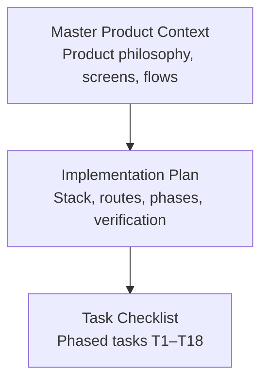
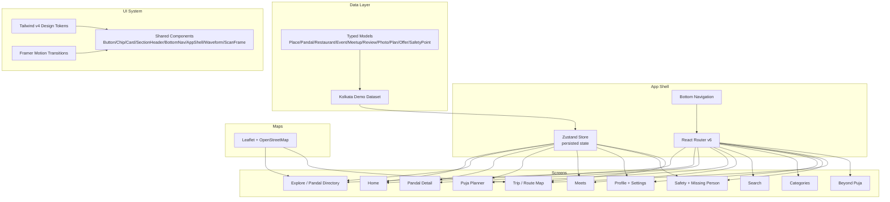
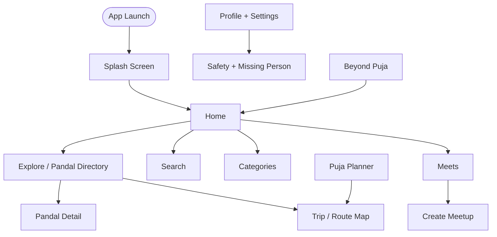
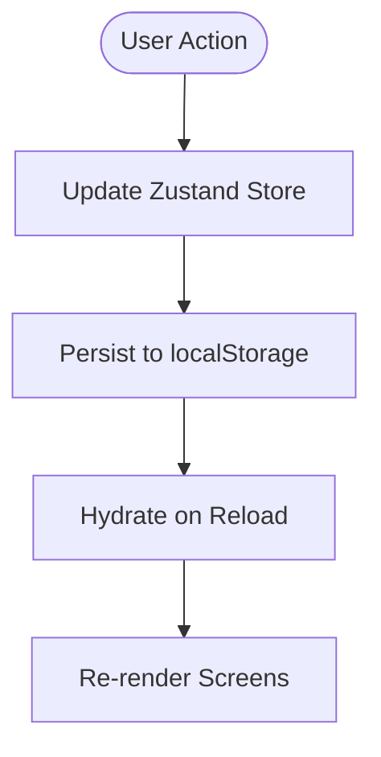
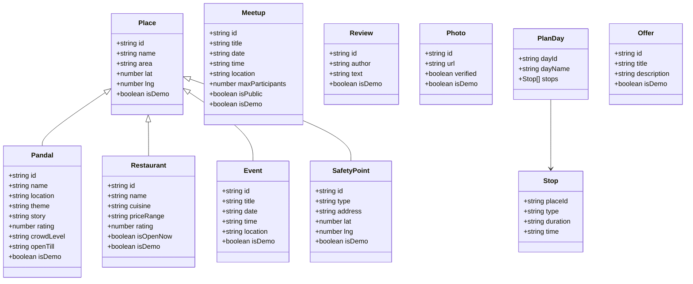
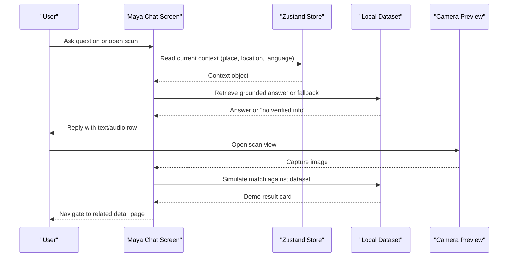
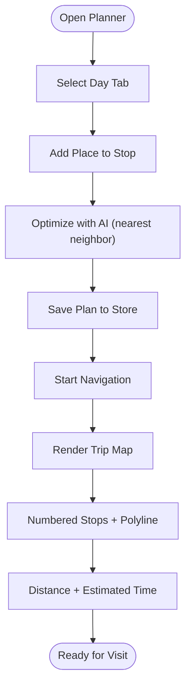
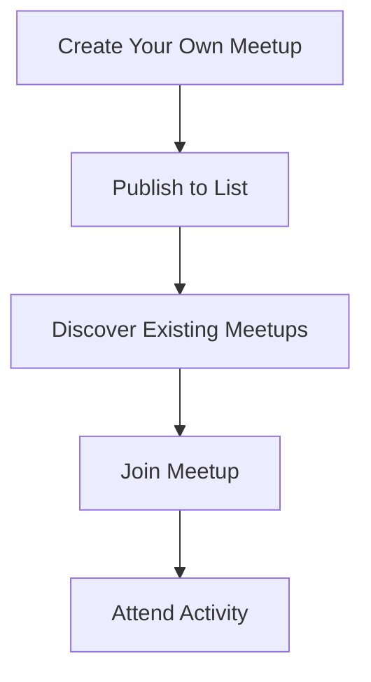
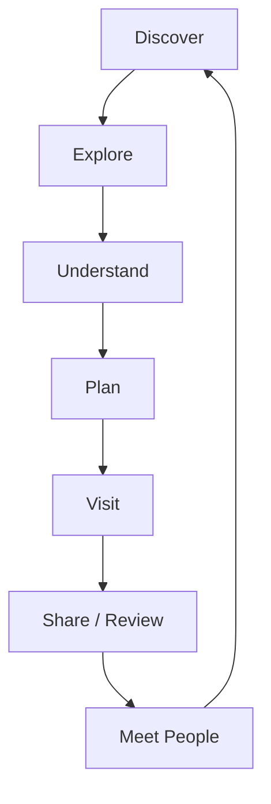
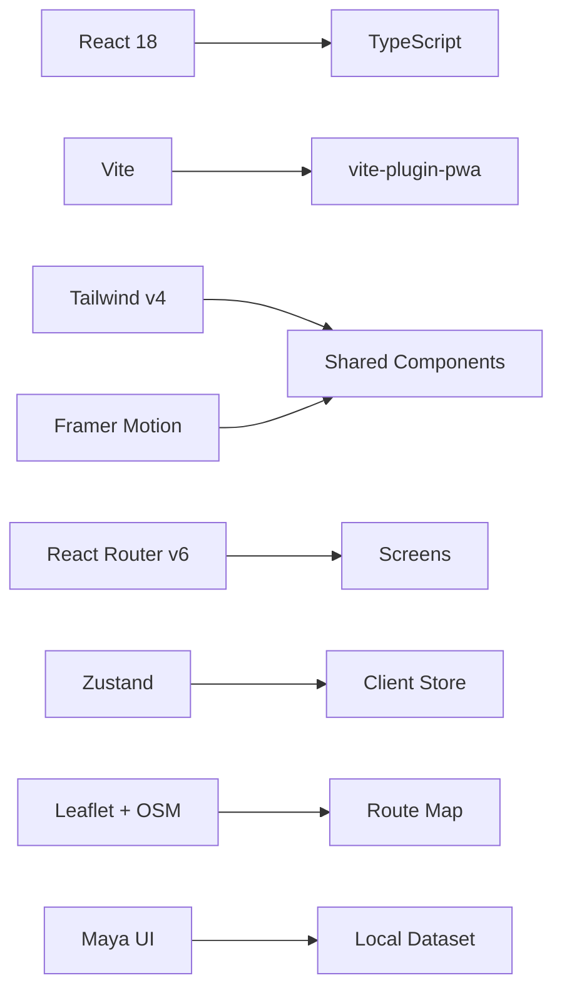

# React Ecosystem and Core Framework

<cite>
**Referenced Files in This Document**
- [Pujo_Sahayak_Master_Project_Context.md](file://Pujo_Sahayak_Master_Project_Context.md)
- [tasks/plan.md](file://tasks/plan.md)
- [tasks/todo.md](file://tasks/todo.md)
</cite>

## Table of Contents
1. [Introduction](#introduction)
2. [Project Structure](#project-structure)
3. [Core Components](#core-components)
4. [Architecture Overview](#architecture-overview)
5. [Detailed Component Analysis](#detailed-component-analysis)
6. [Dependency Analysis](#dependency-analysis)
7. [Performance Considerations](#performance-considerations)
8. [Troubleshooting Guide](#troubleshooting-guide)
9. [Conclusion](#conclusion)
10. [Appendices](#appendices)

## Introduction
This document explains the React ecosystem for Puja Sahayak, focusing on how a React 18 + TypeScript application is organized to support mobile-first PWA behavior, discovery-driven UX, planning features, and social meetups. The project context defines Puja Sahayak as a digital companion for exploring Kolkata during Durga Puja, with an intentionally broader local-discovery ecosystem beyond the festival season.

Key product goals include:
- Discovery of pandals, restaurants, events, and local experiences
- AI-assisted guidance through Maya
- Multi-day Puja planning
- Social meetups and activity-based connections
- Safety, transport, and utility information
- Personalization and continuity across sessions

The implementation plan positions the app as a mobile-first React + Vite PWA using Tailwind CSS v4, React Router v6, Zustand with persistence, Framer Motion, and Leaflet + OpenStreetMap. The UI should feel bespoke rather than generic SaaS, with design tokens encoding ivory surfaces, vermilion primary, charcoal ink, muted gold, and dark imagery.

**Section sources**
- [Pujo_Sahayak_Master_Project_Context.md:1-18](file://Pujo_Sahayak_Master_Project_Context.md#L1-L18)
- [tasks/plan.md:1-18](file://tasks/plan.md#L1-L18)

## Project Structure
At this stage, the repository contains:
- A master product context describing the full product vision, navigation, screens, and feature boundaries
- An implementation plan defining stack choices, route mapping, phases, verification criteria, risks, and open questions
- A task checklist tracking phased build steps from foundation through polish

**Diagram sources**
- [Pujo_Sahayak_Master_Project_Context.md:1-18](file://Pujo_Sahayak_Master_Project_Context.md#L1-L18)
- [tasks/plan.md:1-18](file://tasks/plan.md#L1-L18)
- [tasks/todo.md:1-10](file://tasks/todo.md#L1-L10)

**Section sources**
- [Pujo_Sahayak_Master_Project_Context.md:1-18](file://Pujo_Sahayak_Master_Project_Context.md#L1-L18)
- [tasks/plan.md:1-18](file://tasks/plan.md#L1-L18)
- [tasks/todo.md:1-10](file://tasks/todo.md#L1-L10)

## Core Components
The core React ecosystem is defined by the following building blocks:

- Application shell and navigation
  - Mobile-first bottom navigation with five tabs: Home, Favorites, Search, Categories, Meets
  - Deep links for detail pages such as `/pandal/:id` and `/restaurant/:id`
  - Splash entry and route transitions

- State management
  - One client store backed by Zustand with persist middleware
  - Stores saved places, visited places, six-day Puja plan, meetups, language, theme, app-logo choice, and “continue where you left off” session data

- Data model
  - Typed entities including User, Place, Pandal, Restaurant, Event, Meetup, Review, Photo, Plan, Offer, SafetyPoint
  - Local demo dataset grounded in real Kolkata locations, marked `isDemo: true`

- UI system
  - Tailwind CSS v4 design tokens
  - Shared components: Button, Chip, Card (with place-card variant), SectionHeader, BottomNav, AppShell, Waveform, ScanFrame
  - Page transitions powered by Framer Motion, honoring reduced-motion preferences

- Maps and routing
  - Leaflet + OpenStreetMap for route maps, list/map toggle, and nearby help points
  - React Router v6 for tab-to-route mapping and nested detail routes

- Accessibility and personalization
  - Dark mode, reduced motion, Bengali/English i18n strings
  - App-logo picker and language toggle

These components collectively enable discovery, planning, and social features while keeping the app installable and offline-capable via Vite PWA configuration.

**Section sources**
- [tasks/plan.md:9-18](file://tasks/plan.md#L9-L18)
- [tasks/todo.md:10-14](file://tasks/todo.md#L10-L14)
- [Pujo_Sahayak_Master_Project_Context.md:140-158](file://Pujo_Sahayak_Master_Project_Context.md#L140-L158)

## Architecture Overview
The architecture centers around a typed data layer, a single persisted client store, and a route-driven UI built with React Router. The app shell renders the bottom navigation and page content, while shared components compose screen layouts.

**Diagram sources**
- [tasks/plan.md:9-18](file://tasks/plan.md#L9-L18)
- [tasks/plan.md:19-39](file://tasks/plan.md#L19-L39)
- [tasks/todo.md:10-14](file://tasks/todo.md#L10-L14)
- [Pujo_Sahayak_Master_Project_Context.md:140-158](file://Pujo_Sahayak_Master_Project_Context.md#L140-L158)

## Detailed Component Analysis

### Application Shell and Navigation
The app shell provides the persistent navigation structure and ensures that each route maps cleanly to a screen. The bottom navigation supports five tabs and keeps the AI assistant accessible without consuming a permanent slot.

**Diagram sources**
- [tasks/plan.md:19-39](file://tasks/plan.md#L19-L39)
- [Pujo_Sahayak_Master_Project_Context.md:140-158](file://Pujo_Sahayak_Master_Project_Context.md#L140-L158)

**Section sources**
- [tasks/plan.md:19-39](file://tasks/plan.md#L19-L39)
- [Pujo_Sahayak_Master_Project_Context.md:140-158](file://Pujo_Sahayak_Master_Project_Context.md#L140-L158)

### State Management with Zustand
The single client store centralizes user-facing state and persists it to localStorage. This includes:
- Saved places and visited places
- Six-day Puja plan
- Meetups and user preferences (language, theme, app logo)
- “Continue where you left off” session data

**Diagram sources**
- [tasks/plan.md:12-12](file://tasks/plan.md#L12-L12)
- [tasks/todo.md:10-14](file://tasks/todo.md#L10-L14)

**Section sources**
- [tasks/plan.md:12-12](file://tasks/plan.md#L12-L12)
- [tasks/todo.md:10-14](file://tasks/todo.md#L10-L14)

### Data Model and Demo Dataset
The typed data model ensures type-safe logic across screens and services. The demo dataset includes real Kolkata pandals, restaurants, events, meetups, offers, and safety points, with crowd levels and hours sourced only from dataset fields.

**Diagram sources**
- [tasks/plan.md:46-46](file://tasks/plan.md#L46-L46)
- [tasks/todo.md:13-14](file://tasks/todo.md#L13-L14)

**Section sources**
- [tasks/plan.md:46-46](file://tasks/plan.md#L46-L46)
- [tasks/todo.md:13-14](file://tasks/todo.md#L13-L14)

### Maya Assistant Flow
Maya is UI-complete but locally simulated. It answers questions grounded in the dataset, supports voice waveform UI, and integrates camera scan with a live preview and animated frame. Identification is explicitly labeled as a demo against the dataset.

**Diagram sources**
- [tasks/plan.md:15-15](file://tasks/plan.md#L15-L15)
- [tasks/todo.md:36-40](file://tasks/todo.md#L36-L40)
- [Pujo_Sahayak_Master_Project_Context.md:558-662](file://Pujo_Sahayak_Master_Project_Context.md#L558-L662)

**Section sources**
- [tasks/plan.md:15-15](file://tasks/plan.md#L15-L15)
- [tasks/todo.md:36-40](file://tasks/todo.md#L36-L40)
- [Pujo_Sahayak_Master_Project_Context.md:558-662](file://Pujo_Sahayak_Master_Project_Context.md#L558-L662)

### Puja Planner and Trip Map
The planner supports multi-day itineraries with day tabs, stop cards, add-place selection, and AI-suggested nearest-neighbor reordering. The trip map visualizes numbered markers and polylines, computes distance and estimated time, and supports navigation actions.

**Diagram sources**
- [tasks/todo.md:50-54](file://tasks/todo.md#L50-L54)
- [tasks/todo.md:63-64](file://tasks/todo.md#L63-L64)

**Section sources**
- [tasks/todo.md:50-54](file://tasks/todo.md#L50-L54)
- [tasks/todo.md:63-64](file://tasks/todo.md#L63-L64)

### Meets and Social Features
Meets enables users to discover or organize activity-based gatherings. Cards show event details, attendee counts, and join actions. Creation supports title, date, time, location, description, interest chips, maximum participants, and public/restricted visibility.

**Diagram sources**
- [tasks/todo.md:53-54](file://tasks/todo.md#L53-L54)
- [Pujo_Sahayak_Master_Project_Context.md:664-772](file://Pujo_Sahayak_Master_Project_Context.md#L664-L772)

**Section sources**
- [tasks/todo.md:53-54](file://tasks/todo.md#L53-L54)
- [Pujo_Sahayak_Master_Project_Context.md:664-772](file://Pujo_Sahayak_Master_Project_Context.md#L664-L772)

### Conceptual Overview
Conceptually, the app follows a continuous loop:
- Discover places
- Explore and understand them
- Plan visits
- Visit and share experiences
- Connect with people
- Discover more

[No sources needed since this diagram shows conceptual workflow, not actual code structure]

## Dependency Analysis
The dependency relationships are driven by the implementation plan’s architectural decisions:
- React 18 + TypeScript + Vite form the base
- Tailwind v4 provides the design system
- React Router v6 manages navigation
- Zustand persists client state
- Framer Motion animates transitions
- Leaflet + OpenStreetMap render maps
- Maya is UI-complete with local simulation

**Diagram sources**
- [tasks/plan.md:9-18](file://tasks/plan.md#L9-L18)

**Section sources**
- [tasks/plan.md:9-18](file://tasks/plan.md#L9-L18)

## Performance Considerations
- Keep component composition shallow and reuse shared components to reduce layout thrash on mobile devices
- Use lazy loading for heavy screens like maps and Maya camera views
- Debounce search inputs and filter operations to avoid excessive re-renders
- Prefer memoization for expensive computations such as nearest-neighbor optimization
- Respect reduced-motion settings for animations
- Cache static assets and shell via PWA; keep dataset small and typed for fast hydration

[No sources needed since this section provides general guidance]

## Troubleshooting Guide
Common issues and mitigations:
- Build errors: Ensure TypeScript compiles cleanly and all imports resolve; verify Vite config and PWA plugin setup
- Route navigation failures: Confirm React Router v6 configuration matches documented routes and deep links
- State persistence problems: Validate Zustand persist middleware and localStorage availability
- Maya hallucination risk: Ground responses strictly in the local dataset; use explicit fallback messaging when no verified information exists
- Offline asset availability: Provide gradient/placeholder fallbacks so layout remains intact without images
- Bengali text rendering: Include appropriate fonts and system fallbacks

**Section sources**
- [tasks/plan.md:63-86](file://tasks/plan.md#L63-L86)
- [tasks/todo.md:77-81](file://tasks/todo.md#L77-L81)

## Conclusion
Puja Sahayak’s React ecosystem combines React 18, TypeScript, Vite, Tailwind v4, React Router v6, Zustand, Framer Motion, and Leaflet to deliver a mobile-first PWA focused on discovery, planning, and social engagement. The typed data model and single persisted store ensure consistent state across screens, while shared components and design tokens maintain a bespoke UI identity. Maya provides contextual, dataset-grounded assistance, and the planner/trip flow ties exploration to actionable itineraries. With clear phases, verification criteria, and risk mitigations, the project balances fidelity to mockups with extensibility for future enhancements.

[No sources needed since this section summarizes without analyzing specific files]

## Appendices

### Setup Instructions
- Scaffold a Vite + React + TypeScript project
- Install Tailwind CSS v4, React Router v6, Zustand, Framer Motion, and vite-plugin-pwa
- Configure PWA manifest, icons, and offline shell
- Verify clean build and dev server serving the app shell

**Section sources**
- [tasks/todo.md:7-8](file://tasks/todo.md#L7-L8)

### Configuration Examples
- React Router v6 routes mapped to bottom navigation tabs and nested detail pages
- Zustand store configured with persist middleware for saves, visits, plans, meetups, language, theme, and app-logo choice
- Tailwind v4 tokens for colors, radii, and typography, including Bengali serif accents
- Framer Motion page transitions respecting reduced-motion preferences
- Leaflet + OpenStreetMap initialization for route maps and nearby help points

**Section sources**
- [tasks/plan.md:9-18](file://tasks/plan.md#L9-L18)
- [tasks/todo.md:10-14](file://tasks/todo.md#L10-L14)

### Best Practices for Reusable UI Components
- Encapsulate common patterns into shared components: Button, Chip, Card, SectionHeader, BottomNav, AppShell, Waveform, ScanFrame
- Compose screens from these primitives to maintain consistency and reduce duplication
- Keep motion subtle and purposeful; honor accessibility preferences
- Avoid generic SaaS styling; encode brand-specific tokens and layout rules
- Test components independently before integrating into complex screens

**Section sources**
- [tasks/todo.md:10-11](file://tasks/todo.md#L10-L11)
- [tasks/plan.md:10-10](file://tasks/plan.md#L10-L10)