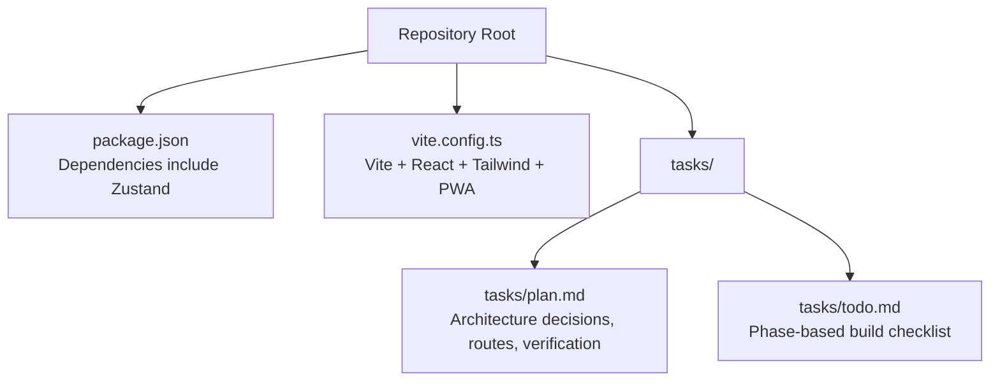
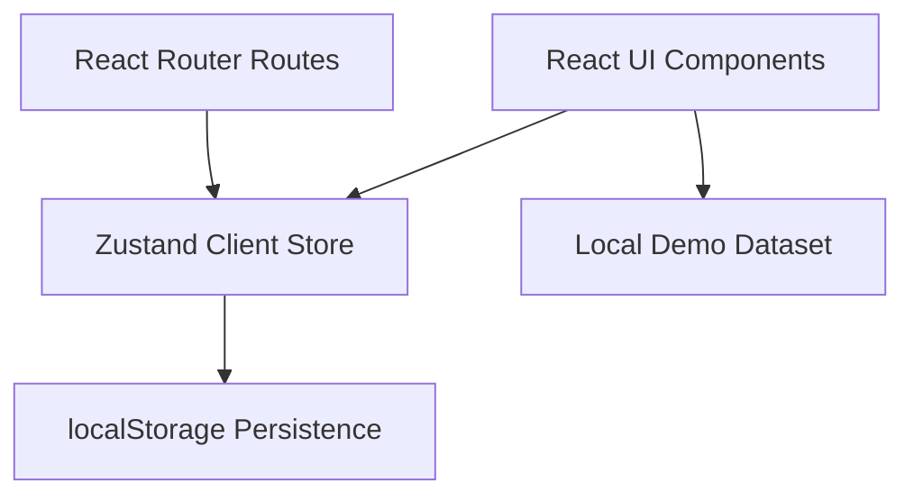
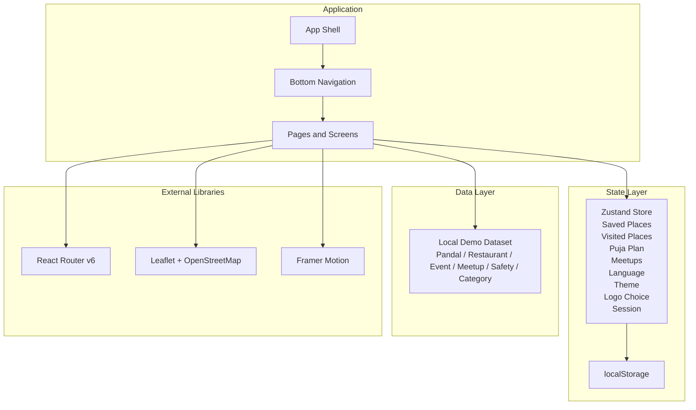
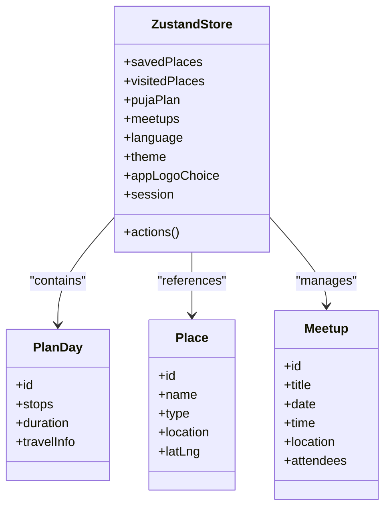
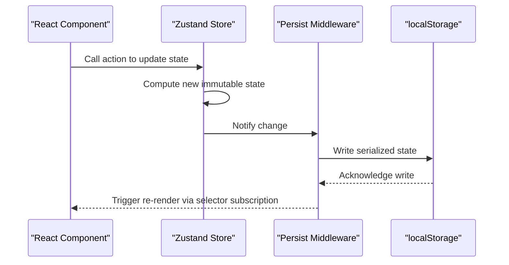
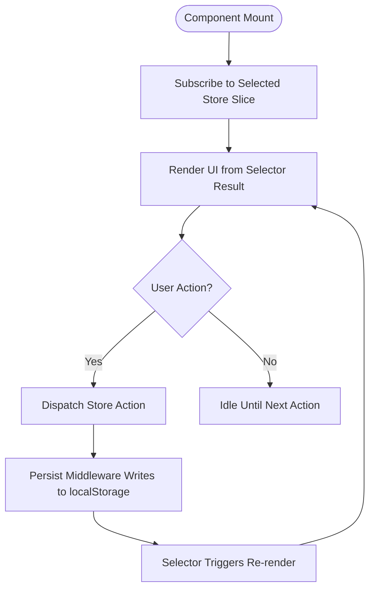
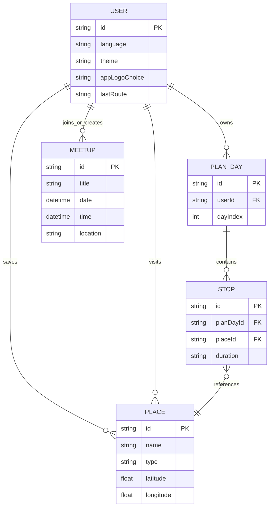
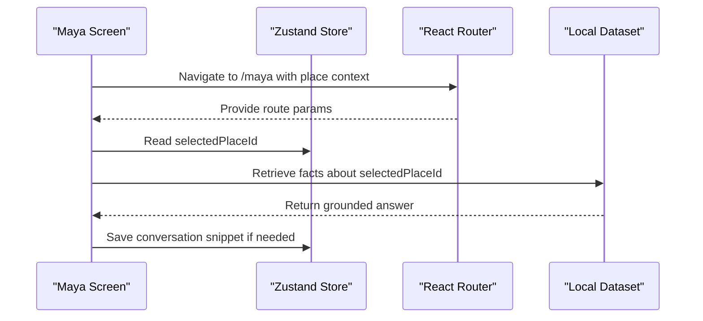
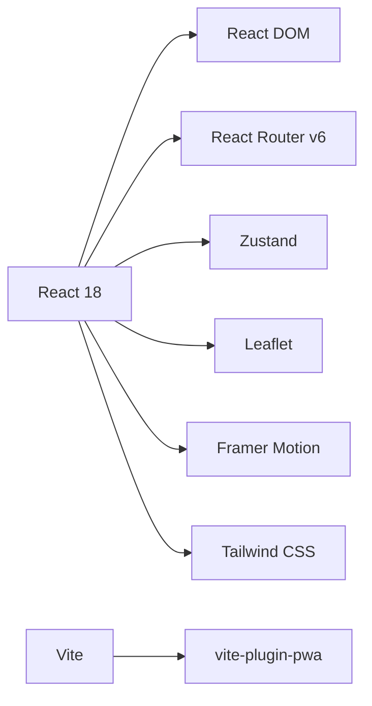
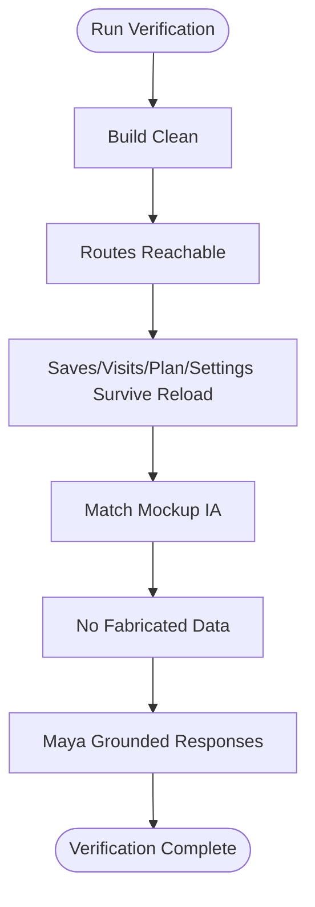

# State Management with Zustand

<cite>
**Referenced Files in This Document**
- [package.json](file://package.json)
- [vite.config.ts](file://vite.config.ts)
- [plan.md](file://tasks/plan.md)
- [todo.md](file://tasks/todo.md)
</cite>

## Table of Contents
1. [Introduction](#introduction)
2. [Project Structure](#project-structure)
3. [Core Components](#core-components)
4. [Architecture Overview](#architecture-overview)
5. [Detailed Component Analysis](#detailed-component-analysis)
6. [Dependency Analysis](#dependency-analysis)
7. [Performance Considerations](#performance-considerations)
8. [Troubleshooting Guide](#troubleshooting-guide)
9. [Conclusion](#conclusion)

## Introduction
This document explains how the project is designed to use Zustand for client-side state management with persistence, and how that state relates to user preferences, saved places, visited places, plans, settings, and AI context. The repository currently contains configuration files and planning documents rather than the full application source code; therefore, this documentation focuses on the intended architecture described in the plan and task files, plus the installed dependencies that confirm Zustand usage.

The goal is to make it clear what the store should contain, how persistence works conceptually, how UI components consume state, and how complex relationships between places, users, and AI context can be modeled without over-coupling.

## Project Structure
At this stage, the repository includes:
- A Vite + React + TypeScript PWA scaffold configuration.
- Dependency declarations including Zustand.
- Planning and task documents describing the intended screen flow, data model, and persistence expectations.

**Diagram sources**
- [package.json:11-19](file://package.json#L11-L19)
- [vite.config.ts:1-36](file://vite.config.ts#L1-L36)
- [plan.md:1-86](file://tasks/plan.md#L1-L86)
- [todo.md:1-81](file://tasks/todo.md#L1-L81)

**Section sources**
- [package.json:1-32](file://package.json#L1-L32)
- [vite.config.ts:1-37](file://vite.config.ts#L1-L37)
- [plan.md:1-86](file://tasks/plan.md#L1-L86)
- [todo.md:1-81](file://tasks/todo.md#L1-L81)

## Core Components
Based on the planning documents, the intended Zustand store is a single client store that persists user-related state to localStorage. The documented responsibilities include:

- Saved places
- Visited places
- Puja plan with six day slots
- Meetups
- Language preference
- Theme
- App-logo choice
- “Continue where you left off” session state

These items are explicitly listed as part of the Zustand + persist middleware design decision.

**Diagram sources**
- [plan.md:12-15](file://tasks/plan.md#L12-L15)
- [plan.md:63-68](file://tasks/plan.md#L63-L68)
- [todo.md:13-14](file://tasks/todo.md#L13-L14)

**Section sources**
- [plan.md:12-15](file://tasks/plan.md#L12-L15)
- [plan.md:63-68](file://tasks/plan.md#L63-L68)
- [todo.md:13-14](file://tasks/todo.md#L13-L14)

## Architecture Overview
The intended architecture centers around one Zustand store that holds user-driven state and persists it to localStorage. The UI consumes this store through selectors, and actions update state immutably. The plan also describes a local demo dataset used by discovery screens, Maya responses, and route calculations.

**Diagram sources**
- [plan.md:9-15](file://tasks/plan.md#L9-L15)
- [plan.md:19-39](file://tasks/plan.md#L19-L39)
- [plan.md:63-68](file://tasks/plan.md#L63-L68)
- [todo.md:13-14](file://tasks/todo.md#L13-L14)

## Detailed Component Analysis

### Store Responsibilities and State Model
The store is intended to manage:
- Saved places: IDs or references to places the user wants to revisit.
- Visited places: IDs or references to places the user has already seen.
- Puja plan: an array or map of six day slots, each containing stops and metadata such as duration and travel information.
- Meetups: locally created or joined meetups.
- Language: Bengali, English, or Hindi selection.
- Theme: light/dark mode or similar appearance setting.
- App-logo choice: visual branding variant.
- Session: “continue where you left off,” likely storing the last active route or section.

The data model types mentioned in the tasks include Place, Pandal, Restaurant, Event, Meetup, Review, Photo, PlanDay, Offer, SafetyPoint, and Category. These types inform how the store references related entities.

**Diagram sources**
- [plan.md:12-15](file://tasks/plan.md#L12-L15)
- [todo.md:13-14](file://tasks/todo.md#L13-L14)

**Section sources**
- [plan.md:12-15](file://tasks/plan.md#L12-L15)
- [todo.md:13-14](file://tasks/todo.md#L13-L14)

### Persistence with localStorage
The plan states that all user state (saves, visits, plans, settings) persists to localStorage. The verification criteria also require that saves, visits, plan, and settings survive reload. This implies using Zustand’s persist middleware so that state changes are written to localStorage and restored on app initialization.

**Diagram sources**
- [plan.md:12-15](file://tasks/plan.md#L12-L15)
- [plan.md:63-68](file://tasks/plan.md#L63-L68)

**Section sources**
- [plan.md:12-15](file://tasks/plan.md#L12-L15)
- [plan.md:63-68](file://tasks/plan.md#L63-L68)

### UI Re-renders and Selectors
Components should subscribe only to the slices of state they need. For example:
- Explore and Pandal Detail should subscribe to saved and visited place sets.
- Planner should subscribe to the current day’s plan.
- Settings and Profile should subscribe to language, theme, and logo choice.
- Maya context-aware features should read route state and selected place context from the store or router.

This pattern avoids unnecessary re-renders when unrelated parts of the store change.

**Diagram sources**
- [plan.md:12-15](file://tasks/plan.md#L12-L15)
- [plan.md:63-68](file://tasks/plan.md#L63-L68)

**Section sources**
- [plan.md:12-15](file://tasks/plan.md#L12-L15)
- [plan.md:63-68](file://tasks/plan.md#L63-L68)

### Managing Complex Relationships Between Places, Users, and AI Context
The store should keep user identity minimal since authentication is skipped in v1. Instead, relationships are expressed through:
- Saved places: user-to-place relationship.
- Visited places: user-to-place history.
- Puja plan: user-to-plan-day-to-stop chain.
- Meetups: user participation and creation.
- Maya context: current route, selected place, and conversation history derived from the local dataset.

**Diagram sources**
- [plan.md:12-15](file://tasks/plan.md#L12-L15)
- [todo.md:13-14](file://tasks/todo.md#L13-L14)

**Section sources**
- [plan.md:12-15](file://tasks/plan.md#L12-L15)
- [todo.md:13-14](file://tasks/todo.md#L13-L14)

### Maya AI Context Integration
Maya is described as UI-complete but AI-simulated locally. It uses the local dataset for grounded answers and supports voice waveform UI, camera scan, and context-aware replies based on the current route or selected place. The store should not hold large chat histories unless necessary; instead, it can store lightweight context such as the current place ID and recent quick-reply selections.

**Diagram sources**
- [plan.md:15-16](file://tasks/plan.md#L15-L16)
- [todo.md:36-40](file://tasks/todo.md#L36-L40)

**Section sources**
- [plan.md:15-16](file://tasks/plan.md#L15-L16)
- [todo.md:36-40](file://tasks/todo.md#L36-L40)

## Dependency Analysis
The project depends on:
- React 18 and React DOM for UI rendering.
- React Router v6 for navigation.
- Zustand for state management.
- Leaflet for maps.
- Framer Motion for animations.
- Tailwind CSS for styling.
- Vite for build tooling.
- vite-plugin-pwa for manifest and service worker support.

**Diagram sources**
- [package.json:11-29](file://package.json#L11-L29)
- [vite.config.ts:1-36](file://vite.config.ts#L1-L36)

**Section sources**
- [package.json:11-29](file://package.json#L11-L29)
- [vite.config.ts:1-36](file://vite.config.ts#L1-L36)

## Performance Considerations
To keep the app responsive while using Zustand with persistence:
- Use fine-grained selectors so components only re-render when their specific slice changes.
- Avoid storing large objects in localStorage; prefer IDs and reference lookups against the local dataset.
- Batch related updates to reduce repeated writes to localStorage.
- Debounce frequent writes if needed, though Zustand’s persist middleware typically handles serialization efficiently.
- Keep Maya conversation history small or externalize it to IndexedDB if conversations grow large.
- Use memoized computations for derived values like distance or estimated travel time.

[No sources needed since this section provides general guidance]

## Troubleshooting Guide
Common issues and checks aligned with the project’s verification goals:
- Build clean: ensure `npm run build` succeeds with no TypeScript errors.
- Route reachability: verify every route is reachable via bottom navigation or deep links.
- Persistence verification: confirm saves, visits, plan, and settings survive reload.
- Mockup fidelity: compare per-screen information architecture against the documented mockups.
- Dataset honesty: avoid fabricated stats or reviews beyond the clearly marked demo dataset.
- Maya behavior: ensure Maya never invents facts and falls back to “I don’t have verified information.”

**Diagram sources**
- [plan.md:63-68](file://tasks/plan.md#L63-L68)

**Section sources**
- [plan.md:63-68](file://tasks/plan.md#L63-L68)

## Conclusion
The repository defines a clear intent to use Zustand with persist middleware for a single client store that manages user preferences, saved and visited places, the six-day Puja plan, meetups, language, theme, logo choice, and session state. While the full application source is not present yet, the planning and task documents provide a solid blueprint for implementing the store, wiring persistence to localStorage, and ensuring UI components subscribe selectively to maintain performance. When implementation begins, follow the documented verification steps to guarantee correctness, offline readiness, and fidelity to the mockups.

[No sources needed since this section summarizes without analyzing specific files]