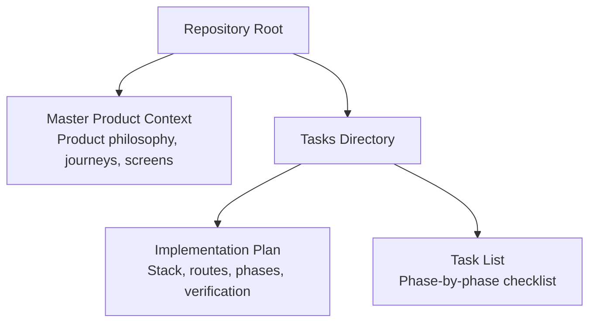
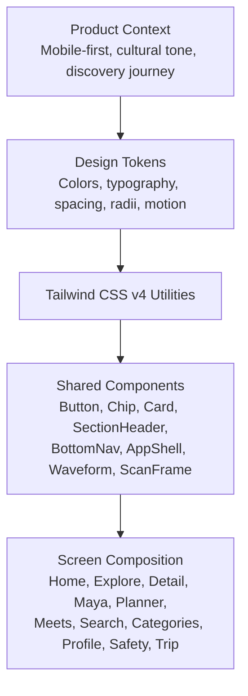
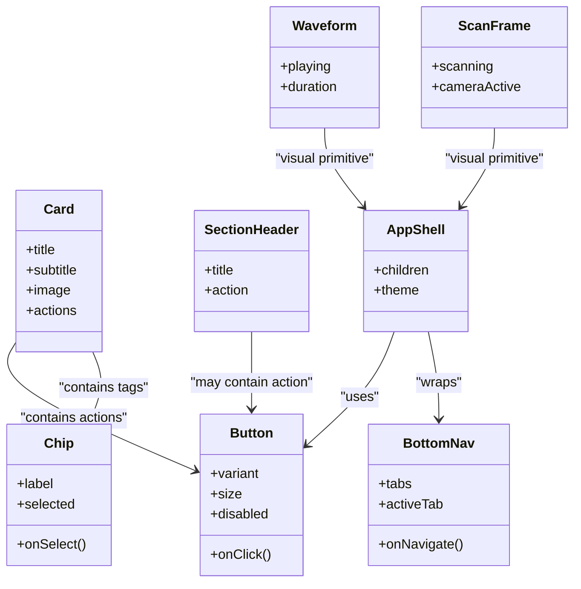
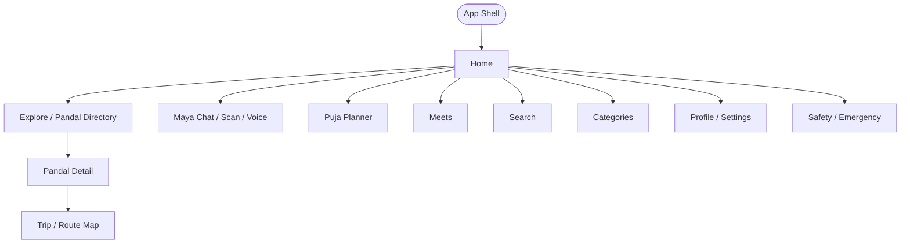
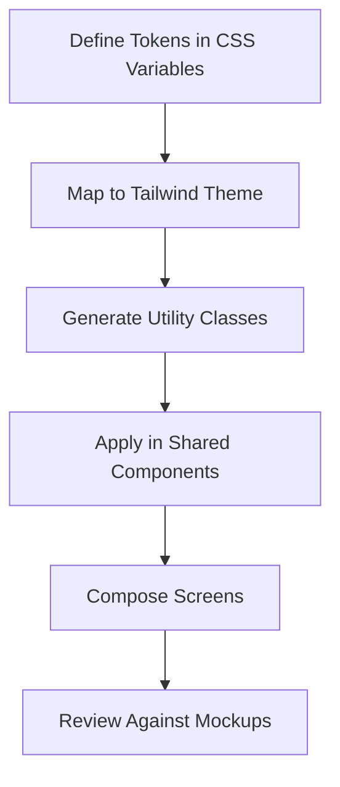
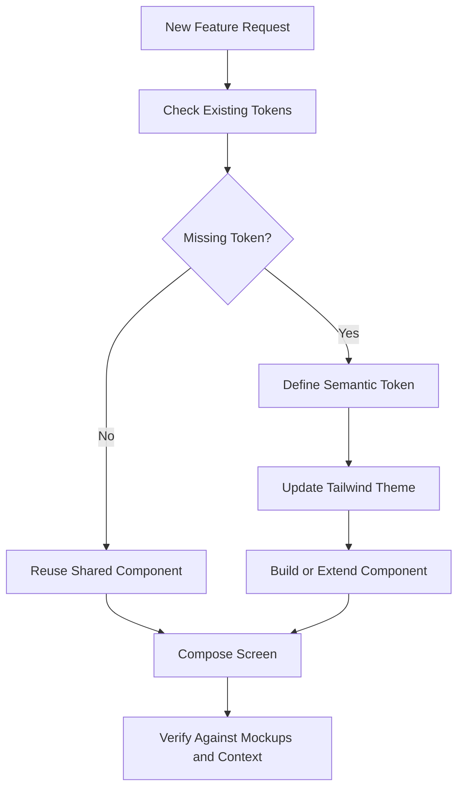
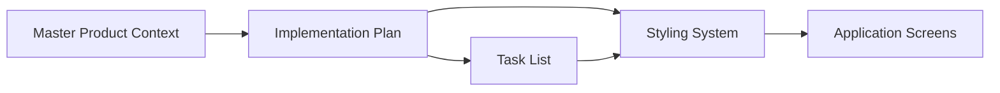

# Styling System and Design Tokens

<cite>
**Referenced Files in This Document**
- [Pujo_Sahayak_Master_Project_Context.md](file://Pujo_Sahayak_Master_Project_Context.md)
- [plan.md](file://tasks/plan.md)
- [todo.md](file://tasks/todo.md)
</cite>

## Table of Contents
1. [Introduction](#introduction)
2. [Project Structure](#project-structure)
3. [Core Components](#core-components)
4. [Architecture Overview](#architecture-overview)
5. [Detailed Component Analysis](#detailed-component-analysis)
6. [Dependency Analysis](#dependency-analysis)
7. [Performance Considerations](#performance-considerations)
8. [Troubleshooting Guide](#troubleshooting-guide)
9. [Conclusion](#conclusion)

## Introduction
This document explains the styling system and design-token strategy for Pujo Sahayak, a mobile-first React + Vite PWA built around Tailwind CSS v4. The project is intentionally bespoke: it does not rely on a generic component library, so its visual identity is defined by a small set of design tokens and utility-first classes.

At a high level:
- The app is a local discovery companion for Kolkata’s Durga Puja experience, with extended use beyond the festival season.
- The UI should feel native to mobile, culturally grounded, and consistent across screens such as Home, Explore, Pandal Detail, Maya (AI assistant), Planner, Meets, Search, Categories, Profile, Safety, and Trip/Route Map.
- The design system centers on a restrained palette, clear typography hierarchy, predictable spacing, and reusable components that can be extended safely as new features are added.

The repository currently contains product context and implementation planning documents. The actual source code for the React application, Tailwind configuration, and CSS token definitions is not present yet; this document therefore describes the intended styling architecture based on the documented plan and product context.

**Section sources**
- [Pujo_Sahayak_Master_Project_Context.md:1-18](file://Pujo_Sahayak_Master_Project_Context.md#L1-L18)
- [plan.md:1-18](file://tasks/plan.md#L1-L18)

## Project Structure
The repository at this stage is documentation-driven rather than code-driven. It includes:
- A master product context file describing the product philosophy, user journey, screen expectations, and feature boundaries.
- An implementation plan outlining the stack, routes, phases, verification steps, risks, and open questions.
- A task list breaking work into foundation, discovery, Maya, planning/social, utility/account, and polish phases.

**Diagram sources**
- [Pujo_Sahayak_Master_Project_Context.md:1-18](file://Pujo_Sahayak_Master_Project_Context.md#L1-L18)
- [plan.md:1-18](file://tasks/plan.md#L1-L18)
- [todo.md:1-10](file://tasks/todo.md#L1-L10)

**Section sources**
- [Pujo_Sahayak_Master_Project_Context.md:1-18](file://Pujo_Sahayak_Master_Project_Context.md#L1-L18)
- [plan.md:1-18](file://tasks/plan.md#L1-L18)
- [todo.md:1-10](file://tasks/todo.md#L1-L10)

## Core Components
The styling system is organized around three layers:

1. **Design tokens**: Colors, typography, spacing, radii, shadows, motion, and semantic roles.
2. **Utility-first styles**: Tailwind CSS v4 utilities applied directly in markup for layout, color, typography, spacing, and responsive behavior.
3. **Shared components**: Reusable building blocks such as buttons, chips, cards, section headers, bottom navigation, waveform, scan frame, and page transitions.

### Utility-First Styling Approach
Tailwind CSS v4 is used to encode the mockups’ design system without introducing a heavy component library. The plan explicitly states that the design system—ivory surfaces, vermilion primary, charcoal ink, muted gold, and dark imagery—is encoded as design tokens in CSS. This keeps the interface bespoke and aligned with the cultural tone of the product.

Key implications:
- Styles are close to the markup, making it easy to audit per-screen fidelity against the mockups.
- Tokens centralize values like colors, type scale, radii, and spacing so changes propagate consistently.
- Shared components encapsulate repeated patterns while still using utility classes under the hood.

**Section sources**
- [plan.md:9-11](file://tasks/plan.md#L9-L11)

### Custom Color Palette
The documented palette emphasizes:
- Ivory surfaces for light backgrounds.
- Vermilion as the primary accent.
- Charcoal ink for text and strong contrast elements.
- Muted gold for secondary emphasis.
- Dark imagery for hero sections and atmospheric visuals.

These tokens should be exposed through semantic names such as `surface`, `primary`, `ink`, `gold`, and `image-dark`. Semantic naming helps maintain consistency when adding new screens or components.

### Typography System
The plan specifies a type scale with a Bengali serif accent. This supports both English and Bengali content while preserving cultural readability. The typography system should include:
- A base sans-serif for body text.
- A Bengali serif for headings or accent text where appropriate.
- Clear size, weight, line-height, and letter-spacing tokens.
- Accessibility considerations such as sufficient contrast and readable line lengths on mobile.

### Spacing Guidelines
Spacing should follow a consistent scale so padding, margins, gaps, and component sizes feel cohesive. Recommended practices:
- Use a small base unit (for example, 4px or 8px) and derive all spacing from multiples.
- Apply spacing tokens in components rather than ad-hoc pixel values.
- Keep mobile-first spacing tight but breathable, expanding thoughtfully on larger screens.

### Responsive and Mobile-First Strategy
The application is explicitly mobile-first. The plan also mentions desktop adaptation later in the polish phase. This means:
- Base styles target small screens.
- Breakpoints expand layouts for tablets and desktops.
- Bottom navigation remains prominent on mobile.
- Larger screens may introduce multi-column rails and wider app frames.

**Section sources**
- [plan.md:9-11](file://tasks/plan.md#L9-L11)
- [plan.md:60-61](file://tasks/plan.md#L60-L61)
- [todo.md:10-11](file://tasks/todo.md#L10-L11)

## Architecture Overview
The styling architecture connects product intent, design tokens, shared components, and screen-level composition.

**Diagram sources**
- [Pujo_Sahayak_Master_Project_Context.md:1-18](file://Pujo_Sahayak_Master_Project_Context.md#L1-L18)
- [plan.md:9-11](file://tasks/plan.md#L9-L11)
- [todo.md:10-11](file://tasks/todo.md#L10-L11)

## Detailed Component Analysis

### Shared Components and Their Styling Responsibilities
The implementation plan identifies several shared components that carry most of the visual responsibility:

| Component | Styling Responsibility | Token Usage |
|---|---|---|
| Button | Primary actions, CTAs, save/route actions | Primary color, ink, radius, spacing |
| Chip | Filters, quick replies, interest tags | Secondary color, surface, border, spacing |
| Card | Place cards, restaurant cards, meetup cards | Surface, shadow, image container, spacing |
| SectionHeader | Page and section titles | Typography scale, ink, spacing |
| BottomNav | Five-tab navigation with active state | Ink, primary, spacing, safe-area handling |
| AppShell | Global layout shell | Surface, background, typography base |
| Waveform | Voice input visualization | Motion tokens, color accents |
| ScanFrame | Camera scan animation | Border, glow-like effects via tokens, motion |

**Diagram sources**
- [todo.md:10-11](file://tasks/todo.md#L10-L11)

**Section sources**
- [todo.md:10-11](file://tasks/todo.md#L10-L11)

### Screen-Level Styling Patterns
Screens compose shared components and apply utility classes to achieve the mockup structure. Examples include:

- **Home**: greeting, search bar, language toggle, sponsored card, explore spotlight, nearby restaurants rail, offers and discounts rail, events rail, continue-where-left-off.
- **Explore / Pandal Directory**: list/map toggle, filter chips, pandal cards with rating, distance, crowd tag, theme, and actions.
- **Pandal Detail**: hero image, name/location/save, rating/reviews/distance/crowd/open-till, action row, info row, about/story, Ask Maya chip, reviews, top clicks, similar places, nearby restaurants, meetups near place.
- **Maya**: chat thread, Bengali user bubble, Maya reply, inline audio player, waveform, quick-reply chips, camera scan frame.
- **Planner**: day tabs, stop cards, add place, optimize suggestion, start navigation.
- **Meets**: pills, meetup cards with avatars and counts, create meetup form.
- **Search and Categories**: pill filters, trending/nearby rails, icon grids.
- **Profile, Settings, Safety, Missing Person Report**: structured lists, emergency shortcuts, wizard steps.

**Diagram sources**
- [plan.md:19-39](file://tasks/plan.md#L19-L39)
- [Pujo_Sahayak_Master_Project_Context.md:140-158](file://Pujo_Sahayak_Master_Project_Context.md#L140-L158)

**Section sources**
- [plan.md:19-39](file://tasks/plan.md#L19-L39)
- [Pujo_Sahayak_Master_Project_Context.md:140-158](file://Pujo_Sahayak_Master_Project_Context.md#L140-L158)

### Design Token Definition and Usage
Based on the plan, design tokens should be defined in CSS and consumed through Tailwind utilities. The intended token categories include:

- **Color tokens**: ivory, vermilion, charcoal, muted gold, dark imagery.
- **Typography tokens**: font families, sizes, weights, line heights, Bengali serif accent.
- **Spacing tokens**: base unit and derived scales for padding, margin, gap, and component sizing.
- **Radius tokens**: corner radii for buttons, chips, cards, and modals.
- **Shadow tokens**: subtle elevation for cards and overlays.
- **Motion tokens**: durations, easing curves, reduced-motion support.

Recommended usage pattern:
- Define semantic tokens in CSS variables.
- Map those variables into Tailwind’s theme configuration.
- Use semantic utility names in components instead of raw values.
- Extend tokens only through approved extension points to avoid drift.

**Diagram sources**
- [plan.md:9-11](file://tasks/plan.md#L9-L11)
- [todo.md:10-11](file://tasks/todo.md#L10-L11)

**Section sources**
- [plan.md:9-11](file://tasks/plan.md#L9-L11)
- [todo.md:10-11](file://tasks/todo.md#L10-L11)

### Best Practices for Styling
To keep the system consistent and extensible:

1. **Prefer tokens over raw values.** Never hard-code colors, spacing, or radii in components.
2. **Keep components small and focused.** Each component should have one clear visual role.
3. **Use semantic class names.** For example, prefer `text-ink` or `bg-surface` over arbitrary hex values.
4. **Respect accessibility.** Ensure contrast ratios, focus states, and reduced-motion preferences are honored.
5. **Maintain mobile-first breakpoints.** Add larger breakpoints only when necessary.
6. **Document exceptions.** If a screen needs a special case, record why and where.
7. **Avoid generic SaaS styling.** The plan explicitly discourages relying on a generic component library.

**Section sources**
- [plan.md:9-11](file://tasks/plan.md#L9-L11)
- [todo.md:10-11](file://tasks/todo.md#L10-L11)

### Extending the Design System
When adding new features:

- **Add tokens first**, then utilities, then components.
- **Reuse existing components** before creating new ones.
- **Extend shared components** with variants rather than duplicating logic.
- **Align new screens with the established IA**: Home, Favorites, Search, Categories, Meets, and detail pages.
- **Verify against mockups and the product context** to ensure cultural and functional alignment.

**Diagram sources**
- [plan.md:41-61](file://tasks/plan.md#L41-L61)
- [Pujo_Sahayak_Master_Project_Context.md:21-43](file://Pujo_Sahayak_Master_Project_Context.md#L21-L43)

**Section sources**
- [plan.md:41-61](file://tasks/plan.md#L41-L61)
- [Pujo_Sahayak_Master_Project_Context.md:21-43](file://Pujo_Sahayak_Master_Project_Context.md#L21-L43)

## Dependency Analysis
The styling system depends on the product context and implementation plan to remain aligned with the intended user experience.

**Diagram sources**
- [Pujo_Sahayak_Master_Project_Context.md:1-18](file://Pujo_Sahayak_Master_Project_Context.md#L1-L18)
- [plan.md:1-18](file://tasks/plan.md#L1-L18)
- [todo.md:1-10](file://tasks/todo.md#L1-L10)

**Section sources**
- [Pujo_Sahayak_Master_Project_Context.md:1-18](file://Pujo_Sahayak_Master_Project_Context.md#L1-L18)
- [plan.md:1-18](file://tasks/plan.md#L1-L18)
- [todo.md:1-10](file://tasks/todo.md#L1-L10)

## Performance Considerations
Although the current repository does not contain compiled assets, the planned approach suggests performance-friendly styling practices:

- **Tailwind CSS v4** reduces custom CSS bloat by generating only the utilities actually used.
- **Shared components** reduce duplication and make style audits easier.
- **Motion primitives** should honor reduced-motion settings for accessibility and performance.
- **Image-heavy screens** should use placeholders and lazy loading strategies during development and production.
- **Offline PWA shell** caching should include critical CSS and fonts needed for the initial render.

[No sources needed since this section provides general guidance]

## Troubleshooting Guide
Common issues and how to address them:

| Issue | Likely Cause | Resolution |
|---|---|---|
| Inconsistent colors across screens | Hard-coded values instead of tokens | Replace with semantic token utilities |
| Typography feels inconsistent | Missing type scale tokens | Define and apply consistent font-size, weight, and line-height tokens |
| Spacing looks uneven | Ad-hoc margins and paddings | Use spacing tokens and component-based spacing |
| Buttons and chips look different | Duplicate styling logic | Consolidate into shared components |
| Animations feel jarring or inaccessible | Ignoring reduced-motion preference | Respect reduced-motion settings in motion tokens |
| Screens do not match mockups | Missing sections or wrong order | Compare against the documented screen structure and IA |
| Bengali text renders poorly | Missing font or fallback | Configure Bengali serif accent and system fallbacks |

**Section sources**
- [plan.md:63-79](file://tasks/plan.md#L63-L79)
- [todo.md:71-75](file://tasks/todo.md#L71-L75)

## Conclusion
The Pujo Sahayak styling system is designed to be lightweight, culturally grounded, and highly consistent. By encoding the design system into Tailwind CSS v4 tokens and composing screens from shared components, the project avoids generic SaaS aesthetics while remaining scalable. As new features are added, the recommended process is to extend tokens first, reuse or extend components second, and always verify against the product context and mockups.

[No sources needed since this section summarizes without analyzing specific files]