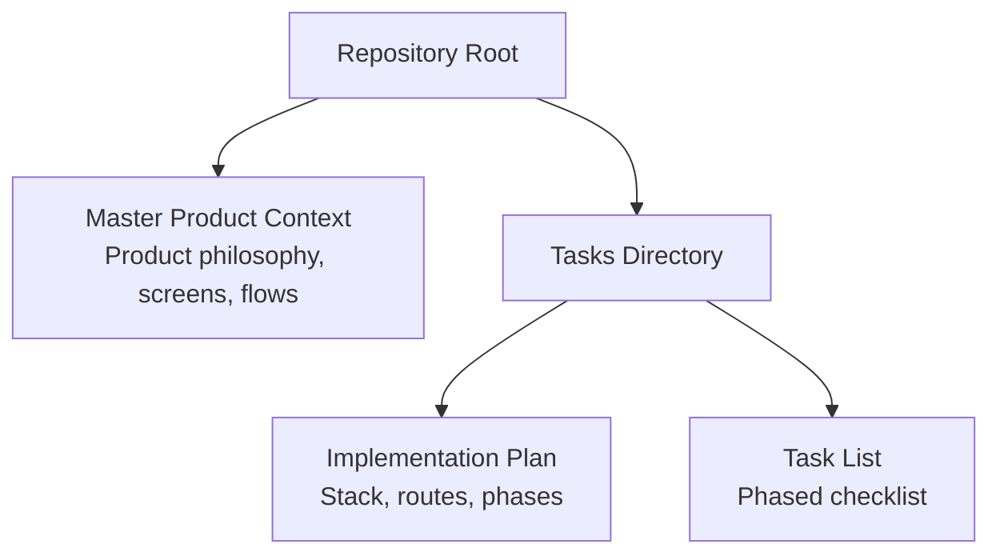
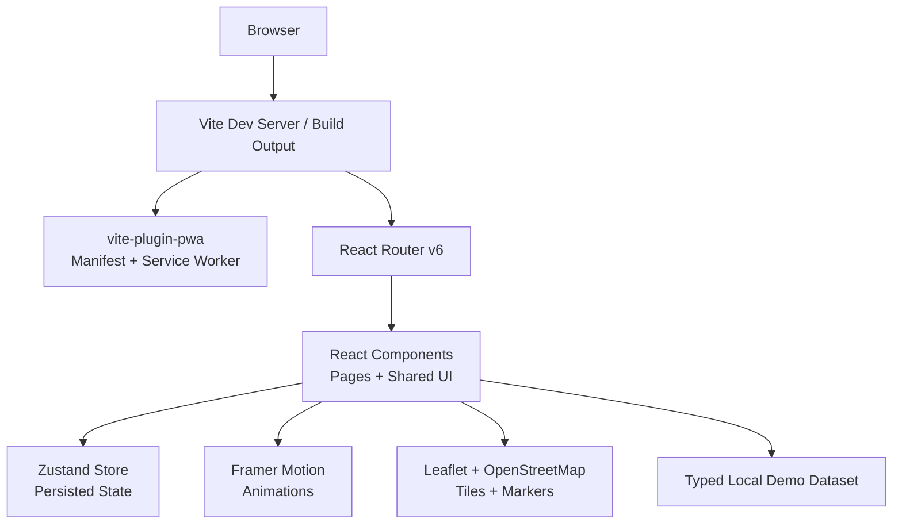
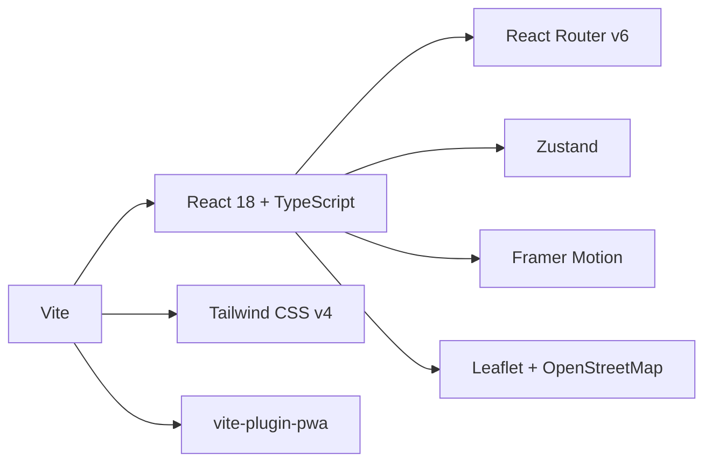

# Technology Stack and Dependencies

<cite>
**Referenced Files in This Document**
- [Pujo_Sahayak_Master_Project_Context.md](file://Pujo_Sahayak_Master_Project_Context.md)
- [plan.md](file://tasks/plan.md)
- [todo.md](file://tasks/todo.md)
</cite>

## Table of Contents
1. [Introduction](#introduction)
2. [Project Structure](#project-structure)
3. [Core Components](#core-components)
4. [Architecture Overview](#architecture-overview)
5. [Detailed Component Analysis](#detailed-component-analysis)
6. [Dependency Analysis](#dependency-analysis)
7. [Performance Considerations](#performance-considerations)
8. [Troubleshooting Guide](#troubleshooting-guide)
9. [Conclusion](#conclusion)

## Introduction
This document describes the planned technology stack for Puja Sahayak, a mobile-first Progressive Web App that helps users discover pandals, restaurants, events, and local experiences around Kolkata while providing AI-assisted guidance, route planning, social meetups, safety utilities, and personalization. The project is intentionally scoped as a modern web application rather than a native app, with an offline-capable shell, installable experience, and strong type safety.

The documented stack includes:
- React 18 + TypeScript
- Vite as build tool and development server
- Tailwind CSS v4 for utility-first styling with custom design tokens
- React Router v6 for client-side routing
- Zustand for state management with persistence
- Framer Motion for animations
- Leaflet + OpenStreetMap for mapping
- vite-plugin-pwa for manifest, icons, and service worker behavior

These choices are aligned with the product’s emphasis on discovery, understanding, planning, visiting, sharing, meeting people, and staying safe, while keeping the implementation grounded in a typed local demo dataset and honest “demo” markers where real backend or AI services are not yet available.

**Section sources**
- [Pujo_Sahayak_Master_Project_Context.md:1-20](file://Pujo_Sahayak_Master_Project_Context.md#L1-L20)
- [plan.md:1-18](file://tasks/plan.md#L1-L18)

## Project Structure
At this stage, the repository contains the master product context and task-oriented planning files. The actual source code for the React + Vite PWA has not been scaffolded yet; the plan defines how the stack will be organized once initialization begins.

**Diagram sources**
- [Pujo_Sahayak_Master_Project_Context.md:1-20](file://Pujo_Sahayak_Master_Project_Context.md#L1-L20)
- [plan.md:1-18](file://tasks/plan.md#L1-L18)
- [todo.md:1-10](file://tasks/todo.md#L1-L10)

**Section sources**
- [Pujo_Sahayak_Master_Project_Context.md:1-20](file://Pujo_Sahayak_Master_Project_Context.md#L1-L20)
- [plan.md:1-18](file://tasks/plan.md#L1-L18)
- [todo.md:1-10](file://tasks/todo.md#L1-L10)

## Core Components
The core components of the planned stack are selected to support a mobile-first PWA with strong typing, fast iteration, accessible motion, real maps without API keys, and persistent user state.

| Technology | Planned Version / Role | Rationale | Key Integration Notes |
|---|---|---|---|
| React 18 | UI library for component-based rendering | Provides concurrent features, hooks, and a mature ecosystem suitable for a complex multi-screen PWA. | Used with TypeScript for type-safe props, state, and data models. |
| TypeScript | Type system over JavaScript | Prevents runtime errors, improves developer experience, and documents data shapes such as Place, Pandal, Restaurant, Event, Meetup, Review, Photo, PlanDay, Offer, SafetyPoint. | All stores, routes, datasets, and UI components should be fully typed. |
| Vite | Build tool and dev server | Fast HMR, simple configuration, and plugin ecosystem suited for modern frontend stacks. | Serves the app during development and produces optimized production builds. |
| vite-plugin-pwa | PWA plugin for Vite | Generates manifest, icons, and service worker behavior so the app is installable and caches the offline shell. | Should be configured alongside React Router to avoid 404s on deep links. |
| Tailwind CSS v4 | Utility-first CSS framework | Encodes the mockup design system (ivory surfaces, vermilion primary, charcoal ink, muted gold, dark imagery) as design tokens without forcing a generic component library. | Custom tokens should live in CSS variables and be referenced through Tailwind classes. |
| React Router v6 | Client-side router | Maps the bottom navigation and nested detail pages to URL routes, enabling deep linking and browser history. | Bottom nav should reflect active route; detail pages use dynamic segments like `/pandal/:id`. |
| Zustand | State management | Lightweight store for saves, visits, plans, meetups, language, theme, logo choice, and “continue where you left off.” | Use the persist middleware to save relevant state to localStorage. |
| Framer Motion | Animation library | Implements soft page fades, card scale effects, animated scan frame, voice waveform, and respects reduced-motion preferences. | Wrap page transitions and interactive elements; disable heavy motion when reduced motion is enabled. |
| Leaflet + OpenStreetMap | Mapping layer | Provides real maps for route visualization, list/map toggle, nearby help points, and trip planning without requiring Google Maps credentials. | Configure tiles from OpenStreetMap; compute distances using haversine logic against lat-lng data. |

**Section sources**
- [plan.md:7-18](file://tasks/plan.md#L7-L18)
- [todo.md:7-14](file://tasks/todo.md#L7-L14)

## Architecture Overview
The planned architecture centers on a mobile-first PWA shell built with React and Vite. Routing drives navigation between discovery, planning, social, utility, and profile screens. A single Zustand store holds user-driven state persisted to localStorage. Maps are rendered with Leaflet and OpenStreetMap, while Framer Motion adds controlled animation. The PWA plugin ensures the app can be installed and cache its shell for offline access.

**Diagram sources**
- [plan.md:7-18](file://tasks/plan.md#L7-L18)
- [todo.md:7-14](file://tasks/todo.md#L7-L14)

## Detailed Component Analysis

### React 18 + TypeScript
React 18 provides the component model and lifecycle primitives used across all screens, including Home, Explore, Pandal Detail, Maya, Planner, Meets, Categories, Search, Profile, Safety, and Trip/Route Map. TypeScript enforces consistent data shapes for places, users, plans, reviews, photos, offers, and safety points.

Key responsibilities:
- Typed data models for places, pandals, restaurants, events, meetups, reviews, photos, plan days, offers, and safety points.
- Type-safe props and state for shared components such as cards, chips, buttons, section headers, bottom navigation, app shell, waveform, and scan frame.
- Clear separation between UI components and data retrieval from the local demo dataset.

Version compatibility:
- React 18 works well with TypeScript and modern bundlers like Vite.
- Ensure `@types/react` and `@types/react-dom` match the installed React version.

Integration pattern:
- Define TypeScript interfaces for domain entities.
- Keep components focused on presentation and behavior.
- Use typed store slices in Zustand for user state.

**Section sources**
- [plan.md:7-10](file://tasks/plan.md#L7-L10)
- [todo.md:10-14](file://tasks/todo.md#L10-L14)

### Vite
Vite is the chosen build tool and development server. It enables fast hot module replacement during development and efficient production builds.

Key responsibilities:
- Serve the React application during development.
- Transform TypeScript, JSX, and CSS.
- Integrate plugins such as Tailwind CSS and vite-plugin-pwa.

Installation guidance:
- Initialize a Vite project with the React TypeScript template.
- Add Tailwind CSS, React Router, Zustand, Framer Motion, Leaflet, and vite-plugin-pwa as dependencies.

Configuration guidance:
- Configure Vite to handle TypeScript and JSX.
- Enable plugins for PWA assets and service worker generation.
- Ensure the dev server serves the app shell at the root path.

**Section sources**
- [plan.md:7-10](file://tasks/plan.md#L7-L10)
- [todo.md:7-9](file://tasks/todo.md#L7-L9)

### Tailwind CSS v4
Tailwind CSS v4 is used to implement the mockup-inspired design system without adopting a generic component library. The design emphasizes ivory surfaces, vermilion primary color, charcoal ink, muted gold accents, and dark imagery.

Key responsibilities:
- Encode design tokens as CSS variables.
- Provide utility classes for spacing, typography, colors, radii, and responsive layouts.
- Support Bengali typography through appropriate fonts and fallbacks.

Installation guidance:
- Install Tailwind CSS v4 and configure it within the Vite pipeline.
- Import base styles and define custom tokens in the CSS entry file.

Configuration guidance:
- Define semantic tokens such as primary, surface, ink, accent, and background.
- Create reusable style patterns for cards, chips, buttons, and navigation.
- Respect accessibility needs such as contrast and focus states.

**Section sources**
- [plan.md:9-10](file://tasks/plan.md#L9-L10)
- [todo.md:10-11](file://tasks/todo.md#L10-L11)

### React Router v6
React Router v6 manages client-side navigation for the 21 planned screens. The bottom navigation maps directly to routes, and detail pages use dynamic segments.

Key responsibilities:
- Define routes for splash, home, explore, pandal detail, maya, planner, meets, categories, search, profile, safety, trip/route map, restaurant detail, settings, and beyond-Puja content.
- Preserve deep-linking behavior for shareable URLs.
- Keep navigation state synchronized with the active route.

Installation guidance:
- Install React Router and add route definitions in the application entry point.

Configuration guidance:
- Map the five-tab bottom navigation to primary routes.
- Use nested routes for detail pages such as `/pandal/:id` and `/restaurant/:id`.
- Ensure PWA caching does not break deep links by configuring the service worker appropriately.

**Section sources**
- [plan.md:11-14](file://tasks/plan.md#L11-L14)
- [plan.md:19-39](file://tasks/plan.md#L19-L39)
- [todo.md:7-9](file://tasks/todo.md#L7-L9)

### Zustand with Persistence
Zustand provides a lightweight global store for user-driven state. The plan specifies one client store containing saved places, visited places, puja plan slots, meetups, language, theme, app-logo choice, and “continue where you left off” session data.

Key responsibilities:
- Persist saves, visits, plans, settings, and related UI state to localStorage.
- Expose selectors and actions for components to read and update state.
- Keep store logic separate from UI rendering.

Installation guidance:
- Install Zustand and the persist middleware.

Configuration guidance:
- Create a single store slice for user state.
- Enable persistence for fields that must survive reloads.
- Avoid persisting large or transient data unnecessarily.

**Section sources**
- [plan.md:12-13](file://tasks/plan.md#L12-L13)
- [todo.md:7-9](file://tasks/todo.md#L7-L9)

### Framer Motion
Framer Motion implements the motion system described in the product context: soft page fades, subtle card scaling, animated scan frames, and voice waveforms. Animations should honor reduced-motion preferences.

Key responsibilities:
- Animate page transitions between routes.
- Animate interactive elements such as cards, chips, and FABs.
- Provide visual feedback for camera scanning and voice input.

Installation guidance:
- Install Framer Motion and import motion primitives into components.

Configuration guidance:
- Wrap page-level components with transition animations.
- Disable or simplify animations when the user prefers reduced motion.
- Keep animations performant on mobile devices.

**Section sources**
- [plan.md:13-14](file://tasks/plan.md#L13-L14)
- [todo.md:10-11](file://tasks/todo.md#L10-L11)

### Leaflet + OpenStreetMap
Leaflet and OpenStreetMap provide real mapping functionality without requiring proprietary API keys. They support route visualization, list/map toggles, nearby help points, and trip planning.

Key responsibilities:
- Render maps for the Trip/Route Map screen.
- Show markers for stops, safety points, and nearby locations.
- Compute distances and estimated travel times using latitude/longitude data.

Installation guidance:
- Install Leaflet and its TypeScript types.
- Include Leaflet CSS and initialize maps inside React components.

Configuration guidance:
- Use OpenStreetMap tile providers.
- Bind markers and polylines to the typed dataset.
- Handle map resizing and cleanup on component unmount.

**Section sources**
- [plan.md:14-15](file://tasks/plan.md#L14-L15)
- [todo.md:63-64](file://tasks/todo.md#L63-L64)

### vite-plugin-pwa
vite-plugin-pwa configures the Progressive Web App capabilities required for installation, offline shell caching, and asset management.

Key responsibilities:
- Generate a web app manifest.
- Manage icons and splash assets.
- Register a service worker that caches the app shell.

Installation guidance:
- Install vite-plugin-pwa and add it to the Vite configuration.

Configuration guidance:
- Point the plugin to generated or static assets such as icons and manifest entries.
- Configure workbox strategies for shell caching and API/data caching if needed.
- Ensure deep links are handled correctly by the service worker.

**Section sources**
- [plan.md:9-10](file://tasks/plan.md#L9-L10)
- [todo.md:7-9](file://tasks/todo.md#L7-L9)

## Dependency Analysis
The dependencies form a layered architecture where Vite orchestrates the build, React renders the UI, React Router handles navigation, Zustand manages state, Framer Motion adds motion, Leaflet renders maps, and vite-plugin-pwa enables PWA behavior.

**Diagram sources**
- [plan.md:7-18](file://tasks/plan.md#L7-L18)
- [todo.md:7-14](file://tasks/todo.md#L7-L14)

**Section sources**
- [plan.md:7-18](file://tasks/plan.md#L7-L18)
- [todo.md:7-14](file://tasks/todo.md#L7-L14)

## Performance Considerations
- Prefer lazy loading for heavy routes such as maps and detailed screens.
- Keep the PWA shell small so the initial install and first load are fast.
- Avoid persisting large datasets to localStorage; persist only user-driven state.
- Use image placeholders and lazy-loaded images to reduce payload size.
- Respect reduced-motion preferences to improve performance and accessibility.
- Optimize Leaflet maps by limiting marker count and deferring map initialization until needed.

[No sources needed since this section provides general guidance]

## Troubleshooting Guide
Common issues and resolutions based on the planned stack:

- Build fails with TypeScript errors:
  - Verify that all components, stores, and datasets are properly typed.
  - Ensure dependency versions are compatible with React 18 and Vite.

- Routes do not work after installing the PWA:
  - Check vite-plugin-pwa configuration so the service worker does not intercept deep links incorrectly.
  - Confirm React Router is configured for the deployment base path.

- Maps do not render:
  - Ensure Leaflet CSS is loaded and the map container has dimensions.
  - Verify OpenStreetMap tile access and network availability.

- Animations feel janky on mobile:
  - Simplify motion effects.
  - Honor reduced-motion preferences.
  - Avoid animating layout-heavy properties.

- State disappears after reload:
  - Confirm Zustand persist middleware is configured for the correct storage key and fields.

**Section sources**
- [plan.md:63-69](file://tasks/plan.md#L63-L69)
- [todo.md:77-80](file://tasks/todo.md#L77-L80)

## Conclusion
The Puja Sahayak technology stack is designed to deliver a mobile-first, type-safe, installable PWA that supports discovery, understanding, planning, visiting, sharing, meeting people, and safety. React 18 and TypeScript provide a robust foundation, Vite enables fast development and builds, Tailwind CSS v4 encodes the bespoke design system, React Router v6 structures navigation, Zustand persists user state, Framer Motion enhances interaction, Leaflet + OpenStreetMap delivers real mapping, and vite-plugin-pwa makes the app installable and resilient offline. Together, these technologies align with the product’s vision of a digital companion for exploring Kolkata during Puja and beyond.

[No sources needed since this section summarizes without analyzing specific files]