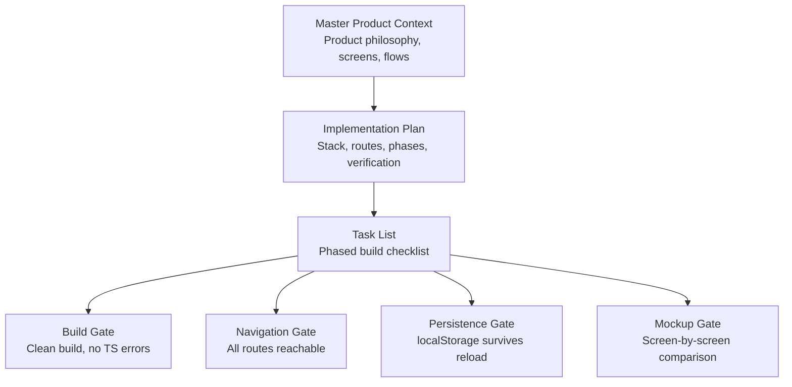
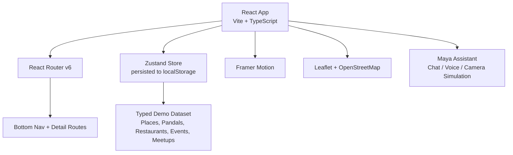
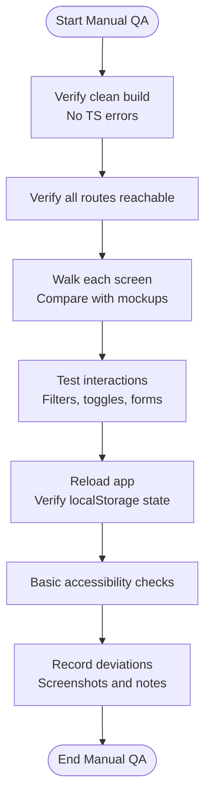
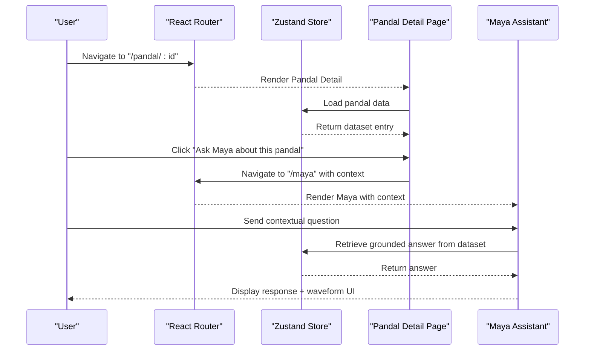
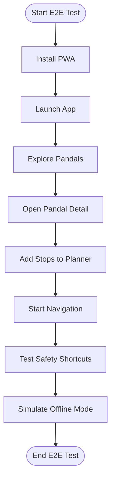
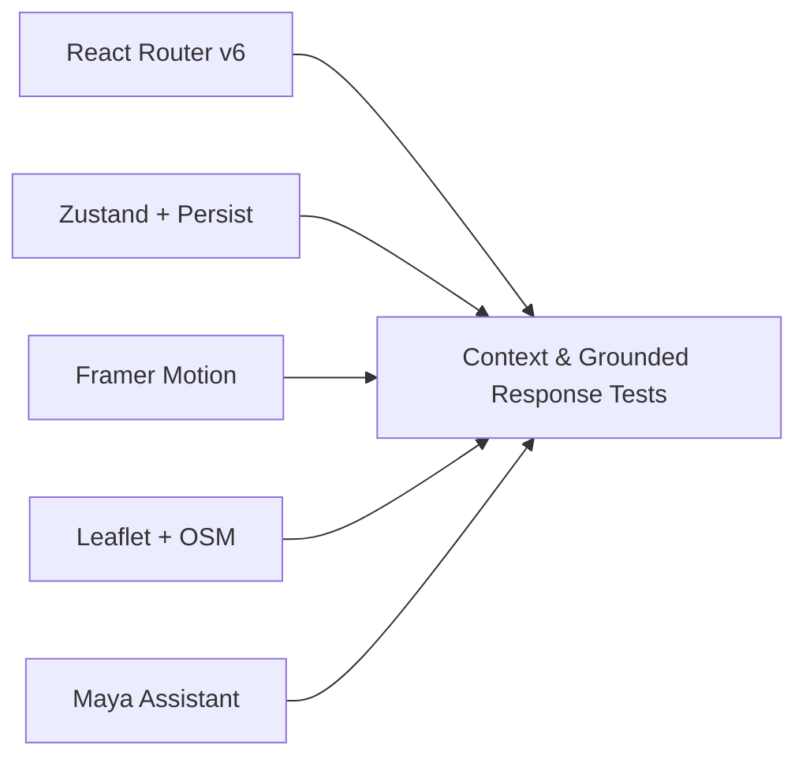

# Testing and Quality Assurance

<cite>
**Referenced Files in This Document**
- [Pujo_Sahayak_Master_Project_Context.md](file://Pujo_Sahayak_Master_Project_Context.md)
- [plan.md](file://tasks/plan.md)
- [todo.md](file://tasks/todo.md)
</cite>

## Table of Contents
1. [Introduction](#introduction)
2. [Project Structure](#project-structure)
3. [Core Components](#core-components)
4. [Architecture Overview](#architecture-overview)
5. [Detailed Component Analysis](#detailed-component-analysis)
6. [Dependency Analysis](#dependency-analysis)
7. [Performance Considerations](#performance-considerations)
8. [Troubleshooting Guide](#troubleshooting-guide)
9. [Conclusion](#conclusion)

## Introduction
This document defines the testing and quality assurance strategy for Puja Sahayak, a mobile-first React + Vite PWA that replicates 21 mockup screens and adds polish around discovery, planning, social meetups, safety, and an AI assistant called Maya. The goal is to ensure pixel-perfect implementation against design specifications, reliable user flows across devices, strong performance, accessibility compliance, security hygiene, and consistent code quality.

The project’s scope includes:
- Discovery and exploration of pandals, restaurants, events, and local experiences.
- A context-aware AI assistant shell (Maya) with chat, voice waveform UI, and camera scan simulation.
- Planning features such as favorites, multi-day Puja itineraries, route maps, and meetups.
- Utility and account-related screens including profile, settings, safety, emergency shortcuts, and a missing-person report wizard.
- A PWA shell with installability and offline support.

**Section sources**
- [Pujo_Sahayak_Master_Project_Context.md:1-18](file://Pujo_Sahayak_Master_Project_Context.md#L1-L18)
- [plan.md:1-17](file://tasks/plan.md#L1-L17)

## Project Structure
At this stage, the repository contains product context and task planning artifacts rather than full application source code. The QA strategy therefore focuses on process, verification gates, and acceptance criteria tied to the documented screens, routes, and behaviors.

**Diagram sources**
- [plan.md:63-69](file://tasks/plan.md#L63-L69)
- [todo.md:77-80](file://tasks/todo.md#L77-L80)

**Section sources**
- [plan.md:1-17](file://tasks/plan.md#L1-L17)
- [todo.md:1-15](file://tasks/todo.md#L1-L15)

## Core Components
The QA strategy is organized around the core components identified in the plan and tasks:

- **PWA Shell**: Installable app shell, manifest, service worker, offline fallback.
- **Design System and Shared Components**: Tokens, buttons, chips, cards, section headers, bottom navigation, motion primitives.
- **Data Model and Demo Dataset**: Typed entities for places, pandals, restaurants, events, meetups, reviews, photos, plans, offers, safety points; dataset marked as demo data.
- **Discovery Screens**: Splash, Home, Explore/Pandal Directory, Pandal Detail.
- **Maya Assistant**: Chat, voice waveform UI, camera scan simulation, grounded responses from dataset.
- **Search and Categories**: Live filtering, trending sections, category grids.
- **Planning and Social**: Favorites, Puja Planner, Meets list and create flow.
- **Utility and Account**: Restaurant detail, trip/route map, profile, settings, safety, missing person wizard.
- **Polish Layer**: Personalization, i18n, dark mode, reduced motion, beyond-Puja content, responsive desktop adaptation.

Each component has explicit verification expectations in the task list, which form the basis of unit, integration, and end-to-end test cases.

**Section sources**
- [plan.md:7-17](file://tasks/plan.md#L7-L17)
- [todo.md:5-15](file://tasks/todo.md#L5-L15)
- [todo.md:18-43](file://tasks/todo.md#L18-L43)
- [todo.md:45-67](file://tasks/todo.md#L45-L67)
- [todo.md:69-80](file://tasks/todo.md#L69-L80)

## Architecture Overview
The application architecture influences how testing should be structured:

- **Frontend Stack**: React 18, TypeScript, Vite, Tailwind CSS v4, React Router v6, Zustand with persistence, Framer Motion, Leaflet with OpenStreetMap tiles.
- **Routing**: Bottom navigation maps to five tabs; detail pages use nested routes.
- **State Management**: One client store persists saved places, visited places, planner days, meetups, language, theme, logo choice, and session continuity.
- **AI Assistant**: Maya is UI-complete but simulated locally; answers are retrieved from the dataset without hallucination.
- **Maps and Route Planning**: Leaflet-based route visualization with polyline and distance/time estimates.
- **Images**: Placeholder gradients and free stock at build time; layout remains image-agnostic.

**Diagram sources**
- [plan.md:7-17](file://tasks/plan.md#L7-L17)
- [plan.md:19-39](file://tasks/plan.md#L19-L39)

**Section sources**
- [plan.md:7-17](file://tasks/plan.md#L7-L17)
- [plan.md:19-39](file://tasks/plan.md#L19-L39)

## Detailed Component Analysis

### Manual Testing Against Mockups and Design Specifications
Manual testing ensures pixel-perfect implementation and correct information architecture.

- **Scope**: Every screen listed in the route map must match the mockup structure, element order, and labeling intent.
- **Verification Gates**:
  - Clean build with no TypeScript errors.
  - All routes reachable via bottom navigation or deep links.
  - Screen-by-screen comparison against mockups.
- **Key Areas to Validate**:
  - Splash auto-advance and branding.
  - Home greeting, search bar, language toggle, sponsored card, spotlight, restaurant rail, offers, events, continue-where-left-off.
  - Explore list/map toggle, filters, pandal cards, actions.
  - Pandal detail hero, actions, info row, about, reviews, similar places, nearby restaurants, meetups.
  - Maya chat messages, quick replies, voice waveform, camera preview and scan frame.
  - Search pills, trending pandals, popular nearby places.
  - Categories icon grids per mockup.
  - Favorites saved/visited/recommendations.
  - Planner day tabs, stop cards, add place, optimize suggestion wording, navigation to trip.
  - Meets list and create meetup form.
  - Restaurant detail hero, rating, save/call/order stubs, dishes rail.
  - Trip/route map markers, polyline, total distance, estimated time.
  - Profile stats, upgrade banner, emergency shortcuts, settings rows.
  - Safety red-gradient screen, call 112 shortcut, nearby help points, missing-person wizard steps.
  - Beyond Puja card/section, PWA installability, desktop adaptation.

**Diagram sources**
- [plan.md:63-69](file://tasks/plan.md#L63-L69)
- [todo.md:77-80](file://tasks/todo.md#L77-L80)

**Section sources**
- [plan.md:63-69](file://tasks/plan.md#L63-L69)
- [todo.md:77-80](file://tasks/todo.md#L77-L80)

### Automated Testing Strategy

#### Unit Tests for Components
Unit tests should cover isolated behavior of shared components and small feature modules:

- **Shared Components**: Button, Chip, Card variants, SectionHeader, BottomNav, AppShell, Waveform, ScanFrame, page-transition wrapper.
- **Validation Targets**:
  - Props rendering and default values.
  - Active tab state in BottomNav.
  - Reduced-motion handling in motion wrappers.
  - Token usage consistency (colors, radii, type scale).
- **Approach**:
  - Render components in isolation.
  - Assert DOM structure and class names where meaningful.
  - Simulate user interactions like clicks and keyboard events.
  - Verify accessibility attributes such as roles and labels.

#### Integration Tests for User Flows
Integration tests should validate multi-step flows that span components and routing:

- **Discovery Flow**: Home → Explore → Pandal Detail → Ask Maya chip.
- **Maya Flow**: Chat with contextual question → Grounded response → Quick reply → Voice waveform UI.
- **Camera Scan Flow**: Open camera → Preview → Capture → Simulated match → Navigate to detail.
- **Search Flow**: Enter query → Filter pills → Results update.
- **Planner Flow**: Add stops → Optimize suggestion → Save plan → Reload verifies persistence.
- **Meets Flow**: Join meetup → Create meetup → Update list.
- **Safety Flow**: Emergency shortcut → Nearby help points → Missing-person wizard completion.

**Diagram sources**
- [plan.md:19-39](file://tasks/plan.md#L19-L39)
- [todo.md:29-43](file://tasks/todo.md#L29-L43)

**Section sources**
- [todo.md:10-15](file://tasks/todo.md#L10-L15)
- [todo.md:29-43](file://tasks/todo.md#L29-L43)

#### End-to-End Tests for Critical Paths
End-to-end tests should simulate real device behavior for critical paths:

- **Install and Launch**: Install PWA, launch splash, navigate to Home.
- **Explore and Visit**: Browse pandals, open detail, mark visited, verify persistence.
- **Plan a Day**: Add multiple stops, optimize route, start navigation, verify trip map.
- **Join Meetup**: Join a meetup, confirm attendee count updates.
- **Safety Actions**: Call 112 shortcut, complete missing-person wizard, verify local record.
- **Offline Behavior**: Verify shell availability and basic navigation when offline.

**Diagram sources**
- [todo.md:63-67](file://tasks/todo.md#L63-L67)
- [todo.md:74-80](file://tasks/todo.md#L74-L80)

**Section sources**
- [todo.md:63-67](file://tasks/todo.md#L63-L67)
- [todo.md:74-80](file://tasks/todo.md#L74-L80)

### Performance Optimization Guidelines
Performance testing should focus on bundle size, lazy loading, image optimization, and memory management.

- **Bundle Size Reduction**:
  - Use Vite’s tree-shaking and code splitting.
  - Lazy-load heavy routes such as maps and Maya camera features.
  - Avoid importing large libraries unless necessary.
- **Lazy Loading Strategies**:
  - Split routes by feature: discovery, Maya, planner, meets, utility.
  - Defer non-critical animations and third-party integrations.
- **Image Optimization**:
  - Prefer lightweight placeholders during development.
  - Use appropriate formats and sizes for production images.
  - Ensure layouts remain stable without images.
- **Memory Management**:
  - Clean up event listeners and observers.
  - Avoid retaining large datasets in memory unnecessarily.
  - Monitor Zustand store growth and avoid unnecessary re-renders.

**Section sources**
- [plan.md:7-17](file://tasks/plan.md#L7-L17)
- [todo.md:10-15](file://tasks/todo.md#L10-L15)

### Cross-Browser and Device Compatibility Matrix
Compatibility testing should cover mobile, tablet, and desktop contexts.

| Platform | Browser | Priority | Key Checks |
|---|---|---|---|
| iOS Safari | Mobile | High | Touch gestures, camera permissions, PWA install prompt, bottom nav usability |
| Android Chrome | Mobile | High | Camera access, location-based features, PWA install prompt, scroll performance |
| Desktop Browsers | Chrome, Firefox, Edge, Safari | Medium | Responsive layout, multi-column rails, keyboard navigation, hover states |
| Tablet Devices | iPadOS Safari, Android Chrome | Medium | Layout adaptation, touch targets, orientation changes |
| Small Screens | 375px viewport | High | Pixel-perfect mobile layout, text readability, tap targets |
| Large Screens | 1280px+ viewport | Medium | Desktop adaptation, max-width app frame, rail layout |

**Section sources**
- [todo.md:74-80](file://tasks/todo.md#L74-L80)

### Accessibility Testing Procedures
Accessibility testing should ensure WCAG compliance and assistive technology support.

- **Keyboard Navigation**:
  - All interactive elements reachable via keyboard.
  - Focus indicators visible and logical.
- **Screen Readers**:
  - Meaningful labels for buttons, chips, cards, and navigation.
  - Announce dynamic updates such as filter results and plan changes.
- **Reduced Motion**:
  - Respect system preference for reduced motion.
  - Disable or simplify animations when requested.
- **Color and Contrast**:
  - Sufficient contrast for text and icons.
  - Do not rely solely on color to convey meaning.
- **Language and Localization**:
  - Correct `lang` attributes for Bengali and English strings.
  - Verify i18n coverage and fallback behavior.

**Section sources**
- [todo.md:10-15](file://tasks/todo.md#L10-L15)
- [todo.md:71-75](file://tasks/todo.md#L71-L75)

### Security Testing Approach
Security testing should address input validation, XSS prevention, CSRF protection, and data encryption considerations.

- **Input Validation**:
  - Validate user inputs in forms such as meetup creation and missing-person wizard.
  - Sanitize any user-generated content before rendering.
- **XSS Prevention**:
  - Avoid injecting untrusted HTML directly into the DOM.
  - Use safe rendering patterns in React.
- **CSRF Protection**:
  - If backend APIs are introduced later, implement CSRF tokens or same-site cookies.
  - For local-only demo data, ensure no false sense of security.
- **Data Encryption**:
  - Encrypt sensitive data if persisted or transmitted.
  - For local demo data, clearly mark it as non-production and non-sensitive.
- **Camera and Permissions**:
  - Handle camera permission denials gracefully.
  - Do not store captured images unless explicitly required and consented.

**Section sources**
- [todo.md:53-67](file://tasks/todo.md#L53-L67)
- [plan.md:15-17](file://tasks/plan.md#L15-L17)

### Code Quality Assurance Processes
Code quality processes should enforce consistency, reliability, and maintainability.

- **Linting**:
  - Enforce consistent style and catch common mistakes.
  - Configure rules for TypeScript, React, and Tailwind usage.
- **Static Analysis**:
  - Run TypeScript compiler checks in CI.
  - Use static analysis tools to detect potential bugs and anti-patterns.
- **Code Coverage Requirements**:
  - Set minimum coverage thresholds for critical components and flows.
  - Prioritize coverage for state transitions, routing, and data transformations.
- **Peer Review Standards**:
  - Require review for new screens, complex logic, and security-sensitive changes.
  - Include screenshots for visual changes.
  - Validate against mockups and accessibility guidelines.

**Section sources**
- [plan.md:63-69](file://tasks/plan.md#L63-L69)
- [todo.md:77-80](file://tasks/todo.md#L77-L80)

## Dependency Analysis
Testing dependencies align with the architectural decisions:

- **React Router v6**: Tests must assert route transitions and nested detail routes.
- **Zustand + Persist Middleware**: Tests must verify store state changes and localStorage persistence.
- **Framer Motion**: Tests must respect reduced-motion preferences and avoid flaky animation assertions.
- **Leaflet + OpenStreetMap**: Tests should mock map initialization and marker/polyline rendering.
- **Maya Assistant**: Tests should validate grounded responses and simulated camera flow without external AI dependencies.

**Diagram sources**
- [plan.md:7-17](file://tasks/plan.md#L7-L17)

**Section sources**
- [plan.md:7-17](file://tasks/plan.md#L7-L17)

## Performance Considerations
Performance testing should include:

- **Bundle Size Audits**: Measure initial load and route-specific bundles.
- **Time to Interactive**: Ensure critical paths render quickly on low-end devices.
- **Memory Profiling**: Identify leaks in camera preview, map instances, and long-lived stores.
- **Network Simulation**: Test slow networks and offline scenarios.
- **Image Loading**: Verify progressive loading and fallbacks.

[No sources needed since this section provides general guidance]

## Troubleshooting Guide
When issues arise, follow these debugging strategies:

- **Build Failures**:
  - Run `npm run build` and inspect TypeScript errors.
  - Check dependency versions and Vite configuration.
- **Navigation Issues**:
  - Verify route definitions match the route map.
  - Ensure bottom navigation updates active state correctly.
- **State Persistence Problems**:
  - Inspect localStorage for expected keys.
  - Verify Zustand persist middleware configuration.
- **Maya Simulation Errors**:
  - Confirm dataset entries exist for queried topics.
  - Validate context passed from detail pages.
- **Camera Permission Errors**:
  - Handle denied permissions and show helpful messages.
  - Test gallery fallback if camera is unavailable.
- **Map Rendering Errors**:
  - Ensure Leaflet container exists before mounting.
  - Verify tile provider availability.

**Section sources**
- [plan.md:63-69](file://tasks/plan.md#L63-L69)
- [todo.md:39-43](file://tasks/todo.md#L39-L43)
- [todo.md:63-67](file://tasks/todo.md#L63-L67)

## Conclusion
The testing and quality assurance strategy for Puja Sahayak centers on disciplined manual verification against mockups, automated unit and integration tests for core components and user flows, end-to-end tests for critical paths, and comprehensive coverage of performance, compatibility, accessibility, security, and code quality. By anchoring tests to the documented screens, routes, and behaviors, the team can deliver a reliable, accessible, and performant PWA that faithfully implements the intended Durga Puja companion experience while remaining robust beyond the festival season.

[No sources needed since this section summarizes without analyzing specific files]