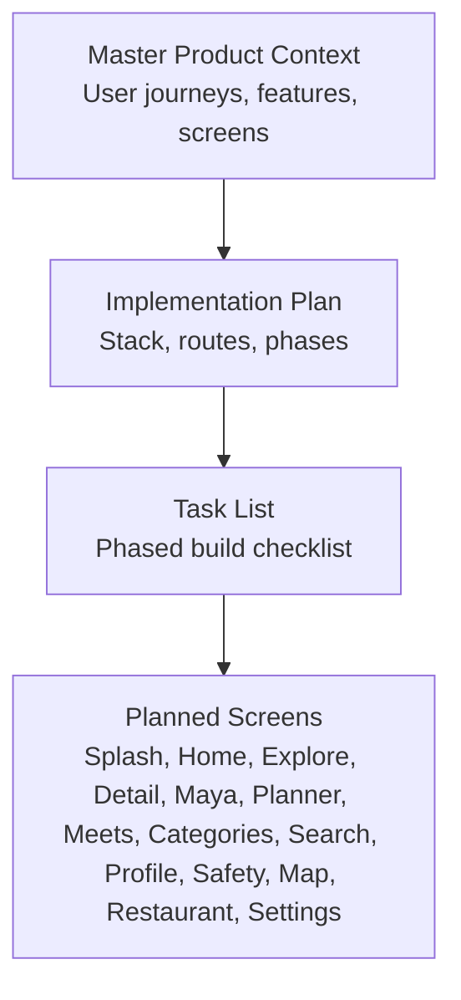
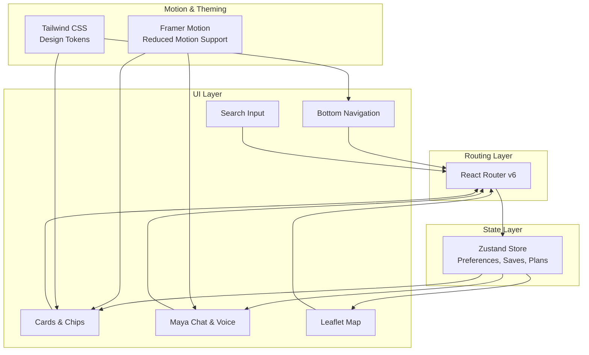
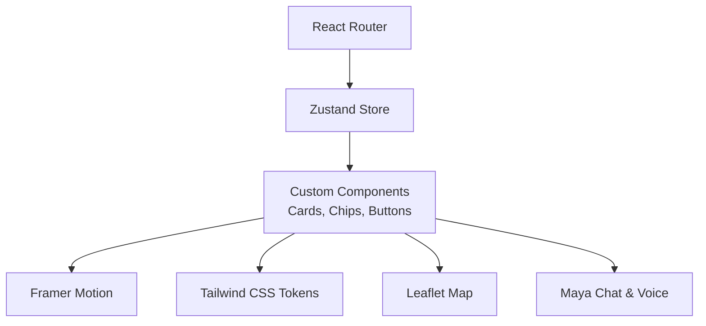

# Accessibility and Inclusive Design

<cite>
**Referenced Files in This Document**
- [Pujo_Sahayak_Master_Project_Context.md](file://Pujo_Sahayak_Master_Project_Context.md)
- [tasks/plan.md](file://tasks/plan.md)
- [tasks/todo.md](file://tasks/todo.md)
</cite>

## Table of Contents
1. [Introduction](#introduction)
2. [Project Structure](#project-structure)
3. [Core Components](#core-components)
4. [Architecture Overview](#architecture-overview)
5. [Detailed Component Analysis](#detailed-component-analysis)
6. [Dependency Analysis](#dependency-analysis)
7. [Performance Considerations](#performance-considerations)
8. [Troubleshooting Guide](#troubleshooting-guide)
9. [Conclusion](#conclusion)
10. [Appendices](#appendices)

## Introduction
This document defines the accessibility guidelines and inclusive design principles for Puja Sahayak, a mobile-first React + Vite PWA focused on Durga Puja discovery, planning, community meetups, and local exploration. It translates WCAG 2.1 AA requirements into concrete implementation rules for keyboard navigation, focus management, screen reader compatibility, color contrast, touch targets, gestures, multilingual Bengali and English support, testing procedures, and custom component standards. The guidance is grounded in the product context, planned screens, and technical architecture described in the project documentation.

## Project Structure
The repository currently contains:
- A master product context describing user journeys, core features, and screen expectations.
- An implementation plan outlining the React + Vite PWA stack, routes, data model, and phased delivery.
- A task list tracking feature development across six phases.

**Diagram sources**
- [Pujo_Sahayak_Master_Project_Context.md:1-120](file://Pujo_Sahayak_Master_Project_Context.md#L1-L120)
- [tasks/plan.md:1-40](file://tasks/plan.md#L1-L40)
- [tasks/todo.md:1-20](file://tasks/todo.md#L1-L20)

**Section sources**
- [Pujo_Sahayak_Master_Project_Context.md:1-120](file://Pujo_Sahayak_Master_Project_Context.md#L1-L120)
- [tasks/plan.md:1-40](file://tasks/plan.md#L1-L40)
- [tasks/todo.md:1-20](file://tasks/todo.md#L1-L20)

## Core Components
Accessibility applies to every planned screen and interaction. The following components are central to inclusive design:

- Bottom Navigation (five tabs): Must be fully keyboard navigable with visible focus indicators, accessible labels, and correct tab roles.
- Cards (Place/Pandal/Restaurant/Event/Meetup): Must expose semantic structure, descriptive titles, ratings, distances, crowd tags, and actions (Save/Visited/Route).
- Filters and Chips: Must be operable via keyboard, announce state changes to screen readers, and provide clear active/inactive states.
- Search Input: Must have an accessible label, placeholder text that does not replace labels, and live region updates for results.
- Maps (Leaflet): Must expose map controls, markers, and route lines as accessible elements; avoid relying solely on visual cues.
- Maya Chat Interface: Must support keyboard input, announce new messages, and provide alternatives for voice and camera interactions.
- Camera Scan Frame: Must include instructions, permission handling, and non-visual feedback for scanning status.
- Planners and Route Maps: Must allow adding stops, reordering, and navigating with keyboard and assistive technologies.
- Settings and Personalization: Must persist reduced motion, language, and theme preferences; ensure all toggles are accessible.

WCAG 2.1 AA compliance anchors:
- Perceivable: Text alternatives, captions where applicable, color contrast, adaptable layouts, and consistent navigation.
- Operable: Keyboard access, sufficient time, no content traps, skip links, and gesture alternatives.
- Understandable: Clear labels, predictable navigation, readable Bengali and English text, and error prevention.
- Robust: Semantic HTML, proper ARIA usage, compatibility with screen readers and browsers.

**Section sources**
- [tasks/plan.md:9-18](file://tasks/plan.md#L9-L18)
- [tasks/todo.md:10-18](file://tasks/todo.md#L10-L18)
- [Pujo_Sahayak_Master_Project_Context.md:140-158](file://Pujo_Sahayak_Master_Project_Context.md#L140-L158)

## Architecture Overview
The application uses React Router for routing, Zustand for state persistence, Framer Motion for animations (respecting reduced motion), Leaflet for maps, and Tailwind CSS for design tokens. Accessibility must be embedded at each layer:

- Routing and Navigation: Ensure focus management when navigating between pages and deep links.
- State Management: Persist accessibility preferences (reduced motion, language, theme) and reflect them consistently.
- UI Layer: Use semantic HTML and ARIA attributes; avoid overusing ARIA when native semantics suffice.
- Media and Interactions: Provide alternatives for camera and voice inputs; ensure keyboard operability.
- Data Presentation: Present place cards, filters, and lists with clear headings, labels, and status updates.

**Diagram sources**
- [tasks/plan.md:9-18](file://tasks/plan.md#L9-L18)
- [tasks/plan.md:19-40](file://tasks/plan.md#L19-L40)

**Section sources**
- [tasks/plan.md:9-18](file://tasks/plan.md#L9-L18)
- [tasks/plan.md:19-40](file://tasks/plan.md#L19-L40)

## Detailed Component Analysis

### Keyboard Navigation and Focus Management
Requirements:
- All interactive elements (buttons, chips, filters, search input, map controls, settings toggles) must be reachable via Tab and Enter/Space.
- Visible focus indicators must be high-contrast and consistent across components.
- Focus should move logically within modals, dialogs, and overlays; return focus to the triggering element upon close.
- Skip links should allow bypassing repeated navigation to main content.
- Page transitions should preserve or update focus appropriately; avoid trapping users in unexpected locations.

Implementation notes:
- Bottom Navigation: Each tab must be a button or link with aria-current="page" when active.
- Cards: Actions like Save/Visited/Route must be buttons with descriptive labels.
- Filters: Chip groups should use role="group" and individual chips with aria-pressed.
- Search: Input must have an explicit label; results should update a live region without losing focus.
- Maps: Controls must be keyboard-accessible; markers should have accessible names and descriptions.

**Section sources**
- [tasks/plan.md:9-18](file://tasks/plan.md#L9-L18)
- [tasks/todo.md:10-18](file://tasks/todo.md#L10-L18)

### Screen Reader Compatibility
Requirements:
- Use semantic HTML elements (nav, main, section, article, form, button, input, heading levels).
- Provide meaningful alt text for images; decorative images should have empty alt.
- ARIA roles and properties should supplement semantics, not replace them.
- Live regions should announce dynamic updates (search results, chat messages, save/visited state changes).
- Avoid redundant labels; keep announcements concise and useful.

Implementation notes:
- Place cards: Title, rating, distance, crowd tag, and actions should be exposed clearly.
- Maya chat: New messages should be announced; audio players should have accessible controls.
- Camera scan: Status messages should be conveyed via live regions; instructions must be available to screen readers.
- Bengali and English: Ensure font loading and text rendering do not break screen reader behavior.

**Section sources**
- [tasks/todo.md:36-43](file://tasks/todo.md#L36-L43)
- [Pujo_Sahayak_Master_Project_Context.md:558-662](file://Pujo_Sahayak_Master_Project_Context.md#L558-L662)

### Color Contrast and Color-Blind Friendly Design
Requirements:
- Text and interactive elements must meet WCAG 2.1 AA contrast ratios against their backgrounds.
- Do not rely on color alone to convey information; combine color with icons, labels, or patterns.
- Use design tokens consistently to maintain contrast across light and dark themes.
- Test color combinations for common forms of color blindness (deuteranopia, protanopia, tritanopia).

Implementation notes:
- Primary colors (vermilion) and surfaces (ivory/charcoal) must be validated for contrast.
- Tags such as “Open now,” “Crowd,” and “Nearby” should use both color and text/icon cues.
- Dark mode must preserve contrast thresholds and avoid low-contrast accents.

**Section sources**
- [tasks/plan.md:9-18](file://tasks/plan.md#L9-L18)
- [tasks/todo.md:71-75](file://tasks/todo.md#L71-L75)

### Touch Target Sizing and Gesture Alternatives
Requirements:
- Touch targets should be at least 44x44 dp (or equivalent) to accommodate motor impairments.
- Provide alternative interactions for gestures (swipe, pinch, long press); ensure tap-only operations exist.
- Avoid accidental activation by spacing interactive elements adequately.

Implementation notes:
- Bottom Navigation items, filter chips, and card actions must meet minimum target sizes.
- Camera scan frame and gallery controls should offer large, clearly labeled buttons.
- Map controls and route actions must be easy to activate without precise gestures.

**Section sources**
- [tasks/todo.md:10-18](file://tasks/todo.md#L10-L18)
- [tasks/todo.md:39-43](file://tasks/todo.md#L39-L43)

### Multilingual Accessibility (Bengali and English)
Requirements:
- Provide language toggle with persistent preference; ensure all strings are localized.
- Load appropriate fonts (e.g., Noto Serif Bengali, Hind Sildar) and verify rendering quality.
- Ensure Bengali text does not cause layout shifts or overflow issues.
- Screen readers must correctly pronounce Bengali text; test with locale-specific voices.

Implementation notes:
- Language toggle should be prominent and accessible from key screens (Home, Settings).
- i18n strings should cover all planned screens and components.
- Verify that dynamic content (pandal names, reviews, messages) respects selected language.

**Section sources**
- [tasks/plan.md:79-80](file://tasks/plan.md#L79-L80)
- [tasks/todo.md:71-75](file://tasks/todo.md#L71-L75)
- [Pujo_Sahayak_Master_Project_Context.md:558-662](file://Pujo_Sahayak_Master_Project_Context.md#L558-L662)

### Testing Procedures for Accessibility Compliance
Automated tools:
- Lighthouse Accessibility audits for contrast, ARIA usage, image alt text, and page structure.
- axe-core integration in CI to catch regressions early.
- Pa11y or WAVE for additional checks on semantic markup and labeling.

Manual testing:
- Keyboard-only navigation across all routes and components.
- Screen reader testing with NVDA, JAWS, VoiceOver, and TalkBack.
- Color contrast verification using tools and manual inspection.
- Touch target sizing validation on mobile devices.
- Multilingual string coverage and font rendering checks for Bengali and English.

Procedures:
- Run automated audits on dev builds and block merges on critical failures.
- Perform manual tests per screen checklist aligned with tasks/todo.md.
- Validate reduced motion preferences and theme toggles.
- Confirm that camera and voice interactions have accessible alternatives.

**Section sources**
- [tasks/plan.md:63-70](file://tasks/plan.md#L63-L70)
- [tasks/todo.md:77-81](file://tasks/todo.md#L77-L81)

### Guidelines for Creating Accessible Custom Components
Standards:
- Prefer native elements; use ARIA only when necessary to augment semantics.
- Ensure all custom widgets are keyboard operable and announce state changes.
- Provide accessible names and descriptions for complex components (maps, charts, media players).
- Maintain consistent focus order and visible focus indicators.
- Respect reduced motion preferences for animations and transitions.

Patterns:
- Buttons and Links: Always include accessible labels; avoid icon-only buttons without labels.
- Cards: Wrap content in semantic containers; expose actions as buttons with descriptive text.
- Filter Groups: Use role="group" and aria-pressed for toggles; announce selection changes.
- Forms: Associate labels explicitly; provide inline validation messages with aria-live.
- Media: Include captions/transcripts where applicable; provide controls with accessible names.

**Section sources**
- [tasks/plan.md:9-18](file://tasks/plan.md#L9-L18)
- [tasks/todo.md:10-18](file://tasks/todo.md#L10-L18)

## Dependency Analysis
Accessibility depends on multiple layers working together:

- Routing and Navigation: Proper focus management and aria-current states.
- State Management: Persistent accessibility preferences and reactive updates.
- UI Components: Semantic markup, ARIA attributes, and consistent styling.
- Motion and Theming: Respecting reduced motion and ensuring contrast in all themes.
- Data Presentation: Clear labeling and structured content for assistive technologies.

**Diagram sources**
- [tasks/plan.md:9-18](file://tasks/plan.md#L9-L18)
- [tasks/plan.md:19-40](file://tasks/plan.md#L19-L40)

**Section sources**
- [tasks/plan.md:9-18](file://tasks/plan.md#L9-L18)
- [tasks/plan.md:19-40](file://tasks/plan.md#L19-L40)

## Performance Considerations
- Minimize unnecessary re-renders in components that update frequently (search results, chat messages).
- Defer heavy computations (route calculations, nearest-neighbor suggestions) to background processes or web workers if needed.
- Optimize images and assets to reduce load times; ensure fallbacks do not break accessibility.
- Respect reduced motion preferences to avoid performance penalties from animations.
- Cache static resources and translations to improve perceived performance without compromising accessibility.

[No sources needed since this section provides general guidance]

## Troubleshooting Guide
Common issues and resolutions:
- Missing focus indicators: Ensure CSS outlines or borders are applied to interactive elements; test with keyboard navigation.
- Screen reader not announcing updates: Use aria-live regions for dynamic content; verify that announcements are concise.
- Low contrast in dark mode: Validate color combinations; adjust token values to meet AA thresholds.
- Touch targets too small: Increase padding and size for buttons and chips; test on mobile devices.
- Bengali text rendering problems: Verify font loading and fallbacks; check for layout shifts and overflow.
- Camera/voice interactions inaccessible: Provide text-based alternatives and clear instructions; ensure permissions are handled gracefully.

**Section sources**
- [tasks/todo.md:39-43](file://tasks/todo.md#L39-L43)
- [tasks/todo.md:71-75](file://tasks/todo.md#L71-L75)

## Conclusion
Puja Sahayak’s accessibility strategy centers on WCAG 2.1 AA compliance, robust keyboard navigation, screen reader compatibility, inclusive color and gesture design, multilingual support, and comprehensive testing. By embedding these principles into the planned screens and components—bottom navigation, cards, filters, search, maps, Maya chat, planner, and settings—the application will deliver an inclusive experience across devices and assistive technologies. Continuous automated and manual testing, along with adherence to semantic HTML and ARIA best practices, will ensure sustained accessibility throughout development and beyond.

[No sources needed since this section summarizes without analyzing specific files]

## Appendices

### WCAG 2.1 AA Quick Reference for Puja Sahayak
- Perceivable:
  - Alt text for images; captions/transcripts for media.
  - Contrast ratios ≥ 4.5:1 for normal text; ≥ 3:1 for large text and UI components.
  - Adaptable layouts and scalable text.
- Operable:
  - Full keyboard access; visible focus indicators.
  - No keyboard traps; skip links.
  - Gesture alternatives; sufficient time for interactions.
- Understandable:
  - Clear labels and instructions; predictable navigation.
  - Error prevention and recovery; readable Bengali and English.
- Robust:
  - Semantic HTML; valid ARIA; compatibility with assistive technologies.

[No sources needed since this section provides general guidance]