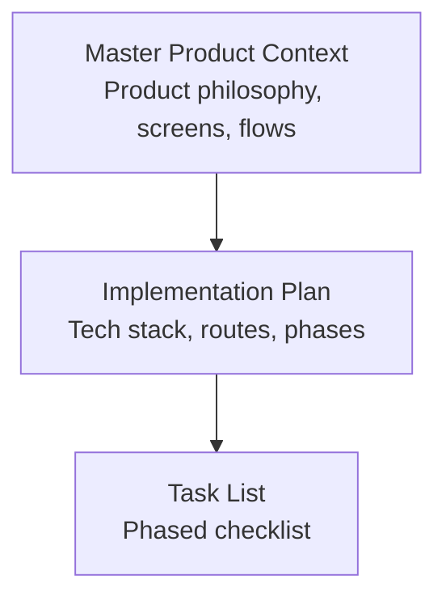
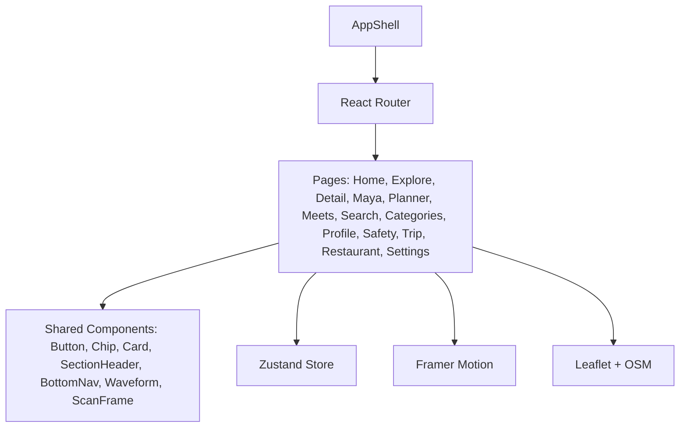
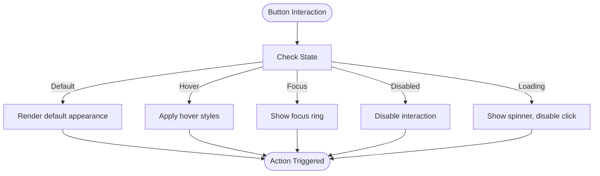
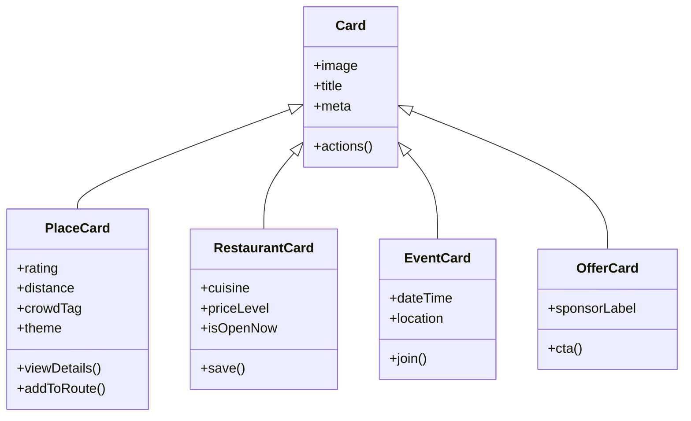
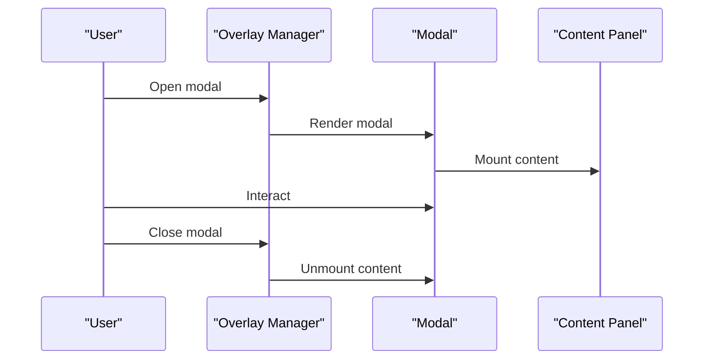
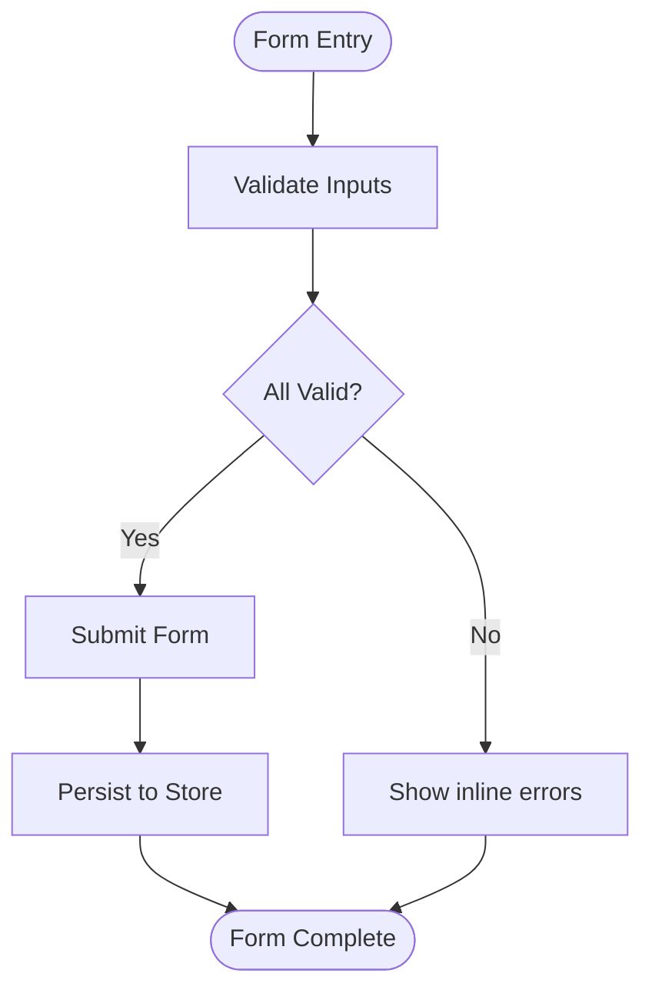
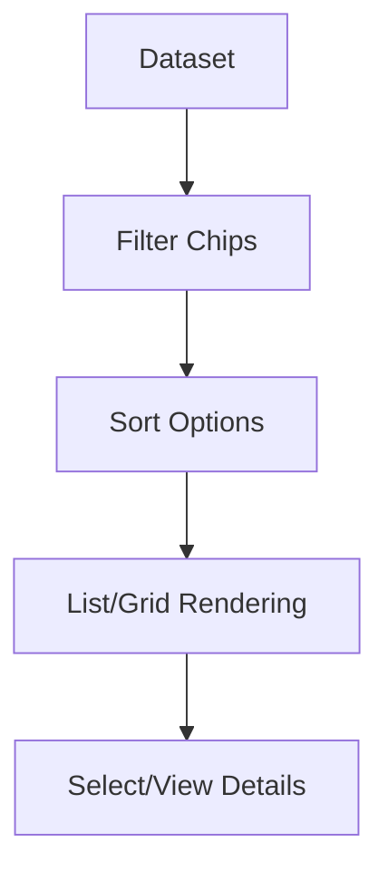
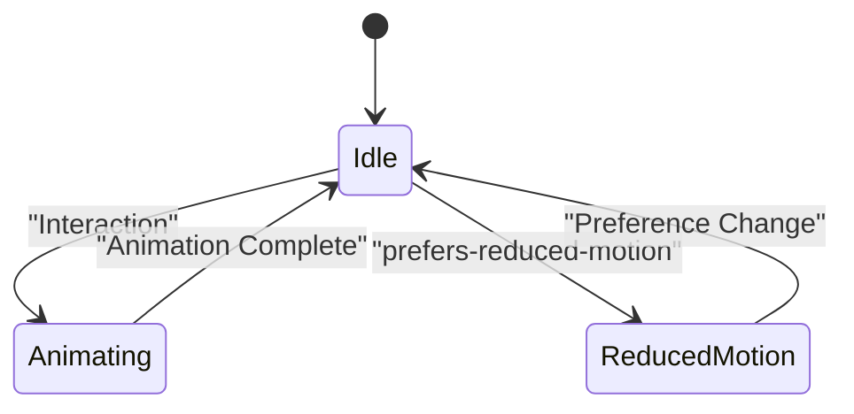
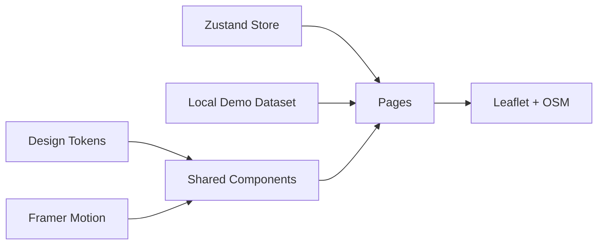

# Component Library and Reusable UI Elements

<cite>
**Referenced Files in This Document**
- [Pujo_Sahayak_Master_Project_Context.md](file://Pujo_Sahayak_Master_Project_Context.md)
- [plan.md](file://tasks/plan.md)
- [todo.md](file://tasks/todo.md)
</cite>

## Table of Contents
1. [Introduction](#introduction)
2. [Project Structure](#project-structure)
3. [Core Components](#core-components)
4. [Architecture Overview](#architecture-overview)
5. [Detailed Component Analysis](#detailed-component-analysis)
6. [Dependency Analysis](#dependency-analysis)
7. [Performance Considerations](#performance-considerations)
8. [Troubleshooting Guide](#troubleshooting-guide)
9. [Conclusion](#conclusion)
10. [Appendices](#appendices)

## Introduction
This document defines the reusable component library and UI element specifications for Puja Sahayak. It focuses on the design system, shared components, and page-level composition patterns that will be implemented as part of a React + Vite PWA with Tailwind CSS v4, Framer Motion, Zustand, and Leaflet. The goal is to establish consistent patterns for buttons, cards, modals, forms, input fields, lists, grids, overlays, and animations, while aligning with the product’s discovery-first journey: Discover → Explore → Understand → Plan → Visit → Share → Meet → Discover again.

The repository currently contains the master product context and implementation planning documents. There are no application source files present yet; therefore, this documentation describes the intended component system and implementation guidelines based on those plans and requirements.

**Section sources**
- [Pujo_Sahayak_Master_Project_Context.md:1-120](file://Pujo_Sahayak_Master_Project_Context.md#L1-L120)
- [plan.md:1-18](file://tasks/plan.md#L1-L18)

## Project Structure
At this stage, the project structure includes:
- A master product context file describing the product philosophy, screens, data model concepts, and user journeys.
- An implementation plan outlining technology choices, route mapping, phases, verification criteria, risks, and open questions.
- A task list breaking down work into foundation, discovery core, Maya/search/categories, planning/social, utility/account, and polish phases.

**Diagram sources**
- [Pujo_Sahayak_Master_Project_Context.md:1-120](file://Pujo_Sahayak_Master_Project_Context.md#L1-L120)
- [plan.md:1-18](file://tasks/plan.md#L1-L18)
- [todo.md:1-15](file://tasks/todo.md#L1-L15)

**Section sources**
- [Pujo_Sahayak_Master_Project_Context.md:1-120](file://Pujo_Sahayak_Master_Project_Context.md#L1-L120)
- [plan.md:1-18](file://tasks/plan.md#L1-L18)
- [todo.md:1-15](file://tasks/todo.md#L1-L15)

## Core Components
The planned shared components include:
- Button
- Chip
- Card (with place-card variant)
- SectionHeader
- BottomNav
- AppShell
- Waveform
- ScanFrame
- Page transition wrapper with reduced-motion support

These components are designed to be bespoke using Tailwind CSS v4 tokens rather than relying on a generic component library. They should remain accessible, responsive, and motion-aware.

### Design Tokens and Visual Language
- Colors: ivory surfaces, vermilion primary, charcoal ink, muted gold, indigo accents.
- Typography: type scale with Bengali serif accent.
- Spacing and radii: consistent across components.
- Imagery: dark imagery style; image-agnostic layouts so real photography can drop in later.

### Shared Component Inventory
| Component | Purpose | Key Variants / States | Accessibility Notes |
|---|---|---|---|
| Button | Primary actions, secondary actions, ghost variants | Default, primary, secondary, disabled, loading | Focusable, keyboard operable, aria-labels where needed |
| Chip | Filters, tags, quick replies | Filter chip, tag chip, selected/unselected | Role="button" or "checkbox", keyboard toggle |
| Card | Place card, restaurant card, event card, offer card | Image, title, meta, actions | Semantic HTML, alt text, focus outline |
| SectionHeader | Section titles and subheaders | Title, subtitle, action | Proper heading levels |
| BottomNav | Five-tab navigation | Active/inactive tabs, labels, icons | Tab roles, current-page indicator |
| AppShell | App frame, header, content area, bottom nav | Light/dark mode, reduced motion | Skip links, viewport sizing |
| Waveform | Voice waveform visualization | Playing/paused, animated | Respect reduced-motion preference |
| ScanFrame | Camera scan overlay | Animated border/frame | Accessible label for camera controls |
| PageTransitionWrapper | Route transitions | Fade/scale, duration | Honor prefers-reduced-motion |

**Section sources**
- [plan.md:10-14](file://tasks/plan.md#L10-L14)
- [todo.md:10-14](file://tasks/todo.md#L10-L14)

## Architecture Overview
The application architecture centers around:
- React Router for navigation across 21 screens.
- Zustand store for client state (saves, visits, plans, settings).
- Framer Motion for soft page fades, subtle card scale, animated scan frame, and voice waveform.
- Leaflet + OpenStreetMap for maps and route visualization.
- Tailwind CSS v4 for design tokens and bespoke styling.

**Diagram sources**
- [plan.md:9-15](file://tasks/plan.md#L9-L15)
- [todo.md:10-14](file://tasks/todo.md#L10-L14)

**Section sources**
- [plan.md:9-15](file://tasks/plan.md#L9-L15)
- [todo.md:10-14](file://tasks/todo.md#L10-L14)

## Detailed Component Analysis

### Buttons
- Variants:
  - Primary: high-emphasis actions like Save, Route, Join.
  - Secondary: supportive actions like Call (stub), Order (disabled).
  - Ghost: low-emphasis actions like Cancel, Clear filters.
- States:
  - Default, Hover, Focus, Disabled, Loading.
- Accessibility:
  - Keyboard operable, visible focus ring, aria-disabled when disabled.
- Usage:
  - Bottom sheet actions, detail page action rows, form submission.

**Section sources**
- [todo.md:10-14](file://tasks/todo.md#L10-L14)

### Cards
- Place Card (Pandal):
  - Fields: image, name, rating, distance, crowd tag, theme.
  - Actions: View Details, Add to Route.
- Restaurant Card:
  - Fields: image, name, rating, distance, cuisine/price, open now.
  - Actions: View Details, Save.
- Event Card:
  - Fields: image, title, date/time, location.
  - Actions: View Details, Join.
- Offer Card:
  - Fields: sponsor branding, short description, CTA.
  - Note: visually distinct from organic recommendations.

**Diagram sources**
- [todo.md:26-30](file://tasks/todo.md#L26-L30)
- [todo.md:60-61](file://tasks/todo.md#L60-L61)

**Section sources**
- [todo.md:26-30](file://tasks/todo.md#L26-L30)
- [todo.md:60-61](file://tasks/todo.md#L60-L61)
- [Pujo_Sahayak_Master_Project_Context.md:185-207](file://Pujo_Sahayak_Master_Project_Context.md#L185-L207)

### Modals, Drawers, and Popovers (Overlay Components)
- Modal:
  - Use for confirmations, detailed info panels, missing person report wizard steps.
  - Should trap focus, close on Escape, and respect reduced motion.
- Drawer:
  - Use for side panels such as filters, details, or planner editing.
  - Should be dismissible and keyboard-accessible.
- Popover:
  - Use for contextual tips, quick actions, or metadata popups.
  - Should position reliably and maintain focus management.

[No diagram sources since this diagram shows conceptual overlay behavior]

**Section sources**
- [todo.md:66-67](file://tasks/todo.md#L66-L67)

### Forms and Input Fields
- Form Patterns:
  - Create Meetup: title, date, time, location, description, interest chips, max participants, public/restricted.
  - Missing Person Report: 4-step wizard (Person → Details → Location → Submit).
  - Settings: toggles for dark mode, reduced motion, language, app logo picker.
- Validation:
  - Required fields, date/time validation, numeric constraints for participants.
  - Inline error messages with clear labeling.
- Accessibility:
  - Labels associated with inputs, error announcements via aria-live regions, keyboard navigation through steps.

**Section sources**
- [todo.md:53-54](file://tasks/todo.md#L53-L54)
- [todo.md:66-67](file://tasks/todo.md#L66-L67)

### Lists and Grids
- Lists:
  - Pandal directory list with filters (Area, Distance, Theme, Crowd).
  - Favorites sections: Saved Pandals, Places You’ve Been, You Might Like.
  - Meets list with pills (All/Nearby/My Interests).
- Grids:
  - Categories icon grid (Places, Transport & Services, Utilities).
  - Nearby help points on map/list toggle.

**Section sources**
- [todo.md:26-27](file://tasks/todo.md#L26-L27)
- [todo.md:47-48](file://tasks/todo.md#L47-L48)
- [todo.md:53-54](file://tasks/todo.md#L53-L54)
- [todo.md:42-43](file://tasks/todo.md#L42-L43)

### Animation and Transition Patterns
- Page Transitions:
  - Soft fade between routes.
- Card Interactions:
  - Subtle scale on hover/tap.
- Voice Waveform:
  - Animated bars during playback.
- Camera Scan Frame:
  - Animated scanning border.
- Reduced Motion:
  - All animations must honor prefers-reduced-motion.

**Section sources**
- [plan.md:13](file://tasks/plan.md#L13)
- [todo.md:10-14](file://tasks/todo.md#L10-L14)

## Dependency Analysis
Key dependencies and relationships:
- Shared components depend on design tokens and motion primitives.
- Pages compose shared components and consume Zustand store.
- Maps depend on Leaflet and dataset coordinates.
- Maya chat depends on local dataset retrieval and waveform UI.

**Diagram sources**
- [plan.md:9-15](file://tasks/plan.md#L9-L15)
- [todo.md:10-14](file://tasks/todo.md#L10-L14)

**Section sources**
- [plan.md:9-15](file://tasks/plan.md#L9-L15)
- [todo.md:10-14](file://tasks/todo.md#L10-L14)

## Performance Considerations
- Keep images lightweight and use placeholders/gradients until production assets are available.
- Defer heavy computations (e.g., nearest-neighbor optimization) to background tasks or after user confirmation.
- Use lazy loading for off-screen lists and map markers.
- Respect reduced-motion preferences to avoid unnecessary reflows.
- Avoid over-rendering by memoizing expensive components and filtering datasets efficiently.

[No sources needed since this section provides general guidance]

## Troubleshooting Guide
Common issues and resolutions:
- Build fails due to TypeScript errors:
  - Ensure all types (Place/Pandal/Restaurant/Event/Meetup/Review/Photo/Plan/Offer/SafetyPoint) are defined and used consistently.
- Routes not reachable:
  - Verify React Router configuration matches the documented screen-to-route map.
- Persistence not working:
  - Confirm Zustand persist middleware is configured for saves, visits, plans, and settings.
- Motion causing performance issues:
  - Disable animations for users with reduced-motion preference.
- Camera permissions denied:
  - Provide fallback instructions and graceful degradation for Maya scan.

**Section sources**
- [plan.md:63-69](file://tasks/plan.md#L63-L69)
- [todo.md:77-80](file://tasks/todo.md#L77-L80)

## Conclusion
The Puja Sahayak component library should emphasize bespoke, accessible, and motion-aware UI elements built on Tailwind CSS v4 tokens. Shared components like Button, Chip, Card, SectionHeader, BottomNav, AppShell, Waveform, and ScanFrame provide the foundation for pages that guide users through discovery, understanding, planning, visiting, sharing, meeting, and discovering again. Implementation should proceed in phased tasks, ensuring each checkpoint leaves the app runnable and aligned with mockups and product philosophy.

[No sources needed since this section summarizes without analyzing specific files]

## Appendices

### Screen-to-Route Mapping Reference
| Screen | Route |
|---|---|
| Splash | `/splash` |
| Home | `/` |
| Explore / Pandal Directory | `/explore` |
| Pandal Detail | `/pandal/:id` |
| Maya chat / Scan / Voice | `/maya`, `/maya/scan` |
| Puja Planner | `/planner` |
| Meets list | `/meets` |
| Create Meetup | `/meets/create` |
| Categories | `/categories` |
| Search | `/search` |
| Profile | `/profile` |
| Safety / Emergency | `/safety` |
| Missing Person Report | `/safety/missing-person` |
| Trip / Route Map | `/trip/:planDayId` |
| Restaurant Detail | `/restaurant/:id` |
| Settings | `/profile/settings` |
| Beyond Puja | `/beyond-puja` |

**Section sources**
- [plan.md:19-39](file://tasks/plan.md#L19-L39)

### Data Model Concepts
- Place
- Pandal
- Restaurant
- Event
- Meetup
- Review
- Photo
- Plan (day slots)
- Offer
- SafetyPoint
- Category

**Section sources**
- [plan.md:46](file://tasks/plan.md#L46)
- [todo.md:13-14](file://tasks/todo.md#L13-L14)