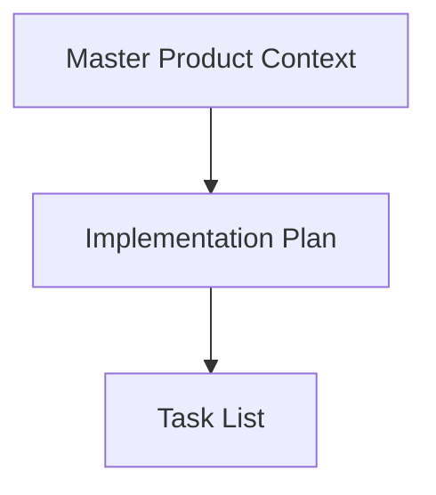
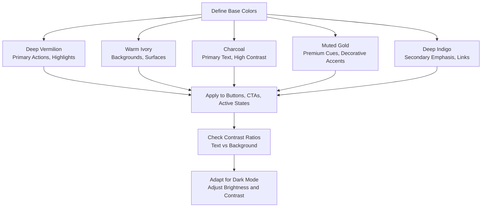
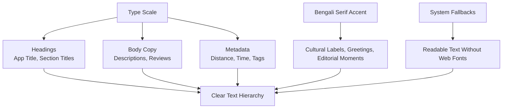
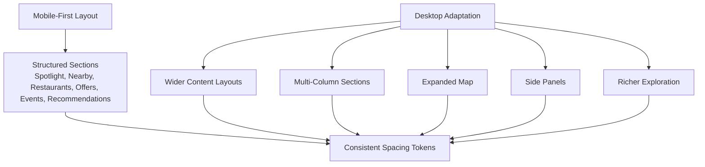
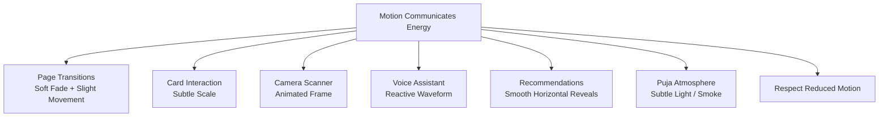
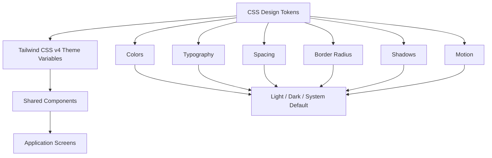
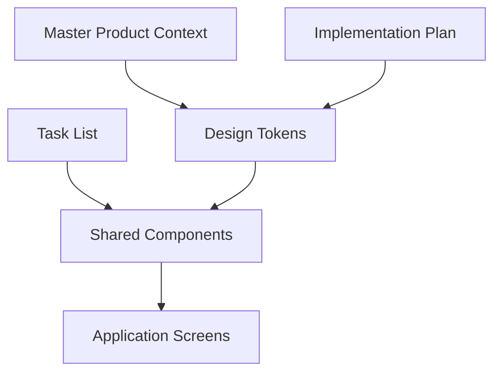

# Design Tokens and Visual Identity

<cite>
**Referenced Files in This Document**   
- [Pujo_Sahayak_Master_Project_Context.md](file://Pujo_Sahayak_Master_Project_Context.md)
- [plan.md](file://tasks/plan.md)
- [todo.md](file://tasks/todo.md)
</cite>

## Table of Contents
1. [Introduction](#introduction)
2. [Project Structure](#project-structure)
3. [Core Components](#core-components)
4. [Architecture Overview](#architecture-overview)
5. [Detailed Component Analysis](#detailed-component-analysis)
6. [Dependency Analysis](#dependency-analysis)
7. [Performance Considerations](#performance-considerations)
8. [Troubleshooting Guide](#troubleshooting-guide)
9. [Conclusion](#conclusion)
10. [Appendices](#appendices)

## Introduction
This document defines the design tokens and visual identity system for Puja Sahayak, a modern local-discovery platform centered around the Durga Puja experience in Kolkata. The system is intended to feel modern, elegant, editorial, vibrant, immersive, youthful, and culturally rooted, while remaining highly functional. It should not look like a generic SaaS dashboard or a festival-decorated website.

The current repository contains product context and implementation planning rather than an already implemented codebase. Therefore, this document synthesizes the documented visual language, motion principles, responsive strategy, and Tailwind CSS v4 tokenization plan into a complete design-token specification that can guide future implementation.

## Project Structure
At this stage, the workspace includes:
- A master product context document describing the product vision, information architecture, visual direction, motion system, and responsive strategy.
- An implementation plan describing React + Vite PWA, Tailwind CSS v4 tokenization, routing, state management, motion, mapping, and screen coverage.
- A task list breaking down foundation, discovery core, Maya, planning, social, utility, and polish phases.

**Diagram sources**
- [Pujo_Sahayak_Master_Project_Context.md:1-1878](file://Pujo_Sahayak_Master_Project_Context.md#L1-L1878)
- [plan.md:1-86](file://tasks/plan.md#L1-L86)
- [todo.md:1-81](file://tasks/todo.md#L1-L81)

**Section sources**
- [Pujo_Sahayak_Master_Project_Context.md:1-1878](file://Pujo_Sahayak_Master_Project_Context.md#L1-L1878)
- [plan.md:1-86](file://tasks/plan.md#L1-L86)
- [todo.md:1-81](file://tasks/todo.md#L1-L81)

## Core Components
The design system is described as a set of design tokens encoded in CSS with Tailwind CSS v4. The documented token categories include:
- Colors: deep vermilion, warm ivory, charcoal, muted gold, deep indigo.
- Typography: type scale with Bengali serif accent.
- Spacing and layout: mobile-first structure with desktop expansion.
- Motion: page transitions, card interactions, scanner frame, waveform, horizontal reveals, subtle atmospheric effects.
- Responsive behavior: mobile primary target; desktop adaptation through wider layouts, multi-column sections, expanded maps, side panels, and richer exploration.

The shared component layer planned under the design-system task includes:
- Button
- Chip
- Card (including place-card variant)
- SectionHeader
- BottomNav (five tabs with active state)
- AppShell
- Waveform
- ScanFrame
- Page-transition wrapper with reduced-motion support

These components are expected to consume the design tokens rather than hard-code values.

**Section sources**
- [Pujo_Sahayak_Master_Project_Context.md:1482-1531](file://Pujo_Sahayak_Master_Project_Context.md#L1482-L1531)
- [Pujo_Sahayak_Master_Project_Context.md:1555-1573](file://Pujo_Sahayak_Master_Project_Context.md#L1555-L1573)
- [plan.md:10-10](file://tasks/plan.md#L10-L10)
- [todo.md:10-11](file://tasks/todo.md#L10-L11)

## Architecture Overview
The visual identity architecture is token-driven and component-driven:

```mermaid
graph TB
subgraph "Design System"
Tokens["Design Tokens<br/>Colors, Typography, Spacing, Motion"]
Theme["Theme Layer<br/>Light / Dark / Reduced Motion"]
end
subgraph "Component Layer"
Shared["Shared Components<br/>Button, Chip, Card, SectionHeader,<br/>BottomNav, AppShell, Waveform, ScanFrame"]
end
subgraph "Application Screens"
Home["Home"]
Explore["Explore / Pandal Directory"]
Detail["Pandal Detail"]
Maya["Maya Chat / Voice / Camera"]
Planner["Puja Planner"]
Meets["Meets"]
Profile["Profile / Settings"]
end
Tokens --> Shared
Theme --> Shared
Shared --> Home
Shared --> Explore
Shared --> Detail
Shared --> Maya
Shared --> Planner
Shared --> Meets
Shared --> Profile
```

**Diagram sources**
- [plan.md:10-10](file://tasks/plan.md#L10-L10)
- [todo.md:10-11](file://tasks/todo.md#L10-L11)
- [Pujo_Sahayak_Master_Project_Context.md:1482-1531](file://Pujo_Sahayak_Master_Project_Context.md#L1482-L1531)

## Detailed Component Analysis

### Color Palette
The documented color palette centers on a culturally grounded but modern palette:
- Deep vermilion: primary brand color, used for strong actions, highlights, and cultural emphasis.
- Warm ivory: surface and background tone, providing warmth without harshness.
- Charcoal: text and high-contrast UI elements.
- Muted gold: accent color for premium cues, decorative accents, and subtle emphasis.
- Deep indigo: secondary brand color, useful for depth, links, and complementary emphasis.

Usage guidance derived from the product context:
- Use colors to communicate modern Kolkata and Durga Puja inspiration.
- Avoid over-decoration and generic SaaS styling.
- Keep photography, tasteful gradients, subtle grain, and soft glow as supporting visuals rather than relying on heavy color blocks.

Accessibility considerations:
- Ensure sufficient contrast between text and surfaces.
- Treat vermilion and gold as emphasis colors, not sole indicators of meaning.
- Provide semantic alternatives such as icons, labels, or patterns where color alone communicates status.

Dark mode considerations:
- The product explicitly supports light mode, dark mode, and system default.
- Dark imagery is mentioned alongside the token palette.
- Surfaces should shift to darker tones while preserving readability.
- Vermilion and gold should be adjusted for dark backgrounds to maintain contrast and avoid excessive brightness.

**Diagram sources**
- [Pujo_Sahayak_Master_Project_Context.md:1482-1505](file://Pujo_Sahayak_Master_Project_Context.md#L1482-L1505)
- [Pujo_Sahayak_Master_Project_Context.md:1055-1074](file://Pujo_Sahayak_Master_Project_Context.md#L1055-L1074)

**Section sources**
- [Pujo_Sahayak_Master_Project_Context.md:1482-1505](file://Pujo_Sahayak_Master_Project_Context.md#L1482-L1505)
- [Pujo_Sahayak_Master_Project_Context.md:1055-1074](file://Pujo_Sahayak_Master_Project_Context.md#L1055-L1074)

### Typography System
The typography system is defined by:
- A type scale.
- Bengali serif accent fonts.
- English and Bengali language support.
- System fallbacks for Bengali rendering.

Guidelines:
- Use the documented type scale consistently across headings, body text, captions, and metadata.
- Apply Bengali serif accents where appropriate, especially for cultural or editorial moments.
- Respect reduced-motion preferences when typography animations are introduced.
- Keep hierarchy clear: app name, section titles, content titles, body copy, helper text.

Font families referenced:
- Noto Serif Bengali
- Hind Siladari

Fallback strategy:
- Use Google Fonts for Bengali typography.
- Include system font fallbacks to ensure readable text even if web fonts fail to load.

**Diagram sources**
- [todo.md:10-11](file://tasks/todo.md#L10-L11)
- [plan.md:79-79](file://tasks/plan.md#L79-L79)

**Section sources**
- [todo.md:10-11](file://tasks/todo.md#L10-L11)
- [plan.md:79-79](file://tasks/plan.md#L79-L79)

### Spacing and Layout System
Spacing and layout follow a mobile-first approach:
- Mobile is the primary design target.
- Desktop adapts the same system into wider content layouts, multi-column sections, expanded maps, side panels, and richer exploration.
- Shared components such as cards, chips, buttons, and bottom navigation should use consistent spacing tokens.

Layout principles:
- Preserve structured sections rather than turning the home page into an endless feed.
- Maintain clear information hierarchy so users quickly understand location, nearby activity, exploration options, saved items, and Maya assistance.
- Keep spacing consistent across screens to reinforce familiarity.

**Diagram sources**
- [Pujo_Sahayak_Master_Project_Context.md:1555-1573](file://Pujo_Sahayak_Master_Project_Context.md#L1555-L1573)
- [Pujo_Sahayak_Master_Project_Context.md:1577-1603](file://Pujo_Sahayak_Master_Project_Context.md#L1577-L1603)

**Section sources**
- [Pujo_Sahayak_Master_Project_Context.md:1555-1573](file://Pujo_Sahayak_Master_Project_Context.md#L1555-L1573)
- [Pujo_Sahayak_Master_Project_Context.md:1577-1603](file://Pujo_Sahayak_Master_Project_Context.md#L1577-L1603)

### Shadow, Border Radius, and Z-Index Strategy
The repository does not define explicit shadow values, border radius values, or z-index layering rules. However, the design direction emphasizes:
- Modern, elegant, editorial, and immersive visuals.
- Tasteful gradients, subtle grain, and soft glow.
- Subtle motion rather than heavy visual noise.

Recommended tokenization approach:
- Define small, medium, and large elevation tokens for shadows.
- Use subtle shadows for cards, modals, and floating controls.
- Define border radius tokens for buttons, chips, cards, and inputs.
- Establish a z-index scale for layers such as base content, overlays, modals, bottom navigation, and floating action buttons.
- Keep safety and emergency interfaces prioritized for clarity and speed over visual effects.

**Section sources**
- [Pujo_Sahayak_Master_Project_Context.md:1482-1505](file://Pujo_Sahayak_Master_Project_Context.md#L1482-L1505)
- [Pujo_Sahayak_Master_Project_Context.md:1390-1410](file://Pujo_Sahayak_Master_Project_Context.md#L1390-L1410)

### Iconography and Illustration Guidelines
The repository does not define a dedicated iconography or illustration library. Instead, it references:
- Photography as a core visual element.
- Subtle alpana-inspired patterns.
- Soft glow and tasteful gradients.
- Bengali typography accents.

Guidelines:
- Prefer real photography for places, pandals, restaurants, events, and user-generated content.
- Use minimal, culturally respectful patterns sparingly.
- Avoid over-decoration and random festival decorations.
- Keep illustrations and icons simple, legible at small sizes, and consistent with the modern editorial aesthetic.

**Section sources**
- [Pujo_Sahayak_Master_Project_Context.md:1482-1505](file://Pujo_Sahayak_Master_Project_Context.md#L1482-L1505)

### Motion System
The motion system is designed to communicate energy without becoming a showcase:
- Page transitions: soft fade plus slight movement.
- Cards: very subtle scale on interaction.
- Camera scanner: animated scan frame.
- Voice assistant: reactive waveform.
- Recommendations: smooth horizontal reveals.
- Puja atmosphere: occasional subtle light/smoke effects.
- Reduced motion: honored by the application.

**Diagram sources**
- [Pujo_Sahayak_Master_Project_Context.md:1509-1531](file://Pujo_Sahayak_Master_Project_Context.md#L1509-L1531)

**Section sources**
- [Pujo_Sahayak_Master_Project_Context.md:1509-1531](file://Pujo_Sahayak_Master_Project_Context.md#L1509-L1531)

### Implementation with Tailwind CSS v4
The implementation plan states that Tailwind CSS v4 is used and that the mockups’ design system is encoded as design tokens in CSS. The tokenization covers:
- Ivory surfaces
- Vermilion primary
- Charcoal ink
- Muted gold
- Dark imagery
- Radii
- Type scale with Bengali serif accent

Recommended token organization:
- Define CSS custom properties for colors, typography, spacing, radii, shadows, and motion durations.
- Map Tailwind v4 theme variables to these tokens.
- Build shared components that reference tokens instead of raw values.
- Support theme switching for light, dark, and system defaults.
- Honor reduced-motion settings globally.

**Diagram sources**
- [plan.md:10-10](file://tasks/plan.md#L10-L10)
- [todo.md:10-11](file://tasks/todo.md#L10-L11)

**Section sources**
- [plan.md:10-10](file://tasks/plan.md#L10-L10)
- [todo.md:10-11](file://tasks/todo.md#L10-L11)

## Dependency Analysis
The design system depends on:
- Master product context for visual direction, motion principles, and responsive strategy.
- Implementation plan for technology stack, tokenization approach, and component scope.
- Task list for phased delivery of foundation, shared components, and screens.

**Diagram sources**
- [Pujo_Sahayak_Master_Project_Context.md:1482-1531](file://Pujo_Sahayak_Master_Project_Context.md#L1482-L1531)
- [plan.md:10-10](file://tasks/plan.md#L10-L10)
- [todo.md:10-11](file://tasks/todo.md#L10-L11)

**Section sources**
- [Pujo_Sahayak_Master_Project_Context.md:1482-1531](file://Pujo_Sahayak_Master_Project_Context.md#L1482-L1531)
- [plan.md:10-10](file://tasks/plan.md#L10-L10)
- [todo.md:10-11](file://tasks/todo.md#L10-L11)

## Performance Considerations
- Keep motion subtle and respect reduced-motion preferences.
- Avoid heavy visual effects in safety and emergency flows.
- Use photography efficiently and provide fallbacks when images are unavailable.
- Keep the design system token-driven so changes propagate consistently without rework.
- Maintain clean builds and predictable component boundaries to reduce maintenance cost.

[No sources needed since this section provides general guidance]

## Troubleshooting Guide
Common issues and resolutions:
- Inconsistent colors or spacing: ensure all components consume design tokens rather than hard-coded values.
- Poor readability in dark mode: verify contrast ratios and adjust surface/text tokens accordingly.
- Excessive decoration: return to the documented visual language and avoid generic SaaS or festival-decorated aesthetics.
- Motion causing distraction: honor reduced-motion settings and keep animations subtle.
- Bengali text rendering problems: confirm Google Fonts loading and system fallbacks.

**Section sources**
- [Pujo_Sahayak_Master_Project_Context.md:1482-1505](file://Pujo_Sahayak_Master_Project_Context.md#L1482-L1505)
- [Pujo_Sahayak_Master_Project_Context.md:1509-1531](file://Pujo_Sahayak_Master_Project_Context.md#L1509-L1531)
- [plan.md:79-79](file://tasks/plan.md#L79-L79)

## Conclusion
The Puja Sahayak design tokens and visual identity are grounded in a culturally rooted yet modern aesthetic. The documented palette, typography direction, motion principles, and responsive strategy provide a clear foundation for building a bespoke, non-generic interface. Future implementation should encode these tokens in CSS, expose them through Tailwind CSS v4, and build shared components that enforce consistency across screens. Accessibility, dark mode, and reduced-motion support should remain central to the design system.

[No sources needed since this section summarizes without analyzing specific files]

## Appendices

### Token Reference Summary
- Colors: deep vermilion, warm ivory, charcoal, muted gold, deep indigo.
- Typography: type scale with Bengali serif accent; Noto Serif Bengali and Hind Siladari referenced.
- Spacing: mobile-first with desktop expansion.
- Motion: page transitions, card scale, scanner frame, waveform, horizontal reveals, subtle atmosphere.
- Theme: light, dark, system default.
- Components: button, chip, card, section header, bottom navigation, app shell, waveform, scan frame, page transition wrapper.

**Section sources**
- [Pujo_Sahayak_Master_Project_Context.md:1482-1531](file://Pujo_Sahayak_Master_Project_Context.md#L1482-L1531)
- [todo.md:10-11](file://tasks/todo.md#L10-L11)
- [plan.md:10-10](file://tasks/plan.md#L10-L10)