# Navigation Structure and User Flows

<cite>
**Referenced Files in This Document**
- [Pujo_Sahayak_Master_Project_Context.md](file://Pujo_Sahayak_Master_Project_Context.md)
- [plan.md](file://tasks/plan.md)
- [todo.md](file://tasks/todo.md)
</cite>

## Table of Contents
1. [Introduction](#introduction)
2. [Project Structure](#project-structure)
3. [Core Components](#core-components)
4. [Architecture Overview](#architecture-overview)
5. [Detailed Component Analysis](#detailed-component-analysis)
6. [Dependency Analysis](#dependency-analysis)
7. [Performance Considerations](#performance-considerations)
8. [Troubleshooting Guide](#troubleshooting-guide)
9. [Conclusion](#conclusion)
10. [Appendices](#appendices)

## Introduction
This document explains the navigation architecture and user flow patterns for Puja Sahayak, a mobile-first local discovery platform centered around Durga Puja but designed to remain useful beyond the festival season. The product combines place discovery, AI assistance through Maya, planning, community meetups, safety utilities, and personalization.

The primary navigation is intentionally simple and mobile-first: Home, Favorites, Search, Categories, and Meets. Deep linking, routing hierarchy, breadcrumb behavior, search flows, transition animations, state preservation, and consistency guidelines are covered so that every screen supports a clear user purpose and predictable navigation experience.

## Project Structure
At this stage, the repository contains product context and implementation planning rather than source code. The project plan defines a React + Vite PWA with React Router v6, Zustand for client state, Framer Motion for transitions, Leaflet for maps, and Tailwind CSS for styling. The planned screen-to-route mapping establishes the foundation for navigation structure.

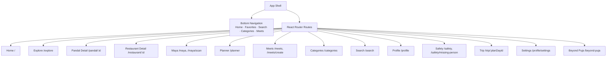

**Diagram sources**
- [plan.md:19-39](file://tasks/plan.md#L19-L39)

**Section sources**
- [plan.md:1-18](file://tasks/plan.md#L1-L18)
- [plan.md:19-39](file://tasks/plan.md#L19-L39)

## Core Components
The core navigation components are defined by the product’s primary tabs and supporting screens. Each tab has a distinct responsibility and entry point into deeper features.

| Tab | Route(s) | Responsibility | Key Entry Points |
|---|---|---|---|
| Home | `/` | Main discovery surface; sponsored spotlight, explore spotlight, restaurants, offers, events, recommendations, and “Continue where you left off.” | Greeting, search bar, rails, continue card |
| Favorites | `/planner` (also accessible from Favorites) | Saved places, visited places, recommendations, and multi-day Puja planner | Saved list, visited list, planner entry |
| Search | `/search` | Global search across pandals, restaurants, events, trending items, and nearby places | Search input, category pills, trending rail, nearby rail |
| Categories | `/categories` | Structured discovery hub grouped into Places, Transport & Services, and Utilities | Category grids, “Ask Maya” CTA |
| Meets | `/meets`, `/meets/create` | Discover existing meetups and create new ones | Meetup cards, create form |

Supporting screens include Pandal Detail, Restaurant Detail, Maya chat and camera, Safety/Emergency, Missing Person Report, Trip/Route Map, Profile, Settings, and the off-season “Beyond Puja” experience.

**Section sources**
- [Pujo_Sahayak_Master_Project_Context.md:140-158](file://Pujo_Sahayak_Master_Project_Context.md#L140-L158)
- [Pujo_Sahayak_Master_Project_Context.md:160-284](file://Pujo_Sahayak_Master_Project_Context.md#L160-L284)
- [Pujo_Sahayak_Master_Project_Context.md:320-351](file://Pujo_Sahayak_Master_Project_Context.md#L320-L351)
- [Pujo_Sahayak_Master_Project_Context.md:447-493](file://Pujo_Sahayak_Master_Project_Context.md#L447-L493)
- [Pujo_Sahayak_Master_Project_Context.md:495-556](file://Pujo_Sahayak_Master_Project_Context.md#L495-L556)
- [Pujo_Sahayak_Master_Project_Context.md:664-772](file://Pujo_Sahayak_Master_Project_Context.md#L664-L772)
- [plan.md:19-39](file://tasks/plan.md#L19-L39)

## Architecture Overview
The navigation architecture follows a bottom-tab shell with nested detail routes. The app shell renders the bottom navigation and hosts route-based pages. Details such as pandal or restaurant information use parameterized routes. Secondary experiences like Maya, planner, safety, and trip map are reachable from both the main navigation and contextual actions on content pages.

```mermaid
graph TB
subgraph "Shell"
Shell["App Shell"]
Nav["Bottom Navigation"]
end
subgraph "Primary Tabs"
HomeTab["Home"]
FavTab["Favorites"]
SearchTab["Search"]
CatTab["Categories"]
MeetsTab["Meets"]
end
subgraph "Detail Pages"
PandalDetail["Pandal Detail"]
RestDetail["Restaurant Detail"]
end
subgraph "Secondary Features"
Maya["Maya Chat / Scan"]
Planner["Puja Planner"]
Safety["Safety / Emergency"]
TripMap["Trip / Route Map"]
Profile["Profile / Settings"]
end
Shell --> Nav
Nav --> HomeTab
Nav --> FavTab
Nav --> SearchTab
Nav --> CatTab
Nav --> MeetsTab
HomeTab --> PandalDetail
HomeTab --> RestDetail
SearchTab --> PandalDetail
SearchTab --> RestDetail
CatTab --> PandalDetail
CatTab --> RestDetail
MeetsTab --> PandalDetail
MeetsTab --> RestDetail
PandalDetail --> Maya
PandalDetail --> Planner
PandalDetail --> Safety
PandalDetail --> TripMap
Profile --> Safety
Profile --> Planner
```

**Diagram sources**
- [plan.md:19-39](file://tasks/plan.md#L19-L39)
- [Pujo_Sahayak_Master_Project_Context.md:775-952](file://Pujo_Sahayak_Master_Project_Context.md#L775-L952)

## Detailed Component Analysis

### Primary Navigation Tabs

#### Home
Home is the main discovery surface. It should not only show pandals; it should dynamically present what is relevant to the user based on season, time, location, activity, current events, and recommendations. It includes sponsored spotlight, explore spotlight, restaurants, offers, shopping concept, events/local experiences, and “Continue where you left off.”

Navigation responsibilities:
- Provide quick access to search and categories.
- Surface trending and nearby content.
- Offer contextual links to details, planners, and meetups.
- Preserve session continuity via “Continue where you left off.”

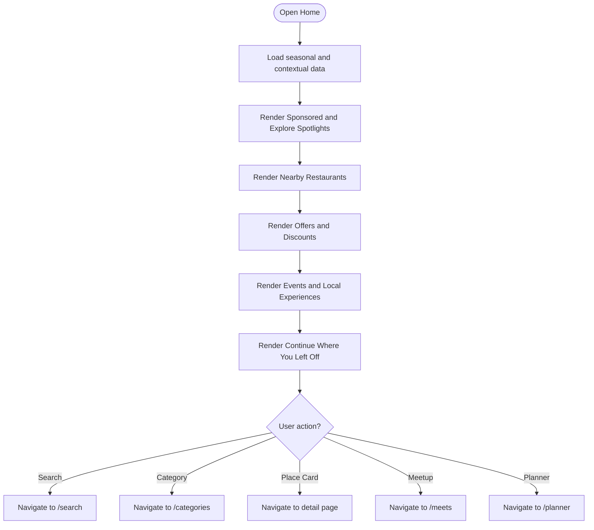

**Diagram sources**
- [Pujo_Sahayak_Master_Project_Context.md:160-284](file://Pujo_Sahayak_Master_Project_Context.md#L160-L284)
- [Pujo_Sahayak_Master_Project_Context.md:286-318](file://Pujo_Sahayak_Master_Project_Context.md#L286-L318)

**Section sources**
- [Pujo_Sahayak_Master_Project_Context.md:160-284](file://Pujo_Sahayak_Master_Project_Context.md#L160-L284)
- [Pujo_Sahayak_Master_Project_Context.md:286-318](file://Pujo_Sahayak_Master_Project_Context.md#L286-L318)

#### Favorites
Favorites is more than a bookmark list. It includes saved pandals, places you’ve been, recommendations (“You might like”), and an entry to the Puja planner. It connects personal history with future planning.

Navigation responsibilities:
- Show saved and visited places.
- Surface recommendations based on saved and visited data.
- Provide direct access to the planner.

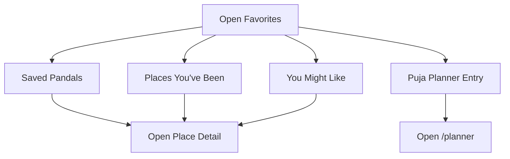

**Diagram sources**
- [Pujo_Sahayak_Master_Project_Context.md:320-351](file://Pujo_Sahayak_Master_Project_Context.md#L320-L351)
- [Pujo_Sahayak_Master_Project_Context.md:353-421](file://Pujo_Sahayak_Master_Project_Context.md#L353-L421)

**Section sources**
- [Pujo_Sahayak_Master_Project_Context.md:320-351](file://Pujo_Sahayak_Master_Project_Context.md#L320-L351)
- [Pujo_Sahayak_Master_Project_Context.md:353-421](file://Pujo_Sahayak_Master_Project_Context.md#L353-L421)

#### Search
Search covers the entire local ecosystem. It includes category shortcuts, trending pandals, and popular nearby places. Filters and results should be consistent with the broader data model.

Navigation responsibilities:
- Accept free-text queries and category filters.
- Display trending and nearby results.
- Navigate to detail pages for selected items.

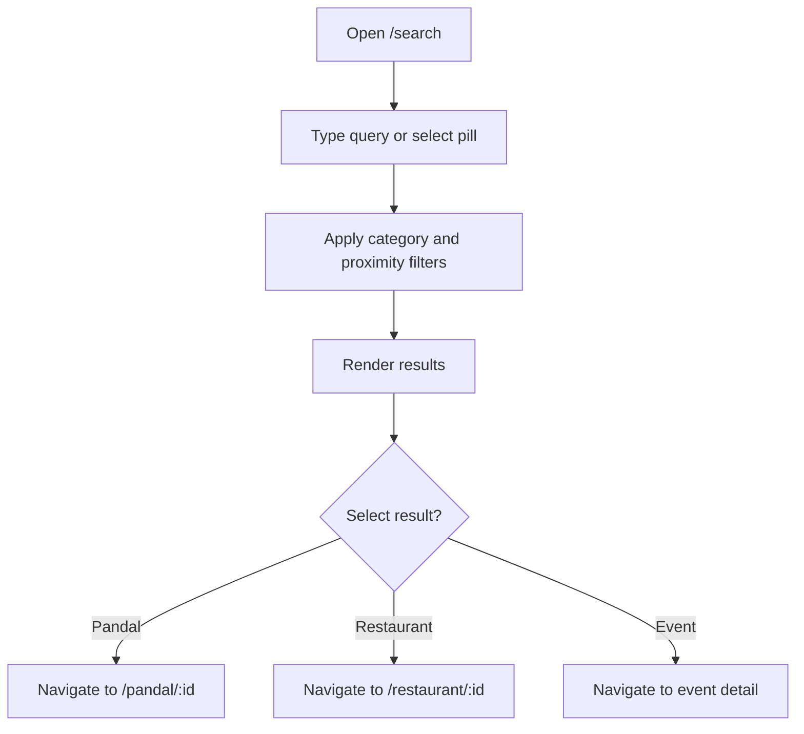

**Diagram sources**
- [Pujo_Sahayak_Master_Project_Context.md:447-493](file://Pujo_Sahayak_Master_Project_Context.md#L447-L493)
- [plan.md:19-39](file://tasks/plan.md#L19-L39)

**Section sources**
- [Pujo_Sahayak_Master_Project_Context.md:447-493](file://Pujo_Sahayak_Master_Project_Context.md#L447-L493)

#### Categories
Categories is a structured discovery hub grouping Places, Transport & Services, and Utilities. It also provides a prominent “Ask Maya” call-to-action.

Navigation responsibilities:
- Organize discovery by domain.
- Provide quick access to related lists and detail pages.
- Bridge to Maya for contextual help.

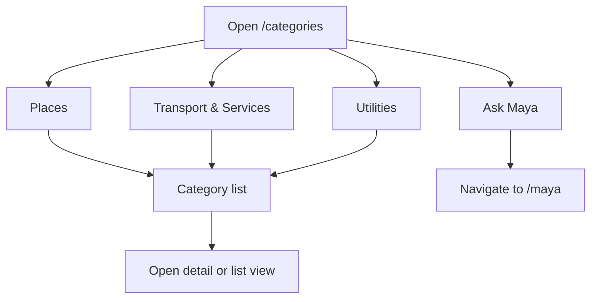

**Diagram sources**
- [Pujo_Sahayak_Master_Project_Context.md:495-556](file://Pujo_Sahayak_Master_Project_Context.md#L495-L556)
- [Pujo_Sahayak_Master_Project_Context.md:558-576](file://Pujo_Sahayak_Master_Project_Context.md#L558-L576)

**Section sources**
- [Pujo_Sahayak_Master_Project_Context.md:495-556](file://Pujo_Sahayak_Master_Project_Context.md#L495-L556)
- [Pujo_Sahayak_Master_Project_Context.md:558-576](file://Pujo_Sahayak_Master_Project_Context.md#L558-L576)

#### Meets
Meets enables discovering existing meetups and creating new ones. It connects individual place exploration with community activities.

Navigation responsibilities:
- Show existing meetups with date, time, location, participants, and description.
- Allow creation of new meetups with title, schedule, location, interest tags, participant limits, and visibility.
- Connect meetup context back to places and routes.

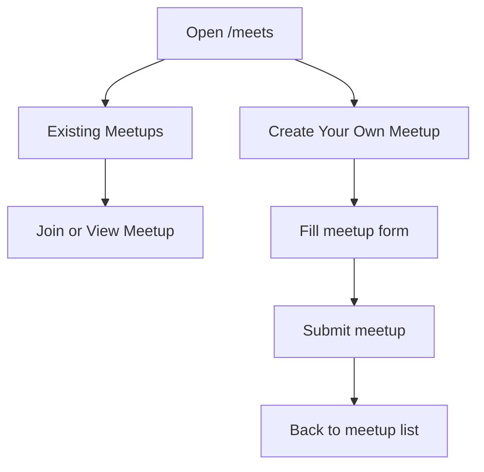

**Diagram sources**
- [Pujo_Sahayak_Master_Project_Context.md:664-772](file://Pujo_Sahayak_Master_Project_Context.md#L664-L772)

**Section sources**
- [Pujo_Sahayak_Master_Project_Context.md:664-772](file://Pujo_Sahayak_Master_Project_Context.md#L664-L772)

### Routing Hierarchy and URL Structure
The planned routing hierarchy uses React Router v6 with five bottom tabs mapped to routes. Detail pages are nested under parameterized routes. Secondary features such as Maya, planner, safety, and trip map have dedicated routes.

| Screen | Route | Notes |
|---|---|---|
| Splash | `/splash` | Entry screen |
| Home | `/` | Main discovery surface |
| Explore / Pandal Directory | `/explore` | List/map toggle with filters |
| Pandal Detail | `/pandal/:id` | Rich detail page |
| Maya chat / scan | `/maya`, `/maya/scan` | Chat and camera identification |
| Puja Planner | `/planner` | Multi-day itinerary |
| Meets list | `/meets` | Discover meetups |
| Create Meetup | `/meets/create` | New meetup form |
| Categories | `/categories` | Structured discovery hub |
| Search | `/search` | Global search and filters |
| Profile | `/profile` | Personal control center |
| Safety / Emergency | `/safety` | Emergency shortcuts and help points |
| Missing Person Report | `/safety/missing-person` | Wizard-style report flow |
| Trip / Route Map | `/trip/:planDayId` | Day-specific route visualization |
| Restaurant Detail | `/restaurant/:id` | Restaurant detail page |
| Settings | `/profile/settings` | Appearance, language, permissions |
| Beyond Puja | `/beyond-puja` | Off-season local discovery |

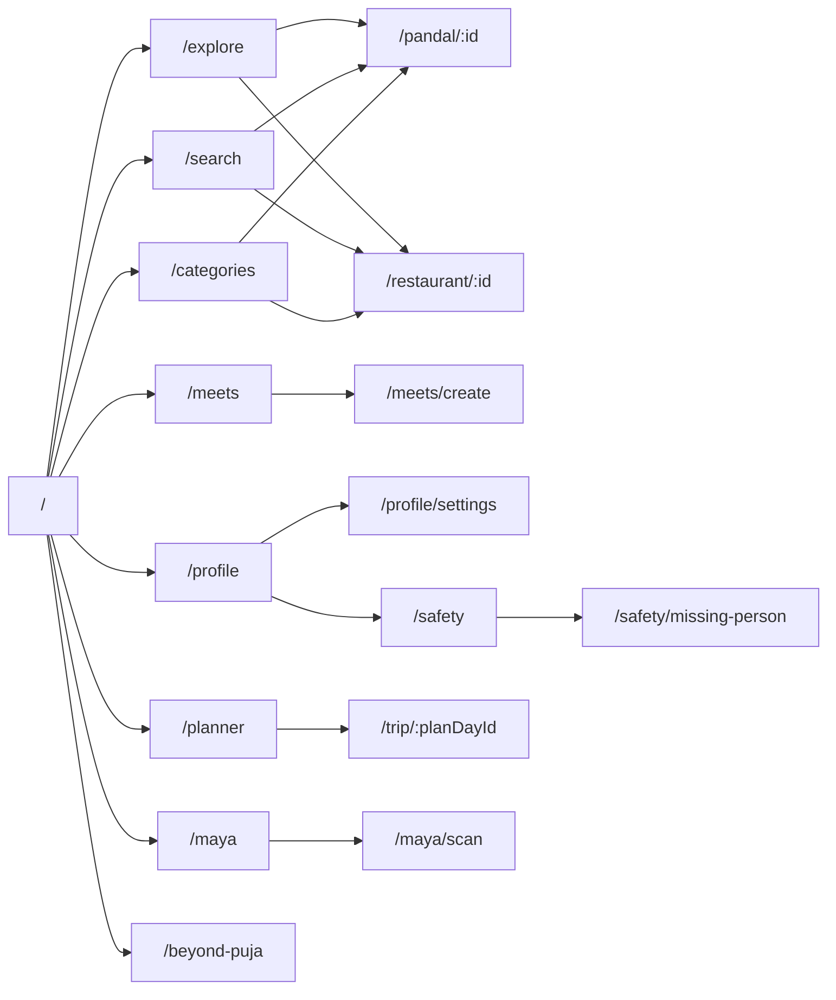

**Diagram sources**
- [plan.md:19-39](file://tasks/plan.md#L19-L39)

**Section sources**
- [plan.md:19-39](file://tasks/plan.md#L19-L39)

### Deep Linking Strategy
Deep linking should allow direct access to specific content such as pandal details, restaurant details, Maya sessions with context, and trip routes. The strategy should support:

- Direct navigation to `/pandal/:id` and `/restaurant/:id`.
- Opening Maya with contextual parameters, such as the current place or category.
- Navigating to `/meets/:meetId` when meetup IDs exist.
- Opening `/trip/:planDayId` for a specific day’s route.
- Preserving navigation state when returning from deep links.

Recommended URL conventions:
- Use lowercase kebab-case for paths.
- Keep IDs short and stable.
- Include query parameters for optional context, such as `?from=home` or `?context=pandal`.
- Validate parameters before rendering detail pages.

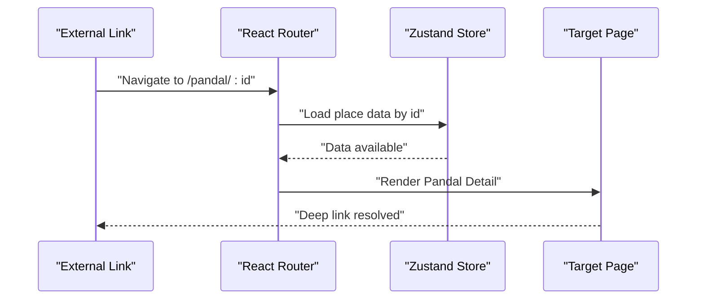

**Diagram sources**
- [plan.md:19-39](file://tasks/plan.md#L19-L39)

**Section sources**
- [plan.md:19-39](file://tasks/plan.md#L19-L39)

### Breadcrumb Navigation and Back Button Behavior
Breadcrumb behavior should reflect the depth of navigation:

- From Home, Search, Categories, or Meets, tapping a card navigates to a detail page.
- From a detail page, the back button returns to the previous screen type:
  - If opened from Search, return to Search with preserved query and filters.
  - If opened from Categories, return to the selected category list.
  - If opened from Meets, return to the meetup list or detail.
  - If opened from Home, return to Home.
- For Maya, the back button should preserve conversation context unless explicitly cleared.
- For Planner and Trip, the back button should return to the planner overview or the previous step in the wizard.

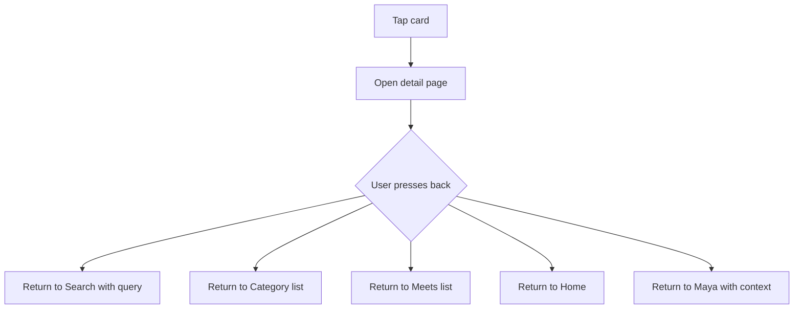

**Diagram sources**
- [Pujo_Sahayak_Master_Project_Context.md:775-952](file://Pujo_Sahayak_Master_Project_Context.md#L775-L952)

**Section sources**
- [Pujo_Sahayak_Master_Project_Context.md:775-952](file://Pujo_Sahayak_Master_Project_Context.md#L775-L952)

### Search Navigation Patterns and Filter Result Flows
Search should provide immediate feedback and consistent filtering:

- Query input triggers live filtering.
- Category pills narrow scope to All, Pandals, Restaurants, Events, Places.
- Trending and nearby sections remain visible even while filtering.
- Selected results navigate to appropriate detail pages.
- Filters and query state persist during navigation and survive reloads via store persistence.

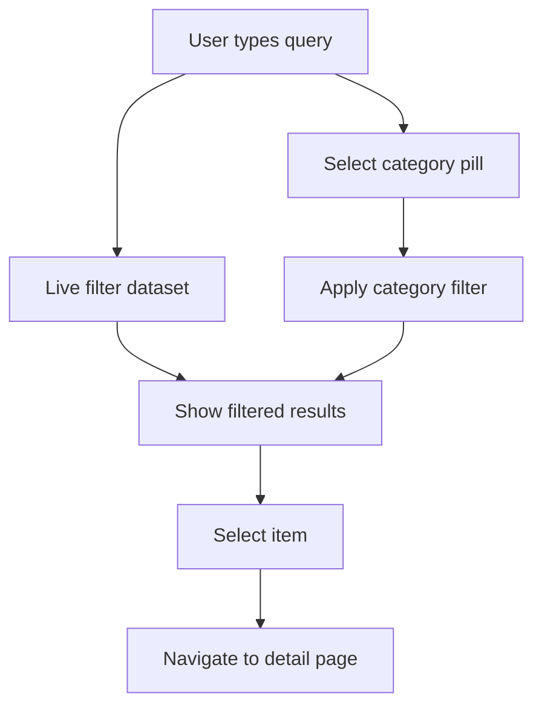

**Diagram sources**
- [Pujo_Sahayak_Master_Project_Context.md:447-493](file://Pujo_Sahayak_Master_Project_Context.md#L447-L493)

**Section sources**
- [Pujo_Sahayak_Master_Project_Context.md:447-493](file://Pujo_Sahayak_Master_Project_Context.md#L447-L493)

### Transition Animations and State Preservation
Transitions should feel energetic but never compromise usability. The motion system includes soft page fades, subtle card scale, animated scan frame, voice waveform, smooth horizontal reveals, and occasional subtle atmospheric effects. Reduced-motion preferences must be honored.

State preservation should cover:
- Saved places, visited places, and planner data.
- Current search query and active filters.
- Last viewed category or section.
- Maya conversation context.
- “Continue where you left off” session.

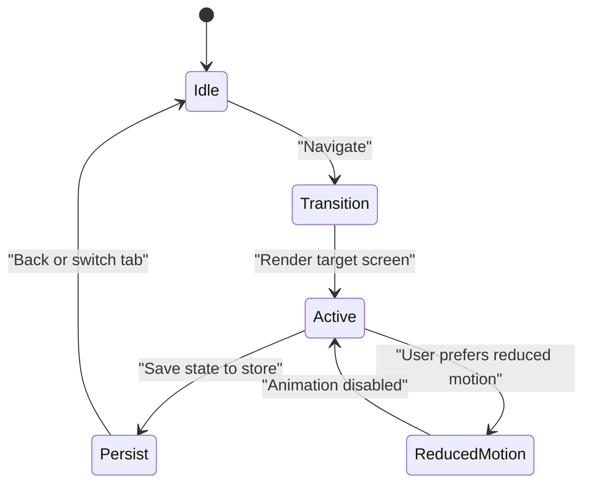

**Diagram sources**
- [plan.md:1-18](file://tasks/plan.md#L1-L18)
- [Pujo_Sahayak_Master_Project_Context.md:1509-1533](file://Pujo_Sahayak_Master_Project_Context.md#L1509-L1533)

**Section sources**
- [plan.md:1-18](file://tasks/plan.md#L1-L18)
- [Pujo_Sahayak_Master_Project_Context.md:1509-1533](file://Pujo_Sahayak_Master_Project_Context.md#L1509-L1533)

### Guidelines for Consistent Navigation Patterns
To maintain consistent navigation across all sections:

- Keep the bottom navigation fixed and clearly labeled.
- Use one primary action per screen to avoid decision overload.
- Always provide a clear back path.
- Preserve user context when navigating between related screens.
- Use consistent card layouts for places, restaurants, events, and meetups.
- Avoid turning Home into an endless feed; keep structured sections.
- Treat AI as a supportive assistant, not the sole navigation driver.
- Ensure accessibility and reduced-motion support.
- Validate deep links and handle missing data gracefully.
- Keep naming aligned with the product: Platform is Pujo Sahayak; Assistant is Maya.

**Section sources**
- [Pujo_Sahayak_Master_Project_Context.md:140-158](file://Pujo_Sahayak_Master_Project_Context.md#L140-L158)
- [Pujo_Sahayak_Master_Project_Context.md:1509-1533](file://Pujo_Sahayak_Master_Project_Context.md#L1509-L1533)
- [Pujo_Sahayak_Master_Project_Context.md:1555-1619](file://Pujo_Sahayak_Master_Project_Context.md#L1555-L1619)
- [Pujo_Sahayak_Master_Project_Context.md:1621-1688](file://Pujo_Sahayak_Master_Project_Context.md#L1621-L1688)
- [Pujo_Sahayak_Master_Project_Context.md:1734-1778](file://Pujo_Sahayak_Master_Project_Context.md#L1734-L1778)
- [Pujo_Sahayak_Master_Project_Context.md:1862-1878](file://Pujo_Sahayak_Master_Project_Context.md#L1862-L1878)

## Dependency Analysis
The navigation layer depends on several architectural decisions:

- React Router manages route definitions and nested detail pages.
- Zustand persists user state across sessions.
- Framer Motion controls transitions and honors reduced-motion settings.
- Leaflet powers map-based navigation and route visualization.
- Tailwind CSS implements the design tokens used across screens.

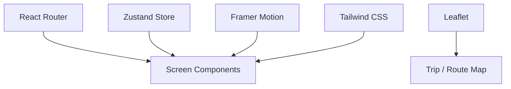

**Diagram sources**
- [plan.md:1-18](file://tasks/plan.md#L1-L18)

**Section sources**
- [plan.md:1-18](file://tasks/plan.md#L1-L18)

## Performance Considerations
- Prefer lightweight transitions; avoid heavy animations on low-end devices.
- Defer non-critical data loading until after initial render.
- Cache frequently accessed place data locally.
- Limit concurrent API calls if backend integration is added later.
- Respect reduced-motion preferences to improve accessibility and performance.
- Keep search filtering efficient by indexing or precomputing common filters.

[No sources needed since this section provides general guidance]

## Troubleshooting Guide
Common navigation issues and resolutions:

- **Deep link fails**: Verify route definition exists and parameter validation passes.
- **Back button loses context**: Ensure previous route state is preserved in the store.
- **Search results empty**: Check query normalization and filter logic.
- **Animations cause jank**: Disable or simplify transitions when reduced motion is enabled.
- **Planner state lost**: Confirm localStorage persistence and store hydration on app start.
- **Map not rendering**: Validate Leaflet initialization and container dimensions.

**Section sources**
- [plan.md:63-86](file://tasks/plan.md#L63-L86)
- [todo.md:77-81](file://tasks/todo.md#L77-L81)

## Conclusion
Puja Sahayak’s navigation architecture centers on a simple five-tab shell with rich detail pages and secondary features. The routing hierarchy maps directly to user goals: discover, explore, understand, plan, visit, share, meet, and return. Deep linking, breadcrumbs, search flows, transitions, and state preservation work together to create a predictable and engaging experience. Maintaining consistent navigation patterns ensures that users can move confidently through the app whether they are exploring pandals during Puja or discovering Kolkata’s local scene year-round.

[No sources needed since this section summarizes without analyzing specific files]

## Appendices

### Final Product Map
The final product map outlines the complete navigation tree, including primary tabs, Maya, detail pages, and profile-related sections.

```mermaid
graph TB
Root["PUJO SAHAYAK"]
Root --> Home["HOME"]
Root --> Favorites["FAVORITES"]
Root --> Search["SEARCH"]
Root --> Categories["CATEGORIES"]
Root --> Meets["MEETS"]
Root --> Maya["MAYA"]
Root --> PandalDetail["PANDAL DETAIL"]
Root --> Profile["PROFILE"]
Home --> HomeSpotlight["Sponsored Spotlight"]
Home --> ExploreSpotlight["Explore Spotlight"]
Home --> HomeRestaurants["Restaurants"]
Home --> Offers["Offers"]
Home --> Shopping["Shopping"]
Home --> Events["Events"]
Home --> LocalExp["Local Experiences"]
Home --> Continue["Continue Where You Left Off"]
Favorites --> Saved["Saved Pandals"]
Favorites --> Visited["Visited Places"]
Favorites --> Recommend["You Might Like"]
Favorites --> Planner["Puja Planner"]
Search --> SearchPandals["Pandals"]
Search --> SearchRestaurants["Restaurants"]
Search --> SearchEvents["Events"]
Search --> Trending["Trending"]
Search --> Nearby["Nearby"]
Categories --> CatPlaces["Pandals, Restaurants, Places"]
Categories --> CatTransport["Metro, Bus, Parking"]
Categories --> CatUtilities["Police, Hospitals, ATMs, Pharmacy"]
Categories --> AskMaya["Ask Maya"]
Meets --> Discover["Discover Meetups"]
Meets --> Create["Create Meetup"]
Meets --> Vibe["Find Your Vibe"]
Maya --> Chat["Chat"]
Maya --> Voice["Voice"]
Maya --> Camera["Camera"]
Maya --> Identify["Pandal Identification"]
Maya --> Explain["Explanation"]
Maya --> Recs["Recommendations"]
Maya --> Plan["Planning"]
PandalDetail --> Hero["Hero"]
PandalDetail --> Info["Current Information"]
PandalDetail --> Past["Past Editions"]
PandalDetail --> Theme["Theme / Story"]
PandalDetail --> Reviews["What Others Say"]
PandalDetail --> TopClicks["Top Clicks"]
PandalDetail --> Photos["User Photos"]
PandalDetail --> Similar["Similar Places"]
PandalDetail --> NearRest["Nearby Restaurants"]
PandalDetail --> NearMeets["Nearby Meetups"]
Profile --> Subscription["Subscription"]
Profile --> Visits["Visits"]
Profile --> Premium["Premium"]
Profile --> Emergency["Emergency"]
Profile --> Payments["Payments"]
Profile --> Donations["Donations"]
Profile --> Personal["Personalization"]
Profile --> Account["Account"]
Profile --> About["About"]
```

**Diagram sources**
- [Pujo_Sahayak_Master_Project_Context.md:1781-1858](file://Pujo_Sahayak_Master_Project_Context.md#L1781-L1858)